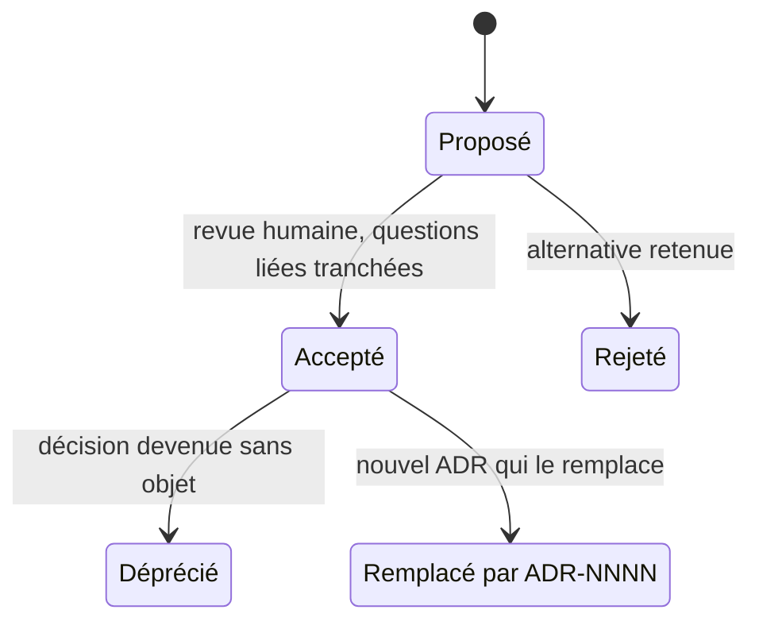
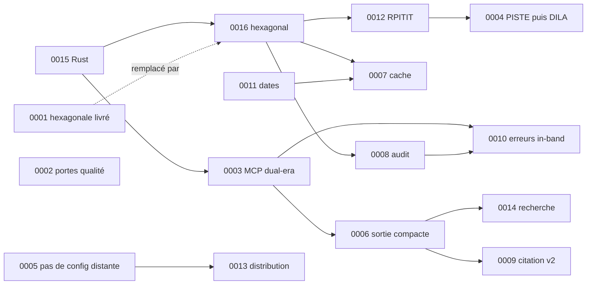

# Décisions d'architecture (ADR) — `mcp-legifrance`

> Index et mode d'emploi des *Architecture Decision Records* du projet `mcp-legifrance`. Il s'agit de la réécriture en Rust, en architecture hexagonale, du serveur MCP Python « fr-eli-mcp » (API Légifrance via PISTE). Les ADR s'adressent à des développeurs, humains ou agents, qui n'ont pas eu accès aux échanges qui ont mené aux décisions.

## 1. Rôle des ADR

- [00-decisions.md](../plan/00-decisions.md) est **normatif**. Il fixe ce qui est décidé : noms, crates, ports, outils, erreurs, protocole, jalons M0 à M9, questions Q1 à Q12. Un ADR dit **pourquoi** : le contexte sourcé, les options écartées et le prix à payer. Il ne contredit jamais 00. Si une source semble justifier un autre choix, l'ADR applique la décision et signale l'écart (section « À surveiller » ou « Alternatives »).
- Les documents du plan ([02-architecture.md](../plan/02-architecture.md) à [09-risques-et-questions.md](../plan/09-risques-et-questions.md), annexes A à D) détaillent la mise en œuvre et renvoient aux ADR par leur numéro (`ADR-00NN`).
- Un ADR est **requis** (06 §13.2, [06-qualite.md](../plan/06-qualite.md)) pour :
  - toute modification d'une décision de 00 ;
  - toute nouvelle dépendance structurante : SDK, TLS, base de données, crate de validation de jetons en M8 ;
  - tout changement de protocole servi ;
  - tout changement de posture de sécurité : mode d'audit, empreinte salée, mode HTTP partagé.

## 2. Cycle de vie



| Statut | Sens | Règle |
|---|---|---|
| **Proposé** | décision rédigée, en attente d'une condition (question Q, spike, mesure) | peut encore être modifié sur le fond ; le code qui l'applique peut exister derrière une configuration par défaut prudente |
| **Accepté** | décision en vigueur | doit être accepté **avant** la fusion du code qui l'applique ; n'est plus modifié sur le fond : on le remplace |
| **Déprécié** | décision sans objet (fonction retirée) | reste dans l'index |
| **Remplacé par ADR-NNNN** | une décision plus récente le remplace | lien dans les deux sens |
| Rejeté | proposition abandonnée | conservé pour mémoire |

Corrections admises sur un ADR accepté : coquilles, liens, ajout d'une référence. Tout le reste passe par un nouvel ADR. Dans la même PR, on coche la case « Décision de 00 ou d'un ADR modifiée ? » du modèle de PR (06 §13.1) et on met à jour 00-decisions.md.

Exception datée : lors de la réconciliation du 2026-10-16 (décisions C1 à C7), les ADR 0003, 0004, 0008, 0009, 0011, 0012, 0015 et 0016 ont été amendés en place (jalons, échéance du spike, MSRV, commentaire de code, contrat de citation, etc. ; amendements de forme ou d'alignement sur le M0-M1 livré), les ADR 0009 et 0011 portant en plus une note datée en tête (les amendements des autres ADR figurent dans leur corps, sans note de tête ; 0015 et 0016 n'ont en tête que leur note de renumérotation), parce que le plan complet fusionné devait être aligné sur le M0-M1 livré et qu'aucun code n'appliquait encore ces décisions amendées. À partir de cette date, la règle ci-dessus s'applique de nouveau sans exception.

## 3. Conventions

- Fichier `docs/adr/NNNN-titre-en-kebab-case.md`, numéro sur 4 chiffres. Les ADR 0001 et 0002 ont été livrés avec M0 ; ce plan crée les ADR 0003 à 0016 (0015 et 0016 sont les ex-0001 et ex-0002 du plan, renumérotés le 2026-10-16) ; la numérotation continue à **0017** et un numéro n'est **jamais** réutilisé (06 §13.2).
- Langue : français ; identifiants techniques tels quels.
- Longueur : 40 à 120 lignes. Un ADR est court ; le détail est dans le plan, vers lequel il renvoie.
- Sources : chaque fait non trivial est sourcé, par exemple (recherche 03 §4), (référence `citations.py:309`), (fixture `consult_juri_cetat.json`) ou une URL. Les défauts de la référence sont cités `D-01…D-47` ([recherche 02](../recherche/02-defauts.md)), les points de parité `P-xxx` et les écarts `E-xx` ([recherche 01](../recherche/01-parite.md)).
- Ce qui n'est pas vérifié est marqué **NON VÉRIFIÉ** et suivi d'une étiquette `[v:…]`. Les étiquettes sont reprises dans le registre V-xx de [09-risques-et-questions.md](../plan/09-risques-et-questions.md).
- Tout extrait de code Rust est « non compilé, à valider au jalon qui l'implémente ».

## 4. Modèle

```markdown
# ADR-00NN — Titre court à l'infinitif ou nominal

- **Statut** : Proposé | Accepté | Déprécié | Remplacé par ADR-NNNN
- **Date** : AAAA-MM-JJ
- **Jalons concernés** : M…
- **Questions liées** : Q…

## Contexte
Faits sourcés (D-xx, P-xxx, E-xx, rapports de recherche, URL), contraintes, ce qui n'est pas vérifié.

## Décision
Ce qui est décidé, sous forme de règles vérifiables ; renvoi à 00-decisions.md et au document du plan qui détaille.

## Conséquences
### Positives
### Négatives
### À surveiller
Points NON VÉRIFIÉS [v:…], mesures à faire, conditions de révision.
### Tests qui la gardent

## Alternatives envisagées
| Option | Raison du rejet |

## Références et sources
Documents du plan, rapports de recherche, référence Python, URL.
```

## 5. Index

| ADR | Titre | Statut | Jalons | Questions | Documents principaux |
|---|---|---|---|---|---|
| [ADR-0001](0001-architecture-hexagonale.md) | Architecture hexagonale en workspace de crates | **Remplacé par ADR-0016** | M0 (livré) | — | [02-architecture](../plan/02-architecture.md) |
| [ADR-0002](0002-portes-qualite.md) | Tests unitaires, couverture et mutation au maximum | Accepté | M0, tous | — | [00-decisions](../plan/00-decisions.md) §10, [06-qualite](../plan/06-qualite.md) |
| [ADR-0003](0003-mcp-2026-07-28-dual-era-rmcp.md) | MCP 2026-07-28 en dual-era avec `rmcp =3.5.1` | Accepté | spike rmcp, M4, M7, M8 | Q7, Q8 | [annexe D](../plan/annexes/D-mcp-2026-07-28.md), [05-outils-mcp](../plan/05-outils-mcp.md) |
| [ADR-0004](0004-piste-puis-dila.md) | PISTE d'abord, DILA ensuite derrière le même port | Accepté | M2, M9 | Q3, Q6 | [04-adapter-piste](../plan/04-adapter-piste.md), [annexe C](../plan/annexes/C-api-legifrance.md) |
| [ADR-0005](0005-pas-de-configuration-distante.md) | Aucune configuration distante ni télémétrie | Accepté | M2, M4 | — | [02-architecture](../plan/02-architecture.md) §8.2, [08-distribution](../plan/08-distribution.md) §1.4 |
| [ADR-0006](0006-sortie-compacte-retour-progressif.md) | Sortie compacte via `structuredContent` et retour progressif | Accepté | M4, M5 | — | [05-outils-mcp](../plan/05-outils-mcp.md) §1, §6 |
| [ADR-0007](0007-cache-memoire-port.md) | Cache mémoire au niveau du port | Accepté | M3, M9 | — | [02-architecture](../plan/02-architecture.md) §7.2 |
| [ADR-0008](0008-audit-decorateur-strict.md) | Audit obligatoire en décorateur, strict par défaut | Accepté | M3, M4 | Q9 | [02-architecture](../plan/02-architecture.md) §7.1, [06-qualite](../plan/06-qualite.md) §11 |
| [ADR-0009](0009-contrat-de-citation-v2.md) | Contrat de citation v2 et corrections typographiques (implémentation : tête de M2) | Accepté | M2, M4 | — | [03-domaine](../plan/03-domaine.md) §5 |
| [ADR-0010](0010-erreurs-in-band.md) | Erreurs métier in-band `[code]` | Accepté | M2, M3, M4 | — | [02-architecture](../plan/02-architecture.md) §9, [05-outils-mcp](../plan/05-outils-mcp.md) §7 |
| [ADR-0011](0011-dates-chrono-paris.md) | Dates : `CivilDate` dans le domaine, chrono hors domaine, Europe/Paris, sentinelles (amendé 2026-10-16) | Accepté | M1 (livré), M2, M3 | — | [03-domaine](../plan/03-domaine.md) §6 |
| [ADR-0012](0012-ports-async-rpitit.md) | Ports en async natif (RPITIT) et génériques | Accepté | spike rmcp, M3, M9 | — | [02-architecture](../plan/02-architecture.md) §5, §10 |
| [ADR-0013](0013-distribution.md) | Distribution : cargo-dist, MCPB, OCI, signature | **Proposé** (Q5, spike TLS en tâche 0 de M2 ; Q1 décidée le 2026-10-16) | M2, M4, transverse dès v0.1.0 | Q1 (décidée), Q2 (décidée), Q5 | [08-distribution](../plan/08-distribution.md) |
| [ADR-0014](0014-recherche-mode-pagination.md) | Recherche : mode par défaut et pagination | **Proposé** (Q10, mesures M5) | M2, M5 | Q10 | [05-outils-mcp](../plan/05-outils-mcp.md) §5.1, [04-adapter-piste](../plan/04-adapter-piste.md) §6 |
| [ADR-0015](0015-reecriture-en-rust.md) | Réécriture en Rust (ex-0001 du plan) | Accepté | M0 → M9 | Q1 (décidée), Q2 (décidée), Q6 | [01-existant](../plan/01-existant.md), [A-parite](../plan/annexes/A-parite.md) |
| [ADR-0016](0016-hexagonal-workspace.md) | Architecture hexagonale en workspace multi-crates (ex-0002 du plan ; remplace ADR-0001) | Accepté | M0 (livré), M3 | — | [02-architecture](../plan/02-architecture.md) |

Prochain numéro libre : **0017**. Un numéro n'est jamais réutilisé : les ex-0001 et ex-0002 du plan ont été renumérotés 0015 et 0016 parce que 0001 et 0002 étaient déjà livrés.

Conditions d'acceptation des ADR proposés :

- [ ] **ADR-0013** : réponse à Q5 (certificat Authenticode chez SSL.com ou Azure Artifact Signing, compte Apple Developer) ; Q1 est décidée le 2026-10-16 (nom `mcp-legifrance`) ; résultat du spike TLS de la tâche 0 de M2 (aws-lc ou ring) consigné dans l'ADR.
- [ ] **ADR-0014** : réponse à Q10 (`any` ou `all`) ; mesures de M5 sur la pagination profonde et sur `typePagination` en page 2.

## 6. Dépendances entre décisions



## 7. Sources

- [00-decisions.md](../plan/00-decisions.md) (normatif), §0 à §13 (le §10 Qualité fonde l'ADR-0002 ; ancien §9 du brouillon livré).
- [06-qualite.md](../plan/06-qualite.md) §13.1 (modèle de PR, revue renforcée) et §13.2 (gabarit, numérotation, règle « accepté avant la fusion »).
- [02-architecture.md](../plan/02-architecture.md) §13 (décisions, alternatives écartées et renvois aux ADR) et §13.1 (divergences entre sources).
- [09-risques-et-questions.md](../plan/09-risques-et-questions.md) (registres R-xx, V-xx, questions Q1 à Q12).
- Rapports de recherche : [README](../recherche/README.md) et rapports 01 à 09.
- Michael Nygard, « Documenting Architecture Decisions » (2011) : https://cognitect.com/blog/2011/11/15/documenting-architecture-decisions — origine du format.
