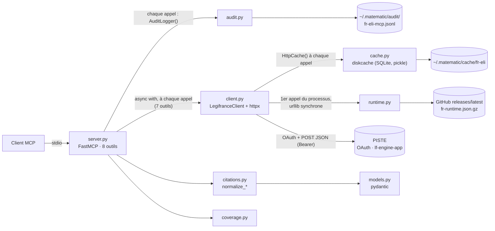

# 01 — L'existant : la référence Python `fr-eli-mcp`, ce qu'on garde, ce qu'on corrige

> **Statut** : plan, sans implémentation. Ce document applique [00-decisions.md](00-decisions.md), qui est normatif et l'emporte en cas de doute.
> **Rôle** : point d'entrée du plan. Il présente la référence Python, vérifie les quatre constats qui ont motivé la réécriture et rattache chacun des 47 défauts de la référence (D-01…D-47) à la partie du plan qui empêche de le reproduire, avec le jalon où il disparaît.
> **Jalons** : tous (M0…M9). La colonne « Où · jalon » des tableaux du §4 et la check-list du §4.16 disent quand chaque défaut cesse d'exister.
> **Lecteurs** : tout développeur, humain ou agent, avant d'ouvrir les autres documents ; tout relecteur qui veut vérifier qu'un défaut connu n'est pas réintroduit. Aucune connaissance des échanges préalables n'est supposée.
> **Conventions** :
> - « La référence Python » désigne `matematicsolutions/fr-eli-mcp@d3b5b13`. Un chemin `fichier:ligne` sans autre précision renvoie à ce dépôt, lu en lecture seule (`src/fr_eli_mcp/` est omis pour les modules Python).
> - Gravités, preuves et mesures viennent de la [recherche 02](../recherche/02-defauts.md). Les points de parité `P-xxx`, les écarts `E-xx` et les scénarios d'erreur `S1…S17` viennent de la [recherche 01](../recherche/01-parite.md).
> - Ce qui n'est pas vérifié est marqué **NON VÉRIFIÉ** avec une étiquette `[v:…]`. Les étiquettes sont recensées au §7 et reprises dans le registre `V-xx` de [09-risques-et-questions.md](09-risques-et-questions.md).
> - Ce document ne contient aucun extrait de code Rust ; les noms de types cités renvoient aux documents qui les définissent. Les ADR cités sont dans [l'index des ADR](../adr/README.md).

Documents liés : [02-architecture.md](02-architecture.md) (crates, ports, décorateurs, erreurs), [03-domaine.md](03-domaine.md) (types, citations, dates, texte), [04-adapter-piste.md](04-adapter-piste.md) (OAuth, HTTP, résilience, DTO), [05-outils-mcp.md](05-outils-mcp.md) (outils, protocole, rendu), [06-qualite.md](06-qualite.md) (tests, CI), [07-feuille-de-route.md](07-feuille-de-route.md) (tâches), [08-distribution.md](08-distribution.md), [09-risques-et-questions.md](09-risques-et-questions.md), [annexes/A-parite.md](annexes/A-parite.md) (parité et divergences), [annexes/C-api-legifrance.md](annexes/C-api-legifrance.md) (API).

---

## Sommaire

0. [Résumé](#0-résumé)
1. [La référence Python en bref](#1-la-référence-python-en-bref)
2. [Ce qu'on garde](#2-ce-quon-garde)
3. [Les quatre constats annoncés et leur vérification](#3-les-quatre-constats-annoncés-et-leur-vérification)
4. [Les 47 défauts et leur traitement](#4-les-47-défauts-et-leur-traitement)
5. [Ce qu'on change volontairement](#5-ce-quon-change-volontairement)
6. [Ce qui reste incertain sur le comportement réel de l'API](#6-ce-qui-reste-incertain-sur-le-comportement-réel-de-lapi)
7. [Points NON VÉRIFIÉS de ce document](#7-points-non-vérifiés-de-ce-document)
8. [Questions ouvertes propres à ce document](#8-questions-ouvertes-propres-à-ce-document)
9. [Sources](#sources)

---

## 0. Résumé

- **La référence Python** (v0.5.3, Apache-2.0, 1 746 lignes de Python) est un serveur MCP stdio en lecture seule. Il expose 8 outils sur 8 fonds de Légifrance à travers l'API PISTE : 7 endpoints `POST` JSON, authentification OAuth2 `client_credentials` (§1).
- **Ce qu'on garde** : la lecture seule, le contrat de citation, la couverture déclarée et appelable, l'audit obligatoire, le verrou des descripteurs, le test de dérive des instructions, les fixtures réelles et les tests live facultatifs. Chacune de ces idées est reprise, et renforcée là où la référence ne la tenait pas (§2).
- **Les quatre constats annoncés** sont confirmés, avec des nuances. Le cache n'est inopérant que pour la *recherche* LODA/CODE. Un 404 HTTP est audité, contrairement aux `invalid_arg` et aux `not_found` issus de la normalisation. Le manifeste distant est téléchargé au premier appel d'outil et non au démarrage, mais aussi quand `FR_ELI_BASE_URL` est défini et quand les identifiants manquent. Le code compte 7 blocs `try/except`, pas 8 (§3).
- **47 défauts** (recherche 02) : 2 bloquants (D-02 audit incomplet, D-04 manifeste distant), 27 majeurs et 18 mineurs, répartis en 14 thèmes. Chacun est rattaché à une section du plan et à un jalon (§4). Pour 13 d'entre eux, le plan applique une mesure différente de celle proposée par la recherche 02, parce que 00 en décide autrement ; le §4.15 les liste avec leur point de réévaluation.
- **Ce qui change pour un client** : `citation` au lieu de `human_readable_citation`, résumé par défaut puis lecture paginée des textes longs, TOC avec sections, préfixe `[code]` réellement en tête, deux codes d'erreur de plus, variables `LF_*`. Chaque changement est une divergence volontaire nommée et testée dans [annexes/A-parite.md](annexes/A-parite.md) §4 (§5).
- **Ce qui reste à vérifier en direct** : réponse à un identifiant inexistant, forme des 404 et 403, quotas, origine du mojibake, présence de `texteHtml`, TOC réelles, pagination profonde, sémantique des modes de recherche (§6). Ces points se lèvent en M2 par `cargo xtask record-fixture` et les smoke tests live, sous réserve d'un compte PISTE (Q3).

---

## 1. La référence Python en bref

### 1.1 Fiche d'identité

| Élément | Valeur | Source |
|---|---|---|
| Dépôt | `matematicsolutions/fr-eli-mcp` (GitHub) | 00 §0 |
| Commit de référence | `d3b5b13`, 2026-09-24, unique commit du clone : « test: lock tool descriptors against silent drift » | `git log` ; recherche 01 (en-tête) |
| Version | 0.5.3 | `pyproject.toml:7`, `server.json:5` |
| Licence | Apache-2.0 (code et fixtures) | `LICENSE`, `CONSTITUTION.md:5` |
| Auteur | Wieslaw Mazur / MateMatic, ligne « eu-legal-mcp » de connecteurs juridiques nationaux | `CONSTITUTION.md` (fin), `README.md` |
| Langage et dépendances | Python ≥ 3.11 (CI en 3.12, Docker en 3.11) ; `fastmcp>=3.4,<4`, `httpx>=0.27,<1`, `pydantic>=2.6`, `diskcache>=5.6`, `anyio>=4.3` ; aucun fichier de verrouillage des dépendances | `pyproject.toml:11, :27-33` ; recherche 01 §1 |
| Taille | 1 746 lignes dans `src/fr_eli_mcp/` (10 fichiers) ; 6 fichiers de tests ; 16 fixtures JSON | `wc -l` ; `ls tests/` |
| Transport MCP | stdio seulement (`mcp.run()`) ; `serverInfo` = `fr-eli-mcp` avec la **version de FastMCP** (E-09) | `server.py:517-519` ; recherche 01 §2.1 |
| Protocole | versions du SDK MCP Python installé : 2024-11-05 à 2025-11-25 avec le SDK 1.26.0. Les versions réellement installées chez les utilisateurs sont **NON VÉRIFIÉES** [v:versions-mcp-reference] | [annexe A §4.9](annexes/A-parite.md) |
| Distribution | PyPI (`uvx fr-eli-mcp`) ; registre MCP `io.github.matematicsolutions/fr-eli-mcp` (registryType `pypi`, sans `environmentVariables`) ; `Dockerfile` `python:3.11-slim` exécuté en root | `server.json:1-22`, `Dockerfile:1-5` ; recherche 01 §12 |
| Amont | API Légifrance `lf-engine-app` derrière PISTE, hôtes **sandbox** par défaut | `client.py:28-29` |

### 1.2 Ce qu'elle fait

Le serveur recherche et consulte le droit français officiel, et renvoie le texte verbatim avec une citation vérifiable (`README.md`). Il est construit par vagues successives :

| Étape | Date | Contenu | Source |
|---|---|---|---|
| v0.1.0 | 2026-06-24 | LODA, CODE, JURI ; endpoints `search`, `lawDecree`, `getArticle`, `juri` sondés en direct sur la sandbox | `DISCOVERY.md:1-33`, `CONSTITUTION.md` |
| Juridictions | 2026-07-07 | CONSTIT et CETAT, servis par le même `/consult/juri` (commit `f90bc25`) | `SOURCES.md` |
| 0.3.0 | 2026-07-08 | CNIL, KALI, ACCO (« feature-003 ») | `SOURCES.md` |
| 0.5.3 | 2026-09-24 | verrou des descripteurs | `git log` |

Les versions intermédiaires ne sont pas documentées : le clone n'a qu'un commit et le `CHANGELOG.md` exigé par la CONSTITUTION n'existe pas (D-43).

Les 8 fonds servis (`server.py:91-100`, recherche 01 §3.1) :

| `fond` utilisateur | Fond API | Préfixe des hits | Filtre ajouté par la référence | Outil de lecture | Corpus |
|---|---|---|---|---|---|
| `LODA` (défaut) | `LODA_DATE` | `LEGITEXT` | `DATE_VERSION`, `singleDate` = instant de l'appel en ms | `fr_get_act`, puis `fr_get_text` | lois, ordonnances, décrets consolidés |
| `CODE` | `CODE_DATE` | `LEGITEXT` du code, extraits `LEGIARTI` | idem | `fr_get_act`, `fr_get_text` | codes |
| `JURI` | `JURI` | `JURITEXT` | — | `fr_get_decision` | Cour de cassation, cours d'appel |
| `CONSTIT` | `CONSTIT` | `CONSTEXT` | — | `fr_get_decision` | Conseil constitutionnel |
| `CETAT` | `CETAT` | `CETATEXT` | — | `fr_get_decision` | Conseil d'État, CAA, TA |
| `CNIL` | `CNIL` | `CNILTEXT` | — | `fr_get_deliberation` | délibérations de la CNIL |
| `KALI` | `KALI` | `KALITEXT` | — | `fr_get_convention`, `fr_get_text` (`KALIARTI`) | conventions collectives |
| `ACCO` | `ACCO` | `ACCOTEXT` | — | `fr_get_company_agreement` | accords d'entreprise |

### 1.3 Les 8 outils

Tous les outils sont `async` et portent les annotations `READ_ONLY` : `readOnlyHint=true`, `idempotentHint=true`, `destructiveHint=false`, `openWorldHint=true` (`server.py:81-86`). Chacun renvoie un modèle pydantic, que FastMCP publie à la fois en `structuredContent` et en `TextContent` JSON, avec un `outputSchema` (recherche 01 §2.3). Les erreurs sont des `ToolError` à 4 codes (`invalid_arg`, `not_found`, `upstream_error`, `config_error`), dont le texte arrive préfixé par `Error calling tool '<nom>': ` (recherche 01 §2.4, E-01).

| Outil | Paramètres (défauts) | Appel PISTE | Sortie | Métrique d'audit | En v0.1 ([05 §5](05-outils-mcp.md)) |
|---|---|---|---|---|---|
| `fr_search` | `query`, `fond="LODA"`, `page_size=10` (1..100) | `POST /search` : `UN_DES_MOTS`, `pageNumber: 1`, `sort: PERTINENCE`, `DATE_VERSION` pour LODA et CODE | `SearchResult {fond, query, total, hits[], eli_note, dataset_note}` | hits de la page | ajoute `page`, `match`, `date_from`/`date_to`, `version_date` ; `has_more` ; extraits pour tous les fonds |
| `fr_get_act` | `text_id` (LEGITEXT), `date` (défaut : date **UTC**) | `POST /consult/lawDecree {textId, date}` | `Act` : métadonnées + `articles[]` aplatis | nombre d'articles | ajoute `toc_offset`, `toc_limit` ; TOC avec sections ; date Europe/Paris |
| `fr_get_text` | `article_id` (LEGIARTI ou KALIARTI) | `POST /consult/getArticle {id}` | `ArticleText` : texte intégral, `byte_size` | octets UTF-8 | ajoute `detail`, `offset`, `max_chars`, `focus`, `passages` |
| `fr_get_decision` | `decision_id` (JURITEXT, CONSTEXT, CETATEXT) | `POST /consult/juri {textId}` | `Decision` : ECLI natif, juridiction, formation, solution, texte | octets UTF-8 | paramètres de lecture communs |
| `fr_get_deliberation` | `deliberation_id` (CNILTEXT) | `POST /consult/cnil {textId}` | `Deliberation` | octets UTF-8 | paramètres de lecture communs |
| `fr_get_convention` | `convention_id` (KALITEXT) | `POST /consult/kaliText {id}` | `Act` (TOC de `KALIARTI`) | nombre d'articles | ajoute `toc_offset`, `toc_limit` |
| `fr_get_company_agreement` | `agreement_id` (ACCOTEXT) | `POST /consult/acco {id}` | `CompanyAgreement` : métadonnées seules, `attachment_note` | 1 | métadonnées seules, inchangé |
| `fr_coverage` | aucun | aucun | `Coverage` : 3 familles, 2 lacunes, `status="ok"` | 2 (lacunes) | couverture calculée, environnement, état de la configuration |

Sources : recherche 01 §3.1 à §3.8 ; `server.py:173-514`. Les métriques d'audit de la v0.1 sont celles de 00 §7.

### 1.4 Architecture

Un module par préoccupation, sans couches ni inversion de dépendance. Chaque outil de `server.py` enchaîne lui-même validation, audit, client HTTP, normalisation et modèle de sortie.

| Module | Lignes | Rôle | Défauts principaux |
|---|---:|---|---|
| `server.py` | 523 | `FastMCP(name="fr-eli-mcp", instructions=INSTRUCTIONS)` (4 470 caractères), `ToolError`, 8 outils, validations, corps `/search`, `_map_upstream` | D-02, D-03, D-07, D-08, D-09, D-19, D-22, D-31, D-32 |
| `citations.py` | 486 | normalisation des réponses (`normalize_*`), URL Légifrance, citations, dates | D-20, D-21, D-23, D-25 à D-30 |
| `client.py` | 208 | `TokenManager` OAuth, `LegifranceClient` (httpx), boucle `_post` (réessais, cache), endpoints | D-06, D-10 à D-14, D-41 |
| `models.py` | 190 | modèles pydantic de sortie, notes `ELI_NOTE` et `DATASET_NOTE` | D-24, D-30, D-33 |
| `audit.py` | 94 | `AuditLogger` JSONL, `hash_input`, `timer` | D-03, D-16, D-17 |
| `runtime.py` | 92 | manifeste distant `fr-runtime.json.gz` | D-04, D-05 |
| `coverage.py` | 77 | familles et lacunes déclarées | D-34 |
| `cache.py` | 57 | `HttpCache` sur `diskcache` | D-01, D-15, D-38 |
| `__main__.py`, `__init__.py` | 15, 4 | `python -m fr_eli_mcp`, version | — |



Gabarit d'un outil de consultation, d'après la recherche 01 §3 (Python simplifié, annoté avec les défauts qu'il produit) :

```python
audit = AuditLogger()                          # mkdir à chaque appel ; OSError possible avant toute validation (S17)
<validations> -> ToolError("invalid_arg")      # levée avant tout audit.log : non auditée (D-02)
with timer() as t:
    try:
        async with LegifranceClient() as c:    # nouveau client httpx + diskcache + manifeste au 1er appel (D-06, D-04)
            raw = await c.<endpoint>(...)
    except Exception as exc:
        audit.log(..., duration_ms=t.duration_ms or 0, status="error")   # __exit__ pas encore exécuté : 0 (D-03)
        raise _map_upstream(exc) from exc      # 404 de toute origine -> not_found (D-10)
norm = citations.normalize_<x>(raw)            # AttributeError possible sur null, hors try (D-23)
if norm is None: raise ToolError("not_found")  # non auditée (D-02)
result = Modèle.model_validate(norm)           # ValidationError possible, hors try (D-24)
audit.log(..., status="ok")                    # durée = appel HTTP seul (D-03)
```

Ce gabarit est répété dans 7 outils (D-07). Toutes les corrections du plan découlent de ce constat : un décorateur d'audit unique au-dessus de l'exécution complète, un client partagé, des erreurs typées, des DTO tolérants ([02 §1.2](02-architecture.md)).

### 1.5 Configuration, état local et outillage

| Sujet | Référence | Source |
|---|---|---|
| Variables lues | `FR_ELI_CLIENT_ID`, `FR_ELI_CLIENT_SECRET` (requis) ; `FR_ELI_OAUTH_URL`, `FR_ELI_BASE_URL` (défauts sandbox) ; `FR_ELI_CACHE_DIR` ; `FR_ELI_AUDIT_DIR` ; `FR_ELI_RUNTIME_URL` (vide = pas de manifeste). `FR_ELI_ENV` figure dans l'exemple mais n'est lu nulle part. | `client.py:42-58`, `runtime.py:22-25`, `.mcp.json.example:6` ; recherche 01 §6.1 |
| État local | cache `~/.matematic/cache/fr-eli` (diskcache, 1 Gio, persistant) ; journal `~/.matematic/audit/fr-eli-mcp.jsonl` ; copie du manifeste dans le répertoire de cache | `cache.py:21-43`, `audit.py:25-47`, `runtime.py:61-66` |
| Tests | `test_parse.py` (normaliseurs sur fixtures), `test_coverage.py`, `test_descriptor_lock.py`, `test_instructions_drift.py`, `test_smoke.py` (live, ignoré sans identifiants), `conftest.py` | recherche 01 §11 |
| CI et release | `ci.yml` : Python 3.12, Linux, `pytest -k "not smoke"` ; `release.yml` : PyPI par jeton, publication du manifeste distant, publication au registre MCP avec `mcp-publisher` « latest » | `.github/workflows/ci.yml:1-36`, `release.yml:1-91` |

---

## 2. Ce qu'on garde

La référence porte des principes justes, souvent mieux énoncés que tenus. Le plan les reprend et ajoute ce qui manquait pour qu'ils soient garantis.

| # | Bonne idée | Dans la référence | Ce que le plan garde | Ce que le plan ajoute | Où · jalon |
|---|---|---|---|---|---|
| 1 | **Lecture seule** | `CONSTITUTION.md` art. 1 ; annotations `READ_ONLY` sur les 8 outils (`server.py:81-86`) ; textes « verbatim from Legifrance » (`server.py:50`) | mêmes annotations ; aucun outil d'écriture ; aucun texte officiel réécrit (P-002) | seules la réparation du mojibake et `text::clean` touchent un texte | 00 §6, [05 §1.4, §5.0](05-outils-mcp.md) · M4 |
| 2 | **Contrat de citation** | art. 4 ; `citations.py:1-24` : citation française, `source_url`, ECLI natif cité tel quel, jamais d'ELI fabriqué | chaque entité citable porte `citation` et `source_url` ; `ecli` seulement natif ; aucun ELI ni ECLI fabriqué (P-039) | contrat garanti par les types, typographie corrigée, `eli_uri` trompeur supprimé (D-27, D-30) | ADR-0009, [03 §5](03-domaine.md) · M1 |
| 3 | **Couverture déclarée et appelable** | `coverage.py:1-10` (« an empty gap list would mean nobody checked ») ; consigne « Absence here is not absence in the law » (`server.py:46`) | `fr_coverage`, une lacune = un repli, liste jamais vide ; même consigne dans les instructions | catalogue complet, environnement et état de la configuration calculés (D-18, D-34) | [03 §4.8](03-domaine.md), [05 §4.1, §5.8](05-outils-mcp.md) · M1, M4 |
| 4 | **Audit obligatoire, échec = erreur** | art. 2 ; `audit.py` (JSONL, `hash_input` canonique) | une ligne JSONL par appel ; mêmes clés de tête, même format de `ts` (`+00:00`), même algorithme d'empreinte (P-040, P-041) ; échec d'écriture ⇒ erreur (mode `strict` par défaut, Q9) | toutes les issues, durée réelle, accusé d'écriture, rotation (D-02, D-03, D-16) | ADR-0008, [02 §3.5, §7.1](02-architecture.md) · M3 |
| 5 | **Verrou des descripteurs** | `tests/test_descriptor_lock.py`, `tests/tools.lock.json` : SHA-256 du JSON canonique, refus d'un verrou vide, liste des outils ajoutés, retirés, modifiés | même JSON canonique (clés triées, séparateurs compacts, UTF-8 brut), recalculable en Python ; même nom de fichier, `tests/tools.lock.json` | lecture du binaire en boîte noire dans les deux ères, instructions et capacités verrouillées, politique SemVer (D-37) | [05 §9](05-outils-mcp.md) · M4 (P-007) |
| 6 | **Test de dérive des instructions** | `tests/test_instructions_drift.py:40-92` : outils cités = outils enregistrés, chaque code documenté | même principe | égalité des ensembles dans les deux sens, paramètres et valeurs d'`enum` cités, taille ≤ 3 500 caractères | [05 §4.3](05-outils-mcp.md) · M4 (P-006) |
| 7 | **Fixtures réelles** | 16 réponses PISTE capturées en sandbox ; `tests/test_parse.py` hors ligne | les 16 fichiers sans modification, avec attribution dans `NOTICE` ; sorties de la référence figées dans [parite-golden.json](annexes/donnees/parite-golden.json) | métadonnées de capture, recaptures brutes, réparation et détection du mojibake (D-35) | [04 §13.3, §13.4](04-adapter-piste.md), [annexe A §5](annexes/A-parite.md) · M2 |
| 8 | **Tests live facultatifs** | `tests/test_smoke.py:26-27` : ignorés sans identifiants ; 9 scénarios bout en bout | mêmes scénarios et assertions (P-060) | `#[ignore]`, profil nextest `live`, sondes « introuvable » | [04 §13.5](04-adapter-piste.md) · M2 |
| 9 | **Jeton OAuth en mémoire seulement** | art. 3 ; `cache.py:1-5` (« OAuth tokens are NEVER stored here ») | jeton jamais écrit sur disque, en cache ni dans un journal (P-026) | `SecretString`, rafraîchissement mono-vol (D-12) | [04 §3.3, §3.6](04-adapter-piste.md) · M2 |
| 10 | **Endpoints sondés en direct** | `DISCOVERY.md` (« Probed live (not trusted from docs) ») : `DATE_VERSION` requis en LODA et CODE, un seul `/consult/juri` pour les trois juridictions | mêmes endpoints, mêmes clés de corps, mêmes constantes (P-020, P-021) | `cargo xtask record-fixture` pour capturer et dater chaque réponse | [04 §6, §7](04-adapter-piste.md) · M2 |
| 11 | **Codes d'erreur courts et stables** | `ToolError` à 4 codes (`server.py:69-78`) ; section « Error iteration » des instructions | les 4 codes et leur sens ; la première phrase des messages `invalid_arg` et `not_found` (P-012, P-013) | `[code]` réellement en tête, `rate_limited` et `audit_error` en plus, messages actionnables (D-08) | ADR-0010, [05 §7](05-outils-mcp.md) · M4 |
| 12 | **Dire ce qu'on n'a pas** | ACCO « metadata only » avec `attachment_note` (`citations.py:480-481`) ; `ecli` laissé `null` pour les CAA et TA | `attachment_note` mot pour mot (P-036) ; champ omis plutôt que fabriqué | lacunes FR-003 et FR-004 de `fr_coverage` | [05 §5.7, §5.8](05-outils-mcp.md) · M2, M4 |

---

## 3. Les quatre constats annoncés et leur vérification

Avant la rédaction du plan, quatre constats sur la référence avaient été annoncés à l'utilisateur pour motiver la réécriture. La recherche 02 §2 les a vérifiés dans le code. Les quatre tiennent, mais trois doivent être reformulés.

### 3.1 Constat a : le cache LODA/CODE

> Annoncé : « Le cache disque ne sert jamais pour LODA/CODE car la clé contient `singleDate=_now_ms()`. »

**Verdict : confirmé pour `fr_search` sur LODA et CODE, infirmé pour la consultation.** La formulation doit être restreinte à la *recherche*.

- Preuve : `_now_ms()` renvoie `int(time.time() * 1000)` (`server.py:129-130`) ; pour `LODA_DATE` et `CODE_DATE`, le corps reçoit `{"facette": "DATE_VERSION", "singleDate": _now_ms()}` (`server.py:135-136`) ; la clé de cache est le corps JSON entier (`client.py:144-147`), lue en `:151-154` et écrite en `:171` avec un TTL d'une heure (`cache.py:16`). Deux recherches identiques n'ont donc jamais la même clé.
- Aggravation : chaque recherche LODA/CODE **écrit** quand même une entrée de 3 à 40 Ko qui ne sera jamais relue, dans un cache plafonné à 1 Gio (`diskcache/core.py:52`) ; pur coût d'écriture disque.
- Nuances : `fr_get_act` envoie `{"textId", "date": "AAAA-MM-JJ"}`, clé stable sur la journée UTC (`client.py:190-193`) ; `fr_get_text` envoie `{"id"}`, clé stable (`client.py:195-196`) ; les recherches JURI, CONSTIT, CETAT, CNIL, KALI et ACCO n'ont pas de filtre daté et sont bien mises en cache une heure (`server.py:134-136`).
- Défauts : **D-01**, et D-15 pour les autres faiblesses du cache.
- Réponse du plan : la clé est construite sur l'objet du domaine `SearchQuery`, dont la `VersionDate` est au jour près (défaut : aujourd'hui à Paris). L'adapter recalcule `singleDate` à minuit Europe/Paris de cette date, hors de la clé ([02 §7.2](02-architecture.md), [04 §6.3](04-adapter-piste.md), 00 §8 et §9). Que minuit Paris ne sélectionne pas la version de la veille est **NON VÉRIFIÉ** [v:singledate-minuit-paris]. Jalons M2 et M3.

### 3.2 Constat b : les trous de l'audit

> Annoncé : « L'audit n'enregistre pas `invalid_arg` / `not_found`, et les erreurs upstream sont loggées avec `duration_ms=0`. »

**Verdict : confirmé, avec deux précisions.** Un `not_found` dû à un HTTP 404 *est* journalisé, dans le `except` ; seul le `not_found` issu de la normalisation (`norm is None`) ne l'est pas. Les échecs de parsing et de validation (pydantic, `AttributeError`) ne le sont pas non plus.

- Exigence violée : « Every tool call MUST append one JSON line … Inability to write = the tool returns an error » (`CONSTITUTION.md:25-27`) ; promesse faite au modèle : « every tool call appends to `~/.matematic/audit/fr-eli-mcp.jsonl` » (`server.py:51`). Le module se présente comme « JSONL audit logger for AI Act art. 12 » (`audit.py:1`).
- `invalid_arg` levé **avant** tout `audit.log` : `server.py:191-197` (`fr_search`), `:242` (`fr_get_act`, via `_require_prefix` défini en `:159-165`), `:282-289`, `:336-342`, `:383`, `:425`, `:495`.
- `not_found` de normalisation levé avant `audit.log` : `server.py:256-258` puis log en `:260`, et de même dans les cinq autres consultations ; `Act.model_validate(norm)` (`:259`) hors `try`.
- `duration_ms=0` : `self.duration_ms = 0` à l'initialisation (`audit.py:81-83`), valeur calculée seulement dans `__exit__` (`audit.py:89-90`) ; or `audit.log(... duration_ms=t.duration_ms or 0 ...)` est appelé **dans** le bloc `with timer()` (`server.py:203-211`, et 6 autres occurrences). En succès, le chronomètre n'englobe que l'appel HTTP, pas la normalisation.
- Aggravation : si `audit.log` échoue dans la branche d'erreur, l'`OSError` remplace l'erreur d'origine (`server.py:208-211`). Le seul test d'audit couvre le chemin heureux de `fr_coverage` (`tests/test_coverage.py:62-78`).
- Bilan des scénarios de la recherche 01 §2.6 : S1 à S5 (validation) et S15 (réponse vide) ne laissent aucune ligne ; S6 à S14 (erreurs amont) laissent une ligne avec `duration_ms: 0` ; S17 (répertoire d'audit inutilisable) échoue avant toute validation.
- Défauts : **D-02** (bloquant), **D-03** ; cause racine D-07.
- Réponse du plan : un seul décorateur `Audited` dans `lf-application`, posé sur l'exécution complète : décodage des arguments, validation, appels au port, politique de lecture. Il écrit une ligne pour chaque issue, avec une durée mesurée par une horloge monotone ([02 §5.4, §7.1](02-architecture.md), ADR-0008). Les arguments sont reçus bruts (`JsonObject`) et décodés à l'intérieur de l'exécution auditée ; que cette approche compile avec rmcp 3.5.1 est **NON VÉRIFIÉ** [v:rmcp-jsonobject-input-schema] (spike M0). Jalons M3 et M4.

### 3.3 Constat c : le manifeste distant

> Annoncé : « `runtime.py` télécharge au démarrage un manifeste distant qui peut changer `base_url`, vers lequel le Bearer token est envoyé (+ métrique d'activation) — contradiction avec CONSTITUTION art. 3. »

**Verdict : confirmé sur le fond, avec une correction et deux aggravations.**

- **Correction** : le téléchargement n'a pas lieu au démarrage, mais au **premier appel d'un outil qui construit un `LegifranceClient`**, c'est-à-dire tous sauf `fr_coverage`, une fois par processus (mémo global `_runtime`, `runtime.py:30`, `:72-82`).
- **Aggravation 1** : il a lieu **même quand `FR_ELI_BASE_URL` est défini**, car l'argument par défaut d'`os.environ.get` est évalué avant l'appel (`client.py:46-47`). Seul `FR_ELI_RUNTIME_URL=""` le désactive (`runtime.py:10`, `:52-53`). La redirection, elle, ne joue que si `FR_ELI_BASE_URL` n'est pas défini.
- **Aggravation 2** : il a lieu **même sans identifiants**, car le constructeur évalue l'URL de base (`client.py:126`) avant de chercher les identifiants (`client.py:128`).

```mermaid
flowchart LR
  A["1er appel d'outil<br/>(sauf fr_coverage)"] --> B["LegifranceClient.__init__<br/>client.py:126"]
  B --> C["_env_base_url()<br/>défaut évalué même si FR_ELI_BASE_URL est défini<br/>client.py:46-47"]
  C --> D["get_runtime() : urllib synchrone, 15 s<br/>gunzip sans borne<br/>runtime.py:55-58"]
  D --> E[("GitHub releases/latest<br/>fr-runtime.json.gz")]
  E --> F["base_urls.eli accepté sans contrôle<br/>d'hôte ni de schéma<br/>runtime.py:85-92"]
  F -- "si FR_ELI_BASE_URL absent" --> G["url = base_url + path<br/>client.py:150"]
  G --> H["Authorization: Bearer …<br/>client.py:161-163"]
  H --> I[("hôte désigné<br/>par le manifeste")]
```



- Absence d'intégrité : le workflow publie un `.sha256` (`release.yml:58-59`, `:68`) que le client ne télécharge ni ne vérifie ; le manifeste est copié sur disque (`runtime.py:61-66`) et resservi hors ligne (`:78-80`).
- Télémétrie : « The unlinked asset's download_count is a clean per-connector activation metric » (`runtime.py:7-8`) ; « Unlinked URL -> download_count = real activation » (`release.yml:46`).
- Contradictions : « no … commercial telemetry. The server talks only to the PISTE OAuth + Legifrance endpoints and the local filesystem » (`CONSTITUTION.md:31-32`) ; « sends nothing beyond the search query / document id » (`CONSTITUTION.md:18-19`).
- Portée exacte : l'URL OAuth n'est **pas** pilotée par le manifeste (`client.py:42-43`), donc le `client_secret` n'est pas redirigé. Sont exposés le jeton Bearer (valable 3 600 s en sandbox, `DISCOVERY.md:12`), toutes les requêtes (ce que cherche le juriste) et surtout **l'intégrité des textes** : un hôte malveillant peut servir de faux articles présentés comme « verbatim from Legifrance » (`server.py:50`). L'URL vise `releases/latest` (`runtime.py:24`) : une release compromise redirige toutes les installations, anciennes versions comprises. Le champ `citation_grammar_version` du manifeste n'est lu nulle part.
- Défauts : **D-04** (bloquant), **D-05** (boucle bloquée jusqu'à 15 s) ; liés : D-39, D-41, D-44.
- Réponse du plan : aucune configuration distante ni télémétrie (ADR-0005, 00 §1). Les URLs viennent de `LF_PISTE_ENV` et de surcharges locales validées ; le démarrage ne fait aucun appel réseau ; aucune redirection n'est suivie ; aucune URL lue dans une réponse n'est appelée ([02 §8.2](02-architecture.md), [04 §2.3, §14.3](04-adapter-piste.md)). Jalons M2 et M4.

### 3.4 Constat d : la structure du code

> Annoncé : « Client HTTP + cache disque recréés à chaque appel, try/except d'audit dupliqué 8 fois, erreurs en chaînes "[code] …", pas de pagination (`pageNumber=1` figé). »

**Verdict : confirmé, avec une correction de compte.**

- Recréation : `async with LegifranceClient() as client:` dans 7 outils (`server.py:205, 248, 294, 347, 388, 430, 500`). Le constructeur ouvre un `HttpCache()` (`client.py:127` → `cache.py:31-34` : `mkdir` puis ouverture SQLite) et un `httpx.AsyncClient` (`client.py:129-132`) fermé en fin d'appel (`client.py:140-142`) : une nouvelle connexion TCP et TLS par appel d'outil. Seul le `TokenManager` est partagé (`_TOKEN_MANAGERS`, `client.py:103-114`) : le jeton, lui, est réutilisé.
- Duplication : **7** blocs `try/except Exception` et non 8, car `fr_coverage` n'en a pas (`server.py:207, 250, 296, 349, 390, 432, 502`) ; **8** instanciations `audit = _audit()` ; **15** appels `audit.log(`.
- Erreurs en chaînes : `class ToolError(Exception)` avec le message `f"[{code}] {message}"` (`server.py:69-78`) ; FastMCP la traite comme une exception quelconque : trace `ERROR` dans ses journaux et texte préfixé par `Error calling tool '<nom>': ` (recherche 01 §2.4).
- Pagination : `"pageNumber": 1` (`server.py:150`), `"sort": "PERTINENCE"` (`:153`), `"typePagination": "DEFAUT"` (`:154`) ; aucun paramètre de page dans la signature (`server.py:174`).
- Défauts : **D-06**, **D-07**, **D-08**, **D-09**.
- Réponse du plan : un `reqwest::Client` unique ([04 §4.2](04-adapter-piste.md)) ; décorateurs posés une fois ([02 §7](02-architecture.md)) ; `AppError` typé rendu en `[code] message` ([05 §7](05-outils-mcp.md), ADR-0010) ; `page` et `has_more` ([05 §5.1](05-outils-mcp.md), ADR-0014). Jalons M2 à M5.

### 3.5 Synthèse

| # | Constat annoncé | Verdict | Nuance à retenir | Défauts | Corrigé en |
|---|---|---|---|---|---|
| a | Cache LODA/CODE jamais utilisé | confirmé pour `fr_search` | faux pour `fr_get_act` et `fr_get_text` | D-01 (+ D-15) | M2, M3 |
| b | Audit sans `invalid_arg` ni `not_found`, `duration_ms=0` | confirmé | un 404 HTTP est audité ; les erreurs de parsing ne le sont pas | D-02, D-03 (+ D-07) | M3, M4 |
| c | Manifeste distant au démarrage, Bearer redirigeable, télémétrie | confirmé sur le fond | au premier appel d'outil ; même avec `FR_ELI_BASE_URL` ; même sans identifiants | D-04, D-05 (+ D-39, D-41, D-44) | M2, M4 |
| d | Client et cache recréés, `try/except` × 8, erreurs en chaînes, `pageNumber=1` | confirmé | 7 `try/except`, 8 instanciations d'audit, 15 `audit.log` | D-06, D-07, D-08, D-09 | M2 à M5 |

---

## 4. Les 47 défauts et leur traitement

### 4.0 Lecture des tableaux

- **Gravité** (recherche 02 §0) : **bloquant** = viole la CONSTITUTION de la référence ou l'intégrité des textes juridiques, ou rend fausse une fonction centrale ; **majeur** = erreur fonctionnelle, de performance ou de conception à fort impact ; **mineur** = défaut localisé ou cas limite.
- **Défaut et preuve** : résumé et preuve courte. Le détail, avec toutes les lignes et les démonstrations, est dans la recherche 02 §3.
- **Réponse du plan** : ce qui empêche le défaut de se reproduire. Le symbole ✱ signale une réponse qui diffère de la mesure proposée par la recherche 02 ; le §4.15 explique chaque écart.
- **Où · jalon** : document et section du plan, ADR, puis jalon(s) de 00 §11.
- **Tests** : noms des tests de non-régression. Ils viennent du document du plan cité quand il les nomme, sinon de la matrice de la recherche 02 §6. [06-qualite.md](06-qualite.md) fait foi pour les noms définitifs.
- La recherche 02 a été écrite avant 00 et emploie d'autres noms. Correspondance :

| Recherche 02 | Nom normatif (00) |
|---|---|
| `domain`, `application`, `adapter-legifrance`, `adapter-audit`, `adapter-mcp`, `app` | `lf-domain`, `lf-application`, `lf-adapter-piste`, `lf-adapter-audit`, `lf-adapter-mcp`, `lf-app` (plus `lf-adapter-cache`) |
| `LegalSource`, `CachedLegalSource`, port `CacheStore` | `LegalCorpus`, `CachedCorpus` (pas de port de cache) |
| `AuditedUseCase` | `Audited` |
| `LegifranceError`, `UpstreamError::InvalidResponse` | `CorpusError` (`Auth`, `Config`, `Decode`, …) |
| `LegalDate` | `chrono::NaiveDate` + `date::open_ended` (sentinelles ⇒ `None`) |
| `LEGIFRANCE_ENV`, `LEGIFRANCE_RPS` | `LF_PISTE_ENV` ; quota dans `PisteConfig` |
| `human_readable_citation`, `official_title` | `citation`, `title` |
| codes `timeout`, `invalid_response` | `upstream_error` |

Répartition par thème et gravité :

| Thème (section) | Défauts | Bloquant | Majeur | Mineur |
|---|---|---:|---:|---:|
| Cache (§4.1) | D-01, D-15 | 0 | 2 | 0 |
| Audit (§4.2) | D-02, D-03, D-16, D-17 | 1 | 1 | 2 |
| Configuration distante et environnement (§4.3) | D-04, D-05, D-18, D-39 | 1 | 2 | 1 |
| Client HTTP, OAuth et résilience (§4.4) | D-10 à D-14 | 0 | 5 | 0 |
| Erreurs et diagnostics (§4.5) | D-07, D-08, D-46 | 0 | 2 | 1 |
| Normalisation et dates (§4.6) | D-19 à D-26 | 0 | 4 | 4 |
| Citations, URL et identifiants (§4.7) | D-27 à D-31, D-47 | 0 | 2 | 4 |
| Recherche (§4.8) | D-09, D-32 | 0 | 2 | 0 |
| Taille des réponses (§4.9) | D-33 | 0 | 1 | 0 |
| Couverture et provenance (§4.10) | D-34, D-45 | 0 | 1 | 1 |
| Tests et fixtures (§4.11) | D-35, D-36, D-37 | 0 | 2 | 1 |
| Performance (§4.12) | D-06, D-38 | 0 | 2 | 0 |
| Sécurité (§4.13) | D-40, D-41, D-44 | 0 | 0 | 3 |
| Documentation (§4.14) | D-42, D-43 | 0 | 1 | 1 |
| **Total** | **47** | **2** | **27** | **18** |

D-38 est compté majeur, comme dans la recherche 02 ; il n'est que mineur tant que le serveur reste en stdio mono-utilisateur.

### 4.1 Cache

| ID | Gravité | Défaut et preuve | Réponse du plan | Où · jalon | Tests |
|---|---|---|---|---|---|
| D-01 | majeur | **Cache jamais relu pour `fr_search` LODA/CODE** : la clé est le corps JSON entier, qui contient `singleDate = _now_ms()` (`server.py:129-136`, `client.py:144-147`). Détail au §3.1. | Clé de domaine `CacheKey { env, Op::Search(SearchQuery) }` ; `VersionDate` au jour près, aujourd'hui à Paris par défaut ; `singleDate` recalculé par l'adapter à minuit Europe/Paris, hors de la clé ; la clé change à minuit heure de Paris. **NON VÉRIFIÉ** [v:singledate-minuit-paris]. | [02 §7.2](02-architecture.md), [04 §6.3](04-adapter-piste.md), 00 §8-§9, ADR-0007 · M2, M3 | `second_identical_loda_search_hits_cache`, `cache_key_changes_when_paris_day_changes` |
| D-15 | majeur | **Cache mal isolé et fragile** : clé sans environnement ni hôte (`client.py:144-147`) ; réponses 200 vides mises en cache, d'où un « introuvable » qui persiste 24 h (`client.py:169-171`) ; un échec d'écriture diskcache fait échouer l'outil (`client.py:171`, `:173-180`) ; valeurs sérialisées en pickle (`diskcache/core.py:221, :282-284`) ; requêtes stockées en clair alors que l'audit ne garde qu'un hash. | Cache `moka` **en mémoire seulement** : ni disque, ni pickle, aucune écriture faillible ; clé préfixée par l'environnement ; erreurs et réponses vides jamais mises en cache ; capacité bornée en octets ; requêtes identiques coalescées. ✱ | [02 §3.4, §7.2](02-architecture.md), 00 §9, ADR-0007 · M3 | `cache_namespaced_by_env`, `errors_and_empty_results_are_not_cached`, `concurrent_identical_calls_coalesce` |

### 4.2 Audit

| ID | Gravité | Défaut et preuve | Réponse du plan | Où · jalon | Tests |
|---|---|---|---|---|---|
| D-02 | **bloquant** | **Audit incomplet**, contraire à `CONSTITUTION.md:25-27` : `invalid_arg` levés avant tout `audit.log` (`server.py:191-197`, `:242`…) ; `not_found` de normalisation aussi (`:256-258`) ; validation pydantic hors `try` (`:259`) ; un échec d'audit dans la branche d'erreur remplace l'erreur d'origine (`:208-211`). Détail au §3.2. | Décorateur unique `Audited` autour de l'exécution complète : décodage des arguments (reçus en `JsonObject`), validation, port, rendu. Une ligne par issue, annulation et délai dépassé compris. Mode `strict` par défaut (Q9) : un échec d'écriture donne `[audit_error]`, qui cite le code d'origine. **NON VÉRIFIÉ** [v:rmcp-jsonobject-input-schema]. | [02 §5.4, §7.1](02-architecture.md), [05 §3.3](05-outils-mcp.md), ADR-0008 · M3, M4 | `audit_written_for_every_outcome`, `undecodable_arguments_are_audited_invalid_arg`, `audit_failure_returns_audit_error` |
| D-03 | majeur | **`duration_ms` faux** : toujours 0 en erreur, car `audit.log` est appelé dans le `with timer()` avant `__exit__` (`audit.py:81-90`, `server.py:203-211`) ; en succès, la durée exclut normalisation et validation. | `tokio::time::Instant` pris à l'entrée d'`Audited::run` ; durée calculée à la sortie pour toutes les issues, normalisation comprise. | [02 §7.1](02-architecture.md) · M3 | `error_duration_is_nonzero` |
| D-16 | mineur | **Journal peu durable** : ouverture en ajout à chaque ligne, ni `fsync`, ni rotation, ni verrou entre processus (`audit.py:73-75`) ; `mkdir` à chaque appel (`audit.py:44-47`). | Fil d'écriture dédié, canal borné, accusé `oneshot` : le cas d'usage attend l'écriture. `write_all` puis `sync_data` ; verrou consultatif `fs4` ; rotation à 16 Mio ou au changement de date UTC. Atomicité entre processus, surtout sous Windows : **NON VÉRIFIÉ** [v:audit-multi-processus]. | [02 §3.5, §5.2](02-architecture.md) · M3 | `concurrent_writers_produce_valid_jsonl`, `audit_write_is_acknowledged_before_tool_returns` |
| D-17 | mineur | **Enregistrement pauvre** : SHA-256 non salé, donc réversible par énumération pour une entrée courte (`audit.py:35-38`) ; ni code d'erreur, ni version, ni environnement, ni identifiant de requête (`audit.py:63-70`). | Clés de tête inchangées, puis `error_code`, `env`, `server_version` (00 §7) ; empreinte SHA-256 conservée pour la parité (P-041) ; `request_id` dans `tracing` seulement. ✱ Le salage n'est pas retenu en v0.1 : risque résiduel assumé. | [02 §3.5, §13.1](02-architecture.md), [annexe A §4.8](annexes/A-parite.md) · M3 | `audit_record_schema_snapshot`, `input_hash_reference_vectors` |

### 4.3 Configuration distante et environnement

| ID | Gravité | Défaut et preuve | Réponse du plan | Où · jalon | Tests |
|---|---|---|---|---|---|
| D-04 | **bloquant** | **Manifeste distant** `releases/latest/download/fr-runtime.json.gz` (`runtime.py:22-25`) qui fixe l'URL de base sans contrôle d'hôte (`runtime.py:85-92`), vers laquelle part le Bearer (`client.py:150`, `:161-163`) ; aucune vérification d'intégrité ; télémétrie d'activation (`runtime.py:7-8`) ; contraire à `CONSTITUTION.md:31-32`. Détail au §3.3. | Aucune configuration distante ni télémétrie (ADR-0005). URLs = `LF_PISTE_ENV` + surcharges locales `LF_PISTE_OAUTH_URL`, `LF_PISTE_BASE_URL` validées (`https`, ni userinfo, ni requête, ni fragment) ; hôte hors `*.piste.gouv.fr` ⇒ `warn!`, lacune FR-103 et mention dans `check-config` ; aucune redirection suivie ; aucune URL d'une réponse n'est appelée. ✱ | [02 §8.2](02-architecture.md), [04 §2.3, §14.3](04-adapter-piste.md), [05 §5.8](05-outils-mcp.md), ADR-0005 · M2, M4 | `no_network_at_startup`, tests de configuration (04 §13.6) |
| D-05 | majeur | **E/S bloquante dans la boucle asyncio** : `urllib.request.urlopen` synchrone (15 s) appelé depuis le constructeur du client, dans une coroutine d'outil (`runtime.py:55-57`, `client.py:126`) ; tout le serveur, `ping` compris, attend. | Disparaît avec D-04. Règle générale : aucune E/S bloquante dans une tâche tokio ; démarrage sans appel réseau (00 §6). | [02 §1.2, §10](02-architecture.md) · M4 | `server_answers_ping_while_tool_waits_upstream` |
| D-18 | majeur | **Sandbox par défaut, sans le dire** : URLs sandbox par défaut (`client.py:28-29`) ; `fr_coverage` répond `status="ok"` et `live=True` sans nommer l'environnement (`coverage.py:73-75`) ; la sandbox n'a aucun engagement de service et ses données diffèrent de la production (recherche 05 §3.2). | `LF_PISTE_ENV=sandbox\|production`, défaut `sandbox` (00 §1) ; `fr_coverage.environment` et lacune dynamique FR-101 ; rappel `info` au démarrage ; `env` dans chaque ligne d'audit. ✱ Ampleur de l'écart de données : **NON VÉRIFIÉ** [v:sandbox-prod-donnees]. | [04 §2.1](04-adapter-piste.md), [05 §5.8](05-outils-mcp.md), [02 §11.1](02-architecture.md) · M2, M4 | snapshot `coverage_v01_sandbox`, `coverage_degraded_without_credentials` |
| D-39 | mineur | **Ordre de construction** : le constructeur du client déclenche le manifeste et ouvre SQLite avant de vérifier les identifiants (`client.py:126-128`) ; la connexion diskcache reste ouverte à chaque appel sans identifiants. | Dépendances construites une fois par `lf-app`, sans E/S ; identifiants absents ⇒ `[config_error]` immédiat, sans réseau ni disque ; mode dégradé plutôt que refus de démarrer. | [02 §8.2, §8.4](02-architecture.md), [04 §2.4](04-adapter-piste.md) · M2, M4 | `missing_credentials_makes_no_network_call` |

### 4.4 Client HTTP, OAuth et résilience

| ID | Gravité | Défaut et preuve | Réponse du plan | Où · jalon | Tests |
|---|---|---|---|---|---|
| D-10 | majeur | **Erreurs OAuth et 404 mal classées** : un 400 ou 401 de l'endpoint token devient `upstream_error`, et les instructions disent de réessayer (`client.py:87`, `server.py:58`, `:113-119`) ; **tout** 404, y compris d'OAuth ou de routage, devient `not_found` « Legifrance returned 404 for that resource » (`server.py:114-115`) ; `expires_in: null` ⇒ `TypeError` (`client.py:93`). | OAuth 400/401, et 401 de l'API après un renouvellement ⇒ `config_error` ; OAuth 404 et 404 de routage ⇒ `config_error`, jamais `not_found` (00 §5) ; `not_found` réservé à une ressource désignée absente ; `expires_in` absent ou nul ⇒ défaut borné. Formes réelles : **NON VÉRIFIÉ** [v:forme-404-piste], [v:oauth-reponses]. | [02 §9.2](02-architecture.md), [04 §3.5, §11](04-adapter-piste.md), [05 §7.2](05-outils-mcp.md) · M2 | `oauth_*_maps_to_*`, `404_on_search_is_config_not_not_found` |
| D-11 | majeur | **Corps non JSON ou `null`** : `resp.json()` lève `JSONDecodeError`, ni rattrapé ni mappé (`client.py:88`, `:170`, `server.py:122`) ; un corps `null` est mis en cache puis provoque `AttributeError` dans `normalize_*`, hors `try` : erreur sans code ni audit (S14). | Corps lu avec une borne, décodé par `serde_json` + `serde_path_to_error` ⇒ `CorpusError::Decode` ⇒ `[upstream_error] unexpected response from Legifrance…`, audité ; jamais de panique (lints `unwrap_used`, `expect_used`). | [04 §4.4, §8.5](04-adapter-piste.md), [02 §9.2](02-architecture.md) · M2 | `invalid_json_maps_to_decode_with_path`, fuzz « jamais de panique » |
| D-12 | majeur | **Réessais incorrects** : un 401 consomme une des 3 tentatives ; `forced_refresh` n'est jamais remis à faux, donc chaque tentative suivante redemande un jeton ; backoff fixe `0,5 × 2^n` sans gigue ; `Retry-After` ignoré ; 500 réessayé même s'il est déterministe (`client.py:156-183`). | `backon` : 3 tentatives au plus sur 429, 500, 502, 503, 504 et erreurs réseau ; backoff exponentiel avec gigue ; `Retry-After` respecté (≤ 30 s et ≤ temps restant) ; **un seul** renouvellement de jeton par appel sur 401, puis `Auth` ; rafraîchissement mono-vol. **NON VÉRIFIÉ** [v:401-sous-throttling], [v:retry-after-piste], [v:500-requete-invalide]. | [04 §3.3, §3.4, §5.2](04-adapter-piste.md), 00 §8 · M2 | `401_then_503_then_200_requests_exactly_two_tokens`, `concurrent_calls_share_one_token_refresh` |
| D-13 | majeur | **Aucune limitation de débit ni de concurrence** côté client (`client.py`), alors que PISTE applique des quotas par seconde, minute et jour, par application ou par méthode (recherche 05 §3.3). | Limiteur `governor` global au processus (5 req/s, rafale 10 par défaut), attendu avant chaque tentative ; 4 requêtes en vol au plus ; `fr_search_all` (M7) passe par le même limiteur. ✱ Valeurs réelles : **NON VÉRIFIÉ** [v:quota-piste-prod]. | [04 §5.4, §5.5](04-adapter-piste.md), [02 §10](02-architecture.md) · M2, M7 | `rate_limiter_spaces_requests`, `concurrency_cap_is_respected` |
| D-14 | majeur | **Aucun délai global par outil** : délais httpx par opération (10 s à la connexion, 40 s en lecture), 3 tentatives, pauses, jetons et manifeste ; pire cas estimé à environ 216 s (`client.py:30`, `:34`, `:181` ; recherche 02 D-14). | `tokio::time::timeout(LF_TOOL_DEADLINE_S)`, 60 s par défaut, dans `Audited` ; aucune tentative programmée si elle dépasserait le temps restant ; erreur explicite `[upstream_error] tool deadline of 60 s exceeded…`. ✱ Délais des clients MCP : **NON VÉRIFIÉ** [v:delai-clients-mcp]. | [02 §7.1, §10](02-architecture.md), [04 §5.3](04-adapter-piste.md) · M2, M3 | `tool_deadline_caps_retries`, `deadline_maps_to_upstream_error_before_deadline_plus_epsilon` |

### 4.5 Erreurs et diagnostics

| ID | Gravité | Défaut et preuve | Réponse du plan | Où · jalon | Tests |
|---|---|---|---|---|---|
| D-07 | majeur | **Code dupliqué**, cause racine de D-02 et D-03 : 7 blocs `try/except` (`server.py:207, 250, 296, 349, 390, 432, 502`), 8 `audit = _audit()`, 15 `audit.log(` ; le même enchaînement dans chaque outil. | Audit, cache, délai et limitation sont posés une fois (`Audited`, `CachedCorpus`, `PisteCorpus`) ; un outil MCP ne fait que décoder, appeler la façade `LegalService` et rendre ; une seule correspondance d'erreurs ; règles de dépendance vérifiées en CI. | [02 §1.2, §4, §6.3, §12.1](02-architecture.md) · M3, M4 | `cargo xtask check-deps` ; tests d'outil sur `FakeCorpus` |
| D-08 | majeur | **Erreurs en chaînes** : `ToolError` hérite d'`Exception` et non de l'erreur FastMCP (`server.py:69-78`) ; FastMCP journalise une trace `ERROR` pour une erreur attendue et préfixe le texte par `Error calling tool '<nom>': ` (E-01) ; avec `mask_error_details`, le code disparaît (FastMCP `server/server.py:1494-1532`). | `AppError` typé ⇒ `ErrorCode` (6 codes, source unique) ⇒ `CallToolResult { isError: true }` dont le texte **commence** par `[code]`, suivi d'un message actionnable ; erreurs de protocole en JSON-RPC ; `invalid_arg` et `not_found` journalisés en `info`. ✱ | [02 §9](02-architecture.md), [05 §7](05-outils-mcp.md), ADR-0010 · M4 | un cas par code et par outil (05 §11), `invalid_arg_is_not_logged_as_error` |
| D-46 | mineur | **Aucun journal de diagnostic** : aucun `logging` dans `src/` ; seuls les journaux internes de FastMCP existent. | `tracing` sur **stderr** seulement, filtre `LF_LOG` (`RUST_LOG` ignoré) ; spans `mcp_request`, `tool_call`, `piste_request`, `oauth_token`, `audit_write` ; jamais de contenu, de secret ni de valeur d'argument. | [02 §8.6, §11](02-architecture.md) · M3, M4 | `stdout_contains_only_jsonrpc` |

### 4.6 Normalisation et dates

| ID | Gravité | Défaut et preuve | Réponse du plan | Où · jalon | Tests |
|---|---|---|---|---|---|
| D-19 | mineur | **« Aujourd'hui » en UTC** : `time.strftime("%Y-%m-%d", time.gmtime())`, date par défaut de `fr_get_act` (`server.py:125-126`, `:243`) ; entre minuit et 1 h (hiver) ou 2 h (été) à Paris, la version servie est celle de la veille. | Port `Clock::today_paris()`, implémenté par `SystemClock` (chrono-tz) dans `lf-app` ; défaut de toutes les dates de version (E-05). | [02 §5.3](02-architecture.md), [03 §6.4](03-domaine.md), ADR-0011 · M1, M3 | `today_is_paris_date_at_2330_utc_in_summer`, `dst_transition_days` |
| D-20 | majeur | **`ms_to_date` fragile** (`citations.py:66-73`) : sous Windows, toute date antérieure à 1970 deviendrait `None`, par exemple `-5231606400000` (1804-03-21, consult_article.json), conclusion tirée du code de CPython et **NON VÉRIFIÉ** [v:ref-windows-dates-pre-1970] ; la sentinelle `2999-01-01` (11 occurrences en ms dans les fixtures) est rendue comme une vraie date ; `True` ⇒ `1970-01-01`. | `date::from_epoch_ms` par chrono, calcul calendaire pur et identique sur toutes les plates-formes ; `open_ended` : toute date ≥ 2222-01-01 ⇒ `None`, champ omis ; booléens et flottants rejetés par l'adapter ; tests exécutés en CI Windows. Convention horaire générale : **NON VÉRIFIÉ** [v:convention-horaire-timestamps]. | [03 §6.2, §6.3](03-domaine.md), [04 §8.2](04-adapter-piste.md), ADR-0011 · M1, M2 | `negative_ms_1804`, `sentinel_2999_and_2222_are_none`, `bool_is_not_a_date` |
| D-21 | mineur | **Formats de date non unifiés** (entier ms, `AAAA-MM-JJ`, ISO `+0000`) ; dates des hits jetées (`citations.py:118-125`) ; `dateDebutVersion` et `dateFinVersion` recopiés bruts (`:220-223`) ; `etat` LODA lu dans `etat`, souvent `null`, alors que KALI se replie sur `jurisState` (`:219` contre `:427`). | Désérialiseur unique `opt_raw_date` dans l'adapter ; `date` rendue dans chaque hit ; `status_of(etat, jurisState)` commun à LODA et KALI (E-10). | [03 §3.3, §5.6](03-domaine.md), [04 §8.2](04-adapter-piste.md) · M1, M2 | `raw_date_accepts_ms_numeric_string_ymd_iso`, `loda_status_falls_back_to_juris_state` |
| D-22 | mineur | **Paramètre `date` non validé** : `07/10/2016`, `hier` ou `2016-13-45` partent vers l'API (`server.py:243`). | `VersionDate::parse` strict (`AAAA-MM-JJ`, date calendaire valide, plage bornée) ⇒ `[invalid_arg]` local, sans appel réseau. Bornes : **NON VÉRIFIÉ** [v:version-date-bornes]. | [03 §6.1](03-domaine.md), [05 §5.2](05-outils-mcp.md) · M1 | `invalid_date_is_rejected_locally` |
| D-23 | majeur | **`null` dans une liste ou corps `null`** ⇒ `AttributeError` hors `try`, démontré sur `titles=[None]`, `results=[None]`, `sections=[None]` (`citations.py:112-114`, `:154-155`, `:178`, `:191-193`). | DTO serde minimaux, `#[serde(default)]` partout, `null_default` sur les listes, éléments `null` écartés et comptés ; fuzz par mutation des fixtures : `Ok` ou `Decode`, jamais de panique. | [04 §8.1 à §8.4, §13.3](04-adapter-piste.md) · M2 | `null_list_is_empty_vec`, fuzz « jamais de panique » |
| D-24 | mineur | **Typage rigide** : champs pydantic `str` stricts, un entier provoque une `ValidationError` non gérée (`models.py:80-98`) ; aucune hétérogénéité dans les fixtures, occurrence réelle **NON VÉRIFIÉ** [v:types-champs-heterogenes]. | Helper `opt_string_or_number` pour les numéros et identifiants (`num`, `idcc`, `numParution`) ; un seul type en sortie (E-14). | [04 §8.2](04-adapter-piste.md), [annexe A §3](annexes/A-parite.md) · M2 | `idcc_accepts_string_and_number` |
| D-25 | majeur | **TOC appauvrie** : les 26 titres de sections de consult_loda.json disparaissent ; articles puis sous-sections, sans tenir compte d'`intOrdre` ; doublons possibles en KALI ; le contenu HTML des articles KALI, déjà reçu, est jeté, d'où N appels supplémentaires (`citations.py:190-201`, `:413-419`). | `TocNode::Section` (titre) et `TocNode::Article`, tri par `intOrdre` s'il existe, dédoublonnage, profondeur ; TOC aplatie en préordre et paginée (`toc_offset`, `toc_limit` ≤ 500, `next_toc_offset`) : 88 entrées au lieu de 62 sur la fixture. Contenu KALI en ligne : question ouverte (05 §13.2). **NON VÉRIFIÉ** [v:intordre-lawdecree], [v:toc-doublons-reels], [v:lawdecree-content-articles]. | [03 §4.2](03-domaine.md), [05 §5.2, §5.6](05-outils-mcp.md) · M1, M5 | `toc_preserves_section_titles`, `toc_sorted_by_int_ordre`, `toc_dedups_articles` |
| D-26 | majeur | **Structure des textes perdue** : `texte` ne contient aucun saut de ligne dans 5 consultations, alors que `texteHtml` porte la structure (85 `<br/>` dans consult_juri_cetat.json) ; la référence ne lit que `texte` (`citations.py:272`, `:351`, `:391`). | `text::from_html`, scanner maison sans crate HTML, reconstruit les paragraphes depuis `texteHtml`, avec repli sur `texte` ; `LongText` commun aux trois lectures longues. ✱ **NON VÉRIFIÉ** [v:texte-plat-source], [v:texte-html-getarticle-juri]. | [03 §7.2, §7.4](03-domaine.md) · M1 | `cetat_fixture_yields_multiple_paragraphs`, `verbatim_text_is_unchanged_except_markup` |

### 4.7 Citations, URL et identifiants

| ID | Gravité | Défaut et preuve | Réponse du plan | Où · jalon | Tests |
|---|---|---|---|---|---|
| D-27 | majeur | **Citations fautives** : « decision » et « deliberation » sans accent (`citations.py:309`, `:378`) ; mois `fevrier`, `aout`, `decembre` et « 1 » au lieu de « 1er » (`:283-286`) ; objet extrait par le **premier** crochet (`:315`) ; la faute est figée par les tests (`test_parse.py:116`, `:198`). | `format_fr` (12 mois accentués, « 1er ») ; règles corrigées : « Cons. const., décision n° 2025-1173 QPC du 7 novembre 2025 », « CNIL, délibération n° SAN-2026-002 du 8 janvier 2026 » ; plus de suffixe « - [objet] » : l'objet reste lisible dans `title`. | [03 §5.4, §6.5](03-domaine.md), ADR-0009 · M1 | golden P-035, `months_have_accents`, `first_of_month_is_1er` |
| D-28 | mineur | **URL de décision choisie par le champ `origine`** de la réponse, et non par le préfixe déjà validé (`citations.py:333-334`) : sans `origine`, un `CETATEXT` part en `/juri/id/` ; `CONSTEXT` absent de `_ID_PREFIXES` (`:34-44`). | `enum DecisionId { Juri, Constit, Cetat }` : juridiction, URL et règle de citation viennent du préfixe, `origine` ne sert que de contrôle ; les 10 préfixes documentaires sont dans le domaine. Forme canonique : **NON VÉRIFIÉ** [v:url-ceta-vs-juri]. | [03 §2.5, §5.5](03-domaine.md) · M1 | `decision_url_follows_prefix_not_origine`, `all_prefixes_parse` |
| D-29 | mineur | **URL d'article de loi** : `/codes/article_lc/` pour tout `LEGIARTI`, y compris un article de loi (`citations.py:262`), assertion figée par le smoke test (`test_smoke.py:57`) ; la forme `/loda/article_lc/` existe. | Kind `loda_article` (`/loda/article_lc/`) quand le texte parent n'est pas un code ; `code_article` pour un code ou une nature inconnue. **NON VÉRIFIÉ** [v:url-loda-article-lc], [v:url-codes-article-lc-loi], [v:texttitles-nature-loi]. | [03 §5.5](03-domaine.md), [annexe A §3](annexes/A-parite.md) · M1 (P-060 en live) | `law_article_url_uses_loda_article_lc` |
| D-30 | majeur | **Contrat de citation non garanti** : tous ses champs sont optionnels dans les modèles et le JSON Schema publié (`models.py:51-53`…) ; un hit LODA sans `id` a `source_url = None` (`citations.py:166-168`) ; `eli_uri` est toujours égal à `source_url` (`:170-171`), doublon au nom trompeur ; notes répétées dans chaque réponse (`models.py:7-17`). | `CitationContract { citation, source_url, ecli, eli }` sans `Option` sur les deux premiers ; `eli_uri` supprimé ; `ecli` et `eli` seulement natifs ; hit incomplet écarté et compté ; note ELI déclarée une fois (instructions, `fr_coverage`). | [03 §5.1 à §5.3](03-domaine.md), ADR-0009 · M1 | `every_normalized_fixture_has_contract`, `hit_without_resolvable_url_is_dropped_and_counted` |
| D-31 | mineur | **Validation faible** : préfixe seul, sans `trim` (`server.py:159-165`) : `LEGITEXT` seul passe ; JSON Schema sans `enum` pour `fond` ni bornes pour `page_size` (`tests/tools.lock.json`). | Newtypes à préfixe de 8 lettres + 12 chiffres, `FromStr` strict (trim et casse du préfixe tolérés, suffixe `_JJ-MM-AAAA` sur `LEGITEXT` seulement) ; `enum`, `minimum`, `maximum`, `additionalProperties: false` dans les schémas ; identifiants envoyés dans le corps, jamais dans le chemin. Format hors fixtures : **NON VÉRIFIÉ** [v:id-format-hors-fixtures]. | [03 §2](03-domaine.md), [05 §1.4, §2.5](05-outils-mcp.md), [04 §14.3](04-adapter-piste.md) · M1, M4 | `id_error_messages_table`, `id_parse_roundtrip` |
| D-47 | mineur | **`fr_get_act` accepte le `LEGITEXT` d'un code** renvoyé par `fr_search` CODE (`server.py:242`, search_code.json) : réponse potentiellement énorme ; comportement de l'API **NON VÉRIFIÉ** [v:lawdecree-sur-code]. | `LegiTextId` unique (00 §3, §7) ; taille bornée par la pagination de la TOC (`toc_limit` ≤ 500) et par le plafond dur de 45 000 caractères ; `note` quand `nature = CODE` ; TOC de code par `/consult/legi/tableMatieres` en M7 si la vérification le justifie. ✱ | [03 §2.7](03-domaine.md), [05 §5.2, §6.4](05-outils-mcp.md), [04 §7.3, §15](04-adapter-piste.md) · M5, M7 | à définir dans 06 |

### 4.8 Recherche

| ID | Gravité | Défaut et preuve | Réponse du plan | Où · jalon | Tests |
|---|---|---|---|---|---|
| D-09 | majeur | **Ni pagination, ni filtres, ni facettes** : `pageNumber: 1`, `sort: PERTINENCE`, `typePagination: DEFAUT` figés (`server.py:150-154`), aucun paramètre de page ; `total` exposé (122 147 pour JURI « responsabilite », search_juri.json) sans moyen d'aller au-delà de 100 ; facettes jetées ; en CODE, `total` compte les codes et non les articles. | `page` (≥ 1) et `has_more` ; `typePagination` reçu, mémorisé par l'adapter et renvoyé ; `date_from` et `date_to` mappés sur la facette de date du fond ; `version_date` ; facettes jamais rendues brutes ; tri `PERTINENCE`. ✱ `total_articles` (CODE) : question ouverte. **NON VÉRIFIÉ** [v:pagination-profonde], [v:typepagination-page2], [v:filtres-dates-effet]. | [04 §6.5 à §6.7](04-adapter-piste.md), [05 §5.1](05-outils-mcp.md), ADR-0014 · M2, M5 | `search_page_2_sends_page_number_2`, `has_more_computed_from_total` |
| D-32 | majeur | **Mode figé `UN_DES_MOTS`**, un OU logique : « republique numerique » ramène 1 786 textes LODA (search_loda.json) ; `query` non bornée, écrite en clair dans la clé de cache et renvoyée dans la réponse (`server.py:144`, `:194-195`, `:216`). | Paramètre `match` : `any` (`UN_DES_MOTS`, défaut, Q10), `all` (`TOUS_LES_MOTS_DANS_UN_CHAMP`), `exact` (`EXACTE`) ; `QueryText` : trim, blancs repliés, caractères de contrôle retirés, 1 à 500 caractères ; requête jamais journalisée ni renvoyée. ✱ **NON VÉRIFIÉ** [v:mode-all-semantique], [v:syntaxe-moteur-valeur], [v:longueur-max-query]. | [03 §4.1](03-domaine.md), [04 §6.4, §6.8](04-adapter-piste.md), ADR-0014 · M2, M5 | `type_recherche_follows_match`, `query_too_long_is_invalid_arg` |

### 4.9 Taille des réponses

| ID | Gravité | Défaut et preuve | Réponse du plan | Où · jalon | Tests |
|---|---|---|---|---|---|
| D-33 | majeur | **Taille non maîtrisée** : une décision CONSTIT ou CETAT normalisée pèse environ 16 Ko, texte intégral toujours renvoyé ; `structuredContent` et `TextContent` JSON sur le fil ; coût fixe d'environ 22 Ko par session (17 643 octets de descripteurs, dont 12 167 d'`outputSchema`, et 4 470 caractères d'instructions, que Claude Code coupe à 4 096) ; inversement, les extraits de recherche hors CODE sont jetés (`citations.py:118-125`). | Retour progressif (ADR-0006) : `detail="summary"` par défaut ; `detail="full"` avec fenêtre `offset`/`max_chars` (4 000 par défaut, 40 000 au plus) et `next_offset` ; `focus` ⇒ passages BM25 ; `snippet` ≤ 280 caractères pour tous les fonds ; champs `None` omis, aucun doublon ; plafond dur de 45 000 caractères ; instructions ≤ 3 500 caractères. Mesuré sur la fixture CONSTIT : 15 140 ⇒ 1 147 caractères. **NON VÉRIFIÉ** [v:tokens-par-caractere], [v:cc-structured-content-succes]. | [05 §1.2, §6](05-outils-mcp.md), [03 §7.6 à §7.9](03-domaine.md), [02 §6.1](02-architecture.md) · M4, M5 | `paged_reading_reconstructs_full_text`, `every_tool_response_under_hard_cap`, `descriptor_size_budget` |

### 4.10 Couverture et provenance

| ID | Gravité | Défaut et preuve | Réponse du plan | Où · jalon | Tests |
|---|---|---|---|---|---|
| D-34 | majeur | **`fr_coverage` incomplet et figé** : 3 familles (CONSTIT et CETAT non nommés, `fr_search` absent), 2 lacunes, `status="ok"` et `live=True` codés en dur (`coverage.py:65-75`) ; lacunes connues non déclarées : ACCO en `.docx`, ECLI des CAA et TA, JORF, Judilibre, pagination, sandbox, pseudonymisation. | Catalogue statique FR-001 à FR-009, une famille par fond servi ; lacunes dynamiques FR-101 (sandbox), FR-102 (identifiants absents), FR-103 (hôte personnalisé) ; `status` calculé ; `environment`, `configuration`, `eli_note` ; liste jamais vide par construction. | [03 §4.8](03-domaine.md), [05 §5.8](05-outils-mcp.md) · M1, M4 | `every_registered_tool_is_in_a_family_or_general`, `gaps_never_empty`, `coverage_degraded_without_credentials` |
| D-45 | mineur | **Pseudonymisation JURI et occultation CNIL non signalées** (consult_juri.json, consult_cnil.json) ; attribution de la Licence Ouverte 2.0 (source et date de dernière mise à jour) non fournie ; `dateMaj` et `modifDate` jetés. | Lacune FR-006 ; champ `source` de `fr_coverage` qui cite Légifrance (DILA) et la Licence Ouverte 2.0 ; `NOTICE`. ✱ Pas de champ de rédaction ni de date de mise à jour par réponse en v0.1. Sémantique des champs de mise à jour : **NON VÉRIFIÉ** [v:date-maj-par-document]. | [05 §5.8](05-outils-mcp.md), [annexe C](annexes/C-api-legifrance.md), 00 §12 · M4 | snapshot `coverage_v01_sandbox` |

### 4.11 Tests et fixtures

| ID | Gravité | Défaut et preuve | Réponse du plan | Où · jalon | Tests |
|---|---|---|---|---|---|
| D-35 | majeur | **Fixtures peu fiables** : 6 sur 16 en mojibake (235 séquences sur 60 champs, aucun accent correct ; UTF-8 décodé en ISO-8859-1, probablement par l'outil de capture : **NON VÉRIFIÉ** [v:mojibake-origine]) ; textes tronqués à 600 caractères, listes plafonnées à 5 ; aucune métadonnée de capture ; assertion vide de sens, qui cherche « Rpublique » (`test_parse.py:28`). | Les 16 fixtures reprises **sans modification**, avec un `.meta.toml` (`known_issues`) et l'attribution dans `NOTICE` ; recaptures brutes avec métadonnées par `cargo xtask record-fixture` ; réparation tout-ou-rien du mojibake au niveau du corps, comptée et journalisée ; `.gitattributes` `-text`. ✱ | [04 §10, §13.3, §13.4](04-adapter-piste.md), [02 §2.2](02-architecture.md) · M2 | `repairs_all_six_corrupt_fixtures`, `no_mojibake_after_mapping`, `fixtures_have_meta_sidecar`, `fixture_sha256_matches_meta` |
| D-36 | majeur | **Couverture de tests et CI insuffisantes** : aucun test du client (réessais, 401, jeton), du cache, de l'audit hors un chemin heureux, du manifeste ni du mapping d'erreurs ; CI sous Python 3.12 et Linux seulement, smoke tests exclus ; `ruff` et `mypy --strict` configurés mais jamais exécutés (`.github/workflows/ci.yml:30-36`). | Pyramide : unitaires du domaine et `proptest` ; adapter avec `wiremock` et fixtures ; MCP en processus et `insta` ; JSON-RPC brut en stdio dans les deux ères ; smoke tests live facultatifs. CI : `fmt --check`, `clippy -D warnings`, `nextest` sous Linux, macOS et Windows, MSRV 1.91, `cargo deny`, `cargo xtask check-deps`. | 00 §10, [06-qualite.md](06-qualite.md), [04 §13](04-adapter-piste.md) · M0, puis chaque jalon | matrice de 06 |
| D-37 | mineur | **Verrou des descripteurs fragile** : l'empreinte inclut la méta FastMCP et les schémas pydantic, avec des dépendances non épinglées : le test peut échouer sans changement de code ; version non comparée ; instructions non verrouillées ; test de dérive appuyé sur un attribut privé (`tests/test_descriptor_lock.py:62-83`, `pyproject.toml:28-32`). | `cargo xtask lock-descriptors` interroge le **binaire** en stdio, en boîte noire, dans trois sessions (2026-07-28, 2025-11-25, 2025-06-18) ; forme normalisée sans méta propre au SDK ; instructions, capacités et versions verrouillées ; `Cargo.lock` versionné et rmcp épinglé `=3.5.1` ; `--compare` vérifie le saut SemVer. | [05 §9](05-outils-mcp.md), [02 §3.8](02-architecture.md) · M4 | `cargo xtask lock-descriptors --check` en CI |

### 4.12 Performance

| ID | Gravité | Défaut et preuve | Réponse du plan | Où · jalon | Tests |
|---|---|---|---|---|---|
| D-06 | majeur | **Client HTTP et cache recréés à chaque appel** : `async with LegifranceClient()` dans 7 outils ; chaque construction ouvre un `diskcache.Cache` (SQLite) et un `httpx.AsyncClient` fermé en fin d'appel, donc une connexion TCP et TLS par appel (`server.py:205`…, `client.py:127-142`). Détail au §3.4. | Un seul `reqwest::Client` (pool de connexions, construit au premier appel) dans `PisteCorpus` ; un seul `CachedCorpus` ; `LegalService` partagé par `Arc`. | [02 §8.4](02-architecture.md), [04 §4.2](04-adapter-piste.md) · M2 | test de construction (04 §13.6) |
| D-38 | majeur (HTTP), mineur (stdio) | **E/S synchrones dans la boucle d'événements** : SQLite de diskcache dans `_post` (`cache.py:36-40`, `client.py:152`, `:171`), écriture du journal (`audit.py:73-75`), manifeste (`runtime.py:55-57`). | Audit dans un fil dédié avec accusé ; pas de cache disque ; aucune E/S `std::fs` dans les cas d'usage ; `spawn_blocking` pour tantivy (M9) ; `clippy::await_holding_lock = deny`. | [02 §3.5, §10](02-architecture.md) · M3 (M9 pour DILA) | `concurrent_tool_calls_progress_while_disk_is_slow` |

### 4.13 Sécurité

| ID | Gravité | Défaut et preuve | Réponse du plan | Où · jalon | Tests |
|---|---|---|---|---|---|
| D-40 | mineur | **Messages trop bavards** : le texte httpx inclus (`server.py:116-119`) contient l'URL complète, dont le userinfo n'est pas masqué par `URL.__str__` (httpx `_urls.py:374-375`), et un lien MDN ; une `OSError` d'audit révèle le chemin local ; l'erreur complète part aussi dans l'audit. | `SecretString` pour le secret et le jeton ; `Debug` de la configuration expurgé ; `redact_url` (schéma, hôte, chemin) ; messages au modèle sans URL, chemin local, en-tête ni secret ; détails techniques dans `tracing` seulement. | [02 §8.3, §9.3, §11.3](02-architecture.md), [04 §14.1](04-adapter-piste.md), [05 §7.1](05-outils-mcp.md) · M2, M4 | `error_messages_never_contain_secret_or_token`, `debug_of_config_redacts_secret` |
| D-41 | mineur | **Corps non bornés** : réponse lue entièrement puis mise en cache (`client.py:170`) ; manifeste gzip décompressé sans limite (`runtime.py:57-58`). | Lecture en flux avec plafond (16 Mio décompressés) ⇒ `Decode` ; plus de manifeste. Taille réelle maximale : **NON VÉRIFIÉ** [v:taille-max-textes]. | [04 §4.3, §14.4](04-adapter-piste.md) · M2 | `oversized_body_is_rejected`, `gzip_body_is_limited_after_decompression` |
| D-44 | mineur | **Chaîne de release fragile** : `mcp-publisher` téléchargé en `latest` par `curl \| tar`, sans somme de contrôle ; actions épinglées par tag ; publication PyPI par jeton ; job de manifeste qui couple toutes les installations à la dernière release ; image Docker non épinglée exécutée en root (`release.yml:40-84`, `Dockerfile:4`). | Aucun manifeste ; binaires construits par cargo-dist et signés (Authenticode, notarisation macOS, sous réserve de Q5) ; bundle MCPB avec `fileSha256` ; image OCI distroless non root. L'épinglage des actions par SHA et l'attestation de provenance sont à fixer dans 08. | [08-distribution.md](08-distribution.md), 00 §12, ADR-0013 · M0, Distribution | vérifications de 08 |

### 4.14 Documentation

| ID | Gravité | Défaut et preuve | Réponse du plan | Où · jalon | Tests |
|---|---|---|---|---|---|
| D-42 | majeur (UX) | **Variables d'identifiants fausses dans le README** : `PISTE_CLIENT_ID` et `PISTE_CLIENT_SECRET` (`README.md:14`), alors que le code lit `FR_ELI_CLIENT_ID` et `FR_ELI_CLIENT_SECRET` (`client.py:51-52`) : l'installation « en une commande » échoue. | Une seule table des variables, dans `lf-app::config`, seul module autorisé à lire l'environnement (`clippy.toml`) ; `check-config` affiche chaque variable et sa source ; correspondance `FR_ELI_*` ⇒ `LF_*` documentée ; `PISTE_CLIENT_*` ne sont toujours pas lues. | [02 §2.2, §8.1, §8.2](02-architecture.md), [annexe A §6.2](annexes/A-parite.md) · M4 | `readme_mentions_only_supported_env_vars` (proposé par la recherche 02, à inscrire dans 06) |
| D-43 | mineur | **Autres dérives** : User-Agent `fr-eli-mcp/0.3.0` pour une v0.5.3 (`client.py:31`) ; `FR_ELI_ENV` lu nulle part (`.mcp.json.example:6`) ; CONSTITUTION obsolète et `CHANGELOG.md` exigé mais absent (`CONSTITUTION.md:58-63`) ; instructions fausses : `not_found` « or a search returned nothing », « Retry once » pour tout `upstream_error` (`server.py:57-58`). | Version unique `CARGO_PKG_VERSION` pour le User-Agent, `serverInfo` et l'audit ; `CHANGELOG.md` à la racine (proposé en M0) ; instructions réécrites et testées contre la dérive (outils, codes, paramètres cités) ; « retry » réservé aux codes réessayables. | [02 §2.2](02-architecture.md), [04 §4.2](04-adapter-piste.md), [05 §4.3, §4.4](05-outils-mcp.md) · M0, M2, M4 | `user_agent_contains_crate_version`, `server_info_reports_crate_version`, `instructions_drift` |

### 4.15 Écarts entre la mesure de la recherche 02 et le plan

Pour 13 défauts, la recherche 02 proposait une mesure que 00 ne retient pas. Le plan applique 00 ; le défaut reste neutralisé, mais autrement. Ces écarts sont aussi recensés dans [02 §13.1](02-architecture.md) et [05 §13.1](05-outils-mcp.md).

| Défaut | Mesure proposée par la recherche 02 | Décision appliquée | Fondement | Point de réévaluation |
|---|---|---|---|---|
| D-04 | liste blanche stricte des hôtes, option `--allow-custom-host` | surcharges `LF_PISTE_*_URL` acceptées en `https` ; hôte non PISTE ⇒ `warn!`, lacune FR-103, `check-config` | 00 §1 (surcharges explicites) | 09 (02 §13.1, ligne 8) |
| D-08 | erreur dans `structuredContent` (`code`, `retryable`, `hint`) ; codes `timeout` et `invalid_response` | texte seul `[code] message`, 6 codes ; délai dépassé et corps illisible ⇒ `upstream_error` | ADR-0010 ; Claude Code ne transmet pas `structuredContent` en erreur (05 §1.2) | aucun |
| D-09 | tri (pertinence, date) et filtres par juridiction, nature, code | tri `PERTINENCE` seul ; filtres de date seulement | 00 §7 | après v0.1, en classe « ajout » (05 §9.5) |
| D-13 | variable `LEGIFRANCE_RPS` | quota dans `PisteConfig`, sans variable dans 00 | 00 §1 | 04 §16 propose `LF_PISTE_RPS`, `LF_PISTE_BURST`, `LF_PISTE_CONCURRENCY` |
| D-14 | délais par cas d'usage (par exemple 25 s en recherche, 30 s en consultation) | un délai unique `LF_TOOL_DEADLINE_S`, 60 s | 00 §1 | après [v:delai-clients-mcp] |
| D-15 | port `CacheStore`, disque optionnel (`redb`, valeurs `serde_json`), TTL court pour les résultats négatifs | décorateur `CachedCorpus` en mémoire ; erreurs et réponses vides jamais en cache ; pas de disque | 00 §9, ADR-0007 | M9 (cache disque) |
| D-17 | empreinte HMAC-SHA256 avec clé locale, `request_id`, statut amont, état du cache dans l'audit | SHA-256 non salé (parité P-041) ; `error_code`, `env`, `server_version` ; le reste dans `tracing` | 00 §7 | après v0.1, par ADR-0008 |
| D-18 | `LEGIFRANCE_ENV` obligatoire, environnement dans chaque réponse | `LF_PISTE_ENV`, défaut `sandbox`, exposé dans `fr_coverage`, au démarrage et dans l'audit | 00 §1 | aucun |
| D-26 | crates `scraper` ou `html2text` | scanner HTML maison dans `lf-domain` | liste fermée de 00 §2 | si les recaptures montrent des tableaux ou des listes ([v:balises-html-autres]) |
| D-32 | défaut `tous_les_mots`, plus précis | défaut `any` (`UN_DES_MOTS`, parité) | 00 §7, ADR-0014 | Q10 |
| D-35 | détecter le mojibake sans jamais « réparer » un texte officiel | réparation active par défaut, comptée, journalisée en `warn`, désactivable | 00 §8 ; compromis de 04 §10.5 | après [v:mojibake-origine] |
| D-45 | champs `redaction` et `last_update` dans la provenance de chaque réponse | lacune FR-006 et champ `source` de `fr_coverage` | champs fermés de 00 §7 ; ADR-0006 | après [v:date-maj-par-document] (annexe C) |
| D-47 | `LodaTextId` et `CodeId` distincts ; outil de code dédié et paginé | `LegiTextId` unique ; TOC paginée ; `note` sur un code | 00 §3, §7 | M7, après [v:lawdecree-sur-code] |

### 4.16 Check-list : quand chaque défaut disparaît

Un défaut est clos quand ses tests sont verts en CI au jalon indiqué. Un défaut qui apparaît à deux jalons est clos au dernier.

**M0 — Fondations**
- [ ] D-36 : CI `fmt`, `clippy -D warnings`, `nextest` sur Linux, macOS et Windows, MSRV, `cargo deny`, `cargo xtask check-deps`.
- [ ] D-43 (partie) : `CHANGELOG.md` créé (proposition de [02 §2.2](02-architecture.md) ; 00 §11 ne le cite pas en M0).
- [ ] D-44 (partie) : aucun outil téléchargé en « latest » sans vérification dans la CI ; règles d'épinglage des actions à fixer dans [08-distribution.md](08-distribution.md).

**M1 — Domaine**
- [ ] D-20, D-22 (dates), D-26 (paragraphes), D-27, D-28, D-29, D-30 (citations et URL), D-31 (identifiants).
- [ ] Parties domaine de D-19 (pas d'horloge dans le domaine), D-21 (`status_of`), D-25 (modèle de TOC), D-34 (catalogue de couverture).

**M2 — Adapter PISTE**
- [ ] D-06, D-10, D-11, D-12, D-13 (hors `fr_search_all`), D-23, D-24, D-35, D-39, D-41.
- [ ] Parties adapter de D-01 (`singleDate` à minuit Paris), D-04 (URLs validées), D-14 (réessais plafonnés), D-18 (environnement), D-20 et D-21 (désérialisation des dates), D-40 (secrets), D-43 (User-Agent).

**M3 — Application**
- [ ] D-01 (cache), D-03, D-07 (partie application), D-14 (délai global dans `Audited`), D-15, D-16, D-17, D-19, D-38, D-46 (partie application).
- [ ] D-02 (partie application : `Audited` sur toutes les issues), clos en M4 avec le décodage audité.

**M4 — Adapter MCP**
- [ ] D-02 (décodage audité), D-04, D-05, D-07, D-08, D-18 (`fr_coverage`), D-31 (schémas), D-34, D-37, D-40, D-42, D-43, D-45, D-46.

**M5 — Économie de contexte (v0.1.0)**
- [ ] D-09, D-25 (pagination de la TOC), D-32, D-33 ; D-47 pour la v0.1 (TOC paginée, plafond, `note`).

**M7 — Navigation**
- [ ] D-13 (`fr_search_all` derrière le limiteur) ; D-47 (TOC de code), si [v:lawdecree-sur-code] le justifie.

**Transverse Distribution**
- [ ] D-44 : signature, MCPB avec `fileSha256`, image OCI non root, provenance.

---

## 5. Ce qu'on change volontairement

La parité visée est **fonctionnelle**, pas octet pour octet ([annexe A §1.2](annexes/A-parite.md)). Tout changement observable par un client est une divergence volontaire, nommée par une clé, motivée par 00, par un ADR ou par un défaut, et testée par le harnais golden. Le détail est dans [annexes/A-parite.md](annexes/A-parite.md) §4 ; la correspondance complète pour un utilisateur qui migre est au §6 de la même annexe.

| Famille | Ce qui change | Clés (annexe A §4) | Motif |
|---|---|---|---|
| Contrat de sortie | `citation` remplace `human_readable_citation` ; `eli_uri`, `eli_note` et `dataset_note` disparaissent ; champs `None` omis ; `title` omis quand la citation le contient ; `fond` et `query` ne sont plus renvoyés ; quelques champs renommés ou ajoutés | `citation_renamed`, `eli_uri_dropped`, `notes_dropped`, `nulls_omitted`, `title_omitted_when_in_citation`, `search_echo_dropped`, `fields_renamed`, `fields_not_rendered`, `fields_added` | ADR-0006, ADR-0009 ; D-30, D-33 |
| Citations et URL | typographie française ; citation jamais vide ; `/loda/article_lc/` pour un article de loi ; URL de décision par préfixe | `citation_typography`, `citation_never_empty`, `law_article_url`, `decision_routing_by_prefix` | D-27 à D-30 |
| Dates | « aujourd'hui » à Paris ; sentinelles omises ; dates anciennes identiques sur toutes les plates-formes ; `date` validée | `today_paris`, `sentinel_dates_none`, `epoch_platform_independent`, `date_param_validated` | ADR-0011 ; D-19 à D-22 |
| Textes | mojibake réparé ; blancs repliés et NBSP remplacées ; paragraphes reconstruits depuis `texteHtml` ; résumé par défaut puis lecture paginée ; `text_length` remplace `byte_size` | `mojibake_repaired`, `short_text_cleaned`, `long_text_structured`, `text_progressive`, `byte_size_to_text_length` | ADR-0006 ; D-26, D-33, D-35 |
| Recherche | `page`, `match`, `date_from`/`date_to`, `version_date` ; `singleDate` à minuit Paris ; `query` bornée ; extraits pour tous les fonds ; date des hits ; hits incomplets écartés | `search_params_added`, `search_singledate_midnight_paris`, `query_normalized`, `snippets_all_fonds`, `snippet_ellipsis`, `hit_date`, `invalid_hits_dropped` | ADR-0014 ; D-01, D-09, D-32, D-33 |
| Structures | TOC avec sections, `intOrdre`, dédoublonnage et pagination ; `etat` LODA renseigné ; `numero_affaire` CETAT ; suffixe de version conservé ; `idcc` d'un seul type | `toc_tree`, `etat_juris_state_fallback`, `numero_affaire_cetat`, `version_suffix_kept`, `idcc_single_type` | D-21, D-24, D-25 |
| Identifiants et erreurs | validation 8 lettres + 12 chiffres ; décodage audité ; schémas stricts ; `[code]` en tête ; 6 codes ; OAuth, 404 et JSON illisible reclassés ; messages `not_found` par juridiction (à arbitrer) ; messages expurgés ; outil inconnu en JSON-RPC | `id_validation_strict`, `invalid_input_audited`, `schema_stricter`, `error_prefix`, `error_codes_added`, `error_codes_reclassified`, `not_found_semantics`, `not_found_message_per_court`, `error_messages_redacted`, `unknown_tool_jsonrpc` | ADR-0010 ; D-08, D-10, D-11, D-31, D-40 |
| Audit | une ligne par issue, durée réelle ; trois clés ajoutées ; nouveau chemin et rotation ; empreinte des arguments bruts ; métriques redéfinies ; modes `strict` et `best-effort` | `audit_every_outcome`, `audit_keys_added`, `audit_location_rotation`, `audit_hash_raw_arguments`, `audit_metrics_redefined`, `audit_mode_configurable` | ADR-0008 ; D-02, D-03, D-16, D-17 |
| Couverture, protocole, exploitation | couverture calculée ; identité `mcp-legifrance` ; MCP 2026-07-28 en dual-era avec 2025-11-25 et 2025-06-18 (Q7) ; instructions et descriptions réécrites ; variables `LF_*` ; pas de manifeste ; cache en mémoire ; limiteur et délai global ; réessais corrigés ; configuration lue une fois | `coverage_computed`, `server_identity`, `protocol_versions`, `instructions_rewritten`, `descriptors_rewritten`, `env_vars_renamed`, `no_remote_manifest`, `memory_cache`, `rate_limit_and_deadline`, `retry_policy`, `config_read_once` | 00 §1, §6, §9 ; ADR-0003, ADR-0005, ADR-0007 ; D-04, D-13, D-14, D-34 |

**Ce qui ne change pas** ([annexe A §4](annexes/A-parite.md)) : les 8 noms d'outils et leur rôle ; les paramètres de la référence avec leurs noms, défauts et caractère requis ; les 8 valeurs de `fond` et leur correspondance avec l'API ; les endpoints appelés et les clés des corps ; les motifs d'URL, sauf l'article de loi ; les identifiants et ECLI natifs ; la recherche vide renvoyée comme un succès ; les 4 codes historiques ; la première phrase des messages `invalid_arg` et `not_found` ; la lecture seule ; le transport stdio ; OAuth `client_credentials` avec la sandbox par défaut ; la tête des lignes d'audit et l'algorithme d'empreinte.

**Ce qu'un client existant doit adapter** (check-list complète : [annexe A §6.7](annexes/A-parite.md)) :

- [ ] lire `citation` au lieu de `human_readable_citation`, et `source_url` au lieu d'`eli_uri` ;
- [ ] pour un texte long, passer `detail: "full"` puis boucler sur `offset = next_offset` ;
- [ ] lire la TOC dans `toc` et la paginer avec `toc_offset = next_toc_offset` ;
- [ ] analyser le préfixe `[code]` en tête du texte d'erreur, et gérer `rate_limited` et `audit_error` ;
- [ ] renommer les variables en `LF_*` (les `FR_ELI_*` restent lues, avec un avertissement) et suivre le nouveau chemin du journal d'audit ;
- [ ] utiliser un client MCP qui parle au moins la révision 2025-06-18.

---

## 6. Ce qui reste incertain sur le comportement réel de l'API

Les recherches ont été menées sans accès authentifié à PISTE (recherche 02 §0). Les points ci-dessous conditionnent des choix du plan ; chacun a une étiquette, et le registre `V-xx` de [09-risques-et-questions.md](09-risques-et-questions.md) leur attribuera un identifiant. La colonne « Si la réponse est défavorable » dit ce qui changerait.

### 6.1 Authentification, environnements, quotas

| Question | Étiquette | Défauts | Si la réponse est défavorable |
|---|---|---|---|
| Les URL de production (`oauth.piste.gouv.fr`, `api.piste.gouv.fr/dila/legifrance/lf-engine-app`) répondent-elles comme documenté avec des identifiants de production ? | [v:oauth-production-live] | D-18 | `LF_PISTE_ENV=production` serait inutilisable sans surcharge ; 00 §8 à corriger |
| Statuts et corps réels des erreurs de l'endpoint token ; valeurs de `expires_in` et `token_type` | [v:oauth-reponses] | D-10 | classification `Auth`/`Config` de 04 §3.5 à revoir |
| PISTE renvoie-t-il `401 invalid_client` pendant une limitation de débit (rapport d'un client tiers) ? | [v:401-sous-throttling] | D-12 | un 401 transitoire serait classé `config_error` à tort ; il faudrait un réessai différé |
| Quotas réels (par seconde, minute, jour ; par application ou par méthode) | [v:quota-piste-prod] | D-13 | défauts de `governor` et parallélisme de `fr_search_all` à recalibrer |
| Présence et format de `Retry-After` sur les 429 et 503 | [v:retry-after-piste] | D-12 | `[rate_limited]` sans délai précis (« retry in a few seconds ») |
| Ampleur des écarts de données entre sandbox et production | [v:sandbox-prod-donnees] | D-18 | formulation de la lacune FR-101 ; fixtures de sandbox moins représentatives |

### 6.2 Erreurs et « introuvable »

| Question | Étiquette | Défauts | Si la réponse est défavorable |
|---|---|---|---|
| Réponse de chaque consultation à un identifiant bien formé mais inexistant : 200 vide, 400, 404 ou 500 ? | [v:introuvable-par-endpoint] | D-10, D-15 | règles de `not_found` de 04 §11 à revoir |
| Forme d'un 404 PISTE, de routage ou de ressource | [v:forme-404-piste] | D-10 | risque de confondre « endpoint absent » et « texte absent » |
| Sens d'un 403 de l'API Légifrance (application non abonnée ?) | [v:forme-403-piste] | D-10 | `config_error` provisoire à remplacer |
| Un 500 est-il déterministe pour une requête invalide (facette ou champ inconnu) ? | [v:500-requete-invalide] | D-12 | les 3 tentatives sur 500 seraient inutiles (04 §16, question 3) |
| Forme générale des corps d'erreur (`error`, `status`, `message`) | [v:corps-erreur-piste] | D-10, D-11 | extraction du message amont de 04 §11.3 à revoir |

### 6.3 Contenu et forme des réponses

| Question | Étiquette | Défauts | Si la réponse est défavorable |
|---|---|---|---|
| Le mojibake des 6 fixtures vient-il de l'outil de capture ou de l'API ? | [v:mojibake-origine] | D-35 | si l'API en produit, le corpus de tests s'enrichit de cas réels ; la réparation reste active |
| PISTE sert-il les caractères non ASCII bruts ou échappés en `\uXXXX` ? | [v:json-echappements-unicode] | D-35 | réparation à appliquer par champ, ce qui demanderait une révision de 00 §8 |
| Le champ `texte` est-il aplati (sans saut de ligne) par l'API elle-même, et non par la capture ? | [v:texte-plat-source] | D-26 | sans `texteHtml`, la structure en alinéas resterait perdue |
| `texteHtml` est-il présent sur `/consult/getArticle` et sur `/consult/juri` pour JURI ? | [v:texte-html-getarticle-juri] | D-26 | articles et arrêts JURI restitués en un seul paragraphe |
| `/consult/lawDecree` renvoie-t-il le contenu HTML des articles ? | [v:lawdecree-content-articles] | D-25 | lecture article par article (N appels) inévitable pour LODA |
| Comportement et taille de `/consult/lawDecree` sur le `LEGITEXT` d'un code | [v:lawdecree-sur-code] | D-47 | TOC de code par `tableMatieres` (M7), voire outil dédié |
| Présence d'`intOrdre` dans les réponses `lawDecree` réelles | [v:intordre-lawdecree] | D-25 | ordre de la TOC différent de celui de la référence |
| Fréquence réelle des articles en double dans une TOC | [v:toc-doublons-reels] | D-25 | aucun impact fonctionnel (dédoublonnage déjà prévu) |
| Tous les horodatages de date sont-ils à minuit UTC ? | [v:convention-horaire-timestamps] | D-20 | décalage d'un jour possible ; conversion à revoir champ par champ |
| Sens de `2222-02-22` dans une date de début, lien avec `VIGUEUR_DIFF` | [v:sentinelle-2222-debut] | D-20 | sens du champ omis à documenter autrement (03 §6.2) |
| Les numéros et identifiants (`num`, `idcc`, `numParution`) arrivent-ils parfois en entier ? | [v:types-champs-heterogenes] | D-24 | aucun : `opt_string_or_number` couvre les deux formes |
| `eli` et `idEli` restent-ils `null` en production ? | [v:eli-natif-null] | D-30 | `eli` natif à rendre, et lacune FR-001 à réviser |
| Tailles maximales réelles des textes, codes et TOC | [v:taille-max-textes] | D-33, D-41 | budgets de M5 et borne de 16 Mio à recalibrer |
| Sens de `modifDate`, `dateMaj`, `lastUpdate`, `refInjection` comme « date de dernière mise à jour » | [v:date-maj-par-document] | D-45 | attribution Licence Ouverte limitée à la date de consultation |
| Le format 8 lettres + 12 chiffres vaut-il pour tous les identifiants servis ? | [v:id-format-hors-fixtures] | D-31 | `FromStr` trop strict : identifiants valides refusés |

### 6.4 Recherche

| Question | Étiquette | Défauts | Si la réponse est défavorable |
|---|---|---|---|
| Sens de `TOUS_LES_MOTS_DANS_UN_CHAMP` avec `typeChamp = ALL` | [v:mode-all-semantique] | D-32 | `match="all"` moins utile qu'attendu ; pèse sur Q10 |
| Syntaxe interprétée dans `valeur` (guillemets, jokers) | [v:syntaxe-moteur-valeur] | D-32 | assainissement de 04 §6.8 à étendre |
| Longueur maximale de `query` acceptée par `/search` | [v:longueur-max-query] | D-32 | borne de 500 caractères à ajuster |
| Effet de `typePagination` (`DEFAUT`, `ARTICLE`) en page 2, cohérence de `has_more` | [v:typepagination-page2] | D-09 | paramètre opaque `pagination` à ajouter (05 §13.1, ligne 7) |
| Fenêtre maximale de résultats accessibles (10 000 ?) | [v:pagination-profonde] | D-09 | plafond de pagination à adopter en M5 (lacune FR-008) |
| Effet réel des facettes de date (`date_from`, `date_to`) | [v:filtres-dates-effet] | D-09 | filtres de date à restreindre à certains fonds |
| `singleDate` à minuit Paris (22 h ou 23 h UTC la veille) retient-il un texte qui entre en vigueur le jour J ? | [v:singledate-minuit-paris] | D-01 | passer à midi Europe/Paris (04 §16, question 1) |
| Réponse de l'API à une date de version extrême | [v:version-date-bornes] | D-22 | bornes de `VersionDate` à ajuster |

### 6.5 Autres incertitudes citées dans ce document

Elles ne portent pas sur l'API, mais sur le site Légifrance, les clients MCP, le SDK ou la référence elle-même.

| Question | Étiquette | Défauts |
|---|---|---|
| Chaque motif d'URL du plan ouvre-t-il la bonne page dans un navigateur ? | [v:url-patterns-navigateur] | D-28, D-29, D-30 |
| `/loda/article_lc/` est-il la forme canonique d'un article de texte non codifié ? | [v:url-loda-article-lc] | D-29 |
| `/codes/article_lc/` résout-il un article de loi ? | [v:url-codes-article-lc-loi] | D-29 |
| Forme canonique pour `CETATEXT` : `/ceta/id/` ou `/juri/id/` ? | [v:url-ceta-vs-juri] | D-28 |
| `/conv_coll/id/KALIARTI…` ouvre-t-il l'article ? | [v:url-kaliarti] | D-29 |
| Valeur de `textTitles[].nature` renvoyée par `getArticle` pour un article de loi | [v:texttitles-nature-loi] | D-29 |
| Balises HTML autres que paragraphes et sauts de ligne (tableaux, listes) dans les codes et lois | [v:balises-html-autres] | D-26 |
| Claude Code transmet-il `structuredContent` sur un succès et le texte seul sur une erreur ? | [v:cc-structured-content-succes] | D-08, D-33 |
| Ratio caractères/tokens réel sur du français juridique | [v:tokens-par-caractere] | D-33 |
| Délais imposés par Claude Code et VS Code à un appel d'outil | [v:delai-clients-mcp] | D-14 |
| Arguments reçus en `JsonObject` avec un `input_schema` explicite : compilent-ils avec rmcp 3.5.1 (spike M0) ? | [v:rmcp-jsonobject-input-schema] | D-02 |
| Atomicité des écritures du journal par plusieurs processus, sous Windows en particulier | [v:audit-multi-processus] | D-16 |
| Versions de FastMCP et du SDK MCP réellement installées avec la référence | [v:versions-mcp-reference] | D-08 |
| La référence rend-elle vraiment `None` pour une date antérieure à 1970 sous Windows ? | [v:ref-windows-dates-pre-1970] | D-20 |

### 6.6 Comment ces points seront levés

1. **Compte PISTE** (Q3) : sandbox d'abord, production ensuite. Sans compte, aucun des points des §6.1 à §6.4 ne peut être tranché.
2. **`cargo xtask record-fixture`** (M2) : le plan de lot par défaut couvre les 6 fixtures en mojibake avec les mêmes identifiants, des versions non tronquées de `consult_juri`, `consult_cnil` et `lawDecree`, un `getArticle` avec `texteHtml`, les sondes « introuvable » de chaque endpoint, la page 2 d'une recherche CODE et une recherche par facette de date ([04 §13.4](04-adapter-piste.md)). Chaque capture garde ses octets bruts et ses métadonnées.
3. **Smoke tests live** (M2, puis M6 et M7) : les 9 scénarios de la référence et les sondes du plan ([04 §13.5](04-adapter-piste.md)). Aucun 429 n'est provoqué volontairement : quotas et `Retry-After` s'observent dans la console PISTE et dans les journaux `warn`.
4. **Recette des URL** avant v0.1.0 : ouverture dans un navigateur de chaque motif marqué [v:url-patterns-navigateur] ([03 §5.5](03-domaine.md)).
5. Les résultats sont reportés dans le registre `V-xx` de [09-risques-et-questions.md](09-risques-et-questions.md), et chaque document du plan concerné est mis à jour.

---

## 7. Points NON VÉRIFIÉS de ce document

Les étiquettes déjà employées par d'autres documents du plan sont reprises telles quelles. Trois sont nouvelles : [v:texte-plat-source], [v:types-champs-heterogenes] et [v:ref-windows-dates-pre-1970].

| Étiquette | Vérification à faire |
|---|---|
| [v:versions-mcp-reference] | Versions de FastMCP et du SDK MCP Python réellement installées avec la référence, donc versions du protocole qu'elle servait. |
| [v:singledate-minuit-paris] | Avec `singleDate` à minuit Europe/Paris, un texte qui entre en vigueur le jour J est-il retenu le jour J ? |
| [v:rmcp-jsonobject-input-schema] | Arguments en `JsonObject`, `input_schema` explicite et détection de l'`outputSchema` compilent ensemble avec rmcp 3.5.1. |
| [v:audit-multi-processus] | Atomicité des écritures JSONL concurrentes de plusieurs processus, sous Windows en particulier. |
| [v:sandbox-prod-donnees] | Ampleur des écarts de données entre sandbox et production. |
| [v:forme-404-piste] | Forme d'un 404 PISTE, de routage ou de ressource. |
| [v:oauth-reponses] | Statuts et corps réels des erreurs de l'endpoint token ; `expires_in` et `token_type` réels. |
| [v:401-sous-throttling] | PISTE renvoie-t-il `401 invalid_client` pendant une limitation de débit ? |
| [v:retry-after-piste] | Présence et format de `Retry-After` sur les 429 et 503 de PISTE. |
| [v:500-requete-invalide] | Un champ ou une facette inconnus provoquent-ils un 500 plutôt qu'un 400 ? |
| [v:quota-piste-prod] | Valeurs et granularité réelles des quotas PISTE. |
| [v:delai-clients-mcp] | Délais imposés par Claude Code et VS Code à un appel d'outil, comparés aux 60 s de `LF_TOOL_DEADLINE_S`. |
| [v:ref-windows-dates-pre-1970] | La référence rend `None` pour toute date antérieure à 1970 sous Windows (déduit du code de CPython 3.13 et de la documentation Microsoft, jamais exécuté). |
| [v:convention-horaire-timestamps] | Tous les horodatages de date de l'API sont à minuit UTC. |
| [v:version-date-bornes] | Réponse de l'API à des dates de version extrêmes. |
| [v:types-champs-heterogenes] | Les champs `num`, `idcc`, `numParution` et autres numéros arrivent parfois en entier dans des réponses réelles. |
| [v:intordre-lawdecree] | Présence d'`intOrdre` dans les réponses réelles de `/consult/lawDecree`. |
| [v:toc-doublons-reels] | Fréquence réelle des articles en double dans une TOC. |
| [v:lawdecree-content-articles] | Présence du contenu HTML des articles dans `/consult/lawDecree`. |
| [v:texte-plat-source] | Le champ `texte` est aplati, sans saut de ligne, par l'API elle-même et non par l'outil de capture. |
| [v:texte-html-getarticle-juri] | Présence de `texteHtml` sur `/consult/getArticle` et sur `/consult/juri` pour JURI. |
| [v:url-ceta-vs-juri] | Forme canonique de l'URL d'un `CETATEXT` : `/ceta/id/` ou `/juri/id/`. |
| [v:url-loda-article-lc] | `/loda/article_lc/` est la forme canonique d'un article de texte non codifié. |
| [v:url-codes-article-lc-loi] | `/codes/article_lc/` résout ou non un article de loi. |
| [v:texttitles-nature-loi] | Valeur de `textTitles[].nature` renvoyée par `/consult/getArticle` pour un article de loi. |
| [v:id-format-hors-fixtures] | Le format 8 lettres + 12 chiffres vaut pour tous les identifiants servis par l'API. |
| [v:lawdecree-sur-code] | Comportement et taille de `/consult/lawDecree` sur le `LEGITEXT` d'un code. |
| [v:pagination-profonde] | Fenêtre maximale de résultats accessibles par `/search` et réponse au-delà. |
| [v:typepagination-page2] | Effet de `typePagination` en page 2 et cohérence de `has_more`. |
| [v:filtres-dates-effet] | Effet réel des facettes de date de `date_from`/`date_to`. |
| [v:mode-all-semantique] | Sens de `TOUS_LES_MOTS_DANS_UN_CHAMP` avec `typeChamp = ALL`. |
| [v:syntaxe-moteur-valeur] | Syntaxe interprétée dans `valeur` (guillemets, jokers). |
| [v:longueur-max-query] | Longueur maximale de `query` acceptée par `/search`. |
| [v:tokens-par-caractere] | Ratio caractères/tokens réel sur du français juridique. |
| [v:cc-structured-content-succes] | Claude Code transmet `structuredContent` sur un succès et le texte seul sur une erreur. |
| [v:date-maj-par-document] | Sémantique de `modifDate`, `dateMaj`, `lastUpdate`, `refInjection` comme date de dernière mise à jour. |
| [v:mojibake-origine] | Le mojibake des 6 fixtures vient de l'outil de capture ou de l'API. |
| [v:taille-max-textes] | Tailles maximales réelles des réponses, textes et TOC. |
| [v:balises-html-autres] | Autres balises HTML (tableaux, listes) dans le HTML des codes et lois. |
| [v:oauth-production-live] | Les URL de production OAuth et API fonctionnent avec des identifiants de production. |
| [v:introuvable-par-endpoint] | Réponse de chaque consultation à un identifiant bien formé mais inexistant. |
| [v:forme-403-piste] | Sens d'un 403 de l'API Légifrance. |
| [v:corps-erreur-piste] | Forme générale des corps d'erreur de l'API. |
| [v:json-echappements-unicode] | PISTE sert les caractères non ASCII bruts ou échappés en `\uXXXX`. |
| [v:sentinelle-2222-debut] | Sens de `2222-02-22` dans les dates de début et lien avec `VIGUEUR_DIFF`. |
| [v:eli-natif-null] | `eli` et `idEli` restent `null` en production. |
| [v:url-patterns-navigateur] | Chaque motif d'URL du plan ouvre la bonne page dans un navigateur. |
| [v:url-kaliarti] | `/conv_coll/id/KALIARTI…` ouvre l'article. |

---

## 8. Questions ouvertes propres à ce document

À reporter dans [09-risques-et-questions.md](09-risques-et-questions.md). Aucune ne modifie une décision de 00. Les propositions par défaut sont entre parenthèses.

1. **Totaux d'articles en recherche CODE** (D-09) : [03 §4.10](03-domaine.md) garde `SearchPage.total_articles` dans le domaine, mais [02 §5.1](02-architecture.md) ne le déclare pas et [05 §13.1](05-outils-mcp.md) ne le rend pas. (Garder le champ dans le domaine et le rendre en option en v0.2, classe « ajout », comme le propose 05.)
2. **Attribution de la Licence Ouverte** (D-45) : faut-il une date de mise à jour par réponse ? (Date de consultation dans `fr_coverage`, plus `modifDate` quand il existe, après [v:date-maj-par-document] ; voir l'annexe C, §10, question 5.)
3. **Salage de l'empreinte d'audit** (D-17) : adopter un HMAC avec clé locale après v0.1 casserait la parité P-041. (Réévaluer par ADR-0008 si aucun consommateur n'exige l'égalité des empreintes ; annexe A §8, question 3.)
4. **Hôtes personnalisés** (D-04) : garder l'avertissement et la lacune FR-103, ou refuser tout hôte hors `*.piste.gouv.fr` sauf option explicite ? (Garder l'avertissement : les tests locaux en dépendent ; `http` reste refusé hors boucle locale.)
5. **Contenu KALI en ligne** (D-25) : rendre en option le contenu des articles déjà fourni par `/consult/kaliText`, pour éviter N appels à `fr_get_text` ? (Question 5 de [05 §13.2](05-outils-mcp.md).)
6. **Identifiant de code distinct** (D-47) : introduire un type `CodeId` et un outil de navigation de code en M7 ? (Décider après [v:lawdecree-sur-code].)
7. **Actions à inscrire ailleurs** : le test README ↔ variables d'environnement (D-42) dans [06-qualite.md](06-qualite.md) ; l'épinglage des actions par SHA et l'attestation de provenance (D-44) dans [08-distribution.md](08-distribution.md).

---

## Sources

**Plan et décisions**
- [00-decisions.md](00-decisions.md) (normatif) : §0 (référence), §1 (noms et variables), §2 (crates), §3 (ports, `Audited`), §4 (domaine, contrat de citation, dates), §5 (erreurs), §6 (protocole, instructions, sortie), §7 (outils, paramètres, métriques d'audit), §8 (adapter PISTE), §9 (cache), §10 (qualité), §11 (jalons), §12 (distribution, licence), §13 (Q1 à Q10).
- [02-architecture.md](02-architecture.md) : §1.2, §2.2, §3.3 à §3.8, §4, §5.1 à §5.4, §6.1 à §6.3, §7.1, §7.2, §8.1 à §8.6, §9, §10, §11, §12.1, §13, §13.1.
- [03-domaine.md](03-domaine.md) : §2, §2.5, §2.7, §3.3, §4.1, §4.2, §4.8, §4.10, §5.1 à §5.6, §6.1 à §6.5, §7.2 à §7.9, liste des points NON VÉRIFIÉS.
- [04-adapter-piste.md](04-adapter-piste.md) : §0, §1.1, §2.1 à §2.4, §3.3 à §3.6, §4.2 à §4.4, §5.2 à §5.5, §6.3 à §6.8, §7.3, §8.1 à §8.5, §10, §11, §13.3 à §13.6, §14, §15, §16, liste des points NON VÉRIFIÉS.
- [05-outils-mcp.md](05-outils-mcp.md) : §0, §1.2, §1.4, §2.5, §3.3, §4.1 à §4.4, §5.1, §5.2, §5.6 à §5.8, §6.4 à §6.6, §7, §9, §11, §12, §13.1, §13.2.
- [annexes/A-parite.md](annexes/A-parite.md) : §0, §1.2, §3 (E-01 à E-36), §4 (clés de divergence), §6.2, §6.7, §7, §8.
- [annexes/C-api-legifrance.md](annexes/C-api-legifrance.md) : champs de date de mise à jour (`[v:date-maj-par-document]`), question 5 du §10.

**Rapports de recherche** (`docs/recherche/`)
- [02-defauts.md](../recherche/02-defauts.md), lu en entier : §0 (méthode, gravités), §1 (synthèse D-01 à D-47 et décompte), §2.a à §2.d (vérification des quatre constats), §3.1 à §3.14 (défauts détaillés), §4 (tailles mesurées), §5 (mojibake), §6 (matrice des tests), §7 (questions et points NON VÉRIFIÉS).
- [01-parite.md](../recherche/01-parite.md) : §0 à §3 (surface MCP, erreurs, scénarios S1 à S17, outils), §6.1 (variables), §7 (cache), §8 (audit), §9 (manifeste), §10 (couverture), §11 (tests), §12 (CI et empaquetage), §13 (fixtures), §14 (E-01 à E-36), §15 (P-001 à P-060).
- [05-piste-dila.md](../recherche/05-piste-dila.md) : §3.2 (sandbox et production), §3.3 (quotas), §3.4 (codes d'erreur), §4.2 (Licence Ouverte 2.0).

**Référence Python** (`/home/user/matematicsolutions/fr-eli-mcp`, commit `d3b5b13`, lecture seule)
- `src/fr_eli_mcp/server.py:31-66` (INSTRUCTIONS, dont `:46`, `:50`, `:51`, `:57-58`), `:69-78` (`ToolError`), `:81-86` (`READ_ONLY`), `:91-100` (fonds), `:110-122` (`_map_upstream`), `:125-136` (`_today`, `_now_ms`, filtre de date), `:144-156` (corps `/search`), `:159-165` (`_require_prefix`), `:173-514` (outils), `:517-519` (`main`).
- `src/fr_eli_mcp/client.py:28-35` (URL sandbox, délais, User-Agent, réessais), `:42-58` (variables, identifiants), `:61-114` (`TokenManager`), `:117-142` (client par appel), `:144-183` (clé de cache, boucle `_post`), `:187-208` (endpoints).
- `src/fr_eli_mcp/runtime.py:1-30, :51-92` ; `src/fr_eli_mcp/cache.py:1-57` ; `src/fr_eli_mcp/audit.py:1-94` ; `src/fr_eli_mcp/coverage.py:1-77` ; `src/fr_eli_mcp/citations.py:1-24, :34-44, :66-73, :110-182, :190-228, :236-276, :283-318, :321-355, :363-395, :403-436, :444-486` ; `src/fr_eli_mcp/models.py:7-17, :51-53, :80-98`.
- `CONSTITUTION.md` (art. 1 à 4, points ouverts), `DISCOVERY.md:1-33`, `SOURCES.md`, `README.md:14` et sections « Tools », « Configuration », `pyproject.toml:7, :11, :27-33`, `server.json:1-22`, `Dockerfile:1-5`, `.mcp.json.example`, `.github/workflows/ci.yml:1-36`, `.github/workflows/release.yml:1-91`.
- `tests/test_parse.py:28, :116, :198`, `tests/test_coverage.py:62-78`, `tests/test_descriptor_lock.py:62-83`, `tests/test_instructions_drift.py:40-92`, `tests/test_smoke.py:26-27, :57`, `tests/tools.lock.json`.
- Fixtures `tests/fixtures/*.json` (16 fichiers, Apache-2.0), dont consult_loda.json, consult_article.json, consult_juri.json, consult_juri_constit.json, consult_juri_cetat.json, consult_cnil.json, search_code.json, search_juri.json, search_loda.json.

**Code tiers** (via la recherche 02 §8 ; clones publics en lecture seule)
- FastMCP `PrefectHQ/fastmcp@e2fcc41` : `fastmcp_slim/fastmcp/server/server.py:1494-1532` (erreurs d'outil) ; FastMCP v3.4.8 via la recherche 01 §2.4.
- httpx `encode/httpx@b5addb6` : `httpx/_models.py:794-832`, `httpx/_urls.py:374-382`.
- diskcache `grantjenks/python-diskcache@ebfa37c` : `diskcache/core.py:51-60, :221, :282-284`.
- CPython 3.13 : `Python/pytime.c:1325-1349`, `Modules/_datetimemodule.c:5446-5448` (dates négatives sous Windows).
- chrono `chronotope/chrono@6adaa52` : `src/datetime/mod.rs:838-842`.
- pylegifrance `rdassignies/pylegifrance@d8e0e59` (quotas, sentinelle 2999-01-01, 401 sous limitation de débit).
