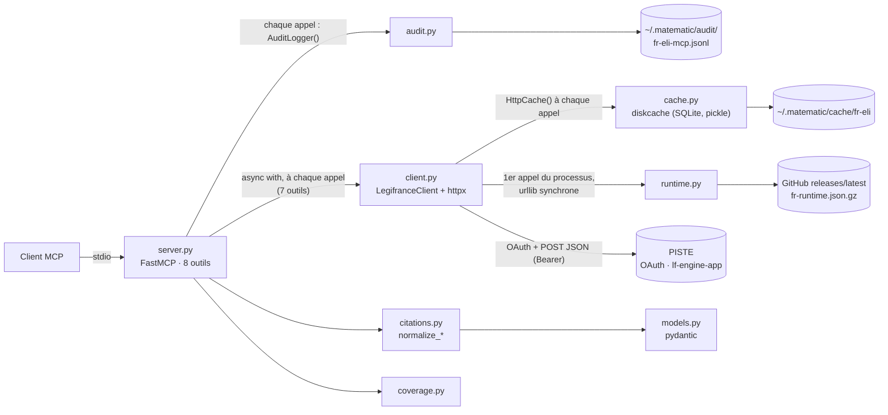

# 01 — L'existant : la référence Python `fr-eli-mcp`, ce qu'on garde, ce qu'on corrige

> **Statut** : M0-M1 livrés (plan 1), le reste est un plan. Ce document applique [00-decisions.md](00-decisions.md), qui est normatif et l'emporte en cas de doute.
> **Rôle** : point d'entrée du plan. Il présente la référence Python, vérifie les quatre constats qui ont motivé la réécriture et rattache chacun des 47 défauts de la référence (D-01…D-47) à la partie du plan qui empêche de le reproduire, avec le jalon où il disparaît.
> **Jalons** : tous (M0…M9). La colonne « Où · jalon » des tableaux du §4 et la check-list du §4.16 disent quand chaque défaut cesse d'exister. Le catalogue de [06 §3.1](06-qualite.md) fait foi pour les tests de non-régression et le jalon de clôture de chaque défaut (06 est le document propriétaire des tests, 00 §0) ; ces tableaux en sont une vue, alignée sur lui et sur 00 révision 2.
> **Lecteurs** : tout développeur, humain ou agent, avant d'ouvrir les autres documents ; tout relecteur qui veut vérifier qu'un défaut connu n'est pas réintroduit. Aucune connaissance des échanges préalables n'est supposée.
> **Conventions** :
> - « La référence Python » désigne `matematicsolutions/fr-eli-mcp@d3b5b13`. Un chemin `fichier:ligne` sans autre précision renvoie à ce dépôt, lu en lecture seule (`src/fr_eli_mcp/` est omis pour les modules Python).
> - Gravités, preuves et mesures viennent de la [recherche 02](../recherche/02-defauts.md). Les points de parité `P-xxx`, les écarts `E-xx` et les scénarios d'erreur `S1…S17` viennent de la [recherche 01](../recherche/01-parite.md).
> - Ce qui n'est pas vérifié est marqué **NON VÉRIFIÉ** avec une étiquette `[v:…]`. Les étiquettes sont recensées au §7 avec leur identifiant du registre `V-01…V-215` de [09-risques-et-questions.md](09-risques-et-questions.md).
> - Questions ouvertes de l'utilisateur : `Q1…Q17` de 00 §13 (propositions adoptées par défaut, à confirmer, sauf les questions décidées). Q1 (dépôt et nom `mcp-legifrance`) et Q2 (Apache-2.0, titulaire « Loïc Wernert ») sont DÉCIDÉES le 2026-10-16 ; Q16 (typographie des citations) est DÉCIDÉE (plan 1, 2026-10-15) ; Q17 (`/codes/article_lc/` pour un article de loi) est ouverte, à vérifier en M2 (V-141). Amendements de la revue : `AM-01…AM-43` (journal de 00 §14).
> - Ce document ne contient aucun extrait de code Rust ; les noms de types cités renvoient aux documents qui les définissent. Les ADR cités sont dans [l'index des ADR](../adr/README.md).

Documents liés : [02-architecture.md](02-architecture.md) (crates, ports, décorateurs, erreurs), [03-domaine.md](03-domaine.md) (types, citations, dates, texte), [04-adapter-piste.md](04-adapter-piste.md) (OAuth, HTTP, résilience, DTO), [05-outils-mcp.md](05-outils-mcp.md) (outils, protocole, rendu), [06-qualite.md](06-qualite.md) (tests, CI), [07-feuille-de-route.md](07-feuille-de-route.md) (jalons, tâches `T-Mx-yy`, critères d'acceptation ; M0 et M1 livrés ; renvoie au §4.16 pour la clôture des défauts), plans d'implémentation exécutables ([README du plan §3.5](README.md#35-plans-dimplémentation-retirés), retirés ; ils déclinaient 07 jalon par jalon ; plan 1 = M0 et M1, livrés), [08-distribution.md](08-distribution.md), [09-risques-et-questions.md](09-risques-et-questions.md), [annexes/A-parite.md](annexes/A-parite.md) (parité et divergences), [annexes/C-api-legifrance.md](annexes/C-api-legifrance.md) (API).

---

## Sommaire

0. [Résumé](#0-résumé)
1. [La référence Python en bref](#1-la-référence-python-en-bref)
2. [Ce qu'on garde](#2-ce-quon-garde)
3. [Les quatre constats annoncés et leur vérification](#3-les-quatre-constats-annoncés-et-leur-vérification)
4. [Les 47 défauts et leur traitement](#4-les-47-défauts-et-leur-traitement)
5. [Ce qu'on change volontairement](#5-ce-quon-change-volontairement)
6. [Ce qui reste incertain sur le comportement réel de l'API](#6-ce-qui-reste-incertain-sur-le-comportement-réel-de-lapi)
7. [Points NON VÉRIFIÉS de ce document](#7-points-non-vérifiés-de-ce-document)
8. [Questions ouvertes propres à ce document](#8-questions-ouvertes-propres-à-ce-document)
9. [Sources](#sources)

---

## 0. Résumé

- **La référence Python** (v0.5.3, Apache-2.0, 1 746 lignes de Python) est un serveur MCP stdio en lecture seule. Il expose 8 outils sur 8 fonds de Légifrance à travers l'API PISTE : 7 endpoints `POST` JSON, authentification OAuth2 `client_credentials` (§1).
- **Ce qu'on garde** : la lecture seule, le contrat de citation, la couverture déclarée et appelable, l'audit obligatoire, le verrou des descripteurs, le test de dérive des instructions, les fixtures réelles et les tests live facultatifs. Chacune de ces idées est reprise, et renforcée là où la référence ne la tenait pas (§2).
- **Les quatre constats annoncés** sont confirmés, avec des nuances. Le cache n'est inopérant que pour la *recherche* LODA/CODE. Un 404 HTTP est audité, contrairement aux `invalid_arg` et aux `not_found` issus de la normalisation. Le manifeste distant est téléchargé au premier appel d'outil et non au démarrage, mais aussi quand `FR_ELI_BASE_URL` est défini et quand les identifiants manquent. Le code compte 7 blocs `try/except`, pas 8 (§3).
- **47 défauts** (recherche 02) : 2 bloquants (D-02 audit incomplet, D-04 manifeste distant), 27 majeurs et 18 mineurs, répartis en 14 thèmes. Chacun est rattaché à une section du plan et à un jalon (§4), le catalogue de [06 §3.1](06-qualite.md) faisant foi pour les tests et les jalons. Pour 12 d'entre eux, le plan applique une mesure différente de celle proposée par la recherche 02, parce que 00 en décide autrement ; le §4.15 les liste avec leur point de réévaluation.
- **Ce qui change pour un client** : `citation` au lieu de `human_readable_citation`, résumé par défaut puis lecture paginée des textes longs, TOC avec sections, préfixe `[code]` réellement en tête, deux codes d'erreur de plus, variables `LF_*`. Chaque changement est une divergence volontaire nommée et testée dans [annexes/A-parite.md](annexes/A-parite.md) §4 (§5).
- **Ce qui reste à vérifier en direct** : réponse à un identifiant inexistant, forme des 404 et 403, quotas, origine du mojibake, présence de `texteHtml`, TOC réelles, pagination profonde, sémantique des modes de recherche (§6). Ces points se lèvent en M2 par `cargo xtask record-fixture` et les smoke tests live, sous réserve d'un compte PISTE (Q3 : sandbox avant M2, production avant v0.1.0).

---

## 1. La référence Python en bref

### 1.1 Fiche d'identité

| Élément | Valeur | Source |
|---|---|---|
| Dépôt | `matematicsolutions/fr-eli-mcp` (GitHub) | 00 §0 |
| Commit de référence | `d3b5b13`, 2026-09-24, unique commit du clone : « test: lock tool descriptors against silent drift » | `git log` ; recherche 01 (en-tête) |
| Version | 0.5.3 | `pyproject.toml:7`, `server.json:5` |
| Licence | Apache-2.0 (code et fixtures) | `LICENSE`, `CONSTITUTION.md:5` |
| Auteur | Wieslaw Mazur / MateMatic, ligne « eu-legal-mcp » de connecteurs juridiques nationaux | `CONSTITUTION.md` (fin), `README.md` |
| Langage et dépendances | Python ≥ 3.11 (CI en 3.12, Docker en 3.11) ; `fastmcp>=3.4,<4`, `httpx>=0.27,<1`, `pydantic>=2.6`, `diskcache>=5.6`, `anyio>=4.3` ; aucun fichier de verrouillage des dépendances | `pyproject.toml:11, :27-33` ; recherche 01 §1 |
| Taille | 1 746 lignes dans `src/fr_eli_mcp/` (10 fichiers) ; 6 fichiers de tests ; 16 fixtures JSON | `wc -l` ; `ls tests/` |
| Transport MCP | stdio seulement (`mcp.run()`) ; `serverInfo` = `fr-eli-mcp` avec la **version de FastMCP** (E-09) | `server.py:517-519` ; recherche 01 §2.1 |
| Protocole | versions du SDK MCP Python installé : 2024-11-05 à 2025-11-25 avec le SDK 1.26.0. Les versions réellement installées chez les utilisateurs sont **NON VÉRIFIÉES** [V-190 · versions-mcp-reference] (V-190) | [annexe A §4.9](annexes/A-parite.md) |
| Distribution | PyPI (`uvx fr-eli-mcp`) ; registre MCP `io.github.matematicsolutions/fr-eli-mcp` (registryType `pypi`, sans `environmentVariables`) ; `Dockerfile` `python:3.11-slim` exécuté en root | `server.json:1-22`, `Dockerfile:1-5` ; recherche 01 §12 |
| Amont | API Légifrance `lf-engine-app` derrière PISTE, hôtes **sandbox** par défaut | `client.py:28-29` |

### 1.2 Ce qu'elle fait

Le serveur recherche et consulte le droit français officiel, et renvoie le texte verbatim avec une citation vérifiable (`README.md`). Il est construit par vagues successives :

| Étape | Date | Contenu | Source |
|---|---|---|---|
| v0.1.0 | 2026-06-24 | LODA, CODE, JURI ; endpoints `search`, `lawDecree`, `getArticle`, `juri` sondés en direct sur la sandbox | `DISCOVERY.md:1-33`, `CONSTITUTION.md` |
| Juridictions | 2026-07-07 | CONSTIT et CETAT, servis par le même `/consult/juri` (commit `f90bc25`) | `SOURCES.md` |
| 0.3.0 | 2026-07-08 | CNIL, KALI, ACCO (« feature-003 ») | `SOURCES.md` |
| 0.5.3 | 2026-09-24 | verrou des descripteurs | `git log` |

Les versions intermédiaires ne sont pas documentées : le clone n'a qu'un commit et le `CHANGELOG.md` exigé par la CONSTITUTION n'existe pas (D-43).

Les 8 fonds servis (`server.py:91-100`, recherche 01 §3.1) :

| `fond` utilisateur | Fond API | Préfixe des hits | Filtre ajouté par la référence | Outil de lecture | Corpus |
|---|---|---|---|---|---|
| `LODA` (défaut) | `LODA_DATE` | `LEGITEXT` | `DATE_VERSION`, `singleDate` = instant de l'appel en ms | `fr_get_act`, puis `fr_get_text` | lois, ordonnances, décrets consolidés |
| `CODE` | `CODE_DATE` | `LEGITEXT` du code, extraits `LEGIARTI` | idem | `fr_get_act`, `fr_get_text` | codes |
| `JURI` | `JURI` | `JURITEXT` | — | `fr_get_decision` | Cour de cassation, cours d'appel |
| `CONSTIT` | `CONSTIT` | `CONSTEXT` | — | `fr_get_decision` | Conseil constitutionnel |
| `CETAT` | `CETAT` | `CETATEXT` | — | `fr_get_decision` | Conseil d'État, CAA, TA |
| `CNIL` | `CNIL` | `CNILTEXT` | — | `fr_get_deliberation` | délibérations de la CNIL |
| `KALI` | `KALI` | `KALITEXT` | — | `fr_get_convention`, `fr_get_text` (`KALIARTI`) | conventions collectives |
| `ACCO` | `ACCO` | `ACCOTEXT` | — | `fr_get_company_agreement` | accords d'entreprise |

### 1.3 Les 8 outils

Tous les outils sont `async` et portent les annotations `READ_ONLY` : `readOnlyHint=true`, `idempotentHint=true`, `destructiveHint=false`, `openWorldHint=true` (`server.py:81-86`). Chacun renvoie un modèle pydantic, que FastMCP publie à la fois en `structuredContent` et en `TextContent` JSON, avec un `outputSchema` (recherche 01 §2.3). Les erreurs sont des `ToolError` à 4 codes (`invalid_arg`, `not_found`, `upstream_error`, `config_error`), dont le texte arrive préfixé par `Error calling tool '<nom>': ` (recherche 01 §2.4, E-01).

| Outil | Paramètres (défauts) | Appel PISTE | Sortie | Métrique d'audit | En v0.1 ([05 §5](05-outils-mcp.md)) |
|---|---|---|---|---|---|
| `fr_search` | `query`, `fond="LODA"`, `page_size=10` (1..100) | `POST /search` : `UN_DES_MOTS`, `pageNumber: 1`, `sort: PERTINENCE`, `DATE_VERSION` pour LODA et CODE | `SearchResult {fond, query, total, hits[], eli_note, dataset_note}` | hits de la page | ajoute `page`, `match`, `date_from`/`date_to`, `version_date` ; `has_more` ; extraits pour tous les fonds |
| `fr_get_act` | `text_id` (LEGITEXT), `date` (défaut : date **UTC**) | `POST /consult/lawDecree {textId, date}` | `Act` : métadonnées + `articles[]` aplatis | nombre d'articles | ajoute `toc_offset`, `toc_limit` ; TOC avec sections ; date Europe/Paris |
| `fr_get_text` | `article_id` (LEGIARTI ou KALIARTI) | `POST /consult/getArticle {id}` | `ArticleText` : texte intégral, `byte_size` | octets UTF-8 | ajoute `detail`, `offset`, `max_chars`, `focus`, `passages` |
| `fr_get_decision` | `decision_id` (JURITEXT, CONSTEXT, CETATEXT) | `POST /consult/juri {textId}` | `Decision` : ECLI natif, juridiction, formation, solution, texte | octets UTF-8 | paramètres de lecture communs |
| `fr_get_deliberation` | `deliberation_id` (CNILTEXT) | `POST /consult/cnil {textId}` | `Deliberation` | octets UTF-8 | paramètres de lecture communs |
| `fr_get_convention` | `convention_id` (KALITEXT) | `POST /consult/kaliText {id}` | `Act` (TOC de `KALIARTI`) | nombre d'articles | ajoute `toc_offset`, `toc_limit` |
| `fr_get_company_agreement` | `agreement_id` (ACCOTEXT) | `POST /consult/acco {id}` | `CompanyAgreement` : métadonnées seules, `attachment_note` | 1 | métadonnées seules, inchangé |
| `fr_coverage` | aucun | aucun | `Coverage` : 3 familles, 2 lacunes, `status="ok"` | 2 (lacunes) | couverture calculée, environnement, état de la configuration, attribution des données (00 §12, Q15) |

Sources : recherche 01 §3.1 à §3.8 ; `server.py:173-514`. Les métriques d'audit de la v0.1 sont celles de 00 §7.

### 1.4 Architecture

Un module par préoccupation, sans couches ni inversion de dépendance. Chaque outil de `server.py` enchaîne lui-même validation, audit, client HTTP, normalisation et modèle de sortie.

| Module | Lignes | Rôle | Défauts principaux |
|---|---:|---|---|
| `server.py` | 523 | `FastMCP(name="fr-eli-mcp", instructions=INSTRUCTIONS)` (4 470 caractères), `ToolError`, 8 outils, validations, corps `/search`, `_map_upstream` | D-02, D-03, D-07, D-08, D-09, D-19, D-22, D-31, D-32 |
| `citations.py` | 486 | normalisation des réponses (`normalize_*`), URL Légifrance, citations, dates | D-20, D-21, D-23, D-25 à D-30 |
| `client.py` | 208 | `TokenManager` OAuth, `LegifranceClient` (httpx), boucle `_post` (réessais, cache), endpoints | D-06, D-10 à D-14, D-41 |
| `models.py` | 190 | modèles pydantic de sortie, notes `ELI_NOTE` et `DATASET_NOTE` | D-24, D-30, D-33 |
| `audit.py` | 94 | `AuditLogger` JSONL, `hash_input`, `timer` | D-03, D-16, D-17 |
| `runtime.py` | 92 | manifeste distant `fr-runtime.json.gz` | D-04, D-05 |
| `coverage.py` | 77 | familles et lacunes déclarées | D-34 |
| `cache.py` | 57 | `HttpCache` sur `diskcache` | D-01, D-15, D-38 |
| `__main__.py`, `__init__.py` | 15, 4 | `python -m fr_eli_mcp`, version | — |



Gabarit d'un outil de consultation, d'après la recherche 01 §3 (Python simplifié, annoté avec les défauts qu'il produit) :

```python
audit = AuditLogger()                          # mkdir(exist_ok=True) à chaque appel : OSError avant toute validation
                                               # si le répertoire ne peut pas être créé (S17 a) ; rien si un répertoire existe (S17 b)
<validations> -> ToolError("invalid_arg")      # levée avant tout audit.log : non auditée (D-02)
with timer() as t:
    try:
        async with LegifranceClient() as c:    # nouveau client httpx + diskcache + manifeste au 1er appel (D-06, D-04)
            raw = await c.<endpoint>(...)
    except Exception as exc:
        audit.log(..., duration_ms=t.duration_ms or 0, status="error")   # __exit__ pas encore exécuté : 0 (D-03) ;
                                               # répertoire non inscriptible : PermissionError qui remplace l'erreur d'origine (S17 b)
        raise _map_upstream(exc) from exc      # 404 de toute origine -> not_found (D-10) ; exception non HTTP rendue telle quelle, sans code (D-11)
norm = citations.normalize_<x>(raw)            # AttributeError possible sur null, hors try (D-23)
if norm is None: raise ToolError("not_found")  # non auditée (D-02)
result = Modèle.model_validate(norm)           # ValidationError possible, hors try (D-24)
audit.log(..., status="ok")                    # durée = appel HTTP seul (D-03) ; open("a") : PermissionError
                                               # après l'appel amont si le répertoire n'est pas inscriptible (S17 b)
```

Ce gabarit est répété dans 7 outils (D-07). Toutes les corrections du plan découlent de ce constat : un décorateur d'audit unique au-dessus de l'exécution complète, un client partagé, des erreurs typées, des DTO tolérants ([02 §1.2](02-architecture.md)).

### 1.5 Configuration, état local et outillage

| Sujet | Référence | Source |
|---|---|---|
| Variables lues | `FR_ELI_CLIENT_ID`, `FR_ELI_CLIENT_SECRET` (requis) ; `FR_ELI_OAUTH_URL`, `FR_ELI_BASE_URL` (défauts sandbox) ; `FR_ELI_CACHE_DIR` ; `FR_ELI_AUDIT_DIR` ; `FR_ELI_RUNTIME_URL` (vide = pas de manifeste). `FR_ELI_ENV` figure dans l'exemple mais n'est lu nulle part. | `client.py:42-58`, `runtime.py:22-25`, `.mcp.json.example:6` ; recherche 01 §6.1 |
| État local | cache `~/.matematic/cache/fr-eli` (diskcache, 1 Gio, persistant) ; journal `~/.matematic/audit/fr-eli-mcp.jsonl` ; copie du manifeste dans le répertoire de cache | `cache.py:21-43`, `audit.py:25-47`, `runtime.py:61-66` |
| Tests | `test_parse.py` (normaliseurs sur fixtures), `test_coverage.py`, `test_descriptor_lock.py`, `test_instructions_drift.py`, `test_smoke.py` (live, ignoré sans identifiants), `conftest.py` | recherche 01 §11 |
| CI et release | `ci.yml` : Python 3.12, Linux, `pytest -k "not smoke"` ; `release.yml` : PyPI par jeton, publication du manifeste distant, publication au registre MCP avec `mcp-publisher` « latest » | `.github/workflows/ci.yml:1-36`, `release.yml:1-91` |

---

## 2. Ce qu'on garde

La référence porte des principes justes, souvent mieux énoncés que tenus. Le plan les reprend et ajoute ce qui manquait pour qu'ils soient garantis.

| # | Bonne idée | Dans la référence | Ce que le plan garde | Ce que le plan ajoute | Où · jalon |
|---|---|---|---|---|---|
| 1 | **Lecture seule** | `CONSTITUTION.md` art. 1 ; annotations `READ_ONLY` sur les 8 outils (`server.py:81-86`) ; textes « verbatim from Legifrance » (`server.py:50`) | mêmes annotations ; aucun outil d'écriture ; aucun texte officiel réécrit (P-002) | seules la réparation du mojibake et `text::clean` touchent un texte | 00 §6, [05 §1.4, §5.0](05-outils-mcp.md) · M4 |
| 2 | **Contrat de citation** | art. 4 ; `citations.py:1-24` : citation française, `source_url`, ECLI natif cité tel quel, jamais d'ELI fabriqué | chaque entité citable porte `citation` et `source_url` ; `ecli` seulement natif ; aucun ELI ni ECLI fabriqué (P-039) | contrat garanti par les types, typographie corrigée, `eli_uri` trompeur supprimé (D-27, D-30) | ADR-0009, [03 §5](03-domaine.md) · M1 (typographie), tête de M2 (contrat v2) |
| 3 | **Couverture déclarée et appelable** | `coverage.py:1-10` (« an empty gap list would mean nobody checked ») ; consigne « Absence here is not absence in the law » (`server.py:46`) | `fr_coverage`, une lacune = un repli, liste jamais vide ; même consigne dans les instructions | catalogue complet, environnement et état de la configuration calculés (D-18, D-34) | [03 §4.8](03-domaine.md), [05 §4.1, §5.8](05-outils-mcp.md) · M3 (forme), M4 |
| 4 | **Audit obligatoire, échec = erreur** | art. 2 ; `audit.py` (JSONL, `hash_input` canonique) | une ligne JSONL par appel ; mêmes clés de tête, même format de `ts` (`+00:00`), même algorithme d'empreinte (P-040, P-041) ; échec d'écriture ⇒ erreur (mode `strict` par défaut, Q9) | toutes les issues, durée réelle, accusé d'écriture, rotation (D-02, D-03, D-16) | ADR-0008, [02 §3.5, §7.1](02-architecture.md) · M3 |
| 5 | **Verrou des descripteurs** | `tests/test_descriptor_lock.py`, `tests/tools.lock.json` : SHA-256 du JSON canonique, refus d'un verrou vide, liste des outils ajoutés, retirés, modifiés | même JSON canonique (clés triées, séparateurs compacts, UTF-8 brut), recalculable en Python ; même nom de fichier, `tests/tools.lock.json` | lecture du binaire en boîte noire dans les deux ères, instructions et capacités verrouillées, politique SemVer (D-37) | [05 §9](05-outils-mcp.md) · M4 (P-007) |
| 6 | **Test de dérive des instructions** | `tests/test_instructions_drift.py:40-92` : outils cités = outils enregistrés, chaque code documenté | même principe | égalité des ensembles dans les deux sens, paramètres et valeurs d'`enum` cités, taille ≤ 3 500 caractères | [05 §4.3](05-outils-mcp.md) · M4 (P-006) |
| 7 | **Fixtures réelles** | 16 réponses PISTE capturées en sandbox ; `tests/test_parse.py` hors ligne | les 16 fichiers sans modification, avec attribution dans `NOTICE` ; sorties de la référence figées dans [parite-golden.json](annexes/donnees/parite-golden.json) | métadonnées de capture, recaptures brutes, réparation et détection du mojibake (D-35) | [04 §13.3, §13.4](04-adapter-piste.md), [annexe A §5](annexes/A-parite.md) · M2 |
| 8 | **Tests live facultatifs** | `tests/test_smoke.py:26-27` : ignorés sans identifiants ; 9 scénarios bout en bout | mêmes scénarios et assertions (P-060) | `#[ignore]`, profil nextest `live`, sondes « introuvable » ; sandbox par défaut, sondes de production en lecture seule lancées à la main avant chaque étiquette, jamais d'identifiants de production en CI (00 §10, Q3) | [04 §13.5](04-adapter-piste.md) · M2 |
| 9 | **Jeton OAuth en mémoire seulement** | art. 3 ; `cache.py:1-5` (« OAuth tokens are NEVER stored here ») | jeton jamais écrit sur disque, en cache ni dans un journal (P-026) | `SecretString`, rafraîchissement mono-vol (D-12) | [04 §3.3, §3.6](04-adapter-piste.md) · M2 |
| 10 | **Endpoints sondés en direct** | `DISCOVERY.md` (« Probed live (not trusted from docs) ») : `DATE_VERSION` requis en LODA et CODE, un seul `/consult/juri` pour les trois juridictions | mêmes endpoints, mêmes clés de corps, mêmes constantes (P-020, P-021) | `cargo xtask record-fixture` pour capturer et dater chaque réponse | [04 §6, §7](04-adapter-piste.md) · M2 |
| 11 | **Codes d'erreur courts et stables** | `ToolError` à 4 codes (`server.py:69-78`) ; section « Error iteration » des instructions | les 4 codes et leur sens ; la première phrase des messages `invalid_arg` et `not_found` (P-012, P-013) | `[code]` réellement en tête, `rate_limited` et `audit_error` en plus, messages actionnables (D-08) | ADR-0010, [05 §7](05-outils-mcp.md) · M4 |
| 12 | **Dire ce qu'on n'a pas** | ACCO « metadata only » avec `attachment_note` (`citations.py:480-481`) ; `ecli` laissé `null` pour les CAA et TA | `attachment_note` mot pour mot (P-036) ; champ omis plutôt que fabriqué | lacunes FR-003 et FR-004 de `fr_coverage` | [05 §5.7, §5.8](05-outils-mcp.md) · M2, M4 |

---

## 3. Les quatre constats annoncés et leur vérification

Avant la rédaction du plan, quatre constats sur la référence avaient été annoncés à l'utilisateur pour motiver la réécriture. La recherche 02 §2 les a vérifiés dans le code. Les quatre tiennent, mais trois doivent être reformulés.

### 3.1 Constat a : le cache LODA/CODE

> Annoncé : « Le cache disque ne sert jamais pour LODA/CODE car la clé contient `singleDate=_now_ms()`. »

**Verdict : confirmé pour `fr_search` sur LODA et CODE, infirmé pour la consultation.** La formulation doit être restreinte à la *recherche*.

- Preuve : `_now_ms()` renvoie `int(time.time() * 1000)` (`server.py:129-130`) ; pour `LODA_DATE` et `CODE_DATE`, le corps reçoit `{"facette": "DATE_VERSION", "singleDate": _now_ms()}` (`server.py:135-136`) ; la clé de cache est le corps JSON entier (`client.py:144-147`), lue en `:151-154` et écrite en `:171` avec un TTL d'une heure (`cache.py:16`). Deux recherches identiques n'ont donc jamais la même clé.
- Aggravation : chaque recherche LODA/CODE **écrit** quand même une entrée de 3 à 40 Ko qui ne sera jamais relue, dans un cache plafonné à 1 Gio (`diskcache/core.py:52`) ; pur coût d'écriture disque.
- Nuances : `fr_get_act` envoie `{"textId", "date": "AAAA-MM-JJ"}`, clé stable sur la journée UTC (`client.py:190-193`) ; `fr_get_text` envoie `{"id"}`, clé stable (`client.py:195-196`) ; les recherches JURI, CONSTIT, CETAT, CNIL, KALI et ACCO n'ont pas de filtre daté et sont bien mises en cache une heure (`server.py:134-136`).
- Défauts : **D-01**, et D-15 pour les autres faiblesses du cache.
- Réponse du plan : la clé est construite sur l'objet du domaine `SearchQuery`, dont la `VersionDate` est au jour près (défaut : aujourd'hui à Paris). L'adapter recalcule `singleDate` à midi Europe/Paris de cette date (10:00Z en été, 11:00Z en hiver, par exemple 2026-10-15 → `1792058400000`), hors de la clé ([02 §7.2](02-architecture.md), [04 §6.3](04-adapter-piste.md), 00 §8 et §9, AM-02). Midi est stable sur la journée et reste correct que PISTE compare l'instant à des bornes stockées à minuit UTC ou le tronque en date UTC ou Paris, alors que minuit Paris (22 h ou 23 h UTC la veille) pouvait sélectionner la version de la veille. Que midi Paris retienne un texte qui entre en vigueur le jour J est vérifié en sandbox le 2026-10-28 [V-76 · singledate-midi-paris] (09 §2.20), production non essayée. Jalons M2 à M4 ([06 §3.1](06-qualite.md)).

### 3.2 Constat b : les trous de l'audit

> Annoncé : « L'audit n'enregistre pas `invalid_arg` / `not_found`, et les erreurs upstream sont loggées avec `duration_ms=0`. »

**Verdict : confirmé, avec deux précisions.** Un `not_found` dû à un HTTP 404 *est* journalisé, dans le `except` ; seul le `not_found` issu de la normalisation (`norm is None`) ne l'est pas. Les échecs de normalisation et de validation, levés hors du `try` (`AttributeError`, `ValidationError` pydantic), ne le sont pas non plus ; un corps non JSON (`JSONDecodeError`, levée dans le `try`) l'est, avec `duration_ms: 0`, mais n'est pas mappé (S14).

- Exigence violée : « Every tool call MUST append one JSON line … Inability to write = the tool returns an error » (`CONSTITUTION.md:25-27`) ; promesse faite au modèle : « every tool call appends to `~/.matematic/audit/fr-eli-mcp.jsonl` » (`server.py:51`). Le module se présente comme « JSONL audit logger for AI Act art. 12 » (`audit.py:1`).
- `invalid_arg` levé **avant** tout `audit.log` : `server.py:191-197` (`fr_search`), `:242` (`fr_get_act`, via `_require_prefix` défini en `:159-165`), `:282-289`, `:336-342`, `:383`, `:425`, `:495`.
- `not_found` de normalisation levé avant `audit.log` : `server.py:256-258` puis log en `:260`, et de même dans les cinq autres consultations ; `Act.model_validate(norm)` (`:259`) hors `try`.
- `duration_ms=0` : `self.duration_ms = 0` à l'initialisation (`audit.py:81-83`), valeur calculée seulement dans `__exit__` (`audit.py:89-90`) ; or `audit.log(... duration_ms=t.duration_ms or 0 ...)` est appelé **dans** le bloc `with timer()` (`server.py:203-211`, et 6 autres occurrences). En succès, le chronomètre n'englobe que l'appel HTTP, pas la normalisation.
- Aggravation : si `audit.log` échoue dans la branche d'erreur, l'`OSError` remplace l'erreur d'origine (`server.py:208-211`). Le seul test d'audit couvre le chemin heureux de `fr_coverage` (`tests/test_coverage.py:62-78`).
- Bilan des scénarios de la recherche 01 §2.6 : S1 à S5 (validation) et S15 (réponse vide) ne laissent aucune ligne ; S6 à S14 (erreurs amont, corps non JSON compris) laissent une ligne avec `duration_ms: 0` ; S16 (recherche sans résultat) laisse une ligne `ok`. S17 (répertoire d'audit inutilisable) recouvre deux cas, que la recherche 01 confond : (a) répertoire **non créable** : `AuditLogger()` fait `mkdir(parents=True, exist_ok=True)` (`audit.py:46`) dès `_audit()`, d'où une `OSError` avant toute validation ; (b) répertoire **existant mais non inscriptible** : `mkdir(exist_ok=True)` ignore l'erreur, qui ne survient qu'à l'ouverture du fichier dans `audit.log()` (`audit.py:74`) ; aucune erreur pour les issues non auditées (S1 à S5, S15), une `PermissionError` après l'appel amont pour les autres, qui remplace l'erreur d'origine dans la branche d'erreur. Un corps `null` sort de cette liste : il passe la couche HTTP puis provoque une `AttributeError` hors `try` (§4.4, D-11).
- Défauts : **D-02** (bloquant), **D-03** ; cause racine D-07.
- Réponse du plan : un seul décorateur `Audited` dans `lf-application`, posé sur l'exécution complète : décodage des arguments, validation, appels au port, politique de lecture. Il écrit une ligne pour chaque issue, avec une durée mesurée par une horloge monotone ([02 §5.4, §7.1](02-architecture.md), ADR-0008). Les arguments sont reçus bruts (`JsonObject`) et décodés à l'intérieur de l'exécution auditée ; que cette approche compile avec rmcp 3.5.1 est **NON VÉRIFIÉ** [V-28 · rmcp-jsonobject-input-schema] (V-28 ; spike rmcp avant la conception des ports de M3, 00 §11.1 ; repli `Parameters<T>` acté par ADR, 00 §5). En mode `strict`, un journal non inscriptible fait échouer l'appel par `[audit_error]` quel que soit le cas de S17, sans masquer la cause d'origine ; le test `audit_unwritable_dir_fails_call` ([06 §3.1](06-qualite.md)) doit couvrir les cas (a) et (b). Jalons M3 et M4.

### 3.3 Constat c : le manifeste distant

> Annoncé : « `runtime.py` télécharge au démarrage un manifeste distant qui peut changer `base_url`, vers lequel le Bearer token est envoyé (+ métrique d'activation) — contradiction avec CONSTITUTION art. 3. »

**Verdict : confirmé sur le fond, avec une correction et deux aggravations.**

- **Correction** : le téléchargement n'a pas lieu au démarrage, mais au **premier appel d'un outil qui construit un `LegifranceClient`**, c'est-à-dire tous sauf `fr_coverage`, une fois par processus (mémo global `_runtime`, `runtime.py:30`, `:72-82`).
- **Aggravation 1** : il a lieu **même quand `FR_ELI_BASE_URL` est défini**, car l'argument par défaut d'`os.environ.get` est évalué avant l'appel (`client.py:46-47`). Seul `FR_ELI_RUNTIME_URL=""` le désactive (`runtime.py:10`, `:52-53`). La redirection, elle, ne joue que si `FR_ELI_BASE_URL` n'est pas défini.
- **Aggravation 2** : il a lieu **même sans identifiants**, car le constructeur évalue l'URL de base (`client.py:126`) avant de chercher les identifiants (`client.py:128`).

```mermaid
flowchart LR
  A["1er appel d'outil<br/>(sauf fr_coverage)"] --> B["LegifranceClient.__init__<br/>client.py:126"]
  B --> C["_env_base_url()<br/>défaut évalué même si FR_ELI_BASE_URL est défini<br/>client.py:46-47"]
  C --> D["get_runtime() : urllib synchrone, 15 s<br/>gunzip sans borne<br/>runtime.py:55-58"]
  D --> E[("GitHub releases/latest<br/>fr-runtime.json.gz")]
  E --> F["base_urls.eli accepté sans contrôle<br/>d'hôte ni de schéma<br/>runtime.py:85-92"]
  F -- "si FR_ELI_BASE_URL absent" --> G["url = base_url + path<br/>client.py:150"]
  G --> H["Authorization: Bearer …<br/>client.py:161-163"]
  H --> I[("hôte désigné<br/>par le manifeste")]
```



- Absence d'intégrité : le workflow publie un `.sha256` (`release.yml:58-59`, `:68`) que le client ne télécharge ni ne vérifie ; le manifeste est copié sur disque (`runtime.py:61-66`) et resservi hors ligne (`:78-80`).
- Télémétrie : « The unlinked asset's download_count is a clean per-connector activation metric » (`runtime.py:7-8`) ; « Unlinked URL -> download_count = real activation » (`release.yml:46`).
- Contradictions : « no … commercial telemetry. The server talks only to the PISTE OAuth + Legifrance endpoints and the local filesystem » (`CONSTITUTION.md:31-32`) ; « sends nothing beyond the search query / document id » (`CONSTITUTION.md:18-19`).
- Portée exacte : l'URL OAuth n'est **pas** pilotée par le manifeste (`client.py:42-43`), donc le `client_secret` n'est pas redirigé. Sont exposés le jeton Bearer (valable 3 600 s en sandbox, `DISCOVERY.md:12`), toutes les requêtes (ce que cherche le juriste) et surtout **l'intégrité des textes** : un hôte malveillant peut servir de faux articles présentés comme « verbatim from Legifrance » (`server.py:50`). L'URL vise `releases/latest` (`runtime.py:24`) : une release compromise redirige toutes les installations, anciennes versions comprises. Le champ `citation_grammar_version` du manifeste n'est lu nulle part.
- Défauts : **D-04** (bloquant), **D-05** (boucle bloquée jusqu'à 15 s) ; liés : D-39, D-41, D-44.
- Réponse du plan : aucune configuration distante ni télémétrie (ADR-0005, 00 §1) ; `FR_ELI_RUNTIME_URL` n'est jamais lue (avertissement « ignored » au démarrage et dans `check-config`). Les URLs viennent de `LF_PISTE_ENV` et de surcharges locales validées ; le démarrage ne fait aucun appel réseau ; aucune redirection n'est suivie ; aucune URL lue dans une réponse n'est appelée ([02 §8.2](02-architecture.md), [04 §2.3, §14.3](04-adapter-piste.md)). Jalons M2 et M4.

### 3.4 Constat d : la structure du code

> Annoncé : « Client HTTP + cache disque recréés à chaque appel, try/except d'audit dupliqué 8 fois, erreurs en chaînes "[code] …", pas de pagination (`pageNumber=1` figé). »

**Verdict : confirmé, avec une correction de compte.**

- Recréation : `async with LegifranceClient() as client:` dans 7 outils (`server.py:205, 248, 294, 347, 388, 430, 500`). Le constructeur ouvre un `HttpCache()` (`client.py:127` → `cache.py:31-34` : `mkdir` puis ouverture SQLite) et un `httpx.AsyncClient` (`client.py:129-132`) fermé en fin d'appel (`client.py:140-142`) : une nouvelle connexion TCP et TLS par appel d'outil. Seul le `TokenManager` est partagé (`_TOKEN_MANAGERS`, `client.py:103-114`) : le jeton, lui, est réutilisé.
- Duplication : **7** blocs `try/except Exception` et non 8, car `fr_coverage` n'en a pas (`server.py:207, 250, 296, 349, 390, 432, 502`) ; **8** instanciations `audit = _audit()` ; **15** appels `audit.log(`.
- Erreurs en chaînes : `class ToolError(Exception)` avec le message `f"[{code}] {message}"` (`server.py:69-78`) ; FastMCP la traite comme une exception quelconque : trace `ERROR` dans ses journaux et texte préfixé par `Error calling tool '<nom>': ` (recherche 01 §2.4).
- Pagination : `"pageNumber": 1` (`server.py:150`), `"sort": "PERTINENCE"` (`:153`), `"typePagination": "DEFAUT"` (`:154`) ; aucun paramètre de page dans la signature (`server.py:174`).
- Défauts : **D-06**, **D-07**, **D-08**, **D-09**.
- Réponse du plan : un `reqwest::Client` unique ([04 §4.2](04-adapter-piste.md)) ; décorateurs posés une fois ([02 §7](02-architecture.md)) ; `AppError` typé rendu en `[code] message` ([05 §7](05-outils-mcp.md), ADR-0010) ; `page` et `has_more` ([05 §5.1](05-outils-mcp.md), ADR-0014). Jalons M2 à M5.

### 3.5 Synthèse

| # | Constat annoncé | Verdict | Nuance à retenir | Défauts | Corrigé en |
|---|---|---|---|---|---|
| a | Cache LODA/CODE jamais utilisé | confirmé pour `fr_search` | faux pour `fr_get_act` et `fr_get_text` | D-01 (+ D-15) | M2 à M4 |
| b | Audit sans `invalid_arg` ni `not_found`, `duration_ms=0` | confirmé | un 404 HTTP et un corps non JSON sont audités ; les erreurs de normalisation et de validation ne le sont pas | D-02, D-03 (+ D-07) | M3, M4 |
| c | Manifeste distant au démarrage, Bearer redirigeable, télémétrie | confirmé sur le fond | au premier appel d'outil ; même avec `FR_ELI_BASE_URL` ; même sans identifiants | D-04, D-05 (+ D-39, D-41, D-44) | M2, M4 |
| d | Client et cache recréés, `try/except` × 8, erreurs en chaînes, `pageNumber=1` | confirmé | 7 `try/except`, 8 instanciations d'audit, 15 `audit.log` | D-06, D-07, D-08, D-09 | M2 à M5 |

---

## 4. Les 47 défauts et leur traitement

### 4.0 Lecture des tableaux

- **Gravité** (recherche 02 §0) : **bloquant** = viole la CONSTITUTION de la référence ou l'intégrité des textes juridiques, ou rend fausse une fonction centrale ; **majeur** = erreur fonctionnelle, de performance ou de conception à fort impact ; **mineur** = défaut localisé ou cas limite.
- **Défaut et preuve** : résumé et preuve courte. Le détail, avec toutes les lignes et les démonstrations, est dans la recherche 02 §3.
- **Réponse du plan** : ce qui empêche le défaut de se reproduire. Le symbole ✱ signale une réponse qui diffère de la mesure proposée par la recherche 02 ; le §4.15 explique chaque écart.
- **Où · jalon** : document et section du plan, ADR, puis jalon(s) de 00 §11. Le dernier jalon, celui de la clôture, est repris de la colonne « Jalon » de [06 §3.1](06-qualite.md) ; les jalons antérieurs peuvent en différer, parce qu'ils signalent aussi des parties livrées plus tôt d'après 00 §11 ou le document propriétaire (par exemple `CHANGELOG.md` de D-43 en M0). Un défaut traité à plusieurs jalons est clos au dernier.
- **Tests** : principaux tests de non-régression, repris de [06 §3.1](06-qualite.md). **06 §3.1 fait foi** pour la liste complète des tests, leurs noms et le jalon de clôture de chaque défaut ; en cas d'écart, c'est ce tableau-ci qui est à corriger, sauf si 06 contredit 00 (00 l'emporte, écart signalé au §4.16).
- La recherche 02 a été écrite avant 00 et emploie d'autres noms. Correspondance :

| Recherche 02 | Nom normatif (00) |
|---|---|
| `domain`, `application`, `adapter-legifrance`, `adapter-audit`, `adapter-mcp`, `app` | `lf-domain`, `lf-application`, `lf-adapter-piste`, `lf-adapter-audit`, `lf-adapter-mcp`, `lf-app` (plus `lf-adapter-cache`) |
| `LegalSource`, `CachedLegalSource`, port `CacheStore` | `LegalCorpus`, `CachedCorpus` (pas de port de cache) |
| `AuditedUseCase` | `Audited` |
| `LegifranceError`, `UpstreamError::InvalidResponse` | `CorpusError` (`Auth`, `Config`, `Decode`, …) |
| `LegalDate` | `CivilDate` livré (`crates/lf-domain/src/date.rs`, ADR-0011 amendé, 00 §4) + `date::open_ended` (sentinelles ⇒ `None`, tâche de tête de M2, 00 §11.1) |
| `LEGIFRANCE_ENV`, `LEGIFRANCE_RPS` | `LF_PISTE_ENV` ; `LF_PISTE_RPS`, avec `LF_PISTE_BURST` et `LF_PISTE_CONCURRENCY` (00 §1, AM-05) |
| `human_readable_citation`, `official_title` | `citation`, `title` |
| codes `timeout`, `invalid_response` | `upstream_error` |

Répartition par thème et gravité :

| Thème (section) | Défauts | Bloquant | Majeur | Mineur |
|---|---|---:|---:|---:|
| Cache (§4.1) | D-01, D-15 | 0 | 2 | 0 |
| Audit (§4.2) | D-02, D-03, D-16, D-17 | 1 | 1 | 2 |
| Configuration distante et environnement (§4.3) | D-04, D-05, D-18, D-39 | 1 | 2 | 1 |
| Client HTTP, OAuth et résilience (§4.4) | D-10 à D-14 | 0 | 5 | 0 |
| Erreurs et diagnostics (§4.5) | D-07, D-08, D-46 | 0 | 2 | 1 |
| Normalisation et dates (§4.6) | D-19 à D-26 | 0 | 4 | 4 |
| Citations, URL et identifiants (§4.7) | D-27 à D-31, D-47 | 0 | 2 | 4 |
| Recherche (§4.8) | D-09, D-32 | 0 | 2 | 0 |
| Taille des réponses (§4.9) | D-33 | 0 | 1 | 0 |
| Couverture et provenance (§4.10) | D-34, D-45 | 0 | 1 | 1 |
| Tests et fixtures (§4.11) | D-35, D-36, D-37 | 0 | 2 | 1 |
| Performance (§4.12) | D-06, D-38 | 0 | 2 | 0 |
| Sécurité (§4.13) | D-40, D-41, D-44 | 0 | 0 | 3 |
| Documentation (§4.14) | D-42, D-43 | 0 | 1 | 1 |
| **Total** | **47** | **2** | **27** | **18** |

D-38 est compté majeur, comme dans la recherche 02 ; il n'est que mineur tant que le serveur reste en stdio mono-utilisateur.

### 4.1 Cache

| ID | Gravité | Défaut et preuve | Réponse du plan | Où · jalon | Tests |
|---|---|---|---|---|---|
| D-01 | majeur | **Cache jamais relu pour `fr_search` LODA/CODE** : la clé est le corps JSON entier, qui contient `singleDate = _now_ms()` (`server.py:129-136`, `client.py:144-147`). Détail au §3.1. | Clé de domaine `CacheKey { env, Op::Search(SearchQuery) }` ; `VersionDate` au jour près, aujourd'hui à Paris par défaut ; `singleDate` recalculé par l'adapter à midi Europe/Paris du jour (AM-02), hors de la clé ; la clé change à minuit heure de Paris. Midi Paris vérifié en sandbox le 2026-10-28 [V-76 · singledate-midi-paris] (09 §2.20), production non essayée. | [02 §7.2](02-architecture.md), [04 §6.3](04-adapter-piste.md), 00 §8-§9, ADR-0007 · M2 à M4 | `cache_key_is_stable_across_calls_same_day`, `cache_key_changes_when_paris_day_changes`, `search_request_matches_reference_json`, `second_identical_loda_search_hits_cache` |
| D-15 | majeur | **Cache mal isolé et fragile** : clé sans environnement ni hôte (`client.py:144-147`) ; réponses 200 vides mises en cache, d'où un « introuvable » qui persiste 24 h (`client.py:169-171`) ; un échec d'écriture diskcache fait échouer l'outil (`client.py:171`, `:173-180`) ; valeurs sérialisées en pickle (`diskcache/core.py:221, :282-284`) ; requêtes stockées en clair alors que l'audit ne garde qu'un hash. | Cache `moka` **en mémoire seulement** : ni disque, ni pickle, aucune écriture faillible ; clé préfixée par l'environnement ; erreurs et réponses vides jamais mises en cache ; capacité bornée en octets ; requêtes identiques coalescées. ✱ | [02 §3.4, §7.2](02-architecture.md), 00 §9, ADR-0007 · M3 | `cache_namespaced_by_env`, `errors_and_empty_results_are_not_cached`, `concurrent_identical_calls_coalesce` |

### 4.2 Audit

| ID | Gravité | Défaut et preuve | Réponse du plan | Où · jalon | Tests |
|---|---|---|---|---|---|
| D-02 | **bloquant** | **Audit incomplet**, contraire à `CONSTITUTION.md:25-27` : `invalid_arg` levés avant tout `audit.log` (`server.py:191-197`, `:242`…) ; `not_found` de normalisation aussi (`:256-258`) ; validation pydantic hors `try` (`:259`) ; un échec d'audit dans la branche d'erreur remplace l'erreur d'origine (`:208-211`). Détail au §3.2. | Décorateur unique `Audited` autour de l'exécution complète : décodage des arguments (reçus en `JsonObject`), validation, port, rendu. Une ligne par issue, annulation et délai dépassé compris. Mode `strict` par défaut (Q9) : un échec d'écriture donne `[audit_error]`, qui cite le code d'origine. **NON VÉRIFIÉ** [V-28 · rmcp-jsonobject-input-schema] (V-28). | [02 §5.4, §7.1](02-architecture.md), [05 §3.3](05-outils-mcp.md), ADR-0008 · M3, M4 | `audit_written_for_every_outcome`, `invalid_input_audited`, `audit_failure_returns_audit_error`, `audit_failure_does_not_mask_original_cause`, `audit_unwritable_dir_fails_call` |
| D-03 | majeur | **`duration_ms` faux** : toujours 0 en erreur, car `audit.log` est appelé dans le `with timer()` avant `__exit__` (`audit.py:81-90`, `server.py:203-211`) ; en succès, la durée exclut normalisation et validation. | `tokio::time::Instant` pris à l'entrée d'`Audited::run` ; durée calculée à la sortie pour toutes les issues, normalisation comprise. | [02 §7.1](02-architecture.md) · M3 | `error_duration_is_nonzero`, `duration_includes_normalization`, `cancelled_call_is_audited` |
| D-16 | mineur | **Journal peu durable** : ouverture en ajout à chaque ligne, ni `fsync`, ni rotation, ni verrou entre processus (`audit.py:73-75`) ; `mkdir` à chaque appel (`audit.py:44-47`). | Fil d'écriture dédié, canal borné, accusé `oneshot` : le cas d'usage attend l'écriture. Pour chaque ligne : verrou consultatif sur `.mcp-legifrance.lock` (`fs4`), ouverture en ajout, `write_all`, `sync_data`, fermeture ; rotation à 16 Mio ou au changement de date UTC sous le même verrou ; aucune E/S disque avant le premier `record()` (00 §7). Atomicité entre processus, surtout sous Windows : **NON VÉRIFIÉ** [V-164 · audit-multi-processus] (V-164). | [02 §3.5, §5.2](02-architecture.md) · M3, M4 | `concurrent_writers_produce_valid_jsonl`, `two_processes_share_audit_file`, `rotation_renames_under_lock`, `audit_write_is_acknowledged_before_tool_returns` |
| D-17 | mineur | **Enregistrement pauvre** : SHA-256 non salé, donc réversible par énumération pour une entrée courte (`audit.py:35-38`) ; ni code d'erreur, ni version, ni environnement, ni identifiant de requête (`audit.py:63-70`). | Clés de tête inchangées, puis `error_code`, `env`, `server_version` (00 §7) ; même algorithme d'empreinte (SHA-256 non salé du JSON canonique, P-041), calculé sur les arguments **bruts** : empreintes non comparables à celles de la référence (`audit_hash_raw_arguments`, 00 §7) ; `request_id` dans `tracing` seulement. ✱ Le salage n'est pas retenu en v0.1 : risque résiduel assumé, sel ou HMAC réexaminé par ADR après v0.1.0. | [02 §3.5, §13.1](02-architecture.md), [annexe A §4.8](annexes/A-parite.md) · M3 | `audit_record_schema_snapshot`, `audit_line_key_order_is_normative`, `input_hash_reference_vectors` |

### 4.3 Configuration distante et environnement

| ID | Gravité | Défaut et preuve | Réponse du plan | Où · jalon | Tests |
|---|---|---|---|---|---|
| D-04 | **bloquant** | **Manifeste distant** `releases/latest/download/fr-runtime.json.gz` (`runtime.py:22-25`) qui fixe l'URL de base sans contrôle d'hôte (`runtime.py:85-92`), vers laquelle part le Bearer (`client.py:150`, `:161-163`) ; aucune vérification d'intégrité ; télémétrie d'activation (`runtime.py:7-8`) ; contraire à `CONSTITUTION.md:31-32`. Détail au §3.3. | Aucune configuration distante ni télémétrie (ADR-0005). URLs = `LF_PISTE_ENV` + surcharges locales `LF_PISTE_OAUTH_URL`, `LF_PISTE_BASE_URL` validées (`https`, `http` admis vers 127.0.0.1, ::1 et localhost seulement ; ni userinfo, ni requête, ni fragment ; chemin officiel exact) ; hôte hors des quatre hôtes officiels ⇒ avertissement `CustomHost` (démarrage, `check-config`, lacune FR-103 de `fr_coverage`) ; hôte officiel d'un autre environnement que `LF_PISTE_ENV` ⇒ problème `EnvMismatch`, sans déduction implicite, et mode dégradé (00 §1, AM-27) ; `FR_ELI_RUNTIME_URL` jamais lue ; aucune redirection suivie ; aucune URL d'une réponse n'est appelée. ✱ | [02 §8.2](02-architecture.md), [04 §2.3, §14.3](04-adapter-piste.md), [05 §5.8](05-outils-mcp.md), ADR-0005 · M2 à M4 | `no_network_call_except_piste`, `fr_eli_runtime_url_is_ignored`, `config_rejects_http_scheme_except_loopback`, `config_rejects_userinfo_query_fragment`, `config_warns_on_custom_host`, `urls_in_responses_are_never_fetched` |
| D-05 | majeur | **E/S bloquante dans la boucle asyncio** : `urllib.request.urlopen` synchrone (15 s) appelé depuis le constructeur du client, dans une coroutine d'outil (`runtime.py:55-57`, `client.py:126`) ; tout le serveur, `ping` compris, attend. | Disparaît avec D-04. Règle générale : aucune E/S bloquante dans une tâche tokio ; démarrage sans appel réseau (00 §6). | [02 §1.2, §10](02-architecture.md) · M4 | `server_answers_discover_while_tool_waits_upstream` (`ping` n'existe plus en ère moderne) |
| D-18 | majeur | **Sandbox par défaut, sans le dire** : URLs sandbox par défaut (`client.py:28-29`) ; `fr_coverage` répond `status="ok"` et `live=True` sans nommer l'environnement (`coverage.py:73-75`) ; la sandbox n'a aucun engagement de service et ses données diffèrent de la production (recherche 05 §3.2). | `LF_PISTE_ENV=sandbox\|production`, défaut `sandbox` (00 §1) ; `fr_coverage.environment` et lacune dynamique FR-101 ; rappel `info` au démarrage ; `env` dans chaque ligne d'audit. ✱ Ampleur de l'écart de données : **NON VÉRIFIÉ** [V-61 · sandbox-prod-donnees] (V-61). | [04 §2.1](04-adapter-piste.md), [05 §5.8](05-outils-mcp.md), [02 §11.1](02-architecture.md) · M2, M4 | `default_env_is_sandbox`, `coverage_lists_sandbox_gap` (FR-101), `startup_logs_sandbox_notice` |
| D-39 | mineur | **Ordre de construction** : le constructeur du client déclenche le manifeste et ouvre SQLite avant de vérifier les identifiants (`client.py:126-128`) ; la connexion diskcache reste ouverte à chaque appel sans identifiants. | Dépendances construites une fois par `lf-app`, sans E/S ; identifiants absents ⇒ `[config_error]` immédiat, sans réseau (la ligne d'audit reste écrite, 00 §3) ; mode dégradé plutôt que refus de démarrer. | [02 §8.2, §8.4](02-architecture.md), [04 §2.4](04-adapter-piste.md) · M2 à M4 | `missing_credentials_makes_no_network_call`, `e2e_missing_credentials_config_error_audited`, `new_does_no_io` |

### 4.4 Client HTTP, OAuth et résilience

| ID | Gravité | Défaut et preuve | Réponse du plan | Où · jalon | Tests |
|---|---|---|---|---|---|
| D-10 | majeur | **Erreurs OAuth et 404 mal classées** : un 400 ou 401 de l'endpoint token devient `upstream_error`, et les instructions disent de réessayer (`client.py:87`, `server.py:58`, `:113-119`) ; **tout** 404, y compris d'OAuth ou de routage, devient `not_found` « Legifrance returned 404 for that resource » (`server.py:114-115`) ; `expires_in: null` ⇒ `TypeError` (`client.py:93`). | OAuth 400/401, et 401 de l'API après un renouvellement ⇒ `config_error` ; OAuth 404 et 404 de routage ⇒ `config_error`, jamais `not_found` (00 §5) ; 403 de l'API ⇒ `config_error` (« check that the PISTE application is subscribed to the Legifrance API », V-65) ; `not_found` réservé à une ressource désignée absente ; `expires_in` absent ou nul ⇒ défaut borné. Formes réelles : aucun 404 observé en sandbox le 2026-10-28, la passerelle rendant un 403 JSON pour une route inconnue (la règle 404 reste du code défensif) [V-66 · forme-404-piste] (V-66) ; **NON VÉRIFIÉ** [V-60 · oauth-reponses] (V-60). | [02 §9.2](02-architecture.md), [04 §3.5, §11](04-adapter-piste.md), [05 §7.2](05-outils-mcp.md) · M2, M3 | `oauth_invalid_client_401_maps_to_auth_no_retry`, `oauth_404_maps_to_config_not_not_found`, `404_on_search_is_config_not_not_found`, `corpus_error_maps_to_app_error_table` |
| D-11 | majeur | **Corps non JSON ou `null`** : `resp.json()` lève `JSONDecodeError` (`client.py:88`, `:170`), rattrapée et auditée (`duration_ms: 0`) par le `except Exception` de chaque outil, mais non mappée : `_map_upstream` la renvoie telle quelle (`server.py:122`), d'où un texte sans code (S14) ; un corps `null` passe la couche HTTP (écrit dans le cache sans jamais être relu) puis provoque une `AttributeError` dans `normalize_search`, `normalize_article`, `normalize_juri`, `normalize_cnil` et `normalize_acco`, hors `try` : ni code ni audit (cas hors S1…S17 ; `lawDecree` et `kaliText`, qui testent `if not payload`, rendent un `not_found`). | Corps lu avec une borne, décodé en UTF-8 strict puis par `serde_json` + `serde_path_to_error` ⇒ `CorpusError::Decode` ⇒ `[upstream_error] unexpected response from Legifrance…`, audité ; corps `null` ⇒ `Decode` ; jamais de panique (lints `unwrap_used`, `expect_used`). | [04 §4.4, §8.5](04-adapter-piste.md), [02 §9.2](02-architecture.md) · M2, M3 | `html_body_maps_to_decode`, `json_null_body_maps_to_decode`, `invalid_json_maps_to_decode_with_path`, `invalid_utf8_body_maps_to_decode`, fuzz « jamais de panique » |
| D-12 | majeur | **Réessais incorrects** : un 401 consomme une des 3 tentatives ; `forced_refresh` n'est jamais remis à faux, donc chaque tentative suivante redemande un jeton ; backoff fixe `0,5 × 2^n` sans gigue ; `Retry-After` ignoré ; 500 réessayé même s'il est déterministe (`client.py:156-183`). | boucle de réessai maison (ADR-0017) : 3 tentatives au plus sur 429, 502, 503, 504 et erreurs réseau ; 2 au plus sur 500, puis `Upstream { status: 500, retryable: false }` (un 500 répété est présumé déterministe ; retour à 3 si V-69 montre des 500 transitoires fréquents) ; backoff exponentiel avec gigue (≥ 0,5 s puis ≥ 1 s) ; `Retry-After` respecté jusqu'à 30 s et dans le temps restant (au-delà de 30 s : refus d'attendre, échec immédiat `RateLimited { retry_after }`, valeur propagée écrêtée à 1 h) ; **un seul** renouvellement de jeton par appel sur 401, puis `Auth` ; rafraîchissement mono-vol (00 §8, AM-03). **NON VÉRIFIÉ** [V-64 · 401-sous-throttling] (V-64), [V-63 · retry-after-piste] (V-63), [V-69 · 500-requete-invalide] (V-69). | [04 §3.3, §3.4, §5.2](04-adapter-piste.md), 00 §8 · M2 | `status_401_then_503_then_200_requests_exactly_two_tokens`, `api_401_twice_maps_to_auth`, `the_429_retry_after_is_honoured`, `the_500_then_200_succeeds_after_backoff`, `concurrent_calls_share_one_token_refresh` |
| D-13 | majeur | **Aucune limitation de débit ni de concurrence** côté client (`client.py`), alors que PISTE applique des quotas par seconde, minute et jour, par application ou par méthode (recherche 05 §3.3). | Limiteur `governor` global au processus, consulté par `check()` avant chaque tentative, réessais compris (jamais `until_ready`, dont les attentes échappent au délai global) ; 5 req/s et rafale 10 par défaut (`LF_PISTE_RPS`, `LF_PISTE_BURST`) ; `LF_PISTE_CONCURRENCY` requêtes en vol, 4 par défaut (00 §1, §8 ; AM-05, AM-06) ; `fr_search_all` (M7) passe par le même limiteur. Valeurs réelles : **NON VÉRIFIÉ** [V-62 · quota-piste-prod] (V-62). | [04 §5.4, §5.5](04-adapter-piste.md), [02 §10](02-architecture.md) · M2, M7 | `rate_limiter_spaces_requests`, `rate_limit_wait_beyond_deadline_fails_fast`, `concurrency_cap_is_respected`, `search_all_respects_concurrency_cap` |
| D-14 | majeur | **Aucun délai global par outil** : délais httpx par opération (10 s à la connexion, 40 s en lecture), 3 tentatives, pauses, jetons et manifeste ; pire cas estimé à environ 216 s (`client.py:30`, `:34`, `:181` ; recherche 02 D-14). | `tokio::time::timeout(LF_TOOL_DEADLINE_S)`, 60 s par défaut, dans `Audited` ; aucune tentative programmée si elle dépasserait le temps restant ; erreur explicite `[upstream_error] tool deadline of 60 s exceeded…` ; échéance publiée par `Deadline` (variable locale de tâche) et lue par l'adapter comme une durée restante ; les cas d'usage à appels multiples cessent d'en lancer à 80 % du délai (00 §3). ✱ Délais des clients MCP : **NON VÉRIFIÉ** [V-55 · delai-clients-mcp] (V-55). | [02 §7.1, §10](02-architecture.md), [04 §5.3](04-adapter-piste.md) · M2, M3 | `tool_deadline_caps_retries`, `request_timeout_maps_to_timeout`, `deadline_maps_to_upstream_error_before_deadline_plus_epsilon` |

### 4.5 Erreurs et diagnostics

| ID | Gravité | Défaut et preuve | Réponse du plan | Où · jalon | Tests |
|---|---|---|---|---|---|
| D-07 | majeur | **Code dupliqué**, cause racine de D-02 et D-03 : 7 blocs `try/except` (`server.py:207, 250, 296, 349, 390, 432, 502`), 8 `audit = _audit()`, 15 `audit.log(` ; le même enchaînement dans chaque outil. | Audit, cache, délai et limitation sont posés une fois (`Audited`, `CachedCorpus`, `PisteCorpus`) ; un outil MCP ne fait que décoder, appeler la façade `LegalService` et rendre ; une seule correspondance d'erreurs ; règles de dépendance vérifiées en CI. | [02 §1.2, §4, §6.3, §12.1](02-architecture.md) · M3, M4 | `every_tool_goes_through_audited`, `cargo xtask check-arch` ; tests d'outil sur `FakeCorpus` |
| D-08 | majeur | **Erreurs en chaînes** : `ToolError` hérite d'`Exception` et non de l'erreur FastMCP (`server.py:69-78`) ; FastMCP journalise une trace `ERROR` pour une erreur attendue et préfixe le texte par `Error calling tool '<nom>': ` (E-01) ; avec `mask_error_details`, le code disparaît (FastMCP `server/server.py:1494-1532`). | `AppError` typé ⇒ `ErrorCode` (6 codes, source unique) ⇒ `CallToolResult { isError: true }` dont le texte **commence** par `[code]`, suivi d'un message actionnable ; erreurs de protocole en JSON-RPC ; `invalid_arg` et `not_found` journalisés en `info`. ✱ | [02 §9](02-architecture.md), [05 §7](05-outils-mcp.md), ADR-0010 · M3, M4 | `error_results_are_text_with_code_prefix`, `error_text_snapshot_per_code` (un cas par code et par outil, 05 §11), `invalid_arg_is_not_logged_as_error` |
| D-46 | mineur | **Aucun journal de diagnostic** : aucun `logging` dans `src/` ; seuls les journaux internes de FastMCP existent. | `tracing` sur **stderr** seulement, filtre `LF_LOG` (`RUST_LOG` ignoré) ; spans `mcp_request`, `tool_call`, `piste_request`, `oauth_token`, `audit_write` ; jamais de contenu, de secret ni de valeur d'argument. | [02 §8.6, §11](02-architecture.md) · M2 à M4 | `stdout_contains_only_jsonrpc`, `tool_call_emits_one_info_event`, `piste_request_span_fields` |

### 4.6 Normalisation et dates

| ID | Gravité | Défaut et preuve | Réponse du plan | Où · jalon | Tests |
|---|---|---|---|---|---|
| D-19 | mineur | **« Aujourd'hui » en UTC** : `time.strftime("%Y-%m-%d", time.gmtime())`, date par défaut de `fr_get_act` (`server.py:125-126`, `:243`) ; entre minuit et 1 h (hiver) ou 2 h (été) à Paris, la version servie est celle de la veille. | Port `Clock::today_paris()`, renvoie une `CivilDate`, implémenté par `SystemClock` (chrono-tz, hors du domaine) dans `lf-app` ; défaut de toutes les dates de version (E-05). | [02 §5.3](02-architecture.md), [03 §6.4](03-domaine.md), ADR-0011 · M1 (livré : aucune horloge dans le domaine), M3, M4 | `today_is_paris_date_at_2230_utc_in_summer`, `today_paris_in_winter`, `dst_transition_days`, `get_act_default_date_is_today_paris`, `tz_env_does_not_change_today` |
| D-20 | majeur | **`ms_to_date` fragile** (`citations.py:66-73`) : sous Windows, toute date antérieure à 1970 deviendrait `None`, par exemple `-5231606400000` (1804-03-21, consult_article.json), conclusion tirée du code de CPython et **NON VÉRIFIÉ** [V-191 · ref-windows-dates-pre-1970] (V-191) ; la sentinelle `2999-01-01` (11 occurrences en ms dans les fixtures) est rendue comme une vraie date ; `True` ⇒ `1970-01-01`. | `CivilDate::from_unix_millis` (`date.rs`, calcul calendaire maison, `div_euclid` pour les epochs négatifs, identique sur toutes les plates-formes ; test du vecteur 1804-03-21 = `-5231606400000` : tâche de tête de M2) ; `CivilDate::open_ended` : toute date ≥ 2222-01-01 ⇒ `None`, champ omis (**tâche de tête de M2**, 00 §11.1 ; le livré garde la sentinelle 2999-01-01 comme date, `act.rs:41`) ; booléens et flottants rejetés par l'adapter ; tests exécutés en CI Windows. Convention horaire générale : vérifiée en sandbox le 2026-10-28, sauf deux métadonnées de fichier joint [V-100 · convention-horaire-timestamps] (V-100). | [03 §6.2, §6.3](03-domaine.md), [04 §8.2](04-adapter-piste.md), ADR-0011 · M1 (`from_unix_millis`, livré), M2 (`open_ended`, tête de M2) | `negative_ms_1804`, `sentinel_2999_and_2222_are_none`, `bool_is_not_a_date` |
| D-21 | mineur | **Formats de date non unifiés** (entier ms, `AAAA-MM-JJ`, ISO `+0000`) ; dates des hits jetées (`citations.py:118-125`) ; `dateDebutVersion` et `dateFinVersion` recopiés bruts (`:220-223`) ; `etat` LODA lu dans `etat`, souvent `null`, alors que KALI se replie sur `jurisState` (`:219` contre `:427`). | Désérialiseur unique `opt_raw_date` dans l'adapter ; `date` rendue dans chaque hit ; `status_of(etat, jurisState)` commun à LODA et KALI (E-10). | [03 §3.3, §5.6](03-domaine.md), [04 §8.2](04-adapter-piste.md) · M2 (reporté, 00 §11.1) | `raw_date_accepts_ms_numeric_string_ymd_iso`, `loda_status_falls_back_to_juris_state` |
| D-22 | mineur | **Paramètre `date` non validé** : `07/10/2016`, `hier` ou `2016-13-45` partent vers l'API (`server.py:243`). | `VersionDate::parse` strict (`AAAA-MM-JJ`, date calendaire valide, plage bornée ; `VersionDate` borné reporté en tête de M2, 00 §11.1) ⇒ `[invalid_arg]` local, sans appel réseau, validé dans le cas d'usage (00 §5). Bornes : acceptées par l'API en sandbox le 2026-10-28 pour les dates essayées [V-89 · version-date-bornes] (V-89). | [03 §6.1](03-domaine.md), [05 §5.2](05-outils-mcp.md) · M2 (`VersionDate` borné, reporté), M3 | `version_date_rejects_bad_formats`, `invalid_date_is_rejected_locally` |
| D-23 | majeur | **`null` dans une liste ou corps `null`** ⇒ `AttributeError` hors `try`, démontré sur `titles=[None]`, `results=[None]`, `sections=[None]` (`citations.py:112-114`, `:154-155`, `:178`, `:191-193`). | DTO serde minimaux, `#[serde(default)]` partout, `null_default` sur les listes, éléments `null` écartés et comptés ; fuzz par mutation des fixtures : `Ok` ou `Decode`, jamais de panique. | [04 §8.1 à §8.4, §13.3](04-adapter-piste.md) · M2 | `null_list_is_empty_vec`, fuzz « jamais de panique » |
| D-24 | mineur | **Typage rigide** : champs pydantic `str` stricts, un entier provoque une `ValidationError` non gérée (`models.py:80-98`) ; aucune hétérogénéité dans les fixtures, ni dans les réponses de sandbox, vérifié le 2026-10-28 [V-105 · types-champs-heterogenes] (V-105). | Helper `opt_string_or_number` pour les numéros et identifiants (`num`, `idcc`, `numParution`) ; un seul type en sortie (E-14). | [04 §8.2](04-adapter-piste.md), [annexe A §3](annexes/A-parite.md) · M2 | `idcc_accepts_string_and_number` |
| D-25 | majeur | **TOC appauvrie** : les 26 titres de sections de consult_loda.json disparaissent ; articles puis sous-sections, sans tenir compte d'`intOrdre` ; doublons possibles en KALI ; le contenu HTML des articles KALI, déjà reçu, est jeté, d'où N appels supplémentaires (`citations.py:190-201`, `:413-419`). | `TocNode::Section` (titre) et `TocNode::Article` (**tâche de tête de M2**, 00 §11.1 ; le livré a une liste plate `TocEntry` (`act.rs:13`), à renommer `TocArticle`), tri par `intOrdre` s'il existe, dédoublonnage, profondeur ; TOC aplatie en préordre : 88 entrées au lieu de 62 sur la fixture. Contenu KALI en ligne : question ouverte (05 §13.2). La pagination de la TOC (`toc_offset`, `toc_limit` ≤ 500, `next_toc_offset`) n'appartient pas à D-25 : livrée en M5 (00 §11), elle est suivie avec D-47. Vérifié en sandbox le 2026-10-28 : `intOrdre` présent sur tous les nœuds [V-97 · intordre-lawdecree] (V-97), doublons d'articles réels [V-99 · toc-doublons-reels] (V-99), `content` présent sur tous les articles [V-95 · lawdecree-content-articles] (V-95). | [03 §4.2](03-domaine.md), [05 §5.2, §5.6](05-outils-mcp.md) · M2 (tête de M2) | `toc_preserves_section_titles`, `toc_sorted_by_int_ordre`, `toc_dedups_articles`, `toc_article_projection_matches_reference_order`, `kali_inline_content_is_available_without_extra_call` |
| D-26 | majeur | **Structure des textes perdue** : `texte` ne contient aucun saut de ligne dans 5 consultations, alors que `texteHtml` porte la structure (85 `<br/>` dans consult_juri_cetat.json) ; la référence ne lit que `texte` (`citations.py:272`, `:351`, `:391`). | `text::from_html` (reporté en M2, 00 §11.1), scanner maison sans crate HTML, reconstruit les paragraphes depuis `texteHtml`, avec repli sur `texte` ; `LongText` commun aux trois lectures longues. ✱ Vérifié en sandbox le 2026-10-28 : `texte` sans saut de ligne [V-91 · texte-plat-source] (V-91), `texteHtml` présent sur `getArticle` et sur les textes JURI et CNIL, production non essayée [V-90 · texte-html-getarticle-juri] (V-90). | [03 §7.2, §7.4](03-domaine.md) · M2 (reporté, 00 §11.1) | `cetat_fixture_yields_multiple_paragraphs`, `constit_fixture_yields_49_paragraphs`, `verbatim_text_is_unchanged_except_markup` |

### 4.7 Citations, URL et identifiants

| ID | Gravité | Défaut et preuve | Réponse du plan | Où · jalon | Tests |
|---|---|---|---|---|---|
| D-27 | majeur | **Citations fautives** : « decision » et « deliberation » sans accent (`citations.py:309`, `:378`) ; mois `fevrier`, `aout`, `decembre` et « 1 » au lieu de « 1er » (`:283-286`) ; objet extrait par le **premier** crochet (`:315`) ; la faute est figée par les tests (`test_parse.py:116`, `:198`). | `CivilDate::to_french` (livré, `date.rs` ; 12 mois accentués, « 1er » ; typographie décidée par le plan 1 le 2026-10-15, Q16 de 00 §13, absorbée par 00 §4 / ADR-0009) ; règles corrigées : « Cons. const., décision n° 2025-1173 QPC du 7 novembre 2025 », « CNIL, délibération n° SAN-2026-002 du 8 janvier 2026 » ; plus de suffixe « - [objet] » : l'objet reste lisible dans `title` (contrat de citation v2, **tâche de tête de M2**, 00 §11.1 ; le livré a encore `constit_citation` avec `title`) ; formes complémentaires : Q12 (00 §4, adoptée par défaut). | [03 §5.4, §6.5](03-domaine.md), ADR-0009 · M1 (typographie, livrée), tête de M2 (suffixe) | `constit_citation_golden`, `cnil_citation_golden`, `format_fr_twelve_months_and_premier` (livré sous le nom `to_french`, table de correspondance de 06 §3.1), `constit_citation_ignores_bracketed_subject` |
| D-28 | mineur | **URL de décision choisie par le champ `origine`** de la réponse, et non par le préfixe déjà validé (`citations.py:333-334`) : sans `origine`, un `CETATEXT` part en `/juri/id/` ; `CONSTEXT` absent de `_ID_PREFIXES` (`:34-44`). | `enum DecisionId { Juri, Constit, Cetat }` : juridiction, URL et règle de citation viennent du préfixe, `origine` ne sert que de contrôle ; les 10 préfixes documentaires sont dans le domaine. Forme canonique : **NON VÉRIFIÉ** [V-143 · url-ceta-vs-juri] (V-143). | [03 §2.5, §5.5](03-domaine.md) · M1 (livré), M2 | `url_depends_on_id_type_not_payload_origine`, `origine_mismatch_emits_diagnostic`, `suffix_only_on_legitext` |
| D-29 | mineur | **URL d'article de loi** : `/codes/article_lc/` pour tout `LEGIARTI`, y compris un article de loi (`citations.py:262`), assertion figée par le smoke test (`test_smoke.py:57`) ; la forme `/loda/article_lc/` existe. | Kind `loda_article` (`/loda/article_lc/`) quand le texte parent n'est pas un code ; `code_article` pour un code ou une nature inconnue (repli de parité, 00 §4). Appliqué seulement après les vérifications live en M2 ; d'ici là `/codes/article_lc/`, comme la référence (Q17 de 00 §13, ouverte, à vérifier en M2). URL non datée en v0.1. **NON VÉRIFIÉ** [V-140 · url-loda-article-lc] (V-140), [V-141 · url-codes-article-lc-loi] (V-141), [V-142 · texttitles-nature-loi] (V-142) ; V-140 et V-142 sont bloquantes pour v0.1.0. | [03 §5.5](03-domaine.md), [annexe A §3](annexes/A-parite.md) · M2 (après V-140 à V-142 ; scénario live 3, P-060) | `law_article_url_uses_loda_article_lc`, scénario live 3 |
| D-30 | majeur | **Contrat de citation non garanti** : tous ses champs sont optionnels dans les modèles et le JSON Schema publié (`models.py:51-53`…) ; un hit LODA sans `id` a `source_url = None` (`citations.py:166-168`) ; `eli_uri` est toujours égal à `source_url` (`:170-171`), doublon au nom trompeur ; notes répétées dans chaque réponse (`models.py:7-17`). | `CitationContract { citation, source_url, ecli, eli }` sans `Option` sur les deux premiers (module `contract`, ex-`citation`, **tâche de tête de M2**, 00 §11.1 ; le livré a le contrat v1 avec `eli_uri`) ; `eli_uri` supprimé ; `ecli` et `eli` seulement natifs ; hit incomplet écarté et compté ; note ELI déclarée une fois (instructions, `fr_coverage`). | [03 §5.1 à §5.3](03-domaine.md), ADR-0009 · tête de M2 (contrat v2), M4 (vues) | `every_normalized_fixture_has_contract`, `invalid_hit_is_dropped_and_counted`, `citation_never_empty`, `no_view_has_eli_uri`, `ported_no_fabricated_eli` |
| D-31 | mineur | **Validation faible** : préfixe seul, sans `trim` (`server.py:159-165`) : `LEGITEXT` seul passe ; JSON Schema sans `enum` pour `fond` ni bornes pour `page_size` (`tests/tools.lock.json`). | Newtypes à préfixe de 8 lettres + 12 chiffres, forme stricte (8 lettres + 12 chiffres), `FromStr` tolérant sur blancs et casse (trim et casse du préfixe tolérés ; suffixe `_JJ-MM-AAAA` bien formé conservé par `parse_versioned` (**tâche de tête de M2**) ; sur un préfixe autre que `LEGITEXT`, suffixe toléré puis retiré avec un diagnostic, tolérance documentée ; suffixe mal formé refusé : 00 §4, AM-43 amendé par C4 le 2026-10-16) ; `enum`, `minimum`, `maximum`, `additionalProperties: false` dans les schémas ; identifiants envoyés dans le corps, jamais dans le chemin. Format hors fixtures : vérifié en sandbox le 2026-10-28, production non essayée [V-103 · id-format-hors-fixtures] (V-103). | [03 §2](03-domaine.md), [05 §1.4, §2.5](05-outils-mcp.md), [04 §14.3](04-adapter-piste.md) · M1 (livré), tête de M2, M4 | `id_error_messages_table`, `id_parse_roundtrip`, `schema_has_enum_for_fond_and_bounds_for_page_size`, `ids_go_in_body_never_in_path` |
| D-47 | mineur | **`fr_get_act` accepte le `LEGITEXT` d'un code** renvoyé par `fr_search` CODE (`server.py:242`, search_code.json) : réponse potentiellement énorme ; comportement de l'API mesuré en sandbox le 2026-10-28 : 200, mais 6,2 Mio pour le Code civil et 31,4 Mio pour le Code du travail, au-dessus de la borne de corps de 16 Mio, décision C2 option (b) [V-96 · lawdecree-sur-code] (V-96). | `LegiTextId` unique (00 §3, §7) ; `note` quand `nature = CODE` et borne `toc_limit` ≤ 500 du schéma (M4) ; taille bornée par la pagination de la TOC et par le plafond dur de 45 000 caractères (M5, 00 §11) ; TOC de code par `/consult/legi/tableMatieres` (nature CODE) dès la v0.1 si V-96, bloquante en M2, montre que `lawDecree` sur un code dépasse 4 Mio ou 10 s (00 §8, AM-29). ✱ | [03 §2.7](03-domaine.md), [05 §5.2, §6.4](05-outils-mcp.md), [04 §7.3, §15](04-adapter-piste.md) · M2 (V-96), M4, M5 | `live_lawdecree_on_code_size` (V-96, M2) ; `get_act_on_code_adds_note`, `toc_page_bounds` ; `get_act_on_code_uses_table_matieres` dès la v0.1 si V-96 le justifie |

### 4.8 Recherche

| ID | Gravité | Défaut et preuve | Réponse du plan | Où · jalon | Tests |
|---|---|---|---|---|---|
| D-09 | majeur | **Ni pagination, ni filtres, ni facettes** : `pageNumber: 1`, `sort: PERTINENCE`, `typePagination: DEFAUT` figés (`server.py:150-154`), aucun paramètre de page ; `total` exposé (122 147 pour JURI « responsabilite », search_juri.json) sans moyen d'aller au-delà de 100 ; facettes jetées ; en CODE, `total` compte les codes et non les articles. | `page` (≥ 1) et `has_more` ; `typePagination` jamais exposé : reçu, mémorisé par l'adapter (`PaginationMemo`) et renvoyé, repli `ARTICLE` pour CODE en page > 1 ; `date_from` et `date_to` mappés sur la facette de date du fond ; `version_date` ; rejets `invalid_arg` sans réseau (`version_date` hors LODA/CODE, dates sur CODE, `date_from` > `date_to`, `page × page_size` > 10 000) ; facettes jamais rendues brutes ; tri `PERTINENCE` (00 §7, AM-04). ✱ `total_articles?` (CODE) : porté par le domaine dès v0.1, rendu en v0.2, classe « ajout » (AM-37). **NON VÉRIFIÉ** [V-83 · pagination-profonde] (V-83), [V-82 · typepagination-page2] (V-82), [V-78 · filtres-dates-effet] (V-78). | [04 §6.5 à §6.7](04-adapter-piste.md), [05 §5.1](05-outils-mcp.md), ADR-0014 · M2, M5 | `search_page_2_sends_page_number_2`, `has_more_computed_from_total`, `type_pagination_is_echoed_on_next_page`, `code_page_2_without_memo_sends_article` |
| D-32 | majeur | **Mode figé `UN_DES_MOTS`**, un OU logique : « republique numerique » ramène 1 786 textes LODA (search_loda.json) ; `query` non bornée, écrite en clair dans la clé de cache et renvoyée dans la réponse (`server.py:144`, `:194-195`, `:216`). | Paramètre `match` : `any` (`UN_DES_MOTS`), `all` (`TOUS_LES_MOTS_DANS_UN_CHAMP`), `exact` (`EXACTE`) ; défaut `any` (parité) jusqu'à V-79 (M2), puis `all` si V-79 le confirme, décision consignée avant le verrou des descripteurs de M4 (Q10, AM-41) ; `QueryText` : trim, blancs repliés, caractères de contrôle retirés, 1 à 500 caractères (reporté de M1, M2, 00 §11.1) ; `match` traduit en `typeRecherche` par l'adapter (M2) ; requête jamais journalisée ni renvoyée. ✱ **NON VÉRIFIÉ** [V-79 · mode-all-semantique] (V-79), [V-80 · syntaxe-moteur-valeur] (V-80), [V-81 · longueur-max-query] (V-81). | [03 §4.1](03-domaine.md), [04 §6.4, §6.8](04-adapter-piste.md), ADR-0014 · M2 | `query_too_long_is_invalid_arg`, `query_control_chars_are_stripped`, `type_recherche_follows_match` |

### 4.9 Taille des réponses

| ID | Gravité | Défaut et preuve | Réponse du plan | Où · jalon | Tests |
|---|---|---|---|---|---|
| D-33 | majeur | **Taille non maîtrisée** : une décision CONSTIT ou CETAT normalisée pèse environ 16 Ko, texte intégral toujours renvoyé ; `structuredContent` et `TextContent` JSON sur le fil ; coût fixe d'environ 22 Ko par session (17 643 octets de descripteurs, dont 12 167 d'`outputSchema`, et 4 470 caractères d'instructions, que Claude Code coupe à 4 096) ; inversement, les extraits de recherche hors CODE sont jetés (`citations.py:118-125`). | Retour progressif (ADR-0006) : `detail="summary"` par défaut ; `detail="full"` avec fenêtre `offset`/`max_chars` (4 000 par défaut, 40 000 au plus) et `next_offset`, implicite quand `offset > 0` est fourni sans `detail` (00 §7, AM-43) ; `focus` ⇒ passages BM25 ; `snippet` ≤ 280 caractères pour tous les fonds ; champs `None` omis, aucun doublon ; plafond dur de 45 000 caractères ; instructions ≤ 3 500 caractères. Mesuré sur la fixture CONSTIT : 15 140 ⇒ 1 147 caractères. **NON VÉRIFIÉ** [V-58 · tokens-par-caractere] (V-58), [V-46 · cc-structured-content-succes] (V-46). | [05 §1.2, §6](05-outils-mcp.md), [03 §7.6 à §7.9](03-domaine.md), [02 §6.1](02-architecture.md) · M4, M5 | `paged_reading_reconstructs_full_text`, `every_tool_response_under_hard_cap`, `descriptor_size_budget` |

### 4.10 Couverture et provenance

| ID | Gravité | Défaut et preuve | Réponse du plan | Où · jalon | Tests |
|---|---|---|---|---|---|
| D-34 | majeur | **`fr_coverage` incomplet et figé** : 3 familles ; la famille « Case law (JURI) » ne cite que `fr_get_decision` (ni `fr_search`, ni CONSTIT, ni CETAT) et `fr_coverage` n'appartient à aucune famille ; 2 lacunes ; `status="ok"` et `live=True` codés en dur (`coverage.py:65-75`) ; lacunes connues non déclarées : ACCO en `.docx`, ECLI des CAA et TA, JORF, Judilibre, pagination, sandbox, pseudonymisation. | Catalogue statique FR-001 à FR-009, une famille par fond servi ; lacunes dynamiques FR-101 (sandbox), FR-102 (identifiants absents), FR-103 (hôte personnalisé, `CustomHost`), et mode dégradé d'une configuration invalide (00 §1) ; `status` calculé ; `environment`, `configuration`, `eli_note`, attribution des données (00 §12) ; liste jamais vide par construction. | [03 §4.8](03-domaine.md), [05 §5.8](05-outils-mcp.md) · M3 (forme, 03 §4.8), M4 (outil ; M1-D20) | `every_registered_tool_is_in_a_family_or_general`, `every_served_fond_has_a_family`, `gaps_never_empty`, `coverage_degraded_without_credentials`, `coverage_lists_known_gaps` |
| D-45 | mineur | **Pseudonymisation JURI et occultation CNIL non signalées** (consult_juri.json, consult_cnil.json) ; attribution de la Licence Ouverte 2.0 (source et date de dernière mise à jour) non fournie ; `dateMaj` et `modifDate` jetés. | Lacune FR-006 ; `fr_coverage` et les instructions serveur portent « Source : Légifrance / DILA — Licence Ouverte 2.0 » et la date de consultation (date du jour, Europe/Paris), rappelées par le README (00 §12, adopté par défaut, Q15, AM-39) ; `NOTICE`. ✱ Pas de champ de rédaction par réponse ; un champ `last_update?` par document n'est ajouté (classe « ajout ») qu'une fois un champ fiable de l'API identifié. Sémantique des champs de mise à jour : **NON VÉRIFIÉ** [V-108 · date-maj-par-document] (V-108). | [05 §5.8](05-outils-mcp.md), [annexe C](annexes/C-api-legifrance.md), 00 §12 · M4 | `coverage_lists_pseudonymisation_gap` (FR-006), `coverage_attribution_and_consultation_date`, `instructions_carry_attribution` |

### 4.11 Tests et fixtures

| ID | Gravité | Défaut et preuve | Réponse du plan | Où · jalon | Tests |
|---|---|---|---|---|---|
| D-35 | majeur | **Fixtures peu fiables** : 6 sur 16 en mojibake, 252 séquences au total (235 dans 60 valeurs, 17 dans 14 clés de facettes de search_juri.json ; recherche 03 §11.1, recompté avec `docs/plan/annexes/donnees/scripts/dto_repair_check.py`, qui répare ces 60 valeurs et 14 clés) ; aucun accent correct ; UTF-8 décodé en ISO-8859-1, par l'outil de capture (vérifié en sandbox le 2026-10-28 : les mêmes requêtes reviennent en UTF-8 propre, production non essayée) [V-72 · mojibake-origine] (V-72) ; textes tronqués à 600 caractères, listes plafonnées à 5 ; aucune métadonnée de capture ; assertion vide de sens, qui cherche « Rpublique » (`test_parse.py:28`). | Les 16 fixtures reprises **sans modification**, avec un `.meta.toml` (`known_issues`) et l'attribution dans `NOTICE` ; recaptures brutes avec métadonnées par `cargo xtask record-fixture` (sandbox par défaut) ; réparation tout-ou-rien du mojibake au niveau du corps, après le décodage UTF-8 strict et avant serde et toute normalisation des NBSP, par la fonction pure du domaine `text::encoding::repair_latin1_mojibake` (reliquat de M1, tâche de tête de M2, 00 §11.1), comptée et journalisée en `warn`, désactivable par `LF_PISTE_MOJIBAKE_REPAIR=off` (00 §8, AM-17) ; `.gitattributes` `-text`. ✱ | [04 §10, §13.3, §13.4](04-adapter-piste.md), [02 §2.2](02-architecture.md) · M2 | `mojibake_body_is_repaired_and_counted`, `no_mojibake_after_mapping`, `recorded_fixtures_have_no_mojibake`, `fixtures_have_meta_sidecar`, `fixture_sha256_matches_meta` |
| D-36 | majeur | **Couverture de tests et CI insuffisantes** : aucun test du client (réessais, 401, jeton), du cache, de l'audit hors un chemin heureux, du manifeste ni du mapping d'erreurs ; CI sous Python 3.12 et Linux seulement, smoke tests exclus ; `ruff` et `mypy --strict` configurés mais jamais exécutés (`.github/workflows/ci.yml:30-36`). | Pyramide : unitaires du domaine et `proptest` ; adapter avec `wiremock` et fixtures ; MCP en processus et `insta` ; JSON-RPC brut en stdio dans les deux ères ; smoke tests live facultatifs. CI : `fmt --check`, `clippy -D warnings`, `nextest` (livré en M0, `make test`), matrice Linux/macOS/Windows et `.config/nextest.toml` (`--profile ci`) à partir de M2, MSRV 1.88, `cargo deny`, `cargo xtask check-arch`, couverture 100 % et mutation (00 §10). | 00 §10, [06-qualite.md](06-qualite.md), [04 §13](04-adapter-piste.md) · M0 (`make ci`), matrice en M2, puis chaque jalon | matrice de 06 |
| D-37 | mineur | **Verrou des descripteurs fragile** : l'empreinte inclut la méta FastMCP et les schémas pydantic, avec des dépendances non épinglées : le test peut échouer sans changement de code ; version non comparée ; instructions non verrouillées ; test de dérive appuyé sur un attribut privé (`tests/test_descriptor_lock.py:62-83` : empreinte incluant `meta.fastmcp` et les schémas pydantic ; `tests/test_instructions_drift.py:20-25` : attribut privé `_tool_manager` ; `pyproject.toml:28-32`). | `cargo xtask lock-descriptors` interroge le **binaire** en stdio, en boîte noire, dans trois sessions (2026-07-28, 2025-11-25, 2025-06-18) ; forme normalisée sans méta propre au SDK ; instructions, capacités et versions verrouillées ; `Cargo.lock` versionné (livré en M0), dont les mises à jour retiennent pour chaque crate la plus haute version publiée depuis au moins 14 jours (règle d'âge, 00 §2) ; exigences de `[workspace.dependencies]` au niveau mineur, sauf `rmcp` et `rmcp-macros` épinglés `=3.5.1` (les versions citées dans le plan sont des versions de référence, pas des planchers) ; `--compare` vérifie le saut SemVer. | [05 §9](05-outils-mcp.md), [02 §3.8](02-architecture.md) · M4 | `cargo xtask lock-descriptors --check` en CI, `tools_list_snapshot`, `descriptor_lock_rejects_empty_baseline`, `versions_are_consistent` |

### 4.12 Performance

| ID | Gravité | Défaut et preuve | Réponse du plan | Où · jalon | Tests |
|---|---|---|---|---|---|
| D-06 | majeur | **Client HTTP et cache recréés à chaque appel** : `async with LegifranceClient()` dans 7 outils ; chaque construction ouvre un `diskcache.Cache` (SQLite) et un `httpx.AsyncClient` fermé en fin d'appel, donc une connexion TCP et TLS par appel (`server.py:205`…, `client.py:127-142`). Détail au §3.4. | Un seul `reqwest::Client` (pool de connexions, construit au premier appel) dans `PisteCorpus` ; un seul `CachedCorpus` ; `LegalService` partagé par `Arc`. | [02 §8.4](02-architecture.md), [04 §4.2](04-adapter-piste.md) · M2 | `piste_client_is_built_once` ; `clippy.toml` interdit `reqwest::Client::new` hors du module HTTP de l'adapter |
| D-38 | majeur (HTTP), mineur (stdio) | **E/S synchrones dans la boucle d'événements** : SQLite de diskcache dans `_post` (`cache.py:36-40`, `client.py:152`, `:171`), écriture du journal (`audit.py:73-75`), manifeste (`runtime.py:55-57`). | Audit dans un fil dédié avec accusé ; pas de cache disque ; aucune E/S `std::fs` dans les cas d'usage ; `spawn_blocking` pour tantivy (M9) ; `clippy::await_holding_lock = deny`. | [02 §3.5, §10](02-architecture.md) · M3, M4 (M9 pour DILA) | `tool_calls_progress_while_audit_write_is_slow` (seul l'audit écrit sur disque) ; lint `disallowed-methods` |

### 4.13 Sécurité

| ID | Gravité | Défaut et preuve | Réponse du plan | Où · jalon | Tests |
|---|---|---|---|---|---|
| D-40 | mineur | **Messages trop bavards** : le texte httpx inclus (`server.py:116-119`) contient l'URL complète, dont le userinfo n'est pas masqué par `URL.__str__` (httpx `_urls.py:374-375`), et un lien MDN ; une `OSError` d'audit révèle le chemin local ; l'erreur complète part aussi dans l'audit. | `SecretString` pour le secret et le jeton ; `Debug` de la configuration expurgé ; `redact_url` (schéma, hôte, chemin) ; messages au modèle sans URL, chemin local, en-tête ni secret ; détails techniques dans `tracing` seulement. | [02 §8.3, §9.3, §11.3](02-architecture.md), [04 §14.1](04-adapter-piste.md), [05 §7.1](05-outils-mcp.md) · M2, M4 | `error_messages_never_contain_secret_or_token`, `debug_of_config_redacts_secret` |
| D-41 | mineur | **Corps non bornés** : réponse lue entièrement puis mise en cache (`client.py:170`) ; manifeste gzip décompressé sans limite (`runtime.py:57-58`). | Lecture en flux avec plafond (16 Mio décompressés) ⇒ `Decode` ; plus de manifeste. Taille réelle maximale : **NON VÉRIFIÉ** [V-75 · taille-max-textes] (V-75). | [04 §4.3, §14.4](04-adapter-piste.md) · M2 | `oversized_body_is_rejected`, `gzip_body_is_limited_after_decompression`, `acco_large_data_field_is_skipped` |
| D-44 | mineur | **Chaîne de release fragile** : `mcp-publisher` téléchargé en `latest` par `curl \| tar`, sans somme de contrôle ; actions épinglées par tag ; publication PyPI par jeton ; job de manifeste qui couple toutes les installations à la dernière release ; image Docker non épinglée exécutée en root (`release.yml:40-84`, `Dockerfile:4`). | Partie CI (hygiène immédiate, 00 §11.1 ; reportée de M0, M1-D15) : actions épinglées par SHA complet, aucun outil téléchargé en « latest » sans vérification, contrôlés par le job `workflow-lint` ([06 §7](06-qualite.md)). Partie release (Transverse Distribution, dès v0.1.0) : aucun manifeste ; binaires construits par cargo-dist et signés (Windows par Azure Artifact Signing ou SSL.com eSigner, macOS par `codesign` + `notarytool` ; adopté par défaut, Q5) ; bundle MCPB unique avec `fileSha256` ; image OCI distroless non root ; attestations de provenance GitHub ([08 §3](08-distribution.md)). | [08-distribution.md](08-distribution.md), [06 §7](06-qualite.md), 00 §12, ADR-0013 · hygiène immédiate (00 §11.1 ; au plus tard début de M2), Distribution | `workflow-lint` (zizmor, actionlint) ; vérifications de 08 |

### 4.14 Documentation

| ID | Gravité | Défaut et preuve | Réponse du plan | Où · jalon | Tests |
|---|---|---|---|---|---|
| D-42 | majeur (UX) | **Variables d'identifiants fausses dans le README** : `PISTE_CLIENT_ID` et `PISTE_CLIENT_SECRET` (`README.md:14`), alors que le code lit `FR_ELI_CLIENT_ID` et `FR_ELI_CLIENT_SECRET` (`client.py:51-52`) : l'installation « en une commande » échoue. | Une seule table des variables, dans `lf-app::config`, seul module autorisé à lire l'environnement (`clippy.toml`) ; `check-config` affiche chaque variable et sa source ; correspondance `FR_ELI_*` ⇒ `LF_*` documentée ; `PISTE_CLIENT_ID`/`PISTE_CLIENT_SECRET` ne sont jamais lues et produisent un avertissement « ignored » au démarrage et dans `check-config` (00 §1). | [02 §2.2, §8.1, §8.2](02-architecture.md), [annexe A §6.2](annexes/A-parite.md) · M4 | `readme_mentions_only_supported_env_vars`, `check_config_lists_every_variable` |
| D-43 | mineur | **Autres dérives** : User-Agent `fr-eli-mcp/0.3.0` pour une v0.5.3 (`client.py:31`) ; `FR_ELI_ENV` lu nulle part (`.mcp.json.example:6`) ; CONSTITUTION obsolète et `CHANGELOG.md` exigé mais absent (`CONSTITUTION.md:58-63`) ; instructions fausses : `not_found` « or a search returned nothing », « Retry once » pour tout `upstream_error` (`server.py:57-58`). | Version unique `CARGO_PKG_VERSION` pour le User-Agent, `serverInfo` et l'audit ; `CHANGELOG.md` à la racine (hygiène du dépôt, 00 §11.1 ; AM-42) ; `FR_ELI_ENV` jamais lue (avertissement « ignored ») ; instructions réécrites et testées contre la dérive (outils, codes, paramètres cités) ; « retry » réservé aux échecs `retryable: true` (00 §8). | [02 §2.2](02-architecture.md), [04 §4.2](04-adapter-piste.md), [05 §4.3, §4.4](05-outils-mcp.md) · hygiène immédiate (00 §11.1), M2, M4, M5 | `user_agent_contains_crate_version`, `server_info_is_mcp_legifrance_with_crate_version`, `instructions_drift`, `changelog_has_entry_for_version` (job de release), `regression_catalog_is_implemented` (M5 ; lit la table de correspondance des tests livrés de 06 §3.1, ou supprimé) |

### 4.15 Écarts entre la mesure de la recherche 02 et le plan

Pour 12 défauts, la recherche 02 proposait une mesure que 00 ne retient pas. Le plan applique 00 ; le défaut reste neutralisé, mais autrement. Ces écarts sont aussi recensés dans [02 §13.1](02-architecture.md) et [05 §13.1](05-outils-mcp.md). D-13 figurait dans cette liste avant la révision 2 de 00 : la variable de débit proposée par la recherche 02 (`LEGIFRANCE_RPS`) est désormais retenue sous les noms `LF_PISTE_RPS`, `LF_PISTE_BURST` et `LF_PISTE_CONCURRENCY` (00 §1, AM-05), et l'écart n'existe plus.

| Défaut | Mesure proposée par la recherche 02 | Décision appliquée | Fondement | Point de réévaluation |
|---|---|---|---|---|
| D-04 | liste blanche stricte des hôtes, option `--allow-custom-host` | surcharges `LF_PISTE_*_URL` acceptées en `https` (`http` vers la boucle locale seulement) ; hôte hors des quatre hôtes officiels ⇒ avertissement `CustomHost` (démarrage, lacune FR-103, `check-config`) ; hôte officiel de l'autre environnement ⇒ `EnvMismatch`, mode dégradé | 00 §1 (surcharges explicites, AM-27) | aucun (tranché par 00 révision 2 ; 02 §13.1, ligne 8) |
| D-08 | erreur dans `structuredContent` (`code`, `retryable`, `hint`) ; codes `timeout` et `invalid_response` | texte seul `[code] message`, 6 codes ; délai dépassé et corps illisible ⇒ `upstream_error` | ADR-0010 ; Claude Code ne transmet pas `structuredContent` en erreur (05 §1.2) | aucun |
| D-09 | tri (pertinence, date) et filtres par juridiction, nature, code | tri `PERTINENCE` seul ; filtres de date seulement | 00 §7 | après v0.1, en classe « ajout » (05 §9.5) |
| D-14 | délais par cas d'usage (par exemple 25 s en recherche, 30 s en consultation) | un délai unique `LF_TOOL_DEADLINE_S`, 60 s | 00 §1 | après [V-55 · delai-clients-mcp] (V-55) |
| D-15 | port `CacheStore`, disque optionnel (`redb`, valeurs `serde_json`), TTL court pour les résultats négatifs | décorateur `CachedCorpus` en mémoire ; erreurs et réponses vides jamais en cache ; pas de disque | 00 §9, ADR-0007 | M9 (cache disque) |
| D-17 | empreinte HMAC-SHA256 avec clé locale, `request_id`, statut amont, état du cache dans l'audit | SHA-256 non salé (parité P-041) ; `error_code`, `env`, `server_version` ; le reste dans `tracing` | 00 §7 | après v0.1, par ADR-0008 |
| D-18 | `LEGIFRANCE_ENV` obligatoire, environnement dans chaque réponse | `LF_PISTE_ENV`, défaut `sandbox`, exposé dans `fr_coverage`, au démarrage et dans l'audit | 00 §1 | aucun |
| D-26 | crates `scraper` ou `html2text` | scanner HTML maison dans `lf-domain` | liste blanche de `lf-domain` (`thiserror` seul, `xtask/src/arch.rs`, échec fermé), élargie par ADR (00 §2) | si les recaptures montrent des tableaux ou des listes ([V-93 · balises-html-autres], V-93) |
| D-32 | défaut `tous_les_mots`, plus précis | défaut `any` (`UN_DES_MOTS`, parité), adopté par défaut | 00 §7, ADR-0014 ; Q10 (AM-41) | V-79 (M2) : passage à `all` si la sémantique et le rappel sont confirmés, décision avant le verrou des descripteurs de M4 |
| D-35 | détecter le mojibake sans jamais « réparer » un texte officiel | réparation active par défaut, comptée, journalisée en `warn`, désactivable par `LF_PISTE_MOJIBAKE_REPAIR=off` | 00 §1, §8 ; compromis de 04 §10.5 | après [V-72 · mojibake-origine] (V-72) |
| D-45 | champs `redaction` et `last_update` dans la provenance de chaque réponse | lacune FR-006 ; source, licence et date de consultation dans `fr_coverage` et les instructions ; `last_update?` seulement après V-108 | champs fermés de 00 §7 ; 00 §12 (Q15, AM-39) ; ADR-0006 | après [V-108 · date-maj-par-document] (V-108, annexe C) |
| D-47 | `LodaTextId` et `CodeId` distincts ; outil de code dédié et paginé | `LegiTextId` unique ; TOC paginée ; `note` sur un code ; `tableMatieres` dès la v0.1 si V-96 l'exige | 00 §3, §7, §8 (AM-29) | M2, au résultat de [V-96 · lawdecree-sur-code] (V-96, bloquante) ; `CodeId` et outil dédié réexaminés ensuite (§8, question 6) |

### 4.16 Check-list : quand chaque défaut disparaît

**[06 §3.1](06-qualite.md) fait foi** pour les tests de non-régression et le jalon de chaque défaut ; cette check-list en est la projection par jalon de clôture (dernier jalon de la colonne « Jalon » de 06 §3.1, relevée le 2026-10-15 et revérifiée le 2026-10-16), et c'est cette check-list qu'il faut corriger en cas d'écart, sauf si 06 contredit 00 (00 l'emporte, écart signalé ci-dessous). Un défaut est clos quand ses tests sont verts en CI au jalon indiqué ; un défaut traité à plusieurs jalons est clos au dernier, ses parties antérieures étant rappelées sous le jalon où elles commencent. Chaque défaut est clos à un seul jalon (47 défauts au total, D-01 à D-47). M0 et M1 étant livrés, les reports vers la tête de M2 (00 §11.1) sont rappelés sous M1 et M2 ; D-27, dont le suffixe « - [objet] » est supprimé en tête de M2 (contrat v2), est clos en M2, comme dans 06 §3.1.

**M0 — Fondations** (livré, plan 1 ; reports en 00 §11.1)
- [ ] D-36 : CI `fmt`, `clippy -D warnings`, tests, MSRV 1.88, `cargo deny`, `cargo xtask check-arch` (`make ci`, `make cov`, `make mutants-diff`). La matrice Linux/macOS/Windows et `.config/nextest.toml` (`--profile ci`) démarrent en M2 ; `nextest` est livré en M0 (`make test`).
- Parties ouvertes en M0 et closes plus tard : D-43 (`CHANGELOG.md`, hygiène du dépôt à faire tout de suite, 00 §11.1) ; D-44 (actions épinglées par SHA, aucun outil en « latest » sans vérification, job `workflow-lint` : hygiène immédiate, 00 §11.1, M1-D15).

**M1 — Domaine** (livré, plan 1 ; les reports vers la tête de M2 sont en 00 §11.1)
- Rappel, partie livrée de D-27 (typographie des citations : `CivilDate::to_french`, accents, « 1er »), clos en M2 : reste en tête de M2 la suppression du suffixe « - [objet] » (contrat v2).
- Livrés en partie : D-19 (aucune horloge dans le domaine), D-20 (`from_unix_millis`), D-28 (URL de décision par préfixe), D-31 (identifiants).
- Parties domaine closes plus tard (reports en tête de M2 ou en M2, 00 §11.1) : D-20 (`open_ended`), D-22 (`VersionDate` borné), D-25 (modèle de TOC, `TocEntry` renommé `TocArticle`), D-26 (paragraphes), D-29 (URL d'article de loi), D-30 (contrat de citation v2), D-31 (`parse_versioned`), D-32 (`QueryText`, borne et nettoyage de `query`) ; D-21 (`status_of`, adapter, M2) ; D-34 (seul le type `Coverage` est livré : forme tranchée en M3, tests en M4, M1-D20).

**M2 — Adapter PISTE**
- [ ] Défauts reportés depuis M1 (tâche de tête de M2 et M2, 00 §11.1) : D-20 (`open_ended`), D-25 (modèle de TOC), D-26 (paragraphes), D-27 (suffixe), D-29 (URL d'article de loi), D-32 (`QueryText`).
- Parties de tête de M2 de défauts clos plus tard (hors décompte M2) : D-22 (`VersionDate`, clos en M3), D-30 (contrat v2, clos en M4), D-31 (`parse_versioned`, clos en M4).
- [ ] D-06, D-12, D-20, D-21, D-23, D-24, D-35, D-41.
- [ ] D-25 (tri, dédoublonnage et mapping de la TOC), D-26 (paragraphes depuis `texteHtml`), D-28 et D-29 (URL ; scénario live 3), D-32 (`match` traduit en `typeRecherche`).
- Parties adapter closes plus tard : D-01 (`singleDate` à midi Europe/Paris ; V-76 bloquante), D-04 (URLs validées), D-09 (`typePagination` mémorisé), D-10 et D-11 (classement des erreurs), D-13 (limiteur), D-14 (réessais plafonnés), D-18 (sélection de l'environnement), D-39, D-40 (secrets), D-43 (User-Agent), D-46 (span `piste_request`), D-47 (V-96 bloquante : `tableMatieres` en v0.1 si nécessaire).

**M3 — Application**
- [ ] D-03, D-10, D-11, D-14 (délai global dans `Audited`), D-15, D-17, D-22 (rejet local dans le cas d'usage).
- Parties application closes en M4 : D-01 (cache), D-02 (`Audited` sur toutes les issues), D-07 (façade `LegalService`, décorateurs posés une fois), D-08 (correspondance des erreurs), D-16, D-19, D-34, D-38, D-46 (span `tool_call`).

**M4 — Adapter MCP**
- [ ] D-01, D-02 (décodage audité), D-04, D-05, D-07, D-08, D-16 (deux processus), D-18, D-19, D-30, D-31 (schémas), D-34, D-37, D-38, D-39, D-40, D-42, D-45, D-46.
- Parties ouvertes en M4 : D-33 (instructions ≤ 3 500 caractères, `descriptor_size_budget`), D-43 (instructions, `serverInfo`), D-47 (`note` sur un code, borne `toc_limit` ≤ 500 du schéma).

**M5 — Économie de contexte (v0.1.0)**
- [ ] D-09 (pagination de la recherche), D-33, D-43 (`regression_catalog_is_implemented`), D-47 pour la v0.1 (pagination de la TOC, plafond dur, `note`).

**M7 — Navigation**
- [ ] D-13 (`fr_search_all` derrière le limiteur).

**Transverse Distribution (dès v0.1.0)**
- [ ] D-44 : signature, MCPB avec `fileSha256`, image OCI non root, attestations de provenance ([08 §3](08-distribution.md)).

Cas tranchés explicitement :
- **D-25** : clos en M2 (06 §3.1). La pagination de la TOC (`toc_offset`, `toc_limit`, `next_toc_offset`) n'en fait pas partie : c'est un livrable de M5 (00 §11), suivi avec D-47 (`toc_page_bounds`).
- **D-32** : `QueryText` (borne et nettoyage de `query`) reporté en M2 (00 §11.1), traduction de `match` en `typeRecherche` en M2 ; clos en M2. Le choix de la valeur par défaut (Q10) n'est pas une condition de clôture : il est consigné avant le verrou des descripteurs de M4, au vu de V-79.
- **D-44** : partie CI : hygiène immédiate (job `workflow-lint` de 06 ; 00 §11.1, M1-D15, au plus tard début de M2), partie release en Transverse Distribution (vérifications de 08) ; clos à la première release signée, v0.1.0. 06 §3.1 donne « hygiène du dépôt, tout de suite » (M1-D15, au plus tard début de M2) et renvoie la vérification de la partie release à 08.
- **D-47** : clos en M5. 06 §3.1 donne « M2, M4–M5 » : V-96 (`live_lawdecree_on_code_size`) en M2, `note` et borne `toc_limit` en M4, pagination de la TOC et plafond dur en M5 (00 §11), `get_act_on_code_uses_table_matieres` dès la v0.1 si V-96 l'exige (00 §8, AM-29).

Aucun écart ne reste entre 06 §3.1 et 00 sur les jalons de clôture : celui que signalait la version précédente de cette check-list pour D-47 (« M4, M7 ») est corrigé dans 06 §3.1. Un écart futur y serait signalé ici.

---

## 5. Ce qu'on change volontairement

La parité visée est **fonctionnelle**, pas octet pour octet ([annexe A §1.2](annexes/A-parite.md)). Tout changement observable par un client est une divergence volontaire, nommée par une clé, motivée par 00, par un ADR ou par un défaut, et testée par le harnais golden. Le détail est dans [annexes/A-parite.md](annexes/A-parite.md) §4 ; la correspondance complète pour un utilisateur qui migre est au §6 de la même annexe.

| Famille | Ce qui change | Clés (annexe A §4) | Motif |
|---|---|---|---|
| Contrat de sortie | `citation` remplace `human_readable_citation` ; `eli_uri`, `eli_note` et `dataset_note` disparaissent ; champs `None` omis ; `title` omis quand la citation le contient ; `fond` et `query` ne sont plus renvoyés ; quelques champs renommés ou ajoutés | `citation_renamed`, `eli_uri_dropped`, `notes_dropped`, `nulls_omitted`, `title_omitted_when_in_citation`, `search_echo_dropped`, `fields_renamed`, `fields_not_rendered`, `fields_added` | ADR-0006, ADR-0009 ; D-30, D-33 |
| Citations et URL | typographie française ; citation jamais vide ; `/loda/article_lc/` pour un article de loi ; URL de décision par préfixe | `citation_typography`, `citation_never_empty`, `law_article_url`, `decision_routing_by_prefix` | D-27 à D-30 |
| Dates | « aujourd'hui » à Paris ; sentinelles omises ; dates anciennes identiques sur toutes les plates-formes ; `date` validée | `today_paris`, `sentinel_dates_none`, `epoch_platform_independent`, `date_param_validated` | ADR-0011 ; D-19 à D-22 |
| Textes | mojibake réparé ; blancs repliés et NBSP remplacées ; paragraphes reconstruits depuis `texteHtml` ; résumé par défaut puis lecture paginée ; `text_length` remplace `byte_size` | `mojibake_repaired`, `short_text_cleaned`, `long_text_structured`, `text_progressive`, `byte_size_to_text_length` | ADR-0006 ; D-26, D-33, D-35 |
| Recherche | `page`, `match`, `date_from`/`date_to`, `version_date` ; `singleDate` à midi Europe/Paris du jour (AM-02) ; `query` bornée ; extraits pour tous les fonds ; date des hits ; hits incomplets écartés | `search_params_added`, `search_singledate_noon_paris`, `query_normalized`, `snippets_all_fonds`, `snippet_ellipsis`, `hit_date`, `invalid_hits_dropped` | ADR-0014 ; D-01, D-09, D-32, D-33 |
| Structures | TOC avec sections, `intOrdre`, dédoublonnage et pagination ; `etat` LODA renseigné ; `numero_affaire` CETAT ; suffixe de version conservé ; `idcc` d'un seul type | `toc_tree`, `etat_juris_state_fallback`, `numero_affaire_cetat`, `version_suffix_kept`, `idcc_single_type` | D-21, D-24, D-25 |
| Identifiants et erreurs | validation 8 lettres + 12 chiffres ; décodage audité ; schémas stricts ; `[code]` en tête ; 6 codes ; OAuth, 404 et JSON illisible reclassés ; messages `not_found` de `fr_get_decision` par juridiction (E-15, 00 §5, AM-24) ; messages expurgés ; outil inconnu en JSON-RPC | `id_validation_strict`, `invalid_input_audited`, `schema_stricter`, `error_prefix`, `error_codes_added`, `error_codes_reclassified`, `not_found_semantics`, `not_found_message_per_court`, `error_messages_redacted`, `unknown_tool_jsonrpc` | ADR-0010 ; D-08, D-10, D-11, D-31, D-40 |
| Audit | une ligne par issue, durée réelle ; trois clés ajoutées ; nouveau chemin et rotation ; empreinte des arguments bruts ; métriques redéfinies ; modes `strict` et `best-effort` | `audit_every_outcome`, `audit_keys_added`, `audit_location_rotation`, `audit_hash_raw_arguments`, `audit_metrics_redefined`, `audit_mode_configurable` | ADR-0008 ; D-02, D-03, D-16, D-17 |
| Couverture, protocole, exploitation | couverture calculée, avec l'attribution des données (Q15) ; identité `mcp-legifrance` (Q1, décidée le 2026-10-16) ; MCP 2026-07-28 en dual-era avec 2025-11-25 et 2025-06-18 (Q7) ; instructions et descriptions réécrites ; variables `LF_*` ; pas de manifeste ; cache en mémoire ; limiteur et délai global ; réessais corrigés ; configuration lue une fois | `coverage_computed`, `server_identity`, `protocol_versions`, `instructions_rewritten`, `descriptors_rewritten`, `env_vars_renamed`, `no_remote_manifest`, `memory_cache`, `rate_limit_and_deadline`, `retry_policy`, `config_read_once` | 00 §1, §6, §9 ; ADR-0003, ADR-0005, ADR-0007 ; D-04, D-13, D-14, D-34 |

**Ce qui ne change pas** ([annexe A §4](annexes/A-parite.md)) : les 8 noms d'outils et leur rôle ; les paramètres de la référence avec leurs noms, défauts et caractère requis ; les 8 valeurs de `fond` et leur correspondance avec l'API ; les endpoints appelés et les clés des corps ; les motifs d'URL, sauf l'article de loi ; les identifiants et ECLI natifs ; la recherche vide renvoyée comme un succès ; les 4 codes historiques ; la première phrase des messages `invalid_arg` et `not_found` ; la lecture seule ; le transport stdio ; OAuth `client_credentials` avec la sandbox par défaut ; la tête des lignes d'audit et l'algorithme d'empreinte.

**Ce qu'un client existant doit adapter** (check-list complète : [annexe A §6.7](annexes/A-parite.md)) :

- [ ] lire `citation` au lieu de `human_readable_citation`, et `source_url` au lieu d'`eli_uri` ;
- [ ] pour un texte long, passer `detail: "full"` puis boucler sur `offset = next_offset` ;
- [ ] lire la TOC dans `toc` et la paginer avec `toc_offset = next_toc_offset` ;
- [ ] analyser le préfixe `[code]` en tête du texte d'erreur, et gérer `rate_limited` et `audit_error` ;
- [ ] renommer les variables en `LF_*` (les `FR_ELI_*` restent lues, avec un avertissement) et suivre le nouveau chemin du journal d'audit ;
- [ ] utiliser un client MCP qui parle au moins la révision 2025-06-18.

---

## 6. Ce qui reste incertain sur le comportement réel de l'API

Les recherches ont été menées sans accès authentifié à PISTE (recherche 02 §0). Les points ci-dessous conditionnent des choix du plan ; chacun a une étiquette, dont l'identifiant dans le registre `V-01…V-215` de [09-risques-et-questions.md](09-risques-et-questions.md) est donné au §7. La colonne « Si la réponse est défavorable » dit ce qui changerait.

### 6.1 Authentification, environnements, quotas

| Question | Étiquette | Défauts | Si la réponse est défavorable |
|---|---|---|---|
| Les URL de production (`oauth.piste.gouv.fr`, `api.piste.gouv.fr/dila/legifrance/lf-engine-app`) répondent-elles comme documenté avec des identifiants de production ? | [V-59 · oauth-production-live] | D-18 | `LF_PISTE_ENV=production` serait inutilisable sans surcharge ; 00 §8 à corriger |
| Statuts et corps réels des erreurs de l'endpoint token ; valeurs de `expires_in` et `token_type` | [V-60 · oauth-reponses] | D-10 | classification `Auth`/`Config` de 04 §3.5 à revoir |
| PISTE renvoie-t-il `401 invalid_client` pendant une limitation de débit (rapport d'un client tiers) ? | [V-64 · 401-sous-throttling] | D-12 | un 401 transitoire serait classé `config_error` à tort ; il faudrait un réessai différé |
| Quotas réels (par seconde, minute, jour ; par application ou par méthode) | [V-62 · quota-piste-prod] | D-13 | défauts de `governor` et parallélisme de `fr_search_all` à recalibrer |
| Présence et format de `Retry-After` sur les 429 et 503 | [V-63 · retry-after-piste] | D-12 | `[rate_limited]` sans délai précis (« retry in a few seconds ») |
| Ampleur des écarts de données entre sandbox et production | [V-61 · sandbox-prod-donnees] | D-18 | formulation de la lacune FR-101 ; fixtures de sandbox moins représentatives |

### 6.2 Erreurs et « introuvable »

| Question | Étiquette | Défauts | Si la réponse est défavorable |
|---|---|---|---|
| Réponse de chaque consultation à un identifiant bien formé mais inexistant : 200 vide, 400, 404 ou 500 ? | [V-68 · introuvable-par-endpoint] | D-10, D-15 | règles de `not_found` de 04 §11 à revoir |
| Forme d'un 404 PISTE, de routage ou de ressource | [V-66 · forme-404-piste] | D-10 | risque de confondre « endpoint absent » et « texte absent » |
| Sens d'un 403 de l'API Légifrance (application non abonnée ?) | [V-65 · forme-403-piste] | D-10 | `config_error` provisoire à remplacer |
| Un 500 est-il déterministe pour une requête invalide (facette ou champ inconnu) ? | [V-69 · 500-requete-invalide] | D-12 | 00 §8 présume déjà un 500 répété déterministe (2 tentatives, puis `retryable: false`) ; si les 500 transitoires sont fréquents, retour à 3 tentatives |
| Forme générale des corps d'erreur (`error`, `status`, `message`) | [V-67 · corps-erreur-piste] | D-10, D-11 | extraction du message amont de 04 §11.3 à revoir |

### 6.3 Contenu et forme des réponses

| Question | Étiquette | Défauts | Si la réponse est défavorable |
|---|---|---|---|
| Le mojibake des 6 fixtures vient-il de l'outil de capture ou de l'API ? | [V-72 · mojibake-origine] | D-35 | si l'API en produit, le corpus de tests s'enrichit de cas réels ; la réparation reste active |
| PISTE sert-il les caractères non ASCII bruts ou échappés en `\uXXXX` ? | [V-71 · json-echappements-unicode] | D-35 | réparation à appliquer par champ, ce qui demanderait une révision de 00 §8 |
| Le champ `texte` est-il aplati (sans saut de ligne) par l'API elle-même, et non par la capture ? | [V-91 · texte-plat-source] | D-26 | sans `texteHtml`, la structure en alinéas resterait perdue |
| `texteHtml` est-il présent sur `/consult/getArticle` et sur `/consult/juri` pour JURI ? | [V-90 · texte-html-getarticle-juri] | D-26 | articles et arrêts JURI restitués en un seul paragraphe |
| `/consult/lawDecree` renvoie-t-il le contenu HTML des articles ? | [V-95 · lawdecree-content-articles] | D-25 | lecture article par article (N appels) inévitable pour LODA |
| Comportement et taille de `/consult/lawDecree` sur le `LEGITEXT` d'un code (bloquante en M2) | [V-96 · lawdecree-sur-code] | D-47 | au-delà de 4 Mio ou de 10 s, TOC de code par `/consult/legi/tableMatieres` dès la v0.1 (00 §8) ; outil dédié réexaminé ensuite |
| Présence d'`intOrdre` dans les réponses `lawDecree` réelles | [V-97 · intordre-lawdecree] | D-25 | ordre de la TOC différent de celui de la référence |
| Fréquence réelle des articles en double dans une TOC | [V-99 · toc-doublons-reels] | D-25 | aucun impact fonctionnel (dédoublonnage déjà prévu) |
| Tous les horodatages de date sont-ils à minuit UTC ? | [V-100 · convention-horaire-timestamps] | D-20 | décalage d'un jour possible ; conversion à revoir champ par champ |
| Sens de `2222-02-22` dans une date de début, lien avec `VIGUEUR_DIFF` | [V-101 · sentinelle-2222-debut] | D-20 | sens du champ omis à documenter autrement (03 §6.2) |
| Les numéros et identifiants (`num`, `idcc`, `numParution`) arrivent-ils parfois en entier ? | [V-105 · types-champs-heterogenes] | D-24 | aucun : `opt_string_or_number` couvre les deux formes |
| `eli` et `idEli` restent-ils `null` en production ? | [V-102 · eli-natif-null] | D-30 | `eli` natif à rendre, et lacune FR-001 à réviser |
| Tailles maximales réelles des textes, codes et TOC | [V-75 · taille-max-textes] | D-33, D-41 | budgets de M5 et borne de 16 Mio à recalibrer |
| Sens de `modifDate`, `dateMaj`, `lastUpdate`, `refInjection` comme « date de dernière mise à jour » | [V-108 · date-maj-par-document] | D-45 | attribution Licence Ouverte limitée à la date de consultation |
| Le format 8 lettres + 12 chiffres vaut-il pour tous les identifiants servis ? | [V-103 · id-format-hors-fixtures] | D-31 | `FromStr` trop strict : identifiants valides refusés |

### 6.4 Recherche

| Question | Étiquette | Défauts | Si la réponse est défavorable |
|---|---|---|---|
| Sens de `TOUS_LES_MOTS_DANS_UN_CHAMP` avec `typeChamp = ALL` | [V-79 · mode-all-semantique] | D-32 | `match="all"` moins utile qu'attendu ; pèse sur Q10 |
| Syntaxe interprétée dans `valeur` (guillemets, jokers) | [V-80 · syntaxe-moteur-valeur] | D-32 | assainissement de 04 §6.8 à étendre |
| Longueur maximale de `query` acceptée par `/search` | [V-81 · longueur-max-query] | D-32 | borne de 500 caractères, ramenée à 450 (V-81, plan 2h C3) |
| Effet de `typePagination` (`DEFAUT`, `ARTICLE`) en page 2, cohérence de `has_more` | [V-82 · typepagination-page2] | D-09 | si le `PaginationMemo` ne suffit pas, paramètre opaque `pagination`, classe « ajout » (00 §7) |
| Fenêtre maximale de résultats accessibles (10 000 ?) | [V-83 · pagination-profonde] | D-09 | borne `page × page_size` ≤ 10 000 de 00 §7 (rejet `invalid_arg`) à ajuster, lacune FR-008 à reformuler |
| Effet réel des facettes de date (`date_from`, `date_to`) | [V-78 · filtres-dates-effet] | D-09 | filtres de date à restreindre à certains fonds |
| `singleDate` à midi Europe/Paris (10 h ou 11 h UTC du jour J, 00 §8, AM-02) retient-il un texte qui entre en vigueur le jour J ? Bloquante en M2. | [V-76 · singledate-midi-paris] | D-01 | règle de 00 §8 à revoir (minuit UTC, ou date sans heure) ; seule la conversion de l'adapter change, la clé de cache reste sur `VersionDate` |
| Réponse de l'API à une date de version extrême | [V-89 · version-date-bornes] | D-22 | bornes de `VersionDate` à ajuster |

### 6.5 Autres incertitudes citées dans ce document

Elles ne portent pas sur l'API, mais sur le site Légifrance, les clients MCP, le SDK ou la référence elle-même.

| Question | Étiquette | Défauts |
|---|---|---|
| Chaque motif d'URL du plan ouvre-t-il la bonne page dans un navigateur ? | [V-139 · url-patterns-navigateur] | D-28, D-29, D-30 |
| `/loda/article_lc/` est-il la forme canonique d'un article de texte non codifié ? | [V-140 · url-loda-article-lc] | D-29 |
| `/codes/article_lc/` résout-il un article de loi ? | [V-141 · url-codes-article-lc-loi] | D-29 |
| Forme canonique pour `CETATEXT` : `/ceta/id/` ou `/juri/id/` ? | [V-143 · url-ceta-vs-juri] | D-28 |
| `/conv_coll/id/KALIARTI…` ouvre-t-il l'article ? | [V-144 · url-kaliarti] | D-29 |
| Valeur de `textTitles[].nature` renvoyée par `getArticle` pour un article de loi | [V-142 · texttitles-nature-loi] | D-29 |
| Balises HTML autres que paragraphes et sauts de ligne (tableaux, listes) dans les codes et lois | [V-93 · balises-html-autres] | D-26 |
| Claude Code transmet-il `structuredContent` sur un succès et le texte seul sur une erreur ? | [V-46 · cc-structured-content-succes] | D-08, D-33 |
| Ratio caractères/tokens réel sur du français juridique | [V-58 · tokens-par-caractere] | D-33 |
| Délais imposés par Claude Code et VS Code à un appel d'outil | [V-55 · delai-clients-mcp] | D-14 |
| Arguments reçus en `JsonObject` avec un `input_schema` explicite : compilent-ils avec rmcp 3.5.1 (spike rmcp avant la conception des ports de M3, 00 §11.1) ? | [V-28 · rmcp-jsonobject-input-schema] | D-02 |
| Atomicité des écritures du journal par plusieurs processus, sous Windows en particulier | [V-164 · audit-multi-processus] | D-16 |
| Versions de FastMCP et du SDK MCP réellement installées avec la référence | [V-190 · versions-mcp-reference] | D-08 |
| La référence rend-elle vraiment `None` pour une date antérieure à 1970 sous Windows ? | [V-191 · ref-windows-dates-pre-1970] | D-20 |

### 6.6 Comment ces points seront levés

1. **Compte PISTE** (Q3, adopté par défaut) : sandbox avant le début de M2, production avant v0.1.0 ; en production, seulement des sondes en lecture seule lancées à la main par le mainteneur avant chaque étiquette (≤ 1 requête/s) et des fixtures de données publiques marquées `env = production` ; jamais d'identifiants de production en CI (00 §10). Sans compte, aucun des points des §6.1 à §6.4 ne peut être tranché.
2. **`cargo xtask record-fixture`** (M2, sandbox par défaut, identifiants requis) : le plan de lot par défaut couvre les 6 fixtures en mojibake avec les mêmes identifiants, des versions non tronquées de `consult_juri`, `consult_cnil` et `lawDecree`, un `getArticle` avec `texteHtml`, les sondes « introuvable » de chaque endpoint, la page 2 d'une recherche CODE et une recherche par facette de date ([04 §13.4](04-adapter-piste.md)). Chaque capture garde ses octets bruts et ses métadonnées.
3. **Smoke tests live** (M2, puis M6 et M7) : les 9 scénarios de la référence et les sondes du plan ([04 §13.5](04-adapter-piste.md)). Aucun 429 n'est provoqué volontairement : quotas et `Retry-After` s'observent dans la console PISTE et dans les journaux `warn`.
4. **Recette des URL** avant v0.1.0 : ouverture dans un navigateur de chaque motif marqué [V-139 · url-patterns-navigateur] ([03 §5.5](03-domaine.md)).
5. Les résultats sont reportés dans le registre `V-01…V-215` de [09-risques-et-questions.md](09-risques-et-questions.md) (identifiants au §7), et chaque document du plan concerné est mis à jour. V-76 (`singleDate`) et V-96 (`lawDecree` sur un code) sont bloquantes en M2 ; V-140 et V-142 (URL d'un article de loi) le sont pour v0.1.0.

---

## 7. Points NON VÉRIFIÉS de ce document

Les étiquettes déjà employées par d'autres documents du plan sont reprises telles quelles. Trois ont été créées par ce document : [V-91 · texte-plat-source], [V-105 · types-champs-heterogenes] et [V-191 · ref-windows-dates-pre-1970]. La colonne « V-xx » donne l'identifiant du registre de [09-risques-et-questions.md](09-risques-et-questions.md), qui fait foi pour l'échéance et la méthode de chaque vérification. Les alias de la table « Étiquettes fusionnées » de 09 §2.1 sont remplacés par leur étiquette de référence ; ce document n'en employait aucun. L'étiquette [V-76 · singledate-midi-paris] remplace l'ancienne `[V-76 · singledate-minuit-paris]`, puisque la règle porte désormais sur midi Europe/Paris (AM-02) : 09 doit l'enregistrer comme étiquette de référence de V-76, l'ancienne devenant un alias.

| Étiquette | V-xx (09) | Vérification à faire |
|---|---|---|
| [V-190 · versions-mcp-reference] | V-190 | Versions de FastMCP et du SDK MCP Python réellement installées avec la référence, donc versions du protocole qu'elle servait. |
| [V-76 · singledate-midi-paris] | V-76 | Avec `singleDate` à midi Europe/Paris du jour J (00 §8 ; minuit Paris dans la première version du plan), un texte qui entre en vigueur le jour J est-il retenu le jour J ? Bloquante en M2. |
| [V-28 · rmcp-jsonobject-input-schema] | V-28 | Arguments en `JsonObject`, `input_schema` explicite et détection de l'`outputSchema` compilent ensemble avec rmcp 3.5.1. |
| [V-164 · audit-multi-processus] | V-164 | Atomicité des écritures JSONL concurrentes de plusieurs processus, sous Windows en particulier. |
| [V-61 · sandbox-prod-donnees] | V-61 | Ampleur des écarts de données entre sandbox et production. |
| [V-66 · forme-404-piste] | V-66 | Forme d'un 404 PISTE, de routage ou de ressource. |
| [V-60 · oauth-reponses] | V-60 | Statuts et corps réels des erreurs de l'endpoint token ; `expires_in` et `token_type` réels. |
| [V-64 · 401-sous-throttling] | V-64 | PISTE renvoie-t-il `401 invalid_client` pendant une limitation de débit ? |
| [V-63 · retry-after-piste] | V-63 | Présence et format de `Retry-After` sur les 429 et 503 de PISTE. |
| [V-69 · 500-requete-invalide] | V-69 | Un champ ou une facette inconnus provoquent-ils un 500 plutôt qu'un 400 ? |
| [V-62 · quota-piste-prod] | V-62 | Valeurs et granularité réelles des quotas PISTE. |
| [V-55 · delai-clients-mcp] | V-55 | Délais imposés par Claude Code et VS Code à un appel d'outil, comparés aux 60 s de `LF_TOOL_DEADLINE_S`. |
| [V-191 · ref-windows-dates-pre-1970] | V-191 | La référence rend `None` pour toute date antérieure à 1970 sous Windows (déduit du code de CPython 3.13 et de la documentation Microsoft, jamais exécuté). |
| [V-100 · convention-horaire-timestamps] | V-100 | Tous les horodatages de date de l'API sont à minuit UTC. |
| [V-89 · version-date-bornes] | V-89 | Réponse de l'API à des dates de version extrêmes. |
| [V-105 · types-champs-heterogenes] | V-105 | Les champs `num`, `idcc`, `numParution` et autres numéros arrivent parfois en entier dans des réponses réelles. |
| [V-97 · intordre-lawdecree] | V-97 | Présence d'`intOrdre` dans les réponses réelles de `/consult/lawDecree`. |
| [V-99 · toc-doublons-reels] | V-99 | Fréquence réelle des articles en double dans une TOC. |
| [V-95 · lawdecree-content-articles] | V-95 | Présence du contenu HTML des articles dans `/consult/lawDecree`. |
| [V-91 · texte-plat-source] | V-91 | Le champ `texte` est aplati, sans saut de ligne, par l'API elle-même et non par l'outil de capture. |
| [V-90 · texte-html-getarticle-juri] | V-90 | Présence de `texteHtml` sur `/consult/getArticle` et sur `/consult/juri` pour JURI. |
| [V-143 · url-ceta-vs-juri] | V-143 | Forme canonique de l'URL d'un `CETATEXT` : `/ceta/id/` ou `/juri/id/`. |
| [V-140 · url-loda-article-lc] | V-140 | `/loda/article_lc/` est la forme canonique d'un article de texte non codifié. Bloquante pour v0.1.0. |
| [V-141 · url-codes-article-lc-loi] | V-141 | `/codes/article_lc/` résout ou non un article de loi. |
| [V-142 · texttitles-nature-loi] | V-142 | Valeur de `textTitles[].nature` renvoyée par `/consult/getArticle` pour un article de loi. Bloquante pour v0.1.0. |
| [V-103 · id-format-hors-fixtures] | V-103 | Le format 8 lettres + 12 chiffres vaut pour tous les identifiants servis par l'API. |
| [V-96 · lawdecree-sur-code] | V-96 | Comportement et taille de `/consult/lawDecree` sur le `LEGITEXT` d'un code (seuils de 00 §8 : 4 Mio, 10 s). Bloquante en M2. |
| [V-83 · pagination-profonde] | V-83 | Fenêtre maximale de résultats accessibles par `/search` et réponse au-delà. |
| [V-82 · typepagination-page2] | V-82 | Effet de `typePagination` en page 2 et cohérence de `has_more`. |
| [V-78 · filtres-dates-effet] | V-78 | Effet réel des facettes de date de `date_from`/`date_to`. |
| [V-79 · mode-all-semantique] | V-79 | Sens de `TOUS_LES_MOTS_DANS_UN_CHAMP` avec `typeChamp = ALL` ; décide de Q10 avant le verrou de M4. |
| [V-80 · syntaxe-moteur-valeur] | V-80 | Syntaxe interprétée dans `valeur` (guillemets, jokers). |
| [V-81 · longueur-max-query] | V-81 | Longueur maximale de `query` acceptée par `/search`. |
| [V-58 · tokens-par-caractere] | V-58 | Ratio caractères/tokens réel sur du français juridique. |
| [V-46 · cc-structured-content-succes] | V-46 | Claude Code transmet `structuredContent` sur un succès et le texte seul sur une erreur. |
| [V-108 · date-maj-par-document] | V-108 | Sémantique de `modifDate`, `dateMaj`, `lastUpdate`, `refInjection` comme date de dernière mise à jour. |
| [V-72 · mojibake-origine] | V-72 | Le mojibake des 6 fixtures vient de l'outil de capture ou de l'API. |
| [V-75 · taille-max-textes] | V-75 | Tailles maximales réelles des réponses, textes et TOC. |
| [V-93 · balises-html-autres] | V-93 | Autres balises HTML (tableaux, listes) dans le HTML des codes et lois. |
| [V-59 · oauth-production-live] | V-59 | Les URL de production OAuth et API fonctionnent avec des identifiants de production. |
| [V-68 · introuvable-par-endpoint] | V-68 | Réponse de chaque consultation à un identifiant bien formé mais inexistant. |
| [V-65 · forme-403-piste] | V-65 | Sens d'un 403 de l'API Légifrance. |
| [V-67 · corps-erreur-piste] | V-67 | Forme générale des corps d'erreur de l'API. |
| [V-71 · json-echappements-unicode] | V-71 | PISTE sert les caractères non ASCII bruts ou échappés en `\uXXXX`. |
| [V-101 · sentinelle-2222-debut] | V-101 | Sens de `2222-02-22` dans les dates de début et lien avec `VIGUEUR_DIFF`. |
| [V-102 · eli-natif-null] | V-102 | `eli` et `idEli` restent `null` en production. |
| [V-139 · url-patterns-navigateur] | V-139 | Chaque motif d'URL du plan ouvre la bonne page dans un navigateur. |
| [V-144 · url-kaliarti] | V-144 | `/conv_coll/id/KALIARTI…` ouvre l'article. |

---

## 8. Questions ouvertes propres à ce document

À reporter dans [09-risques-et-questions.md](09-risques-et-questions.md). Aucune ne modifie une décision de 00. Les propositions par défaut sont entre parenthèses. Ces questions, numérotées localement, sont distinctes des questions `Q1…Q17` de 00 §13 ; la révision 2 de 00 en a tranché plusieurs, ce qui est indiqué.

1. **Totaux d'articles en recherche CODE** (D-09) : **tranchée** par 00 §7 (AM-37) : `SearchPage.total_articles` est porté par le domaine dès v0.1 et rendu en `total_articles?` en v0.2, classe « ajout ».
2. **Attribution de la Licence Ouverte** (D-45) : **adoptée par défaut** par 00 §12 (Q15, AM-39) : source, licence et date de consultation dans `fr_coverage` et les instructions, rappel dans le README ; `last_update?` par document seulement après [V-108 · date-maj-par-document] (V-108 ; annexe C, §10, question 5). Reste à confirmer par l'utilisateur (Q15).
3. **Salage de l'empreinte d'audit** (D-17) : **tranchée** pour la v0.1 par 00 §7 (AM-30) : SHA-256 non salé. Un HMAC avec clé locale changerait l'algorithme reproduit par P-041 (les empreintes ne sont déjà plus comparables à celles de la référence, puisque l'entrée hachée diffère). (00 §7 : sel ou HMAC réexaminé par ADR-0008 après v0.1.0 ; annexe A §8, question 3.)
4. **Hôtes personnalisés** (D-04) : **tranchée** par 00 §1 (AM-27) : avertissement `CustomHost` et lacune FR-103 pour un hôte hors des quatre hôtes officiels, `EnvMismatch` pour un hôte officiel de l'autre environnement, `http` admis vers 127.0.0.1, ::1 et localhost seulement.
5. **Contenu KALI en ligne** (D-25) : rendre en option le contenu des articles déjà fourni par `/consult/kaliText`, pour éviter N appels à `fr_get_text` ? (Non en v0.1 ; option en v0.2 si les mesures de M5 le justifient, 09 §3.16.2 ; question 5 de [05 §13.2](05-outils-mcp.md).)
6. **Identifiant de code distinct** (D-47) : introduire un type `CodeId` et un outil de navigation de code après la v0.1 ? (Décider en M7, au vu de [V-96 · lawdecree-sur-code] (V-96, bloquante en M2), qui décide déjà de `/consult/legi/tableMatieres` en v0.1, 00 §8 ; 09 §3.16.2.)
7. **Actions à inscrire ailleurs** : **faites** : le test README ↔ variables d'environnement (D-42, `readme_mentions_only_supported_env_vars`) figure dans [06 §3.1](06-qualite.md) ; l'épinglage des actions par SHA (D-44) dans [06 §7](06-qualite.md) (job `workflow-lint`) ; les attestations de provenance dans [08 §3](08-distribution.md).

---

## Sources

**Plan et décisions**
- [00-decisions.md](00-decisions.md) (normatif) : §0 (référence), §1 (noms et variables), §2 (crates), §3 (ports, `Audited`), §4 (domaine, contrat de citation, dates), §5 (erreurs), §6 (protocole, instructions, sortie), §7 (outils, paramètres, métriques d'audit), §8 (adapter PISTE), §9 (cache), §10 (qualité : couverture 100 %, mutation, tests live et fixtures, scripts des données dérivées), §11 (jalons) et §11.1 (écarts du livré et reports), §12 (distribution, licence, attribution), §13 (Q1 à Q17), §14 (journal des amendements AM-01 à AM-43) ; révision 2 du 2026-10-15.
- [02-architecture.md](02-architecture.md) : §1.2, §2.2, §3.3 à §3.8, §4, §5.1 à §5.4, §6.1 à §6.3, §7.1, §7.2, §8.1 à §8.6, §9, §10, §11, §12.1, §13, §13.1.
- [03-domaine.md](03-domaine.md) : §2, §2.5, §2.7, §3.3, §4.1, §4.2, §4.8, §4.10, §5.1 à §5.6, §6.1 à §6.5, §7.2 à §7.9, liste des points NON VÉRIFIÉS.
- [04-adapter-piste.md](04-adapter-piste.md) : §0, §1.1, §2.1 à §2.4, §3.3 à §3.6, §4.2 à §4.4, §5.2 à §5.5, §6.3 à §6.8, §7.3, §8.1 à §8.5, §10, §11, §13.3 à §13.6, §14, §15, §16, liste des points NON VÉRIFIÉS.
- [05-outils-mcp.md](05-outils-mcp.md) : §0, §1.2, §1.4, §2.5, §3.3, §4.1 à §4.4, §5.1, §5.2, §5.6 à §5.8, §6.4 à §6.6, §7, §9, §11, §12, §13.1, §13.2.
- [annexes/A-parite.md](annexes/A-parite.md) : §0, §1.2, §3 (E-01 à E-36), §4 (clés de divergence), §6.2, §6.7, §7, §8.
- [annexes/C-api-legifrance.md](annexes/C-api-legifrance.md) : champs de date de mise à jour (`[V-108 · date-maj-par-document]`), question 5 du §10.
- [06-qualite.md](06-qualite.md) : §3.1 (catalogue des tests de non-régression D-01 à D-47, qui fait foi pour les tests et les jalons), §7 (CI, `workflow-lint`).
- [08-distribution.md](08-distribution.md) : §3 (signature, intégrité et provenance).
- [09-risques-et-questions.md](09-risques-et-questions.md) : registre des vérifications `V-01…V-215` (identifiants du §7).
- Données dérivées : `docs/plan/annexes/donnees/scripts/dto_repair_check.py` (sha256 `ef5c1c80c82a063a407ba9134d3afc3e5526bc659e5650810b38a3096d9d0530`, Python 3.13, `python3 -I`), exécuté sur les 16 fixtures de la référence : 60 valeurs et 14 clés réparées dans 6 fixtures (D-35) ; le décompte de 252 séquences (235 + 17) applique le même motif aux valeurs et aux clés (recherche 03 §11.1).

**Rapports de recherche** (`docs/recherche/`)
- [02-defauts.md](../recherche/02-defauts.md), lu en entier : §0 (méthode, gravités), §1 (synthèse D-01 à D-47 et décompte), §2.a à §2.d (vérification des quatre constats), §3.1 à §3.14 (défauts détaillés), §4 (tailles mesurées), §5 (mojibake), §6 (matrice des tests), §7 (questions et points NON VÉRIFIÉS).
- [01-parite.md](../recherche/01-parite.md) : §0 à §3 (surface MCP, erreurs, scénarios S1 à S17, outils), §6.1 (variables), §7 (cache), §8 (audit), §9 (manifeste), §10 (couverture), §11 (tests), §12 (CI et empaquetage), §13 (fixtures), §14 (E-01 à E-36), §15 (P-001 à P-060).
- [05-piste-dila.md](../recherche/05-piste-dila.md) : §3.2 (sandbox et production), §3.3 (quotas), §3.4 (codes d'erreur), §4.2 (Licence Ouverte 2.0).
- [03-dto.md](../recherche/03-dto.md) : §11.1 (mojibake : 252 séquences, 13 motifs, 60 valeurs et 14 clés).

**Référence Python** (`/home/user/matematicsolutions/fr-eli-mcp`, commit `d3b5b13`, lecture seule)
- `src/fr_eli_mcp/server.py:31-66` (INSTRUCTIONS, dont `:46`, `:50`, `:51`, `:57-58`), `:69-78` (`ToolError`), `:81-86` (`READ_ONLY`), `:91-100` (fonds), `:110-122` (`_map_upstream`), `:125-136` (`_today`, `_now_ms`, filtre de date), `:144-156` (corps `/search`), `:159-165` (`_require_prefix`), `:173-514` (outils), `:517-519` (`main`).
- `src/fr_eli_mcp/client.py:28-35` (URL sandbox, délais, User-Agent, réessais), `:42-58` (variables, identifiants), `:61-114` (`TokenManager`), `:117-142` (client par appel), `:144-183` (clé de cache, boucle `_post`), `:187-208` (endpoints).
- `src/fr_eli_mcp/runtime.py:1-30, :51-92` ; `src/fr_eli_mcp/cache.py:1-57` ; `src/fr_eli_mcp/audit.py:1-94` ; `src/fr_eli_mcp/coverage.py:1-77` ; `src/fr_eli_mcp/citations.py:1-24, :34-44, :66-73, :110-182, :190-228, :236-276, :283-318, :321-355, :363-395, :403-436, :444-486` ; `src/fr_eli_mcp/models.py:7-17, :51-53, :80-98`.
- `CONSTITUTION.md` (art. 1 à 4, points ouverts), `DISCOVERY.md:1-33`, `SOURCES.md`, `README.md:14` et sections « Tools », « Configuration », `pyproject.toml:7, :11, :27-33`, `server.json:1-22`, `Dockerfile:1-5`, `.mcp.json.example`, `.github/workflows/ci.yml:1-36`, `.github/workflows/release.yml:1-91`.
- `tests/test_parse.py:28, :116, :198`, `tests/test_coverage.py:62-78`, `tests/test_descriptor_lock.py:35-43, :62-83`, `tests/test_instructions_drift.py:20-25, :40-92`, `tests/test_smoke.py:26-27, :57`, `tests/tools.lock.json`.
- Fixtures `tests/fixtures/*.json` (16 fichiers, Apache-2.0), dont consult_loda.json, consult_article.json, consult_juri.json, consult_juri_constit.json, consult_juri_cetat.json, consult_cnil.json, search_code.json, search_juri.json, search_loda.json.

**Code tiers** (via la recherche 02 §8 ; clones publics en lecture seule)
- FastMCP `PrefectHQ/fastmcp@e2fcc41` : `fastmcp_slim/fastmcp/server/server.py:1494-1532` (erreurs d'outil) ; FastMCP v3.4.8 via la recherche 01 §2.4.
- httpx `encode/httpx@b5addb6` : `httpx/_models.py:794-832`, `httpx/_urls.py:374-382`.
- diskcache `grantjenks/python-diskcache@ebfa37c` : `diskcache/core.py:51-60, :221, :282-284`.
- CPython 3.13 : `Python/pytime.c:1325-1349`, `Modules/_datetimemodule.c:5446-5448` (dates négatives sous Windows).
- chrono `chronotope/chrono@6adaa52` : `src/datetime/mod.rs:838-842`.
- pylegifrance `rdassignies/pylegifrance@d8e0e59` (quotas, sentinelle 2999-01-01, 401 sous limitation de débit).
