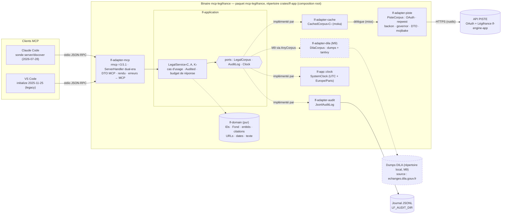
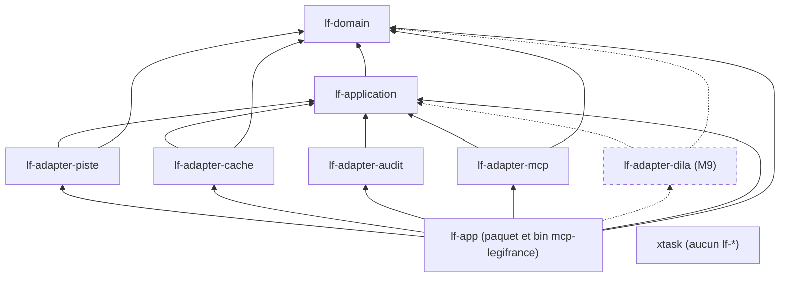
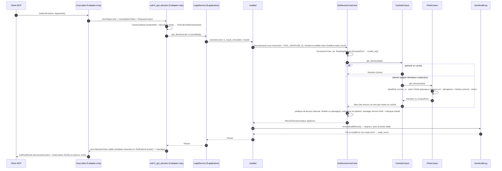

# 02 — Architecture cible (hexagonale, workspace multi-crates)

> Ce document applique les décisions normatives de [00-decisions.md](00-decisions.md) (révision 2, amendements `AM-01…AM-43`). Il en reprend les noms, les crates, les ports, les erreurs et les jalons sans y déroger. Il décrit la **structure** du produit : crates, dépendances, ports, cas d'usage, décorateurs, composition, erreurs, concurrence et observabilité.
> Document propriétaire (00 §0) : 02 fait foi pour les **dépendances, les crates et les règles d'architecture**. Il renvoie sans recopier le détail à 04 pour les internes et les fixtures de `lf-adapter-piste`, à 05 pour le contrat des outils et le texte des messages, à l'annexe D pour le protocole, à 06 pour les tests, les chemins de tests, la CI, les lints et les règles de `check-deps` (dont R9), à 08 pour la distribution et à 09 pour les registres des risques et des vérifications.
> Les autres documents détaillent le reste : le domaine dans [03-domaine.md](03-domaine.md), l'adapter PISTE dans [04-adapter-piste.md](04-adapter-piste.md), les schémas d'outils dans [05-outils-mcp.md](05-outils-mcp.md), les tests et la CI dans [06-qualite.md](06-qualite.md), l'ordre des tâches dans [07-feuille-de-route.md](07-feuille-de-route.md), la distribution dans [08-distribution.md](08-distribution.md) et le registre des risques et des vérifications dans [09-risques-et-questions.md](09-risques-et-questions.md). Le protocole est détaillé dans [annexes/D-mcp-2026-07-28.md](annexes/D-mcp-2026-07-28.md).
>
> Conventions :
> - Les extraits Rust sont **non compilés, à valider en M0**.
> - « La référence Python » désigne `matematicsolutions/fr-eli-mcp@d3b5b13`.
> - Un point non vérifié est marqué **NON VÉRIFIÉ** suivi d'une étiquette `[v:…]`, reprise ensuite dans le registre `V-01…V-215` de [09-risques-et-questions.md](09-risques-et-questions.md).
> - Les choix adoptés par défaut sur une question de l'utilisateur (`Q1…Q15`, 00 §13) sont appliqués ici et restent à confirmer. Sans réponse de l'utilisateur à l'ouverture de M0, M0 démarre sous le nom actuel du dépôt avec ces propositions par défaut ; le renommage éventuel du dépôt (Q1) se fait ensuite, redirection GitHub vérifiée (00 §13).
> - Les sources sont citées en ligne. Les vérifications faites spécialement pour ce document (index crates.io, sources de `rmcp-v3.5.1`, `moka v0.12.16`, `governor v0.10.4`, `cargo-deny 0.20.2`, `cargo-dist v0.33.0`, lues le 2026-10-15 ; dates de publication de l'index et sources de `tokio-1.53.3`, lues le 2026-10-16) sont listées dans la section [Sources](#sources).

---

## Sommaire

1. [Vue d'ensemble de l'hexagone](#1-vue-densemble-de-lhexagone)
2. [Arborescence du dépôt cible](#2-arborescence-du-dépôt-cible)
3. [Fiches par crate](#3-fiches-par-crate)
4. [Règles de dépendance et vérification](#4-règles-de-dépendance-et-vérification)
5. [Ports](#5-ports)
6. [Cas d'usage et façade `LegalService`](#6-cas-dusage-et-façade-legalservice)
7. [Décorateurs : `Audited` et `CachedCorpus`](#7-décorateurs--audited-et-cachedcorpus)
8. [Composition root (`lf-app`)](#8-composition-root-lf-app)
9. [Modèle d'erreurs en couches](#9-modèle-derreurs-en-couches)
10. [Concurrence et async](#10-concurrence-et-async)
11. [Observabilité](#11-observabilité)
12. [Extensibilité](#12-extensibilité)
13. [Décisions et alternatives écartées](#13-décisions-et-alternatives-écartées)
14. [Sources](#sources)

---

## 1. Vue d'ensemble de l'hexagone

### 1.1 Schéma



Les crates et leurs dépendances autorisées, d'après [00-decisions §2](00-decisions.md#2-workspace-cargo) :



### 1.2 Principes

1. **Les dépendances pointent vers l'intérieur.** Les adapters dépendent de `lf-application` et de `lf-domain`. `lf-application` dépend de `lf-domain`. `lf-domain` ne dépend d'aucun crate `lf-*`. Aucun adapter ne dépend d'un autre adapter. Seul `lf-app` connaît les types concrets ([00-decisions §2](00-decisions.md#2-workspace-cargo)). Ces règles sont vérifiées mécaniquement en CI (§4).
2. **Le domaine est pur.** `lf-domain` n'a ni I/O, ni async, ni `serde_json`, ni horloge système. Il n'appelle jamais `Utc::now()` ; la date du jour lui est passée en paramètre. Il est donc déterministe et se teste par propriétés (`proptest`).
3. **L'application orchestre sans connaître les SDK.** `lf-application` contient les ports (traits), les cas d'usage, la façade `LegalService`, le décorateur `Audited` et la politique de budget de réponse. Aucun type `rmcp::model::*` ni `reqwest::*` n'y apparaît. Les changements incompatibles de rmcp restent ainsi confinés à un seul crate : l'API a connu au moins quatre versions incompatibles en 2026 (0.17, 1.0, 2.0, 3.0), et `LATEST` a changé dans une mineure, 3.5.0 (00 §6 ; recherche 09 §0, §7a).
4. **Les adapters traduisent.** L'adapter entrant `lf-adapter-mcp` convertit les messages JSON-RPC en appels de la façade, puis les résultats et les erreurs en réponses MCP. Les adapters sortants convertissent les ports en HTTP PISTE, en mémoire (cache), en fichier JSONL (audit) ou en horloge système.
5. **Les génériques sont monomorphisés une fois.** Les ports sont des traits RPITIT `+ Send`. Le dispatch est statique (ADR-0012). La seule instanciation de production est `LegalService<CachedCorpus<PisteCorpus>, JsonlAuditLog, SystemClock>` ; les tests utilisent des faux.
6. **Des décorateurs plutôt que du code dupliqué.** La référence répète le même bloc audit/try/except dans chaque outil, d'où des trous d'audit (D-07, D-02). Ici, l'audit est un décorateur posé sur chaque exécution de cas d'usage (`Audited`, ADR-0008), et le cache un décorateur du port (`CachedCorpus`, ADR-0007).
7. **Le démarrage ne fait aucune E/S réseau, et stdout est réservé au protocole.** `server/discover` est servi à partir de données statiques. Le jeton OAuth, le client HTTP, la table des codes (M6) et le fichier d'audit sont créés paresseusement (00 §6 ; recherche 08 §5.1 ; D-05, D-39).
8. **Pas de configuration distante ni de télémétrie** (ADR-0005). Cela supprime D-04 et E-07.
9. **Les erreurs sont typées et traduites à chaque frontière** : `DomainError` → `AppError` ← `CorpusError`, puis résultat MCP (§9). Aucun secret, jeton ou chemin local n'apparaît dans un message destiné au modèle (D-40).

### 1.3 Parcours d'un appel d'outil

Le parcours suit `fr_get_decision`. Les autres consultations suivent le même chemin, avec leur propre cas d'usage.



---

## 2. Arborescence du dépôt cible

```text
mcp-legifrance/                      # ex-mcp-ligitfrance, renommé par son propriétaire le 2026-10-16 (Q1, 00 §0)
├── Cargo.toml                       # workspace virtuel : resolver = "3", [workspace.package|dependencies|lints], profils
├── Cargo.lock                       # versionné (produit binaire) ; verrou initial T-M0-05, pas avant le 2026-10-19 (§3.0.1) ;
│                                    # montée de rmcp manuelle uniquement
├── rust-toolchain.toml              # toolchain épinglée 1.99.0 + rustfmt, clippy (RUSTUP_TOOLCHAIN=1.97.0 en local tant que le conteneur ne peut pas l'installer, Q6)
├── rustfmt.toml                     # style_edition = "2024", max_width = 100
├── clippy.toml                      # disallowed-methods (horloge, env, exit), allow-unwrap/expect-in-tests
├── deny.toml                        # cargo-deny : advisories, licenses, bans (wrappers), sources
├── dist-workspace.toml              # configuration cargo-dist 0.33 (ou [workspace.metadata.dist]) — 08-distribution
├── server.json                      # manifeste du registre MCP (io.github.muchiny/mcp-legifrance, Q1) — 08
├── .cargo/config.toml               # alias `cargo xtask`
├── .config/nextest.toml             # profils nextest : default, ci, live
├── .gitattributes                   # **/tests/fixtures/** -text, tests/jsonrpc/** -text, **/snapshots/** -text (aucune conversion CRLF : sha256 des fixtures stable)
├── .gitignore                       # target/, *.snap.new, captures locales non versionnées
├── LICENSE                          # Apache-2.0 (Q2)
├── NOTICE                           # crédits : référence Python (Apache-2.0), fixtures reprises, données Légifrance/DILA (LO 2.0)
├── README.md                        # installation (dont `cargo install --git … --tag vX.Y.Z --locked`, Q13), configuration LF_*, attribution des données (Q15)
├── CHANGELOG.md                     # format Keep a Changelog ; une section par version (corrige D-43)
├── CONTRIBUTING.md                  # règles de dépendance, cargo xtask, verrou des descripteurs, tests live, montée de rmcp
├── SECURITY.md                      # signalement privé, périmètre, secrets PISTE à ne jamais publier
├── PRIVACY.md                       # hôtes contactés, données traitées — 08 §1.4, §9.8
├── about.toml, about.hbs            # configuration de cargo about (liste blanche des licences) — 08 §9.3
├── THIRD_PARTY_LICENSES.md          # généré par cargo about, versionné, vérifié en CI — 08 §9.3
├── .github/
│   ├── workflows/
│   │   ├── ci.yml                   # fmt, clippy, nextest (Linux/macOS/Windows), doc-tests, MSRV 1.91, deny, check-deps, pureté
│   │   ├── release.yml              # généré par `dist init` (ne pas éditer à la main) — 08
│   │   ├── release-gates.yml, build-mcpb.yml, publish-oci.yml, publish-mcp-registry.yml …
│   │   │                            # jobs personnalisés de la release ; liste et contenu : 08 §7.4-§7.5
│   │   │                            # (pas de publish-crates.yml en v0.x, Q13)
│   │   └── live.yml                 # smoke tests PISTE sandbox seulement (déclenchement manuel + planifié) ; jamais d'identifiants de production en CI (Q3)
│   ├── scripts/                     # install-mcp-publisher.sh (08 §7.5) ; check-min-age.sh (règle d'âge minimal,
│   │                                # 00 §2 ; étape min-age du job deny, 06 §9.4 ; esquisse à valider en M0, T-M0-05)
│   ├── dependabot.yml               # cargo + github-actions ; rmcp et rmcp-macros ignorés (montée manuelle)
│   └── pull_request_template.md     # case « descripteurs/instructions modifiés ? », « règles de dépendance ? »
├── crates/
│   ├── lf-domain/                   # §3.1
│   ├── lf-application/              # §3.2
│   ├── lf-adapter-piste/            # §3.3
│   ├── lf-adapter-cache/            # §3.4
│   ├── lf-adapter-audit/            # §3.5
│   ├── lf-adapter-mcp/              # §3.6
│   ├── lf-app/                      # §3.7 (paquet et binaire mcp-legifrance ; répertoire lf-app, Q1)
│   └── lf-adapter-dila/             # §3.9 (M9 seulement)
├── xtask/                           # §3.8 : lock-descriptors, check-deps, record-fixture, instructions-size
├── tests/                           # données de test partagées, pas un crate (chemins : 06 §1.4, qui fait foi)
│   ├── tools.lock.json              # verrou des descripteurs (cargo xtask lock-descriptors --update ; 05 §9) — 00-decisions §10
│   ├── jsonrpc/                     # transcriptions JSON-RPC brutes stdio : legacy (initialize) et modern (discover, _meta)
│   └── conformance-baseline.yml     # M8 : échecs attendus de la suite officielle, chacun justifié (06 §1.4)
├── fuzz/                            # hors workspace : cibles cargo-fuzz (06 §1.4)
├── packaging/
│   ├── mcpb/                        # manifest.json, launcher (lanceur POSIX), icon.png — bundle MCPB unique, 08 §4.2
│   └── oci/                         # Dockerfile (distroless non-root, LABEL io.modelcontextprotocol.server.name), prebuilt/,
│                                    # data/audit/.keep (répertoire /data/audit de l'image) — 08 §5.2
└── docs/
    ├── plan/                        # ce plan (README.md : index ; 00…09, annexes/) ; annexes/donnees/ : golden de parité et scripts
    │                                # versionnés scripts/golden.py, check_golden.py, dto_repair_check.py (00 §10)
    ├── adr/                         # README.md + 0001…0014
    └── recherche/                   # rapports bruts 01…09
```

Les fixtures PISTE sont **locales au crate** : `crates/lf-adapter-piste/tests/fixtures/{reference,recorded,synthetic}/` (16 fixtures de la référence, dont 6 en mojibake, D-35 ; captures de `cargo xtask record-fixture` ; cas construits). Leur disposition et leurs sidecars `.meta.toml` sont fixés par 04 §1.5 et §13.3-§13.4. Les fichiers de test sont listés par 06 §1.4 et ceux de la distribution par 08 §2.2, §4.2, §5.2 et §7.4 : l'arbre ci-dessus ne recopie que l'essentiel.

### 2.1 Contenu de chaque crate

```text
crates/lf-domain/src/             # disposition détaillée : 03-domaine §1.5 (fait foi)
    ├── lib.rs            # lints hérités ; ré-exports
    ├── error.rs          # DomainError (+ IdError, DateError)
    ├── id/               # newtypes à préfixe (LegiTextId … AccoTextId), VersionedId, ArticleId, DecisionId
    ├── fond.rs           # Fond (+ Jorf en M7) ↔ fond API, PaginationMode
    ├── status.rs         # LegalStatus
    ├── date.rs           # VersionDate, DateRange, epoch ms (négatifs), sentinelles, format_fr
    ├── contract/         # contrat de citation v2 : CitationContract, SourceUrl, règles, Ecli, Eli, Nor, Idcc
    ├── search.rs         # SearchQuery, QueryText, MatchMode, PageSize ; M6 : NumberQuery, NumberKind (forme : annexe B §6.6)
    ├── entity/           # SearchHit/SearchPage, TocNode, Act, ArticleText, Decision, Deliberation, Convention,
    │                     # CompanyAgreement, Coverage (+ PisteEnvironment) ; M6 : CodeListing ; M7 : ArticleVersion, RelatedLinks
    ├── text/             # from_html, clean, LongText, window, passages, rank (BM25), summary,
    │                     # encoding (réparation du mojibake : fonction pure appelée par l'adapter, 03 §7.1)
    └── citation/         # M6 : parse (winnow 1.0 + aho-corasick), dictionnaires codes et juridictions
crates/lf-application/src/
    ├── lib.rs
    ├── ports/            # mod.rs, corpus.rs (LegalCorpus, CorpusError), audit.rs (AuditLog, AuditRecord…), clock.rs
    ├── input.rs          # ToolCall<I>, CanonicalInput, InputError, entrées par outil (SearchInput…)
    ├── output.rs         # sorties par outil, AuditMetric
    ├── usecase/          # un module par outil : search.rs, get_act.rs, … (v0.1) ; verify_citations.rs, resolve.rs (M6) ;
    │                     # get_related.rs, diff_article.rs, search_all.rs, resource.rs, complete.rs (M7)
    ├── service.rs        # LegalService<C, A, K>, ServiceSettings
    ├── audited.rs        # Audited<A>, AuditMode, CallMeta
    ├── deadline.rs       # Deadline : échéance de l'appel, variable locale de tâche (tokio::task_local!, 00 §3)
    ├── budget.rs         # ResponseBudget, ReadingRequest, politique résumé / fenêtre / passages,
    │                     # estimation conservatrice du plafond de 45 000 caractères et ordre de dégradation (00 §7)
    ├── coverage.rs       # appelle la fonction pure du domaine (lf_domain coverage, 03 §4.8) + état de configuration (D-34)
    ├── tools.rs          # ToolName (constantes fr_*), liste ALL (test de dérive)
    ├── messages.rs       # tous les messages destinés au modèle (parité, aides, not_found, upstream, config, audit ; textes de 05 §7)
    ├── error.rs          # AppError (porte le message final), ErrorCode, UpstreamCause
    └── testing.rs        # feature "test-support" : FakeCorpus, FixedClock, MemoryAuditLog, FailingAuditLog
crates/lf-adapter-piste/          # disposition détaillée : 04 §1.5 (fait foi) ; modules ci-dessous repris de 04
├── src/              # lib.rs, config.rs, auth.rs (TokenManager mono-vol), http.rs (client paresseux, corps borné),
│                     # encoding.rs (UTF-8 strict puis réparation du mojibake par lf_domain::text::encoding),
│                     # classify.rs (statut + corps → CorpusError), retry.rs (backon, Retry-After),
│                     # deadline.rs (lecture de lf_application::deadline::Deadline), limit.rs (sémaphore + governor),
│                     # time.rs (MonoClock, Sleeper), request/, dto/, map/, memo.rs (PaginationMemo ; CodeTable en M6),
│                     # corpus.rs (impl LegalCorpus)
├── examples/record_fixture.rs   # feature `record`, lancé par `cargo xtask record-fixture` (identifiants requis, 04 §13.4)
└── tests/            # fixtures/{reference,recorded,synthetic}/ + tests wiremock, golden, live (#[ignore]) : 04 §13, 06 §1.4
crates/lf-adapter-cache/src/      # lib.rs, corpus.rs (CachedCorpus), key.rs (CacheKey, Op), policy.rs (TTL, capacité),
                                  # expiry.rs (impl moka::Expiry), weight.rs (trait Weigh)
crates/lf-adapter-audit/src/      # lib.rs, log.rs (JsonlAuditLog), line.rs (sérialisation ordonnée), hash.rs (SHA-256),
                                  # writer.rs (fil d'écriture + accusé ; par ligne : verrou .mcp-legifrance.lock, ouverture
                                  # en ajout, write_all, sync_data, fermeture), rotation.rs (sous le même verrou)
crates/lf-adapter-mcp/
├── src/
│   ├── lib.rs            # pub use ServerIdentity, serve_stdio, (feature http) serve_http, ServeOutcome, ServeError
│   ├── server.rs         # LegifranceServer<C, A, K> + impl ServerHandler (get_info, versions, discover, list_tools…)
│   ├── tools.rs          # #[tool_router] : une méthode par outil (v0.1, puis v0.2 et v0.3 en routeurs combinés)
│   ├── params.rs         # paramètres d'outils (Deserialize + JsonSchema) ; input_schema::<P>() (schéma d'entrée explicite)
│   ├── views.rs          # sorties (Serialize + JsonSchema, racine objet, champs omis avec #[serde(default)]) ;
│   │                     # mesure exacte de la taille sérialisée (plafond de 45 000 caractères, 00 §7)
│   ├── decode.rs         # JsonObject → ToolCall<I> (décodage audité)
│   ├── canonical.rs      # JSON canonique des arguments (empreinte d'audit, vecteurs P-041)
│   ├── failure.rs        # ToolFailure (IntoContents : préfixe « [code] » + message de l'application) ; erreurs resources → ErrorData
│   ├── text.rs           # INSTRUCTIONS (anglais, ≤ 3 500 car., attribution des données), titres et descriptions d'outils
│   │                     # en anglais, textes des prompts en français (Q14, Q15)
│   ├── versions.rs       # SUPPORTED = [2026-07-28, 2025-11-25, 2025-06-18]
│   ├── resources.rs, prompts.rs, completions.rs   # M7 (prompts sans #[prompt_handler], §3.6)
│   ├── stdio.rs          # serve_stdio, PreLifecycleFilter (annexe D §4.3), fin ConnectionClosed/Cancelled → code 0
│   └── http.rs           # M8, feature "http"
└── tests/                # inprocess.rs (duplex), protocol_raw.rs, descriptors.rs, instructions.rs, rendering.rs,
                          # budgets.rs, snapshots/ — liste : 06 §1.4
crates/lf-app/
├── src/
│   ├── main.rs           # runtime, sous-commandes, codes de sortie
│   ├── cli.rs            # clap
│   ├── config.rs         # EnvSource, AppConfig, table des variables (§8.2), compatibilité FR_ELI_*, variables héritées ignorées
│   ├── wiring.rs         # alias de types, construction de LegalService (AnyCorpus en M9)
│   ├── clock.rs          # SystemClock
│   ├── logging.rs        # tracing-subscriber sur stderr
│   ├── shutdown.rs       # signaux → CancellationToken
│   └── check.rs          # sous-commande check-config
└── tests/                # cli.rs, e2e_stdio.rs (JSON-RPC brut, deux ères), stdout_only_jsonrpc.rs, … — liste : 06 §1.4
xtask/src/                # main.rs, check_deps.rs (+ rules.rs), lock_descriptors.rs, record_fixture.rs, instructions_size.rs
```

### 2.2 Rôle des fichiers racine

| Fichier | Contenu attendu | Source ou décision |
|---|---|---|
| `Cargo.toml` | `[workspace]` virtuel avec `resolver = "3"` **explicite** : un workspace virtuel reste au résolveur 1 sinon. `members` en liste explicite. `[workspace.package]` : `version`, `edition = "2024"`, `rust-version = "1.91"`, `license`, `repository`. `[workspace.dependencies]` (§3.0), `[workspace.lints]` (§3.0.3), `[profile.release]`. | 00-decisions §2 ; recherche 04 §4.3 |
| `rust-toolchain.toml` | `channel = "1.99.0"`, `components = ["rustfmt", "clippy"]`, `profile = "minimal"`. La date de sortie de 1.99.0 est **NON VÉRIFIÉE** [V-16 · date-rust-1-99] ; seul le tag `1.99.0` est attesté (recherche 04 §5.2). Tant que le conteneur de développement ne peut pas installer cette toolchain, `RUSTUP_TOOLCHAIN=1.97.0` en local (≥ MSRV 1.91) ; la CI garde l'épinglage, et les lints propres à 1.98 et 1.99 ne sont vus qu'en CI (Q6). | 00-decisions §2, §13 (Q6) |
| `rustfmt.toml` | `style_edition = "2024"`, `max_width = 100`. Uniquement des options stables : rmcp utilise des options nightly, qu'on ne reprend pas. | recherche 04 §5.2 |
| `clippy.toml` | `allow-unwrap-in-tests = true`, `allow-expect-in-tests = true`. `disallowed-methods` : `chrono::Utc::now`, `chrono::Local::now`, `std::time::SystemTime::now` (passer par le port `Clock`) ; `std::env::var`, `std::env::var_os`, `std::env::vars` (lecture réservée à `lf-app::config`) ; `std::process::exit` (sortie gérée par `main`). Chaque usage légitime porte un `#[expect(clippy::disallowed_methods, reason = "…")]` local. La correspondance des chemins ré-exportés de chrono (`chrono::Utc` = `chrono::offset::Utc`) est **NON VÉRIFIÉE** [V-13 · clippy-disallowed-chrono]. | D-19, D-42 |
| `deny.toml` | Voir §4.3. `[graph] all-features = true`. Advisories : vulnérabilités et yanked refusés. Licences : liste blanche compatible Apache-2.0, ce qui exclut de fait l'AGPL. Bans : `wrappers` pour les crates confinés, `openssl-sys` et `native-tls` refusés. Sources : crates.io seulement. | 00-decisions §10, §12 |
| `.cargo/config.toml` | `[alias] xtask = "run --package xtask --quiet --"`. L'éventuel CRT statique Windows est tranché dans [08-distribution.md](08-distribution.md). | 00-decisions §2 |
| `.config/nextest.toml` | Profil `ci` : `fail-fast = false`, `slow-timeout`. Profil `live` : uniquement les tests `#[ignore]`, `test-threads = 1` pour ménager le quota PISTE. | 00-decisions §10 |
| `dist-workspace.toml` | Configuration de cargo-dist 0.33.0. Le livre accepte `dist-workspace.toml` ou `[workspace.metadata.dist]` (book `reference/config.md:8-11`). Le fichier réellement produit par `dist init` pour un workspace Rust est **NON VÉRIFIÉ** [V-169 · cargo-dist-emplacement-config] (08 §2.1 l'a lu dans le code d'`init.rs` ; confirmation au premier `dist init` de M0). Archives et installeurs portent le nom du paquet `mcp-legifrance` (§3.7). | 00-decisions §12 |
| `server.json` | Registre MCP : `LF_PISTE_CLIENT_ID` et `LF_PISTE_CLIENT_SECRET` en `environmentVariables` (`isSecret: true`) ; ni les réglages avancés `LF_PISTE_RPS`, `LF_PISTE_BURST`, `LF_PISTE_CONCURRENCY`, `LF_PISTE_MOJIBAKE_REPAIR` (00 §1), ni paquet `cargo` en v0.x (Q13). Version générée par `cargo xtask lock-descriptors` (§3.8). | 00-decisions §1, §12 |
| `LICENSE`, `NOTICE` | Apache-2.0. `NOTICE` crédite la référence Python et les fixtures reprises, et mentionne la source des données « Légifrance / DILA » sous Licence Ouverte 2.0. | 00-decisions §12 ; recherche 01 §13 |
| `CHANGELOG.md` | Absent de la référence alors que sa CONSTITUTION l'exige (D-43). Une entrée par version, avec les divergences volontaires de parité. | D-43 |
| `CONTRIBUTING.md` | Procédures du §12 ; règles du §4 ; `cargo xtask lock-descriptors --update` après toute modification d'outil (05 §9.4) ; montée de rmcp (§12.3) ; règle d'âge minimal des dépendances (00 §2). | 00-decisions §11 (M0) |
| `SECURITY.md` | Canal privé de signalement ; secrets PISTE (CGU : clés « strictement réservées », Q4) ; aucune capture contenant un jeton. | 00-decisions §12 |
| `.gitattributes` | `**/tests/fixtures/** -text`, `tests/jsonrpc/** -text`, `**/snapshots/** -text` : une conversion CRLF sous Windows casserait le `sha256_raw` des sidecars (D-35). Le préfixe `**/` est nécessaire : un motif qui contient un `/` est ancré au répertoire du fichier, et les fixtures vivent dans `crates/lf-adapter-piste/tests/fixtures/` (§2 ; 06 §8.2). | D-35 |
| `.github/dependabot.yml` | Mises à jour `cargo` et `github-actions` ; `ignore: rmcp, rmcp-macros`, car leur montée est manuelle et testée. | 00-decisions §6 |

`[profile.release]` recommandé : `lto = "thin"`, `codegen-units = 1`, `panic = "unwind"` (la valeur par défaut, conservée volontairement). Avec `abort`, une panique dans une tâche d'outil tuerait tout le serveur ; avec `unwind`, tokio la contient dans la tâche (`JoinError`). Le profil `dist` hérite de `release` (08).

---

## 3. Fiches par crate

### 3.0 Socle commun du workspace

#### 3.0.1 Versions des dépendances externes

Versions relues dans l'index sparse crates.io le 2026-10-15 (recherche 04 §4.1, contre-vérifiées pour ce document), dates de publication relues le 2026-10-16. Ce sont des **versions de référence**, pas des planchers (00 §2, AM-26) :
- **Exigence écrite.** `[workspace.dependencies]` (§3.0.2) écrit l'exigence au niveau mineur de la version de référence : `tokio = "1.53"`, `schemars = "1.2"`, `serde_json = "1.0"`, `reqwest = "0.13"`, `rustls = "0.23"`, etc. Seuls `rmcp` et `rmcp-macros` sont épinglés `"=3.5.1"` (00 §6). Une exigence écrite au correctif de référence serait un plancher caret (`"1.53.3"` signifie ≥ 1.53.3) et interdirait le verrou ci-dessous.
- **Règle d'âge minimal.** Toute version figée dans `Cargo.lock` est publiée depuis au moins 14 jours à la date du verrouillage (pubtime de l'index sparse), sauf correctif de sécurité justifié dans la PR.
- **Verrou initial** (T-M0-05). Pour chaque crate, il retient la plus haute version publiée depuis au moins 14 jours à la date du verrou, relevée par script dans l'index sparse, et la fixe par `cargo update -p <crate> --precise <version>`. Si aucune version de la série mineure n'est assez ancienne, l'exigence descend d'une version mineure et c'est cette exigence qui est écrite : c'est le cas de `proptest`, `"1.11"` pour un verrou fait avant le 2026-10-24. `rmcp` et `rmcp-macros` 3.5.1 (publiés le 2026-10-05) deviennent éligibles le 2026-10-19 : M0 ne fait pas le verrou initial avant cette date, mais le spike M0 peut commencer avant.
- **Lint lié à schemars.** Si le `schemars` retenu par le verrou est antérieur à 1.2.3, le lint `unused_qualifications` reste désactivé jusqu'à ce que 1.2.3 soit éligible (le 2026-10-26) et verrouillé (R-22).
- **Marque ⚠.** Elle signale une version de référence publiée moins de 14 jours avant le 2026-10-15, avec sa date d'éligibilité (pubtime + 14 jours). Avant cette date, le verrou prend la plus haute version éligible de la même série. Au 2026-10-19, ce sont `tokio` 1.53.2, `schemars` 1.2.2, `serde_json` 1.0.151, `tokio-util` 0.7.19, `rustls` 0.23.45, `sha2` 0.11.0 et `jsonschema` 0.58.5, avec `proptest` 1.11.0 dans la série inférieure (pubtime de l'index, relevé le 2026-10-16).

| Crate | Version de référence | MSRV déclarée | Publiée | Crates utilisateurs | Features et remarques |
|---|---|---|---|---|---|
| `rmcp` | `=3.5.1` | 1.88 | 2026-10-05 ⚠ (éligible le 2026-10-19) | lf-adapter-mcp (dev : idem avec `client`) | features par défaut (`base64`, `macros`, `server` ; `server` active `schemars`) + `transport-io` ; `transport-streamable-http-server` en M8 seulement. Ni `request-state`, ni `elicitation`, ni `auth` (recherche 09 §7a). Épinglé exactement, comme rmcp-macros : ce sont les deux seuls crates dans ce cas (00 §6). Il reste soumis à la règle d'âge : M0 ne fait pas le verrou initial avant le 2026-10-19 (00 §2). |
| `rmcp-macros` | `=3.5.1` | 1.88 | 2026-10-05 ⚠ (éligible le 2026-10-19) | lf-adapter-mcp | rmcp 3.5.1 déclare `rmcp-macros = { version = "3.5.1" }`, une exigence **caret** (`Cargo.toml` racine du tag `rmcp-v3.5.1`, ligne 9, vérifié). Sans épinglage direct, un `cargo update` pourrait associer rmcp 3.5.1 à un rmcp-macros plus récent. Le crate est déclaré mais pas utilisé directement : `[package.metadata.cargo-machete] ignored = ["rmcp-macros"]`. C'est la seule exception à la règle des squelettes de M0 (une dépendance n'est déclarée que lorsqu'un code l'emploie, 00 §2 ; §3.0.2). |
| `schemars` | `1.2.3` | 1.74 | 2026-10-12 ⚠ (éligible le 2026-10-26) | lf-adapter-mcp | 1.x imposé par rmcp (`schemars ^1.0`, feature `chrono04`). Dépendance directe nécessaire, car le derive émet des chemins `schemars::…`. Exigence `"1.2"`. Le lint `unused_qualifications` exige ≥ 1.2.3 (recherche 04 §2.16) : il reste désactivé tant que le verrou retient une version antérieure, 1.2.2 avant le 2026-10-26 (00 §2, R-22). |
| `serde` | `1.0.229` | 1.56 | 2026-07-18 | adapters, lf-app | `derive`. Interdit dans lf-domain et lf-application (00 §2, §4). |
| `serde_json` | `1.0.154` | 1.71 | 2026-10-11 ⚠ (éligible le 2026-10-25) | adapters, lf-app, xtask | Interdit dans lf-domain et dans lf-application (liste fermée de 00 §2, §4). |
| `serde_path_to_error` | `0.1.20` | 1.61 | 2025-09-15 | lf-adapter-piste, lf-adapter-mcp | chemin JSON fautif dans `Decode` et `InputError` (recherche 03 §8). |
| `thiserror` | `2.0.21` | 1.77 | 2026-09-23 | tous les crates bibliothèques | |
| `tokio` | `1.53.3` | 1.71 | 2026-10-13 ⚠ (éligible le 2026-10-27) | plusieurs (ci-contre) | `default-features = false` au workspace (la valeur par défaut de tokio est déjà vide). Features par membre : lf-application `time`, `macros`, `rt` (`rt` pour `tokio::task_local!` seulement, `Deadline`, 00 §2-§3) ; lf-adapter-piste `time`, `sync` ; lf-adapter-audit `sync` (canal et accusé ; le fil d'écriture est un `std::thread`) ; lf-adapter-mcp `macros`, `io-std` (`tokio::io::stdin()`/`stdout()` de l'`AsyncRwTransport` enveloppé, §3.6 ; rmcp l'active aussi via `transport-io`, `crates/rmcp/Cargo.toml:176` du tag `rmcp-v3.5.1`, vérifié) ; lf-app `rt-multi-thread`, `macros`, `signal`, `sync`, `time` ; tests : `test-util`, `io-util`. |
| `tokio-util` | `0.7.20` | 1.85 | 2026-10-09 ⚠ (éligible le 2026-10-23) | lf-adapter-mcp, lf-app | `CancellationToken`, que rmcp ne ré-exporte pas (recherche 04 §4.1). |
| `futures` | `0.3.34` | 1.71 | 2026-08-11 | lf-application | `default-features = false`, `["std", "async-await"]` : `join_all` et `buffer_unordered` (M6, M7). |
| `reqwest` | `0.13.5` | 1.85 | 2026-09-08 | lf-adapter-piste | Liste de 04 §1.4 (00 §8). Workspace : `default-features = false`, `["json", "form"]` ; lf-adapter-piste ajoute `gzip`, `system-proxy` et la feature TLS retenue au spike M0 (`rustls`, ou `rustls-no-provider`). Ni `charset` (décodage UTF-8 strict depuis les octets, avant la réparation du mojibake), ni `http2`. `form` est indispensable au POST OAuth et n'est plus activée par défaut en 0.13 ; `rustls-tls` s'appelle désormais `rustls` ; `default-features = false` retire aussi `system-proxy`, d'où sa déclaration explicite (recherche 04 §4.1, §4.2). Variante `ring` : `rustls-no-provider` + `rustls` 0.23.46 (ligne suivante) + `install_default()` au démarrage, faute de quoi reqwest panique. Le choix final est un spike M0 : **NON VÉRIFIÉ** [V-02 · tls-fournisseur-cross] (R-09, V-02). `reqwest::Url` (ré-export de `url` 2.5.8) sert à la validation de la configuration : pas de dépendance directe à `url`. |
| `rustls` (option `ring`) | `0.23.46` | 1.71 | 2026-10-14 ⚠ (éligible le 2026-10-28) | lf-adapter-piste | Seulement si `rustls-no-provider` est retenu : `default-features = false`, `["ring", "std", "tls12", "logging"]` (04 §1.4 ; recherche 04 §4.1). |
| `secrecy` | `0.10.3` | 1.60 | 2024-10-09 | lf-adapter-piste, lf-app | `SecretString` ; `Debug` affiche `[REDACTED]`. lf-adapter-piste active la feature `serde` : le jeton OAuth est désérialisé directement en `SecretString` (04 §3.2, 00 §8). |
| `backon` | `1.6.0` | 1.85 | 2025-10-18 | lf-adapter-piste | Workspace : `default-features = false`, `["std"]` ; lf-adapter-piste n'active que `std` ; `tokio-sleep` seulement si le spike M0 montre que backon l'exige (04 §1.4, propriétaire des features), inutile si toutes les attentes passent par le `Sleeper` du crate (04 §5.2). L'API exacte de backon 1.6 est **NON VÉRIFIÉ** [V-06 · backon-api] ; le choix se fait au spike M0. |
| `governor` | `0.10.4` | — | 2025-12-16 | lf-adapter-piste | `default-features = false`, `["std"]` seule (00 §8 ; 04 §1.4) : horloge injectée bâtie sur `MonoClock`, consultée par `check()` ; ni `quanta`, ni `jitter`, ni `dashmap` (limiteurs à clés, inutiles ici). `until_ready` n'est pas utilisé : ses attentes passent par `futures_timer` et échappent au délai global (`state/direct/future.rs:11-30` du tag `v0.10.4`, vérifié ; §3.3). |
| `moka` | `0.12.16` | 1.71.1 | 2026-08-09 | lf-adapter-cache | `["future"]`. La valeur par défaut est vide. |
| `chrono` | `0.4.45` | 1.62 | 2026-06-04 | lf-domain, lf-application, adapters | `default-features = false`, `["std"]` au workspace ; **lf-app seul** ajoute `clock`. Déjà présent dans le graphe via rmcp (`now`, `serde`) : l'unification des features rend `Utc::now` compilable partout, d'où `clippy.toml` et le job de pureté (§4.4). |
| `chrono-tz` | `0.10.4` | 1.65 | 2025-07-11 | lf-app (`SystemClock`), lf-adapter-piste (midi Europe/Paris de `DATE_VERSION`, 00 §8) | Base IANA embarquée à la compilation. |
| `unicode-normalization` | `0.1.25` | 1.36 | 2025-10-30 | lf-domain | |
| `winnow` | `1.0.4` | 1.65 | 2026-07-13 | lf-domain | API 1.0 : les tutoriels 0.6/0.7 ne s'appliquent pas tels quels. |
| `aho-corasick` | `1.1.5` | 1.60 | 2026-08-03 | lf-domain | |
| `regex` | `1.13.1` | 1.65 | 2026-07-15 | lf-domain (M6) | compilées une fois (`std::sync::LazyLock`). |
| `similar` | `3.2.0` | 1.85 | 2026-08-17 | lf-application (M7) | `fr_diff_article`. Ne figure pas dans la liste des dépendances de lf-domain fixée par la décision. |
| `sha2` / `hex` | `0.11.1` / `0.4.3` | 1.88 / — | 2026-10-12 ⚠ (éligible le 2026-10-26) / 2021-03-03 | lf-adapter-audit, xtask | API `digest 0.11` **NON VÉRIFIÉE** [V-05 · api-sha2-0-11] ; 0.11.0 (2026-03-25, MSRV 1.85), retenue par un verrou fait avant le 2026-10-26. |
| `fs4` | `1.1.0` | 1.75 | 2026-04-28 | lf-adapter-audit | verrou consultatif inter-processus sur `.mcp-legifrance.lock`, pris pour chaque ligne (00 §2, §7 ; §3.5). |
| `tracing` | `0.1.44` | 1.65 | 2025-12-18 | tous sauf lf-domain | |
| `tracing-subscriber` | `0.3.23` | 1.65 | 2026-03-13 | lf-app | `default-features = false`, `["std", "fmt", "env-filter", "smallvec", "tracing-log"]` (sans `ansi`). `env-filter` ne fait pas partie des features par défaut. |
| `clap` | `4.6.7` | 1.85 | 2026-09-14 | lf-app | `derive`. Pas de feature `env` : la lecture de l'environnement est centralisée dans `config.rs`. |
| `dirs` | `6.0.0` | — | 2025-01-12 | lf-app | `data_dir()` donne le défaut de `LF_AUDIT_DIR`. 7.0.0 existe (2026-09-05, nouvelle majeure non évaluée). |
| `anyhow` | `1.0.104` | 1.68 | 2026-07-18 | lf-app, xtask | jamais dans un crate bibliothèque. |
| `cargo_metadata` / `toml` | `0.23.1` / `0.9.8` | 1.86 / 1.76 | 2025-11-12 / 2025-10-09 | xtask | |
| `jsonschema` | `0.58.6` | 1.85 | 2026-10-06 ⚠ (éligible le 2026-10-20) | xtask (validité 2020-12 des schémas dans `lock-descriptors`, 05 §9.2) ; dev des adapters | **`default-features = false`** (voir la ligne dev ci-dessous). |
| `axum` (M8) | `0.8.9` | 1.80 | 2026-04-14 | lf-adapter-mcp (feature `http`) | utilisé par les exemples rmcp. |
| `tantivy`, `quick-xml`, `tar`, `flate2` (M9) | `0.26.2`, `0.42.0`, `0.4.46`, `1.1.10` | 1.86, 1.86, 1.63, 1.67 | 2026 | lf-adapter-dila | |
| dev : `wiremock`, `insta`, `proptest`, `tempfile`, `assert_cmd`, `predicates`, `jsonschema` | `0.6.5`, `1.49.0` ⚠, `1.12.0` ⚠, `3.27.0`, `2.2.2`, `3.1.4`, `0.58.6` ⚠ | —, 1.66, 1.88, 1.63, 1.85, 1.74, 1.85 | `insta` 2026-10-03 (éligible le 2026-10-17) ; `proptest` 2026-10-10 (éligible le 2026-10-24) ; `jsonschema` : ligne ci-dessus | selon les crates | `insta` : `["json", "redactions"]`. `proptest` : exigence `"1.11"` (1.11.0, MSRV 1.85) pour un verrou fait avant le 2026-10-24, car 1.12.0 est la seule version de sa série ; `"1.12"` ensuite. `jsonschema` : **`default-features = false`**, car ses features par défaut (`resolve-http`, `resolve-file`, `tls-aws-lc-rs`, `idna`) tirent `reqwest` (index, version 0.58.6, vérifié), ce qui violerait R6 et le ban `cargo-deny` du §4.3. |

**MSRV 1.91** (00-decisions §2) : elle couvre rmcp (1.88), proptest 1.12 (1.88), sha2 0.11.1 (1.88), cargo-nextest 0.9.148 (1.91, installé en binaire) et uuid. uuid ≥ 1.27 exige 1.89 (1.27.0 et 1.28.0 déclarent `rust_version = 1.89.0` dans l'index). rmcp tire `uuid ^1` via `server`, et ce piège est sans objet avec une MSRV à 1.91 : aucune dépendance directe à `uuid` n'est nécessaire (recherche 04 §4.1 le signalait pour une MSRV 1.88).

#### 3.0.2 `Cargo.toml` racine (extrait)

```toml
# Cargo.toml — non compilé, à valider en M0
[workspace]
resolver = "3"                       # obligatoire : un workspace virtuel reste au résolveur 1 sinon
members = [
  "crates/lf-domain", "crates/lf-application",
  "crates/lf-adapter-piste", "crates/lf-adapter-cache", "crates/lf-adapter-audit", "crates/lf-adapter-mcp",
  "crates/lf-app", "xtask",
  # "crates/lf-adapter-dila",        # M9
]

[workspace.package]
version = "0.1.0"
edition = "2024"
rust-version = "1.91"
license = "Apache-2.0"
repository = "https://github.com/muchiny/mcp-legifrance"   # dépend de Q1 (…/mcp-legifrance après le renommage)

[workspace.dependencies]
# internes : pas de publication crates.io en v0.x (00 §12, Q13 ; réexamen à v1.0.0). `version` reste déclaré et
# suit `[workspace.package] version` à chaque release (08 §7.3) ; check-deps vérifie l'égalité (§4.2, étape 5)
lf-domain        = { path = "crates/lf-domain",        version = "=0.1.0" }
lf-application   = { path = "crates/lf-application",   version = "=0.1.0" }
lf-adapter-piste = { path = "crates/lf-adapter-piste", version = "=0.1.0" }
lf-adapter-cache = { path = "crates/lf-adapter-cache", version = "=0.1.0" }
lf-adapter-audit = { path = "crates/lf-adapter-audit", version = "=0.1.0" }
lf-adapter-mcp   = { path = "crates/lf-adapter-mcp",   version = "=0.1.0" }
# externes : exigence au niveau mineur de la version de référence (§3.0.1, 00 §2) ; le correctif est choisi
# par le verrou (plus haute version publiée depuis au moins 14 jours, `cargo update -p <crate> --precise <v>`)
# MCP (confiné à lf-adapter-mcp) : rmcp et rmcp-macros, seuls crates épinglés exactement (00 §6)
rmcp        = { version = "=3.5.1", features = ["transport-io"] }
rmcp-macros = "=3.5.1"
schemars    = "1.2"                  # unused_qualifications activé seulement si le verrou retient >= 1.2.3 (R-22)
# default-features = false déclaré ICI quand c'est voulu : au niveau d'un membre,
# l'héritage n'est respecté qu'à partir de Rust 1.99 (édition 2024), alors que la MSRV est 1.91
tokio   = { version = "1.53", default-features = false }
chrono  = { version = "0.4", default-features = false, features = ["std"] }
reqwest = { version = "0.13", default-features = false, features = ["json", "form"] }   # + gzip, system-proxy, TLS : membre
rustls  = { version = "0.23", default-features = false, features = ["ring", "std", "tls12", "logging"] } # option ring seulement
governor = { version = "0.10", default-features = false, features = ["std"] }
backon  = { version = "1.6", default-features = false, features = ["std"] }               # tokio-sleep seulement si le spike M0 l'exige (04 §1.4)
secrecy = "0.10"                                                                          # + serde : lf-adapter-piste
moka    = { version = "0.12", features = ["future"] }
tracing-subscriber = { version = "0.3", default-features = false, features = ["std", "fmt", "env-filter", "smallvec", "tracing-log"] }
futures = { version = "0.3", default-features = false, features = ["std", "async-await"] }
serde_json = "1.0"
# … autres lignes du tableau §3.0.1, même règle (ex. proptest = "1.11" pour un verrou fait avant le 2026-10-24)

[profile.release]
lto = "thin"
codegen-units = 1
```

Chaque membre écrit `version.workspace = true`, `edition.workspace = true`, `rust-version.workspace = true`, `license.workspace = true`, `[lints] workspace = true`, et déclare ses dépendances sous la forme `x = { workspace = true, features = [...] }`, les features étant additives. Les listes « Dépendances » des fiches (§3.1 à §3.9) décrivent la cible, pas le contenu des squelettes. En M0, un crate ne déclare une dépendance que lorsqu'un code l'emploie : les squelettes n'en déclarent pas d'avance, pour que `cargo machete` reste vert (00 §2). La seule exception est `rmcp-macros`, déclaré dans lf-adapter-mcp pour son épinglage et ignoré par `cargo machete` (§3.0.1).

#### 3.0.3 Lints de workspace

La liste qui fait foi est celle de [06-qualite.md](06-qualite.md) §8.1 (document propriétaire des lints, 00 §0). Elle ajoute au socle ci-dessous, repris de la recherche 04 §5.4 avec `unsafe_code = "forbid"` (décision), notamment `missing_docs`, `unused_lifetimes`, `let_underscore_drop`, `[workspace.lints.rustdoc]`, `print_stderr`, `unimplemented`, `allow_attributes_without_reason`, `large_futures`, `mem_forget` et `exit`. Extrait du socle :

```toml
[workspace.lints.rust]
unsafe_code = "forbid"
rust_2018_idioms = { level = "warn", priority = -1 }
unused_qualifications = "warn"            # exige schemars >= 1.2.3 ; désactivé tant que le verrou retient une version antérieure (00 §2, R-22)
missing_debug_implementations = "warn"

[workspace.lints.clippy]
all = { level = "warn", priority = -1 }
pedantic = { level = "warn", priority = -1 }
module_name_repetitions = "allow"
missing_errors_doc = "allow"
must_use_candidate = "allow"
print_stdout = "deny"                     # stdout = canal JSON-RPC
dbg_macro = "deny"
unwrap_used = "deny"
expect_used = "warn"
todo = "warn"
await_holding_lock = "deny"               # aucun verrou std tenu à travers un .await
```

Deux points sont à mesurer au premier `cargo clippy` du spike M0, tous deux **NON VÉRIFIÉS** [V-15 · rmcp-macros-unsafe-forbid] :
- la compatibilité du code généré par `#[tool_router]` et `#[tool]` avec `forbid(unsafe_code)` : un `#[allow(unsafe_code)]` émis par une macro est une erreur dure sous `forbid`, auquel cas on repasse à `deny` ;
- le bruit de `clippy::pedantic` sur ce même code, à traiter par des `#[allow]` ciblés.

`edition 2024` rend `std::env::set_var` `unsafe`, ce qui est interdit par le lint ci-dessus. Les tests de configuration doivent donc injecter un `EnvSource` (§8.2) au lieu de modifier l'environnement du processus.

### 3.1 `lf-domain`

- **Responsabilité** : le cœur pur ([00-decisions §4](00-decisions.md#4-domaine-lf-domain)). Il valide les identifiants et les fonds, porte les entités et le contrat de citation v2 (ADR-0009), les URLs Légifrance, les dates civiles et sentinelles (ADR-0011), le traitement de texte (HTML → paragraphes, nettoyage, passages, BM25, fenêtre, résumé) et, en M6, le parseur de citations. Le détail est dans [03-domaine.md](03-domaine.md).
- **Modules publics** (disposition de [03-domaine.md](03-domaine.md) §1.5, qui fait foi) : `id`, `fond`, `status`, `date`, `contract`, `search`, `entity`, `text` (`from_html`, `clean`, `window`, `passages`, `rank`, `summary`, `encoding`), `citation` (M6), `error`.
- **Types exportés** :
  - identifiants : `LegiTextId`, `LegiArtiId`, `JorfTextId`, `KaliTextId`, `KaliArtiId`, `JuriTextId`, `ConsTextId`, `CetaTextId`, `CnilTextId`, `AccoTextId`, `VersionedId`, `ArticleId`, `DecisionId`, `Ecli` ;
  - recherche et environnement : `Fond`, `PaginationMode`, `PisteEnvironment`, `SearchQuery`, `MatchMode`, `QueryText`, `PageSize`, `DateRange`, `VersionDate`, `SearchHit`, `SearchPage` ;
  - entités et texte : `Act`, `TocNode`, `ArticleText`, `Decision`, `Deliberation`, `Convention`, `CompanyAgreement`, `Coverage` (+ fonction pure `coverage(…)`, dont la signature et les lacunes calculées sont fixées par 03 §4.8), `LongText`, `Window`, `Segment` (noms de 03) ; `text::encoding::repair_latin1_mojibake` (fonction pure, tout-ou-rien, appliquée au corps par l'adapter PISTE, 00 §4, §8) ;
  - M6 et M7 : `NumberQuery`, `NumberKind`, `NumberValue` (forme : annexe B §6.6, placés dans `search.rs`), `CodeListing` (entrée de `list_codes()`, M6), `ArticleVersion` et `RelatedLinks` (M7), définis dans 03 ;
  - erreurs : `DomainError`.
  - Les types de sortie sont `Clone`, `Send` et `Sync`. Une recommandation pour 03 : `LongText` partage ses paragraphes par `Arc<str>`, pour que le clone servi par le cache (§7.2) reste bon marché.
- **Dépendances (liste blanche normative ; versions de référence, exigences au niveau mineur, §3.0.1)** : `thiserror` 2.0.21, `chrono` 0.4.45 (`std`, sans `clock`), `unicode-normalization` 0.1.25, `winnow` 1.0.4, `aho-corasick` 1.1.5, `regex` 1.13.1 (M6). Rien d'autre, ni `tracing`, ni `serde`. Dev : `proptest` 1.12.0, `insta`.
- **Features Cargo** : aucune.
- **Pièges** :
  1. La décision ne prévoit **aucun crate HTML** dans le domaine. `text::from_html` (reconstitution des paragraphes depuis `texteHtml`, D-26) est donc écrit à la main : tokeniseur de balises de bloc (`<p>`, `<br/>`, `<div>`, `<li>`), décodage des entités (`&nbsp;`, `&amp;`, `&#NNN;`), et tests sur les fixtures CETAT (85 `<br/>`) et CNIL (`<p>`) (recherche 02 D-26).
  2. L'unification des features rend `chrono::Utc::now` disponible dans le workspace complet, parce que rmcp active `now`. La pureté se vérifie donc par `cargo check -p lf-domain` seul, qui résout les features de ce seul graphe (§4.4), et par `clippy.toml`.
  3. `FromStr` est strict (préfixe de 8 lettres + 12 chiffres). Le suffixe `_JJ-MM-AAAA` (LEGITEXT) est séparé dans `VersionedId` (décision §4 ; E-16, E-17, E-36).
  4. Pas de `Rc` ni de `RefCell` : les entités traversent des tâches tokio.

### 3.2 `lf-application`

- **Responsabilité** : les ports, les cas d'usage (un par outil), la façade `LegalService<C, A, K>`, le décorateur `Audited`, l'échéance `Deadline` (variable locale de tâche) et la politique de budget de réponse, dont l'estimation du plafond de 45 000 caractères ([00-decisions §2, §3, §7](00-decisions.md#3-ports-lf-applicationports)). Ce crate rédige aussi **tous** les messages destinés au modèle (module `messages`, textes de 05 §7.2-§7.4) : `AppError` porte le message final, qu'`Audited` inscrit tel quel dans le champ `error` de l'audit (≤ 500 caractères) et auquel `lf-adapter-mcp` n'ajoute que le préfixe `[code] `. Ce crate ignore MCP, HTTP, JSON et le système de fichiers.
- **Modules publics** : `ports` (`corpus`, `audit`, `clock`), `input`, `output`, `usecase`, `service`, `audited`, `deadline`, `budget`, `coverage`, `tools`, `messages`, `error`, et `testing` (feature `test-support`).
- **Types exportés** :
  - ports : `LegalCorpus`, `CorpusError`, `AuditLog`, `AuditRecord`, `AuditStatus`, `AuditError`, `Clock` (§5) ;
  - appels : `ToolCall<I>`, `CanonicalInput`, `InputError`, puis une entrée et une sortie par outil (`SearchInput`/`SearchOutput`, …), `AuditMetric` ;
  - façade et décorateur : `LegalService`, `ServiceSettings`, `ConfigurationState`, `Audited`, `AuditMode`, `CallMeta`, `Deadline`, `ResponseBudget`, `ReadingRequest` ;
  - noms et erreurs : `ToolName`, `AppError`, `ErrorCode`, `UpstreamCause`.
  - Ré-exports : `pub use lf_domain::PisteEnvironment` (et les types de domaine cités par les ports). Grâce à eux, `lf-adapter-audit` n'a pas besoin de dépendre directement de `lf-domain` (décision §2).
- **Dépendances (liste fermée, 00 §2, vérifiée par `cargo xtask check-deps`)** :
  - `lf-domain`, `thiserror`, `chrono` (`std`) et `tracing` ;
  - `tokio` avec **seulement** `time`, `macros` et `rt` : `tokio::time::timeout` (délai global), `tokio::time::Instant` (durée mesurable en temps suspendu dans les tests D-03) et `tokio::task_local!` pour `Deadline`. `rt` n'est admis que pour `task_local!` : l'application ne lance aucune tâche et ne construit aucun runtime (§13). `task_local!` ne demande que la feature `rt` : son module est déclaré dans le bloc `cfg_rt!` de `tokio/src/task/mod.rs:277-331` (`mod task_local`, ligne 307, tag `tokio-1.53.3`, vérifié), et `task_local.rs` n'importe que `std` et `pin_project_lite`. `cargo check -p lf-application` seul le confirme à la compilation en M0 (§4.4) ;
  - `futures` (`std`, `async-await` : `join_all`, `buffer_unordered`) et `similar` (M7).
  - Sont interdits : tout adapter, `serde`, `serde_json`, `rmcp`, `reqwest`, `moka`, `governor`, `backon` et `async-trait`.
- **Features Cargo** : `test-support` expose `FakeCorpus` (réponses programmées par méthode, compteur d'appels), `FixedClock`, `MemoryAuditLog` et `FailingAuditLog`. Les autres crates l'activent en dev-dependency.
- **Pièges** :
  1. Les ports n'ont **aucune méthode par défaut**. Ainsi, un décorateur ou un faux qui oublierait une méthode ajoutée en M6 ou M7 ne compile pas : il ne peut pas renvoyer silencieusement « non supporté ».
  2. Les futures des ports sont `+ Send` dans la signature du trait. C'est obligatoire : rmcp boxe les futures d'outils en `Pin<Box<dyn Future + Send>>` (recherche 04 §2.4, §5.1).
  3. Utiliser `tokio::time::Instant`, et non `std::time::Instant`, sinon les tests en temps suspendu mesurent zéro.
  4. Pas de `#[async_trait]` ni de `dyn` (ADR-0012).
  5. `Deadline` n'est visible que dans la tâche qui exécute le cas d'usage : les cas d'usage n'utilisent pas `tokio::spawn` (sinon, propagation explicite de l'échéance). Les sous-futurs de `join_all` et `buffer_unordered` sont interrogés dans la même tâche et voient la même échéance (00 §3 ; 04 §5.3).
  6. La politique de budget **estime** la taille de la réponse (somme des longueurs en caractères des chaînes + 64 par champ ou élément, cible 42 000), puisque ce crate ne connaît ni serde ni la forme sérialisée ; la mesure exacte du `structuredContent` se fait dans `lf-adapter-mcp` (00 §7, §3.6).

### 3.3 `lf-adapter-piste`

- **Responsabilité** : `PisteCorpus: LegalCorpus` ([00-decisions §8](00-decisions.md#8-adapter-piste-lf-adapter-piste)). Il couvre :
  - l'OAuth2 `client_credentials` paresseux, mono-vol, renouvelé 60 s avant expiration ;
  - un seul `reqwest::Client`, avec des timeouts de 10 s à la connexion et de `LF_HTTP_TIMEOUT_S` (40 s) par requête ;
  - les retries `backon` : 3 tentatives au plus sur 429, 502, 503, 504 et les erreurs réseau ; 2 au plus sur 500, puis `Upstream { status: 500, retryable: false }` (un 500 répété est présumé déterministe, V-69) ; gigue, respect de `Retry-After` (≤ 30 s), plafond fixé par `LF_TOOL_DEADLINE_S` (00 §8). `Retry-After` est lu en secondes, ou en date HTTP convertie en délai par différence avec l'en-tête `Date` de la même réponse, sans horloge murale ; une date HTTP sans `Date` exploitable est ignorée et l'attente revient au backoff (04 §5.2). La présence de ces deux en-têtes chez PISTE est **NON VÉRIFIÉE** [V-63 · retry-after-piste] ;
  - le respect du délai global : lecture de `lf_application::deadline::Deadline` (durée restante, convertie dans l'horloge monotone de l'adapter à l'entrée de la méthode du port) ; aucune tentative ni attente programmée au-delà (00 §3) ;
  - le limiteur `governor` du processus, consulté par `check()` avant chaque tentative (jamais `until_ready`), et un sémaphore de `LF_PISTE_CONCURRENCY` requêtes en vol ;
  - des DTO serde minimaux, le mapping DTO → domaine et l'application au corps de la réparation du mojibake (fonction pure du domaine, interrupteur `LF_PISTE_MOJIBAKE_REPAIR`) ;
  - la construction des requêtes `/search`, avec le `PaginationMemo` (`typePagination`, 00 §7), et la table des codes (M6).
  - Le détail est dans [04-adapter-piste.md](04-adapter-piste.md), qui fait foi pour les internes du crate et ses fixtures (00 §0).
- **Modules** : disposition de 04 §1.5 (fait foi), reprise au §2.1. Seuls `PisteCorpus` et les types de configuration sont publics ; `auth`, `http`, `encoding`, `classify`, `retry`, `deadline`, `limit`, `time`, `request`, `dto`, `map` et `memo` restent privés.
- **Types exportés** (liste et méthodes : 04 §1.3 et §1.5) :
  - `PisteCorpus<K: MonoClock = TokioClock, S: Sleeper = TokioSleeper>`, générique sur ses horloges internes pour les tests ; `PisteConfig`, `PisteEndpoints` (URLs sandbox et production de la décision §8), `RateQuota`, `StatsSnapshot`. L'environnement est le `lf_domain::PisteEnvironment` (`PisteConfig.env`, `PisteCorpus::environment()`), jamais un type propre à l'adapter : `lf-adapter-cache` et `lf-application` l'utilisent sans dépendre de l'adapter (R3).
  - `PisteCorpus::new(config) -> Self`. Il ne fait aucune E/S ; le client HTTP est construit au premier appel. Le coût de construction (racines TLS via `rustls-platform-verifier`) est **NON VÉRIFIÉ** [V-04 · cout-init-reqwest].
  - `PisteCorpus::check_credentials(&self) -> Result<(), CorpusError>`, méthode inhérente hors port, utilisée par `check-config --online`.
  - `PisteCorpus::mojibake_repairs(&self) -> u64` et `stats()`, compteurs en mémoire, jamais exportés (ADR-0005).
- **Dépendances** (liste et features : 04 §1.4 ; versions et déclarations de workspace : §3.0) : `lf-application`, `lf-domain`, `reqwest` (+ `gzip`, `system-proxy`, TLS), `rustls` (option `ring` seulement), `tokio` (`time`, `sync`), `serde`, `serde_json`, `serde_path_to_error`, `secrecy` (`serde`), `backon`, `governor` (`std`), `chrono`, `chrono-tz`, `thiserror`, `tracing`. Pas de dépendance directe à `url` : `reqwest::Url`. Dev : `wiremock`, `insta`, `proptest`, `tokio` (`macros`, `rt-multi-thread`).
- **Features Cargo** : `record`, qui expose une API brute (statut, en-têtes utiles, octets) sous `#[cfg(feature = "record")]`, utilisée seulement par `examples/record_fixture.rs` et jamais activée dans le binaire (04 §13.4 ; 06 §1.4). Les tests live sont `#[ignore]` (décision §10).
- **Pièges** :
  1. reqwest 0.13 : `rustls-tls` est renommée `rustls` ; `form` et `query` ne sont plus activées par défaut ; `rustls-no-provider` sans fournisseur installé panique au premier client (recherche 04 §4.2).
  2. `rustls-platform-verifier` exige un magasin de certificats CA système dans l'image OCI ([08-distribution.md](08-distribution.md)).
  3. Les attentes de `governor::until_ready` passent par `futures_timer::Delay` et non par les timers tokio (`state/direct/future.rs:11` du tag `v0.10.4`, vérifié) : elles échapperaient au délai global et aux horloges de test. L'adapter **n'utilise pas** `until_ready` : il boucle sur `check()` avec une horloge `governor` bâtie sur `MonoClock` ; si l'attente prévue dépasse le reste du délai, il rend tout de suite `RateLimited { retry_after }` (00 §8 ; 04 §5.4). Les tests du limiteur, du jeton et du backoff utilisent `ManualClock` et `RecordingSleeper` (04 §1.5, §13.1), sans `FakeRelativeClock`, sans constructeur `with_clock` et sans geler l'horloge tokio.
  4. `tokio::time::pause()` avance automatiquement l'horloge quand le runtime est inactif. Combiné à de vraies sockets (wiremock), il peut déclencher à tort les timeouts reqwest. Les tests de l'adapter ne l'utilisent donc pas ; il reste réservé aux tests sans réseau de `lf-application`.
  5. Corps de réponse lus en flux, bornés à **16 Mio après décompression** → `Decode` au-delà (00 §8 ; D-41 ; 04 §4.3, testé à 17 Mio). La taille réelle maximale des réponses est **NON VÉRIFIÉE** [V-75 · taille-max-textes].
  6. Jamais d'en-tête `Authorization`, de corps de réponse ni de corps OAuth dans un log (§11).
  7. Réparation du mojibake sur le corps entier, après le décodage UTF-8 strict, avant serde et **avant** toute normalisation des NBSP ; jamais appliquée par défaut au texte soumis par l'utilisateur. Son origine reste à confirmer en live, **NON VÉRIFIÉ** [V-72 · mojibake-origine] (décision §8 ; V-72 ; D-35). Les stratégies sont contrôlées sur les fixtures par `docs/plan/annexes/donnees/scripts/dto_repair_check.py` (00 §10).
  8. Renommages serde explicites (`titresTM`) et `null_default` sur toutes les listes, car serde refuse `null` pour un `Vec` (recherche 03 §8).

### 3.4 `lf-adapter-cache`

- **Responsabilité** : `CachedCorpus<C: LegalCorpus>`, décorateur en mémoire du port ([00-decisions §9](00-decisions.md#9-cache-lf-adapter-cache), ADR-0007). Il gère le TTL par opération, la coalescence des requêtes identiques, une capacité bornée en octets et une clé préfixée par l'environnement. Le fonctionnement est décrit au §7.2.
- **Modules publics** : `CachedCorpus`, `CachePolicy` (TTL, capacité), `Weigh` (trait de poids implémenté pour les entités du domaine, ce que la règle d'orphelin permet puisque le trait est local).
- **Dépendances** : `lf-application`, `lf-domain`, `moka` (`future`), `tracing`. Dev : `lf-application` (`test-support`), `tokio`.
- **Features Cargo** : aucune.
- **Pièges** :
  1. `try_get_with` renvoie l'erreur sous la forme `Arc<E>` à tous les appelants coalescés (`future/cache.rs:1194-1207`, vérifié). `CorpusError` doit donc être `Clone`.
  2. moka n'utilise pas l'horloge tokio, si bien que tester les TTL sans attente réelle est **NON VÉRIFIÉ** [V-08 · moka-horloge-tests]. À défaut, on teste la politique, c'est-à-dire la fonction `Expiry`, directement.
  3. Si le futur qui initialise une entrée est abandonné (annulation), moka relance un autre appelant en attente. Au-delà de 200 abandons consécutifs sur la même clé, il panique (`value_initializer.rs:170-206`, vérifié). Ce cas pathologique est accepté et documenté.
  4. Le poids d'une entrée est un `u32` (`builder.rs:277`) ; on le sature au lieu de déborder.

### 3.5 `lf-adapter-audit`

- **Responsabilité** : `JsonlAuditLog: AuditLog`, journal JSONL en ajout seul, avec rotation par taille et par date, et empreinte SHA-256 de l'entrée canonique ([00-decisions §2, §7](00-decisions.md#7-outils-contrat-de-référence--05-outils-mcpmd-en-donne-les-schémas-complets) ; D-16, D-17).
- **Modules publics** : `JsonlAuditLog`, `AuditConfig { dir, max_file_bytes, sync: SyncPolicy }`.
- **Format de ligne**. L'ordre des clés est normatif : il prolonge P-040 et la décision §7.
  - Clés : `ts`, `tool`, `input_hash`, `output_count_or_size`, `duration_ms`, `status`, `error_code` (si erreur), `error` (si erreur, 500 caractères Unicode au plus), `env`, `server_version`.
  - Cas limites (00 §7) : annulation → `status: error`, sans `error_code`, `error: cancelled by client` ; lecture de resource (M7) → `tool: resource:<nom du gabarit>` ; prompts et completions non audités (aucun cas d'usage d'outil exécuté).
  - `ts` = `AAAA-MM-JJTHH:MM:SS.mmm+00:00`, avec le suffixe `+00:00` et non `Z` (parité E-33).
  - `input_hash` = SHA-256 hexadécimal minuscule des octets UTF-8 de `CanonicalInput` (§6.1).
  - JSON compact non échappé, comme le fait `ensure_ascii=False` dans la référence (recherche 01 §8).
  - Exemple : `{"ts":"2026-10-15T15:09:12.345+00:00","tool":"fr_get_decision","input_hash":"26eab19d…","output_count_or_size":4000,"duration_ms":412,"status":"ok","env":"sandbox","server_version":"0.1.0"}`.
- **Écriture** :
  1. Au premier `record()`, création du répertoire, puis d'un fil d'exécution dédié (`std::thread`) qui reçoit les lignes. Le démarrage du serveur ne fait donc aucune E/S disque (00 §7).
  2. Chaque `record()` envoie `(ligne, oneshot::Sender)` sur un canal `tokio::sync::mpsc` borné et attend l'accusé. Le cas d'usage ne se termine donc qu'une fois la ligne écrite, ce qu'exige le mode strict (D-16).
  3. Pour **chaque ligne**, le fil prend le verrou consultatif `fs4` sur un fichier dédié `.mcp-legifrance.lock`, ouvre le journal en ajout, exécute `write_all` puis `sync_data`, ferme le fichier et relâche le verrou (00 §7). Aucun descripteur ne reste ouvert entre deux lignes : un renommage fait par un autre processus ne laisse jamais un écrivain sur un fichier obsolète, et Windows ne refuse pas le renommage d'un fichier ouvert. Plusieurs processus, par exemple la sonde `server/discover` et la session de Claude Code, ou VS Code, peuvent ainsi écrire le même répertoire (V-164). L'atomicité, surtout sous Windows, est **NON VÉRIFIÉE** [V-164 · audit-multi-processus]. Détail et diagramme : 06 §11.5.
  4. Rotation **sous le même verrou**, au-delà de `max_file_bytes` (16 Mio) ou au changement de date UTC : renommage en `mcp-legifrance-AAAA-MM-JJ[-n].jsonl`. Aucune suppression, faute de politique de rétention.
- **Dépendances** : `lf-application`, `serde`, `serde_json`, `sha2`, `hex`, `chrono`, `tokio` (`sync`), `fs4`, `tracing`, `thiserror`. Dev : `tempfile`, `insta`.
- **Pièges** :
  1. `AuditError` porte un `detail` technique (chemin, `errno`) destiné à `tracing` uniquement. Le message vu par le modèle reste générique (D-40, §9.3).
  2. La troncature de `error` se fait en caractères et non en octets, pour ne pas couper en plein UTF-8.
  3. L'empreinte n'est **pas** salée : pour des entrées courtes, elle est réversible par énumération (D-17). Un sel ou un HMAC sera réexaminé par ADR après v0.1.0 (00 §7 ; §13.1).

### 3.6 `lf-adapter-mcp`

- **Responsabilité** : l'adapter entrant ([00-decisions §6, §7](00-decisions.md#6-protocole-mcp-exigence-utilisateur---mcp-v2-)). Il comprend le serveur `rmcp` dual-era, le `PreLifecycleFilter` du transport stdio, le décodage audité des arguments (`JsonObject`, 00 §5), les outils, les resources, les prompts et les completions (M7), le mapping des erreurs vers MCP (préfixe `[code] ` ajouté au message rédigé par l'application, §3.2), les schémas d'entrée et de sortie, le rendu, la mesure exacte de la taille du `structuredContent` (plafond de 45 000 caractères, 00 §7), et les transports stdio puis HTTP (M8). Le contrat d'outils est dans [05-outils-mcp.md](05-outils-mcp.md), le protocole dans [annexes/D-mcp-2026-07-28.md](annexes/D-mcp-2026-07-28.md).
- **API publique**, indépendante du SDK car `lf-app` ne dépend pas de rmcp (§4) :

```rust
// crates/lf-adapter-mcp/src/lib.rs — non compilé, à valider en M0
pub struct ServerIdentity { pub name: &'static str, pub version: &'static str }

pub async fn serve_stdio<C: LegalCorpus, A: AuditLog, K: Clock>(
    service: Arc<LegalService<C, A, K>>,
    identity: ServerIdentity,
    shutdown: tokio_util::sync::CancellationToken,
) -> Result<ServeOutcome, ServeError>;          // ServeOutcome = StdinClosed | Shutdown

#[cfg(feature = "http")]
pub async fn serve_http<C: LegalCorpus, A: AuditLog, K: Clock>(
    service: Arc<LegalService<C, A, K>>, identity: ServerIdentity,
    options: HttpOptions, shutdown: tokio_util::sync::CancellationToken,
) -> Result<(), ServeError>;                    // M8, conditionné à Q4

pub fn registered_tool_names() -> Vec<&'static str>;   // pour les tests de cohérence avec ToolName::ALL
```

- **Structure interne** :
  - `LegifranceServer<C, A, K> { service: Arc<LegalService<…>>, info: Arc<ServerConfig>, tool_router: ToolRouter<Self>, prompt_router (M7) }` avec un `Clone` manuel, car `derive` exigerait `C: Clone` (recherche 04 §3). `get_info()` renvoie un `ServerConfig` précalculé et cloné : rmcp l'appelle souvent, il doit rester bon marché (recherche 04 §2.2).
  - Le routeur est un **champ** utilisé par `#[tool_handler(router = self.tool_router)]` ; sans cela, il serait reconstruit à chaque requête (recherche 04 §2.4).
  - Chaque outil : `async fn fr_x(&self, args: JsonObject, ct: CancellationToken, ctx: RequestContext<RoleServer>) -> Result<Json<XView>, ToolFailure>`, avec `#[tool(name = "fr_x", description = text::FR_X, input_schema = params::input_schema::<XParams>(), annotations(read_only_hint = true, destructive_hint = false, idempotent_hint = true, open_world_hint = true))]`. `params::input_schema::<P>()` vaut `schema_for_input::<P>().unwrap_or_else(|e| panic!(…))` : `schema_for_input` renvoie `Result<Arc<JsonObject>, String>` (`common.rs:77`, vérifié), alors que l'attribut attend une valeur `Into<Arc<JsonObject>>` ; la macro fait de même pour `Parameters<T>` (`rmcp-macros/src/tool.rs:196-205`, vérifié). Une panique à la construction du routeur est captée par `tool_router_builds_and_roots_are_objects` (05 §3.6 ; 06 §2.6). Les annotations sont des littéraux, donc répétées sur chaque outil (recherche 04 §2.8) ; `open_world_hint = true` est adopté par défaut jusqu'à V-53, réexamen avant v0.1.0 (Q11).
  - Les arguments sont reçus **bruts** (`JsonObject`) et décodés par l'adapter pour une raison précise. Avec l'extracteur `Parameters<T>`, un échec de désérialisation devient un résultat in-band `failed to deserialize parameters: …`, mais il est produit par le routeur, **avant** notre code (`handler/server/router/tool.rs:144-156`, vérifié) : il ne serait ni audité, ni préfixé `[invalid_arg]` (E-29, D-02). L'extracteur `JsonObject` renvoie les arguments tels quels (`handler/server/tool.rs:252-258`, vérifié). L'attribut `input_schema` explicite remplace alors le schéma déduit (`rmcp-macros/src/tool.rs:194-216`, vérifié), et `rmcp::handler::server::common::schema_for_input::<P>()` est public (`common.rs:77`, vérifié). Que l'ensemble compile avec la détection d'`outputSchema` sur `Result<Json<T>, ToolFailure>` écrit littéralement est **NON VÉRIFIÉ** [V-28 · rmcp-jsonobject-input-schema] (V-28, spike M0). Repli si le spike M0 échoue, à acter par ADR (ADR-0008) : `Parameters<P>` avec des champs tous `Option<…>`, ce qui rend la désérialisation quasi infaillible et laisse la validation au cas d'usage. `Parameters<T>` n'est employé que pour les prompts (erreurs `-32602`, 00 §5).
  - `list_tools` et `discover` sont écrits à la main ; `#[tool_handler]` ne génère `list_tools` que s'il est absent (`rmcp-macros/src/tool_handler.rs:64`, vérifié). Sans cela, il poserait `ttl_ms: 0` (recherche 04 §2.4), alors que Q8 retient par défaut `ttlMs = 3 600 000` et `cacheScope = public`. Les indications ne sont posées que pour les pairs ≥ 2026-07-28 (`ctx.protocol_version()`), comme dans le squelette de la recherche 09 §8 ; savoir si rmcp les retire de lui-même pour les pairs legacy est **NON VÉRIFIÉ** [V-33 · rmcp-ttl-legacy]. `discover` répond `DiscoverResult::from_server_info(SUPPORTED.to_vec(), self.get_info())` (deux arguments, `model.rs:1374-1377`, vérifié), avec `ttlMs`/`cacheScope` explicites (00 §6 ; annexe D §3.2).
  - Prompts (M7) : **pas** de `#[prompt_handler]`. Contrairement à `#[tool_handler]`, cette macro **remplace** un `list_prompts` ou un `get_prompt` écrit à la main, pose `ttl_ms: 0` aux pairs modernes et reconstruit par défaut `Self::prompt_router()` à chaque appel (`rmcp-macros/src/prompt_handler.rs:28-30`, `:56-75`, `:77-104` du tag `rmcp-v3.5.1`, vérifié). Les définitions passent par `#[prompt_router]`/`#[prompt]` ; `get_prompt` et `list_prompts` sont écrits à la main sur le champ `self.prompt_router`, avec les indications de cache de Q8 pour les pairs modernes.
  - `supported_protocol_versions()` renvoie le tableau statique `[2026-07-28, 2025-11-25, 2025-06-18]` (décision §6). Repli si V-34 confirme en M4 qu'une enveloppe moderne portant une version legacy est servie sans `resultType` : `[2026-07-28]` seul dans discover, et `-32022` répondu par `PreLifecycleFilter` (00 §6).
  - `subscriptions/listen` (décision 00 §6) : par défaut, rmcp répond `-32601` (`handler/server.rs:147-154`, vérifié). En ère moderne, `accepted_subscription_filter` renvoie un filtre vide (accusé minimal, premier message `notifications: {}`), puis le `listen` par défaut attend l'annulation sans émettre de notification (`handler/server.rs:454-480`) ; en ère legacy, `-32601`. Critère M4 : un EOF de stdin avec un `listen` ouvert termine le processus (code 0) en moins d'une seconde (V-35).
  - Cycle de vie stdio : `PreLifecycleFilter` enveloppe `AsyncRwTransport::new_server(tokio::io::stdin(), tokio::io::stdout())` dès le spike M0. Le tuple `(Stdin, Stdout)` que renvoie `rmcp::transport::stdio()` n'implémente que `IntoTransport` (annexe D §4.3) ; que `serve_with_ct` accepte l'enveloppe est **NON VÉRIFIÉ** [V-29 · rmcp-transport-enveloppe] (V-29). Le filtre écarte (`debug!`) toute notification ou réponse reçue avant l'ouverture d'une ère, que rmcp 3.5.1 traiterait comme une erreur fatale (`service/server.rs:681-685`) ; filtre retiré quand rmcp le corrige. Écarts acceptés et testés : `ping` avant toute ère → `{}` ; `initialize` portant un `_meta` moderne → poignée de main legacy ; ligne non JSON ignorée (00 §6 ; annexe D §4.3, §4.7 ; V-29, V-30).
  - Ressources (M7) : ressource inconnue ou introuvable → `ErrorData::resource_not_found` avec `data.uri`, que rmcp émet en `-32002` aux pairs legacy et en `-32602` aux pairs 2026-07-28 ; identifiant invalide dans une URI de gabarit → `-32602` (`invalid_params`) dans les deux ères ; jamais `contents: []` (00 §6).
  - Transport HTTP (M8, Q4) : POST seul, sans session (GET/DELETE → 405, V-40) ; validation `Origin` à notre charge (`with_allowed_origins(liste)` + `enforce_origin_validation()`, rmcp ne validant rien avec la liste vide par défaut ; `Origin` invalide → 403) ; tout POST autre qu'`initialize` sans `MCP-Protocol-Version` → 400 + `-32020` par une couche axum (V-39) ; corps ≤ 256 Kio ; la fabrique sans état clone un prototype `LegifranceServer` dont le routeur est construit une fois ; jeton du profil local lu dans `LF_MCP_HTTP_TOKEN` (00 §1, §6 ; annexe D §5.2).
- **Dépendances** : `lf-application`, `lf-domain`, `rmcp`, `rmcp-macros`, `schemars`, `serde`, `serde_json`, `serde_path_to_error`, `tokio` (`macros`, `io-std` : `stdin()`/`stdout()` de `serve_stdio`), `tokio-util`, `tracing`, `thiserror` ; M8 : `axum`. Dev : `rmcp` (+ `client`), `insta`, `jsonschema`, `tokio` (`io-util` pour `tokio::io::split` d'un `duplex` dans le harnais de 06 §2.6, `test-util`), `lf-application` (`test-support`).
- **Features Cargo** : `http` = `["rmcp/transport-streamable-http-server", "dep:axum"]` (M8).
- **Pièges**. Ce sont ceux de la recherche 04 §2.19 et de la recherche 09 §4-5 :
  1. `get_info()` renvoie `ServerConfig` ; un `get_info` écrit à la main doit appeler `enable_tools()` (et `enable_resources/prompts/completions` en M7), sans `enable_logging()` (déprécié).
  2. `Implementation::new("mcp-legifrance", version)` explicite, jamais `from_build_env()` qui renvoie l'identité de rmcp. La version est passée par `lf-app` dans `ServerIdentity`, avec un test qui la compare à `env!("CARGO_PKG_VERSION")` (même version de workspace ; E-09).
  3. Les paramètres et sorties ont toujours une **racine objet** (bug rmcp #1337), sans combinateur racine ni `$ref` externe ; noms de propriétés ≤ 64 caractères.
  4. Pas de `x-mcp-header` (bug #1348).
  5. La dépendance doit s'appeler `rmcp`, sans renommage, et aucun module local ne doit porter ce nom, car les macros émettent `rmcp::…`.
  6. `Reference`, `ContentBlock` et `CallToolResponse` sont `#[non_exhaustive]` : un bras `_` est obligatoire.
  7. Les arguments de prompt sont des chaînes.
  8. Aucun `println!`.
  9. Les champs « requis mais tolérants » (`query`, identifiants) sont des `Option<String>` marqués requis dans le schéma, pour que le cas d'usage produise les messages de parité (P-012, « text_id is required. »). Les champs à valeurs fermées (`fond`, `match`, `detail`) sont des chaînes qui exposent un `enum` dans le schéma ; leur analyse, insensible à la casse comme l'exige P-010, se fait dans le cas d'usage. L'attribut schemars qui convient (`extend`, `schema_with`, `required`) est **NON VÉRIFIÉ** [V-11 · schemars-enum-chaine].
  10. Dans les vues de sortie, tout champ omis conditionnellement (liste vide, booléen par défaut…) porte `#[serde(default, skip_serializing_if = …)]`. Sans `default`, schemars 1.2.3 le laisse `required` dans l'`outputSchema`, car rmcp génère les schémas en contrat `Deserialize` (`schemars_derive/src/schema_exprs.rs:725-739`, `schemars/src/generate.rs` ; `common.rs:15-48` de rmcp, vérifiés), et un `structuredContent` qui l'omet ne respecterait plus le schéma annoncé. Les `Option` gardent `skip_serializing_if = "Option::is_none"`. À contrôler par le verrou des descripteurs (aucune propriété `required` d'un `outputSchema` ne correspond à un champ omissible, 05 §9.2) et par la validation des sorties contre leur schéma, y compris des vues aux listes optionnelles vides (06).

### 3.7 `lf-app`

- **Responsabilité** : la composition root et le binaire `mcp-legifrance`. Il porte la CLI, le chargement et la validation de la configuration, les secrets, le câblage, `SystemClock`, `tracing` sur **stderr**, le runtime tokio et l'arrêt propre (§8).
- **Nom du paquet** (adopté par défaut, Q1 ; 00 §1-§2) : le paquet Cargo s'appelle `mcp-legifrance`, exception à la règle du préfixe `lf-`, pour que cargo-dist, `cargo install --git` et les archives portent le nom du produit ; son répertoire reste `crates/lf-app` et ce document continue de l'appeler `lf-app`. Le binaire porte le nom du paquet (`[[bin]] name = "mcp-legifrance"`, explicite). Dans les règles de dépendance (`xtask/src/rules.rs`, `deny.toml`) et les commandes Cargo (`-p`), `lf-app` s'écrit `mcp-legifrance`. Q1 est tranchée avant toute publication immuable (registre MCP, MCPB, crates.io, GHCR).
- **Modules** : `main`, `cli`, `config`, `wiring`, `clock`, `logging`, `shutdown`, `check`.
- **Dépendances** :
  - tous les `lf-*` ;
  - `tokio` (`rt-multi-thread`, `macros`, `signal`, `sync`, `time`), `tokio-util`, `clap`, `tracing`, `tracing-subscriber`, `anyhow`, `secrecy`, `chrono` (+ `clock`), `chrono-tz`, `dirs`, `serde_json` (pour `check-config --format json`) ;
  - **pas `rmcp`**, qui passe par `lf-adapter-mcp::serve_stdio`.
  - Dev : `assert_cmd`, `predicates`, `tempfile`, `wiremock`, `serde_json`.
- **Features Cargo** : `http` (→ `lf-adapter-mcp/http`, sous-commande `serve-http`, M8) et `dila` (→ `lf-adapter-dila`, M9, proposition). Aucune n'est activée par défaut.
- **Pièges** :
  1. Initialiser `tracing` **avant** de charger le reste de la configuration, afin que les avertissements de dépréciation passent par stderr (§8.6).
  2. `RUST_LOG` est ignoré volontairement : seul `LF_LOG` compte, ce qui évite qu'un `RUST_LOG=debug` global vide les réponses complètes via rmcp.
  3. `check-config` est la **seule** commande qui écrit sur stdout, avec `writeln!(io::stdout().lock(), …)`, que `clippy::print_stdout` ne voit pas. Le mode `serve` n'y écrit jamais.

### 3.8 `xtask`

- **Responsabilité** : l'outillage du dépôt ([00-decisions §2](00-decisions.md#2-workspace-cargo)). xtask ne dépend d'aucun crate `lf-*`. Il pilote donc le binaire ou les exemples **en boîte noire**. Les quatre commandes sont celles de 00 §2 : toute nouvelle commande amende ce tableau de 00. 05 §9 fait foi pour le verrou des descripteurs, 04 §13.4 pour `record-fixture`.

| Commande | Fonctionnement | Accès réseau |
|---|---|---|
| `cargo xtask check-deps` | §4.2 (via `cargo metadata`) | non |
| `cargo xtask lock-descriptors` | Modes de 05 §9.4 : `--check` (**défaut**, CI) régénère en mémoire et compare au fichier ; `--update` réécrit `tests/tools.lock.json` ; `--compare <ref-git>` (release) classe les différences avec le verrou du tag précédent. Construit puis lance le binaire `mcp-legifrance serve` en stdio, environnement vidé, dans **trois sessions** : `server/discover` moderne, `initialize` 2025-11-25, `initialize` 2025-06-18 ; les descripteurs doivent être identiques dans les deux ères. Périmètre de 05 §9.1 : tous les champs des descripteurs de `tools/list` (dont `_meta`), `prompts/list`, `resources/list` et `resources/templates/list` (M7), `instructions`, `capabilities`, `supportedVersions` (D-37). Génère et contrôle aussi le manifeste MCPB et la version de `server.json` (08 §4.4). Aucun appel PISTE n'est fait. | non |
| `cargo xtask instructions-size` | Même principe avec `server/discover` : vérifie que `instructions` fait ≤ 3 500 caractères Unicode et affiche la taille totale des descripteurs (budget D-33). | non |
| `cargo xtask record-fixture` | Syntaxe de 04 §13.4 : `--endpoint … --body '…' --name … [--env sandbox\|production] [--allow-error] [--redact <pointeur JSON>] [--force]`, ou `--plan <plan.toml>` pour un lot (≤ 1 requête/s). Lance `cargo run -p lf-adapter-piste --example record_fixture --features record` avec les identifiants de l'environnement ; sandbox par défaut, `--env production` seulement par choix explicite du mainteneur (Q3). L'exemple écrit la réponse **brute** (octets) dans `crates/lf-adapter-piste/tests/fixtures/recorded/<endpoint>/<name>.json` et son sidecar `<name>.meta.toml`, dont il calcule `sha256_raw` et `mojibake_detected` (champs : 04 §13.4 ; D-35). En-têtes et jeton ne sont jamais écrits. | oui (identifiants requis) |

- **Dépendances** : `cargo_metadata` 0.23.1, `anyhow`, `serde_json`, `toml` 0.9.8, `sha2`, `hex`, `jsonschema` (`default-features = false`, contrôles du verrou, 05 §9.2). `publish = false`.

### 3.9 `lf-adapter-dila` (M9)

- **Responsabilité** : `DilaCorpus: LegalCorpus` hors ligne. Il traite les dumps DILA (`tar` + `flate2`, `quick-xml`) et un index `tantivy` avec analyseur français (racinisation `Language::French`, mots vides : recherche 05 §6). Il implémente **toutes** les méthodes du port. Le rendu d'une opération non couverte par les dumps est tranché en M9 (00 §5).
- **Dépendances** : `lf-application`, `lf-domain`, `tantivy` 0.26.2, `quick-xml` 0.42.0, `tar` 0.4.46, `flate2` 1.1.10, `tokio` (`rt`) : la recherche tantivy est synchrone, donc lancée dans `spawn_blocking`. Aucun client HTTP.
- **Téléchargement des dumps** (à trancher en M9, à inscrire au registre de 09) : en l'état des règles, le binaire ne peut pas télécharger lui-même les dumps, puisque `reqwest` est confiné à `lf-adapter-piste` (R6, ban `wrappers` du §4.3) et qu'un adapter ne dépend pas d'un autre (R3). Proposition par défaut : téléchargement hors binaire, par un script documenté depuis `echanges.dila.gouv.fr`, le binaire ne lisant qu'un répertoire local. Toute autre option (`wrappers` étendu à `lf-adapter-dila`, module de téléchargement dans `lf-app`) amende R3 ou R6 et `deny.toml`.
- **Sélection** : `enum AnyCorpus` dans `lf-app` (§8.5).

---

## 4. Règles de dépendance et vérification

### 4.1 Règles

Les règles R1 à R5, ainsi que les listes fermées de R1 et R2, reprennent la décision ; R6 à R8 sont des règles d'architecture de ce document ; R9 est fixée par [06-qualite.md](06-qualite.md) §9.3, propriétaire des règles de `check-deps` (00 §0). Dans les règles, `lf-app` désigne le paquet `mcp-legifrance` (§3.7).

| # | Règle | Origine |
|---|---|---|
| R1 | `lf-domain` ne dépend d'aucun `lf-*`, ni de `tokio`, `reqwest`, `serde_json` ou `rmcp`. Sa liste blanche externe est : `thiserror`, `chrono` (sans `clock` ni `now`), `unicode-normalization`, `winnow`, `aho-corasick`, `regex`. | 00-decisions §2 |
| R2 | `lf-application` ne dépend d'aucun adapter. Sa liste fermée externe : `thiserror`, `chrono` (`std`), `tracing`, `futures` (`std`, `async-await`), `tokio` (`time`, `macros`, `rt` — `rt` pour `task_local!` seulement), `similar` (M7). Interdits : `serde`, `serde_json`, `rmcp`, `reqwest`, `moka`, `governor`, `backon`, `async-trait`. | 00-decisions §2 |
| R3 | Aucun `lf-adapter-*` ne dépend d'un autre `lf-adapter-*`, ni de `lf-app`. `lf-adapter-audit` dépend de `lf-application` seul et accède aux types du domaine par ses ré-exports. | 00-decisions §2 |
| R4 | Seul `lf-app` dépend de tous les `lf-*` ; aucun crate ne dépend de `lf-app`, qui n'a pas de cible `lib`. | 00-decisions §2 |
| R5 | `xtask` ne dépend d'aucun `lf-*`, et réciproquement. | 00-decisions §2 |
| R6 | **Crates confinés**, une seule porte d'entrée : `rmcp`, `rmcp-macros`, `schemars`, `axum` → lf-adapter-mcp ; `reqwest`, `rustls` (option `ring`), `backon`, `governor` → lf-adapter-piste ; `moka` → lf-adapter-cache ; `sha2`, `fs4` → lf-adapter-audit (et xtask) ; `tantivy`, `quick-xml`, `tar`, `flate2` → lf-adapter-dila ; `clap`, `tracing-subscriber`, `dirs` → lf-app ; `anyhow` → lf-app, xtask ; `secrecy` → lf-adapter-piste, lf-app ; `chrono-tz` → lf-app (`clock`), lf-adapter-piste (midi Europe/Paris de `DATE_VERSION`), jamais lf-domain ni lf-application (00 §2). `rmcp` ne doit jamais être renommé. | 02 (recherche 04 §5.3, recherche 09 §7a) ; 00 §2 pour `chrono-tz` |
| R7 | Aucun membre ne dépend directement de `async-trait` (ADR-0012) ; seule la feature HTTP de rmcp le tire en M8. | ADR-0012 |
| R8 | Dev-dependencies : `lf-domain` et `lf-application` ne prennent aucun adapter, même en dev. Les adapters peuvent prendre `lf-application` avec `test-support`. | 02 |
| R9 | Aucune double version des crates critiques dans le graphe résolu : `tokio`, `rustls`, `reqwest`, `hyper`, `http`, `serde`, `schemars`, `rmcp`, `chrono`. | 00 §0 ; 06 §9.3 (fait foi) |

### 4.2 `cargo xtask check-deps` : algorithme

```text
1. meta ← `cargo metadata --format-version 1 --all-features --locked` (crate cargo_metadata, MetadataCommand).
   --all-features garantit le pire cas : les features `http` (M8) et `dila` (M9) sont incluses.
2. membres ← meta.workspace_members, indexés par nom de paquet.
3. Arêtes directes : pour chaque membre M et chaque dépendance déclarée d ∈ M.dependencies :
     kind ← d.kind (normal, build ou dev) ; cible ← d.name (et d.rename)
     si cible ∈ membres :
        normal/build : exiger cible ∈ RÈGLES[M].internes            (R1-R5)
        dev          : exiger cible ∈ RÈGLES[M].internes_dev         (R8)
     sinon (externe, normal/build) :
        si RÈGLES[M].liste_blanche existe : exiger cible ∈ liste_blanche   (R1, R2)
        exiger que cible ne soit confinée à un autre membre, sauf xtask    (R6)
        si RÈGLES[M].features_max[cible] existe : exiger d.features ⊆ features_max
            (ex. lf-application : tokio ⊆ {time, macros, rt} ; lf-domain : chrono ∌ clock, now)
        si cible = "rmcp" : exiger d.rename = None                         (R6)
        si cible = "async-trait" : violation                              (R7)
4. Fermeture transitive (production seulement) : depuis meta.resolve.nodes, parcourir les arêtes dont
   dep_kinds contient normal ou build ; si un paquet de INTERDITS_TRANSITIFS[M] est atteint, signaler
   la violation avec le chemin complet (ex. « lf-domain → x → tokio »).
   INTERDITS_TRANSITIFS : lf-domain = {tokio, reqwest, serde_json, rmcp} ; lf-application = {rmcp, reqwest, hyper, moka}.
5. Contrôles de manifeste : chaque membre hérite edition, rust-version, version et license du workspace
   et déclare [lints] workspace = true ; seul lf-app (paquet mcp-legifrance) déclare un [[bin]] (hors xtask) ;
   personne ne dépend de lf-app ; chaque exigence interne de [workspace.dependencies] vaut « = » + la version
   de [workspace.package] (contrôle proposé ici, à inscrire par 06 avec les autres règles).
6. Épinglage : les paquets résolus rmcp et rmcp-macros valent exactement 3.5.1, et l'exigence déclarée
   dans [workspace.dependencies] commence par « = ».
7. Doublons critiques (R9, 06 §9.3) : dans meta.resolve, au plus une version de chacun des crates de R9.
8. Sortie : une ligne par violation « check-deps: <membre> -> <dépendance> [<kind>] : <règle> (<explication>) » ;
   code 0 si aucune violation, 1 sinon ; `--format json` pour annoter la PR.
```

Les règles sont **des données** (`xtask/src/rules.rs`, une table `&[CrateRule]`). Le moteur est une fonction pure `check(&Metadata, &[CrateRule]) -> Vec<Violation>`, testée sur des métadonnées JSON synthétiques, avec au moins une violation par règle R1 à R9. Ajouter un crate, par exemple `lf-adapter-dila` en M9, oblige à ajouter sa ligne : un membre inconnu de la table est lui-même une violation.

### 4.3 Seconde ligne : `cargo deny check bans`

La syntaxe `wrappers` de cargo-deny 0.20.2 autorise des crates précis à dépendre **directement** d'un crate interdit, et refuse toute autre dépendance (`docs/src/checks/bans/cfg.md:90-96`, vérifié) :

```toml
# deny.toml (extrait) — à valider en M0
[graph]
all-features = true

[bans]
multiple-versions = "warn"
wildcards = "deny"
allow-wildcard-paths = true          # dépendances `path` des crates internes
deny = [
  { crate = "openssl-sys", reason = "TLS = rustls uniquement" },
  { crate = "native-tls",  reason = "TLS = rustls uniquement" },
  { crate = "rmcp",    wrappers = ["lf-adapter-mcp"],   reason = "SDK MCP confiné (ADR-0003)" },
  { crate = "reqwest", wrappers = ["lf-adapter-piste"], reason = "HTTP sortant confiné" },
  { crate = "moka",    wrappers = ["lf-adapter-cache"], reason = "cache confiné (ADR-0007)" },
]

[sources]
unknown-registry = "deny"
unknown-git = "deny"
```

`[graph] all-features = true` inclut les dev-dependencies : un dev-dep qui tire `reqwest` (cas de `jsonschema` avec ses features par défaut) fait échouer le ban, d'où `default-features = false` (§3.0.1). Pour la même raison, les tests HTTP de M8 n'utilisent pas `reqwest` : `tower::ServiceExt::oneshot` en processus et un client HTTP/1.1 minimal sur `TcpStream` (00 §0 ; 06 §15.1 n° 6). Le `deny.toml` complet est celui de 06 §9.1. wiremock 0.6.5 ne dépend ni de reqwest ni d'async-trait (index, vérifié). cargo-deny couvre aussi les licences : la liste blanche compatible Apache-2.0 exclut l'AGPL (`juridix`, `mcp-legifrance` de Ktulu-Analog : idées seulement, décision §12). Les avis de sécurité sont traités dans [06-qualite.md](06-qualite.md).

### 4.4 Contrôles de pureté en CI

Ce sont des jobs de `ci.yml`, dont le détail est dans [06-qualite.md](06-qualite.md) :
- `cargo check -p lf-domain` et `cargo check -p lf-application`, **seuls** : les features sont résolues pour ce graphe uniquement, ce qui vérifie que `chrono` n'y a pas `clock`/`now` et que tokio n'apporte à `lf-application` que `time`, `macros` et `rt`.
- `cargo xtask check-deps`, puis `cargo deny check`.
- `cargo tree -p lf-domain -e normal --prefix none` est archivé en artefact, pour visualiser les écarts dans une PR.

---

## 5. Ports

Les signatures suivent [00-decisions §3](00-decisions.md#3-ports-lf-applicationports) : traits RPITIT avec futur `+ Send`, implémentés par des `async fn`, en dispatch statique (ADR-0012). L'édition 2024 place `Future` dans le prélude.

### 5.1 `LegalCorpus` et `CorpusError`

```rust
// crates/lf-application/src/ports/corpus.rs — non compilé, à valider en M0
use std::time::Duration;
use lf_domain::{
    Act, AccoTextId, ArticleId, ArticleText, CnilTextId, CompanyAgreement, Convention, Decision,
    DecisionId, Deliberation, KaliTextId, LegiTextId, SearchHit, SearchPage, SearchQuery, VersionDate,
    // M6 : CodeRef, ArticleNum (03), NumberQuery (forme : annexe B §6.6, type placé dans lf-domain::search),
    //      CodeListing (03) ; M7 : ArticleVersion, RelatedLinks (03)
    // CodeListing ne réutilise pas le nom CodeEntry, pris par le dictionnaire statique de l'annexe B (&'static)
};

/// Port sortant unique vers le corpus juridique : PISTE en v0.x, DILA en M9.
/// Aucune méthode par défaut : un décorateur qui oublie de déléguer ne compile pas.
pub trait LegalCorpus: Send + Sync + 'static {
    fn search(&self, query: &SearchQuery)
        -> impl Future<Output = Result<SearchPage, CorpusError>> + Send;
    /// /consult/lawDecree ; /consult/legi/tableMatieres (nature CODE) pour un code si V-96 l'exige (00 §8).
    fn get_act(&self, id: &LegiTextId, date: VersionDate)
        -> impl Future<Output = Result<Act, CorpusError>> + Send;
    fn get_article(&self, id: &ArticleId)
        -> impl Future<Output = Result<ArticleText, CorpusError>> + Send;
    fn get_decision(&self, id: &DecisionId)
        -> impl Future<Output = Result<Decision, CorpusError>> + Send;
    fn get_deliberation(&self, id: &CnilTextId)
        -> impl Future<Output = Result<Deliberation, CorpusError>> + Send;
    fn get_convention(&self, id: &KaliTextId)
        -> impl Future<Output = Result<Convention, CorpusError>> + Send;
    fn get_company_agreement(&self, id: &AccoTextId)
        -> impl Future<Output = Result<CompanyAgreement, CorpusError>> + Send;

    // ---- M6 (v0.2) : résolution des citations (annexe B) ----
    /// CodeRef → LegiTextId par la table des codes (celle de list_codes) ; à la date du jour,
    /// /consult/getArticleWithIdAndNum (version en vigueur seulement) ; à une autre date, /search EXACTE
    /// sur NUM_ARTICLE + DATE_VERSION, hits filtrés par cid, jamais NOM_CODE sans V-121 (00 §8 ; 04 §7.2).
    /// L'adapter n'a pas d'horloge : il ne sait que `date` est le jour que si l'application le lui indique.
    /// La forme de ce signal est fixée avec la signature en M6 (amendement de 00 §3 si elle change) ;
    /// à défaut, la voie /search sert pour toutes les dates (04 §7.2 étape 2).
    fn find_article(&self, code: &CodeRef, num: &ArticleNum, date: VersionDate)
        -> impl Future<Output = Result<ArticleText, CorpusError>> + Send;
    /// /search en EXACTE sur NUM_ARTICLE, NUM, NUM_AFFAIRE, NUM_DEC, NUM_DELIB, IDCC ; /search filtré par
    /// la facette ECLI (JURI, CETAT ; V-128) ; /consult/getJoWithNor ; /consult/kaliContIdcc ; ELI cités
    /// (/consult/getArticleWithIdEliOrAlias, /consult/eliAndAliasRedirectionTexte ; V-133). Variantes : annexe B §6.6.
    fn find_by_number(&self, query: &NumberQuery)
        -> impl Future<Output = Result<Vec<SearchHit>, CorpusError>> + Send;
    /// /list/code : codes abrogés compris, avec leur `etat`. Chargée paresseusement au premier besoin, jamais au
    /// démarrage ; l'adapter garde une seule table (TTL 7 j), qui sert aussi find_article et les completions (M7).
    fn list_codes(&self)
        -> impl Future<Output = Result<Vec<CodeListing>, CorpusError>> + Send;

    // ---- M7 (v0.3) : navigation ----
    fn article_versions(&self, id: &ArticleId)               // canonicalArticleVersion, repli getArticleByCid
        -> impl Future<Output = Result<Vec<ArticleVersion>, CorpusError>> + Send;
    fn related_links(&self, id: &ArticleId)                  // relatedLinksArticle
        -> impl Future<Output = Result<RelatedLinks, CorpusError>> + Send;
    // Pas de méthode `suggest` : /suggest est retiré (aucun consommateur, 00 §3, §8).
}

/// Erreurs du port. `Clone` est requis : moka renvoie `Arc<E>` aux appels coalescés (§7.2).
/// Les messages (`detail`) ne contiennent jamais de secret, de jeton ni d'URL avec paramètres.
#[derive(Debug, Clone, PartialEq, Eq, thiserror::Error)]
pub enum CorpusError {
    #[error("not found: {what}")]
    NotFound { what: String },                         // classification « introuvable » de 04 §11.2 (404 de
                                                       // consultation, 400 « valider est fausse », 200 sans contenu)
    #[error("request rejected by Legifrance")]
    InvalidRequest { status: Option<u16>, detail: String }, // Some(400) : 400 PISTE sans marqueur « introuvable » ;
                                                       // None : garde défensive de l'adapter (la validation du cas
                                                       // d'usage aurait dû rejeter l'entrée, 00 §5) ; non réessayé
    #[error("upstream error")]
    Upstream { status: Option<u16>, retryable: bool, detail: String }, // None = erreur réseau ; retryable ne sert
                                                       // qu'au message (00 §5) ; 500 après 2 tentatives : false
    #[error("upstream timeout")]
    Timeout,                                           // LF_HTTP_TIMEOUT_S dépassé après retries, ou délai restant épuisé
    #[error("rate limited")]
    RateLimited { retry_after: Option<Duration> },
    #[error("credentials rejected")]
    Auth { detail: String },                           // OAuth 400/401, 401 API après un renouvellement, 403 API (V-65)
    #[error("configuration error: {detail}")]
    Config { detail: String },                         // identifiants absents, configuration invalide, OAuth 404, route inconnue
    #[error("undecodable upstream response: {detail}")]
    Decode { detail: String },                         // JSON invalide, corps trop gros, forme inattendue
}
```

Types d'entrée et de sortie du port, tous définis dans `lf-domain`. Leurs champs et leurs règles sont fixés par [03-domaine.md](03-domaine.md) §4.1, qui fait foi ; l'extrait ne garde que ce qui compte pour l'architecture (clé de cache, frontières) :

```rust
// crates/lf-domain/src/search.rs et date.rs — non compilé, à valider en M0 ; champs complets : 03 §4.1
#[derive(Debug, Clone, Copy, PartialEq, Eq, Hash, Default)]
pub enum MatchMode { #[default] Any, All, Exact }   // UN_DES_MOTS, TOUS_LES_MOTS_DANS_UN_CHAMP, EXACTE ;
                                                    // défaut Any jusqu'à V-79, puis All si confirmé, avant le verrou de M4 (Q10)

#[derive(Debug, Clone, Copy, PartialEq, Eq, Hash, PartialOrd, Ord)]
pub struct VersionDate(chrono::NaiveDate);        // au jour près : stabilise la clé de cache (D-01)

#[derive(Debug, Clone, PartialEq, Eq, Hash)]
pub struct SearchQuery {                           // Eq + Hash : clé de cache (§7.2) ; construit par SearchQuery::new
    pub fond: Fond,
    pub text: QueryText,                           // trim, 1..=500 caractères, sans caractères de contrôle (D-32)
    pub page: std::num::NonZeroU32,                // défaut 1 ; page × page_size ≤ REACHABLE_RESULTS = 10 000 (V-83)
    pub page_size: PageSize,                       // 1..=100, défaut 10
    pub mode: MatchMode,
    pub date_range: Option<DateRange>,             // date_from ≤ date_to ; seulement si fond.has_date_filter() ; une
                                                   // borne absente est complétée par DateRange::new (03 §6.1) : période
                                                   // toujours fermée, clé de cache unique
    pub version_date: Option<VersionDate>,         // Some pour Loda et Code seulement (DATE_VERSION)
    // … autres champs éventuels : 03 §4.1. La typePagination envoyée à PISTE est choisie par l'adapter
    //   (PaginationMemo, 00 §7 ; 04 §6.6) : un éventuel champ `pagination` de 03 reste à Defaut côté application.
}

#[derive(Debug, Clone, PartialEq, Eq)]
pub struct SearchPage {
    pub total: u64,
    pub total_articles: Option<u64>,               // CODE ; porté dès v0.1, rendu en v0.2 (00 §7)
    pub page: std::num::NonZeroU32,
    pub page_size: PageSize,
    pub has_more: bool,
    pub hits: Vec<SearchHit>,                      // chaque hit porte citation + source_url (contrat v2) ; SearchHit.idcc
    pub dropped: u32,                              // hits écartés (id absent ou incohérent), journalisés par l'adapter
    pub pagination: PaginationMode,                // typePagination reçu : alimente le PaginationMemo de l'adapter
                                                   // et les journaux ; jamais rendu au modèle (00 §7)
}
```

`SearchQuery::new` applique les rejets de 00 §7 sans réseau, ce qui en fait des `invalid_arg` du cas d'usage : `version_date` hors LODA/CODE ; `date_from`/`date_to` sur un fond sans facette de date (CODE) ; `date_from` > `date_to` ; `page × page_size` > 10 000 (fenêtre supposée, V-83). L'adapter n'en garde qu'une copie défensive (`InvalidRequest { status: None }`), jamais atteinte si le domaine a validé (00 §5).

`NumberQuery` et `NumberKind` (M6) ont la forme définie par l'annexe B §6.6 (dont `version_date`, obligatoire pour CODE et LODA) ; le type est placé dans `lf-domain::search`, à côté de `SearchQuery`, parce que la clé de cache `Op::FindByNumber` (§7.2) et l'adapter l'utilisent, et que son constructeur renvoie un `DomainError`. `CodeListing { id: LegiTextId, title: String, etat: Option<LegalStatus> }` (forme proposée, définie dans 03) est l'entrée de `list_codes()` ; `RelatedLinks` (M7) est défini dans 03.

### 5.2 `AuditLog`

```rust
// crates/lf-application/src/ports/audit.rs — non compilé, à valider en M0
pub use lf_domain::PisteEnvironment;

pub trait AuditLog: Send + Sync + 'static {
    /// Écrit une ligne et ne rend la main qu'une fois l'écriture terminée (accusé, D-16).
    fn record(&self, record: &AuditRecord) -> impl Future<Output = Result<(), AuditError>> + Send;
}

#[derive(Debug, Clone)]
pub struct AuditRecord {
    pub ts: chrono::DateTime<chrono::Utc>,     // Clock::now_utc() à l'entrée de la façade
    pub tool: ToolName,                        // "fr_search", … ; lecture de resource (M7) : "resource:<nom du gabarit>"
    pub input: CanonicalInput,                 // JSON canonique des arguments ; l'adapter en calcule input_hash
    pub output_count_or_size: u64,             // AuditMetric (00-decisions §7) ; 0 en erreur
    pub duration_ms: u64,                      // durée réelle, y compris en erreur (D-03)
    pub status: AuditStatus,                   // Ok | Error
    pub error_code: Option<ErrorCode>,         // None si Ok ou en cas d'annulation (00 §7)
    pub error: Option<String>,                 // message final de AppError (sans le préfixe [code]), ≤ 500 caractères,
                                               // sans secret ; "cancelled by client" pour une annulation
    pub env: PisteEnvironment,                      // sandbox | production
    pub server_version: &'static str,
}

#[derive(Debug, Clone, Copy, PartialEq, Eq)]
pub enum AuditStatus { Ok, Error }

#[derive(Debug, thiserror::Error)]
#[error("audit log unavailable ({kind:?})")]
pub struct AuditError { pub kind: AuditErrorKind, pub detail: String }   // detail : logs seulement
#[derive(Debug, Clone, Copy)]
pub enum AuditErrorKind { Io, DiskFull, PermissionDenied, Encode, WriterGone }
```

### 5.3 `Clock`

```rust
// crates/lf-application/src/ports/clock.rs — non compilé, à valider en M0
/// Synchrone : aucune E/S. Implémentations : lf-app::clock::SystemClock (chrono-tz), testing::FixedClock.
pub trait Clock: Send + Sync + 'static {
    fn now_utc(&self) -> chrono::DateTime<chrono::Utc>;
    /// Date civile Europe/Paris : le défaut de `date` et de `version_date` (D-19, E-05).
    fn today_paris(&self) -> chrono::NaiveDate;
}
```

`FixedClock::new(now_utc, today_paris)` reçoit ses deux valeurs, pour que `lf-application` n'ait pas besoin de `chrono-tz`. Les cas de bascule (2026-03-29 et 2026-10-25, 22:30Z en été) se testent dans `lf-app::clock` (D-19).

### 5.4 Côté entrant : pas de trait

La décision écarte un port entrant sous forme de trait. L'adapter MCP appelle directement les méthodes de `LegalService<C, A, K>` (§6.2). Le seul contrat d'entrée est le type `ToolCall<I>` :

```rust
// crates/lf-application/src/input.rs — non compilé, à valider en M0
/// Un appel d'outil tel que reçu : l'adapter entrant a tenté le décodage, mais c'est l'application
/// qui audite le résultat. Une erreur de décodage devient donc un invalid_arg audité (E-29, D-02).
pub struct ToolCall<I> {
    pub input: Result<I, InputError>,
    pub canonical: CanonicalInput,
}
#[derive(Debug, Clone)]
pub struct CanonicalInput(std::sync::Arc<str>);   // JSON canonique de l'objet `arguments` brut
#[derive(Debug, Clone)]
pub struct InputError { pub message: String }     // ex. "page_size: invalid type: string \"dix\", expected u32"
```

---

## 6. Cas d'usage et façade `LegalService`

### 6.1 Règles communes

- **Signature** : `async fn execute(&self, input: XInput) -> Result<XOutput, AppError>` (décision §3). Les cas d'usage sont de petites structs construites par la façade à chaque appel, sans coût : `GetDecisionUseCase { corpus: &C, clock: &K, budget: &ResponseBudget }`.
- **Analyse des entrées** : un `XInput` est fait de types primitifs (`Option<String>`, `Option<u32>`). Le cas d'usage le convertit en types du domaine, dans l'**ordre de validation de la référence** (P-011 : `fond` → `query` → `page_size`), puis valide les nouveaux paramètres. Un `DomainError` devient `AppError::InvalidArgument`, avec les messages anglais de parité (P-012 ; liste des écarts dans [05-outils-mcp.md](05-outils-mcp.md)).
- **Dates par défaut** : `clock.today_paris()`, jamais l'UTC (D-19, E-05).
- **Messages** : le cas d'usage rédige le message final par le module `messages` (§3.2), dont les textes sont ceux de 05 §7.2-§7.4 : messages de parité et phrase d'aide qui cite l'outil à utiliser pour `invalid_arg`, gabarits `upstream_error`, `config_error`, `rate_limited` et `audit_error`. Pour `not_found`, il remplace le message générique de `CorpusError::NotFound` par celui de l'outil (P-013) ; `fr_get_decision` nomme le fond selon le préfixe : `No JURI decision found for {id}.`, `No CONSTIT decision found for {id}.` ou `No CETAT decision found for {id}.`, suivi de `Check the id, or search with fr_search.` (00 §5, E-15).
- **Métrique d'audit** : chaque `XOutput` implémente `AuditMetric::output_count_or_size()` (décision §7). En erreur, `Audited` inscrit 0.
- **Empreinte d'entrée** : `CanonicalInput` est calculée dans `lf-adapter-mcp::canonical` à partir de l'objet `arguments` **brut**. Les arguments invalides ont donc eux aussi une empreinte. Le format suit `json.dumps(sort_keys=True, separators=(",", ":"))` avec l'échappement `\uXXXX` d'`ensure_ascii` (recherche 01 §8). Les 8 vecteurs P-041 servent de tests unitaires. Décision (00 §7) : `input_hash` = SHA-256 non salé des arguments bruts canonicalisés, **non compatible** avec les empreintes de la référence, qui hachait une charge partiellement normalisée (`server.py:201`, `:244`) ; l'empreinte n'est identique que si le client envoie exactement les champs que la référence hachait (P-041 documenté).
- **Budget de réponse** (`budget.rs`) : bornes et défauts de la décision §7. `max_chars` vaut 4 000 par défaut, avec un minimum de 500 et un maximum de 40 000 ; `passages` vaut 3 par défaut, 10 au plus ; `snippet` est limité à 280 caractères ; `toc_limit` vaut 100 par défaut, 500 au plus ; `max_citations` vaut 50 par défaut (1 à 100). `detail` vaut `"summary"` par défaut, mais `"full"` quand `offset > 0` est fourni sans `detail` ; `detail = "summary"` explicite avec `offset > 0` → `invalid_arg` (00 §7). `ReadingRequest::from(detail, offset, max_chars, focus, passages)` produit l'un de ces modes :
  - `Summary` : sommaire officiel (`OfficialSummary`, mappé par fond dans l'adapter), sinon dispositif, sinon début du texte (`lead`), par `text::summary`, avec `summary_source` (`official`, `dispositif` ou `lead`) ; résumé ≤ min(`max_chars`, 1 200) caractères. Un texte de longueur ≤ min(`max_chars`, 1 200) caractères est rendu entier dans `text` (avec le sommaire officiel s'il existe) : `max_chars` borne tout texte rendu (00 §4, §7) ;
  - `Window { offset, max_chars }` : `text::window`, renvoie `text_length` et `next_offset` (absent en fin de texte) ;
  - `Passages { focus, k }` : `text::passages`, puis `text::rank` (BM25). Il est prioritaire quand `focus` est présent.
- **Plafond dur** (00 §7) : le `structuredContent` sérialisé (JSON compact) ne dépasse jamais 45 000 caractères. La politique de budget l'assure par **estimation conservatrice** (somme des longueurs en caractères des chaînes + 64 par champ ou élément, cible 42 000), dans l'ordre de dégradation de 00 §7 : (1) TOC raccourcie, `next_toc_offset` ajusté ; (2) recherches : retrait des `snippet` en partant du dernier hit, jamais d'un hit, avec `note` ; (3) listes de `fr_verify_citations` et `fr_get_related` tronquées avec `truncated: true`. `lf-adapter-mcp` mesure la taille exacte après conversion en vue (§3.6) ; le test `every_tool_response_under_hard_cap` couvre les combinaisons extrêmes. Aucune clé `_meta` `anthropic/*`.

  Les budgets mesurés relèvent de M5 ([06-qualite.md](06-qualite.md)).

### 6.2 Un cas d'usage par outil

| Outil | Jalon | Cas d'usage | Analyse (→ domaine) | Appels au port | Politique | Métrique d'audit |
|---|---|---|---|---|---|---|
| `fr_search` | v0.1 | `SearchUseCase` | `Fond` (insensible à la casse et aux espaces, défaut `LODA`, P-010), `QueryText`, `PageSize` (1–100, défaut 10), `page` (`NonZeroU32`, défaut 1), `MatchMode` (défaut `any` jusqu'à V-79, Q10), `DateRange`, `VersionDate` (LODA/CODE seulement, défaut aujourd'hui Paris) → `SearchQuery::new`, qui rejette sans réseau (`invalid_arg`) `version_date` hors LODA/CODE, `date_from`/`date_to` sur CODE, `date_from` > `date_to` et `page × page_size` > 10 000 (§5.1) | `search` | `has_more` ; snippet ≤ 280 ; facettes jamais brutes ; `typePagination` jamais exposé (choisi par l'adapter, 00 §7) ; `idcc?` et `total_articles?` rendus en v0.2 (classe « ajout ») | nombre de hits |
| `fr_get_act` | v0.1 | `GetActUseCase` | `LegiTextId` (suffixe de version `_JJ-MM-AAAA` séparé ; admis sur `LEGITEXT` seulement), `VersionDate` (défaut : date du suffixe de `text_id` s'il y en a un, sinon aujourd'hui Paris ; 00 §7, AM-43), `toc_offset` (défaut 0 ; au-delà de la fin de la TOC : `invalid_arg`, `DomainError::TocOffsetPastEnd` de `Toc::page`, 03 §4.2), `toc_limit` (100, au plus 500) | `get_act` | TOC aplatie en ordre préfixe avec profondeur, fenêtre `[offset, offset + limit)`, `next_toc_offset` (D-25) | entrées de TOC renvoyées |
| `fr_get_text` | v0.1 | `GetTextUseCase` | `ArticleId` (Legi ou Kali), `ReadingRequest` | `get_article` | lecture + `date_debut`, `date_fin` (`None`, donc omises, si ≥ 2222-01-01 ; sens d'un champ omis documenté par champ, 00 §4), `etat`, `code_title` | caractères renvoyés |
| `fr_get_decision` | v0.1 | `GetDecisionUseCase` | `DecisionId` (Juri, Constit ou Cetat ; la juridiction se déduit du préfixe, D-28), `ReadingRequest` | `get_decision` | lecture + `ecli` natif, `juridiction`, `formation`, `solution`, `numero_affaire`, `date` | caractères renvoyés |
| `fr_get_deliberation` | v0.1 | `GetDeliberationUseCase` | `CnilTextId`, `ReadingRequest` | `get_deliberation` | lecture | caractères renvoyés |
| `fr_get_convention` | v0.1 | `GetConventionUseCase` | `KaliTextId`, `toc_offset`, `toc_limit` | `get_convention` | TOC (les articles KALIARTI se lisent avec `fr_get_text`) ; `idcc`, `nor?` (comme `fr_get_act`) | entrées de TOC renvoyées |
| `fr_get_company_agreement` | v0.1 | `GetCompanyAgreementUseCase` | `AccoTextId` | `get_company_agreement` | métadonnées seules (texte en pièce jointe .docx) | 1 |
| `fr_coverage` | v0.1 | `CoverageUseCase` | aucune ; l'empreinte est celle de `{}` | aucun | lacunes calculées par la fonction pure du domaine (`coverage(env, &ConfigFacts, served)`, 03 §4.8 ; `ConfigFacts` est tiré de `ServiceSettings.configuration`), avec l'environnement PISTE et l'état de configuration de `ServiceSettings` : identifiants, problèmes détectés (dont `CustomHost` et mode dégradé, 00 §1), mode d'audit. Il porte la note ELI et l'attribution des données « Source : Légifrance / DILA — Licence Ouverte 2.0 » avec la date de consultation (date du jour Europe/Paris, `clock.today_paris()` ; Q15). Les lacunes ne sont jamais vides (D-34). | nombre de lacunes |
| `fr_verify_citations` | v0.2 (M6) | `VerifyCitationsUseCase` | `text` (1 à 20 000 caractères), `max_citations` (1 à 100, défaut 50) → `citation::parse_with` | `find_article`, `find_by_number`, `get_*` | résolutions concurrentes `buffer_unordered(4)` (débit effectif régulé par le limiteur PISTE) ; `span` en points de code (conversion depuis les octets du domaine) ; `quote` calculé automatiquement ; en sandbox, un introuvable est rendu `unresolvable` avec la note « sandbox data differ from production », jamais `not_found` (V-61). Le cas d'usage cesse de lancer des résolutions à 80 % du délai global : les citations restantes passent en `unresolvable` avec une `note`, au lieu d'un échec global (00 §3). | nombre de citations |
| `fr_resolve` | v0.2 (M6) | `ResolveUseCase` | `citation` libre (1 à 1 000 caractères), `date?` (défaut aujourd'hui Paris) → `citation::parse_with` | `find_article`, `find_by_number` | au plus 5 candidats avec `confidence`, meilleur d'abord | 1 |
| `fr_get_related` | v0.3 (M7) | `GetRelatedUseCase` | `id` (article ou décision) | article : `related_links` ; décision : `get_decision`, puis analyse de `citationJp` et `liens` | au plus 100 liens, `truncated: true` au-delà ou sous le plafond dur | nombre de liens |
| `fr_diff_article` | v0.3 (M7) | `DiffArticleUseCase` | `ArticleId`, `date_a`, `date_b` (défaut aujourd'hui Paris) | `article_versions`, `get_article` | diff compact (`similar`) | nombre de hunks |
| `fr_search_all` | v0.3 (M7) | `SearchAllUseCase` | `query`, `fonds` (défaut `[LODA, CODE, JURI, CETAT, CONSTIT]`), `per_fond` (3, au plus 10) | `search` par fond, en parallèle (`join_all`, débit régulé par le limiteur) | regroupement par fond ; un fond en échec donne une entrée d'erreur, pas un échec global (forme dans 05) | nombre total de hits |

Les resources, prompts et completions (M7) utilisent `ResourceUseCase` et `CompleteUseCase`. Les resources réutilisent les cas d'usage de lecture ; une lecture de resource est auditée avec `tool: resource:<nom du gabarit>` et la métrique « caractères renvoyés » (00 §7). Les completions ne servent que la variable `code` du gabarit `legifrance://code/{code}/article/{num}` : noms de codes de `list_codes()`, servis par le cache (7 jours, donc au plus un appel amont par semaine, coalescé), au plus 100 valeurs triées par pertinence, débit limité à 10 complétions par seconde et par processus, liste vide en cas d'erreur. Pas de completion sur `fond`, qu'aucun argument de prompt ni variable de gabarit ne porte (00 §7). Prompts et completions ne sont pas audités.

### 6.3 Façade `LegalService<C, A, K>`

```rust
// crates/lf-application/src/service.rs — non compilé, à valider en M0
pub struct LegalService<C: LegalCorpus, A: AuditLog, K: Clock> {
    corpus: C,
    audited: Audited<A>,
    clock: K,
    settings: ServiceSettings,
}

pub struct ServiceSettings {
    pub env: PisteEnvironment,
    pub server_version: &'static str,        // env!("CARGO_PKG_VERSION") passé par lf-app
    pub audit_mode: AuditMode,               // LF_AUDIT_MODE, défaut Strict (Q9)
    pub tool_deadline: std::time::Duration,  // LF_TOOL_DEADLINE_S, défaut 60 s
    pub configuration: ConfigurationState,   // identifiants présents, problèmes détectés (fr_coverage)
    pub budget: ResponseBudget,
}

impl<C: LegalCorpus, A: AuditLog, K: Clock> LegalService<C, A, K> {
    pub fn new(corpus: C, audit: A, clock: K, settings: ServiceSettings) -> Self;
    pub fn settings(&self) -> &ServiceSettings;

    /// Même forme pour chaque outil : décodage déjà tenté (ToolCall), annulation fournie par l'adapter
    /// sous forme d'un futur générique, pour qu'aucun type tokio-util ou rmcp n'entre dans l'application.
    pub async fn search(&self, call: ToolCall<SearchInput>, cancel: impl Future<Output = ()> + Send)
        -> Result<SearchOutput, AppError>
    {
        let meta = CallMeta::new(ToolName::FR_SEARCH, self.clock.now_utc(), call.canonical);
        self.audited.run(meta, cancel, async {
            let input = call.input.map_err(AppError::from)?;           // InputError → invalid_arg
            SearchUseCase::new(&self.corpus, &self.clock, &self.settings.budget).execute(input).await
        }).await
    }
    // get_act, get_text, get_decision, get_deliberation, get_convention, get_company_agreement, coverage (v0.1)
    // verify_citations, resolve (M6) ; get_related, diff_article, search_all, read_resource, complete (M7)
}
```

`LegalService` est partagé par `Arc` entre les tâches. Il est `Send + Sync` automatiquement, puisque `C`, `A` et `K` le sont par les bornes des ports.

---

## 7. Décorateurs : `Audited` et `CachedCorpus`

### 7.1 `Audited` : chaque exécution est journalisée

**Position** : `Audited<A: AuditLog>` vit dans `lf-application` et enveloppe **l'exécution complète** du cas d'usage : décodage, validation, appels au port, politique de lecture. Ce n'est pas un décorateur du port : un `fr_search` en échec de validation n'appelle jamais le port, et doit pourtant être audité (D-02, E-02).

**Algorithme** :

```rust
// crates/lf-application/src/audited.rs — non compilé, à valider en M0
pub async fn run<O, W, X>(&self, meta: CallMeta, cancel: X, work: W) -> Result<O, AppError>
where O: AuditMetric, W: Future<Output = Result<O, AppError>> + Send, X: Future<Output = ()> + Send
{
    let started = tokio::time::Instant::now();                    // horloge monotone, suspendable en test
    let span = tracing::info_span!("tool_call", tool = meta.tool.as_str(),
        status = tracing::field::Empty, error_code = tracing::field::Empty,
        duration_ms = tracing::field::Empty, output = tracing::field::Empty);
    let work = Deadline::scope(started + self.deadline, work);   // échéance publiée (tokio::task_local!, 00 §3)
    let outcome = async {
        tokio::select! {
            biased;
            () = cancel => Outcome::Cancelled,                    // notifications/cancelled → abandon de `work`
            r = tokio::time::timeout(self.deadline, work) => Outcome::Done(   // seule garde dure
                r.unwrap_or_else(|_| Err(AppError::deadline(self.deadline)))),   // délai global (D-14)
        }
    }.instrument(span.clone()).await;
    let duration_ms = u64::try_from(started.elapsed().as_millis()).unwrap_or(u64::MAX); // troncature, parité
    let record = meta.into_record(&outcome, duration_ms, &self.policy);  // métrique, code, message final ≤ 500 car.
    span.record(/* status, error_code, duration_ms, output */);
    match (outcome, self.log.record(&record).await) {
        (Outcome::Done(res), Ok(())) => res,
        (Outcome::Done(res), Err(e)) => match self.policy.mode {
            AuditMode::Strict => Err(AppError::audit(e, res.err().map(|x| x.code()))), // résultat écarté
            AuditMode::BestEffort => { tracing::warn!(kind = ?e.kind, "audit write failed"); res }
        },
        (Outcome::Cancelled, _) => Err(AppError::cancelled()),   // rmcp ne renverra pas cette réponse
    }
}
```

| Issue | `status` | `error_code` | `output_count_or_size` | `duration_ms` | Retour à l'adapter |
|---|---|---|---|---|---|
| succès | `ok` | — | métrique de l'outil | réelle | `Ok(output)` |
| décodage ou validation (`InputError`, `DomainError`) | `error` | `invalid_arg` | 0 | réelle (≥ 0) | `Err(InvalidArgument)` |
| not found (404 reconnu ou 200 vide) | `error` | `not_found` | 0 | réelle | `Err(NotFound)` |
| erreurs amont, quota, configuration | `error` | `upstream_error`, `rate_limited` ou `config_error` | 0 | réelle | `Err(…)` |
| délai global dépassé | `error` | `upstream_error` | 0 | ≈ `LF_TOOL_DEADLINE_S` | `Err(Upstream{cause: Deadline})` |
| annulation par le client | `error` | absent ; `error: cancelled by client` (00 §7) | 0 | réelle | sans effet : rmcp jette la réponse d'une requête annulée (`service.rs:1503-1505`, vérifié) |
| échec d'écriture, mode `strict` | — (aucune ligne) | — | — | — | `Err(Audit)` → `[audit_error]`, en citant le code d'origine s'il y en avait un (D-02) |
| échec d'écriture, mode `best-effort` | — | — | — | — | résultat d'origine, `warn!` et compteur |

L'annulation est **explicite** : l'adapter passe `ct.cancelled()` en paramètre. On évite ainsi un garde `Drop` qui ne pourrait pas attendre (`await`) l'écriture d'audit. `select!` en mode `biased` fait gagner l'annulation en cas de simultanéité. Abandonner `work` abandonne en cascade la requête reqwest en vol, l'attente du limiteur et les pauses de backon.

**Délai global** (00 §3). `tokio::time::timeout(LF_TOOL_DEADLINE_S)` est la seule garde dure. `Deadline::scope` publie l'échéance dans `lf_application::deadline::Deadline`, variable locale de tâche (`tokio::task_local!`, feature `rt` seule, §3.2). `Deadline::scope` et `Deadline::current_or` sont publics : les tests des adapters ouvrent eux-mêmes une portée (`deadline_from_task_local_is_used`, 04 §13.2), sans passer par `Audited`. Les adapters la lisent par `Deadline::current_or(défaut)` comme une **durée restante** (`Duration`), qu'ils convertissent dans leur propre horloge monotone à l'entrée de la méthode du port, ce qui garde cohérentes leurs horloges de test (`ManualClock`, 04 §13.1). Ils ne programment aucune tentative ni attente qui dépasserait l'échéance et rendent tout de suite une erreur explicite (`RateLimited { retry_after }`, `Timeout` ou dernière erreur). Les cas d'usage n'utilisent pas `tokio::spawn` (sinon, propagation explicite) ; ceux à appels multiples cessent d'en lancer à 80 % du délai et rendent un résultat partiel motivé. Dépassement → `upstream_error` (`UpstreamCause::Deadline`).

**Tests** à écrire, détaillés dans [06-qualite.md](06-qualite.md) :
- `audit_written_for_every_outcome` : les 15 issues de 06 §2.2 (12 avec une ligne, 3 sans ligne en cas d'échec d'écriture) ;
- `error_duration_is_nonzero`, avec `tokio::time::pause` et une attente de 200 ms ;
- `audit_failure_returns_audit_error` et `best_effort_keeps_result` ;
- `cancelled_call_is_audited` ;
- `deadline_maps_to_upstream_error_before_deadline_plus_epsilon` (D-14).

### 7.2 `CachedCorpus<C>` : cache du port

| Aspect | Spécification | Source |
|---|---|---|
| Structure | Un seul `moka::future::Cache<CacheKey, CacheValue>` : une seule capacité, un seul `weigher`, et une `Expiry` par variante (`expire_after_create`, `policy.rs:182`, vérifié ; `builder.rs:245, 277, 399`). | décision §9 |
| Clé | `CacheKey { env: PisteEnvironment, op: Op }`, avec `enum Op { Search(SearchQuery), Act(LegiTextId, VersionDate), Article(ArticleId), Decision(DecisionId), Deliberation(CnilTextId), Convention(KaliTextId), Agreement(AccoTextId), /* M6 */ FindArticle(..), FindByNumber(NumberQuery), Codes, /* M7 */ Versions(ArticleId), Related(ArticleId) }`. Les types du domaine sont déjà normalisés (IDs validés, `VersionDate` au jour, `QueryText` sans espaces de bord). Le texte de la requête n'est **pas** replié (casse, accents) : la clé reflète exactement ce qui part vers PISTE. | décision §9 ; D-01 |
| Valeur | `CacheValue` = enum de `Arc<T>` ; l'appelant reçoit `T::clone(&arc)`. | |
| TTL | recherche (`Search`, `FindByNumber`) 1 h ; consultations (`Act`, `Article`, `Decision`, `Deliberation`, `Convention`, `Agreement`, `FindArticle`, `Versions`, `Related`) 24 h ; listes (`Codes`) 7 jours. | décision §9 |
| Capacité | Bornée en octets (`max_capacity` + `weigher` = taille approximative des chaînes) ; proposition 64 Mio, constante non configurable en v0.1, puisque la décision ne prévoit pas de variable. | décision §9 |
| Coalescence | `cache.entry(key).or_try_insert_with(init)` (`entry_selector.rs:651`) : les appels concurrents identiques n'évaluent qu'un seul `init` (`future/cache.rs:1201-1207`). `Entry::is_fresh()` (`common/entry.rs:80`) distingue `miss` de `hit` pour les logs. | vérifié (tag `v0.12.16`) |
| Non mis en cache | **toutes les erreurs** : un `Err` n'est jamais inséré (`future/cache.rs:1194-1197`) ; les **réponses vides** (`SearchPage.hits` vide, listes vides), que `init` renvoie sous la forme `Err(Bypass(valeur))` pour qu'elles ne soient pas insérées puis reconverties en `Ok` pour l'appelant ; `fr_coverage`, qui n'appelle pas le port. | décision §9 ; D-15 |
| Ordre de composition | `CachedCorpus<PisteCorpus>` : sur un `hit`, ni jeton, ni limiteur, ni retry. `Audited` est au-dessus, au niveau du cas d'usage, donc l'attente d'une entrée coalescée compte dans le délai global. | ADR-0007 |
| Bascule de jour | La clé change à minuit heure de Paris, au changement de date civile, parce que la `VersionDate` par défaut vient de `clock.today_paris()`. Cette bascule ne se confond pas avec l'instant envoyé à PISTE pour `DATE_VERSION`, qui est midi Europe/Paris (00 §8). | D-01, D-19 |

Tests ([06-qualite.md](06-qualite.md)) :
- `second_identical_loda_search_hits_cache` (wiremock `expect(1)`) ;
- `concurrent_identical_calls_coalesce` ;
- `errors_and_empty_results_are_not_cached` ;
- `cache_key_changes_when_paris_day_changes` ;
- `cache_namespaced_by_env` (D-01, D-15).

---

## 8. Composition root (`lf-app`)

### 8.1 CLI (clap)

```text
mcp-legifrance [serve]                       # défaut : serveur MCP stdio
mcp-legifrance check-config [--online] [--format text|json]
mcp-legifrance serve-http [--listen 127.0.0.1:<port>] …   # M8, feature `http`, options figées en M8 (Q4)
mcp-legifrance --version | --help
```

- Pas de sous-commande : `serve`.
- `check-config` charge et valide la configuration et affiche une ligne par variable de la liste fermée de 00 §1 (dont les réglages avancés, documentés seulement dans le README et ici) : nom, source (`LF_*`, `FR_ELI_*` ou défaut), valeur, état. Les secrets apparaissent comme « défini (n caractères) » ; `LF_PISTE_CLIENT_ID` est tronqué à 4 caractères. Il affiche aussi les avertissements (`CustomHost`, valeur invalide remplacée par le défaut, variable dépréciée, variable héritée « ignored ») et les problèmes (`EnvMismatch`, URL invalide). Avec `--online`, la commande tente aussi d'obtenir un jeton (`PisteCorpus::check_credentials`) sans appeler l'API.
- Codes de sortie de `check-config` : 0 si tout est valide, 2 si la configuration est invalide, 3 si les identifiants sont refusés, 4 en cas d'erreur réseau. Le code 2 est aussi celui de clap pour une erreur d'usage.
- **Aucune option pour les secrets** : un argument de ligne de commande se lit dans `ps`.

### 8.2 Configuration

Lecture **unique** au démarrage depuis un `EnvSource`. En production, c'est l'environnement du processus ; en test, une table. Cela corrige E-24 (environnement relu à chaque appel) et E-25. Aucun fichier de configuration et aucune configuration distante (ADR-0005). La table ci-dessous est la **source unique** des formats, défauts et comportements en cas d'erreur des variables de la liste fermée de 00 §1 ; toute nouvelle variable amende d'abord 00 §1.

| Variable | Rôle | Format accepté | Défaut | Compatibilité lue (dépréciée) | Si invalide |
|---|---|---|---|---|---|
| `LF_PISTE_ENV` | environnement PISTE | `sandbox` ou `production` (trim, minuscules) | `sandbox` | — (`FR_ELI_ENV` n'était lu nulle part, recherche 01 §6.1) | problème de configuration → `config_error` sur les outils PISTE |
| `LF_PISTE_CLIENT_ID` | identifiant OAuth | chaîne non vide (trim) | aucun | `FR_ELI_CLIENT_ID` | absent → `config_error` immédiat, sans E/S (D-39, P-014) |
| `LF_PISTE_CLIENT_SECRET` | secret OAuth | chaîne non vide (trim), stockée en `SecretString` | aucun | `FR_ELI_CLIENT_SECRET` | idem |
| `LF_PISTE_OAUTH_URL` | surcharge de l'URL du jeton | URL absolue `https`. `http` n'est accepté que vers `127.0.0.1`, `localhost` ou `[::1]`. Ni userinfo, ni requête, ni fragment. | URL de l'environnement (décision §8) | `FR_ELI_OAUTH_URL` | invalide → problème de configuration ; hôte hors des quatre hôtes officiels (`sandbox-oauth.piste.gouv.fr`, `oauth.piste.gouv.fr`, `sandbox-api.piste.gouv.fr`, `api.piste.gouv.fr`) → accepté avec l'avertissement `CustomHost` (démarrage, `check-config`, lacune dans `fr_coverage`) ; hôte officiel d'un autre environnement que `LF_PISTE_ENV` (explicite ou défaut `sandbox`) → problème `EnvMismatch`, dont le message demande `LF_PISTE_ENV=production`, sans aucune déduction implicite (00 §1 ; 04 §2.3) |
| `LF_PISTE_BASE_URL` | surcharge de l'URL de base | idem ; `/` final retiré (parité `rstrip`) ; sur un hôte officiel, chemin exact `/dila/legifrance/lf-engine-app` | URL de l'environnement | `FR_ELI_BASE_URL` | idem (`CustomHost`, `EnvMismatch`) |
| `LF_AUDIT_DIR` | répertoire du journal | chemin absolu ; un `~/` en tête est développé (compatibilité avec la référence) | `dirs::data_dir()/mcp-legifrance/audit`. Les chemins exacts par OS et le cas sans `HOME` sont **NON VÉRIFIÉS** [V-167 · chemin-donnees-plateforme]. | `FR_ELI_AUDIT_DIR` | inutilisable → au premier appel : `audit_error` en mode strict |
| `LF_AUDIT_MODE` | politique en cas d'échec d'écriture | `strict` ou `best-effort` | `strict` (Q9) | — | inconnu → `strict` + `error!` (choix prudent) |
| `LF_LOG` | filtre `tracing` | syntaxe `EnvFilter` | `info,rmcp=warn,hyper=warn,h2=warn,rustls=warn,reqwest=warn` | — (`RUST_LOG` ignoré) | invalide → défaut + `warn!` |
| `LF_HTTP_TIMEOUT_S` | délai par requête HTTP (la connexion reste à 10 s) | entier 1..=300 | 40 | — | défaut + `warn!` |
| `LF_TOOL_DEADLINE_S` | délai global par appel d'outil | entier 1..=600 | 60 | — | défaut + `warn!` |
| `LF_PISTE_RPS` | réglage avancé : requêtes API par seconde (`governor`) | entier 1..=100 | 5 | — | défaut + `warn!`, affiché par `check-config` |
| `LF_PISTE_BURST` | réglage avancé : rafale du limiteur | entier 1..=100 | 10 | — | idem |
| `LF_PISTE_CONCURRENCY` | réglage avancé : requêtes API en vol (sémaphore) | entier 1..=16 | 4 | — | idem |
| `LF_PISTE_MOJIBAKE_REPAIR` | réglage avancé : réparation du mojibake sur les corps PISTE | `on` ou `off` | `on` | — | idem |
| `LF_MCP_HTTP_TOKEN` (M8) | jeton statique du profil HTTP local (nom proposé, figé en M8) | chaîne non vide, stockée en `SecretString` | aucun | — | figé en M8 (Q4) |

Les quatre réglages avancés ne sont déclarés ni dans `server.json` ni dans le manifeste MCPB : ils sont documentés dans le README et affichés par `check-config` (00 §1, §12).

**Priorité** : options de la CLI (en M8 seulement, et jamais pour un secret), puis `LF_*`, puis `FR_ELI_*`, puis défauts.
- Une valeur vide ou blanche compte comme absente : les bundles MCPB et les clients MCP transmettent souvent des chaînes vides.
- Une variable `FR_ELI_X` utilisée émet `warn!(variable = "FR_ELI_X", replacement = "LF_X", "deprecated environment variable")`.
- Si `LF_X` et `FR_ELI_X` sont toutes deux définies, `LF_X` l'emporte, avec l'avertissement « FR_ELI_X ignored ».
- `FR_ELI_CACHE_DIR`, `FR_ELI_RUNTIME_URL`, `FR_ELI_ENV`, `PISTE_CLIENT_ID` et `PISTE_CLIENT_SECRET` ne sont jamais lues ; si elles sont définies, elles produisent un avertissement « ignored » au démarrage et dans `check-config` (00 §1).

**Mode dégradé plutôt que refus de démarrer** (décision, 00 §1). Une valeur PISTE invalide n'empêche pas le démarrage. Si le serveur refusait de démarrer, le client MCP n'afficherait qu'un « server failed » sans contexte. Le problème est donc journalisé en `error!`, inscrit dans `ConfigurationState`, montré par `fr_coverage` et `check-config`. Chaque outil PISTE renvoie alors `[config_error] …` sans E/S réseau. Seuls les échecs de `tracing` ou du runtime empêchent le démarrage, avec le code 1.

### 8.3 Secrets

- `LF_PISTE_CLIENT_SECRET` est converti en `SecretString` dès sa lecture, qui libère sa mémoire en la remettant à zéro. Le jeton d'accès est lui aussi une `SecretString` dans `lf-adapter-piste` (décision §8).
- `AppConfig` et `PisteConfig` implémentent `Debug` à la main et masquent le secret. Le test `debug_of_config_redacts_secret` le vérifie (D-40).
- Le secret ne sort de `SecretString` (`expose_secret`) qu'à un seul endroit, la construction du corps du formulaire OAuth.
- Les secrets n'apparaissent dans aucun log, aucun message d'erreur, aucune ligne d'audit, et pas dans `check-config`. Le test `error_messages_never_contain_secret_or_userinfo` injecte un secret aléatoire et le recherche dans stderr, dans les messages et dans le journal.
- L'environnement du processus garde une copie du secret, ce qui est inévitable : `SECURITY.md` le documente.

### 8.4 Câblage générique

```rust
// crates/lf-app/src/wiring.rs et main.rs — non compilé, à valider en M0
pub type Corpus  = CachedCorpus<PisteCorpus>;
pub type Service = LegalService<Corpus, JsonlAuditLog, SystemClock>;

// AppConfig { piste: PisteConfig, audit: AuditSettings { mode: AuditMode, log: AuditConfig }, tool_deadline, … }
// PisteConfig.env est un lf_domain::PisteEnvironment (aucun type d'environnement propre à l'adapter, §3.3)
pub fn build(cfg: &AppConfig) -> Service {
    let piste  = PisteCorpus::new(cfg.piste.clone());                 // aucune E/S : client et jeton paresseux
    let corpus = CachedCorpus::new(piste, CachePolicy::default(), cfg.piste.env);
    let audit  = JsonlAuditLog::new(cfg.audit.log.clone());           // AuditConfig (§3.5) ; aucune E/S avant record()
    LegalService::new(corpus, audit, SystemClock, ServiceSettings {
        env: cfg.piste.env, server_version: env!("CARGO_PKG_VERSION"),
        audit_mode: cfg.audit.mode, tool_deadline: cfg.tool_deadline,
        configuration: cfg.state(), budget: ResponseBudget::default(),
    })
}

fn main() -> std::process::ExitCode {
    let cli = Cli::parse();                                  // usage invalide : clap écrit sur stderr, code 2
    let env = ProcessEnv::capture();                         // seule lecture de l'environnement
    logging::init(env.get("LF_LOG"));                        // stderr, sans ANSI, avant tout avertissement
    let cfg = AppConfig::load(&env);                         // aucune E/S ; problèmes collectés
    let Ok(rt) = tokio::runtime::Builder::new_multi_thread()
        .enable_all().thread_name("lf-worker").build() else { return ExitCode::from(1) };
    let code = rt.block_on(run(cli, cfg));                   // serve | check-config | serve-http
    rt.shutdown_timeout(std::time::Duration::from_millis(250));
    code
}

async fn serve(cfg: AppConfig) -> ExitCode {
    let shutdown = CancellationToken::new();
    shutdown::listen_signals(shutdown.clone());              // SIGINT/SIGTERM, Ctrl-C/Ctrl-Break
    tracing::info!(version = env!("CARGO_PKG_VERSION"), env = %cfg.piste.env, "starting");
    let service = Arc::new(wiring::build(&cfg));
    let id = ServerIdentity { name: "mcp-legifrance", version: env!("CARGO_PKG_VERSION") };
    match lf_adapter_mcp::serve_stdio(service, id, shutdown).await {
        Ok(outcome) => { tracing::info!(?outcome, "stopped"); ExitCode::SUCCESS }
        Err(e)      => { tracing::error!(error = %e, "server failed"); ExitCode::from(1) }
    }
}
```

`SystemClock` vit dans `lf-app::clock` (décision §2) : `now_utc()` = `chrono::Utc::now()` (seul usage autorisé, avec `#[expect]`), `today_paris()` = `now_utc().with_timezone(&chrono_tz::Europe::Paris).date_naive()`.

### 8.5 `AnyCorpus` (M9)

La sélection d'adapter se fait à l'exécution, par un enum de dispatch dans `lf-app` (le seul crate qui voit les deux adapters). Il n'y a ni `Box<dyn>` ni boxing de futur (ADR-0004, ADR-0012) :

```rust
// crates/lf-app/src/wiring.rs (M9) — non compilé, à valider en M0
pub enum AnyCorpus {
    Piste(CachedCorpus<PisteCorpus>),   // le cache ne sert qu'à PISTE
    Dila(DilaCorpus),                   // index local : pas de cache
}
impl LegalCorpus for AnyCorpus {
    async fn get_decision(&self, id: &DecisionId) -> Result<Decision, CorpusError> {
        match self {
            Self::Piste(c) => c.get_decision(id).await,
            Self::Dila(c)  => c.get_decision(id).await,
        }
    }
    // … idem pour chaque méthode du port (aucune méthode par défaut)
}
pub type Service = LegalService<AnyCorpus, JsonlAuditLog, SystemClock>;   // à partir de M9 seulement
```

Deux points sont à décider en M9 : la variable de sélection (son nom n'est pas fixé par la décision et ne doit pas être inventé avant M9) et la valeur de `env` pour DILA dans l'audit et dans `fr_coverage`.

### 8.6 `tracing` sur stderr

- `tracing_subscriber::fmt().with_writer(std::io::stderr).with_ansi(false).with_target(true).with_env_filter(filtre).init()` (recherche 04 §2.14, `calculator_stdio.rs:11-15`).
- Garde-fou sur rmcp : si `LF_LOG` active le niveau `debug` ou `trace` sans mentionner `rmcp`, la directive `rmcp=warn` est ajoutée. Si `LF_LOG` mentionne `rmcp` explicitement, il est respecté, avec l'avertissement « rmcp debug logs full responses ». La raison : rmcp journalise `?result`, la réponse complète, en `debug` (`service.rs:1606-1609`, vérifié) et les notifications en `info` (`service.rs:1625`).
- Pas de capacité MCP `logging`, dépréciée (décision §6), et pas d'export OpenTelemetry (ADR-0005).

### 8.7 Runtime tokio

Le runtime est multi-thread (`new_multi_thread().enable_all()`), parce que rmcp exécute chaque requête dans une tâche `tokio::spawn` (`service.rs:1322-1328`, `:1593`, vérifié) et que les clients peuvent entrelacer plusieurs requêtes (recherche 08 §14.1). Le nombre de workers par défaut, celui des cœurs, suffit. Le builder manuel plutôt que `#[tokio::main]` sert à retourner un `ExitCode` et à borner l'arrêt avec `shutdown_timeout`.

### 8.8 Arrêt propre

- **EOF sur stdin**, le cas normal (le client ferme le canal) : `waiting()` → `QuitReason::Closed`. rmcp vide jusqu'à 5 s de réponses en vol (`service.rs:1762-1766`, vérifié), puis on sort avec le code 0. Critère M4 : avec un `subscriptions/listen` ouvert, l'EOF termine le processus (code 0) en moins d'une seconde (00 §6 ; V-35).
- **EOF ou signal avant toute ère** (typiquement le processus de sonde de Claude Code après `server/discover`) : `serve_with_ct` rend `ServerInitializeError::ConnectionClosed` (`service/server.rs:433-444`, vérifié) ou `Cancelled`. `serve_stdio` les traduit en `Ok(ServeOutcome::StdinClosed)` ou `Ok(ServeOutcome::Shutdown)`, donc en code 0, avec un journal `debug` ; tout autre échec d'initialisation donne `error!` et le code 1 (annexe D §4.3 ; C-09).
- **Signal** : `shutdown.cancel()` → `serve_with_ct` (`service.rs:348`) s'arrête avec `QuitReason::Cancelled`, en vidant au plus 2 s de réponses. Claude Code envoie SIGINT, puis SIGTERM 100 ms plus tard, puis SIGKILL 400 ms après (recherche 08 §5.1). L'arrêt doit donc être quasi immédiat. Si le client ne tue pas le processus avant, rmcp vide au plus 2 s de réponses ; ensuite, `shutdown_timeout(250 ms)` borne l'arrêt des tâches restantes.
- Un appel encore en vol à l'arrêt peut perdre sa ligne d'audit. Aucune ligne déjà acquittée n'est perdue, puisque l'accusé suit le `sync_data`. Le comportement sous Windows (événements console, fermeture de stdin) est **NON VÉRIFIÉ** [V-168 · arret-windows].
- Ne jamais quitter sur un message inattendu (décision §6). rmcp 3.5.1 sert `server/discover` avant tout `initialize` (`service/server.rs:625-646`, recherche 09 §3.3) ; une note du SDK TypeScript affirme pourtant que les serveurs rmcp « exit on any pre-initialize request » (recherche 08 §5.1). La lecture du code de 3.5.1 (annexe D §4.2) tranche pour les **requêtes**, toujours servies ; seules les notifications et réponses prématurées arrêtent le service (`service/server.rs:681-685`), d'où le `PreLifecycleFilter` posé dès le spike M0 (§3.6 ; annexe D §4.3 ; V-29). La confirmation à l'exécution reste **NON VÉRIFIÉ** [V-30 · rmcp-methode-inattendue] (V-30) et se fait par les transcriptions JSON-RPC brutes du spike M0 (`premature_notification`), puis de M4.

---

## 9. Modèle d'erreurs en couches

### 9.1 Types par couche

```text
lf-domain        DomainError       InvalidId, InvalidFond, InvalidDate, EmptyQuery, OutOfRange, TooLong, … (03)
lf-application   InputError        décodage des arguments impossible (type, forme)
                 CorpusError       NotFound, InvalidRequest, Upstream{status, retryable}, Timeout,
                                   RateLimited{retry_after}, Auth, Config, Decode            (port, §5.1)
                 AuditError        Io, DiskFull, PermissionDenied, Encode, WriterGone       (port, §5.2)
                 AppError          InvalidArgument, NotFound, Upstream{cause}, RateLimited, Config, Audit
                                   (chaque variante porte le message final, rédigé par `messages`, §3.2)
                 ErrorCode         invalid_arg | not_found | upstream_error | rate_limited | config_error | audit_error
lf-adapter-mcp   ToolFailure       AppError → CallToolResult{isError: true, content: "[code] " + message} (ADR-0010)
                 ErrorData (rmcp)  erreurs de protocole JSON-RPC uniquement
```

- `UpstreamCause` = `Status(u16)`, `Network`, `Timeout`, `Deadline`, `Decode`, `Cancelled`. Il détaille `AppError::Upstream` pour les logs et l'audit, sans créer de nouveau code MCP.
- `ErrorCode` est la **source unique** des six codes. Le test de dérive des instructions compare `ErrorCode::ALL` aux codes cités dans `INSTRUCTIONS` (décision §6).
- Il n'existe pas de `From<DomainError> for CorpusError`. Un adapter qui obtient un `DomainError` en analysant une réponse PISTE choisit donc explicitement `Decode`, ou écarte et compte l'élément (D-30). Il ne produit jamais un `invalid_arg` par erreur.

### 9.2 Table de correspondance

Cette table est la source unique de la correspondance cause → `CorpusError` → `AppError` → code. La classification « introuvable » (lignes 13, 13 bis, 14) suit 04 §11.2, qui fait foi ; le texte des messages suit 05 §7.2-§7.4, que le module `messages` reprend (les exemples ci-dessous en sont des extraits).

| # | Origine | Exemple | Couche adapter | `AppError` | Résultat MCP | Audit |
|---|---|---|---|---|---|---|
| 1 | Arguments non décodables | `page_size: "dix"` | `InputError` (lf-adapter-mcp) | `InvalidArgument` | `isError` : `[invalid_arg] page_size: invalid type…` | `error` / `invalid_arg` |
| 2 | Validation du domaine | `decision_id='X' must start with one of (…)` (P-012), date `2016-13-45` (D-22), `fond` inconnu, texte > 20 000 | `DomainError` (cas d'usage) | `InvalidArgument` | `[invalid_arg] …` (message de parité) | `error` / `invalid_arg` |
| 3 | Outil inconnu | `tools/call {name:"x"}` | rmcp : `invalid_params("tool not found")` (`router/tool.rs:566-571`, vérifié) | — | JSON-RPC `-32602` | aucune ligne : aucune exécution |
| 4 | JSON-RPC malformé, batch, `_meta` moderne incomplet | | rmcp | — | `-32700`, `-32600` ou `-32602` ; version non supportée → `-32022` | aucune |
| 5 | Identifiants absents | `LF_PISTE_CLIENT_ID` non défini | `CorpusError::Config`, sans E/S | `Config` | `[config_error] PISTE credentials missing: set LF_PISTE_CLIENT_ID and LF_PISTE_CLIENT_SECRET …` (S6, E-34) | `error` / `config_error` |
| 6 | Configuration invalide | `LF_PISTE_ENV=prod`, URL `ftp://…` ; hôte officiel de production avec `LF_PISTE_ENV=sandbox` (`EnvMismatch`, 00 §1) | `CorpusError::Config` (mode dégradé, §8.2) | `Config` | `[config_error] LF_PISTE_ENV='prod' is invalid: expected sandbox or production.` ; `EnvMismatch` : `[config_error] LF_PISTE_BASE_URL points to the PISTE production host but LF_PISTE_ENV is sandbox: set LF_PISTE_ENV=production, or fix the URL.` (05 §7.2 ; aucune déduction implicite de l'environnement) | idem |
| 7 | OAuth 400 ou 401 | `invalid_client` | `CorpusError::Auth` | `Config` | `[config_error] PISTE rejected the credentials (HTTP {status}): check LF_PISTE_CLIENT_ID, LF_PISTE_CLIENT_SECRET and LF_PISTE_ENV.` — la référence répond `upstream_error` (S8) : corrigé (D-10) | idem |
| 8 | OAuth 404 | mauvaise `LF_PISTE_OAUTH_URL` | `CorpusError::Config` | `Config` | `[config_error] PISTE OAuth endpoint not found: check LF_PISTE_OAUTH_URL.` — **jamais `not_found`** (décision §5) | idem |
| 9 | OAuth 200 sans `access_token`, ou JSON OAuth illisible | | `CorpusError::Config` | `Config` | `[config_error] PISTE OAuth returned no access_token.` (S7) | idem |
| 10 | OAuth 429, 5xx ou erreur réseau | | retries, puis `RateLimited`, `Upstream` ou `Timeout` | `RateLimited` ou `Upstream` | `[rate_limited] …` ou `[upstream_error] …` | idem |
| 11 | API 401 | jeton révoqué | **un seul** renouvellement, puis `CorpusError::Auth` (décision §8, D-12) | `Config` | `[config_error] …` | idem |
| 12 | API 403 | application non abonnée | `CorpusError::Auth` (décision 00 §5). Le sens d'un 403 PISTE est **NON VÉRIFIÉ** [V-65 · forme-403-piste] (V-65) ; la parité (S10) donnait `upstream_error`. | `Config` | `[config_error] PISTE denied access (HTTP 403): check that the PISTE application is subscribed to the Legifrance API.` | idem |
| 13 | Ressource absente | 404 sur une consultation, URL de base officielle et corps qui n'est pas du HTML ; ou 2xx sans contenu (`text: null`, enveloppe vide) | `CorpusError::NotFound` | `NotFound` | `[not_found] No JURI decision found for …` (P-013) | `error` / `not_found` |
| 13 bis | Identifiant inexistant signalé par un 400 | 400 sur une consultation dont `message` contient « valider est fausse » (`/consult/juri`, seul comportement observé) | `CorpusError::NotFound` (04 §11.2 règle 2) | `NotFound` | `[not_found] …` (message de l'outil, P-013) | `error` / `not_found` |
| 14 | **404 de routage** | 404 sur `/search` ; 404 à corps HTML (passerelle) ; 404 sur un hôte non officiel ; `LF_PISTE_BASE_URL` erronée (un 404 de l'endpoint token relève de la ligne 8) | `CorpusError::Config` | `Config` | `[config_error] Legifrance endpoint not found: check LF_PISTE_BASE_URL.` (D-10). La forme d'un 404 PISTE est **NON VÉRIFIÉE** [V-66 · forme-404-piste]. | `error` / `config_error` |
| 15 | API 400 | 400 sans le marqueur « introuvable » ; ou garde défensive de l'adapter (contrainte d'entrée que le cas d'usage aurait dû rejeter) | `CorpusError::InvalidRequest` (non réessayé, `warn!` « bug probable ») | `Upstream` | `[upstream_error] Legifrance rejected the request (HTTP 400): {détail PISTE nettoyé, ≤ 200 caractères}` (parité S10 ; 00 §5) | `error` / `upstream_error` |
| 16 | API 429 | quota | retries respectant `Retry-After`, puis `CorpusError::RateLimited`. La présence de l'en-tête est **NON VÉRIFIÉE** [V-63 · retry-after-piste]. | `RateLimited` | `[rate_limited] PISTE quota reached; retry in N s` | `error` / `rate_limited` |
| 17 | API 500, 502, 503 ou 504 | | 502, 503, 504 : 3 tentatives au plus, puis `CorpusError::Upstream { retryable: true }` ; 500 : 2 tentatives au plus, puis `Upstream { status: 500, retryable: false }` (un 500 répété est présumé déterministe, V-69 ; 00 §8) | `Upstream` | `[upstream_error] Legifrance/PISTE HTTP 503 (service unavailable); retry once, then report it.` (sans URL, D-40) ; l'invitation à réessayer n'apparaît que si `retryable: true` | `error` / `upstream_error` |
| 18 | Réseau, timeout HTTP | `LF_HTTP_TIMEOUT_S` | retries, puis `CorpusError::Timeout` ou `Upstream { status: None }` | `Upstream` | `[upstream_error] …` | idem |
| 19 | Corps illisible | HTML, `null`, type inattendu, > borne | `CorpusError::Decode` (chemin via `serde_path_to_error`) | `Upstream` | `[upstream_error] unexpected response from Legifrance …` (texte : 05 §7.2 ; E-21, D-11) | idem |
| 20 | Délai global | `LF_TOOL_DEADLINE_S` dépassé | (`Audited`) | `Upstream { cause: Deadline }` | `[upstream_error] tool deadline of 60 s exceeded; retry, or narrow the request (smaller page_size, fewer fonds).` | idem |
| 21 | Annulation | `notifications/cancelled` | (`Audited`) | `Upstream { cause: Cancelled }` | aucune réponse émise (rmcp jette la réponse) | `error`, code absent, `error = "cancelled by client"` |
| 22 | Échec d'écriture du journal, mode strict | disque plein | `AuditError` | `Audit` | `[audit_error] audit log unavailable; the call was not recorded and its result is withheld (see server logs).` suivi de `Original error: [code].` s'il y en avait une — sans chemin (05 §7.2) | aucune ligne possible |
| 23 | Échec d'écriture du journal, mode best-effort | | `AuditError` | — | résultat d'origine | aucune ligne ; `warn!` + compteur |
| 24 | Resource inconnue (M7) | `legifrance://foo` | `ErrorData::resource_not_found(…, data {uri})` | — | JSON-RPC `-32002` aux pairs legacy (spécification 2025-11-25), `-32602` aux pairs 2026-07-28 (rmcp réécrit le code selon l'ère ; décision 00 §6) ; identifiant invalide dans une URI de gabarit → `-32602` (`invalid_params`) dans les deux ères | aucune |
| 25 | Resource introuvable (M7) | article absent | `NotFound` → `ErrorData::resource_not_found` + `data.uri` ; jamais `contents: []` (recherche 08 §7.2) | `NotFound` | `-32002` (legacy) ou `-32602` (moderne) | `error` / `not_found` |
| 26 | Autre erreur sur une resource (M7) | amont | `internal_error("[code] message")` | selon le cas | `-32603` | `error` / code |
| 27 | Completion (M7) | toute erreur | liste vide + `warn!` | — | `CompleteResult` vide | aucune |

### 9.3 Règles de rédaction des messages

- Les messages sont en **anglais**, comme les instructions, les descriptions et les `title` des outils ; seuls les noms et textes des prompts sont en français (Q14). Ils reprennent ceux de la référence (P-012 à P-014), à l'exception des écarts listés dans [05-outils-mcp.md](05-outils-mcp.md) : renommage `LF_*` (E-34), suppression de l'URL httpx (D-40), fond nommé selon le préfixe dans `fr_get_decision` (E-15).
- **Source unique** : les gabarits sont ceux de 05 §7.2-§7.4 ; ils sont rédigés une seule fois, dans `lf-application::messages` (§3.2). Le message porté par `AppError` est celui que voit le modèle (après le préfixe `[code] ` ajouté par `ToolFailure`) et celui qu'`Audited` inscrit dans `error` : aucun texte d'aide n'est ajouté plus tard par `lf-adapter-mcp`. Seuls les messages de décodage (`chemin: motif`, `serde_path_to_error`) sont produits par `lf-adapter-mcp::decode`, avant `Audited`, dans `InputError`.
- Un message doit être **actionnable** : il dit quoi changer (paramètre, variable) ou quand réessayer. « Retry once before surfacing » n'est conservé que pour les codes réessayables (D-43) ; `retryable` ne sert qu'au message : seul un échec `retryable: true` (429, 502, 503, 504, réseau, timeout) invite à réessayer (00 §8).
- Le message ne contient jamais de secret, de jeton, d'en-tête, de chemin local ni d'URL avec paramètres. Les détails techniques (statut, chemin JSON, `errno`) vont dans `tracing`, sur stderr.

---

## 10. Concurrence et async

| Élément | Choix | Raison ou source |
|---|---|---|
| Runtime | tokio multi-thread, une tâche par requête (rmcp) | `service.rs:1322-1328`, `:1593` (vérifié) |
| Bornes des ports | `Send + Sync + 'static` ; futurs `+ Send` | `ServerHandler: Sized + Send + Sync + 'static` ; outils boxés `Send` (recherche 04 §2.2, §2.4) |
| Partage | `Arc<LegalService<…>>` cloné dans le serveur MCP ; en M8, la fabrique HTTP sans état, appelée à chaque requête, clone un prototype `LegifranceServer` dont le routeur est construit une fois | recherche 04 §2.15 ; 00 §6 |
| Annulation | `CancellationToken` de rmcp (extracteur, recherche 04 §2.5) ; `ct.cancelled()` est passé à la façade ; `select!` biaisé dans `Audited`, qui abandonne `work` (et donc la requête reqwest en vol, les pauses backon, l'attente du limiteur) ; ligne d'audit écrite ; réponse jetée par rmcp (`service.rs:1645-1652`, `:1503-1505`, vérifié) | décision §6 ; recherche 08 §5.1 (« MUST NOT send any further messages ») |
| Délai global | `tokio::time::timeout(LF_TOOL_DEADLINE_S)` dans `Audited`, autour du décodage et du cas d'usage : seule garde dure. L'échéance est publiée dans `Deadline` (`tokio::task_local!`, §7.1) ; l'adapter PISTE la lit comme une durée restante, convertie dans sa propre horloge monotone à l'entrée de la méthode du port, et ne programme aucune tentative ni attente qui la dépasserait : on obtient une erreur explicite plutôt qu'une coupure. Les cas d'usage à appels multiples (M6, M7) cessent d'en lancer à 80 % du délai et rendent un résultat partiel motivé. | décision §3, §8 ; D-14 |
| Limiteur partagé | Un seul `governor::RateLimiter` direct (non indexé) dans `PisteCorpus`, sous `Arc`, consulté par `check()` avant **chaque** tentative HTTP vers l'API, retries compris ; jamais `until_ready`, dont les attentes échappent au délai global (§3.3). Si l'attente prévue dépasse le reste du délai : `RateLimited { retry_after }` immédiat. Sémaphore de `LF_PISTE_CONCURRENCY` (4) requêtes en vol. Les jetons OAuth n'y passent pas : ils sont mono-vol. Quota par défaut prudent, `LF_PISTE_RPS` = 5 req/s, `LF_PISTE_BURST` = 10 (00 §1, §8). Les valeurs réelles sont **NON VÉRIFIÉES** [V-62 · quota-piste-prod] (V-62). | décision §8 ; D-13 ; recherche 05 §3.3 ; 04 §5.4 |
| Fan-out | `fr_search_all` : `join_all` sur 8 fonds au plus ; `fr_verify_citations` : `buffer_unordered(4)`. Le débit réel est régulé par le limiteur. | décision §7 |
| Jeton OAuth | `tokio::sync::Mutex<Option<CachedToken>>`, tenu pendant le POST de rafraîchissement : N appels simultanés produisent un seul POST (P-022). La lecture rapide se fait sous le même mutex, non contendu hors rafraîchissement. | décision §8 ; D-12 |
| Cache | moka, concurrent ; coalescence par clé | §7.2 |
| Audit | fil dédié + canal borné + accusé `oneshot` ; aucune E/S bloquante dans une tâche tokio | D-16, D-38 |
| E/S bloquante | interdite dans les tâches async : audit dans un fil dédié ; tantivy (M9) dans `spawn_blocking` ; aucune E/S `std::fs` dans les cas d'usage | D-05, D-38 |
| Verrous | jamais de `std::sync::MutexGuard` tenu à travers un `.await` (`clippy::await_holding_lock = deny`) ; préférer `tokio::sync::Mutex` ou un état sans verrou | |
| Tests de concurrence | `server_answers_discover_while_tool_waits_upstream` (D-05 ; `server/discover`, car `ping` est supprimé en ère moderne, annexe D §7 ; 06 §3.1), `concurrent_calls_share_one_token_refresh` (D-12), `concurrent_identical_calls_coalesce` (§7.2). Horloges : `lf-application` teste `Audited`, le délai global et la durée en temps suspendu (`start_paused`, `tokio::time::Instant`) ; l'adapter PISTE teste jeton, backoff, `Retry-After`, limiteur et délai restant avec `ManualClock` et `RecordingSleeper`, sans geler l'horloge tokio (§3.3 ; 04 §13.1). | 06-qualite ; 04 §13 |

---

## 11. Observabilité

### 11.1 Spans et champs

| Span | Créé par | Champs | Niveau |
|---|---|---|---|
| `mcp_request` | lf-adapter-mcp, pour chaque `tools/call` et `resources/read`. Le span est créé à la main dans la méthode, puis `.instrument()`, plutôt qu'un `#[instrument]` empilé sur `#[tool]`. | `method`, `tool` ou `uri_template`, `request_id` (`ctx.id`), `protocol_version` (`ctx.protocol_version()`, qui indique l'ère), `client` (`clientInfo.name` s'il est présent ; auto-déclaré, pour l'affichage seulement, recherche 08 §4.1) | `info` |
| `tool_call` | `Audited` | `tool`, `status`, `error_code`, `duration_ms`, `output` (= `output_count_or_size`), `input_bytes` | `info` (un événement de fin par appel) |
| `corpus` | `CachedCorpus` | `op`, `cache` (`hit`, `miss` ou `bypass`) | `debug` |
| `piste_request` | lf-adapter-piste, un par **tentative** (nom et champs normatifs ; 04 §12.5 et les tests de 06 s'y alignent) | `endpoint` (chemin seul, ex. `/consult/juri`), `fond`, `attempt`, `http_status`, `elapsed_ms`, `retry_in_ms`, `token_refreshed`, `body_bytes`, `mojibake_repaired` | `debug` ; `warn` quand les retries sont épuisés |
| `oauth_token` | lf-adapter-piste | `outcome`, `expires_in_s` | `debug` (succès), `warn` (échec) |
| `audit_write` | lf-adapter-audit | `bytes`, `rotated`, `input_hash` (12 premiers caractères hexadécimaux, pour corréler stderr et journal) | `debug` ; `error` en cas d'échec |
| `startup` / `shutdown` | lf-app | `version`, `env`, `audit_dir` (stderr seulement), `audit_mode`, `protocol_versions`, `deprecated_vars`, `config_problems` ; à l'arrêt, `quit_reason`, `mojibake_repairs` | `info`. En `sandbox`, un événement `info` le rappelle, car l'environnement n'a pas d'engagement de service (D-18). |

Un champ `traceparent` venant de `_meta` (recherche 08 §3.2 m2) peut être consigné dans `mcp_request`, sans aucun export (ADR-0005).

### 11.2 Niveaux

| Niveau | Contenu |
|---|---|
| `error` | Écriture d'audit impossible en mode strict ; configuration invalide au démarrage ; panique interceptée ; invariant violé. |
| `warn` | Retries épuisés (5xx, 429) ; mojibake réparé (compteur) ; variable `FR_ELI_*` dépréciée ; variable héritée « ignored » ; hôte hors des quatre hôtes officiels (`CustomHost`) ; réglage avancé invalide remplacé par son défaut ; échec d'audit en mode best-effort ; HTTP 400 amont (bug probable) ; filtre `LF_LOG` invalide. |
| `info` | Démarrage et arrêt, une ligne par appel d'outil (`tool_call`). |
| `debug` | Chemins d'endpoint, tailles, état du cache, tentatives. **Jamais** de contenu. |
| `trace` | Rien de plus sensible qu'en `debug`. |

Les erreurs attendues (`invalid_arg`, `not_found`) sont journalisées en `info` et non en `error` (D-08, `invalid_arg_is_not_logged_as_error`).

### 11.3 Ce qui n'est jamais journalisé

- `client_secret`, jeton d'accès, en-tête `Authorization`, corps du POST OAuth. Les crates HTTP restent par défaut en `hyper=warn,h2=warn,rustls=warn,reqwest=warn`.
- Réponses complètes : textes, décisions, TOC. Par conséquent, `rmcp` n'est jamais en `debug` en production (§8.6).
- Valeurs des arguments : texte de la requête, `text` de `fr_verify_citations`. Ce que cherche un juriste reste confidentiel (D-15, D-32). On consigne `input_bytes` et le préfixe de l'empreinte.
- URLs avec userinfo ou paramètres : une fonction `redact_url` ne garde que le schéma, l'hôte et le chemin (D-40).
- Contenu des variables d'environnement, à l'exception de leurs noms et de leur source.

Le test e2e `stdout_contains_only_jsonrpc` (D-46) vérifie que chaque ligne de stdout est un message JSON-RPC. Un test de capture de stderr cherche un secret injecté.

---

## 12. Extensibilité

### 12.1 Ajouter un outil

- [ ] Vérifier que l'outil figure dans [00-decisions §7](00-decisions.md#7-outils-contrat-de-référence--05-outils-mcpmd-en-donne-les-schémas-complets) avec sa métrique d'audit. Sinon, modifier d'abord la décision, puis [05-outils-mcp.md](05-outils-mcp.md).
- [ ] **Domaine** : types et entités nouveaux dans `lf-domain`, avec tests unitaires et `proptest`.
- [ ] **Port**, si une nouvelle donnée amont est nécessaire : ajouter la méthode dans `LegalCorpus`, sans implémentation par défaut. Le compilateur signale alors chaque implémentation à compléter : `PisteCorpus` (endpoint, DTO, mapping, tests wiremock), `CachedCorpus` (variante `Op` + TTL), `FakeCorpus`, et `AnyCorpus` à partir de M9.
- [ ] **Application** : `XInput`, `XOutput` (+ `AuditMetric`), `XUseCase::execute`, `ToolName::FR_X` (ajouté à `ALL`), méthode de façade `LegalService::x`, et famille ou lacune dans le catalogue de couverture du domaine (03 §4.8).
- [ ] **Messages** : gabarits de l'outil dans 05 §7, puis dans `lf-application::messages` (§9.3).
- [ ] **MCP** : `XParams` (racine objet, `input_schema::<XParams>()`), `XView` (racine objet ; tout champ omis conditionnellement porte `#[serde(default, skip_serializing_if = …)]`, §3.6 piège 10), `title` et description `const` en anglais (3 à 6 phrases), méthode `#[tool]` avec le bloc d'annotations, conversion `XOutput → XView`, estimation de taille dans la politique de budget (plafond de 45 000 caractères).
- [ ] **Instructions** : mentionner l'outil si nécessaire, puis lancer le test de dérive et `cargo xtask instructions-size`.
- [ ] `cargo xtask lock-descriptors --update` (05 §9.4), puis commit de `tests/tools.lock.json` et des snapshots `insta` ; la CI relance `--check`.
- [ ] Tests : succès, chaque code d'erreur, une ligne d'audit par issue, budget de taille ([06-qualite.md](06-qualite.md)).
- [ ] Mettre à jour `CHANGELOG.md` et la table des outils de [07-feuille-de-route.md](07-feuille-de-route.md).

### 12.2 Ajouter un adapter de corpus (DILA, M9)

- [ ] Créer `crates/lf-adapter-dila` (dépendances : `lf-application`, `lf-domain`), avec sa ligne dans `xtask/src/rules.rs` (un membre inconnu fait échouer `check-deps`) et sa licence dans `deny.toml` (tantivy). Trancher le téléchargement des dumps (§3.9).
- [ ] Implémenter **toutes** les méthodes de `LegalCorpus`. Une opération indisponible hors ligne renvoie une erreur explicite et documentée dans `fr_coverage`.
- [ ] Exécuter la même batterie de contrats que pour PISTE : mêmes entrées, mêmes formes de sortie (contrat de citation v2, sentinelles, TOC ordonnée) sur un petit dump fixture.
- [ ] Ajouter la variante `AnyCorpus::Dila` et la sélection dans `lf-app` (variable à nommer en M9), et changer l'alias `Service`.
- [ ] Ajouter la feature `dila` de `lf-app`, la cible de distribution ([08-distribution.md](08-distribution.md)) et les lacunes propres au hors-ligne dans `fr_coverage`.

### 12.3 Changer ou monter de version le SDK MCP

Seul `lf-adapter-mcp` connaît rmcp. Son API publique (`serve_stdio`, `serve_http`, `ServerIdentity`, `registered_tool_names`) n'expose aucun type du SDK. Le domaine, l'application et les autres adapters ne bougent donc pas.

- [ ] **Montée de rmcp** (manuelle, décision §6) : lire le CHANGELOG, en particulier les changements de `LATEST`, de `KNOWN_VERSIONS` et de forme des `*Response` (recherche 09 §3.2) ; modifier les deux `=` dans `[workspace.dependencies]` ; lancer `cargo xtask lock-descriptors --check`, les snapshots, les tests JSON-RPC bruts des deux ères (`tests/jsonrpc/`) et `check-deps` ; vérifier si le `PreLifecycleFilter` peut être retiré (annexe D §9.4) ; respecter la règle d'âge minimal (00 §2).
- [ ] **Changement de SDK** (repli de la recherche 09 §7b : `pmcp`, MSRV 1.91 compatible) : réécrire `server.rs`, `tools.rs`, `stdio.rs` et `failure.rs`. On garde `params.rs` et `views.rs` (serde + schemars) ainsi que `text.rs`. Les **oracles boîte noire**, eux, ne dépendent pas du SDK : `tests/tools.lock.json` (produit par xtask via stdio), les scénarios `tests/jsonrpc/`, et les tests e2e de `lf-app`. Ils doivent passer sans modification ; toute différence de schéma apparaît dans le verrou.

### 12.4 Ajouter une resource, un prompt ou une completion (M7)

Le gabarit va dans `resources.rs`, avec analyse stricte de l'URI (recherche 08 §7.2 : « MUST valider les URI ») et appel du cas d'usage de lecture ; erreurs selon 00 §6 (§9.2 lignes 24-26). Les prompts passent par `#[prompt_router]` (arguments en chaînes, textes en français, Q14), avec `get_prompt` et `list_prompts` écrits à la main, sans `#[prompt_handler]` (§3.6). Une completion ne porte que sur un argument de prompt ou une variable de gabarit (aujourd'hui la seule variable `code`) et a au plus 100 valeurs (`CompletionInfo::MAX_VALUES`, recherche 04 §2.11). On met ensuite à jour les snapshots de `resources/templates/list` et `prompts/list`, et le verrou (`lock-descriptors --update`).

---

## 13. Décisions et alternatives écartées

| Décision | Alternatives écartées | Pourquoi | ADR |
|---|---|---|---|
| Réécriture en Rust | Corriger la référence Python | Les défauts sont structurels et répartis partout (D-02, D-06, D-07, D-38) ; un binaire unique facilite la distribution et la signature. | ADR-0001 ([index](../adr/README.md)) |
| Hexagonal en workspace multi-crates (7 crates + xtask) | Un seul crate à modules ; un crate `lf-ports` séparé ; un crate par port | Les frontières sont vérifiées par Cargo et `check-deps`, pas seulement par la revue. Les ports restent dans l'application, où vivent leurs consommateurs. `SystemClock` vit dans un module de `lf-app` : un crate pour 20 lignes serait superflu. | ADR-0002 |
| MCP 2026-07-28 dual-era avec rmcp `=3.5.1` | `rmcp ~3.5.1` (recherche 09 §7a) ; `pmcp` ; `turbomcp` 4 alpha ; notre propre couche protocolaire (2 500 à 4 000 lignes estimées, recherche 09 §7b) | rmcp est le SDK officiel, Tier 1, et sert les deux ères. Il est épinglé exactement parce que `LATEST` a changé dans une mineure (3.5.0) et que rmcp-macros est déclaré en caret. | ADR-0003 |
| rmcp confiné à `lf-adapter-mcp`, `lf-app` sans rmcp | `lf-app` qui appelle `serve(stdio())` (squelette de la recherche 09 §8) ; `lf-adapter-mcp` qui dépend de `lf-app` (inversion, même squelette) | Un changement de SDK ne touche qu'un crate ; la composition root reste indépendante du SDK. | ADR-0003 |
| PISTE d'abord, DILA ensuite derrière le même port, `enum AnyCorpus` | `Box<dyn LegalCorpus>` ; deux binaires | Dispatch statique, exhaustivité vérifiée par le `match`, pas de boxing. | ADR-0004, ADR-0012 |
| Aucune configuration distante ni télémétrie | Manifeste distant (référence) ; compteur d'activation | D-04 (bloquant), D-05, E-07. | ADR-0005 |
| `structuredContent` compact + TextContent JSON du même objet | Texte résumé + `structuredContent` (recherche 04 §2.6) ; `resource_link` | Les clients transmettent `structuredContent` au modèle (décision §6). La spécification veut un TextContent équivalent. | ADR-0006 |
| Cache mémoire au niveau du port (`CachedCorpus`) | Cache HTTP indexé par le corps JSON (D-01) ; disque `diskcache` ou pickle (D-15) ; port `CacheStore` dans l'application (recherche 02 D-15) | Clé de domaine stable sur la journée, coalescence, aucune désérialisation de données non fiables ; un disque est réévalué en M9. | ADR-0007 |
| `Audited` sur l'exécution des cas d'usage, strict par défaut | Journalisation dans chaque outil (référence, D-07) ; décorateur du port (ne voit pas les `invalid_arg`) ; audit via `tracing` | Aucune issue n'échappe à l'audit (D-02), la durée est réelle (D-03), l'échec est explicite (Q9). | ADR-0008 |
| Décodage des arguments par l'adapter, audité (`JsonObject` + `input_schema` explicite) | `Parameters<T>`, dont les erreurs in-band ne sont pas auditées (`router/tool.rs:144-156`) | E-29, D-02. | ADR-0008, ADR-0010 |
| Annulation explicite (`cancel` passé à la façade) | Garde `Drop` qui lancerait une tâche d'audit ; ignorer l'annulation | Écriture d'audit attendue et déterministe, testable ; l'application ne lance aucune tâche (la feature tokio `rt` n'y sert qu'à `task_local!`). | ADR-0008 |
| Contrat de citation v2 | `eli_uri == source_url` (référence) ; ELI fabriqué | D-27, D-30. | ADR-0009 |
| Erreurs métier in-band, texte `[code] message`, 6 codes | Objet d'erreur dans `structuredContent` avec `retryable`/`hint` (recherche 02 D-08) ; erreurs JSON-RPC | Parité (E-01), lisibles par le modèle, compatibles avec les deux ères. | ADR-0010 |
| `chrono` + `chrono-tz`, dates civiles, sentinelles | `jiff` ; `time` | chrono est déjà dans le graphe via rmcp (recherche 04 §4.3) ; une seule bibliothèque de dates. | ADR-0011 |
| Ports RPITIT `+ Send` et génériques | `#[async_trait]` + `Arc<dyn>` ; `trait-variant` ; `dynosaur` | Même modèle que rmcp, zéro allocation, `Send` prouvé à la compilation (recherche 04 §5.1). | ADR-0012 |
| `tokio::time` et `Deadline` (`task_local!`) dans `lf-application` | Délai global dans l'adapter MCP (l'abandon perdrait l'audit) ; méthode `sleep` dans `Clock` (modifierait le port normatif) ; paramètre de délai dans chaque méthode du port ; budget propre à l'adapter mesuré depuis le début de l'appel au port (ignore le temps déjà consommé par un cas d'usage à appels multiples) | Le délai s'applique à l'intérieur d'`Audited`, la durée est mesurable en temps suspendu, l'adapter connaît le temps restant sans changer les signatures du port ; seules les features `time`, `macros` et `rt` (pour `task_local!`) sont admises, vérifié par `check-deps` (00 §2-§3, AM-07). | ADR-0012 |
| Vérification des dépendances par `cargo xtask check-deps` + `cargo-deny` | Revue humaine seule ; outils tiers d'architecture | Règles comme données, messages lisibles, aucune dépendance supplémentaire de CI. | ADR-0002 |
| Distribution cargo-dist + MCPB + OCI + signature | Paquet PyPI ; Docker seul | Voir [08-distribution.md](08-distribution.md). | ADR-0013 |
| Recherche : mode par défaut `any`, pagination (`typePagination` interne, `PaginationMemo`) | `all` par défaut (recherche 02 D-32) ; `typePagination` exposé au modèle | Parité par défaut, adoptée jusqu'à V-79 ; passage à `all` si V-79 le justifie, décidé avant le verrou de M4 (Q10). Outils sans état côté modèle. | ADR-0014 |
| Paquet du binaire `mcp-legifrance`, répertoire `crates/lf-app` | paquet `lf-app` (archives `lf-app-<triple>`, `cargo install lf-app`) | cargo-dist, `cargo install` et les archives portent le nom du produit (adopté par défaut, Q1). | ADR-0013 |
| Messages destinés au modèle rédigés dans `lf-application` | rendu des aides par `lf-adapter-mcp` | Une seule source : le texte audité est le texte vu par le modèle ; `ToolFailure` n'ajoute que `[code] `. | ADR-0010 |

### 13.1 Divergences entre sources (décision appliquée, à reporter dans 09-risques-et-questions)

Dans chaque cas, ce document applique [00-decisions.md](00-decisions.md). Les recommandations sont à arbitrer dans [09-risques-et-questions.md](09-risques-et-questions.md) ; celles que la révision 2 de 00 a déjà tranchées sont marquées « décidé » avec l'amendement correspondant.

| # | Source | Divergence | Appliqué ici | Recommandation |
|---|---|---|---|---|
| 1 | recherche 09 §7a | `rmcp = "~3.5.1"` | `=3.5.1` pour rmcp **et** rmcp-macros (épinglage nécessaire, car rmcp déclare rmcp-macros en caret) | conserver la décision |
| 2 | recherche 09 §8 | Le squelette fait dépendre `lf-adapter-mcp` de `lf-app` | `lf-adapter-mcp` → `lf-application` et `lf-domain` ; `lf-app` sans rmcp | conserver |
| 3 | recherche 04 §5.2 | MSRV 1.88 et `uuid = "1.26"` | MSRV 1.91 ; l'épinglage d'uuid devient inutile | conserver |
| 4 | recherche 02 D-08 | Erreur en `structuredContent` (`code`, `retryable`, `hint`) ; codes `timeout` et `invalid_response` | texte seul `[code] message`, six codes ; `Timeout`, `Decode` et `Deadline` → `upstream_error` | conserver (ADR-0010) |
| 5 | recherche 02 D-18 | `LF_PISTE_ENV` obligatoire, sans défaut | défaut `sandbox`, affiché dans `fr_coverage` et rappelé au démarrage | conserver |
| 6 | recherche 02 D-17 | Empreinte HMAC salée, `request_id`, état du cache dans l'audit | SHA-256 canonique non salé, champs de la décision §7 | Le risque de réversibilité sur entrées courtes est réel. Réévaluer après v0.1 via ADR-0008 ; `request_id` et le cache restent dans `tracing`. |
| 7 | recherche 02 D-13, D-14, D-15 | Limiteur, délai et port `CacheStore` dans l'application | limiteur dans lf-adapter-piste ; cache = décorateur dans lf-adapter-cache ; délai dur dans `Audited`, échéance publiée par `Deadline` | décidé (00 §2-§3, AM-07) : liste fermée des crates externes de lf-application, dont `tokio` (`time`, `macros`, `rt`) et `futures` |
| 8 | recherche 02 D-04 | Liste blanche stricte des hôtes + `--allow-custom-host` | surcharges `LF_PISTE_*_URL` acceptées (`https`) ; hôte hors des quatre hôtes officiels → avertissement `CustomHost` (démarrage, `check-config`, `fr_coverage`) ; environnement incohérent → `EnvMismatch` | décidé (00 §1, AM-27) |
| 9 | recherche 02 D-26, recherche 04 §4.1 | `scraper` ou `html2text` pour `texteHtml` | aucun crate HTML dans lf-domain (liste fermée de la décision) : conversion maison | conserver ; prévoir des tests sur toutes les fixtures HTML |
| 10 | spécification 2025-11-25 ; rmcp (`resource_not_found` → `-32002` en legacy, `-32602` en moderne) | ancienne règle de 00 : « ressource inconnue → `-32602` » dans les deux ères | `ErrorData::resource_not_found` : `-32002` aux pairs legacy, `-32602` aux pairs 2026-07-28 ; identifiant invalide dans une URI de gabarit → `-32602` dans les deux ères | décidé (00 §6, AM-09) |
| 11 | recherche 08 §7.6, §14.1 | `subscriptions/listen` : accusé minimal obligatoire en moderne ; rmcp répond `-32601` par défaut | `accepted_subscription_filter` → filtre vide en moderne, `-32601` en legacy ; EOF avec un `listen` ouvert → code 0 en moins d'une seconde (M4) | décidé (00 §6, AM-10) ; V-35 |
| 12 | recherche 03 §8 (exigence du brief : crates âgés d'au moins 2 semaines) | rmcp 3.5.1 (2026-10-05), schemars 1.2.3, tokio 1.53.3, serde_json 1.0.154, sha2 0.11.1, proptest 1.12.0, rustls 0.23.46, aws-lc-rs 1.18.2 ont moins de 14 jours au 2026-10-15 | versions du plan = versions de référence, pas des planchers ; exigences au niveau mineur, sauf `rmcp`/`rmcp-macros` `=3.5.1` ; règle d'âge minimal de 14 jours au verrouillage ; verrou initial sur la plus haute version éligible, pas avant le 2026-10-19 (éligibilité de rmcp 3.5.1) (§3.0.1) | décidé (00 §2, AM-26, correction du 2026-10-16) ; R-22 |
| 13 | recherche 01 E-29 | « échec de `Parameters<T>` → erreur JSON-RPC » | Le code de rmcp 3.5.1 donne un résultat in-band **non audité**. Ici : `JsonObject` + décodage audité (`invalid_arg`). | décidé (00 §5, AM-08) ; le spike M0 valide ([V-28 · rmcp-jsonobject-input-schema]) ; repli `Parameters<T>` par ADR |
| 14 | 04 §1.4, §1.5, §5.4 et 02 (version initiale) | features de reqwest, governor et secrecy ; noms des modules de l'adapter ; limiteur `until_ready` ; borne de corps 32 Mio | liste de 04 ; modules de 04 §1.5 ; `check()` ; 16 Mio | décidé (00 §8, AM-06, AM-36) |

---

## Sources

**Plan et décisions**
- [00-decisions.md](00-decisions.md) (normatif, révision 2) : §0 à §14, dont les amendements AM-03 à AM-10, AM-12, AM-13, AM-15, AM-17, AM-22, AM-26 à AM-33, AM-36, AM-37 et AM-42 appliqués ici ; questions Q1, Q3, Q6, Q8 à Q11, Q13 à Q15 adoptées par défaut.
- Documents propriétaires cités : 03 §4.1, §4.8 (types du domaine, couverture) ; 04 §1.3-§1.5, §2.3, §4.3, §5.3-§5.4, §11.2, §13.4 (internes de l'adapter, classification « introuvable », fixtures) ; 05 §7.2-§7.4, §9 (messages, verrou) ; 06 §1.4, §2.2, §8.1, §9.3, §11.5 (tests, lints, R9, écriture de l'audit) ; 08 §2.2, §4.2, §5.2, §7.4 (distribution) ; annexe B §6.6 (`NumberQuery`) ; annexe D §3.2, §4.2-§4.7, §5.2 (protocole).

**Rapports de recherche** (`docs/recherche/`)
- 04-rmcp-rust.md :
  - rmcp : §1.2 (features), §1.3 (dépendances), §2.1 à §2.19 (API, macros, extracteurs, retours, erreurs, annotations, resources, completions, annulation, stdio, HTTP, schemars, pièges), §3 (squelette) ;
  - écosystème : §4.1 (versions), §4.2 (reqwest 0.13 et TLS), §4.3 (héritage `default-features`, résolveur, lints) ;
  - recommandations : §5.1 (RPITIT et génériques), §5.2 (MSRV, toolchain), §5.3 (organisation du workspace), §5.4 (lints).
- 09-rmcp-2026.md : §0 (verdict), §1 (règles dual-era), §3.2 et §3.3 (`LATEST`, cycle de vie stdio), §4 (bugs #1337, #1347, #1348), §5 (pièges), §7a et §7b (options, façade, repli `pmcp`), §8 (squelette ; inversion `lf-adapter-mcp → lf-app` non retenue).
- 02-defauts.md :
  - audit et cache : D-01 à D-03, D-15 à D-17 ;
  - configuration et sécurité : D-04, D-05, D-18, D-39 ;
  - client PISTE : D-06, D-10 à D-14, D-41 ;
  - contrat d'erreur : D-07, D-08 ;
  - dates et normalisation : D-19 à D-26 ;
  - citations, URLs, identifiants : D-27 à D-31, D-47 ;
  - recherche et taille des réponses : D-09, D-32 à D-34 ;
  - tests, outillage, messages et documentation : D-35 à D-38, D-40, D-42 à D-46 ;
  - §4 (tailles mesurées), §6 (matrice de tests).
- 08-mcp-2026-07-28.md : §1 (synthèse), §3 (changelog), §4.1 à §4.6 (cycle de vie sans session, dual-era), §5.1 (stdio, sonde de Claude Code, arrêt par signaux), §6 (tools), §7.1 à §7.6 (cache, resources, completions, `subscriptions/listen`), §14.1 (check-list stdio), §15.1 (routage dual-era).
- 01-parite.md : §2.4 à §2.6 (format et matrice des erreurs S1 à S17), §6.1 à §6.4 (variables, OAuth, boucle de requête), §8 (audit, empreinte, vecteurs P-041), §14 (écarts E-01 à E-36), §15 (P-001 à P-060).
- 03-dto.md §8 (helpers `null_default`, `opt_nonempty`, `opt_raw_date`, `opt_string_or_number`, `serde_path_to_error`) ; 05-piste-dila.md §3.3 (quotas), §6 (tantivy français).

**Référence Python** (`/home/user/matematicsolutions/fr-eli-mcp`, `d3b5b13`, lecture seule)
- `src/fr_eli_mcp/audit.py:1-38` (journal, `hash_input`) ; `src/fr_eli_mcp/server.py:46-60` (INSTRUCTIONS : audit, codes d'erreur), `:186-212` (ordre de validation, charge hachée), `:244` ; `src/fr_eli_mcp/client.py:28-35` (URLs sandbox, timeouts, User-Agent, retries, marge de 60 s).

**Vérifications faites pour ce document (2026-10-15)**
- Index sparse crates.io (`https://index.crates.io/…`) : versions, MSRV et dates de rmcp, tokio, tokio-util, reqwest, schemars, serde_json, thiserror, secrecy, moka, governor, backon, winnow, aho-corasick, unicode-normalization, chrono, chrono-tz, sha2, hex, fs4, dirs, directories, uuid (1.27.0 et 1.28.0 : `rust_version` 1.89.0), tracing, tracing-subscriber, clap, anyhow, cargo_metadata, toml, similar, jsonschema, tempfile, wiremock, insta, proptest, assert_cmd, predicates, rustls, aws-lc-rs, rustls-platform-verifier, html2text, scraper, deunicode, unicode-segmentation, axum, quick-xml, tantivy, flate2, tar, tokio-stream, arc-swap, futures, cargo-nextest, cargo-deny, cargo-dist.
- `modelcontextprotocol/rust-sdk`, tag `rmcp-v3.5.1` (`79437f2`) :
  - `Cargo.toml:9` (`rmcp-macros = { version = "3.5.1" }`) ;
  - `crates/rmcp-macros/src/tool.rs:194-216` (`input_schema` explicite ; `:196-205`, `unwrap_or_else(panic!)` sur `schema_for_input`) ;
  - `crates/rmcp-macros/src/prompt_handler.rs:28-30` (routeur par défaut `Self::prompt_router()`), `:56-75` (`ttl_ms: Some(0)` aux pairs modernes), `:77-104` (remplacement de `get_prompt`/`list_prompts` écrits à la main) ; `crates/rmcp-macros/src/tool_handler.rs:64` (`list_tools` généré seulement s'il est absent) ;
  - `crates/rmcp/src/model.rs:1374-1377` (`DiscoverResult::from_server_info(supported_versions, server_config)`) ; `crates/rmcp/src/service/server.rs:433-444` (EOF → `ConnectionClosed`), `:681-685` (`ExpectedInitializeRequest`) ;
  - `crates/rmcp/src/handler/server/common.rs:15-48` (`schema_for_type` en `SchemaSettings::draft2020_12()`), `:77, 99, 121` (`schema_for_input` → `Result<Arc<JsonObject>, String>`, `schema_for_empty_input`, `schema_for_output`) ;
  - `crates/rmcp/src/handler/server/tool.rs:252-258` (extracteur `JsonObject`) ;
  - `crates/rmcp/src/handler/server/router/tool.rs:144-156` (erreurs de désérialisation in-band), `:566-571` (« tool not found » → `-32602`), `:581-589` (tri de `list_all`) ;
  - `crates/rmcp/src/handler/server.rs:147-154` (`subscriptions/listen` → `-32601` par défaut), `:454-480` (`accepted_subscription_filter`, `listen`) ;
  - `crates/rmcp/src/service.rs:140-142` (`peer_cancels_subscriptions` = false côté serveur), `:348` (`serve_with_ct`), `:1199-1203` (`QuitReason`), `:1234` (`protocol_version`), `:1322-1328` (`tokio::spawn`), `:1503-1505` (réponse d'une requête annulée jetée), `:1593-1615` (journalisation `debug ?result`), `:1645-1652` (annulation du jeton de requête), `:1762-1766` (délais de vidage 5 s et 2 s).
- `moka-rs/moka`, tag `v0.12.16` (`a616ec1`) : `src/future/cache.rs:1194-1207, 1305-1316` (`try_get_with` : erreurs non insérées, `Arc<E>`, coalescence) ; `src/future/value_initializer.rs:170-206` (relance après abandon, 200 tentatives au plus) ; `src/future/entry_selector.rs:651` ; `src/common/entry.rs:80` ; `src/policy.rs:182` (`Expiry::expire_after_create`) ; `src/future/builder.rs:245, 277, 399`.
- `boinkor-net/governor`, tag `v0.10.4` (`9f3a79d`) : `governor/Cargo.toml` (features), `governor/src/state/direct/future.rs:11-45` (`until_ready` via `futures_timer`), `governor/src/clock.rs:128` (`FakeRelativeClock`), `governor/src/clock/default.rs`.
- `GREsau/schemars`, tag `v1.2.3` : `schemars_derive/src/schema_exprs.rs:725-739` (propriété facultative en contrat `Deserialize` seulement avec `default` ou `Option`) ; `schemars/src/generate.rs` (préréglages en `Contract::Deserialize`).
- `EmbarkStudios/cargo-deny`, tag `0.20.2` : `docs/src/checks/bans/cfg.md:23-36` (`wildcards`, `allow-wildcard-paths`), `:90-96` (`wrappers`).
- `axodotdev/cargo-dist`, tag `v0.33.0` : `book/src/reference/config.md:8-11` (`dist-workspace.toml` ou `[workspace.metadata.dist]`), `book/src/quickstart/rust.md:34-35`.

**Vérifications complémentaires (2026-10-16)**
- Index sparse crates.io, champ `pubtime`, pour les versions de référence marquées ⚠ et les versions que retient un verrou fait le 2026-10-19 :
  - versions de référence : rmcp et rmcp-macros 3.5.1 (2026-10-05T18:35:06Z et 18:34:44Z), schemars 1.2.3 (2026-10-12T20:30:07Z), serde_json 1.0.154 (2026-10-11T15:31:46Z), tokio 1.53.3 (2026-10-13T20:51:46Z), tokio-util 0.7.20 (2026-10-09T11:02:11Z), rustls 0.23.46 (2026-10-14T09:54:15Z), sha2 0.11.1 (2026-10-12T18:58:22Z), jsonschema 0.58.6 (2026-10-06T14:51:18Z), insta 1.49.0 (2026-10-03T01:12:59Z), proptest 1.12.0 (2026-10-10T18:18:05Z) ;
  - versions retenues le 2026-10-19 : tokio 1.53.2 (2026-10-03), schemars 1.2.2 (2026-07-27), serde_json 1.0.151 (2026-07-20 ; 1.0.152 et 1.0.153 publiés les 2026-10-10 et 2026-10-11), tokio-util 0.7.19 (2026-07-21, MSRV 1.71), rustls 0.23.45 (2026-09-14), sha2 0.11.0 (2026-03-25, MSRV 1.85), jsonschema 0.58.5 (2026-10-02), proptest 1.11.0 (2026-03-24, MSRV 1.85).
- `tokio-rs/tokio`, tag `tokio-1.53.3` (`a85c3f5`) : `tokio/src/task/mod.rs:277-331` (bloc `cfg_rt!`, `mod task_local` ligne 307) ; `tokio/src/task/task_local.rs:1-8` (imports : `pin_project_lite` et `std` seulement), `:34-36` (`task_local!`, `doc(cfg(feature = "rt"))`).
- `modelcontextprotocol/rust-sdk`, tag `rmcp-v3.5.1` : `crates/rmcp/Cargo.toml:175-176` (`transport-async-rw` active `tokio/io-util`, `transport-io` active `tokio/io-std`).
