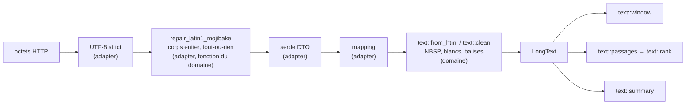
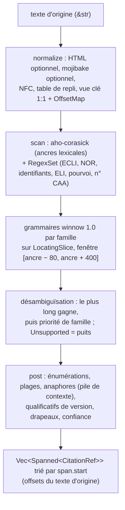

# 03 — Domaine (`lf-domain`) : types, règles et algorithmes purs

> **Statut** : M0-M1 livrés (plan 1) ; tête de M2 (plan 2a) et domaine de M2 (plan 2e : valeurs, texte structuré, entités complètes) livrés ; le reste est un plan. Ce document applique [00-decisions.md](00-decisions.md), qui est normatif et l'emporte en cas de doute. Pour le domaine livré, le code (`crates/lf-domain/`) et les plans font foi : leurs écarts avec ce document sont listés en [00 §11.1](00-decisions.md) (« Écarts et reports » et « Faits au plan 2e »), et chaque section dit ce qui est **[livré]** et ce qui reste à venir.
> **Jalons** : M1 **livré** (plan 1 : identifiants, `Fond`, dates `CivilDate`, entités de base, `clean`, `window`, `passages`, `rank`), tête de M2 (plan 2a) et domaine de M2 (plan 2e) **livrés** (contrat v2, TOC en arbre, `LegalStatus`, `Nor`, `Idcc`, `DocumentId`, `LongText`, entités complètes ; le mapping pur est livré au plan 2f, 00 §14 « Faits au plan 2f » ; son branchement au plan 2g, « Faits au plan 2g »), M4 (types restants des vues), M5 (réglages de l'économie de contexte : fenêtre en caractères, passages, résumé), M6 (parseur de citations ; types `NumberQuery` et `CodeListing` des ports), M7 (types de navigation : versions, liens ; fond `Jorf` si la surface JORF est retenue à l'ouverture de M7, 00 §4).
> **Lecteurs** : développeurs de `lf-domain` et des crates qui en consomment les types (`lf-application`, `lf-adapter-piste`, `lf-adapter-cache`, `lf-adapter-mcp`).
> Les extraits Rust sont **non compilés, à valider au jalon qui les implémente** ; ce qui est livré renvoie au code (`fichier:ligne` : les numéros de ligne ont pu bouger depuis la rédaction, le nom du symbole fait foi). Les points non vérifiés sont marqués **NON VÉRIFIÉ** avec une étiquette `[V-xx · étiquette]`. Le registre `V-xx` les reprend dans [09-risques-et-questions.md](09-risques-et-questions.md).

Documents liés : [02-architecture.md](02-architecture.md) (place du crate), [04-adapter-piste.md](04-adapter-piste.md) (DTO, mapping, mojibake), [05-outils-mcp.md](05-outils-mcp.md) (schémas de sortie et rendu), [06-qualite.md](06-qualite.md) (tests), plans d'implémentation exécutables ([README du plan §3.5](README.md#35-plans-dimplémentation-retirés), retirés ; ils déclinaient [07-feuille-de-route.md](07-feuille-de-route.md), jalon par jalon, forme « plan N, tâche M »), [annexes/A-parite.md](annexes/A-parite.md), [annexes/B-citations.md](annexes/B-citations.md), [annexes/C-api-legifrance.md](annexes/C-api-legifrance.md), ADR-0009, ADR-0011 et ADR-0014 (index : [../adr/README.md](../adr/README.md)).

**Légende livré / à venir.** Trois étiquettes servent dans tout le document.

| Étiquette | Sens |
|---|---|
| **[livré]** | présent dans `crates/lf-domain/` (M1, plans 2a à 2e). Le code fait foi ; la section cite `fichier:ligne` |
| **[M2 tête]** | « tâche de tête de M2 (00 §11.1) » : décidée le 2026-10-16, **livrée au plan 2a** ; l'étiquette dit l'origine d'un élément, qui est [livré] |
| **[Mn]** | spécification future, à livrer au jalon n ; non modifiée sur le fond. **[M2]** : domaine de M2, **livré au plan 2e** sauf mention contraire (mapping au plan 2f, adapter aux plans 2g et 2h) |

Tâches de tête de M2 (livrées au plan 2a) qui touchent ce document (liste complète et points différés M1-D1 à M1-D24 : 00 §11.1) :

1. contrat de citation v2 et renommage du module `citation` en `contract` (C2, §5) ;
2. TOC en arbre (`TocNode`, `Toc::build`, `Toc::page`) et renommage du `TocEntry` livré en `TocArticle` (C4, §4.2) ;
3. suffixe `_JJ-MM-AAAA` conservé par `parse_versioned`, suffixe malformé refusé (C4, §2.4) ;
4. toolchain épinglée 1.99.0 avec `llvm-tools-preview` (C5) ;
5. lints `clippy::panic`, `unreachable`, `unimplemented` (C7, §1.3) ;
6. module `lf_domain::text::encoding` (`repair_latin1_mojibake`, `has_latin1_mojibake`), reliquat de M1 (§7.1) ;
7. test du vecteur `1804-03-21` (`-5231606400000`) pour `CivilDate` (C3, §6.3) ;
8. `open_ended`, `VersionDate` borné, `DateRange` (§6).

---

## 0. Résumé

- `lf-domain` est le cœur pur : pas d'I/O, pas d'async, pas d'horloge, pas de journalisation, pas de sérialisation. Il **construit** des valeurs typées, ne les transporte pas.
- **Identifiants** [livré] : 10 familles `Id<K>` (alias `LegiTextId`…`AccoTextId`, `crates/lf-domain/src/id.rs`), valeur normalisée stockée en `String` (préfixe de 8 lettres + 12 chiffres). `Id::parse` et `FromStr` sont **tolérants** (trim, casse) ; il n'y a ni macro `lf_id!`, ni `u64`, ni `Copy`. Les enums `ArticleId`, `DecisionId` et `DocumentId` (les dix préfixes, pour les hits) sont livrées. `IdPrefix` n'existe pas : `Fond::hit_prefix()` et `DocumentId::prefix()` renvoient un `&'static str` (écart assumé à §3.1, plan 2e : `IdPrefix` n'a de consommateur qu'en M6). Le suffixe `_JJ-MM-AAAA` d'un `LEGITEXT` est conservé par `parse_versioned` / `VersionedId` [livré, plan 2a]. Le routage d'URL et le choix de la règle de citation se font sur le **type**, jamais sur le champ `origine` (corrige D-28).
- **Contrat de citation v2** (ADR-0009) [livré, plan 2a] : chaque entité citable expose un `CitationContract { citation, source_url, ecli, eli }` (module `contract`, `Citable::contract()`), calculé à la demande. `citation` n'est jamais vide et `source_url` est toujours présente. `ecli` et `eli` ne sont renseignés que s'ils viennent de l'API, sans jamais être fabriqués (seule `Decision` porte un `ecli` natif ; `eli` est toujours `None`). Le contrat v1 (`eli_uri`, `human_readable_citation`) a disparu. La typographie est corrigée (« décision », « délibération », mois accentués, « 1er »). Corrige D-27 et D-30.
- **Dates** [livré] : `CivilDate` maison (`date.rs`), sans `chrono` dans le domaine (C3, ADR-0011 amendé). Les epoch ms négatifs sont convertis par un calcul calendaire pur (`CivilDate::from_unix_millis`, vecteur 1804-03-21 testé). Toute date ≥ 2222-01-01 (sentinelles `2999-01-01`, `2222-02-22`) devient `None` par `open_ended` [livré, plan 2a ; appliquée champ par champ par le mapper du plan 2f], de même qu'un champ `…Computed` nul ; le sens de ce `None` est documenté par champ : fin, début ou publication (00 §4, §6.2). `VersionDate` borné et `DateRange` sont livrés. Le domaine ne connaît pas « aujourd'hui » : l'application le lui passe (`Clock::today_paris() -> CivilDate`).
- **Texte** [livré] : `text::clean` convertit le HTML en texte par le lexer partagé `text/html.rs` ; `clean_with_report` compte les caractères invisibles retirés et `clean_field` nettoie un champ optionnel. `LongText::{from_html, from_plain, best_of}` (faillibles : `DomainError::TextTooLarge` au-delà de 16 000 000 caractères) donnent le texte structuré en paragraphes (49, 43 et 3 paragraphes sur les fixtures CONSTIT, CETAT et CNIL). `text::window` découpe une fenêtre `offset`/`max_chars` en caractères Unicode ; `text::passages` et `text::rank` assurent la recherche BM25 maison, avec un repli des accents dans `text/fold.rs` ; `text::encoding::repair_latin1_mojibake` répare le mojibake. À venir : `text::summary` (résumé d'un texte : dispositif ou début), mots vides, repli NFD et passages découpés par paragraphe [M5].
- **Entités** [livré] : `SearchHit` (`SearchHit::new` contrôle le couple fond et identifiant), `SearchPage`, `CodeArticleRef` (avec `Snippet`), `Act` et `Convention` (avec `TextBody` et la table des matières en arbre `Toc` de `TocNode`, `TocSection` et `TocArticle`), `ArticleText` (avec `ParentText`), `Decision` (avec `OfficialSummary` et `LongText`), `Deliberation`, `CompanyAgreement`, `Coverage`, et les valeurs `LegalStatus`, `Nor`, `Idcc` (`u16`), `DocumentId`, `LongText`. `SearchQuery` et ses objets de valeur `QueryText`, `PageSize`, `MatchMode` sont livrés au plan 2b (§4.1). À venir : `cited_case_law`, `applied_texts`, `previous_version` et `SearchHit.solution` (M7).
- **Parseur de citations (M6)** : `citation::parse(&str) -> Vec<Spanned<CitationRef>>`, égal à `parse_with(&str, &ParseOptions::default())`. Un ECLI d'un autre pays que FR donne `Unsupported { family: ForeignEcli }`. Il enchaîne normalisation avec table d'offsets, vue « clé » repliée 1:1, ancres aho-corasick, grammaires winnow 1.0 par famille et désambiguïsation. La résolution vers des identifiants relève de l'application. Le nom de module `citation` est libéré par le renommage du contrat v1 en `contract` [livré, plan 2a].

---

## 1. Principes du domaine

### 1.1 Pureté et dépendances

| Dépendance (00 §2) | Usage dans le domaine | Jalon / état |
|---|---|---|
| `thiserror` | `DomainError` | [livré] : **seule dépendance normale**, liste blanche `DOMAIN_ALLOWED` qui échoue fermé (`xtask/src/arch.rs`) |
| pas de `chrono` | dates civiles : `CivilDate` maison (`date.rs`) pour la validation calendaire, les epoch négatifs (`CivilDate::from_unix_millis`, `div_euclid`) et la prose française (`CivilDate::to_french`). `chrono` (`std`) sert **hors du domaine** (`lf-application`, adapters) ; la feature `clock` ne sert que dans `lf-app::clock` (date du jour à Paris) ; `chrono-tz` sert dans `lf-app::clock` et `lf-adapter-piste` (midi Europe/Paris de `singleDate`, AM-02), qui convertissent depuis et vers `CivilDate` (ADR-0011). Aucune lecture d'horloge n'est donc possible dans le domaine, par construction | [livré] (C3 ; amende ADR-0011) |
| `unicode-normalization` | NFC (vue clé du parseur) ; NFD puis retrait des marques combinantes pour la vue repliée, seulement si le retrait maison ne suffit pas | M6 (NFC) ; M5 au plus tôt. Livré : repli français maison, `text/fold.rs:9` (NFD non replié, M1-D5) |
| `winnow` 1.0, `aho-corasick`, `regex` | parseur de citations uniquement | M6, chacun par un **ADR qui élargit la liste blanche** |

La colonne « Jalon / état » indique quand la dépendance entre dans `crates/lf-domain/Cargo.toml` : chacune arrive avec le premier code qui l'emploie, pour que `cargo machete` reste vert (00 §2). Les exigences de version suivent la politique de 00 §2 (niveau mineur dans `[workspace.dependencies]`, versions du plan = versions de référence).

Règles complémentaires (contrôlées par `cargo xtask check-arch`, alias `make arch`, et la revue). La liste blanche s'élargit par ADR au jalon qui a besoin de la dépendance, jamais d'avance :

- **Pas de `serde`, `serde_json`, `schemars`.** Les entités sont des structs Rust. La sérialisation (noms JSON, `skip_serializing_if`, schémas) est faite par des **vues de sortie** dans `lf-adapter-mcp` (ADR-0006). Les DTO amont restent dans `lf-adapter-piste` (recherche 03 §12.1 point 7). `serde_json` est permis en `[dev-dependencies]` pour charger les fixtures et le corpus de citations dans les tests (recherche 07 §8.2). `check-arch` ne compte que les dépendances normales (pas `dev` ni `build`, `xtask/src/arch.rs`, en-tête), et un membre inconnu devient une violation [livré, plan 2a].
- **Pas de crate HTML** (`scraper`, `html2text`, proposés par la recherche 02 D-26) : ils sont absents de la liste normative. `text::clean` et `LongText::from_html` [livrés, plan 2e] sont bâtis sur un même lexer tolérant écrit à la main (`text/html.rs`, §7.2).
- **Pas de `regex` avant M6** : les scanners livrés (balises dans `clean`, fins de phrase dans `window`) sont de petits automates sur `char_indices()`. `regex` n'arrive qu'avec le parseur (M6).
- **Pas de `tracing`** : une anomalie de données (hit écarté, ECLI invalide, texte HTML douteux) est renvoyée **comme valeur** (compteur, `Diagnostic`). L'appelant la journalise : adapter ou application.

### 1.2 « Parse, don't validate »

Toute valeur externe est convertie **une seule fois**, à la frontière, en un type qui garantit son invariant. Aucune fonction du domaine ne revalide ensuite.

| Valeur brute | Type du domaine | Où se fait la conversion |
|---|---|---|
| paramètre d'identifiant (`text_id`, `article_id`, …) | `LegiTextId`, `ArticleId`, `DecisionId`, … | cas d'usage de `lf-application`, sous `Audited` (02 §6.1), qui appelle `Id::parse` / `FromStr`, tolérants (`id.rs:59`, `:100`) ; `parse_param` est abandonné (§2.6) |
| `fond` | `Fond` | idem (`Fond::parse`, `fond.rs:70`) |
| `date`, `version_date`, `date_from`/`date_to` | `VersionDate`, `DateRange` | idem : `CivilDate::parse` [livré, `date.rs:72`] ; `VersionDate` borné et `DateRange::new` [livrés, plan 2a] |
| `page_size`, `page`, `toc_limit`, `max_chars`, `passages`, `offset` | `PageSize` [livré, plan 2b], `NonZeroU32`, `TocLimit`, `MaxChars`, `PassageCount` [M5], `usize` (offsets livrés) | idem, constructeurs bornés (bornes en 00 §7) |
| `focus`, `query` | `Focus` [M5], `QueryText` [livré, plan 2b] | idem, constructeurs (§4.1, §7.8) |
| identifiants, dates et textes renvoyés par l'API | mêmes types | fonctions de mapping de `lf-adapter-piste` (recherche 03 §12.8) |

`lf-adapter-mcp` ne fait que décoder l'objet `arguments` en types primitifs (`XInput`, serde, 00 §5) ; la conversion en types du domaine a lieu dans le cas d'usage, dans l'ordre de validation de la référence (P-011), pour qu'un `DomainError` devienne un `invalid_arg` audité (00 §3).

### 1.3 Fonctions totales, aucune panique

- Toute fonction publique faillible renvoie `Result<_, DomainError>` ou `Option<_>`. Aucune n'utilise `unwrap`, `expect`, `panic!` ni une tranche de chaîne par octets non vérifiée.
- **Lints (C7, tâche de tête de M2)** : le workspace active `unwrap_used`, `expect_used`, `dbg_macro`, `todo` et `pedantic` en `warn` (`Cargo.toml:25-31`), bloquants par `-D warnings`. S'y ajoutent, **en `warn` dans `[workspace.lints.clippy]`**, seulement les trois lints gratuits `clippy::panic`, `clippy::unreachable` et `clippy::unimplemented` (aucune occurrence aujourd'hui). Les autres lints du plan (`indexing_slicing`, `string_slice`, `arithmetic_side_effects`) **ne sont pas adoptés** : ils imposeraient de réécrire environ 28 lignes (`date.rs`, `window.rs`, `clean.rs`) avec des branches mortes, incompatibles avec 100 % des régions couvertes. L'absence de panique reste prouvée par proptest, fuzz et mutation. Une exception locale (`#[allow]`, `#[expect]`) n'est admise qu'avec une raison écrite. Les tests sont exemptés.
- Les offsets livrés sont en `usize` (caractères), convertis en indices d'octets **uniquement** via `char_indices()` (`byte_at`), ce qui exclut toute coupure au milieu d'un caractère UTF-8. L'arithmétique est `checked_*` ou `saturating_*` quand un dépassement est possible.
- La récursion est bornée : la construction de la TOC [livré, plan 2a] limite la profondeur à 64 (au-delà : `DomainError::TocTooDeep`, mappée en `CorpusError::Decode` par l'adapter). Le parseur n'a aucune récursion non bornée (§8.8).
- **Propriété testée** (proptest, fuzzing hebdomadaire et mutation, §10) : pour toute entrée, aucune panique, et toute sortie respecte ses invariants.

### 1.4 Invariants garantis par les types

| Invariant | Garanti par |
|---|---|
| Un identifiant a exactement le bon préfixe et 12 chiffres | `Id<K>` à champ privé, construit par `Id::parse` / `FromStr` (tolérants : trim, casse, §2.3) [livré] |
| La famille d'un `SearchHit` correspond à son `id` (ex. `Fond::Cetat` ⇒ `CETATEXT`) | `SearchHit::new` renvoie `Err` sinon : le hit est écarté et compté (§4.1) [livré, plan 2e] |
| Toute entité citable a une `citation` non vide et une `source_url` Légifrance | `CitationContract` sans `Option` sur ces deux champs (§5.1) [livré, plan 2a] |
| Un ECLI ou un ELI n'est jamais fabriqué | `Ecli` [livré, `ecli.rs:17`] et `Eli` [livrés] n'ont pas de constructeur à partir d'autres champs : seulement `parse` sur une chaîne venue de l'API ou du texte cité (§5.2, §5.3) |
| Pas de date « 2999 » | `open_ended` appliquée par les mappers de l'adapter, champ par champ (les entités livrées sont des structs à champs publics, sans constructeur ; §6.2) [`open_ended` livrée, plan 2a ; appliquée par le mapper, livré au plan 2f] |
| Bornes des paramètres (00 §7) | `PageSize` 1..=100 [livré, plan 2b], `TocLimit` 1..=500, `MaxChars` 500..=40 000, `PassageCount` 1..=10 [M5] |
| Fenêtre de texte reconstructible et toujours en progression | `text::window` (§7.6) [livré : les fenêtres partitionnent le texte, `window.rs:19`] ; garanties G1 à G7 complètes en M5 |
| La liste des lacunes de couverture n'est jamais vide | `Coverage::new` faillible, `DomainError::EmptyCoverageGaps` [livré, `coverage.rs:65`] (§4.8) |

### 1.5 Organisation des modules

**Organisation livrée (état du plan 2e)** [livré] :

```text
crates/lf-domain/src/
  lib.rs            modules publics, ré-export de DomainError
  error.rs          DomainError (17 variantes, puis `UnbalancedQuotes` en 1.0.1 : L4-08), echo, ECHO_MAX_CHARS (§9)
  id.rs             IdKind (scellé), Id<K>, 10 alias, AnyId, ArticleId, DecisionId, DocumentId, VersionedId / parse_versioned, SectionId (pas de macro, pas de sous-module)
  fond.rs           Fond (name, api_name, hit_prefix, needs_version_date, has_date_filter, parse, ALL), PaginationMode
  status.rs         LegalStatus, status_of
  date.rs           CivilDate, VersionDate (borné), DateRange, open_ended, SENTINEL_FLOOR
  ecli.rs           Ecli (à la racine du crate, pas dans contract/)
  url.rs            ResourceKind, legifrance_url (pub(crate)), SourceUrl
  contract/         mod.rs (CitationContract, Citable, ELI_NOTE), rules.rs (règles de citation), text.rs (CitationText), eli.rs (Eli), nor.rs (Nor), idcc.rs (Idcc)
  coverage.rs       Coverage (constructeur faillible), PisteEnvironment
  search.rs         SearchQuery, QueryText, PageSize, MatchMode, has_more, REACHABLE_RESULTS
  entity/           mod.rs, search.rs, toc.rs, act.rs (Act, Convention, TextBody), article.rs, decision.rs, summary.rs, deliberation.rs, agreement.rs
  text/             mod.rs, clean.rs, html.rs (lexer partagé), encoding.rs, long_text.rs, fold.rs (pub(crate)), window.rs, passages.rs, rank.rs
```

**Structure cible** (modules à venir marqués par leur jalon ; les fichiers livrés ci-dessus s'y fondent au fil des jalons ; les écarts avec l'organisation livrée sont notés en ligne) :

```text
crates/lf-domain/src/
  lib.rs            ré-exports
  error.rs          DomainError (étendu jalon par jalon, §9)
  id.rs             [livré : VersionedId/parse_versioned, DocumentId, SectionId ; ni macro lf_id!, ni parse_param, ni Shown ; IdPrefix abandonné, `hit_prefix` renvoie un `&'static str`, M6 si besoin]
  fond.rs           Fond, PaginationMode (§3)
  status.rs         LegalStatus (§3.3)
  date.rs           CivilDate, VersionDate borné, DateRange, open_ended [livrés] (§6) ; from_unix_millis et to_french sont des méthodes de CivilDate
  contract/         [livré, ex-citation.rs] mod.rs (CitationContract, Citable), rules.rs (règles de citation), text.rs (CitationText),
                    eli.rs (Eli), nor.rs (Nor), idcc.rs (Idcc) ; SourceUrl vit dans url.rs ; Ecli reste à la racine (ecli.rs)
  search.rs         SearchQuery, QueryText, MatchMode, PageSize, REACHABLE_RESULTS (§4.1) ;
                    M6 : NumberQuery, NumberKind, NumberValue (§4.11)
  entity/           [livré] search.rs, toc.rs, act.rs (Act, Convention), article.rs, decision.rs, summary.rs, deliberation.rs, agreement.rs ;
                    coverage.rs (racine du crate : Coverage, PisteEnvironment) ; M6 : codes.rs (CodeListing) ;
                    M7 : versions.rs (ArticleVersion), related.rs (RelatedLinks) (§4.11)
  text/             html.rs (lexer partagé, paragraphes), clean.rs, long_text.rs (LongText), fold.rs [livrés] ;
                    window.rs, passages.rs, rank.rs [livrés ; les fins de phrase vivent dans window.rs, pas dans sentence.rs],
                    summary.rs [M5], encoding.rs [livré] (repair_latin1_mojibake, has_latin1_mojibake : fonctions pures appelées par l'adapter, §7.1)
  citation/         (M6) mod.rs (parse, parse_with), normalize.rs, scan.rs, grammar/*.rs, post.rs, types.rs,
                    dict/codes.rs, dict/courts.rs (§8)
```

### 1.6 Ce que le domaine ne fait pas

| Responsabilité | Crate | Raison |
|---|---|---|
| Décoder le corps HTTP et réparer le mojibake **au niveau du corps** | `lf-adapter-piste` (00 §8) | réparation tout-ou-rien avant `serde`. La fonction pure `text::encoding::repair_latin1_mojibake` vit dans le domaine et l'adapter l'appelle (recherche 03 §11.1) ; elle est **livrée** (tête de M2, plan 2a) et précède l'encodage de l'adapter |
| Lire les dates multi-formats (epoch ms entier ou chaîne, ISO `+0000`, `AAAA-MM-JJ`) | `lf-adapter-piste` (00 §4) | format propre à l'API. Le domaine fournit les conversions pures `CivilDate::from_unix_millis` et `open_ended` [livrés] |
| « Aujourd'hui » à Paris | `lf-app::clock` (`SystemClock`, `chrono-tz`), via le port `Clock::today_paris() -> CivilDate` | pas d'horloge dans le domaine |
| Construire les requêtes `/search`, les facettes, `singleDate` (midi Europe/Paris en ms, 00 §8 ; `CivilDate` converti en `NaiveDate`), la `typePagination` (`PaginationMemo`, 00 §7) | `lf-adapter-piste` | dépend du fuseau, de l'API et d'un état propre à l'adapter |
| Associer les codes à leurs `LEGITEXT` (`/list/code`) | `lf-adapter-piste` (avec cache) | données vivantes (recherche 07 §5.1) |
| Messages destinés au modèle : parité, phrase d'aide, table préfixe ⇒ outil, gabarits `not_found` et autres | `lf-adapter-mcp` (`render.rs`, M4 ; 00 §11.1) | les erreurs du domaine portent des **faits** ; l'adapter MCP rédige la phrase finale à partir des champs typés (§2.7) |
| Schémas JSON, rendu compact, préfixe `[code] ` des erreurs | `lf-adapter-mcp` | le domaine ignore MCP (ADR-0006, ADR-0010) |
| Résolution des citations vers des identifiants (M6) | `lf-application` (cas d'usage) + port `LegalCorpus` | I/O (§8.7) |

---

## 2. Identifiants

### 2.1 Préfixes documentaires et format

Format vérifié sur les 16 fixtures : **préfixe de 8 lettres majuscules ASCII + exactement 12 chiffres ASCII**, soit 20 caractères (recherche 01 §4.1, recherche 03 §11.3). Un scan de ce document sur les fixtures donne 100 % des occurrences sur 12 chiffres : LEGITEXT 11, LEGIARTI 68, JORFTEXT 6, KALITEXT 6, KALIARTI 7, JURITEXT 5, CONSTEXT 8, CETATEXT 7, CNILTEXT 6, ACCOTEXT 6. Hors fixtures, en sandbox le 2026-10-28 [V-103 · id-format-hors-fixtures] (09 §2.20, levé) : 767 hits sur les 8 fonds et toutes les consultations enregistrées n'ont aucun identifiant de document d'une autre forme que 8 lettres et 12 chiffres ; production non essayée.

| Préfixe | Newtype | Contenu | Exemple réel (fixture) | Consultation (v0.1) | Kind d'URL (§5.5) |
|---|---|---|---|---|---|
| `LEGITEXT` | `LegiTextId` | texte LEGI : loi ou décret consolidé, **ou code** | `LEGITEXT000033205014` (loi n° 2016-1321, consult_loda.json) ; `LEGITEXT000006070721` (Code civil, search_code.json) | `/consult/lawDecree` | `loda`, `code` |
| `LEGIARTI` | `LegiArtiId` | version d'un article LEGI | `LEGIARTI000006419288` (C. civ., art. 9, consult_article.json) | `/consult/getArticle` | `code_article`, `loda_article` |
| `JORFTEXT` | `JorfTextId` | texte du JO (version initiale), `cid` d'un texte LODA | `JORFTEXT000033202746` (`cid`, consult_loda.json) | non servi en v0.1 ni en v0.2 ; surface JORF (lecture, fond `Jorf`) tranchée à l'ouverture de M7 (00 §4, §8 ; V-135) | `jorf` |
| `KALITEXT` | `KaliTextId` | texte de convention collective | `KALITEXT000049878950` (consult_kali.json) | `/consult/kaliText` | `kali` |
| `KALIARTI` | `KaliArtiId` | article KALI | `KALIARTI000049886059` (consult_kali.json) | `/consult/getArticle` | `kali` (`/conv_coll/id/`) |
| `JURITEXT` | `JuriTextId` | décision judiciaire (Cour de cassation, cours d'appel) | `JURITEXT000051743650` (consult_juri.json) | `/consult/juri` | `juri` |
| `CONSTEXT` | `ConsTextId` | décision du Conseil constitutionnel | `CONSTEXT000052555275` (consult_juri_constit.json) | `/consult/juri` | `constit` |
| `CETATEXT` | `CetaTextId` | décision administrative (CE, CAA, TA) | `CETATEXT000054178503` (CE, consult_juri_cetat.json) ; `CETATEXT000054242861` (CAA de Marseille, search_cetat.json) | `/consult/juri` | `cetat` |
| `CNILTEXT` | `CnilTextId` | délibération ou décision CNIL | `CNILTEXT000053352643` (consult_cnil.json) | `/consult/cnil` | `cnil` |
| `ACCOTEXT` | `AccoTextId` | accord d'entreprise | `ACCOTEXT000053643828` (consult_acco.json) | `/consult/acco` | `acco` |

`CONSTEXT` était absent de la liste de préfixes de la référence (référence citations.py:34-44, E-36). Il en fait partie ici [livré : `Id<ConsText>`, `id.rs:139`].

[livré] Les « newtypes » de la table sont des **alias** de `Id<K>` (`id.rs:160-178`, marqueurs `id.rs:109-155`). `IdKind` est un trait public non scellé (à sceller en M2, M1-D12). La colonne « Kind d'URL » renvoie à `ResourceKind` (`url.rs:10`), qui n'a pas de variante `loda_article` ni `kali_article` (§5.5).

### 2.2 Préfixes non documentaires

| Préfixe | Vu dans | Traitement |
|---|---|---|
| `LEGISCTA`, `KALISCTA` | sections de TOC, `sectionParentCid` (consult_article.json `LEGISCTA000006117610`, consult_kali.json `KALISCTA000049886029`) | newtype `SectionId` (enum interne Legi/Kali), même format, utilisé seulement dans `TocNode::Section` [M2 tête, avec `TocNode`] |
| `KALICONT` | `conteneurs[].cid` (consult_kali.json `KALICONT000005635096`) | conservé en `String` dans `Convention`. Typé en M6 si la résolution par IDCC l'exige |
| `JORFARTI`, `JORFCONT`, `JORFDOLE` | liens KALI (`articleId: JORFARTI000020445855`), Swagger | reconnus par le parseur (`CitationRef::LegifranceId`, §8.6), non consultables en v0.1 |
| `JURINOME`, `CETANOME` | `titrages` (plan de classement) | **jamais** des identifiants de document (recherche 07 §4.13) : ignorés |

### 2.3 Représentation

**Représentation livrée** [livré] (`crates/lf-domain/src/id.rs`) :

```rust
pub trait IdKind { const PREFIX: &'static str; }            // id.rs:42 ; scellé (M1-D12)
pub struct Id<K> { raw: String, kind: PhantomData<fn() -> K> } // id.rs:48 ; raw = forme normalisée
impl<K: IdKind> Id<K> { pub fn parse(input: &str) -> Result<Self, DomainError>; } // id.rs:59 ; préfixe = K::PREFIX
impl<K> Id<K> { pub fn as_str(&self) -> &str; }              // id.rs:69
// Clone, PartialEq, Eq, Hash (impl manuelle), Debug, Display, FromStr (= parse) ; PAS d'Ord ni de Copy
pub enum LegiText {} /* … 10 marqueurs, id.rs:109-155 */
pub type LegiTextId = Id<LegiText>; /* … LegiArtiId, JorfTextId, KaliTextId, KaliArtiId, JuriTextId,
                                       ConsTextId, CetaTextId, CnilTextId, AccoTextId (id.rs:160-178) */
pub struct AnyId(String);                                    // id.rs:182 ; forme valide, préfixe quelconque (hits)
```

- `normalize` (`id.rs:30`) : trim, majuscules ASCII, coupe au premier `_`, puis exige 8 lettres + 12 chiffres ASCII. `Id::parse` et `FromStr` restent **tolérants** (trim, casse) : c'est utile face aux identifiants tapés par un modèle, et c'est une divergence assumée et testée par rapport au `FromStr` strict du plan initial.
- Le stockage est une `String` : le type n'est pas `Copy`. La macro `lf_id!` et le stockage `u64` du plan initial sont **abandonnés**.
- Propriété testée : `parse ∘ Display = identité` sur toute chaîne acceptée (et absence de panique sur toute chaîne, proptest).
- **Ajouts livrés** (M1-D11) : `Display` et `FromStr` sur `AnyId`, `ArticleId`, `DecisionId`, `DocumentId` et `Ecli` ; `Hash` sur `Id<K>` (impl manuelle qui hache `raw`), `AnyId`, `ArticleId`, `DecisionId`, `DocumentId`, `Ecli`, `Fond` et `CivilDate` (clés moka de M3). `Ord` : M3 (M1-D11). `IdPrefix` n'existe pas : `Fond::hit_prefix()` et `DocumentId::prefix()` renvoient un `&'static str` (écart assumé, plan 2e ; `IdPrefix` n'aurait de consommateur qu'en M6, §3.1).

### 2.4 Suffixe de version et `VersionedId` [livré, plan 2a]

L'API suffixe certains `LEGITEXT` de la date de **début de la version** au format `_JJ-MM-AAAA` : `LEGITEXT000033205014_08-09-2023`, égal à `dateDebutVersion` `2023-09-08` dans consult_loda.json ; `LEGITEXT000033696785_28-12-2016` et `LEGITEXT000006070721_09-04-2026` dans search_loda.json et search_code.json (recherche 03 §11.3). La référence jetait cette date (référence citations.py:55-63), et le livré de M1 aussi (`normalize` coupait au premier `_` pour tout préfixe). Le domaine la **conserve** (C4, option A) par `parse_versioned` [livré, plan 2a, `id.rs`] :

```rust
// livré (`crates/lf-domain/src/id.rs`)
pub struct VersionedId { pub id: LegiTextId, pub version_start: Option<CivilDate> }
pub fn parse_versioned(input: &str) -> Result<VersionedId, DomainError>; // "LEGITEXT…" ou "LEGITEXT…_JJ-MM-AAAA" (date calendaire valide)
```

- `Id::parse` et `FromStr` restent **tolérants sur les espaces et la casse**, mais refusent désormais un suffixe mal formé (`BadSuffix`, ci-dessous) ; un suffixe bien formé hors `LEGITEXT` est toléré puis retiré.
- **Suffixe mal formé** (`_foo`, `_` seul, `_31-02-2023`) : refusé par `DomainError::BadSuffix` (nouvelle variante), par `parse_versioned` **et** par `Id::parse`/`FromStr`. La date du suffixe est lue par `CivilDate::parse` après réordonnancement `JJ-MM-AAAA`.
- **Suffixe bien formé sur un autre préfixe que `LEGITEXT`** : **toléré puis retiré** (option A, pas A-strict). Cette tolérance est documentée : elle évite un aller-retour inutile au modèle, et la variante `SuffixNotAllowed` du plan initial n'est pas retenue. L'API n'a été observée qu'avec des `LEGITEXT` suffixés ; le mapping de l'adapter retire un suffixe trouvé ailleurs (D-28) et le signale par un diagnostic (`upstream_suffix_stripped`, 04 §9.1 c, §9.3), sur l'identifiant principal de la réponse comme sur ses identifiants secondaires (`cid` d'un texte, texte parent d'un article, `cid` et articles d'un hit de recherche ; clôture du plan 2f), et seulement pour un identifiant retenu : un hit écarté, un `cid` omis ou un extrait ignoré ne comptent rien. En sandbox le 2026-10-28 [V-104 · suffixe-version-autres-prefixes] (09 §2.20, levé), le suffixe n'apparaît que sur des `LEGITEXT` (216 occurrences sur 216) ; production non essayée.
- `version_start` alimente `SearchHit.version_start` [livré : `SearchHit::new(fond, id, version_start)`] et, pour `Act`, `body.date_debut_version` (le champ livré ne s'appelle pas `version_start`) ; pour `Act`, c'est le suffixe, sinon `dateDebutVersion`, choix du mapper (plan 2f). `fr_get_act` sans `date` : la date demandée est le `version_start` du suffixe de `text_id` s'il y en a un, sinon aujourd'hui à Paris (00 §7, question 6 du §11). Le choix est fait par le cas d'usage, qui construit la `VersionDate`.
- Le retrait d'un suffixe bien formé hors `LEGITEXT` est compté par l'adapter (`upstream_suffix_stripped`, 04 §9.3) pour les identifiants qu'il lit lui-même ; ceux de la table des matières, lus par `Toc::build`, ne le sont **pas** (décision du plan 2g) : le domaine n'en rend aucun compte, et la sonde V-104 (plan 2h) lit les corps bruts.
- Livré : `Id::parse` refuse `_foo`, `_` seul et `_31-02-2023` par `BadSuffix` ; le test `strips_version_suffix` et le proptest `valid_shape_roundtrips` ont été revus en conséquence (plan 2a).

### 2.5 Enums dérivées du préfixe

[livré] `ArticleId { Legi(LegiArtiId), Kali(KaliArtiId) }` (`id.rs:204`) et `DecisionId { Juri(JuriTextId), Constit(ConsTextId), Cetat(CetaTextId) }` (`id.rs:246`), avec `parse`, `FromStr` et `as_str`. `DocumentId` (les dix préfixes, hits) est livré au plan 2e ; `DecisionId::fond()` est livrée au plan 2f (`pub const fn`, D28) : le mapper des décisions en tire le fond de l'identifiant renvoyé.

```rust
// livré (plan 2e, `id.rs`) ; `DecisionId::fond()` : livrée au plan 2f
pub enum DocumentId { LegiText(LegiTextId), LegiArti(LegiArtiId), JorfText(JorfTextId), KaliText(KaliTextId),
                      KaliArti(KaliArtiId), JuriText(JuriTextId), ConsText(ConsTextId), CetaText(CetaTextId),
                      CnilText(CnilTextId), AccoText(AccoTextId) }               // [livré] hits ; fr_get_related (M7), fr_resolve (M6) ; `DocumentId::prefix() -> &'static str`
impl DecisionId { pub const fn fond(&self) -> Fond { /* Juri | Constit | Cetat */ } }   // [livré, plan 2f] consommateur : `map::decision`
```

- Les parsers d'enum répartissent selon le préfixe. Le livré rejette les autres préfixes par `DomainError::InvalidId { input, expected }` (`expected` = `"JURITEXT, CONSTEXT or CETATEXT"` par exemple) ; la famille retrouvée (`WrongFamily`) est reconstituée par `lf-adapter-mcp` avec `AnyId::parse` (§2.7), pas par une variante du domaine.
- **La juridiction et l'URL se déduisent du préfixe validé** (00 §4) : `DecisionId::Constit` ⇒ URL `/cons/id/` et règle de citation du Conseil constitutionnel ; `Cetat` ⇒ `/ceta/id/` et titre ; `Juri` ⇒ `/juri/id/` et titre. Le champ `origine` de l'API ne sert plus qu'à un contrôle de cohérence : s'il diverge, l'adapter émet un diagnostic. Cela corrige D-28 et E-18. Démonstration du défaut dans la référence : `origine=None` sur un `CETATEXT` y produisait `/juri/id/…` (recherche 02 D-28).
- La « famille » de juridiction vient du préfixe (judiciaire, constitutionnelle, administrative). Le **libellé exact** (« CAA de Marseille », « Conseil d'État ») reste celui du champ `juridiction` ou du titre, car `CETATEXT` couvre CE, CAA et TA (search_cetat.json).

### 2.6 Entrée utilisateur : `parse_param` abandonné

`parse_param` / `parse_versioned_param` du plan initial sont **abandonnés** : la tolérance (trim des blancs Unicode, préfixe insensible à la casse) vit dans `Id::parse` et `FromStr` [livré, `id.rs:30-66`], et non dans une fonction séparée de l'adapter. Corrige E-16, E-17, D-31 : la référence n'avait pas de trim et envoyait l'espace à l'API (recherche 01 §3.2) ; l'insensibilité à la casse évite un aller-retour inutile du modèle.

1. Vide ou malformé ⇒ `DomainError::InvalidId` (le livré n'a pas de variante `Missing` ; « `text_id is required.` » est rédigé par l'adapter MCP quand l'argument est absent).
2. Le suffixe de version relève de `parse_versioned` [M2 tête, §2.4].
3. Le domaine ne cherche jamais un identifiant « dans » une chaîne libre : c'est le travail du parseur (M6).

### 2.7 Messages `invalid_arg` actionnables [M4]

Le domaine fournit des erreurs **structurées** : `DomainError::InvalidId { input, expected }`, l'entrée étant tronquée à 64 caractères par `echo` [livré, `error.rs:45`] (le plan initial prévoyait `IdError` + `field` + `Shown`, non retenus). **`lf-adapter-mcp` (`render.rs`) rédige les phrases d'erreur de parité en M4** à partir des champs typés : entrée tronquée à 64 caractères, `expected`, et famille retrouvée par `AnyId::parse`. Les tests `fond_error_message_matches_reference` et `id_error_messages_table` passent donc en M4. `DomainError` s'étend jalon par jalon ; `#[non_exhaustive]` est à trancher avant les variantes de M2 (M1-D13). `lf-adapter-mcp` rend les messages en anglais (langue des descriptions, 00 §6), précédées de `[invalid_arg] ` (ADR-0010), et ajoute l'outil à utiliser, qu'il est seul à connaître. Les valeurs sont affichées entre apostrophes simples, comme le `repr()` Python le plus courant (E-27), les caractères de contrôle échappés.

Les libellés de la colonne « Cas » désignent des cas fonctionnels retrouvés par `render.rs` à partir de `InvalidId { input, expected }`, de `UnknownFond` et de `AnyId::parse` ; ce ne sont pas des variantes du domaine (§9).

| Cas | Message rendu (exemple) | Parité |
|---|---|---|
| `Missing` | `text_id is required.` | identique (P-012, S4) |
| `WrongFamily`, préfixe connu d'une autre famille | `text_id='JURITEXT000051743650' must be a Legifrance LEGITEXT... identifier. JURITEXT... identifies a court decision: use fr_get_decision.` | première phrase identique (S5), seconde ajoutée |
| `WrongFamily` sur `fr_get_text` | `article_id='LEGITEXT000006070721' must be a Legifrance LEGIARTI... or KALIARTI... identifier. LEGITEXT... identifies a whole text: use fr_get_act, then pick an article_id from its table of contents.` | idem |
| `WrongFamily` sur `fr_get_decision` | `decision_id='CNILTEXT000053352643' must start with one of ('JURITEXT', 'CONSTEXT', 'CETATEXT'). CNILTEXT... identifies a CNIL deliberation: use fr_get_deliberation.` | idem |
| `UnknownPrefix` | `convention_id='KALICONT000005635096' must be a Legifrance KALITEXT... identifier.` | identique |
| `BadDigits` | `text_id='LEGITEXT0001' must be LEGITEXT followed by exactly 12 digits (e.g. LEGITEXT000006070721).` | nouveau : la référence acceptait `LEGITEXT0001` (recherche 02 D-31) |
| `SuffixNotAllowed` | *(non retenu : un suffixe bien formé hors `LEGITEXT` est toléré puis retiré, §2.4)* | — |
| `BadSuffix` [livré, plan 2a] | `text_id='LEGITEXT000033205014_31-02-2023': invalid version suffix (expected _DD-MM-YYYY, e.g. _08-09-2023).` | nouveau |
| `JORFTEXT` passé à `fr_get_act` | `text_id='JORFTEXT000033202746' must be a Legifrance LEGITEXT... identifier. JORFTEXT... is the original Journal officiel text: search it with fr_search fond=LODA and use the LEGITEXT id of the hit.` | nouveau |

**Échappement des valeurs recopiées (1.0.1, L4-09).** La valeur d'un utilisateur recopiée dans un message est échappée pour les barres obliques inverses, `\n`, `\r`, `\t`, les contrôles (Cc), U+2028/U+2029 et tout caractère invisible du domaine (`is_invisible` : format Cf, bidi, largeur nulle, sélecteurs de variante, remplisseurs, tags), écrit `\u{..}` ; les lettres accentuées, œ, € et emoji ne sont pas échappés. Une date bien formée (AAAA-MM-JJ) mais hors de 1500-01-01..2221-12-31 dit `is outside the supported range (1500-01-01..2221-12-31).` ; une date mal formée, impossible ou avec espaces dit `is not a valid date (expected YYYY-MM-DD, e.g. 2026-10-15).` (même variante `InvalidDate`, `CivilDate::is_iso` les distingue ; aucune nouvelle variante).

Table d'aide (préfixe ⇒ outil), propriété de `lf-adapter-mcp` (`render.rs`, M4) : LEGITEXT → `fr_get_act` ; LEGIARTI/KALIARTI → `fr_get_text` ; JURITEXT/CONSTEXT/CETATEXT → `fr_get_decision` ; CNILTEXT → `fr_get_deliberation` ; KALITEXT → `fr_get_convention` ; ACCOTEXT → `fr_get_company_agreement`. Un test de dérive vérifie que chaque outil cité existe (00 §6).

**Limite connue (D-47)** : `LegiTextId` ne distingue pas un texte LODA d'un code, car le préfixe est le même (00 §3 : `get_act(&LegiTextId, …)`). La protection contre une réponse énorme vient de la pagination de la TOC (`toc_limit`, §4.2). Quand l'API renvoie `nature = CODE`, la réponse peut porter un avertissement (voir 05). Sur un code, `/consult/lawDecree` rend 200 mais gros en sandbox le 2026-10-28 : 6,2 Mio pour le Code civil, 31,4 Mio pour le Code du travail, au-dessus de la borne de corps de 16 Mio ; décision C2 option (b) [V-96 · lawdecree-sur-code] (09 §2.20).

---

## 3. Fonds

### 3.1 `Fond` et correspondances

**Forme livrée** [livré] (`crates/lf-domain/src/fond.rs`) : `#[derive(Debug, Clone, Copy, PartialEq, Eq)] pub enum Fond { Loda, Code, Juri, Constit, Cetat, Cnil, Kali, Acco }` (`fond.rs:9`), `Fond::ALL: [Fond; 8]` (`:30`), `name()` (`:42`, valeur du paramètre `fond`, ex. `"LODA"`), `api_name()` (`:56`, ex. `"LODA_DATE"`), `parse()` (`:70`, trim et casse), `Display` et `FromStr`.

```rust
// livré en partie ; Hash (clés de cache) livré, usage en M3 ; Jorf : M7 si la surface JORF est retenue (00 §4)
impl Fond {
    pub const fn kind(self) -> &'static str;           // non livré : "loda", "code", …  (champ `kind` des hits) ; vue de sortie (M4)
    pub const fn hit_prefix(self) -> &'static str;     // [livré, plan 2e] préfixe attendu de `titles[0].id` ; écart à la spec : `&'static str`, pas `IdPrefix`
    pub const fn needs_version_date(self) -> bool;     // [livré, plan 2b] Loda | Code
    pub const fn has_date_filter(self) -> bool;        // [livré, plan 2b] facette de date pour date_from/date_to ; false pour Code (00 §7)
}
```

Chaque objet de valeur est introduit au jalon qui le consomme (`hit_prefix` avec `SearchHit::new`, plan 2e ; `needs_version_date` et `has_date_filter` avec `SearchQuery`, plan 2b). **Écart** : `hit_prefix` renvoie un `&'static str` et non un `IdPrefix`, qui n'existe pas et n'aurait de consommateur qu'en M6 ; `SearchHit::new` compare ce préfixe à `DocumentId::prefix()`.

| `Fond` | `fond` utilisateur | Fond API | `kind` des hits | Préfixe des hits | Filtre `DATE_VERSION` | Consultation | Kind(s) d'URL |
|---|---|---|---|---|---|---|---|
| `Loda` | `LODA` | `LODA_DATE` | `loda` | `LEGITEXT` (le `cid` est un `JORFTEXT`) | oui | `fr_get_act` | `loda` ; articles : `loda_article` |
| `Code` | `CODE` | `CODE_DATE` | `code` | `LEGITEXT` du code | oui | `fr_get_act` (D-47) ; articles : `fr_get_text` | `code` ; articles : `code_article` |
| `Juri` | `JURI` | `JURI` | `juri` | `JURITEXT` | non | `fr_get_decision` | `juri` |
| `Constit` | `CONSTIT` | `CONSTIT` | `constit` | `CONSTEXT` | non | `fr_get_decision` | `constit` |
| `Cetat` | `CETAT` | `CETAT` | `cetat` | `CETATEXT` | non | `fr_get_decision` | `cetat` |
| `Cnil` | `CNIL` | `CNIL` | `cnil` | `CNILTEXT` | non | `fr_get_deliberation` | `cnil` |
| `Kali` | `KALI` | `KALI` | `kali` | `KALITEXT` | non | `fr_get_convention` ; articles : `fr_get_text` | `kali` ; articles : `kali` (`/conv_coll/id/`) |
| `Acco` | `ACCO` | `ACCO` | `acco` | `ACCOTEXT` | non | `fr_get_company_agreement` | `acco` |
| `Jorf` (M7, si retenu) | `JORF` | `JORF` | `jorf` | `JORFTEXT` | à vérifier en M7 | tranchée à l'ouverture de M7 avec son endpoint (00 §4, §8 ; V-135) | `jorf` |

Sources : référence server.py:91-100 et citations.py:110-182, via la recherche 01 §3.1 et §4.6 ; fond API `JORF` (recherche 03 §3.2). Les facettes de date propres à chaque fond (pour `date_from`/`date_to`) sont des noms d'API : elles relèvent de [04-adapter-piste.md](04-adapter-piste.md), pas du domaine ; le domaine sait seulement si le fond en a une (`has_date_filter`). Jusqu'à la décision de M7, `fond` a 8 valeurs (00 §4).

`PaginationMode { Defaut, Article }` [livré, plan 2d ; `crates/lf-domain/src/fond.rs`, avec `api_name()` → `DEFAUT`/`ARTICLE`, `from_api(&str) -> Option<Self>` insensible à la casse et aux espaces, `None` si vide ou inconnue (l'adapter journalise puis `unwrap_or_default()` = `Defaut`), `Default` = `Defaut`, `Hash`, pas de `Display`] : valeur opaque de `typePagination`, reçue dans `SearchPage.pagination` et **jamais exposée** au modèle (00 §7). `CODE_DATE` répond `ARTICLE` à une requête `DEFAUT` (search_code.json, recherche 03 §3.2). La valeur envoyée à la page suivante est choisie par l'adapter, pas par le domaine ni par l'application, qui sont sans état : `PaginationMemo` par requête normalisée sans `page` (TTL 1 h, 1 024 entrées), sinon `ARTICLE` pour CODE en page > 1 et `DEFAUT` ailleurs (00 §7, 04 §6.6). L'effet réel en page 2 est **NON VÉRIFIÉ** [V-82 · typepagination-page2]. `SearchQuery` ne porte donc pas ce mode, et la clé de cache n'en dépend pas (§4.1).

### 3.2 Lecture du paramètre `fond`

`Fond::parse(raw)` [livré, `fond.rs:70`] applique `trim()` puis une comparaison insensible à la casse (parité P-010 : `" loda "` est accepté). En cas d'échec, le domaine renvoie `DomainError::UnknownFond { input }` ; le message de parité est rédigé par `lf-adapter-mcp` en M4 (§2.7) et reste celui de la référence : `fond='XYZ' must be one of ['ACCO', 'CETAT', 'CNIL', 'CODE', 'CONSTIT', 'JURI', 'KALI', 'LODA'].` La liste est triée ; elle ne s'allongera de `JORF` que si la surface JORF est retenue à l'ouverture de M7 (00 §4 ; recherche 01 §3.1). Le schéma JSON portera aussi un `enum` (D-31, voir 05). Ce chemin ne sert donc qu'aux clients qui ne valident pas le schéma.

### 3.3 Statut juridique : `LegalStatus` [livré, plan 2e]

[livré, plan 2e] `LegalStatus` et `status_of` (repli sur `jurisState`) sont dans `status.rs`. Les entités portent `etat: Option<LegalStatus>` (`TextBody`, `ArticleText`, `Deliberation`, sections et articles de la TOC, `SearchHit`) ; seuls les brouillons de TOC (`SectionDraft.etat`, `ArticleDraft.etat`) gardent la chaîne brute du DTO. Le mapper du plan 2f appelle `status_of`.

L'API emploie `etat` (`VIGUEUR`, `ABROGE`) et `jurisState` (`Vigueur` pour LODA, `VIGUEUR_ETEN` pour KALI), avec une casse variable (recherche 03 §11.7). La référence lisait `etat` pour LODA, ce qui donnait `null` alors que `jurisState = "Vigueur"`, mais `jurisState or etat` pour KALI (E-10, D-21).

```rust
// livré (`crates/lf-domain/src/status.rs`)
#[derive(Debug, Clone, PartialEq, Eq, Hash)]
pub enum LegalStatus { Vigueur, VigueurEtendue, VigueurNonEtendue, VigueurDifferee, Abroge, AbrogeDiff,
                       Modifie, ModifieMortNe, Perime, Annule, Disjoint, Transfere, Remplace, Denonce,
                       Initiale, SansEtat, Substitue, Other(String) }    // 17 codes de l'API + Other
impl LegalStatus {
    pub fn parse(raw: &str) -> Option<LegalStatus>;   // contrôles et invisibles retirés, trim, insensible à la casse et aux accents (L3-01) ;
                                                      // rien de visible -> None ; inconnu -> Other (≤ 64 caractères + …)
    pub fn as_api_code(&self) -> &str;                // "VIGUEUR", "VIGUEUR_ETEN", … ; Other -> code conservé, nettoyé
}
pub fn status_of(etat: Option<&str>, juris_state: Option<&str>) -> Option<LegalStatus>; // etat, sinon jurisState
```

- Règle unique pour LODA et KALI : `etat` s'il n'est pas vide, sinon `jurisState`. Sur consult_loda.json, la sortie devient donc `VIGUEUR` au lieu de `null`. C'est une divergence volontaire (§5.6).
- **Libellés accentués** (L3-01, get_act-4) : `LegalStatus::parse` reconnaît les 17 codes sans égard à la casse ni aux accents : le texte est rogné, décomposé (NFD), ses marques combinantes sont retirées, puis il est replié par `text::fold::fold` et mis en majuscules ASCII avant la recherche dans la table. Les libellés accentués de `jurisState` (Abrogé, Modifié, Périmé, Annulé, Transféré, Remplacé, Dénoncé, Substitué) donnent donc le code correspondant (ABROGE, MODIFIE, PERIME, ANNULE, TRANSFERE, REMPLACE, DENONCE, SUBSTITUE), en forme composée ou décomposée. Un libellé inconnu (par exemple Échu) reste `Other` avec son texte d'origine, accents compris. Il n'existe aucune table de libellés à espaces (V-113 reste non vérifié pour ces formes).
- [livré, plan 2e, vague de fin ; audit de sécurité L-2] `parse` retire du code, avant la table et avant `echo`, tout caractère de contrôle (`\n`, ESC…) et tout invisible du jeu de `clean` (§7.3) : `Other` ne rend jamais de bidi, de saut de ligne ni de séquence ANSI par `as_api_code`, et un code connu masqué par un invisible (`VIG\u{200b}UEUR`) est reconnu. `Other` est une variante publique (filtrage par motif) qui ne doit être construite que par `parse` : écrite à la main, elle n'a ni ce nettoyage ni la borne.
- Liste fermée de 17 codes : `ABROGE`, `ABROGE_DIFF`, `ANNULE`, `DENONCE`, `DISJOINT`, `INITIALE`, `MODIFIE`, `MODIFIE_MORT_NE`, `PERIME`, `REMPLACE`, `SANS_ETAT`, `SUBSTITUE`, `TRANSFERE`, `VIGUEUR`, `VIGUEUR_DIFF`, `VIGUEUR_ETEN`, `VIGUEUR_NON_ETEN` (facette `ARTICLE_LEGAL_STATUS` de search_loda.json ; Swagger 2.4.2 `CodeListRequest.states` ; annexe C §3.7). `DENONCE` est courant en KALI (479 textes dans la facette `LEGAL_STATUS` de search_kali.json). `Other(String)` couvre une évolution de l'API : aucun code inconnu n'est perdu. Restent à confirmer la casse et les variantes de `jurisState` (`Vigueur` sur consult_loda.json), dont les valeurs possibles hors des fixtures sont **NON VÉRIFIÉ** [V-113 · etats-juridiques-liste].

---

## 4. Entités

### 4.0 Conventions communes

- Champs textuels courts (titres, natures, numéros) : `Option<String>` passé par `text::clean` (§7.3). `None` signifie absent, vide ou blanc dans l'API, c'est-à-dire la sémantique « vérité Python » de la référence (recherche 01 §4.13). Le mapping ne produit **jamais** `Some("")`.
- Dates : `Option<CivilDate>` [livré], débarrassées des sentinelles par `open_ended` dans le mapping (§6.2) ; `open_ended` est livrée (plan 2a) et la doc des champs de date des entités (`act.rs`, `search.rs`, `entity/mod.rs`) y renvoie ; l'application aux champs est le travail du mapper (plan 2f).
- Textes longs : `LongText` (§7.5) [livré, plan 2e] : `ArticleText.text` et `.nota`, `Decision.text`, `Deliberation.text`, `TocArticle.inline_text`. `Default` = texte vide (`LongText::default()`), jamais une erreur : l'API n'en fournit pas.
- Chaque entité citable implémente `Citable` [livré, plan 2a] : le contrat v2 est **calculé à la demande** par `Citable::contract()` (sept `impl` dans les fichiers de `entity/`, §5.1).
- [livré] Les entités sont des structs à **champs publics, sans constructeur**, sauf `CodeArticleRef::new`, `SearchHit::new`, `SearchPage::new`, `Snippet::new`, `OfficialSummary::new`, `ParentText::new` et `Toc::build` (`entity/`). Les invariants (identifiants typés, dates, textes) sont portés par les types des champs ; la règle des sentinelles se garantit côté mapping, champ par champ. Constructeurs ou `#[non_exhaustive]` pour les autres entités : à trancher avec `#[non_exhaustive]` de `DomainError` (M1-D13).
- Noms de champs JSON, omission des `None` et choix des champs rendus : [05-outils-mcp.md](05-outils-mcp.md) (ADR-0006). Le domaine peut porter un champ que la v0.1 ne rend pas, à condition que ce soit dit.

### 4.1 Recherche : `SearchQuery`, `SearchHit`, `SearchPage`

**État** : [livré] `SearchHit` (`entity/search.rs`) : `SearchHit::new(fond, id: DocumentId, version_start)` contrôle le couple fond et identifiant (`check_prefix`, `Fond::hit_prefix` contre `DocumentId::prefix`, sinon `DomainError::HitKindMismatch`) et renvoie un hit vide que le mapper remplit ; champs `fond`, `id: DocumentId`, `version_start`, `cid: Option<DocumentId>`, `title`, `date`, `nature`, `etat: Option<LegalStatus>`, `snippet: Option<Snippet>`, `idcc: Option<Idcc>`, `raison_sociale`, `articles: Vec<CodeArticleRef>`. `Snippet` (`Snippet::new`, extrait nettoyé de 280 caractères au plus, `…` compris, § 7.3), `CodeArticleRef { article_id: ArticleId, num, snippet: Option<Snippet> }` et `SearchPage` (champs `fond`, `query: String` simplement trimée, `total`, `total_articles: Option<u64>`, `hits`, `dropped: u32`, `pagination: PaginationMode` ; `SearchPage::new`). [livré, plan 2b] `QueryText`, `PageSize`, `MatchMode`, `SearchQuery`, la fonction `has_more` et la constante `REACHABLE_RESULTS` (`lf_domain::search`, `crates/lf-domain/src/search.rs`) ; les champs de `SearchQuery` sont privés, avec un accesseur par champ, et les écarts avec ce paragraphe sont listés en 00 §11.1. **Écarts avec le tableau ci-dessous** : le champ de fond se nomme `fond` (pas `kind`) ; le champ `company` se nomme `raison_sociale` et le type `HitArticle` se nomme `CodeArticleRef` (plan 2e) ; il n'y a **pas** de champ `has_more` ni `page`/`page_size` dans `SearchPage` (la fonction libre `search::has_more` les remplace ; M5) ; `SearchHit.solution` n'est pas livré (M7). Les tests de table de `SearchHit`, `SearchPage` et `CodeArticleRef` par fond viennent du mapper (plan 2f, M1-D18).

```rust
// livré (plan 2b, `crates/lf-domain/src/search.rs`) : champs privés, un accesseur par champ
pub struct SearchQuery {
    fond: Fond,
    text: QueryText,                 // trim + blancs repliés ; 1..=450 caractères (D-32, V-81) ; contrôles retirés
    page: NonZeroU32,                // défaut 1
    page_size: PageSize,             // 1..=100, défaut 10
    mode: MatchMode,                 // Any (UN_DES_MOTS) | All | Exact ; défaut Any jusqu'à V-79, puis All si confirmé,
                                     // avant le verrou de M4 (Q10)
    date_range: Option<DateRange>,   // date_from <= date_to ; seulement si fond.has_date_filter()
    version_date: Option<VersionDate>, // Some pour Loda|Code (défaut today_paris fourni par l'application)
    in_force_only: bool,             // 1.1.0, D-08 : faux par défaut ; vrai seulement pour Fond::Kali
}
pub const REACHABLE_RESULTS: u64 = 10_000;   // fenêtre de résultats atteignables (00 §7, V-83)
impl SearchQuery {
    pub fn new(fond, text, page, page_size, mode, date_range, version_date) -> Result<SearchQuery, DomainError>;
    pub fn with_in_force_only(self, in_force_only: bool) -> Result<SearchQuery, DomainError>; // 1.1.0, D-08
    pub fn fond(&self) -> Fond; // et text(), page(), page_size(), mode(), date_range(), version_date()
}
pub fn has_more(page: NonZeroU32, page_size: PageSize, total: u64) -> bool; // fonction libre
```

- `SearchQuery` est `Eq + Hash`. Sa forme normalisée sert de clé au cache (00 §9). Parce que `version_date` est au jour près, deux recherches LODA identiques le même jour donnent la même clé. Cela corrige D-01 et E-06 : la référence mettait `singleDate=now_ms` dans la clé. Elle ne porte pas la `typePagination`, choisie par l'adapter (§3.1).
- **`in_force_only` (1.1.0, D-08).** `SearchQuery` porte `in_force_only: bool` (faux par défaut, absent de `SearchQuery::new`, posé par le constructeur chaîné `with_in_force_only`, pour ne pas ajouter un huitième argument à `new`). Invariant : vrai seulement pour `Fond::Kali`, sinon `DomainError::InForceOnlyNotApplicable { fond }` (« in_force_only only applies to fond KALI, not {fond} »). Il fait partie de la clé de cache (`Eq` + `Hash`) et du mémo de `typePagination`.
- La borne de `query` est de **450 caractères** (`QUERY_MAX_CHARS`), la proposition initiale de 500 (D-32) étant trop haute. Mesurée en sandbox le 2026-10-28 [V-81 · longueur-max-query] (09 §2.20) : 450 caractères sont acceptés, 499 donnent un 500, soit une limite réelle entre 451 et 498, mesurée en caractères (ASCII et accentués, non en octets : 450 caractères accentués passent) ; l'intervalle n'a pas été sondé, 450 est donc la borne conservatrice (accepté à 450, refusé à 451), révisable par une sonde ultérieure (plan 2h, Task 17, C3).
- `SearchQuery::new`, appelé par le cas d'usage, applique sans réseau les rejets de 00 §7, rendus en `invalid_arg` (messages de 05 §7.3) : `version_date` sur un fond qui n'est ni LODA ni CODE (`Fond::needs_version_date`) ; `date_from`/`date_to` sur un fond sans facette de date, soit CODE (`Fond::has_date_filter`) ; `date_from` > `date_to`, déjà refusé à la construction de `DateRange` (§6.1) ; `page × page_size > REACHABLE_RESULTS`, en arithmétique `checked`. La fenêtre de 10 000 résultats est supposée : **NON VÉRIFIÉ** [V-83 · pagination-profonde]. L'adapter n'en garde qu'une copie défensive (00 §5).

**M6** : `NumberQuery`, `NumberKind` et `NumberValue` (recherche par numéro, `find_by_number`) vivent aussi dans `search.rs` (§4.11).

**`SearchHit`**

| Champ | Type | Source API | Règle et invariant | Défaut corrigé |
|---|---|---|---|---|
| `kind` (livré : `fond`) | `Fond` | fond demandé (parité) | `origin` sert seulement au contrôle | — |
| `id` | `DocumentId` | `titles[0].id` | préfixe = `kind.hit_prefix()`, sinon le hit est écarté et compté | D-30 (la référence renvoyait le hit avec `source_url: null`) |
| `version_start` | `Option<CivilDate>` | suffixe de `titles[0].id` | §2.4 | suffixe jeté par la référence |
| `cid` | `Option<DocumentId>` | `titles[0].cid` | LODA : `JORFTEXT` ; ailleurs souvent égal à `id`, donc omis au rendu | — |
| `title` | `Option<String>` | `titles[0].title` | `clean` : `<mark>` retiré, blancs repliés, trim (espace final des titres KALI, search_kali.json) | — |
| `date` | `Option<CivilDate>` | `date` → `datePublication` → `dateSignature` (ISO `+0000`) | premier présent hors sentinelle. Absent pour JURI, CONSTIT et CETAT, qui n'ont pas de date en recherche (recherche 03 §4.2 ; confirmé en sandbox le 2026-10-28 : 0 date sur 300 hits). Sémantique mesurée en sandbox [V-87 · date-hit-semantique] (09 §2.20) : LODA et CODE, `date` est la date d'entrée en vigueur ou du texte initial (`jurisDate` de la consultation : 2016-10-09 pour une loi, 1973-01-03 pour le Code du travail), non la date de la version ; CNIL, `datePublication` est la date de publication, non celle de la délibération ; KALI, `datePublication` est presque toujours la sentinelle 2999-01-01 (95 hits sur 100) ; ACCO, `dateSignature` est la date du texte | D-21 (dates jetées) |

**Provenance de `SearchHit.date` par fond (L3-08, search-2).** La date que Légifrance donne pour le fond : premier présent parmi `date`, `datePublication`, `dateSignature` (sentinelle 2999 ignorée). CNIL : date de publication (jamais la date de la délibération). CODE : date du texte initial du code. LODA : `date` (entrée en vigueur ou parution) avant la publication. ACCO : date de signature. KALI : omise (publication sentinelle). Ce n'est pas la date de l'acte et `date_from`/`date_to` ne filtrent pas dessus ; la citation porte la date de l'acte. Figé par les tests de `lf-adapter-piste/src/map/search.rs` (`a_cnil_hit_date_is_the_publication_not_the_deliberation`, `the_cnil_search_of_2021_shows_publication_dates`, `code_and_loda_hit_dates_are_the_initial_text_and_the_entry_into_force`, `kali_hits_have_no_date_and_acco_hits_carry_the_signature`). Le texte de description de `fr_search` et la doc du champ sont livrés en 1.1.0 (D-12).

| `nature` | `Option<String>` | `nature` | brut nettoyé (`arret`, `qpc`, `LOI`…) ; casse non homogène (recherche 03 §11.7) | — |
| `etat` | `Option<LegalStatus>` | `etat` | §3.3 | — |
| `solution` | `Option<String>` | `solution` (JURI, CONSTIT) | non livré (M7) ; non rendu en v0.1 (05) | — |
| `snippet` | `Option<Snippet>` | `text`, sinon `sections[].extracts[0].values[0]` | `clean` (`<mark>`, `<br/>`, `\t`, `\n`) ; conserve les `[...]` de l'API ; ≤ 280 caractères (§7.3) | D-33 (extraits jetés hors CODE) |
| `articles` | `Vec<HitArticle>` | `sections[].extracts[]` avec `id` | CODE : `{article_id: Legi, num, snippet ≤ 280}` (parité référence citations.py:150-165) ; KALI : `{article_id: Kali, num: None, snippet}`, car le `num` des extraits KALI est malformé (`"8.4 de la convention)"`, search_kali.json). Fiabilité **partielle** en sandbox (2026-10-28) [V-88 · kali-extraits-num] : aucun `num` mal formé sur 193 extraits KALI, 74 sans `num`, un seul comparé à `getArticle` (identique) ; `num` reste omis tant que la comparaison sur 10 extraits n'est pas faite | E-26 (extraits KALI ignorés) |
| `company`, `idcc` | `Option<String>`, `Option<Idcc>` | `raisonSociale` (ACCO), `idcc` (ACCO, KALI) | `company` sert à la citation ACCO ; `idcc` arrive sous forme de chaîne (`"275"`, search_acco.json) ou de nombre (désérialiseur tolérant dans 04), `null` sur le hit KALI de search_kali.json. `idcc` est porté dès v0.1 et rendu en v0.2 (`idcc?` des hits KALI et ACCO, classe « ajout », 00 §7) | E-14 |
| `contract` | `CitationContract` | — | §5.4 ; `ecli` et `eli` toujours `None` en recherche (aucun ECLI dans `/search`, recherche 03 §4.2) | D-30 |

**`SearchPage`**

| Champ | Type | Règle |
|---|---|---|
| `total` | `u64` | `totalResultNumber`, sinon `hits.len()` (parité référence citations.py:179-182) |
| `total_articles` | `Option<u64>` | `totalArticleResultNumber` quand il est > 0 (CODE). D-09 : la référence le jetait. Porté dès v0.1, rendu en v0.2 (`total_articles?`, 00 §7) |
| `page`, `page_size` | `NonZeroU32`, `PageSize` | repris de la requête ; **non livrés** dans `SearchPage` (M5) |
| `has_more` (**non livré** : la fonction libre `search::has_more(page, page_size, total)` en tient lieu ; champ en M5) | `bool` | vrai si la page suivante existe **et** serait acceptée : `page × page_size < total` et `(page + 1) × page_size ≤ REACHABLE_RESULTS`, en arithmétique `checked` (recherche 03 §12.8 ; même borne que le rejet de `SearchQuery::new`, §4.1 ; règle de 05 §5.1). Quand `page_size` divise 10 000 (10, 20, 25, 50, 100…), cela revient à `page × page_size < min(total, REACHABLE_RESULTS)` ; avec `page_size = 30`, la page 333 (9 990 résultats) a `has_more = false`, car la page 334 serait refusée. À la fin de la fenêtre atteignable, `has_more` vaut donc `false` même si `total` est plus grand. `total` reste la valeur brute de l'API ; une `note` qui renvoie à la lacune FR-008 (affiner la requête) relève du rendu (05) |
| `hits` | `Vec<SearchHit>` | ordre de l'API (tri `PERTINENCE`) |
| `dropped` | `u32` | hits écartés (id absent ou incohérent) ; journalisés par l'adapter, jamais rendus en masse |
| `pagination` | `PaginationMode` | `typePagination` reçu : alimente le `PaginationMemo` de l'adapter et les journaux ; jamais rendu au modèle (00 §7) |

Les facettes ne sont **pas** dans le domaine en v0.1 (00 §7 : jamais renvoyées brutes, recherche 03 §5).

### 4.2 Textes LODA et codes : `Act`, `TocNode`, `Toc`

**État** : [livré, plans 2a et 2e] `Act { text_id: LegiTextId, body: TextBody }` et `Convention { text_id: KaliTextId, body: TextBody, idcc: Option<Idcc>, container_title, container_id, bulletin }` (`entity/act.rs`) partagent `TextBody` : `cid: Option<DocumentId>` (famille selon le texte : `JORFTEXT` pour une loi ou un décret, `LEGITEXT` pour un code, `KALITEXT` égal à l'`id` pour une convention ; plan 2f, tâche 18), `nor: Option<Nor>`, `title`, `nature`, `etat: Option<LegalStatus>`, `date_parution`, `num_parution`, `date_debut_version`, `date_fin_version`, `jo_reference`, `aliases: Vec<String>` et `toc: Toc`. La table des matières est l'arbre `Toc` de `TocNode::{Section(TocSection), Article(TocArticle)}` (`entity/toc.rs`) : `TocEntry` est renommé `TocArticle` (plan 2a) et `TocEntry` désigne désormais l'entrée aplatie de `Toc::page`. `Toc::build` (C4, option A : sections ET articles, tri par `intOrdre` si tous les frères l'ont, dédoublonnage, profondeur limitée à `TOC_MAX_DEPTH` = 64), `Toc::page` et `SectionId` sont livrés ; `Toc::build` échoue en `DomainError::TocTooDeep` ou, pour un texte en ligne démesuré, `DomainError::TextTooLarge`. Les noms de champs **livrés** sont gardés (annexe A §5.4) : `text_id`, `date_debut_version`, `date_fin_version` (et non `version_start` et `version_end`) ; le choix entre le suffixe de version et `dateDebutVersion` revient au mapper (plan 2f). Les tables ci-dessous décrivent la **forme cible** ; l'écart de noms est noté en tête.

**`Act`** (`fr_get_act`), forme cible :

| Champ | Type | Source API (`/consult/lawDecree`) | Règle |
|---|---|---|---|
| `text_id` | `LegiTextId` | `id` (suffixe retiré) | absent ou blanc ⇒ identifiant demandé et `id_mismatch` ; objet sans identité (ni `id`, ni `cid`, ni `title`) ⇒ `CorpusError::NotFound` (parité, recherche 03 §12.8 règle a ; 04 §9.1 a) |
| `version_start` | `Option<CivilDate>` | suffixe (`parse_versioned`, §2.4), sinon `dateDebutVersion` | `2023-09-08` sur consult_loda.json |
| `version_end` | `Option<CivilDate>` | `dateFinVersion` (livré : `body.date_fin_version`) | `2999-01-01` ⇒ `None` par `open_ended` dans le mapper (E-11, D-20) |
| `cid` | `Option<DocumentId>` | `cid` | LODA : `JORFTEXT000033202746` ; code : `LEGITEXT000006070721` ; KALI : `KALITEXT000049878950` (= `id`) |
| `nor` | `Option<Nor>` | `nor` | `Nor` en majuscules et validé (12 caractères, recherche 07 §4.13) ; invalide ⇒ `None` + diagnostic |
| `title` | `Option<String>` | `title` | `clean` |
| `nature` | `Option<String>` | `nature` | `LOI` |
| `etat` | `Option<LegalStatus>` | `etat`, sinon `jurisState` | §3.3 (corrige E-10) |
| `date_parution` | `Option<CivilDate>` | `dateParution` (ms) | `2016-10-08` |
| `num_parution` | `Option<String>` | `numParution` | `"0235"` (chaîne, zéros conservés) |
| `jo_reference` | `Option<String>` | `jorfText` | `JORF n°0235 du 8 octobre 2016` |
| `aliases` | `Vec<String>` | `appellations` | `["loi Lemaire","loi numérique","loi Lemaire [2016]"]` (consult_loda.json) ; servira à `fr_resolve` (M6) |
| `toc` | `Toc` | `sections[]`, `articles[]` | ci-dessous |
| `contract` | `CitationContract` | — | citation = titre ; URL `loda` ou `code` selon `nature == "CODE"` (§5.5) |

**Table des matières** [livré, plan 2a]. La référence aplatissait la TOC en articles seuls (D-25) : elle perdait les 26 titres de sections de consult_loda.json, ignorait `intOrdre`, ne dédoublonnait pas et ne lisait pas les `articles` de premier niveau pour LODA (référence citations.py:190-201). Le domaine garde l'arbre :

```rust
// forme cible ; livré dans `entity/toc.rs` avec des écarts : `TocNode::Section(TocSection)` et
// `TocNode::Article(TocArticle)` (structs nommées), `TocPage::next_offset`, `Toc::page(offset, NonZeroU32)`
// (pas de `TocLimit`) ; `Toc::build` peut aussi échouer en `TextTooLarge` (texte en ligne)
pub enum TocNode {
    Section { id: Option<SectionId>, title: Option<String>, etat: Option<LegalStatus>, children: Vec<TocNode> },
    Article { id: ArticleId, num: Option<String>, etat: Option<LegalStatus>, inline_text: Option<LongText> },
}
pub struct Toc { roots: Vec<TocNode>, dropped: u32 }

/// Entrée neutre fournie par le mapping (pas un DTO serde).
pub struct TocDraft { pub sections: Vec<SectionDraft>, pub articles: Vec<ArticleDraft> }
pub struct SectionDraft { pub id: Option<String>, pub title: Option<String>, pub int_ordre: Option<i64>,
                          pub etat: Option<String>, pub sections: Vec<SectionDraft>, pub articles: Vec<ArticleDraft> }
pub struct ArticleDraft { pub id: Option<String>, pub num: Option<String>, pub int_ordre: Option<i64>,
                          pub etat: Option<String>, pub content_html: Option<String> }   // etat brut du DTO : converti en `LegalStatus` par `Toc::build`

impl Toc {
    pub fn build(draft: TocDraft) -> Result<Toc, DomainError>;      // TocTooDeep au-delà de 64 niveaux ; TextTooLarge
    pub fn len(&self) -> u32;                                        // nombre d'entrées aplaties (= toc_total)
    pub fn page(&self, offset: u32, limit: TocLimit) -> Result<TocPage<'_>, DomainError>; // TocOffsetPastEnd
}
pub struct TocEntry<'a> { pub depth: u16, pub node: TocEntryRef<'a> }   // préordre ; depth = 1 au premier niveau
pub struct TocPage<'a> { pub entries: Vec<TocEntry<'a>>, pub total: u32, pub next_offset: Option<u32> }
```

Règles de `Toc::build`, dans l'ordre :

1. **Filtrage** : un article sans `id` valide (`ArticleId::from_str`) est écarté et compté dans `dropped`. Une section sans `id` est gardée si elle a un titre ou des enfants. `title` et `num` passent par `clean` : l'espace final de `"Chapitre 1er : Recours au CDD d'usage "` (consult_kali.json) disparaît.
2. **Ordre des frères** :
   - si **tous** les frères (sections et articles d'un même parent) portent `intOrdre`, tri stable par `intOrdre`. Exemple : consult_kali.json, section `1074003967`, article `1073741823` ;
   - sinon, ordre des tableaux de l'API, les articles avant les sous-sections. C'est l'ordre de la référence à l'intérieur d'une section ; l'OpenAPI décrit ces listes comme « ordonnées » (recherche 03 §6). La règle s'applique aussi à la racine : les `articles` de premier niveau passent avant les sections. Écart avec la référence KALI, qui mettait les sections d'abord, mais sans effet sur les fixtures où `articles` de premier niveau est vide.
   - `intOrdre` est présent sur tous les nœuds des réponses `lawDecree` réelles de la sandbox (Code civil 622 sections et 2 906 articles, Code du travail 4 991 et 11 831, une loi 29 et 114 ; 2026-10-28) [V-97 · intordre-lawdecree] : il est nécessaire (les 6 sections de tête du Code civil ne sont pas dans l'ordre juridique dans le tableau) mais n'est pas unique (des frères d'`intOrdre` égal : le tri stable garde l'ordre du tableau). Le cas sans `intOrdre` quand articles et sections coexistent n'a pas été observé ; la comparaison avec la page Légifrance n'est pas faite : **partiel** [V-98 · toc-ordre-sans-intordre].
3. **Dédoublonnage** : sur `ArticleId` sur tout l'arbre, la première occurrence en préordre est conservée ; idem pour les sections par `SectionId`. Les doublons ont été démontrés sur une entrée synthétique (D-25) ; leur fréquence réelle, mesurée en sandbox le 2026-10-28 [V-99 · toc-doublons-reels], est de 7 identifiants d'article répétés sur 2 906 au Code civil et de 213 (237 occurrences en trop) sur 11 831 au Code du travail, avec 55 sections répétées au Code du travail, tous à contenu identique.
4. **Texte en ligne** : si `content_html` est présent (attesté pour `/consult/kaliText`, recherche 03 §9), `inline_text = Some(LongText::from_html(..)?)` ; un contenu absent, blanc ou **vide après conversion** donne `None`. [livré, plan 2e, vague de fin] Le texte en ligne n'est construit que pour l'article **retenu** par le dédoublonnage (règle 3, première occurrence) : un doublon écarté ne construit rien et ne peut pas faire échouer la table en `TextTooLarge` (audit de sécurité L-3). En v0.1, il n'est pas rendu par défaut (05), mais il est disponible sans appel supplémentaire (D-25, `kali_inline_content_is_available_without_extra_call`).

`Toc::page` aplatit en préordre et renvoie au plus `limit` entrées à partir de `offset`. `next_offset = offset + entries.len()` s'il reste des entrées. `offset ≥ len()` (hors TOC vide à `offset = 0`) donne `DomainError::TocOffsetPastEnd`. **Seules les entrées rendues sont aplaties** : une section sans titre n'est pas une entrée (05 §5.0.4), mais ses enfants sont aplatis à leur profondeur d'origine. `Toc::len`, `Toc::page`, donc `toc_total`, `toc_offset`, `next_toc_offset` et la métrique d'audit, comptent ainsi le même ensemble d'entrées. Sur consult_loda.json : 26 sections + 62 articles = **88 entrées**, contre 62 dans la référence (P-033), soit une page avec `toc_limit` par défaut (100). La métrique d'audit compte les entrées renvoyées (00 §7).

### 4.3 Article : `ArticleText`

[livré, plan 2e] `ArticleText` (`entity/article.rs`) porte `article_id: ArticleId`, `num`, `etat: Option<LegalStatus>`, `code_title`, `parent: Option<ParentText>`, `path: Vec<String>`, `full_sections_titre`, `date_debut`, `date_fin` (`Option<CivilDate>`), `text: LongText` et `nota: Option<LongText>`. `ParentText { id: DocumentId, nature: ParentNature }` se construit par `ParentText::new(id, nature_raw)` ; `ParentNature::{Code, Text, Kali, Unknown}` décide de la règle de citation, jamais de l'URL, qui ne dépend que du type d'identifiant (`/codes/article_lc/` pour un `LEGIARTI`, `/conv_coll/id/` pour un `KALIARTI`). La table des libellés de nature (`CODE` ⇒ `Code` ; `LOI`, `LOI ORGANIQUE`, `LOI CONSTITUTIONNELLE`, `ORDONNANCE`, `DECRET`, `DECRET LOI`, `ARRETE` ⇒ `Text` ; le reste ⇒ `Unknown`) n'est vérifiée en sandbox le 2026-10-28 que pour `LOI`, lu comme `Text` (V-142, 09 §2.20) ; les autres libellés restent **NON VÉRIFIÉS**. Les libellés sont comparés sans égard à la casse ni aux accents (L3-03 : `ARRÊTÉ` vaut `ARRETE`, `DÉCRET` vaut `DECRET`, famille `Text`) ; les relevés C8 donnent d'ailleurs `ARRETE` sans accent. La citation d'un article d'un texte non codifié retire l'appel de note final « (n) » du titre du texte parent (Q12, **appliquée par défaut dans le code au plan 2e ; réponse du propriétaire toujours attendue**). `previous_version` n'est pas livré (M7) ; `LodaArticle` (article d'un texte non codifié, `loda_article`) n'est ajouté qu'après les vérifications live V-140 et V-142. Le tableau décrit la forme cible.

| Champ | Type | Source (`/consult/getArticle`) | Règle |
|---|---|---|---|
| `article_id` | `ArticleId` | `article.id` | absent ou blanc ⇒ identifiant demandé et `id_mismatch` ; objet sans identité (ni `id`, ni `cid`) ⇒ `NotFound` |
| `num` | `Option<String>` | `num` | `"9"` |
| `etat` | `Option<LegalStatus>` | `etat` | `VIGUEUR` |
| `code_title` | `Option<String>` | `textTitles[nature=="CODE"].titre`, sinon `textTitles[0].titre` | parité (référence citations.py:236-245) : `Code civil` |
| `parent` | `Option<ParentText { id: DocumentId, nature: ParentNature }>` | même entrée de `textTitles` : `cid`, `nature` | `ParentNature::{Code, Text, Kali, Unknown}` (**L3-04, get_act-3** : le texte parent est le premier identifiant `LEGITEXT` ou `KALITEXT` lisible parmi les champs `cid` puis `id` de **toutes** les entrées de `textTitles`, dans l'ordre reçu ; à défaut, le `cid` (puis l'`id`) de l'entrée choisie, qui est un `JORFTEXT` pour une loi sans version consolidée. Pour un texte non codifié, PISTE rend deux entrées : le texte du Journal officiel (`cid` et `id` en `JORFTEXT`) et sa version consolidée (`id` en `LEGITEXT`, `cid` encore en `JORFTEXT`) ; seul le `LEGITEXT` est lu par `fr_get_act`. La nature du parent, et donc la règle de citation, reste celle de l'entrée choisie ; un identifiant illisible est sauté lors de cette recherche et n'est une erreur de décodage que si le repli sur l'entrée choisie le rencontre) décide de la **règle de citation**, pas de l'URL : tant que V-140 et V-142 ne sont pas levées, l'URL d'un article reste `code_article` (`/codes/article_lc/` pour un `LEGIARTI`, `/conv_coll/id/` pour un `KALIARTI`, type d'identifiant seul ; livré au plan 2e). La valeur de `textTitles[].nature` pour un article de loi est `LOI` pour les deux entrées de `LEGIARTI000033205058`, relevée en sandbox le 2026-10-28 [V-142 · texttitles-nature-loi] (09 §2.20, levé) ; reste V-140 (forme canonique de l'URL), bloquant pour v0.1.0 (00 §4) |
| `path` | `Vec<String>` | `context.titresTM[].titre` | chemin complet `["Livre Ier : Des personnes", "Titre Ier : Des droits civils"]` (consult_article.json). Piège de renommage `titresTM` (04) **L3-02 (get_text-1, gap4-8)** : un seul intitulé par niveau, celui en vigueur pour la version de l'article ; les intitulés d'une autre époque du code (avant ou après remaniement) ne figurent pas, et un titre identique deux fois de suite est fusionné (04 §9.1). |
| `full_sections_titre` | `Option<String>` | `fullSectionsTitre` | conservé pour la parité, mais incomplet (`Livre Ier : Des personnes`, recherche 03 §7) ; `path` est préféré au rendu |
| `date_debut`, `date_fin` | `Option<CivilDate>` | `dateDebut`, `dateFin` (ms) | `1970-07-19` et `None` (sentinelle) |
| `text` | `LongText` | `texteHtml`, sinon `texte` | §7.4. `texteHtml` est absent de la fixture, donc l'article 9 tient en un seul paragraphe alors qu'il en compte deux (D-26). Présence en direct vérifiée en sandbox le 2026-10-28 [V-90 · texte-html-getarticle-juri] (09 §2.20, levé) : `texteHtml` est présent sur les trois articles enregistrés |
| `nota` | `Option<LongText>` | `notaHtml`, sinon `nota` (`""` ⇒ `None`) | — |
| `previous_version` | `Option<ArticleId>` | `versionPrecedente` | M7 (`fr_diff_article`) ; **non livré** |
| `contract` | `CitationContract` | — | « Code civil, art. 9 » ; citation selon `parent.nature` (§5.4) ; URL `code_article` selon le type d'identifiant seul, tant que V-140 et V-142 ne sont pas levées (§5.5, plan 2e) |

M7 ajoute `ArticleVersion` (port `article_versions`) et `RelatedLinks` (port `related_links`), définis au §4.11.

Les deux dates sont des champs de sens différent quand elles sont omises (00 §4, §6.2) : `date_fin` absente = en vigueur sans date de fin ; `date_debut` absente = date d'entrée en vigueur non déterminée.

### 4.4 Décision : `Decision`

[livré, plan 2e] `Decision` (`entity/decision.rs`) : `decision_id: DecisionId`, `ecli: Option<Ecli>` (propagé dans le contrat), `num`, `juridiction`, `formation`, `solution`, `numero_affaire: Vec<String>`, **`date_texte`** (le champ `date` du tableau), `nature`, `title`, `text: LongText` (vide par défaut) et `official_summary: OfficialSummary` (vide par défaut). `cited_case_law` et `applied_texts` ne sont **pas** livrés (M7). Le préfixe de `decision_id` choisit l'URL et la règle de citation ; aucun champ `origine` n'existe dans l'entité.

| Champ | Type | Source (`/consult/juri`) | Règle |
|---|---|---|---|
| `decision_id` | `DecisionId` | `text.id` | absent ou blanc ⇒ identifiant demandé et `id_mismatch` ; objet sans identité (ni `id`, ni `titre`, ni `titreLong`) ⇒ `NotFound` ; le préfixe de l'identifiant renvoyé décide de l'URL, de la règle de citation (§2.5) et de la répartition du sommaire |
| `juridiction` | `Option<String>` | `juridiction` | `Cour de cassation`, `Conseil constitutionnel`, `Conseil d'État` |
| `formation` | `Option<String>` | `formation` | brut : code (`CHAMBRE_CIVILE_1`) en JURI, texte (`2ème - 7ème chambres réunies`) en CETAT (recherche 03 §11.7) |
| `solution` | `Option<String>` | `solution` | `Cassation`, `Conformité`, `None` (CETAT) |
| `numero_affaire` | `Vec<String>` | `numeroAffaire[]`, sinon `[num]` pour **CETAT** | JURI `["24-13.470"]` ; CETAT `["506507"]`, contre `[]` dans la référence. Que `num` CETAT soit toujours le numéro de requête est **NON VÉRIFIÉ** [V-112 · cetat-num-requete] |
| `num` | `Option<String>` | `num` | numéro interne (JURI `12500399`), numéro de décision (CONSTIT `2025-1173`), de requête (CETAT) |
| `date` | `Option<CivilDate>` | `dateTexteComputed`, sinon `dateTexte` | `2025-06-04`, `2025-11-07`, `2026-05-29` |
| `nature` | `Option<String>` | `nature` | `ARRET`, `QPC`, `Texte` |
| `title` | `Option<String>` | `titre` | verbatim nettoyé : c'est le titre officiel, que le modèle peut comparer à la citation (D-27) |
| `text` | `LongText` | `texteHtml`, sinon `texte` | §7.4 |
| `official_summary` | `OfficialSummary` | `sommaire[]` | ci-dessous |
| `cited_case_law` | `Option<String>` | `citationJp` (`""` ⇒ `None`) | M7 (`fr_get_related`, analysé par le parseur) ; **non livré** |
| `applied_texts` | `Vec<String>` | `liens[].title` où `typeLien = CITATION` | M7 ; identifiants vides et titres fragmentés (recherche 03 §11.6) ; **non livré** |
| `contract` | `CitationContract` | — | `ecli` natif (§5.2) |

**`OfficialSummary { analyses: Vec<String>, titrages: Vec<String> }`.** Les fixtures montrent que la **sémantique des champs du sommaire dépend du fond**, ce que la recherche 03 §12.8 n'avait pas relevé :

| Fond | `resumePrincipal` | `abstrats` | `autreResume` | Mapping (adapter, décidé par 00 §4) |
|---|---|---|---|---|
| JURI (consult_juri.json) | **titrage** en mots-clés : `Cassation civil - RESPONSABILITE DU FAIT DES PRODUITS DEFECTUEUX - Producteur - …` (189 caractères bruts après réparation du mojibake, 179 nettoyés) | **sommaire rédigé** : `L'action en responsabilité dirigée contre le fabricant d'un produit…` (829 caractères) | titrage étendu (958 caractères, 915 nettoyés) | `analyses ← abstrats` ; `titrages ← resumePrincipal, autreResume` |
| CETAT (consult_juri_cetat.json) | **analyse rédigée**, préfixée d'un code de classement (`01-03-02-02 `, `44 `, `68-01-002 `) et **répétée 3 fois** (736 caractères chacune, identiques une fois le code retiré) | **titrage** en capitales préfixé (`CETAT01-03-02-02 ACTES LÉGISLATIFS…`), en 3 entrées de 468, 344 et 457 caractères | — | `analyses ← resumePrincipal` ; `titrages ← abstrats` |
| CONSTIT, CNIL | `sommaire` vide ou absent | — | — | vide |

`OfficialSummary::new(analyses, titrages)` [livré, plan 2e, `entity/summary.rs`] nettoie chaque entrée (`clean` ; `<br/>` et tout saut de ligne ⇒ une espace), retire le code de classement de tête (`^\d{2}(-\d{2,3})*\s+` et `^CETAT\d{2}(-\d{2,3})*\s+`, scanner manuel) et dédoublonne sur la vue repliée, sans croiser `analyses` et `titrages`. **Écart à la spec** : le code de classement n'est retiré que si le reste commence par une majuscule (`15 jours après la décision` garde son `15`) ; un code seul, sans reste, est conservé. La répartition par fond (quel champ de l'API va dans `analyses` ou `titrages`) est le travail du mapper, **livré au plan 2f** (`map::decision`, D29) : `new` reçoit déjà les deux listes. Règles de D29 : JURI, `abstrats` donne les analyses, `resumePrincipal` puis `autreResume` donnent les titrages ; CETAT, `resumePrincipal` donne les analyses, `abstrats` puis `autreResume` donnent les titrages (`autreResume` CETAT n'est pas attesté par les fixtures) ; CONSTIT et CNIL ignorent le sommaire ; les `titrages` de premier niveau de la réponse (identifiants de nomenclature) ne sont jamais lus. La fixture CETAT porte 6 entrées de `sommaire` : 3 `resumePrincipal` (les 3 analyses, qui n'en font plus qu'**une**) et 3 `abstrats`. **Normalisation des entrées (1.0.1, L3-10, decisions-5).** Le code de tête est une liste `code { "," ( blancs code | blancs? marque ) }` où `code` = [préfixe `CETAT`] deux chiffres suivis de groupes `-NN` ou `-NNN`, et `marque` = `RJ` suivi de chiffres (marques de recueil des titrages du Conseil d'État, ex. `CETAT01-01-02-02,RJ1,RJ2`) ; une subdivision d'une lettre minuscule suivie de `)` (ex. `01-04-005 a)`) peut la suivre. La liste n'est retirée que si au moins un blanc la sépare du reste et que le reste commence par une majuscule ; sinon l'entrée est conservée telle quelle (`15 jours après`, `12,50 Euros`). L'entrée est ensuite coupée en sous-entrées sur toute suite d'au moins quatre points (séparateur de l'amont DILA : `…de la Cour.......Par suite…` donne `…de la Cour.` et `Par suite…`) ; le point final est restitué au fragment de gauche (sauf s'il se termine déjà par `.`, `!` ou `?`). Une suite de points sans texte d'un côté (`etc....` seul, début ou fin d'entrée) ne coupe rien, et une suite de trois points ou moins est du texte. Les entrées vides sont écartées et les doublons supprimés sur la vue repliée (casse et accents ignorés), sans aucun dédoublonnage par sous-chaîne : une phrase répétée dans deux analyses de longueur différente (Nicolo) est gardée dans les deux. Écart assumé à la lettre amont : les séparateurs « .... » ne sont plus conservés verbatim (Q11, option A). Comme le mapping s'appuie sur une fixture par fond, il est **NON VÉRIFIÉ** [V-109 · sommaire-semantique-par-fond].

### 4.5 Délibération CNIL : `Deliberation`

[livré, plan 2e] `Deliberation` (`entity/deliberation.rs`) : `deliberation_id: CnilTextId`, `num`, `nature`, `nature_delib`, `etat: Option<LegalStatus>`, **`date_texte`** (le champ `date` du tableau), `date_publication`, `title`, `title_long`, `text: LongText` (vide par défaut).

| Champ | Type | Source (`/consult/cnil`) | Règle |
|---|---|---|---|
| `deliberation_id` | `CnilTextId` | `text.id` | absent ou blanc ⇒ identifiant demandé et `id_mismatch` ; objet sans identité (ni `id`, ni `titre`, ni `titreLong`) ⇒ `NotFound` |
| `num` | `Option<String>` | `num` | `SAN-2026-002` (verbatim ; les tirets typographiques sont gérés par le parseur, pas réécrits) |
| `nature` | `Option<String>` | `nature` | `Délibération` (ou `Décision`, facette `TYPE`, recherche 03 §5) |
| `nature_delib` | `Option<String>` | `natureDelib` | `Sanction` |
| `etat` | `Option<LegalStatus>` | `etat` | `VIGUEUR` |
| `date` | `Option<CivilDate>` | `dateTexteComputed`, sinon `dateTexte` | `2026-01-08` |
| `date_publication` | `Option<CivilDate>` | `datePubliComputed`, sinon `datePubli` | `2026-01-14` |
| `title`, `title_long` | `Option<String>` | `titre`, `titreLong` | `Délibération SAN-2026-002 du 8 janvier 2026` |
| `text` | `LongText` | `texteHtml` (`<p>`), sinon `texte` | 3 paragraphes sur la fixture tronquée (§7.10) |
| `contract` | `CitationContract` | — | « CNIL, délibération n° SAN-2026-002 du 8 janvier 2026 » |

### 4.6 Convention collective : `Convention`

[livré, plans 2a et 2e] `Convention { text_id: KaliTextId, body: TextBody, idcc: Option<Idcc>, container_title: Option<String>, container_id: Option<String>, bulletin: Option<String> }` (`entity/act.rs`) : `TextBody` porte `cid: Option<DocumentId>` (`KALITEXT…`, égal à `text_id`), `nor: Option<Nor>`, `title`, `nature`, `etat: Option<LegalStatus>`, `date_parution`, `num_parution`, `date_debut_version`, `date_fin_version`, `jo_reference`, `aliases` et `toc: Toc` (§4.2). Le tableau décrit la forme cible ; les noms livrés diffèrent (`text_id` pour `convention_id`, `body.date_parution` pour `date_publication`).

| Champ | Type | Source (`/consult/kaliText`) | Règle |
|---|---|---|---|
| `convention_id` | `KaliTextId` | `id` | absent ou blanc ⇒ identifiant demandé et `id_mismatch` ; objet sans identité (ni `id`, ni `cid`, ni `title`) ⇒ `NotFound` |
| `title` | `Option<String>` | `title` | `clean` (174 caractères, `Annexe IX - Stipulations spécifiques…`) |
| `nor` | `Option<Nor>` | `nor` | `ASET2450455M` (majuscules ; la recherche le renvoie en minuscules) |
| `etat` | `Option<LegalStatus>` | `etat`, sinon `jurisState` | `VIGUEUR_ETEN` (même règle que LODA) |
| `date_publication` | `Option<CivilDate>` | `dateParution` | sentinelle ⇒ `None` (date de publication « inconnue », 00 §4), contre `2999-01-01` dans la référence (D-20) |
| `idcc` | `Option<Idcc>` | `conteneurs[0].num` | `2121`. Absent des hits KALI de recherche (recherche 03 §9) |
| `container_title` | `Option<String>` | `conteneurs[0].titre` | `Convention collective nationale de l'édition du 14 janvier 2000` (saut de ligne final retiré) |
| `container_id` | `Option<String>` | `conteneurs[0].cid` | `KALICONT000005635096` |
| `bulletin` | `Option<String>` | `originePubli`, sinon `numeroBo` | `BO n°2024-20` |
| `toc` | `Toc` | `sections[]`, `articles[]` | §4.2 ; articles `KALIARTI` (vers `fr_get_text`) ; `inline_text` depuis `content` |
| `contract` | `CitationContract` | — | citation = titre (parité) ; URL `kali` |

`Idcc(u16)` [livré, plan 2e, `contract/idcc.rs`] : de 1 à 4 chiffres significatifs, soit 1..=9999 (`0` refusé ; écart à la spec, qui disait `u32`). `Idcc::parse(&str) -> Option<Idcc>` rogne, n'accepte que des chiffres ASCII et ignore les zéros de tête ; `get() -> u16`. `Display` sans zéros de tête : `"275"`, `"2121"`. La lecture accepte `"0000000000002121"` (`numero`). La borne supérieure est **NON VÉRIFIÉ** (recherche 07 §4.12) [V-132 · idcc-bornes]. `Nor` [livré, plan 2e, `contract/nor.rs`] : `Nor::parse(&str) -> Option<Nor>` rogne, passe en majuscules ASCII et valide la forme (quatre lettres, sept chiffres, une lettre) ; un NOR invalide donne `None`, sans variante d'erreur : le mapper l'écarte avec un diagnostic.

### 4.7 Accord d'entreprise : `CompanyAgreement`

[livré, plan 2e] `CompanyAgreement` (`entity/agreement.rs`) : `agreement_id: AccoTextId`, `nature`, `title`, **`raison_sociale`** (le `company` du texte ci-dessous), `siret`, `idcc: Option<Idcc>` (`u16`, 1..=9999 ; absent ou illisible ⇒ `None`), `code_ape`, `secteur`, `themes`, **`syndicats`** (les `unions`), `date_texte`, `date_effet`, `date_depot`, et la constante `ATTACHMENT_NOTE` (`agreement.rs`). Les noms JSON restent décidés par les vues M4.

Métadonnées seules : le texte intégral n'existe qu'en pièce jointe `.docx` (`data` base64), jamais décodée ni déclarée dans le DTO (recherche 03 §10, P-036). **Observé en sandbox le 2026-10-28 [V-106 · acco-data-attachment]** (09 §2.20) : la réponse porte aussi `attachment.content`, le texte extrait du `.docx` en clair (34 192 caractères pour l'accord enregistré) ; il n'est pas lu en v0.1 (`attachment` non déclaré dans `AccoDto`), la décision de l'exposer est ouverte. Champs : `agreement_id: AccoTextId` ; `nature` (`ACCORD`) ; `title` (`titreTexte`) ; `company` (`raisonSociale`, `CORSAIR (Télétravail)`) ; `siret` (`32862158600143`) ; `idcc: Option<Idcc>` (`codeIdcc` `"275"`) ; `code_ape` (`5110Z`) ; `secteur` ; `themes: Vec<String>` et `unions: Vec<String>` (libellés non vides : `["Télétravail"]`, `["CFTC","CFE-CGC","Autre"]`) ; `date_texte`, `date_effet`, `date_depot` (`2025-12-19`, `2025-12-20`, `2026-02-27`) ; `attachment_note: &'static str` (texte de l'annexe A.6 de la recherche 01, rédaction finale dans 05) ; `contract` (« {titre} ({raison sociale}) », URL `acco`). **Aucun champ `text`** (assertion de la référence test_parse.py:222).

### 4.8 Couverture : `Coverage`

[livré] `Coverage` (`coverage.rs:84`) : constructeur faillible `Coverage::new` (`:97`, `DomainError::EmptyCoverageGaps` si aucune lacune), accesseurs `status`, `as_of_note`, `families`, `known_gaps` ; `CoverageFamily { name, tool, source, captured_at, live }` (`:26`) et `CoverageGap { id, family, missing, fallback }` (`:41`). **La forme et l'emplacement de `Coverage` se tranchent en M3** (M1-D20 / remodelage selon la présente section) ; l'outil `fr_coverage` est en M4. On garde l'invariant « au moins une lacune » et le constructeur faillible livrés ; les noms d'outils restent hors du domaine. La forme ci-dessous est la **cible**.

[livré, plan 2c, tâche 1] `PisteEnvironment` (`lf_domain::coverage::PisteEnvironment`, `coverage.rs:58`), sans ré-export à la racine du crate : `enum { Sandbox, Production }` dérivant `Debug, Clone, Copy, PartialEq, Eq, Hash` (`Hash` est requis par la clé de cache, 02 §7.2) ; `const fn name(self) -> &'static str` (`"sandbox"`, `"production"`, valeurs de `LF_PISTE_ENV`) et `Display` qui l'écrit ; ni `FromStr` ni `Default` (la lecture de `LF_PISTE_ENV` et son défaut appartiennent à `lf-app`, pas au domaine).

```rust
// non compilé, à valider au jalon qui l'implémente
#[derive(Debug, Clone, Copy, PartialEq, Eq, Hash)]
pub enum PisteEnvironment { Sandbox, Production }  // seul type d'environnement du workspace (00 §1 : LF_PISTE_ENV)
pub struct Coverage {
    pub status: CoverageStatus,                 // Ok | Degraded | Failed (Failed : énumération de parité, jamais produit en v0.x)
    pub environment: PisteEnvironment,
    pub credentials_configured: bool,
    pub families: Vec<FamilyCoverage>,          // une par Fond servi
    pub gaps: Vec<CoverageGap>,                 // jamais vide (invariant du constructeur)
    pub eli_note: &'static str,                 // note ELI unique (D-30, ADR-0009)
}
pub struct FamilyCoverage { pub fond: Fond, pub label: &'static str }
pub struct CoverageGap { pub id: &'static str, pub fond: Option<Fond>, pub missing: Cow<'static, str>, pub fallback: Cow<'static, str> }
/// Faits de configuration, extraits par lf-application de son ConfigurationState (02 §6.3, §8.2).
pub struct ConfigFacts { pub credentials_configured: bool, pub custom_host: bool, pub has_problems: bool }
pub fn coverage(env: PisteEnvironment, facts: &ConfigFacts, served: &[Fond]) -> Coverage; // pur : catalogue statique + faits passés en argument
```

- `PisteEnvironment` est défini ici et n'a pas de double : `PisteConfig.env` et `PisteCorpus::environment()` (04 ; plan 2c), `CacheKey.env`, `ServiceSettings.env` et `AuditRecord.env` (02) l'emploient tous, sans type propre à un adapter (R3 : `lf-adapter-cache` ne dépend pas de `lf-adapter-piste`).
- **Catalogue statique** (domaine), rédigé définitivement dans 05 §5.8 (identifiants FR-001 à FR-009) : FR-001 pas d'ELI natif (référence) ; FR-002 force juridique non évaluée (référence) ; plus les lacunes non déclarées relevées par D-34 : texte ACCO seulement en `.docx`, ECLI souvent absent pour CAA et TA, Judilibre non intégré (couverture partielle des CA et TJ), pseudonymisation JURI et occultation CNIL (D-45), pages de 100 hits au plus et résultats au-delà de 10 000 inaccessibles (FR-008), droit de l'UE et doctrine non couverts.
- **Lacunes calculées** par `coverage` : FR-007 (fond JORF non interrogeable) tant que `Fond::Jorf` n'est pas dans `served`, ce qui dépend de la décision de M7 (00 §4) ; FR-101 si `env = Sandbox` (données sandbox, possiblement différentes de la production, D-18) ; FR-102 si les identifiants sont absents ; FR-103 si `custom_host` (hôte hors des quatre hôtes officiels, avertissement `CustomHost`, 00 §1) ; FR-104 si `has_problems` (configuration invalide, mode dégradé de 00 §1, dont `EnvMismatch`). Textes de ces lacunes : 05 §5.8.
- **Statut** : `Ok` si les identifiants sont présents et qu'aucun problème n'est détecté ; `Degraded` sinon (identifiants absents ou `has_problems`, dont le mode dégradé de 00 §1). Un hôte personnalisé est un avertissement, pas un problème : il donne FR-103 sans changer le statut (05 §5.8). La liste des problèmes, en phrases sans secret, reste dans `lf-application` (`ConfigurationState`) et n'entre pas dans le domaine.
- Hors du domaine : le mode d'audit et les problèmes (`configuration.audit_mode`, `configuration.problems`), les textes de `source` et `as_of_note`, `attribution` (« Source : Légifrance / DILA — Licence Ouverte 2.0 ») et `consulted_on` (date de consultation : date du jour Europe/Paris, `clock.today_paris()`). Ces champs de la vue `CoverageView` sont ajoutés par le cas d'usage et le rendu (00 §12, Q15 ; 05 §5.8) ; le type `Coverage` du domaine ne les porte pas.
- Le domaine ne connaît pas les **noms d'outils** : ils sont rattachés à chaque `Fond` (`families[].tools`, `general_tools`) hors du domaine (05 §5.8). Le test « tout outil enregistré appartient à une famille ou aux outils généraux » (D-34) vit donc dans l'adapter MCP, qui connaît les outils enregistrés.

### 4.9 Texte structuré : `LongText` [livré, plan 2e]

Voir §7.5 (constructeurs faillibles : `DomainError::TextTooLarge`). Toutes les entités à texte long (`ArticleText.text`, `Decision.text`, `Deliberation.text`, `TocNode::Article.inline_text`, `ArticleText.nota`) utilisent ce même type. La fenêtre, les passages et le résumé fonctionnent donc de façon identique pour `fr_get_text`, `fr_get_decision` et `fr_get_deliberation` (00 §7).

### 4.10 Défauts de la référence corrigés par les entités

| Défaut | Correction dans le domaine |
|---|---|
| D-25 : TOC aplatie, titres de sections perdus, `intOrdre` ignoré, doublons | `TocNode::Section` avec titre ; tri `intOrdre` ; dédoublonnage ; `depth` ; pagination `Toc::page` |
| D-21, E-10 : `etat` LODA toujours `null` alors que `jurisState` est renseigné | `status_of(etat, juris_state)` commun à LODA et KALI |
| D-20, E-11 : sentinelle `2999-01-01` exposée | `date::open_ended`, appliquée par les mappers, champ par champ |
| D-26 : texte à plat | `LongText` depuis `texteHtml` |
| D-28, E-18 : URL choisie par `origine` | `DecisionId` |
| D-30 : contrat optionnel, `eli_uri` trompeur | `CitationContract` non optionnel ; `eli` séparé |
| D-23, D-24 : `null` dans les listes, types rigides | constructeurs tolérants (`Option`, drafts) ; DTO tolérants dans 04 |
| D-33, E-26 : extraits jetés | `SearchHit.snippet`, `HitArticle` pour KALI |
| D-09 : totaux d'articles CODE jetés | `SearchPage.total_articles` |
| D-45 : pseudonymisation non signalée | lacune de couverture ; note par fond (rendu dans 05) |

### 4.11 Types des ports M6 et M7 : `NumberQuery`, `CodeListing`, `ArticleVersion`, `RelatedLinks`

Ces types sont des entrées ou des sorties du port `LegalCorpus` (00 §3, 02 §5.1). Ils sont placés dans `lf-domain` parce que la clé de cache (`Op::FindByNumber`, `Op::Codes`, `Op::Versions`, `Op::Related`, 02 §7.2) et l'adapter PISTE les emploient sans dépendre de `lf-application`.

```rust
// non compilé, à valider au jalon qui l'implémente
// M6 — search.rs : forme et couples (fond, kind) autorisés fixés par l'annexe B §6.6, qui fait foi pour ces champs
pub struct NumberQuery { pub fond: Fond, pub kind: NumberKind, pub value: NumberValue,
                         pub within: Option<DateRange>, pub version_date: Option<VersionDate> }
                         // version_date : Some pour (Code | Loda, Article | Text), None sinon (annexe B §6.6)
// M6 — entity/codes.rs : une entrée de list_codes() (/list/code, codes abrogés compris, 00 §3)
pub struct CodeListing { pub id: LegiTextId, pub title: String, pub etat: Option<LegalStatus> }
// M7 — entity/versions.rs : port article_versions
pub struct ArticleVersion { pub id: LegiArtiId, pub num: Option<String>, pub etat: Option<LegalStatus>,
                            pub date_debut: Option<CivilDate>, pub date_fin: Option<CivilDate> }
// M7 — entity/related.rs : port related_links (/consult/relatedLinksArticle)
pub struct RelatedLinks { pub cites: Vec<RelatedLink>, pub cited_by: Vec<RelatedLink> }   // liensCite, liensCitePar
pub struct RelatedLink { pub target: Option<DocumentId>, pub nature: RelatedNature,
                         pub title: Option<String>, pub date: Option<CivilDate> }
pub enum RelatedNature { Loda, Jorf, Code, Kali, JorfCont, Other(String) }               // LiensRelatifsDTO.nature
```

- `NumberQuery::new(fond, kind, value, at: VersionDate)` renvoie `DomainError::NumberKindNotApplicable` (§9) pour un couple (fond, kind) non autorisé. `at` devient `version_date` pour les couples (CODE | LODA, `Article` | `Text`), envoyés avec `DATE_VERSION` (00 §8), et il est ignoré ailleurs, ce qui garde une clé de cache stable ; `with_within` ajoute la période. Les variantes de `NumberKind` (dont `Ecli` et `Eli`), la valeur `NumberValue` (1 à 128 caractères `[A-Za-z0-9.*/:_ -]`) et la liste des couples autorisés sont celles de l'annexe B §6.6.
- `CodeListing` ne reprend pas le nom `CodeEntry`, déjà pris par l'entrée statique du dictionnaire des codes (`citation::dict::codes`, champs `&'static`, annexe B). Une entrée sans `id` `LEGITEXT` valide ou sans titre est écartée et comptée. La forme réelle de `/list/code` est **NON VÉRIFIÉ** [V-123 · list-code-forme].
- `RelatedLink.target` vient de `id` (sinon `cidText`), validé en `DocumentId` ; un identifiant sans type consultable (`JORFCONT`, `JORFARTI`, §2.2) donne `None` : le lien garde son titre (`name`, nettoyé), sa nature et sa date (`dateVigeur`, sentinelles du §6.2), sans `source_url`. Correspondance `nature` → `kind`, borne de 100 liens et suite éventuelle : 05 §5.11. Forme et taille réelles de la réponse **NON VÉRIFIÉ** [V-136 · related-links-forme].

---

## 5. Contrat de citation v2 (ADR-0009)

> **État** : [livré, plan 2a] **le contrat v2** (C2, option A, décidée le 2026-10-16) : `CitationContract { citation: CitationText, source_url: SourceUrl, ecli: Option<Ecli>, eli: Option<Eli> }` (`contract/mod.rs`), calculé à la demande par `Citable::contract(&self)` ; sept `impl Citable` (`SearchHit`, `Act`, `Convention`, `ArticleText`, `Decision`, `Deliberation`, `CompanyAgreement`) ; newtypes `CitationText`, `SourceUrl` et `Eli` ; règles `article_citation`, `article_citation_for`, `constit_citation` (sans paramètre `title`, donc sans suffixe « - objet »), `cnil_citation` et `with_company` (`contract/rules.rs`) ; `ELI_NOTE` réécrite sans `eli_uri`. Le contrat v1 (`eli_uri`, `human_readable_citation`, module `citation`) a disparu. Livré au plan 2e : `article_citation_for(ParentNature, code_title, num)`, qui retire l'appel de note final du titre d'un texte non codifié (Q12, appliquée par défaut). La typographie (mois accentués, « 1er », « décision », « délibération ») est livrée (`date.rs`).

### 5.1 Champs

```rust
// livré (`crates/lf-domain/src/contract/mod.rs`)
pub struct CitationContract {
    pub citation: CitationText,   // non vide, une ligne, blancs repliés, sans caractère de contrôle
    pub source_url: SourceUrl,    // https://www.legifrance.gouv.fr/… construite depuis un identifiant typé
    pub ecli: Option<Ecli>,       // natif seulement
    pub eli: Option<Eli>,         // natif seulement ; aujourd'hui toujours None
}
pub trait Citable { fn contract(&self) -> CitationContract; } // `contract()` : ex-`citation()` de M1 (renommage seul, contrat toujours calculé à la demande), qui libère `citation` pour le parseur M6
```

| Champ | Garantie | Différence avec la référence |
|---|---|---|
| `citation` | toujours présent et non vide ; repli ultime `Légifrance {ID}` (ex. `Légifrance CETATEXT000054178503`) si l'API ne fournit ni titre, ni numéro, ni date | remplace `human_readable_citation`, qui pouvait être `null` (D-30) |
| `source_url` | toujours présente ; aucun échappement nécessaire puisque l'URL est construite à partir de `[A-Z0-9]` | la référence pouvait renvoyer `null` (hit LODA sans `id`, recherche 02 D-30) |
| `ecli` | `Some` seulement si l'API le renvoie et qu'il est valide | inchangé sur le fond ; ajoute la validation |
| `eli` | `Some` seulement si l'API renvoie un ELI non nul | **`eli_uri` n'est pas reproduit** : la référence le rendait toujours égal à `source_url` (D-30, P-031). La note ELI passe dans les instructions et dans `fr_coverage` (00 §4) |

`CitationText` est limité à 1 000 caractères ; au-delà, coupure en fin de mot suivie de `…`. Garde-fou contre un titre anormal ; aucun titre des fixtures n'en approche. Le respect du plafond dur de réponse (45 000 caractères, 00 §7) ne repose pas sur cette borne : il relève de la politique de budget de `lf-application` et de la mesure de `lf-adapter-mcp` (05 §6.4).

### 5.2 Politique ECLI

- `Ecli` est un newtype validé [livré : `ecli::Ecli` à la racine du crate, `ecli.rs:17` ; `Ecli::parse` `:39`] (00 §4 : `ECLI:FR:…`). Grammaire : `ECLI:FR:{code juridiction}:{année}:{ordinal}`. **Grammaire livrée** (`ecli.rs:19`, `:24`, `:28`) : le code fait 1 à 7 caractères `[A-Z0-9]` (sans lettre initiale exigée), l'année a 4 chiffres, l'ordinal 1 à 25 caractères `[A-Za-z0-9.]` (minuscules acceptées). **Grammaire cible du plan**, plus stricte : code commençant par une lettre, ordinal en `[A-Z0-9.]`. Source : recherche 07 §4.10, structure européenne connue par des sources **WEB**, d'où **NON VÉRIFIÉ** [V-146 · ecli-structure-generale].
- **Jamais fabriqué** : aucune fonction ne dérive un ECLI d'une juridiction, d'une date ou d'un numéro. La recherche 07 §2.3 documente des règles de dérivation (`C1` + n° d'arrêt, `requête.AAAAMMJJ`) : elles servent seulement **au contrôle** d'un ECLI cité (`fr_verify_citations`, M6), jamais à la production d'un champ `ecli`.
- La grammaire ECLI livrée, plus tolérante, est gardée ; la grammaire cible plus stricte ne sera réalignée en M6 que si le parseur la réutilise pour les ECLI cités. Le parseur met l'ECLI cité en majuscules avant `Ecli::parse`, puisque l'ordinal livré accepte les minuscules.
- Mapping : `ecli` trimé, `""` ⇒ `None` ; chaîne invalide ⇒ `None` + diagnostic `invalid_native_ecli`. Pas de correction.
- Souvent `null` pour les CAA et TA (référence DISCOVERY.md:80-82, via la recherche 07 §4.8). C'est une lacune de couverture déclarée.
- Exemples natifs : `ECLI:FR:CCASS:2025:C100399` (consult_juri.json), `ECLI:FR:CC:2025:2025.1173.QPC` (consult_juri_constit.json), `ECLI:FR:CECHR:2026:506507.20260529` (consult_juri_cetat.json). Un ECLI d'un autre pays, cité dans un texte, n'est pas un `Ecli` : le parseur le classe `CitationRef::Unsupported { family: ForeignEcli }` (code `ecli_etranger`), de statut `unresolvable` (00 §4, §8.6).

### 5.3 Politique ELI

- `Eli` est un newtype [livré, plan 2a, `contract/eli.rs`] : chemin `/eli/…`, ou URL absolue `https://www.legifrance.gouv.fr/eli/…` normalisée en URL absolue.
- Renseigné **uniquement** si l'API renvoie `eli` ou `idEli` non nul. Aujourd'hui, ces champs valent `null` (consult_loda.json `eli: null` ; consult_article.json `idEli: null` ; référence DISCOVERY.md:34-40 via la recherche 07 §4.13). C'est vérifié en sandbox le 2026-10-28, production non essayée [V-102 · eli-natif-null].
- Jamais construit à partir du NOR ou de la date, même si la forme `/eli/loi/AAAA/M/J/NOR/jo/texte` est connue (recherche 07 §4.13). Le test P-039 (« aucune URL ne contient `/eli/` ») reste vrai.
- La note ELI (constante `ELI_NOTE`, livrée dans `contract/mod.rs`, sans `eli_uri` ; en anglais) est déclarée **une fois**, dans les instructions serveur et dans `fr_coverage`, au lieu d'être répétée dans chaque réponse (D-30, D-33).

### 5.4 Règles de citation par famille

Fonctions pures de `contract::rules` [livrées, plans 2a et 2e]. Les exemples sont réels : fixtures, après réparation du mojibake pour LODA et JURI.

| Famille | Règle (dans l'ordre, première applicable) | Exemple réel | Source |
|---|---|---|---|
| Article de code (`LEGIARTI`, parent `CODE`) | `{code_title}, art. {num}` ; sinon `Art. {num}` ; sinon `{code_title}` ; sinon repli | « Code civil, art. 9 » (**inchangé**, 00 §4) | consult_article.json ; référence citations.py:256-261 |
| Article d'un texte non codifié (`LEGIARTI`, parent LOI ou DECRET…) | `{titre officiel du texte parent, sans appel de note final « (n) »}, art. {num}`, `num` verbatim ; mêmes replis | forme attendue « LOI n° 2016-1321 du 7 octobre 2016 pour une République numérique, art. 1 » (pas de fixture ; la référence garde « (1) ») | référence citations.py:256-261 ; format adopté par défaut, Q12 (00 §4) ; **L3-03** : le titre est le titre officiel complet (`textTitles[].titreLong`), le titre court (`titre`) en repli si `titreLong` est absent ou vide ; « Arrêté du 20 mai 2026, art. ANNEXE V » devient « Arrêté du 20 mai 2026 portant création de la spécialité « Facture de pianos » de certificat d'aptitude professionnelle et fixant ses modalités de délivrance, art. ANNEXE V ». Un code garde son titre court (« Code civil, art. 9 ») : son `titreLong` peut différer (CGI : « Code général des impôts » contre « Code général des impôts, CGI. ») |
| Article KALI (`KALIARTI`) | même règle | — (le `num` KALI peut être long : `19 (des dispositions communes …)`) | consult_kali.json |
| Texte LODA (`Act`, hit `loda`) | titre officiel nettoyé | « LOI n° 2016-1321 du 7 octobre 2016 pour une République numérique (1) » | consult_loda.json |
| Code (hit `code`) | titre | « Code civil » | search_code.json |
| Cour de cassation et juridictions judiciaires (`JURITEXT`) | `titre` ; sans le jeton final partiel lorsque l'amont l'a coupé à 256 caractères, suivi de ` …` (L3-06 ; 04 §9.1, 09 R-12) | « Cour de cassation, civile, Chambre civile 1, 4 juin 2025, 24-13.470, Publié au bulletin » | consult_juri.json |
| Juridictions administratives (`CETATEXT`) | `titre` | « Conseil d'État, 2ème - 7ème chambres réunies, 29/05/2026, 506507 » ; « CAA de MARSEILLE, 4ème chambre, 09/06/2026, 24MA02429 » | consult_juri_cetat.json ; search_cetat.json |
| Conseil constitutionnel (`CONSTEXT`, consultation) | `Cons. const., décision n° {num}[ {NATURE}] du {date en prose}` si `num` et `date` présents ; sinon `titre` | « Cons. const., décision n° 2025-1173 QPC du 7 novembre 2025 » (**corrigé**, 00 §4) | consult_juri_constit.json ; référence citations.py:298-318 |
| Conseil constitutionnel (hit de recherche) | `titre` (parité : pas de `num` ni de date structurés en recherche ; adopté par défaut en v0.1, réexamen en v0.2 avec le parseur, Q12) | « Décision 2025-1173 QPC - 07 novembre 2025 - M. Amine G. [Absence de publicité …] - Conformité » | search_constit.json |
| CNIL (`CNILTEXT`, consultation) | `CNIL, délibération n° {num} du {date en prose}`, ou `CNIL, décision n° …` si `nature` vaut « Décision » après repli ; sinon `titre` | « CNIL, délibération n° SAN-2026-002 du 8 janvier 2026 » (**corrigé**, 00 §4) | consult_cnil.json ; référence citations.py:376-380 |
| CNIL (hit) | `titre` (parité ; même statut que le hit CONSTIT, Q12) | — | search_cnil.json |
| Convention KALI | `titre` nettoyé, sans IDCC (l'IDCC est un champ ; Q12) | « Avenant n° 18 du 19 juillet 2002 relatif à la médaille d'honneur du travail » | search_kali.json |
| Accord ACCO | `{titre} ({raison sociale})` si les deux sont présents ; sinon `{titre}` | « Accord d'entreprise relatif au télétravail (CORSAIR (Télétravail)) » | search_acco.json ; référence citations.py:141-142, 458 |

Précisions :

- `NATURE` du Conseil constitutionnel : `nature` en majuscules (`QPC`, `DC`). Le libellé des natures rares (contentieux électoral…) est **NON VÉRIFIÉ** [V-114 · natures-constit]. Si `nature` est vide, il est omis, comme dans la référence.
- Le **suffixe « - {objet entre crochets} »** de la référence (premier crochet, regex fragile, D-27) n'est pas reproduit, puisque le format normatif de 00 §4 n'en a pas (confirmé par défaut, Q12). L'objet reste lisible dans `title`, le titre officiel verbatim. Le livré ne le produit plus (`constit_citation` n'a plus de paramètre `title`, plan 2a). La forme courte est un choix de concision (le Conseil constitutionnel cite parfois avec les parties et l'objet).
- Les formats complémentaires (article de texte non codifié, KALI, hits CONSTIT et CNIL, objet du Conseil constitutionnel) sont adoptés par défaut (Q12, 00 §4 et §13), sans attendre de réponse de l'utilisateur, et à figer avant T-M2-10 (génération des golden) ; la forme de l'article de texte non codifié est **appliquée par défaut dans le code au plan 2e** (`article_citation_for`), la réponse du propriétaire restant attendue ; une autre réponse ne change que `contract::rules`, ce tableau, la ligne 26 du §5.6 et les golden.
- Le retrait de l'appel de note final ne touche que la citation d'un **article** : la citation du texte lui-même (`Act`, hit `loda`) reste le titre officiel complet, « (1) » compris (parité).
- La variante « décision » pour la CNIL est une extension cohérente avec 00. Le libellé exact des décisions CNIL est **NON VÉRIFIÉ** [V-115 · cnil-nature-decision-format].
- Signe numéro : `n°` suivi d'une espace normale U+0020, comme dans les exemples de 00 §4. Le parseur (M6) accepte toutes les variantes (recherche 07 §6).
- Aucune donnée officielle n'est réécrite dans les champs autres que `citation` : `num`, `title` et `formation` restent verbatim après `clean`. Les ordinaux non typographiques des données (`2ème`) ne sont **pas** corrigés dans les titres.

### 5.5 Patterns d'URL

[livré] `ResourceKind` (`url.rs` : `Loda`, `Code`, `CodeArticle`, `Juri`, `Constit`, `Cetat`, `Jorf`, `Cnil`, `Kali`, `Acco`) et `legifrance_url(kind, id)` (`url.rs`, `pub(crate)`), qui produit le `SourceUrl` du contrat ; la fonction publique typée au plus tard en M6 (M4 : exposée à `lf-adapter-mcp`). Cible : `SourceUrl` construit par `source_url(UrlTarget)`. `UrlTarget` est une enum typée, ce qui rend impossible de construire une URL d'article avec un identifiant de texte. Base : `https://www.legifrance.gouv.fr` (référence citations.py:32).

| Kind (`ResourceKind`) | Pattern | Utilisé pour | Statut de vérification |
|---|---|---|---|
| `loda` | `/loda/id/{LEGITEXT}` | `Act` et hit LODA (identifiant LEGI, pas le `cid` JORF) | utilisé par la référence (citations.py:76-102) et par ses tests ; ouverture dans un navigateur **NON VÉRIFIÉ** [V-139 · url-patterns-navigateur] |
| `code` | `/codes/texte_lc/{LEGITEXT}` | hit CODE ; `Act` dont `nature = CODE` | idem [V-139 · url-patterns-navigateur] |
| `code_article` | `/codes/article_lc/{LEGIARTI}` | article dont le parent est un code ; **repli** si la nature du parent est inconnue | idem [V-139 · url-patterns-navigateur] |
| `loda_article` (**nouveau**, **seulement après** les vérifications live V-140 et V-142 ; d'ici là le livré garde `/codes/article_lc/` comme la référence) | `/loda/article_lc/{LEGIARTI}` | article d'un texte non codifié (D-29) | WEB : URL indexées, ex. https://www.legifrance.gouv.fr/loda/article_lc/LEGIARTI000006716311 (recherche 02 D-29) ; caractère canonique **NON VÉRIFIÉ** [V-140 · url-loda-article-lc]. Résolution de `/codes/article_lc/` pour un article de loi : **NON VÉRIFIÉ** [V-141 · url-codes-article-lc-loi] (V-141, ex-Q10 du livré, devenue Q17 ; procédure en M2) |
| `juri` | `/juri/id/{JURITEXT}` | `DecisionId::Juri` | référence ; [V-139 · url-patterns-navigateur] |
| `constit` | `/cons/id/{CONSTEXT}` | `DecisionId::Constit` | vérifié par l'auteur de la référence par recherche web (DISCOVERY.md:83-88, via la recherche 01 §4.5) ; test test_parse.py:106 |
| `cetat` | `/ceta/id/{CETATEXT}` | `DecisionId::Cetat` | idem (DISCOVERY.md) ; pylegifrance affirme que `/juri/id/` fonctionne aussi. Forme canonique **NON VÉRIFIÉ** [V-143 · url-ceta-vs-juri] |
| `jorf` | `/jorf/id/{JORFTEXT}` | M7 (fond `Jorf` si la surface JORF est retenue, 00 §4 ; `cid` LODA) | **VÉRIFIÉ par une donnée de l'API** : `lienJo = "https://www.legifrance.gouv.fr/jorf/id/JORFTEXT000052541898"` (consult_juri_constit.json) |
| `cnil` | `/cnil/id/{CNILTEXT}` | `Deliberation`, hit CNIL | référence ; test test_parse.py:189 ; [V-139 · url-patterns-navigateur] |
| `kali` | `/conv_coll/id/{KALITEXT}` | `Convention`, hit KALI | référence ; [V-139 · url-patterns-navigateur] |
| `kali_article` (**sans kind séparé** : un kind `kali_article` distinct est inutile ; le livré n'en a pas) | `/conv_coll/id/{KALIARTI}` | article KALI | référence (test test_parse.py:226) ; aucune occurrence trouvée sur le web : **NON VÉRIFIÉ** [V-144 · url-kaliarti] |
| `acco` | `/acco/id/{ACCOTEXT}` | `CompanyAgreement`, hit ACCO | référence ; [V-139 · url-patterns-navigateur] |
| versions datées (M7) | `/codes/article_lc/{LEGIARTI}/{AAAA-MM-JJ}`, `/loda/article_lc/{LEGIARTI}/{AAAA-MM-JJ}` | `fr_diff_article` | WEB : https://www.legifrance.gouv.fr/loda/article_lc/LEGIARTI000006258433/2011-08-31 (recherche 02 D-29) ; **NON VÉRIFIÉ** pour les textes [V-145 · url-version-datee] |

Choix du kind d'un `LEGIARTI` [après V-140/V-142 ; livré : toujours `CodeArticle`, `ArticleText::contract`] : `ParentNature::Code` ⇒ `code_article` ; `ParentNature::Text` (LOI, DECRET, ORDONNANCE, ARRETE…) ⇒ `loda_article` ; `Unknown` ⇒ `code_article` (repli de parité). En v0.1, `source_url` est **non datée** (stable). Divergence volontaire E-19/D-29 (scénario smoke 3 transposé). Bloquant pour v0.1.0 : V-140 (forme canonique de `/loda/article_lc/`) et V-142 (`textTitles[].nature`) ; voir aussi V-141. Une recette d'acceptation dans un navigateur est prévue avant v0.1.0 pour tous les motifs servis en v0.1, marqués [V-139 · url-patterns-navigateur], y compris `cetat` ([V-143 · url-ceta-vs-juri]) et `kali_article` ([V-144 · url-kaliarti]) ; le statut bloquant de chaque vérification est tenu par le registre de 09 (V-139 à V-145).

### 5.6 Divergences volontaires par rapport à la référence

**État des divergences** : livrées [livré] : n° 4 (CNIL accentué), n° 5 (dates en prose, `date.rs:115`), n° 24 (`CONSTEXT`, `id.rs:139`) et n° 8 (epoch négatif, `from_unix_millis` ; vecteur `-5231606400000` testé au plan 2a) et n° 18 (trim et casse, `id.rs`). **Livrées en tête de M2 (plan 2a)** : n° 1, 2, 3 et 22 (contrat v2), n° 12 (TOC), n° 15 (mojibake, `text::encoding`), n° 23 (suffixe conservé) et n° 6 (`open_ended`, appliquée par le mapper). Après vérification live : n° 10. Les autres suivent le mapping (M2) et les vues (M4).

Ces divergences doivent apparaître dans la liste des écarts des tests golden ([annexes/A-parite.md](annexes/A-parite.md), données [annexes/donnees/parite-golden.json](annexes/donnees/parite-golden.json)).

| # | Sujet | Référence | `lf-domain` | Identifiants | Effet sur les golden |
|---|---|---|---|---|---|
| 1 | Nom du champ citation | `human_readable_citation` | `citation` | P-004, ADR-0009 | tous les outils |
| 2 | `eli_uri` | toujours égal à `source_url` | supprimé ; `eli` natif seulement | D-30, P-031, P-039 | tous les outils |
| 3 | Citation du Conseil constitutionnel | « Cons. const., decision n° 2025-1173 QPC du 7 novembre 2025 - Absence de publicité … » | « Cons. const., décision n° 2025-1173 QPC du 7 novembre 2025 » | E-12, D-27, P-035 (test_parse.py:116) | consult_juri_constit.json |
| 4 | Citation CNIL | « CNIL, deliberation n° SAN-2026-002 du 8 janvier 2026 » | « CNIL, délibération n° … » | E-12, D-27, P-035 (test_parse.py:198) | consult_cnil.json |
| 5 | Dates en prose | « 1 fevrier 2025 », « 1 aout 2025 » | « 1er février 2025 », « 1er août 2025 » | E-12, D-27, P-030 | aucun sur les fixtures (pas de 1er du mois ni de mois accentué) |
| 6 | Sentinelle `2999-01-01` | restituée comme une date | `None` | E-11, D-20, P-030 | consult_article.json `date_fin`, consult_loda.json `date_fin_version`, consult_kali.json `date_parution` |
| 7 | Booléen pris pour une date | `True` ⇒ `1970-01-01` | rejeté (`None`) | D-20, P-030 | aucun |
| 8 | Epoch négatif | `None` sous Windows | `1804-03-21` partout | E-35, D-20 | identique sous Linux |
| 9 | Routage d'URL des décisions | par `origine` | par préfixe | E-18, D-28 | aucun sur les fixtures |
| 10 | URL d'un article de loi | `/codes/article_lc/` | `/loda/article_lc/` si le parent n'est pas un code | E-19, D-29, P-060 (smoke n° 3) | test live uniquement |
| 11 | `etat` LODA | `etat` (`null`) | `etat`, sinon `jurisState` ⇒ `VIGUEUR` | E-10, D-21 | consult_loda.json |
| 12 | TOC | articles seuls, sans titres | sections et articles, `intOrdre`, dédoublonnage, `depth` | D-25, P-033 | consult_loda.json (62 ⇒ 88 entrées), consult_kali.json |
| 13 | Texte | `texte` à plat | paragraphes reconstruits depuis `texteHtml` | D-26 | consult_juri_constit.json, consult_juri_cetat.json, consult_cnil.json |
| 14 | Taille | `byte_size` (octets UTF-8) | `text_length` (caractères, texte canonique §7.5) | P-037 | toutes les consultations à texte |
| 15 | Mojibake | non réparé | réparé par l'adapter avant le domaine | E-13, D-35, P-038 | les 6 fixtures LODA, CODE et JURI |
| 16 | Extraits de recherche | CODE seulement (`articles`) | `snippet` ≤ 280 pour tous les fonds ; `articles` KALI | D-33, E-26 | les 8 recherches |
| 17 | Date des hits | absente | `date` | D-21 | search_loda.json, search_code.json, search_cnil.json, search_acco.json |
| 18 | Validation des identifiants | préfixe seul, sans trim | 8 + 12, trim, casse tolérée ; suffixe `_JJ-MM-AAAA` conservé et validé, toléré puis retiré hors `LEGITEXT` (C4) | E-16, E-17, D-31, P-012 | messages (§2.7) |
| 19 | Hits incomplets | renvoyés avec `source_url: null` | écartés et comptés | D-30 | aucun sur les fixtures |
| 20 | Blancs internes des titres | conservés (« libertés  - Non conformité ») | repliés en une espace | P-032 | search_constit.json |
| 21 | `numero_affaire` CETAT | `[]` | `[num]` | — (amélioration) | consult_juri_cetat.json |
| 22 | Notes répétées | `eli_note` et `dataset_note` dans chaque réponse | aucune ; note unique (instructions, `fr_coverage`) | D-30, D-33 | tous les outils |
| 23 | Suffixe de version | jeté | `version_start` | recherche 03 §11.3 | search_loda.json, search_code.json, consult_loda.json |
| 24 | Préfixe `CONSTEXT` | absent de `_ID_PREFIXES` | présent | E-36, D-28 | aucun |
| 25 | NBSP dans les textes restitués | conservés | remplacés par U+0020 (§7.3) [livré dans `clean`] | — (00 §4) | consult_juri_constit.json (65 NBSP) |
| 26 | Citation d'un article de texte non codifié | titre complet, appel de note « (1) » compris, puis `, art. {num}` | titre sans appel de note final (Q12, adopté par défaut) | AM-19, 00 §4 ; clé `law_article_citation` (annexe A §4.2) | aucun sur les fixtures (pas d'article de loi consulté) |
| 26 bis | Citation d'un article de code (L2-15, 1.0.1) | le titre officiel perd son sigle final redondant avant la règle `article_citation` : une virgule, une espace, de 2 à 8 majuscules et un point, en toute fin (`Code général des impôts, CGI.` donne `Code général des impôts, art. 777`). Autres titres inchangés (`Code civil`, `Code général des impôts, annexe II`, sigle sans point, minuscules, plus de 8 lettres) ; un titre réduit au sigle reste inchangé. Les natures `Kali` et `Unknown` gardent le titre brut. `code_title` garde le titre LEGI brut ; seules `citation` et `resolved.citation` changent. | |

---

## 6. Dates (ADR-0011)

> **État** : [livré] `CivilDate` maison (C3 : le livré gagne ; ADR-0011 amendé, décisions 1 et 2 et alternatives). `chrono` n'est **pas** une dépendance de `lf-domain`. Livrés en tête de M2 (plan 2a) : `open_ended`, `VersionDate` borné, `DateRange`, test du vecteur `-5231606400000`.

### 6.1 Types

| Type | Rôle | Construction |
|---|---|---|
| `CivilDate` [livré, `date.rs`] | toute date juridique civile (champs d'entités, dates citées). Années 1 à 9999, validation calendaire ; `Debug, Clone, Copy, PartialEq, Eq, PartialOrd, Ord`, `Display`, `FromStr` et `Hash` | `new(year, month, day) -> Option<Self>` (`:60`), `parse(&str)` (`:72`, `AAAA-MM-JJ`, espaces autour tolérés), `from_unix_millis(i64) -> Option<Self>` (`:91`), accesseurs `year()`, `month()`, `day()` (`:96`, `:101`, `:106`) |
| `VersionDate` | date de version demandée (`fr_get_act.date`, `fr_search.version_date`), argument des ports (`get_act(&LegiTextId, VersionDate)`) | [livré, plan 2a] newtype borné **sur `CivilDate`** (`VersionDate::parse`, `as_civil`, `TryFrom<CivilDate>`, `MIN` et `MAX`) : format strict `AAAA-MM-JJ`, date calendaire valide, plage 1500-01-01..=2221-12-31 (bornes acceptées par l'API en sandbox le 2026-10-28 pour les dates essayées [V-89 · version-date-bornes]) ; sinon `DomainError::InvalidDate` (corrige D-22 : « 07/10/2016 » ou « 2016-13-45 » n'atteignent plus l'API ; le livré rejette déjà les dates hors calendrier mais accepte `2999-01-01`). `CivilDate` reste large (1..=9999) : les entités doivent pouvoir porter `2999-01-01` avant `open_ended`. `VersionDate::parse` ne tolère aucune espace (aucun rognage ; il peut être fait dans `lf-adapter-mcp` avant le parse). La valeur par défaut `VersionDate::from(today)` est fournie par l'application |
| `DateRange { from, to }` [livré, plan 2a] (deux `VersionDate`, période fermée) | `date_from`/`date_to` de `fr_search` (et `NumberQuery.within`, M6) | `DateRange::new(from: Option<VersionDate>, to: Option<VersionDate>) -> Result<Option<DateRange>, DomainError>` : chaque borne est lue comme une `VersionDate` (même format et même plage) ; aucune borne ⇒ `None` ; une seule borne ⇒ l'autre prend l'extrémité de la plage (`1500-01-01` ou `2221-12-31`), de sorte que l'adapter envoie toujours une période fermée et que la clé de cache est unique ; `from > to` ⇒ `DomainError::InvertedDateRange` |

Choix des bornes de `VersionDate` : la borne basse doit couvrir les textes anciens consolidés. L'ordonnance de Villers-Cotterêts de 1539 figurerait dans LEGI, ce qui est un souvenir non sourcé, donc **NON VÉRIFIÉ** [V-89 · version-date-bornes]. Toute date future est admise jusqu'à la veille de la zone sentinelle, à cause des entrées en vigueur différées. Le comportement de l'API pour des dates extrêmes est vérifié en sandbox le 2026-10-28 [V-89 · version-date-bornes] (09 §2.20) : `DATE_VERSION` au 1500-01-01 donne 200 et 0 résultat, au 2221-12-31 200 et 68 résultats dont une version future (`LEGITEXT000006070719_01-01-2029`) ; `lawDecree` d'un texte existant au 1500-01-01 et au 1804-03-21 donne le 400 « valider est fausse » (donc `NotFound`, 04 §7.3), au 2221-12-31 le 200 de la dernière version. Les bornes 1500-01-01 et 2221-12-31 sont donc acceptées ; 1789-07-14 et 2999-01-01 ne sont pas essayés ; les bornes de période complétées par `DateRange::new` (facettes de date) restent **NON VÉRIFIÉES** (V-78, borne lointaine).

### 6.2 Sentinelles [livré, plan 2a]

```rust
// livré (`crates/lf-domain/src/date.rs`)
pub const SENTINEL_FLOOR: CivilDate = /* 2222-01-01 */;
/// None pour toute date >= 2222-01-01 (couvre 2999-01-01 et 2222-02-22).
pub fn open_ended(d: Option<CivilDate>) -> Option<CivilDate>;
```

- **Livré (plan 2a)** : `SENTINEL_FLOOR` et `open_ended` sont dans `date.rs` ; la doc des champs de date des entités (`TextBody.date_fin_version`, `SearchHit.version_start`…) renvoie à `open_ended`, et `from_unix_millis(32_472_144_000_000) == 2999-01-01` reste testé (la conversion est exacte, la sentinelle est filtrée ensuite). Les entités n'ont pas de constructeur pour leurs dates : les **mappers de M2 (plan 2f) appellent `open_ended` champ par champ** (`date_fin`, `date_fin_version`, `date_debut`, `date_parution`, `date_effet`, `date_depot`, `date_publication`, `date_texte`), chacun avec son test. Forme alternative acceptable : une méthode `CivilDate::open_ended(self) -> Option<Self>`, chaînée à `from_unix_millis(..).and_then(..)`.
- Règle (00 §4) : toute date ≥ 2222-01-01 devient `None`, donc un champ omis en sortie. C'est la règle de l'OpenAPI pour les champs `…Computed`, `null` si la date est ≥ 2222-01-01 (recherche 03 §8.1, §11.2). Elle couvre `2999-01-01`, observée 22 fois dans les fixtures (11 en ms, 6 en `AAAA-MM-JJ`, 5 en ISO), et `2222-02-22`. Un champ `…Computed` à `null` donne aussi `None` : l'adapter le lit en priorité.
- Tests aux bornes : `2999-01-01`, `2222-02-22` et `2222-01-01` donnent `None`, `2221-12-31` est conservé (tue le mutant `>=` en `>`).
- Sens selon le champ, fixé par 00 §4 et repris dans les descriptions d'outils (05), car il **n'est pas toujours** « sans date de fin » :
  - date de fin (`date_fin`, `version_end`) : `None` = **en vigueur sans date de fin** ; une date de fin renseignée est le **jour d'entrée en vigueur de la version suivante** (ce jour-là, la plus récente l'emporte : `date_debut..=date_fin` dans `fr_diff_article`, jamais `day < end` ni `date_fin - 1`) ; une `date_fin` future est une fin programmée (`ABROGE_DIFF`) (L5-02) ;
  - date de début (`date_debut`, `version_start`) : `None` = **date d'entrée en vigueur non déterminée**. Selon les dumps DILA, `2222-02-22` signifie « entrée en vigueur différée à une date non déterminée » (recherche 05 §6.3) ; l'état juridique (`VIGUEUR_DIFF`) porte l'information. **non observé** côté API en sandbox (2026-10-28) [V-101 · sentinelle-2222-debut] : aucun nœud `VIGUEUR_DIFF` dans le corpus enregistré, et `2222-02-22` n'y figure qu'une fois, en date de fin ; ce sens reste donc celui des dumps DILA ;
  - date de publication ou du texte (`date_publication`, `date_parution`, `date` d'une décision ou d'une délibération, `date_texte`) : `None` = **inconnue**.
- On n'affiche jamais « 2999 ». Le modèle ne peut plus écrire « en vigueur jusqu'au 1er janvier 2999 » (D-20). La règle est livrée dans le domaine ; elle ne protège les sorties qu'une fois appliquée par le mapper (plan 2f) : le défaut reste latent jusque-là.

### 6.3 Epoch millisecondes, y compris négatifs [livré]

```rust
// crates/lf-domain/src/date.rs — livré (`CivilDate::from_unix_millis`)
/// Jour UTC d'un instant exprimé en millisecondes epoch. None hors plage 1..=9999.
pub fn from_unix_millis(millis: i64) -> Option<CivilDate> { civil_from_days(millis.div_euclid(MILLIS_PER_DAY)) }
```

- Le calcul calendaire est maison : `div_euclid` sur les millisecondes (donc correct pour les epoch négatifs) puis `civil_from_days`. Le résultat est identique sous Windows, contrairement au `fromtimestamp` de CPython (E-35). Couverture 100 % et 0 mutant survivant (ADR-0002).
- Vecteurs de test : `17193600000` ⇒ `1970-07-19` ; `1762473600000` ⇒ `2025-11-07` ; `32472144000000` ⇒ `2999-01-01`, puis `open_ended` ⇒ `None` [livré] ; `-5231606400000` ⇒ `1804-03-21` (Code civil, `textTitles[].dateDebut`, consult_article.json ; `negative_ms_1804`) [livré, plan 2a].
- Fuseau : les 27 horodatages non sentinelles des fixtures sont des multiples de 86 400 000 (minuit UTC, recherche 02 D-20). La date civile UTC est donc la bonne. Un horodatage qui n'est pas à minuit UTC donne un diagnostic côté adapter. En sandbox (2026-10-28) [V-100 · convention-horaire-timestamps], 30 327 des 30 329 entiers de date sont des multiples de 86 400 000 ; les deux autres sont les métadonnées du fichier joint d'un accord d'entreprise (`attachment.modified` et `attachment.date`), pas des dates juridiques (09 §2.20).
- Les **formats d'entrée** (entier, chaîne de chiffres, ISO `…+0000` réduit à sa partie date, `AAAA-MM-JJ`) et le rejet des booléens et flottants non entiers sont du ressort de l'adapter (00 §4, recherche 03 §12.2 `opt_raw_date`). L'adapter appelle ensuite `CivilDate::from_unix_millis` et `open_ended`.

### 6.4 « Aujourd'hui » = date civile Europe/Paris

- Le domaine ne calcule jamais « aujourd'hui ». `lf-application` obtient `Clock::today_paris() -> CivilDate` (00 §3), calculé par `lf-app::clock` avec `chrono-tz` (M3), et en fait le défaut de `VersionDate`. Cela corrige D-19 et E-05 : la référence utilisait la date UTC.
- Vecteurs de test pour `SystemClock` (dans `lf-app`, pas dans le domaine) : `2026-07-14T22:30Z` ⇒ `2026-07-15` ; `2026-01-14T23:30Z` ⇒ `2026-01-15` ; changements d'heure du 2026-03-29 et du 2026-10-25 (recherche 02 D-19).
- `DATE_VERSION.singleDate` = **midi** Europe/Paris du jour `version_date`, exprimé en ms (00 §8). Calcul fait par l'adapter (`chrono-tz`, 00 §2), qui convertit `CivilDate` en `chrono::NaiveDate` (04), jamais par le domaine. Midi est stable sur la journée et reste correct que PISTE compare l'instant à des bornes stockées à minuit UTC ou le tronque en date UTC ou Paris ; la clé de cache repose sur `VersionDate`, pas sur l'instant. Vecteurs (00 §8, base IANA) : `2026-10-15` ⇒ `1792058400000` (10:00Z, heure d'été) ; `2026-01-15` ⇒ `1768474800000` (11:00Z, heure d'hiver) ; `2026-03-29` ⇒ `1774778400000` (10:00Z, jour du passage à l'heure d'été) ; `2026-10-25` ⇒ `1792926000000` (11:00Z, jour du retour à l'heure d'hiver). La sémantique réelle de `singleDate` est vérifiée en sandbox le 2026-10-28 pour midi Paris [V-76 · singledate-midi-paris] (09 §2.20), production non essayée.

### 6.5 Dates en prose française [livré]

```rust
// crates/lf-domain/src/date.rs — livré
impl CivilDate { pub fn to_french(self) -> String; } // "1er janvier 2026", "7 novembre 2025", "29 février 2024"
```

- Jour sans zéro de tête ; **« 1er »** pour le 1er du mois ; mois en minuscules et **accentués** : janvier, février, mars, avril, mai, juin, juillet, août, septembre, octobre, novembre, décembre ; année sur 4 chiffres, sans séparateur. Cela corrige D-27 et E-12 : la référence écrivait `fevrier`, `aout`, `decembre` et « 1 » (référence citations.py:283-295). Décision Q16 (typographie des citations, DÉCIDÉE le 2026-10-15), 00 §4 / ADR-0009.
- Utilisée uniquement dans les citations. Les champs de date du JSON restent au format ISO `AAAA-MM-JJ` (05).
- Tests : les 12 mois, le 1er de chaque mois, un 29 février d'année bissextile, `2025-11-07` ⇒ « 7 novembre 2025 » (test golden du Conseil constitutionnel).

---

## 7. Texte

> **État** : [livré] `clean`, `window`, `passages`, `rank` et le repli `fold` (`crates/lf-domain/src/text/`, `mod.rs` exporte `clean`, `clean_field`, `clean_with_report`, `CleanReport`, `LongText`, `Passage`, `passages`, `B`, `K1`, `Scored`, `rank`, `Window`, `window` et le module public `encoding`). **Livrés** : `text::encoding` (réparation du mojibake, plan 2a) ; `LongText` (`from_html`, `from_plain`, `best_of`), le lexer partagé `text/html.rs` et le durcissement de `clean` (plan 2e) ; `OfficialSummary` (§4.4, `entity/summary.rs`). **M5** : `summary`, mots vides, repli NFD, `Focus`, `MaxChars`, `PassageCount`, découpe en paragraphes, `OffsetPastEnd`. Les sous-sections ci-dessous décrivent la forme cible, avec un encadré « Livré » là où le code diffère.

### 7.1 Chaîne de traitement et ordre impératif



- **La réparation du mojibake vient AVANT toute normalisation des NBSP** (00 §4, §8). La séquence mojibake de `à` est `Ã` suivi de U+00A0. Normaliser U+00A0 avant la réparation casse 10 champs des fixtures (recherche 03 §11.1 ; contrôle versionné [annexes/donnees/scripts/dto_repair_check.py](annexes/donnees/scripts/dto_repair_check.py), SHA-256 `ef5c1c80c82a063a407ba9134d3afc3e5526bc659e5650810b38a3096d9d0530`, Python 3.13 en `python3 -I`, 00 §10). Le domaine suppose donc que ses entrées sont déjà réparées. `text::encoding::repair_latin1_mojibake(&str) -> Cow<str>` (avec `has_latin1_mojibake`) est une fonction pure du domaine (esquisse dans la recherche 03 §11.1) : **reliquat de M1, livré en tête de M2 (plan 2a, `text/encoding.rs`)**. L'adapter l'appelle depuis son module `encoding.rs` (`lf-adapter-piste`) et l'applique au corps entier. Le parseur peut l'appliquer, en option, à une entrée utilisateur (§8.2).
- Règle de réparation, rappelée pour les tests : la réparation s'applique s'il n'y a aucun caractère au-delà de U+00FF **et** au moins un motif `[U+00C2–U+00F4][U+0080–U+00BF]` ou un caractère C1. On encode alors en latin-1 et on décode en UTF-8 strict. Le résultat n'est accepté que s'il ne reste aucun motif. La fonction est idempotente et donne l'identité sur les 10 fixtures saines (recherche 03 §11.1). L'origine du mojibake est la capture et non l'API, vérifié en sandbox le 2026-10-28, production non essayée [V-72 · mojibake-origine].

### 7.2 `LongText::from_html` : HTML vers paragraphes [livré, plan 2e]

[livré, plan 2e] Le lexer partagé `text/html.rs` (privé au crate) sert `clean` (§7.3, champs courts) et `LongText::from_html` (§7.5, **structure en paragraphes** ; pas de fonction publique `text::from_html`). Il est écrit à la main sur les fixtures `texteHtml` réelles, avec le choix du séparateur des balises de bloc (`li`, `div`, `td`, `tr`, `h*`, M1-D6).

Entrée : un fragment HTML (`texteHtml` de `/consult/juri` et `/consult/cnil`, `content` d'article KALI, `notaHtml`). Sortie : `LongText` (`Result`, §7.5). Scanner de balises écrit à la main (aucun crate HTML : liste de dépendances fermée, 00 §2 et §4), tolérant (balise non refermée, `<` littéral, entités invalides), linéaire, sans récursion non bornée, fuzzé (§10). [livré, plan 2e, vague de fin] **Deux lectures** de l'entrée au lieu d'une : la passe 1 note la fin de la dernière fermante de chaque nom supprimé avec contenu (au plus 256 noms), la passe 2 rend les événements au fil de la lecture, sans en retenir aucun ; mémoire bornée (audit de sécurité M-1 : le tampon d'événements de la passe unique montait à 25 fois la taille de l'entrée, mesuré).

Balises et constructions observées dans les fixtures (scan de ce document, cohérent avec la recherche 03 §11.5) :

| Construction | Où | Occurrences | Traitement |
|---|---|---|---|
| `<BR>` + `</BR>` (majuscules, fermante non standard) | consult_juri_constit.json `texteHtml` | 52 paires | **coupure de paragraphe** pour chacune ; les paragraphes vides qui en résultent sont supprimés |
| `<br/>` | consult_juri_constit.json (4), consult_juri_cetat.json (85), `sommaire[].abstrats` et `resumePrincipal` (JURI, CETAT) | 89 + sommaires | coupure de paragraphe ; dans un champ court (`clean`), devient un saut de ligne `\n` (§7.3) ; seul `OfficialSummary` aplatit ses entrées sur une ligne (§4.4) |
| `<p>`, `</p>`, `<p align="left">` | consult_cnil.json (3 et 2), consult_kali.json `content` | — | coupure de paragraphe ; attributs ignorés |
| `<RECH_ECLI>…</RECH_ECLI>` | fin du `texteHtml` CONSTIT et CETAT | 1 + 1 | **élément supprimé avec son contenu**, puisque l'ECLI est déjà dans `ecli`. Explique que `texte` soit plus long de 30 (CONSTIT) et 35 (CETAT) caractères, soit une espace suivie de l'ECLI (recherche 03 §8.2). Conséquence pour la parité : le `text` du golden (= `texte`) finit par cet ECLI ; le comparateur `LongText` de l'annexe A §5.4 doit retirer ce suffixe « espace + `ecli` », égal à `contract.ecli`, avant de comparer |
| `<a href="/affichCodeArticle.do?…idArticle=LEGIARTI…" title="…">` | consult_kali.json `content` | 1 (**non refermée**, fixture tronquée) | balise retirée, texte conservé ; balise non refermée en fin d'entrée : supprimée jusqu'à la fin (parce qu'elle a vu un `=`, voir l'étape 1). Extraction des `idArticle=` pour les liens : M7 |
| `<mark>`, `</mark>` | titres et extraits de `/search` (jamais dans les consultations) | nombreuses | retirées, contenu conservé (relève surtout de `clean`) |
| indentation `\n` + espaces + `\t` | consult_juri_cetat.json | — | blancs repliés à l'intérieur d'un paragraphe |
| entités HTML (`&amp;`, `&nbsp;`, `&#8217;`…) | **aucune** dans les 16 fixtures (scan) ; `&apos;` vu dans des données tierces (recherche 07 §6) | 0 | décodées par précaution, voir ci-dessous. Dans les données Légifrance, en sandbox le 2026-10-28 [V-94 · entites-html-legifrance] (09 §2.20, levé) : aucune entité dans `texteHtml`, `content` ni `nota` (esperluettes littérales seulement dans les URL des liens) ; quelques `&gt;` et `&nbsp;` dans des champs courts de `/search` et `fullSectionsTitre` |

Algorithme :

1. **Lexing** : `<` suivi d'un `/` facultatif et d'un nom `[A-Za-z][A-Za-z0-9_:-]*`, puis d'attributs jusqu'à `>` (guillemets respectés), forme une balise. Tout autre `<` est du texte littéral (ex. « a < b »). `<!-- … -->` est supprimé. Un commentaire `<!--` sans `-->` reste du texte littéral. Un ouvrant ni fermé ni interrompu jusqu'à la fin de l'entrée n'est supprimé jusqu'à la fin **que s'il a vu un `=`** (forme d'attribut : capture tronquée de consult_kali.json) ; sinon son `<` est littéral et la lecture reprend juste après (`si x <y alors` reste intact). **Écart assumé** à la formulation initiale (« toute balise non refermée en fin d'entrée est supprimée »), qui perdait silencieusement la fin d'un texte juridique (plan 2e, revue de la tâche 4).
2. **Classement** du nom, insensible à la casse :
   - *bloc* (coupure de paragraphe, ouvrante ou fermante) : `br`, `p`, `div`, `li`, `ul`, `ol`, `tr`, `table`, `blockquote`, `h1`–`h6` ;
   - *cellule* (`td`, `th`) : une espace ;
   - *supprimé avec contenu* : tout nom commençant par `RECH_`, plus `script` et `style`. Si la fermante manque, seule la balise est retirée, pour ne jamais perdre de texte. [livré] Un ouvrant n'ouvre une zone supprimée que si une fermante de son nom le suit ; la première fermante de ce nom la ferme (l'ouvrant le plus extérieur prend donc la première fermante de son nom). Au-delà de 256 noms distincts de fermantes, les noms suivants sont traités comme sans fermante : leur contenu est gardé (borne mémoire, aucun texte perdu) ;
   - *en ligne* (tout le reste : `mark`, `a`, `span`, `font`, `b`, `i`, `u`, `em`, `strong`, `sup`, `sub`…) : balise retirée sans espace ajoutée, de sorte que `1<sup>er</sup>` donne `1er`.
   - Les autres structures (tableaux d'annexes, listes) dans le HTML des codes et lois sont **partiellement vérifiées** en sandbox le 2026-10-28 [V-93 · balises-html-autres] (09 §2.20, partiel) : des tableaux (`table`, `tr`, `td`, `th`, `tbody`), ni liste ni titre, et d'autres balises en ligne (`a`, `sup`, `sub`, `em`, `strong`, `b`, `font`, `center`) que le lexer classe déjà ; l'article à barème (CGI art. 197) n'est pas essayé. **L4-01** : V-93 est en outre vérifié sur les relevés C11 (art. 777 et 669 CGI) et sur la fixture KALITEXT000049878950 : cellules `<td><p>…</p></td>`, `<td><br/>10 <br/></td>`, `<th>` vides et cellules de fin vides. Rendu : `Comprise entre 8 072 € et 12 109 € | 10`, `AGE de l'usufruitier | VALEUR de l'usufruit | VALEUR de la nue-propriété`, `Moins de :` (cellules vides de fin effacées).
3. **Entités**, décodées après le retrait des balises pour qu'un `&lt;` décodé ne crée pas de balise : `&amp; &lt; &gt; &quot; &apos; &nbsp;`, numériques `&#NNN;` et `&#xHH;` (tout scalaire Unicode valide sauf NUL ; `&#0;`, les surrogates et les valeurs au-delà de U+10FFFF restent littéraux ; les références `&#128;` à `&#159;` sont remappées vers Windows-1252 comme en HTML, `&#146;` donnant `’`, et les cinq codes non attribués (0x81, 0x8D, 0x8F, 0x90, 0x9D) restent des contrôles C1 retirés ensuite), et une table fermée de 136 entités latin-1 et typographiques (`&eacute;`, `&laquo;`, `&raquo;`, `&rsquo;`, `&ndash;`, `&mdash;`, `&hellip;`, `&oelig;`, `&deg;`, `&sect;`…). Une entité inconnue reste verbatim.
4. **Paragraphes** : chaque segment entre deux coupures passe par la normalisation de `clean` (§7.3). Les segments vides sont supprimés. [livré, plan 2e, vague de fin] Les segments sont repliés **en flux** directement dans le texte canonique, sans tableau intermédiaire de paragraphes ni de mots (audit de sécurité M-2), et au-delà de `LongText::MAX_PARAGRAPHS` (100 000) paragraphes la suite rejoint le dernier après une espace (§7.5). Les séparateurs visuels (`--------------` en CETAT) sont **conservés** dans le texte intégral et ignorés par le résumé (§7.9).
   - **Tableaux (L4-01, get_text-3).** Texte long (`paragraphs`, lu par `scan_rows`) : une ligne de tableau (`tr`) est un seul paragraphe. Les cellules (`td`, `th`) y sont séparées par ` | ` (séparateur ajouté par le serveur, absent de la source). Une coupure de bloc (`br`, `p`, `div`, `li`, `ul`, `ol`, `hN`, fermantes comprises) à l'intérieur d'une cellule ouverte vaut une espace et ne coupe pas ; `tr` et `table` (ouvrantes ou fermantes) ferment la cellule et coupent la ligne. `</td>` rend une espace. L'ouvrante `td` ou `th` ferme la cellule précédente : un `<td>` non fermé est toléré. Une cellule est vide si elle ne contient que des blancs, des balises vides ou des caractères invisibles : entre deux cellules non vides elle garde son séparateur (`Mode | Paiement initial | | Paiement différé`) ; en tête et en fin de ligne elle s'efface, et une ligne ne commence ni ne finit jamais par un séparateur. Le texte situé avant la première cellule ou après `</td>` reste dans la cellule voisine. Les champs courts (`clean`, `clean_with_report`) sont inchangés : une cellule y vaut une espace, un `<p>` y coupe comme avant.
5. Si l'entrée ne contient aucune balise de bloc, le résultat est un seul paragraphe.

Mesures sur les fixtures (prototype de ce document, cohérent avec la recherche 03 §8.2 et §13) :

| Fixture | Paragraphes | Caractères (somme) | Plus long | Comparaison avec `texte` |
|---|---|---|---|---|
| consult_juri_constit.json | **49** | 14 236 | 893 | préfixe commun complet ; `texte` ne fait en plus que suivre de l'ECLI (30 caractères) |
| consult_juri_cetat.json | **43** | 14 524 | 2 612 | idem (35 caractères) |
| consult_cnil.json (tronquée) | **3** | 589 | 262 | `[...]` final de capture |

### 7.3 `text::clean` : nettoyage des champs courts

**Livré** [livré, plans 1 et 2e] : `pub fn clean(html: &str) -> String` (`text/clean.rs`), qui délègue à `pub fn clean_with_report(html: &str) -> (String, CleanReport)` ; `clean_field(Option<&str>) -> Option<String>` enveloppe un champ optionnel (vide ⇒ `None`, le mapping ne produit jamais `Some("")`). `CleanReport { invisible_removed: u32 }` est le diagnostic que l'adapter journalise. Les balises sont lues par le **lexer partagé** `text/html.rs` (le même que `LongText::from_html`, §7.2), en deux lectures, en temps linéaire et en mémoire bornée. Comportement :

- `<br>` donne un saut de ligne, `<p>` et `</p>` une ligne vide, tout autre bloc (`li`, `div`, `h1`…, `</br>`) termine la ligne en cours si elle a du texte, `td` et `th` donnent une espace, une balise en ligne disparaît sans espace ; `RECH_*`, `script` et `style` partent avec leur contenu. **La propriété « `clean` garde ses sauts de ligne »** (`<br>` ⇒ `\n`, `<p>` ⇒ ligne vide, autres blocs ⇒ `\n`, `td`/`th` ⇒ espace) remplace le repli de tout en une espace de la cible ci-dessous (00 §4 et les tests livrés décrivent ce comportement).
- Un **commentaire non fermé** reste littéral (le `<!--` est du texte). Une **balise non fermée en fin d'entrée** n'est supprimée jusqu'à la fin **que si elle a vu un `=`** ; sinon son `<` est littéral (écart à 03 §7.2 étape 1, plan 2e, Ruling 4 : jamais de perte silencieuse de la fin d'un texte).
- Entités décodées après les balises ; les **références numériques `&#128;` à `&#159;` sont remappées vers Windows-1252** (`&#146;` ⇒ `’`) et les cinq codes non attribués sont retirés comme contrôles C1 ; `&#0;` reste littéral.
- Caractères invisibles retirés **et comptés**, y compris ceux qui viennent d'une entité numérique : les contrôles C0 et C1 (et U+007F) sauf `\t`, `\n` et `\r`, et tout point de code `Default_Ignorable_Code_Point` d'Unicode, en 17 plages (vague de fin du plan 2e, audit de sécurité L-1 ; liste recopiée de l'adapter, `error_body.rs`) : U+00AD, U+034F, U+061C (marque de lettre arabe), U+115F–U+1160, U+17B4–U+17B5, U+180B–U+180F, U+200B–U+200F (dont U+200E et U+200F, marques de sens d'écriture), U+202A–U+202E, U+2060–U+206F (dont les isolats bidi U+2066–U+2069), U+3164, U+FE00–U+FE0F (sélecteurs de variante), U+FEFF, U+FFA0, U+FFF0–U+FFF8, U+1BCA0–U+1BCA3, U+1D173–U+1D17A, U+E0000–U+E0FFF (tags et sélecteurs de variante U+E0100–U+E01EF) ; **VT, FF et NEL deviennent une espace** (comptés aussi). U+FFF9–U+FFFB (ancres d'annotation, `Cf` sans être `Default_Ignorable`) restent. Le compte n'est rendu que par `clean_with_report` et `LongText::invisible_removed()` : `clean_field`, `Snippet`, `OfficialSummary` et les titres de `Toc::build` le perdent (les textes en ligne de la table des matières sont des `LongText`, qui le portent). **Décidé au plan 2f** (D17) : seuls les textes longs sont comptés dans `invisible_chars_removed` (04 §9.3), les champs courts, extraits et sommaires les retirent sans les compter, et la recherche n'en compte aucun.
- Blancs : espaces internes réduits à un (NBSP comprise), lignes rognées, au plus une ligne vide.

La propriété « `clean` idempotent » est **retirée** : elle est fausse avec ce lexer (`<<b>b>`, `&amp;lt;`, M1-D8) ; elle ne vaut que pour les entrées sans `<` ni `&`. Reste reporté : invariant de sortie complet des vues en M4 (M1-D7).

**Cible** (étapes de la spécification, signature `clean(&str) -> Option<String>` du plan initial abandonnée) : `clean` s'applique aux titres, natures, numéros, extraits, entrées de sommaire et à chaque paragraphe produit par `from_html`. Étapes, dans l'ordre :

1. Retirer les balises (même scanner que §7.2). Une balise de bloc devient une espace, une balise en ligne disparaît. `<mark>` et `</mark>` sont retirées quelle que soit la casse, ce qui généralise `strip_marks` (référence citations.py:48-52, P-030).
2. Décoder les entités (§7.2 étape 3).
3. Supprimer les caractères invisibles : U+00AD (césure molle, retirée par legi.py selon la recherche 05 §6.3), U+200B, U+200C, U+200D, U+2060, U+FEFF, les caractères de contrôle C0 et C1 autres que `\t`, `\n` et `\r`, et les **contrôles bidirectionnels** U+202A–U+202E et U+2066–U+2069 (00 §4). [livré, plan 2e] Le jeu livré est plus large : U+061C, U+200E et U+200F (marques de sens d'écriture), et tout point de code `Default_Ignorable_Code_Point` (sélecteurs de variante, remplisseurs, tags ; liste complète ci-dessus). Un texte officiel français n'en a aucun usage légitime, et ils peuvent masquer ou réordonner le texte montré au modèle ou à l'utilisateur (attaques « Trojan Source », menace MEN-06 de 06). Leur nombre est rendu comme valeur (diagnostic, §1.1), et l'adapter l'ajoute au compteur `invisible_chars_removed` pour les **textes longs seulement** (plan 2f, D17 ; 04 §9.3) : les champs courts, extraits et sommaires les retirent sans les compter.
4. **Replier les blancs** : toute suite de caractères `White_Space` (espace, `\t`, `\n`, `\r`, **U+00A0 NBSP**, U+202F, U+2007, U+2000–U+200A…) devient **une** espace U+0020. Le NBSP est donc normalisé (00 §4). Cela n'est sûr que parce que la réparation du mojibake a eu lieu avant (§7.1).
5. `trim`. Une chaîne vide donne `None`.

Non modifiés : apostrophes typographiques U+2019 (117 dans le texte CONSTIT, recherche 03 §11.5), guillemets, tirets U+2013, ligatures, casse. Ces replis sont réservés aux vues de recherche (§7.8, §8.2).

`clean` ne s'applique qu'aux textes issus de l'API. Le texte soumis par l'utilisateur à `fr_verify_citations` n'est pas nettoyé, puisque ses spans s'y rapportent : le parseur travaille sur sa propre vue normalisée, avec une table d'offsets vers le texte d'origine (§8.2). Le texte canonique de `LongText` est défini **après** `clean`, de sorte que la fenêtre, le BM25 et le parseur restent cohérents.

`Snippet` [livré, plan 2e : `Snippet::new` passe par `clean`, coupe à `SNIPPET_MAX_CHARS` = 280 en fin de mot et ajoute `…`, `entity/search.rs` ; `None` si le texte nettoyé est vide ; `CodeArticleRef.snippet` et `SearchHit.snippet` sont des `Option<Snippet>`] est un extrait de recherche d'au plus 280 caractères (`char`). Si le texte nettoyé dépasse 280, on coupe à la dernière espace située dans les 40 derniers caractères (sinon coupure franche) et on ajoute `…`, inclus dans les 280. Les `[...]` de l'API (début et fin d'extrait, recherche 03 §2) sont conservés. La référence tronquait à 280 points de code sans ellipse ; aucun extrait CODE des fixtures n'atteint la limite (108 caractères, recherche 01 §11.5). **L3-07 (search-15)** : un extrait tient sur une ligne : après `clean`, tout blanc (saut de ligne, tabulation, espaces répétés) est replié en une seule espace par `text::flatten_whitespace`, avant la coupe à 280 caractères. Le `title` d'un hit est replié de la même façon par le mapping de recherche ; la comparaison `title` / `citation` (05 §5.0.4) se fait sur les blancs repliés des deux côtés.

### 7.4 Choix de la source : `texteHtml` ou `texte` [livré, plan 2e]

`LongText::best_of(html: Option<&str>, plain: Option<&str>) -> Result<LongText, DomainError>` (`TextTooLarge`, §7.5) :

1. `html` présent et non blanc ⇒ `from_html(html)`.
2. **Garde-fou** : si le texte issu du HTML fait moins de 90 % de la longueur repliée de `plain`, `plain` est préféré, car le HTML est alors probablement incomplet. Les fixtures en sont loin : 99,8 % pour CONSTIT et CETAT, puisque seul manque l'ECLI final. Le seuil est **NON VÉRIFIÉ** sur d'autres données [V-92 · texthtml-vs-texte-complet].
3. Sinon `from_plain(plain)` : coupure sur les suites de `\n` (après normalisation de `\r\n`), puis `clean` par paragraphe. Le `texte` de l'API n'a **aucun** saut de ligne dans les fixtures (D-26). Le texte forme alors un seul paragraphe, que la fenêtre découpe en fin de phrase. **Écart livré** (plan 2e, Ruling 12) : `from_plain` ne lexe **pas** le texte brut. Il coupe sur les suites de `\n` (`\r` est un blanc, donc `\r\n` coupe comme `\n`), retire et compte les caractères invisibles (`strip_invisible`, jeu du §7.3), puis replie les blancs ; ni balise, ni commentaire, ni entité. Le `texte` de l'API n'est pas du HTML, et un `<` y est un chevron : « Lorsque R<P, le taux T = 5 % … » donnait « Lorsque R » avec `clean`, et « si A<B et C>D alors… » donnait « si AD alors… ». Un `texte` qui porterait réellement des balises ou des entités les garderait telles quelles (aucune fixture n'en a) : vérification **NON VÉRIFIÉ** [V-216 · chevrons-entites-texte-brut].
4. Aucun des deux ⇒ `LongText` vide (`char_len = 0`).

### 7.5 `LongText` [livré, plan 2e]

```rust
// livré (`crates/lf-domain/src/text/long_text.rs`)
#[derive(Clone, PartialEq, Eq, Default)]   // Debug écrit à la main : la longueur, jamais le texte
pub struct LongText {
    canonical: Arc<str>,       // paragraphes joints par "\n\n" (forme exposée au modèle et base des offsets)
    paras: Arc<[Para]>,        // une entrée par paragraphe
    char_len: u32,             // longueur de `canonical` en caractères Unicode (scalaires)
    invisible_removed: u32,    // invisibles et bidirectionnels retirés à la construction (diagnostic)
}
struct Para { byte_start: u32, char_start: u32, char_len: u32 }
impl LongText {
    pub const MAX_CHARS: u32 = 16_000_000;
    pub const MAX_PARAGRAPHS: u32 = 100_000;           // au-delà : la suite rejoint le dernier paragraphe (une espace)
    // Constructeurs FAILLIBLES (écart à la spec, qui disait `-> LongText`) : au-delà de MAX_CHARS,
    // `DomainError::TextTooLarge`, jamais de troncature silencieuse.
    pub fn from_html(html: &str) -> Result<LongText, DomainError>;
    pub fn from_plain(s: &str) -> Result<LongText, DomainError>;
    pub fn best_of(html: Option<&str>, plain: Option<&str>) -> Result<LongText, DomainError>;
    pub fn as_str(&self) -> &str;
    pub fn char_len(&self) -> u32;                     // = text_length exposé
    pub fn invisible_removed(&self) -> u32;            // diagnostic, compté par l'adapter (textes longs, 04 §9.3)
    pub fn paragraphs(&self) -> impl Iterator<Item = (u32 /* char_start */, &str)>;
    pub fn is_empty(&self) -> bool;
    pub fn heap_bytes(&self) -> usize;                 // texte + table des paragraphes : poids pour le `weigher` (02 §9)
}
```

`Default` est le texte vide (`char_len = 0`) : c'est la valeur « l'API n'en fournit pas » des entités. `Debug` n'écrit jamais le texte (un texte juridique ne doit pas fuir dans un `{:?}`). `Eq` compare aussi `invisible_removed` : deux textes identiques de compteurs différents ne sont pas égaux.

Invariants :

- `canonical == paragraphs.join("\n\n")` ; aucun paragraphe vide ni bordé de blancs ; aucun `\n` à l'intérieur d'un paragraphe.
- `char_len` tient en `u32`. Au-delà de 16 000 000 caractères, la construction échoue (`DomainError::TextTooLarge`, mappée en `Decode`). [livré, plan 2e, vague de fin] La construction se fait **en flux** (audit de sécurité M-2) : chaque segment est replié directement dans le texte canonique ; dès le dépassement, le texte est abandonné et sa mémoire libérée, seuls les caractères restants sont comptés pour que `TextTooLarge { chars }` donne la longueur du texte entier.
- Au plus `MAX_PARAGRAPHS` (100 000) paragraphes : au-delà, le texte restant rejoint le dernier paragraphe après une seule espace (aucune perte, invariants conservés). `heap_bytes()` = octets du texte canonique + 12 octets par paragraphe. La taille maximale réelle des textes est **NON VÉRIFIÉ** [V-75 · taille-max-textes].
- `text_length` (00 §7) = `char_len` du texte canonique, séparateurs compris. Exemple : CONSTIT = 14 236 + 2 × 48 = **14 332** caractères.
- Le `LongText` est construit **une fois**, dans le mapping. Le cache au niveau du port (ADR-0007) stocke l'entité qui le contient. Fenêtres, passages et résumés sont recalculés à chaque appel, pour un coût linéaire.
- Le texte et la table des paragraphes sont partagés par `Arc` (`std::sync::Arc`, pas de dépendance) : le clone d'une entité servie par le cache (02 §7.2 : l'appelant reçoit `T::clone(&arc)`) ne copie pas le texte, qui peut atteindre la borne de 16 000 000 caractères. Le type reste `Send + Sync`.

### 7.6 `text::window` : fenêtre `offset` / `max_chars`

**Livré** [livré] (`text/window.rs`) : `pub fn window(text: &str, offset: usize, max_chars: usize) -> Window<'_>` (`:35`) avec `Window { text: &str, next_offset: Option<usize> }` (`:25`). C'est une fonction **totale** : un `offset` au-delà de la fin renvoie une fenêtre vide, et `OffsetPastEnd` est vérifié dans le cas d'usage M5. Les offsets sont des `usize` en caractères. La coupe douce préfère une fin de phrase (`. ! ? …`, `;`, saut de ligne ; un point après une abréviation de `ABBREVIATIONS`, `window.rs:54`, ou une lettre seule n'en est pas une), sinon un espace, dans la seconde moitié de la fenêtre **mesurée en octets** (`head.len() / 2`) ; elle n'exige pas de majuscule après le point (règle (b) reportée, M1-D9). Les fenêtres successives partitionnent exactement le texte. **M5** : moitié comptée en caractères, niveaux paragraphe > phrase > proposition > mot, `Window` enrichie de `offset` et `text_length`, `OffsetPastEnd`, garanties G1 à G7 ci-dessous, bornes `MaxChars` ; le curseur d'octets (`window_from` privé partagé par `window` et `passages`) se pose en même temps (M1-D1). La forme ci-dessous est la **cible M5**.

```rust
// non compilé, à valider au jalon qui l'implémente
// Signature livrée conservée : fonction totale, offsets en usize ; Window enrichie d'offset et de text_length.
pub struct Window<'a> { pub offset: usize, pub text: &'a str, pub next_offset: Option<usize>, pub text_length: usize }
pub fn window(text: &str, offset: usize, max_chars: usize) -> Window<'_>;
// OffsetPastEnd n'est pas levé ici : le cas d'usage M5 compare offset et text_length avant l'appel.
```

**Unités** : caractères Unicode, c'est-à-dire des scalaires (`char` Rust). Ni octets, ni graphèmes, ni UTF-16. Les offsets sont opaques pour le client, qui renvoie `next_offset` tel quel. Les écarts avec un comptage UTF-16 ne concernent que les caractères hors plan multilingue de base, rares dans les textes juridiques (voir 05).

Algorithme :

1. Si `offset >= text_length` (y compris `text_length == 0`) : fenêtre vide, `next_offset = None` (fonction totale, pas d'erreur). Le **cas d'usage M5** (pas `window`) vérifie `offset < text_length` (sauf `offset == 0` sur un texte vide) et lève `DomainError::OffsetPastEnd { offset, text_length }`, rendu par `[invalid_arg] offset=… is past the end of the text (text_length=…); restart from offset=0 or omit offset.`
2. `start = offset`, sans recalage : un offset arbitraire est respecté tel quel, ce qui garantit la continuité avec `next_offset`.
3. `limit = min(start + max_chars, text_length)`. Si `limit == text_length`, on prend tout jusqu'à la fin et `next_offset = None`.
4. Sinon, on cherche la **meilleure coupure** `cut` dans l'intervalle `[start + max_chars / 2, limit]`, par niveau décroissant :
   - **P** : fin de paragraphe (position juste avant un `"\n\n"`) ;
   - **S** : fin de phrase (§7.7, `text::sentence`) ;
   - **C** : fin de proposition (`;` ou `:` suivi d'un blanc) ;
   - **W** : blanc ;
   - **H** : coupure franche à `limit`.
   On retient la position la plus à droite du meilleur niveau disponible.
5. `text = canonical[start..cut]` sans les blancs de fin ; `next_offset` = premier caractère non blanc après `cut`, ou `None` s'il n'en reste pas.

**Un énumérateur n'est pas une fin de phrase (1.0.1, L4-02, get_text-7).** Pour `.`, la phrase (niveau **S**) ne se termine pas quand la ligne courante (depuis le dernier saut de ligne de la tête de fenêtre, ou le début de la tête) n'est faite que de jetons d'énumérateur, séparés par blancs (y compris insécable), tirets (`-`, `–`, `—`) ou points : entiers, lettres seules, chiffres romains majuscules de II à XX, suffixes `bis`, `ter`, `quater`, `quinquies`, `sexies`, `septies`, `octies`, `nonies`, `decies`, `undecies`, `duodecies`, `terdecies` (casse ignorée). Une ligne vide ou contenant tout autre mot (« article 5 ») reste une fin de phrase ; « article 5. Suite » se coupe donc toujours après « 5. ». Limite : une fenêtre qui démarre en milieu de ligne ignore ce qui précède le début de sa tête. Les fenêtres plus courtes que `max_chars` sont voulues (la coupe se cherche dans la seconde moitié) ; si aucune coupe plus fiable n'existe, le repli sur le dernier espace est inchangé.

Garanties, testées par proptest (§10) :

- **G1** : `text.chars().count() <= max_chars`.
- **G2** (progression) : `next_offset > offset`, et `next_offset - offset >= min(max_chars / 2, text_length - offset)` sauf en fin de texte. Pas de boucle infinie.
- **G3** (reconstruction) : `canonical[offset..next_offset]` est `text` suivi de blancs uniquement. En enchaînant depuis 0, on reconstruit exactement le texte canonique (test `paged_reading_reconstructs_full_text`, D-33).
- **G4** (déterminisme) : mêmes entrées, même sortie.
- **G5** : `Window.offset == offset` demandé.
- **G6** : si `offset == 0` et `text_length <= max_chars`, alors `text` est le texte entier et `next_offset = None`.
- **G7** : le nombre de pages est au plus `ceil(text_length / (max_chars / 2))`.

Exemple attendu : CONSTIT (14 332 caractères) avec `max_chars = 4000` donne 4 à 5 pages, chacune coupée en fin de paragraphe. La recherche 03 §13.1 mesure environ 4 233 caractères de JSON par page.

### 7.7 `text::passages` : découpe en passages

**Livré** [livré] : `pub fn passages(text: &str, max_chars: usize) -> Vec<Passage<'_>>` (`text/passages.rs:15`) avec `Passage { offset: usize, text: &str }` (`:7`) : fenêtres successives d'au plus `max_chars` caractères, obtenues en appelant `window`. Le coût est O(n²/max) (chaque `window` rebalaye depuis l'octet 0, M1-D1), accepté jusqu'en M5. Il n'existe pas de module `text::sentence` : les fins de phrase vivent dans `window.rs`. **M5** : découpe en paragraphes (un segment par paragraphe, 1 200 caractères au plus), taille de passage fixée côté serveur. La description ci-dessous est la **cible M5**.

`passages(t: &LongText) -> Vec<Segment>` avec `Segment { offset: u32, text: &str }` :

- un segment par paragraphe ;
- un paragraphe de plus de **1 200** caractères est découpé en groupes de phrases consécutives d'au plus 1 200 caractères, par remplissage glouton. Une phrase seule de plus de 1 200 caractères est coupée en fin de proposition, puis à un blanc ;
- `offset` = position du segment dans le texte canonique, réutilisable comme `offset` de fenêtre.

Mesure : CONSTIT 49 segments (le plus long fait 893 caractères), CETAT 47 segments (1 143 au plus ; le paragraphe de 2 612 caractères est découpé).

**Fins de phrase** (`text::sentence`, partagé avec §7.6 et §7.9) : `.`, `!`, `?` ou `…`, éventuellement suivi de `»`, `”`, `"` ou `)`, puis un blanc, puis une majuscule, un chiffre, `«`, `"`, `(`, `-` ou la fin du texte. Ce n'est **pas** une fin de phrase si le mot qui précède le point est, après repli :

- un nombre seul (`14.` en tête de considérant) ;
- une lettre majuscule isolée (initiale : « M. Amine G. ») ;
- une abréviation de la liste fermée : `art al alin cf ch chap civ com crim soc req ass plen sect ord dec cass cons const c l lo r d a n no nos p pp s ss t vol ed m mm mme mmes mlle me dr pr st ste jo bull rec leb janv fevr fev avr juill juil sept oct nov ibid op cit v vs`.

C'est une heuristique de découpe, sans effet sur la fidélité du texte.

### 7.8 `text::rank` : BM25 maison

**Livré** [livré] : `pub fn rank(passages: &[&str], query: &str, k: usize) -> Vec<Scored>` (`text/rank.rs:39`) avec `Scored { index: usize, score: f64 }` (`:19`) ; `K1 = 1.2` (`:13`), `B = 0.75` (`:15`). Score strictement positif, tri par score décroissant puis indice croissant, requête sans jeton ⇒ résultat vide ; l'appelant retrouve l'offset à partir de `index`. Tokenisation dans `text/fold.rs` (`pub(crate)`) : minuscules, accents français repliés (`œ` ⇒ `oe`, `æ` ⇒ `ae`, conservés pour le BM25), jetons d'au moins 2 caractères. Reportés : accents décomposés (NFD) non repliés (M1-D5, M5), jetons numériques d'un seul chiffre jetés (« article 9 », M1-D4, M5), borne du nombre de termes distincts de `focus` (M1-D3, M5), `#[allow(clippy::cast_precision_loss)]` sur toute la fonction (M1-D22, sans changement). **M5** : `Focus`, mots vides, jetons de numéros juridiques, `FocusWithoutTerms`, `PassageCount`, `MaxChars`, plafond Σ ≤ `max_chars`. La forme ci-dessous est la **cible M5**.

```rust
// non compilé, à valider au jalon qui l'implémente
pub struct Focus { terms: Vec<String> }                     // termes repliés, dédoublonnés, >= 1
impl Focus { pub fn parse(raw: &str) -> Result<Focus, DomainError>; } // 1..=500 caractères ; FocusWithoutTerms si vide
// Forme livrée conservée : rank renvoie Scored { index, score: f64 } ; l'appelant retrouve offset et texte
// du segment à partir de index (le plafond Σ <= max_chars est appliqué par le cas d'usage M5).
pub struct Scored { pub index: usize, pub score: f64 }
pub fn rank(passages: &[&str], query: &str, k: usize) -> Vec<Scored>;
```

| Paramètre | Valeur | Commentaire |
|---|---|---|
| Corpus | segments du **seul** document consulté (N = nombre de segments) | pas d'index global ; tout est calculé à la volée |
| `k1`, `b` | 1,2 et 0,75 | valeurs usuelles, validées par le test d'acceptation ci-dessous |
| IDF | `ln(1 + (N − df + 0,5) / (df + 0,5))` | toujours > 0 |
| Score | Σ sur les termes distincts du focus de `idf × tf × (k1 + 1) / (tf + k1 × (1 − b + b × len / avglen))` | `f64` en interne, `f32` en sortie, arrondi à 2 décimales au rendu (05) |
| Repli | NFD, retrait des marques combinantes, minuscules Unicode, `œ` → `oe`, `æ` → `ae` | « État » ≡ « etat », « DÉCIDE » ≡ « decide » |
| Jetons | suites maximales de caractères alphanumériques ; des chiffres séparés par `.`, `-` ou `/` restent **un seul** jeton (`24-13.470`, `2025-1173`, `761-1`, `85/374`) ; apostrophes et tirets entre lettres séparent (`l'article` → `l`, `article`) | les numéros juridiques restent des jetons interrogeables |
| Filtrage | mots vides français (liste ci-dessous) ; lettres isolées supprimées, chiffres isolés conservés (`9`) | — |
| Racinisation | **aucune** en v0.1 (question ouverte §11) | — |
| Sélection | segments de score > 0, triés par score décroissant puis `offset` croissant ; au plus `n` passages (défaut 3, maximum 10, 00 §7) ; **Σ des longueurs ≤ `max_chars`** : un passage qui dépasserait est coupé en fin de phrase s'il reste au moins 200 caractères, sinon écarté | déterministe |
| Focus trop long (**1.0.1, L4-09**) | au-delà de 500 caractères après rognage des blancs de bord, `Focus::parse` renvoie `DomainError::FocusTooLong { len, max: 500 }` (et non plus `OutOfRange { field: "focus" }`), rendu `focus is {len} characters long (max 500); shorten it.` | — |
| Focus sans terme utile | `DomainError::FocusWithoutTerms`, rendu `[invalid_arg] focus contains no searchable word (only stop words or punctuation); give a few meaningful words or omit focus.` | — |
| Aucun segment pertinent | résultat vide ; l'application l'indique et propose la fenêtre (05) | — |

Mots vides (forme repliée ; liste figée par un test) :

```text
a ai aient ait as au aucun aucune aupres aussi autre autres aux avaient avait avant avec avoir ayant c ca ce ceci
cela celle celles celui ces cet cette ceux chaque ci comme d dans de des deja donc dont du elle elles en encore entre
est et etaient etait ete etre eu eux il ils j je l la le les leur leurs lors lui m ma mais me meme memes mes moi mon
n ne ni nos notre nous on ont ou par parmi pas peu peut plus pour qu quand que quel quelle quelles quels qui quoi s
sa sans se selon ses si sinon soit son sont sous sur t ta te tel telle telles tels tes toi ton tous tout toute
toutes tres tu un une vos votre vous y
```

Les mots juridiquement porteurs (« article », « loi », « code », « non », « conformité ») ne sont **pas** des mots vides : l'IDF les pondère.

Test d'acceptation (prototype de ce document, avec ces paramètres) : sur consult_juri_constit.json, le focus « publicité des débats » classe en tête le considérant 14 (« Dès lors, le grief tiré de la méconnaissance du principe de publicité des débats du procès pénal ne peut qu'être écarté. »), puis le 8 (`focus_returns_relevant_paragraphs`, D-33). Sur consult_juri_cetat.json, « autorités de cet État membre » classe en tête la citation de l'article L. 104-7 et le point 9.

**Score conservé (1.1.0, D-02).** Le score BM25 de chaque segment retenu est gardé (`PassageOut.score`) et arrondi à 2 décimales à la construction, par `(score * 100).round() / 100` ; un passage coupé au budget garde le score de son segment entier. `PassageOut`, `Reading` et les sorties `GetTextOutput`, `GetDecisionOutput`, `GetDeliberationOutput` ne dérivent plus `Eq` (un `f64` l'interdit) mais gardent `PartialEq`.

### 7.9 `text::summary` : résumé [M5]

```rust
// non compilé, à valider au jalon qui l'implémente
pub enum SummarySource { Official, Dispositif, Lead }   // summary_source : "official", "dispositif", "lead" (00 §7)
pub struct Summary { pub source: SummarySource, pub text: String, pub truncated: bool }
pub enum DispositifRule { ConseilConstitutionnel, ConseilEtat, Cnil, None }  // choisi d'après DecisionId
pub fn summary(text: &LongText, official: &OfficialSummary, rule: DispositifRule, budget: MaxChars) -> Summary;
```

Ordre de préférence (00 §4) :

1. **Sommaire officiel** : `official.analyses`, sinon `official.titrages` (§4.4), joints par `"\n\n"`. Exemples : JURI, l'abstrat de 829 caractères ; CETAT, l'analyse dédoublonnée de 736 caractères. **Seuil (1.1.0, D-07, Q23 = A)** : une entrée n'est gardée que si, une fois rognée, elle compte au moins 20 caractères alphanumériques (`char::is_alphanumeric` : lettres, accentuées ou non, et chiffres ; blancs, ponctuation, tirets et points de conduite ne comptent pas). Les entrées plus courtes (ex. « X », sommaire amont dégénéré d'une ordonnance du TJ de Paris, JURITEXT000046652043) sont ignorées une à une ; si plus aucune entrée de `analyses` ne reste, les `titrages` sont essayés ; si plus aucune entrée ne reste, le résumé retombe sur le dispositif puis sur le début du texte, et `summary_source` vaut `dispositif` ou `lead`. Le seuil a été validé sur les sommaires officiels réels enregistrés (Cour de cassation et Conseil d'État) : le plus court conserve 83 caractères alphanumériques. Le Conseil constitutionnel et la CNIL n'ont pas de sommaire officiel (le mapper n'en lit pas). `OfficialSummary` (§4.4) reste inchangé : le filtre ne s'applique qu'au résumé, la ressource `legifrance://` continue d'afficher toutes les entrées normalisées.
2. **Dispositif**, pour `ConsTextId`, `CetaTextId` et (1.1.0, D-09) `CnilTextId`. Repérage sur la vue repliée du paragraphe (§7.8, NBSP déjà normalisé) :
   - **Conseil constitutionnel** (L4-03, 1.0.1) : l'en-tête est le paragraphe entier « LE CONSEIL CONSTITUTIONNEL DÉCIDE » ou « DÉCIDE » (casse, accents, blancs et « : » final ignorés), exclu. Le dispositif est fermé par le premier paragraphe qui commence par « Jugé par », « Délibéré » ou « Rendu public », exclu. Sans clôture, mais avec un en-tête et un corps non vide, il court jusqu'à la fin du texte (règle propre au Conseil constitutionnel, commune à toutes ses décisions, DC et QPC comprises : le dispositif ouvert est un choix assumé, signatures et pieds de page compris quand la clôture manque, figé par un test ; celle du Conseil d'État exige toujours ses deux marqueurs). Fixture QPC : 2 paragraphes, **551** caractères (« Article 1er. - Le renvoi opéré … », « Article 2. - Cette décision sera publiée … »). Vérifié aussi sur 2022-196 PDR (sans « Jugé par », clôture « Délibéré par… / Rendu public… ») et 2021-150 ORGA (en-tête « DÉCIDE : » seul). 2023-31 ELEC n'est pas un défaut : texte d'observations sans dispositif, il garde le début du texte.
   - **Conseil d'État** : du paragraphe « D E C I D E : » (ou « DECIDE : »), exclu, jusqu'au paragraphe commençant par « Délibéré », exclu. Les paragraphes formés uniquement de `-`, `_`, `=`, `*` ou d'espaces sont ignorés. Fixture : 3 paragraphes, **411** caractères (« Article 1er : Le pourvoi … est rejeté. »…).
   - **CNIL** (`DispositifRule::Cnil`, 1.1.0, D-09). La CNIL ne publie pas de sommaire : le résumé d'une délibération longue est le dispositif, sinon le début du texte. Le dispositif commence après le paragraphe entier « PAR CES MOTIFS » (sanctions : quatre relevées, SAN-2018-008, SAN-2025-008, SAN-2026-002) ou « II- Mesures correctrices prononcées par la CNIL » (mise en demeure : une seule relevée, MED-2024-150, variante **NON VÉRIFIÉE** sur d'autres mises en demeure), casse, accents, blancs et deux-points final ignorés ; il s'arrête avant le paragraphe de clôture : une signature (« Le Président » ou « La Présidente », seuls ou suivis d'au plus quatre mots à majuscule initiale, le nom du signataire ; une phrase du dispositif qui commence ainsi, « Le Président de la CNIL est chargé… », ne ferme rien) ou la mention des voies de recours (« Cette décision peut faire… », « Cette décision est susceptible… » ; « Cette décision est rendue publique… » ne ferme rien). Le dispositif est fermé : sans clôture, le résumé reste le début du texte. Il inclut la phrase d'introduction (« La formation restreinte de la CNIL, après en avoir délibéré, décide de : »), donc l'amende, l'injonction, l'astreinte et la publicité, dans la limite de 1 200 caractères. Un avis (deux relevés : 2025-083, 2025-107) n'a aucun de ces en-têtes : `summary_source` = `lead`. La règle ne lit pas `natureDelib` (champ amont non fiable), seulement le texte. Coût : un passage sur les paragraphes, linéaire. Marqueurs relevés texte par texte : SAN-2025-008 CNILTEXT000052266505, SAN-2018-008 CNILTEXT000037273346 et SAN-2026-002 CNILTEXT000053352643 (en-tête « PAR CES MOTIFS », clôture « Le Président » puis « Cette décision peut… » ou « est susceptible… ») ; MED-2024-150 CNILTEXT000050719865 (pas de « PAR CES MOTIFS », clôture « Cette décision est susceptible… » puis « La Présidente ») ; avis 2025-083 CNILTEXT000053018448 et 2025-107 CNILTEXT000053308330 (aucun marqueur, signés « La présidente, »).
   - Les marqueurs du Conseil constitutionnel et du Conseil d'État ont été validés sur **une** décision chacun (QPC pour le Conseil constitutionnel, hors variantes PDR et ORGA vérifiées en 1.0.1, V-110) (recherche 03 §12.9 et prototype de ce document). Variantes anciennes ou propres aux CAA et TA : **NON VÉRIFIÉ** [V-110 · dispositif-constit-variantes] [V-111 · dispositif-cetat-variantes]. Si l'en-tête est introuvable, ou si le dispositif est vide, on passe à l'étape 3.
3. **Repli** (`Lead`) : premiers paragraphes jusqu'à au moins 600 caractères. Concerne les avis et délibérations de la CNIL sans dispositif repérable, les décisions JURI sans sommaire, et les décisions CONSTIT ou CETAT sans dispositif repérable.

Pas d'heuristique « PAR CES MOTIFS » pour la Cour de cassation en v0.1 (00 §4) : elle n'a été essayée sur aucun texte JURI complet (fixture tronquée à 600 caractères).

Dans tous les cas, `text` est limité à `min(budget, 1 200)` caractères, coupé en fin de phrase (§7.7), avec `truncated = true` si une coupure a eu lieu. Le plafond de 1 200 caractères est fixé par 00 §4 ; les mesures de budget de M5 (06) ne peuvent que le confirmer ou motiver un amendement de 00. En mode résumé, un texte de longueur ≤ `min(max_chars, 1 200)` caractères est rendu entier dans `text`, avec le sommaire officiel s'il existe, au lieu d'un résumé : `max_chars` borne tout texte rendu (00 §7). Ce choix est fait par la politique de budget de `lf-application` ; le rendu par outil est décrit dans [05-outils-mcp.md](05-outils-mcp.md) §6.2.

**Drapeau `summary_truncated` (1.1.0, D-01).** `Summary.truncated` reste inchangé (coupure au plafond). Le drapeau `summary_truncated` de la sortie est calculé par l'application (`budget/reading.rs`) : `truncated`, ou source `Lead` plus courte que le texte. `SUMMARY_CAP_CHARS` reste 1 200 ; le seuil d'un article entier (`ARTICLE_WHOLE_CHARS` = 2 000) est propre à l'application et ne concerne que `fr_get_text`.

### 7.10 Tailles mesurées (recherche 03 §8.3 et §13 ; recherche 02 §4)

| Fixture | Brut (octets / JSON compact) | `texte` | `texteHtml` | Sortie de la référence | Appel par défaut (05 §6.5) | Page `full` à 4 000 (recherche 03) | `full` complet (recherche 03) | Paragraphes |
|---|---|---|---|---|---|---|---|---|
| consult_juri_constit.json | 34 758 / 32 324 | 14 322 | 14 791 | 15 140 | **1 147** (dispositif, ÷ 13) | 4 233 | 14 889 | 49 |
| consult_juri_cetat.json | 39 367 / 37 220 | 14 601 | 15 572 | 15 191 | **1 171** (sommaire officiel, ÷ 13) | 4 240 | 15 052 | 43 |
| consult_juri.json (tronquée à 600) | 8 239 / 7 421 | 600 | absent | 1 225 | 1 881 (texte entier et sommaire officiel) | 1 010 | 991 | 1 |
| consult_cnil.json (tronquée) | 4 042 / 3 551 | 606 | 606 | 1 258 | 1 099 (texte entier) | 1 010 | 991 | 3 |
| consult_article.json | 3 198 / 2 612 | 336 | absent | 949 | 686 (article entier) | 610 | 610 | 1 |

Unité : caractères de JSON compact, sauf la colonne « octets ». La colonne « Appel par défaut » reprend la table de [05-outils-mcp.md](05-outils-mcp.md) §6.5, **seule référence** pour les budgets bloquants de M5 (06 §12.2) ; les valeurs d'un prototype antérieur de ce document (1 154, 1 658, 646, 426, 610) sont obsolètes. Les deux colonnes `full` viennent du prototype de la recherche 03 §13, antérieur au format de sortie de 05 (05 §6.5 donne une page `full` d'environ 4 350 caractères pour CONSTIT). `texte` est la longueur brute du champ ; sa forme repliée (`fold_ws`) fait 14 314 caractères pour CONSTIT. Le texte figure deux fois dans la réponse brute : 90 % du JSON pour CONSTIT, 81 % pour CETAT (recherche 03 §8.3). Les volumes réels (grandes décisions, longues TOC) sont **NON VÉRIFIÉ** [V-75 · taille-max-textes] et seront mesurés sur des fixtures recapturées (`cargo xtask record-fixture`, 06).

---

## 8. Parseur de citations (M6)

> **À venir (M6).** Rien n'est livré. `winnow`, `aho-corasick`, `regex` (et `unicode-normalization` pour la NFC) entrent dans la liste blanche de `lf-domain` par ADR au jalon M6. Le module `lf_domain::citation` est **libéré** par le renommage du contrat v1 en `contract` (livré en tête de M2, plan 2a). Les types `Ecli` et `CivilDate` sont ceux du livré (`ecli::Ecli`, `CivilDate`).

Ce document fixe l'architecture et les types. La grammaire EBNF complète, le dictionnaire des 77 codes, les règles de désambiguïsation détaillées et le corpus (185 cas positifs, 45 négatifs) sont dans [annexes/B-citations.md](annexes/B-citations.md) et [annexes/donnees/](annexes/donnees/) : `citations-corpus-positifs.jsonl`, `citations-corpus-negatifs.jsonl`, `codes-table.md`. Source : recherche 07 §3 à §9.

### 8.1 Architecture



API (00 §4) :

```rust
// non compilé, à valider au jalon qui l'implémente
pub fn parse(input: &str) -> Vec<Spanned<CitationRef>>;                       // = parse_with(input, &ParseOptions::default())
pub fn parse_with(input: &str, opts: &ParseOptions) -> Vec<Spanned<CitationRef>>;
pub struct ParseOptions {                   // Default : valeurs de 00 §4
    pub strip_html: bool,                   // false par défaut ; true pour les champs amont (`citationJp`, `liens[].title`, M7)
    pub repair_mojibake: bool,              // false par défaut (texte utilisateur) ; deux cas du corpus `requires: repair_mojibake`
    pub default_text: Option<TextContext>,  // None par défaut ; contexte implicite (« l'article R. 132-5 » dans un article cité,
                                            // recherche 07 §4.15)
    pub max_citations: usize,               // 1 000 par défaut : garde-fou du domaine (§8.8), pas la borne de l'outil
    pub today: Option<CivilDate>,           // None par défaut ; fourni par l'application via `Clock` (drapeau annee_future, N13)
}
```

`parse_with` ajoute des options sans changer la signature normative de `parse`. La borne de l'outil (`max_citations` de `fr_verify_citations`, 1 à 100, défaut 50, 00 §7) est appliquée par le cas d'usage, après le parseur : sinon `found` ne serait plus calculable. Le domaine n'ayant pas d'horloge, `today` est passé par l'application ; à `None`, le drapeau d'année future n'est pas posé.

### 8.2 Normalisation et table d'offsets

Pipeline, dans cet ordre (recherche 07 §3.1) :

1. Retrait HTML optionnel (`<mark>`, `<br/>`, `<sup>`, entités). Même scanner que §7.2.
2. Réparation du mojibake optionnelle, **avant** le repli des espaces, pour la même raison qu'au §7.1.
3. NFC (`unicode-normalization`).
4. Table de repli explicite, sans NFKC global : espaces exotiques → U+0020 un pour un ; caractères de largeur nulle supprimés ; apostrophes → `'` ; tirets U+2010–U+2014, U+2212 → `-` ; `nº` et `№` → `n°` ; exposants ordinaux (`ʳᵉ` → `re`). Table complète dans la recherche 07 §3.2.
5. **Vue clé repliée 1:1** (`fold_char`, fonction M6 distincte de `text::fold`) : minuscules et diacritiques retirés **caractère pour caractère**. La vue clé a exactement autant de `char` que le texte normalisé (00 §4), ce qui permet de passer d'un offset de la vue clé à un offset normalisé par simple indice. `winnow::ascii::Caseless` n'étant qu'ASCII (recherche 07 §3.3), l'insensibilité aux accents passe par cette vue.
6. `OffsetMap` : segments `(norm_start, orig_start, norm_len, orig_len)`, de type copie ou remplacement, avec recherche dichotomique. `to_orig(start)` et `to_orig_end(end)` renvoient des frontières UTF-8 du texte d'origine. Un caractère supprimé ne crée pas d'entrée ; une expansion (`№` → `n°`) pointe vers le même caractère d'origine.

### 8.3 Ancres

- `aho-corasick` sur la vue clé : abréviations et titres de codes (dictionnaire de l'annexe B), mots-clés (`article`, `art.`, `loi`, `décret`, `ordonnance`, `arrêté`, `Cass.`, `Civ.`, `CE`, `CAA`, `TA`, `Cons. const.`, `délibération`, `IDCC`, `JORF`, `NOR`…) et noms de juridictions et de sièges (dictionnaires `dict/courts.rs`).
- `RegexSet` pour les jetons atomiques : ECLI, NOR, identifiants Légifrance (16 préfixes + suffixe facultatif), ELI, pourvoi `\d{2}-\d{2}\.\d{3}`, numéros de CAA `\d{2}(PA|VE|MA|LY|BX|NT|NC|DA|TL)\d{5}`, `AAAA-N`. `regex` n'a ni look-around ni backreference (recherche 07 §9.1) : il ne sert qu'au balayage, la structure relève de winnow.

### 8.4 Grammaires winnow par famille

Un module par famille dans `citation/grammar/` : `code_article`, `text`, `constitution`, `cass`, `juri_fond`, `ce`, `admin` (CAA et TA), `cc`, `ecli`, `cnil`, `convention`, `jorf`, `ids`, `unsupported`. Chaque parseur travaille sur `LocatingSlice<&str>` du texte normalisé, dans une fenêtre bornée autour de l'ancre, et rend une valeur typée et un `Range<usize>` normalisé (`Parser::with_span`). `alt` est limité à 10 branches par tuple depuis winnow 1.0 : il faut imbriquer (recherche 07 §9.1). Les contraintes sémantiques (date valide, chambre existante, cohérence entre l'année du numéro et la date) sont vérifiées **après** le parsing et produisent des **drapeaux**, pas des échecs silencieux.

### 8.5 Désambiguïsation

- Le chevauchement est résolu par la longueur (le plus long gagne), puis par la priorité : `Ecli` > `LegifranceId` > `Eli` > `Nor` > `Decision` > `CnilDeliberation` > `Convention` > `Jorf` > `TextArticle` > `Text` > `CodeArticle` > `Unsupported`. Un span `Unsupported` (droit de l'UE, CJUE, CEDH, doctrine, recueils) **bloque** les autres : par exemple, « D. 2016, p. 12 » n'est pas un article D. (recherche 07 §4.0 et §4.2).
- Règles obligatoires (annexe B) :
  - `L.`, `D.` ou `Ord.` suivis de `n°` désignent une nature de texte ;
  - un nombre nu n'est pas un article sans préfixe et sans référence de code ;
  - un suffixe minuscule collé (`L. 1234-5a`) ne donne pas de citation ;
  - un sigle ambigu (`CE`, `CC`, `CP`, `CT`, `CU`, `CPI`, `CCP`) donne `confidence = Low` avec une ambiguïté `SigleAmbigu`, et `CE` n'est jamais un code sans contexte ;
  - `2018-2022` n'est un numéro de texte qu'après `n°`.

### 8.6 Types : `CitationRef`, `Spanned`, `Span`

Les noms de variantes reprennent exactement les valeurs `kind` du corpus : CodeArticle 59/8, Decision 50/8, Text 24/2, TextArticle 16/1, Ecli 12/4, CnilDeliberation 7/1, Convention 6/1, LegifranceId 4, Jorf 3, Nor 2, Eli 2, Unsupported 1/3 (attentes positives/négatives, annexe B §8.1, P159 compté en `Unsupported` après la correction de son attente dans le fichier de données, annexe B §8.4). Ils restent ainsi chargeables tels quels en tests table-driven.

```rust
// non compilé, à valider au jalon qui l'implémente — détail des sous-types : annexe B
/// Offsets en OCTETS dans le texte d'ORIGINE ; frontières UTF-8 garanties.
pub struct Span { pub start: usize, pub end: usize }
pub struct Spanned<T> {
    pub value: T,
    pub span: Span,
    pub confidence: Confidence,            // High | Medium | Low
    pub ambiguity: Option<Ambiguity>,      // CodeManquant, TexteManquant, SigleAmbigu(&'static str), AnaphoreNonResolue, …
    pub flags: Vec<Flag>,                  // DateInvalide, AnneeNumeroDifferente, ChambreInexistante, EcliOrdinalNonConforme, …
    pub enum_group: Option<u32>,           // éléments d'une même énumération
}
pub enum CitationRef {
    CodeArticle { code: CodeRef, article: ArticleRef, version: Option<VersionQualifier>, code_via: Option<CodeVia> },
    TextArticle { text: Option<TextCite>, article: ArticleRef, at_date: Option<CivilDate> },
    Text(TextCite),               // nature, number { year, seq, raw }, date, title_hint, nor, anaphora, appellation
    Decision(DecisionCite),       // court: Option<Court> (Cass{chamber} | CourAppel | Tj | ConseilEtat{formation} | Caa | Ta |
                                  // ConseilConstitutionnel | …), date, numbers (Pourvoi | Rg | CeRequete | Caa | Ta | Cc | …), publication, …
    Ecli(Ecli),                   // ECLI:FR seulement (00 §4) ; un ECLI étranger donne Unsupported { family: ForeignEcli }
    CnilDeliberation(CnilCite),   // series, year, seq, date, formation_restreinte
    Convention(ConventionCite),   // kind, idcc, brochure, avenant, title_hint, date
    Jorf(JorfCite),               // number, date, texte, page
    Nor(Nor),
    Eli(Eli),
    LegifranceId(LegifranceIdRef),// prefix (16 préfixes, §2.2), digits, version_start ; to_document_id() -> Option<DocumentId>
    Unsupported(UnsupportedCite), // family : Ue | Cjue | Cedh | Doctrine | Recueil | ForeignEcli
                                  // (codes : UE, CJUE, CEDH, doctrine, recueil, ecli_etranger) ; statut unresolvable
}
pub enum CodeRef { Known(CodeKey), Unknown(String), Anaphora(Anaphora), Missing }
pub struct ArticleRef { pub num: ArticleNum, pub sub: Vec<Subdivision>, pub range_to: Option<ArticleNum> }
// ArticleNum.special : Option<SpecialNum> = Premier | Unique | Liminaire | Preliminaire | SansNumero (alinéa du Préambule, P085)
// ArticleNum { prefix, special, base, latin: Option<LatinAdverb>, latin_sub: Option<u32>, letters: Option<String>, latin_after: Option<LatinAdverb> } (L1-01) :
// num_key() écrit préfixe, base jointe par '-', puis [' ' adverbe ['-' latin_sub]], [' ' lettres], [' ' latin_after] (« 199 terdecies-0 A », « 150-0 B ter »).
// ArticleNum::from_str applique la même règle et refuse (NumberParseError) ce que la grammaire refuse (« 5 bis ter », « 885-0 V bis A », « 5 B bis-3 »).
// Champs ajoutés à une structure publique de lf-domain (non publié séparément).
impl ArticleNum { pub fn num_key(&self) -> String; pub fn key_variants(&self) -> Vec<String>; } // "L. 761-1" -> "L761-1"
```

- Les dates citées sont des `CivilDate` [livré], conformément à 00 §4 et à C3 : pas de `LegalDate` maison (écart avec la recherche 07 §9.3). Une date invalide (31 février) donne `None` avec le drapeau `DateInvalide`. Une date du calendrier républicain est reconnue, conservée brute et marquée par un drapeau, sans conversion en v0.2.
- `num_key` produit la forme interrogeable par `NUM_ARTICLE`, sans point ni espace (`L36-11`, recherche 07 §4.2). La forme exacte attendue par l'API pour `R*`, `1er` et les suffixes latins est **NON VÉRIFIÉ** [V-119 · num-article-forme-api]. `key_variants` fournit donc les candidats (`1er` → `["1er", "1"]`).
- `CodeKey` est une enum fermée (77 entrées, `codes-table.md`) plus `Other(String)`. Elle porte le titre officiel attendu par la facette `NOM_CODE` et les abréviations. La correspondance `CodeKey → LEGITEXT` n'est **pas** dans le domaine : elle vient de `/list/code`, mis en cache par l'adapter (recherche 07 §5.1). Les `LEGITEXT` de `codes-table.md` sont des données tierces, réservées aux tests d'intégration.
- Rendu MCP de `span` (00 §7) : `{start, end}` en **points de code Unicode** du texte reçu, intervalle semi-ouvert, même unité que `offset`/`max_chars`, accompagné de `raw` (extrait d'origine). Le domaine travaille en octets ; `Span::to_chars(input) -> Span` fait la conversion, linéaire, et reste correcte pour toute frontière UTF-8 garantie par le parseur. La recherche 07 §9.4 proposait des octets plus des caractères, ce qui aurait fait deux unités.
- `DecisionCite.court` est une `Option<Court>` (décision citée sans juridiction explicite, cas N21, N28, P114 de l'annexe B) et `ArticleNum.special` admet `SansNumero` (P085) ; le détail des sous-types est dans l'annexe B, qui emploie les mêmes noms.

### 8.7 Ce qui relève du domaine et ce qui relève de l'application

| Domaine (`lf-domain::citation`, pur) | Application (`lf-application`, M6) |
|---|---|
| reconnaissance, spans, normalisation, `OffsetMap` | `VerifyCitationsUseCase`, `ResolveUseCase` |
| contrôles **syntaxiques** et drapeaux : date valide, chambre existante (pas de « 4e civ. »), structure de l'ECLI, ordinal CE égal à la date citée, année du numéro égale à l'année de la date (recherche 07 §7.4, colonne « hors ligne ») | contrôles **en ligne** : existence, état à la date, ECLI natif égal à l'ECLI cité ; champ `quote` (`match` ou `quote_mismatch`) calculé automatiquement quand un extrait entre guillemets jouxte la citation et que le texte officiel a été lu (00 §7) |
| anaphores intra-document (pile de contexte) | choix des appels de port : `find_article(&CodeRef, &ArticleNum, VersionDate)`, `find_by_number(...)`, `get_*` (00 §3) |
| `CitationRef::resolvability()` → `Resolvable` ou `Unresolvable(reason)` : hors périmètre (UE, CEDH, doctrine, ECLI étranger), anaphore sans antécédent, sigle ambigu sans contexte | statut final : `verified`, `not_found`, `ambiguous`, `unresolvable`, `invalid` (00 §7) ; en environnement sandbox, un introuvable est rendu `unresolvable` avec la note « sandbox data differ from production », jamais `not_found` (00 §7 ; ampleur de l'écart des données sandbox **NON VÉRIFIÉ** [V-61 · sandbox-prod-donnees]) ; spans convertis en points de code (§8.6) |
| forme canonique d'une citation reconnue (`format`), qui réutilise `contract::rules` et `CivilDate::to_french` (« Code civil, art. 9 ») | candidats et `confidence` de `fr_resolve` |
| vue repliée 1:1 `fold_char` (M6, distincte de `text::fold` livré, qui garde l'expansion `œ` ⇒ `oe` pour le BM25), pour comparer un extrait cité | comparaison de l'extrait avec le texte consulté (BM25 ou similarité) |

Règle générale : **jamais d'identifiant fabriqué**. Un identifiant résolu vient toujours d'une réponse de l'API (recherche 07 §7.1).

### 8.8 Limites (pas de déni de service)

- Entrée bornée par l'application : 20 000 caractères pour `fr_verify_citations`, 1 000 pour `fr_resolve` (00 §7).
- Fenêtre d'analyse par ancre : [ancre − 80, ancre + 400] caractères. Aucune récursion non bornée. Coût linéaire en nombre d'ancres × taille de fenêtre.
- Sortie du parseur tronquée à `ParseOptions.max_citations` (garde-fou de 1 000, 00 §4), avec un diagnostic « tronqué ». Les bornes de l'outil (`max_citations` 1 à 100, `truncated`, au plus 5 candidats pour `fr_resolve`) sont appliquées par le cas d'usage (00 §7).
- Fuzzing de `parse` et des `FromStr` (06) : aucune panique, spans toujours valides (`input.get(span.start..span.end).is_some()`).

---

## 9. Erreurs du domaine

**Livré** [livré] (`crates/lf-domain/src/error.rs`) : `DomainError` à dix-sept variantes, `Clone, PartialEq, Eq`, via `thiserror` : `InvalidId { input, expected: &'static str }`, `InvalidDate { input }`, `InvalidEcli { input }`, `UnknownFond { input }`, `BadSuffix { input }`, `EmptyCoverageGaps`, `TocTooDeep`, `TocOffsetPastEnd`, `InvertedDateRange { from, to }`, `EmptyQuery`, `QueryTooLong`, `OutOfRange`, `VersionDateNotApplicable`, `DateFilterNotApplicable`, `PageBeyondReach`, `HitKindMismatch { id, fond }` (plan 2e : le préfixe du hit n'est pas celui du fond) et `TextTooLarge` (plan 2e : `LongText` au-delà de 16 000 000 caractères). L'entrée est recopiée tronquée par `echo` (`ECHO_MAX_CHARS` = 64) ; les variantes qui recopient une entrée sont `#[non_exhaustive]`, donc non constructibles hors du crate. Il n'y a ni `IdError`, ni `DateError`, ni `Shown`, ni **`is_input()`** (le plan 2e ne l'ajoute pas ; 04 §9.1 (h) est corrigé en conséquence). `DomainError` **s'étend jalon par jalon** : `OffsetPastEnd`, `FocusWithoutTerms` (M5), etc. Les phrases d'erreur de parité sont rédigées par `lf-adapter-mcp` (§2.7, M4). L'énumération ci-dessous est la **cible**.

```rust
// non compilé, à valider au jalon qui l'implémente
#[derive(Debug, Clone, PartialEq, Eq, thiserror::Error)]
pub enum DomainError {
    // — Entrées utilisateur → AppError::InvalidArgument → [invalid_arg]
    #[error("invalid id {input}")]                                     InvalidId { input: String, expected: &'static str },
    #[error("unknown fond {input}")]                                   UnknownFond { input: String },
    #[error("invalid date {input}")]                                   InvalidDate { input: String },
    #[error("invalid ECLI {input}")]                                   InvalidEcli { input: String },
    #[error("invalid version suffix {input}")]                         BadSuffix { input: String },
    #[error("date_from must be on or before date_to.")]                InvertedDateRange,
    #[error("{field}={value} out of range ({min}..{max}).")]           OutOfRange { field: &'static str, value: i64, min: i64, max: i64 },
    #[error("query is too long ({len} characters, max {max}).")]      QueryTooLong { len: usize, max: usize },
    #[error("query has an unbalanced double quote (\")")]            UnbalancedQuotes,     // L4-08 : sans champ (la requête n'est jamais recopiée) ; lf_domain::search::check_quotes(&QueryText), appelée par les cas d'usage (non par QueryText::parse)
    #[error("offset={offset} is at or past the end of the text (text_length={text_length}).")] OffsetPastEnd { offset: usize, text_length: usize },
    #[error("focus is {len} characters long (max {max})")]            FocusTooLong { len: usize, max: usize }, // 1.0.1 (L4-09), famille entrée, invalid_arg
    #[error("focus contains no searchable word.")]                    FocusWithoutTerms,
    #[error("toc_offset={offset} is past the end (toc_total={total}).")] TocOffsetPastEnd { offset: u32, total: u32 },
    #[error("version_date only applies to fond LODA or CODE.")]       VersionDateNotApplicable { fond: Fond },
    #[error("date_from/date_to are not supported for fond={fond}.")] DateFilterNotApplicable { fond: Fond },
    #[error("page={page} with page_size={page_size} goes beyond the {max} reachable results.")]
                                                                      PageBeyondReach { page: u32, page_size: u32, max: u64 },
    #[error("{kind} is not a number kind of fond {fond}.")]          NumberKindNotApplicable { fond: Fond, kind: &'static str }, // M6
    // — Données amont incohérentes → CorpusError::Decode (adapter) → [upstream_error]
    #[error("hit {id} does not belong to fond {fond}")]               HitKindMismatch { id: String, fond: &'static str },
    #[error("table of contents deeper than {max} levels")]             TocTooDeep { max: u16 },
    #[error("text too large ({chars} characters)")]                    TextTooLarge { chars: usize },
    // — Invariant de construction (livré, `Coverage::new`)
    #[error("coverage must declare at least one known gap")]           EmptyCoverageGaps,
}
// Pas de variante `Missing` : un argument absent est détecté et rédigé (« text_id is required. ») par lf-adapter-mcp (§2.6, §2.7).
// Ni IdError, ni DateError, ni Shown, ni is_input() : toutes les erreurs sont des variantes de DomainError
// (la famille « entrée » / « données amont » est décidée par le mapping de lf-adapter-mcp / de l'adapter).
```

- **Parité des messages** : `OutOfRange` (« page_size=0 out of range (1..100). », P-011/S3), `UnknownFond` (P-010) et la première phrase d'`InvalidId` (P-012/S4–S5) reprennent le texte de la référence (rendu par `lf-adapter-mcp`, M4 ; `DomainError` ne porte que les champs typés, et l'argument absent, `Missing`, n'est pas une variante du domaine), que la recherche 01 §2.6 donne exactement. Les cas nouveaux (§2.7) ajoutent une phrase d'aide. Le texte d'aide et le préfixe `[code]` sont produits par `lf-adapter-mcp` (ADR-0010).
- **Deux familles** : les variantes d'entrée (tout sauf le bloc « amont ») ⇒ `AppError::InvalidArgument`, journalisée par `Audited` avec `error_code = invalid_arg` (00 §3, corrige D-02). Faux ⇒ incohérence des données amont : l'adapter l'encapsule en `CorpusError::Decode`.
- Jamais de secret, de jeton ni d'URL sensible dans une erreur du domaine, qui n'en voit aucun. `echo` tronque les valeurs utilisateur (64 caractères).
- Les erreurs ne portent pas de `String` construite inutilement : les noms de champs et les listes autorisées sont des `&'static str`.

---

## 10. Stratégie de test du domaine (aperçu ; détail dans [06-qualite.md](06-qualite.md))

**Exigence qualité** (00 §10, qui l'emporte sur tout autre document ; ADR-0002) : 100 % de couverture des lignes, des régions et des fonctions (`make cov`, `cargo llvm-cov --workspace --lib`), 0 mutant survivant et TIMEOUT bloquant (`make mutants`, `make mutants-diff` sur le diff d'une PR, `.cargo/mutants.toml`). État de clôture de M1 : 137 tests, 369 mutants, 0 survivant. État de clôture du plan 2e, vague de fin comprise : 981 tests dans le workspace (`cargo nextest run --workspace`), dont 420 tests de la bibliothèque `lf-domain`, couverture à 100 % (lignes, régions, fonctions), 0 mutant survivant sur chaque fichier de production modifié. Les tests unitaires vivent dans un `#[cfg(test)] mod tests` du fichier testé ; les noms de la table ci-dessous sont indicatifs (la correspondance avec les ~130 tests livrés se fait dans 06 §3.1). Les lignes de la table qui citent des types à venir valent pour le jalon qui les livre.

| Famille | Contenu | Défauts et points couverts |
|---|---|---|
| Unitaires, table-driven | IDs (§2.7, tous les cas), `Fond` (mapping complet §3.1), `LegalStatus` (17 codes et `Other`), règles de citation (golden : « Cons. const., décision n° 2025-1173 QPC du 7 novembre 2025 », « CNIL, délibération n° SAN-2026-002 du 8 janvier 2026 », « Code civil, art. 9 »), `CivilDate::to_french` (12 mois et « 1er ») [livré], URL (`ResourceKind`) [livré], `open_ended` [livré], `CivilDate::from_unix_millis` (vecteurs du §6.3) [livré] | D-20, D-27, D-28, D-29, D-31, P-030, P-031, P-034, P-035 |
| proptest | `FromStr`/`Display` aller-retour et absence de panique sur toute chaîne ; `from_unix_millis` sur la plage des années 1 à 9999 (`-62_135_596_800_000..253_402_300_800_000`, `date.rs:319-320`) [livré] ; `window` (G1 à G7 pour tout texte, offset et `max_chars`) ; `from_html` [livré] (aucune panique ; concaténation des paragraphes = HTML débalisé aux blancs près) ; `clean` sans panique [livré] (idempotence retirée, §7.3) ; `rank` (déterminisme, Σ ≤ `max_chars`) | D-23, D-26, D-33 |
| Fixtures (texte extrait des JSON de la référence, `serde_json` en dev-dependency, attribution dans NOTICE) | `from_html` : 49, 43 et 3 paragraphes ; ECLI de `<RECH_ECLI>` absent du texte (et `fold_ws(texte) == fold_ws(canonique) + " " + ecli` sur CONSTIT et CETAT, 14 284 + 30 = 14 314 caractères pour CONSTIT) ; `summary` : CONSTIT dispositif de 2 paragraphes (551 caractères), CETAT analyse dédoublonnée (1 entrée), JURI abstrat ; `Toc::build` sur consult_loda.json (26 sections + 62 articles = 88 entrées, titres présents) ; BM25 « publicité des débats » ⇒ considérant 14 en tête | D-25, D-26, D-33 (`cetat_fixture_yields_multiple_paragraphs`, `toc_preserves_section_titles`, `focus_returns_relevant_paragraphs`) |
| Synthétiques | TOC : tri `intOrdre`, dédoublonnage, profondeur 65 ⇒ `TocTooDeep`, section sans titre non comptée dans `len`/`page` et enfants à leur profondeur, `toc_offset` au-delà de la fin ⇒ `TocOffsetPastEnd` ; balise non refermée ; `<` littéral ; entités numériques invalides ; contrôles bidirectionnels retirés et comptés par `clean` [livré] ; sentinelles `2222-02-22` et `2222-01-01` (`None`), `2221-12-31` (conservée) ; `has_more` faux en fin de fenêtre atteignable (`page × page_size = 10 000 < total`, et `page_size = 30`, `page = 333` : 9 990 < `total` mais page 334 refusée ; `has_more_false_at_reachable_window_end`) [M5] ; `DateRange::new` à une seule borne | D-25 (`toc_sorted_by_int_ordre`, `toc_dedups_articles`) ; MEN-06 |
| Snapshots `insta` | sortie complète des entités construites depuis les fixtures (dans `lf-adapter-piste`, qui fait le mapping) ; résumés et TOC | P-038 (avec la liste des divergences du §5.6) |
| Corpus de citations (M6) | 185 positifs et 45 négatifs table-driven, sans surcharge dans le harnais (P159 `ECLI:EU:…` attendu `Unsupported`, `ecli_etranger`, dans le fichier de données, annexe B §8.4) : span égal à la position de `match`, champs attendus inclus (recherche 07 §8.2) ; proptest `parse(format(c)) == c`, y compris les formes historiques de la référence (« decision », « fevrier ») | annexe B |
| Fuzzing (`cargo fuzz`, balayage **hebdomadaire**, `fuzz/fuzz_targets/ids.rs`, `text.rs`, `from_html.rs` et `version_date.rs` [livrés ; `weekly.yml` lance `from_html`, `ids`, `text` et `version_date`]) | `clean`, les `FromStr` [livré] ; `from_html` [livré, plan 2e] ; `parse` [M6] ; durcissement (`-timeout`, `-max_len`, corpus persistant) en M5 (M1-D2) | « aucune panique » |
| CI Windows | tests de dates et d'epoch négatifs ; la matrice Linux, macOS, Windows **démarre en M2** (premières entrées-sorties et fixtures) : le domaine pur ne dépend d'aucune API horaire du système | D-20, E-35 |

---

## 11. Livrables et critères d'acceptation par jalon

**M1 — Domaine : livré (plan 1).** Ce qui est livré :

- [x] 10 alias `Id<K>`, `AnyId`, `ArticleId`, `DecisionId` (`Id::parse` / `FromStr` tolérants, `Display`).
- [x] `Fond` (8 variantes : `name`, `api_name`, `parse`, `ALL`).
- [x] `CivilDate` (`new`, `parse`, `from_unix_millis`, `year`/`month`/`day`, `to_french`), alias `VersionDate`.
- [x] `Ecli`, `ResourceKind` / `legifrance_url`, règles de citation du contrat v1 avec leurs tests.
- [x] Entités : `SearchHit`, `SearchPage`, `CodeArticleRef`, `Act`, `Convention` (`TextBody`, `TocEntry`, renommé `TocArticle` en tête de M2), `ArticleText`, `Decision`, `Deliberation`, `CompanyAgreement`, `Coverage`.
- [x] `text::clean`, `window`, `passages`, `rank`.
- [x] `make ci` vert (fmt, lint, doc, tests, `check-arch`, couverture à 100 %), mutation à 0 survivant.

**Reportés hors de M1 (00 §11.1)** — à ne pas considérer comme livrés :

- Tâches de tête de M2 (**livrées au plan 2a**) : contrat v2 et module `contract` ; `TocArticle`, `TocNode`, `Toc::build`, `Toc::page` ; `parse_versioned` / `VersionedId` ; `text::encoding` ; `open_ended`, `VersionDate` borné, `DateRange` ; `Hash` sur `Id<K>`, `AnyId`, `ArticleId`, `DecisionId`, `Ecli`, `Fond`, `CivilDate` ; lints C7 ; toolchain 1.99.0 ; test du vecteur `1804-03-21` ; `check-arch` : un membre inconnu devient une violation.
- M2 (**livrés** : `Eli` au plan 2a ; `SearchQuery`, `QueryText`, `PageSize`, `MatchMode` au plan 2b ; `PaginationMode` au plan 2d ; `LongText` (`from_html`, `from_plain`, `best_of`), `OfficialSummary`, `LegalStatus`, `Nor`, `Idcc`, `DocumentId`, `Snippet`, `ParentText`, entités complètes et durcissement de `clean` au plan 2e).
- M3-M4 : forme de `Coverage` (M3), phrases d'erreur de parité dans `render.rs` (M4).
- M5 : `summary`, mots vides, repli NFD, `Focus`, `MaxChars`, `PassageCount`, `TocLimit`, `OffsetPastEnd`, fenêtre et passages au plan.

**M5 — Économie de contexte** : plafonds de `summary`, taille des passages et seuil de `best_of` confirmés par les budgets mesurés (06), sur les fixtures recapturées.

**M6 — Citations** : module `citation` complet (`parse` = `parse_with` + `ParseOptions::default()`, `ForeignEcli`, `Span::to_chars`) ; corpus de l'annexe B entièrement vert, sans surcharge dans le harnais ; fuzzing sans panique ; `resolvability()` et contrôles syntaxiques documentés pour chaque drapeau ; `NumberQuery` et `CodeListing` (§4.11).

**M7 — Navigation** : `ArticleVersion`, `RelatedLinks` (§4.11), URL datées, extraction des liens `idArticle=` du HTML KALI ; `Fond::Jorf` et kind `jorf` si la surface JORF est retenue à l'ouverture de M7 (00 §4), sinon lacune FR-007 maintenue.

**Questions du domaine.** Les questions de l'utilisateur ont leur numérotation dans 00 §13 ; les vérifications sont dans [09-risques-et-questions.md](09-risques-et-questions.md). Aucune ne modifie une décision de 00. Les questions 1, 2 et 5 sont tranchées *par défaut* (Q12) et à revoir en M2 sur les titres réels.

1. Citation d'un article de loi : **adopté par défaut (Q12, 00 §4)** : titre officiel complet sans l'appel de note final « (n) », « art. {num} » verbatim (« LOI n° 2016-1321 du 7 octobre 2016 pour une République numérique, art. 1 »), plutôt que la parité (« … (1), art. 1 ») ou une forme courte (« Loi n° 2016-1321 du 7 octobre 2016, art. 1er »). Sans réponse de l'utilisateur, la proposition par défaut s'applique : **appliquée par défaut dans le code au plan 2e** (`article_citation_for`) ; **réponse du propriétaire toujours attendue**, à figer avant T-M2-10 (génération des golden) ; une autre réponse ne change que `contract::rules`, le §5.4, la ligne 26 du §5.6 et les golden.
2. Hits de recherche du Conseil constitutionnel et de la CNIL : **adopté par défaut (Q12)** : titre officiel comme citation (parité) en v0.1 ; réexamen en v0.2 avec le parseur (M6).
3. Dispositif JURI (« PAR CES MOTIFS ») : **décidé (00 §4)** : pas d'heuristique en v0.1 ; réexamen quand des textes JURI complets auront été recapturés.
4. Racinisation légère en BM25 (pluriels en -s ou -x) ? **Ouverte**, propre au domaine ; aucune en v0.1 (§7.8), à trancher sur les mesures de M5.
5. Citation KALI enrichie de l'IDCC (« … (IDCC 2121) ») : **adopté par défaut (Q12)** : sans IDCC, l'IDCC étant un champ.
6. `LEGITEXT…_JJ-MM-AAAA` passé à `fr_get_act` sans `date` : **décidé (00 §7, C4)** : la date du suffixe sert de date par défaut, via `parse_versioned` [livré, plan 2a] (§2.4).

---

## Points NON VÉRIFIÉS de ce document

| Étiquette | Vérification à faire |
|---|---|
| [V-103 · id-format-hors-fixtures] | Le format 8 lettres + 12 chiffres vaut pour tous les identifiants servis par l'API, pas seulement pour les fixtures. |
| [V-104 · suffixe-version-autres-prefixes] | Le suffixe `_JJ-MM-AAAA` n'apparaît que sur des `LEGITEXT`. |
| [V-96 · lawdecree-sur-code] | Comportement et taille de `/consult/lawDecree` avec le `LEGITEXT` d'un code. |
| [V-113 · etats-juridiques-liste] | Casse et variantes de `jurisState` hors fixtures ; les 17 codes d'`etat` sont connus (facette `ARTICLE_LEGAL_STATUS`, Swagger `CodeListRequest.states`). |
| [V-87 · date-hit-semantique] | Sens du champ `date` des hits selon le fond (entrée en vigueur, date du code…). |
| [V-88 · kali-extraits-num] | Fiabilité du `num` des extraits KALI en recherche. |
| [V-81 · longueur-max-query] | Longueur maximale de `query` acceptée par `/search`. |
| [V-97 · intordre-lawdecree] | Présence d'`intOrdre` dans les réponses `/consult/lawDecree` réelles. |
| [V-98 · toc-ordre-sans-intordre] | Ordre réel articles/sections quand `intOrdre` est absent et que les deux coexistent. |
| [V-99 · toc-doublons-reels] | Fréquence réelle des articles en double dans une TOC. |
| [V-90 · texte-html-getarticle-juri] | Présence de `texteHtml` sur `/consult/getArticle` et sur `/consult/juri` pour JURI. |
| [V-109 · sommaire-semantique-par-fond] | Sens de `resumePrincipal` et `abstrats` : titrage ou analyse selon JURI et CETAT. |
| [V-112 · cetat-num-requete] | Le `num` CETAT est toujours le numéro de requête. |
| [V-132 · idcc-bornes] | Borne supérieure et format de l'IDCC. |
| [V-146 · ecli-structure-generale] | Règles générales de l'ECLI (longueurs, alphabet). |
| [V-102 · eli-natif-null] | `eli` et `idEli` restent `null` en production. |
| [V-114 · natures-constit] | Valeurs de `nature` du Conseil constitutionnel hors QPC et DC. |
| [V-115 · cnil-nature-decision-format] | Forme de citation des décisions CNIL qui ne sont pas des délibérations. |
| [V-139 · url-patterns-navigateur] | Chaque pattern d'URL du §5.5 ouvre la bonne page dans un navigateur. |
| [V-140 · url-loda-article-lc] | `/loda/article_lc/` est la forme canonique pour un article de texte non codifié (bloquant pour `loda_article`, M2). |
| [V-141 · url-codes-article-lc-loi] | `/codes/article_lc/` résout ou non un article de loi (ex-Q10 du livré, devenue Q17, ouverte ; procédure en M2). |
| [V-143 · url-ceta-vs-juri] | Forme canonique pour `CETATEXT` : `/ceta/id/` ou `/juri/id/`. |
| [V-144 · url-kaliarti] | `/conv_coll/id/KALIARTI…` ouvre l'article. |
| [V-145 · url-version-datee] | URL datées des articles et des textes (M7). |
| [V-89 · version-date-bornes] | Réponse de l'API pour des dates de version extrêmes (avant 1789, très lointaines). |
| [V-101 · sentinelle-2222-debut] | Sens de `2222-02-22` dans les dates de début de l'API et lien avec `VIGUEUR_DIFF`. |
| [V-100 · convention-horaire-timestamps] | Tous les horodatages de date sont à minuit UTC. |
| [V-72 · mojibake-origine] | Le mojibake vient de la capture ou de l'API (appel en direct sur les identifiants des 6 fixtures). |
| [V-94 · entites-html-legifrance] | Entités HTML présentes dans `texteHtml` et `content`. |
| [V-93 · balises-html-autres] | Autres balises (tableaux, listes) dans le HTML des codes et lois. |
| [V-92 · texthtml-vs-texte-complet] | Le seuil de 90 % qui fait préférer `texte` à `texteHtml` est pertinent. |
| [V-75 · taille-max-textes] | Tailles maximales réelles des textes et des TOC. |
| [V-110 · dispositif-constit-variantes] | Marqueurs du dispositif du Conseil constitutionnel sur d'autres décisions et époques. |
| [V-111 · dispositif-cetat-variantes] | Marqueurs du dispositif du CE, des CAA et des TA sur d'autres décisions. |
| [V-119 · num-article-forme-api] | Forme attendue par `NUM_ARTICLE` pour `R*`, `1er`, suffixes latins et lettres. |
| [V-82 · typepagination-page2] | Effet réel de la `typePagination` envoyée en page 2 (mémo de l'adapter, repli `DEFAUT` ; `ARTICLE` pour CODE avant le plan 2h). |
| [V-83 · pagination-profonde] | Fenêtre de 10 000 résultats atteignables (`REACHABLE_RESULTS`, `has_more`). |
| [V-142 · texttitles-nature-loi] | Valeur de `textTitles[].nature` pour un article de loi (choix de `loda_article`). |
| [V-76 · singledate-midi-paris] | Sémantique de `DATE_VERSION.singleDate` côté PISTE ; le plan envoie midi Europe/Paris (00 §8). |
| [V-61 · sandbox-prod-donnees] | Écart des données entre sandbox et production (règle `unresolvable` en sandbox). |
| [V-123 · list-code-forme] | Forme réelle des entrées de `/list/code` (`CodeListing`). |
| [V-136 · related-links-forme] | Forme et taille de `relatedLinksArticle` (`RelatedLinks`). |

---

## Sources

**Plan et décisions**
- [00-decisions.md](00-decisions.md), révision 2 : §2 (crates et dépendances), §3 (ports), §4 (domaine), §5 (erreurs), §7 (outils et paramètres), §8 (adapter PISTE), §9 (cache), §10 (qualité ; scripts versionnés), §11 (jalons) et §11.1 (écarts et reports), §12 (attribution), §13 (Q10, Q12, Q16, Q17), §14 (AM-01, AM-02, AM-16, AM-18 à AM-21, AM-25, AM-43 ; décisions C1 à C7).
- [02-architecture.md](02-architecture.md) §3.1-§3.2 (contenu des crates), §4.4 (pureté), §5.1 (types du port), §6.1-§6.3 (cas d'usage, `ConfigurationState`), §7.2 (clé de cache).
- [ADR-0002 (livré, portes qualité)](../adr/0002-portes-qualite.md), ADR-0009, ADR-0011 (amendé par C3), ADR-0014.

**Rapports de recherche** (`docs/recherche/`)
- [01-parite.md](../recherche/01-parite.md) : §2.6 (messages d'erreur), §3.1–§3.7 (validations, mapping des fonds), §4.1–§4.13 (normalisation : constantes, `strip_marks`, `strip_date_suffix`, dates, `legifrance_url`, hits, LODA, article, décisions, CNIL, KALI, ACCO, pièges Python), §5 (modèles de sortie), §11.4–§11.5 (assertions et golden), §13 (fixtures), §14 (écarts E-01…E-36), §15 (P-001…P-060).
- [02-defauts.md](../recherche/02-defauts.md) : §1 (synthèse D-01…D-47), §3.6 (D-19 à D-26), §3.7 (D-27 à D-31, D-47), §3.8 (D-09, D-32), §3.9 (D-33), §3.10 (D-34), §3.11 (D-35), §4 (tailles), §5 (mojibake), §6 (matrice des tests).
- [03-dto.md](../recherche/03-dto.md) : §2 (fiabilité des fixtures), §3 (payloads), §4 (résultats de recherche), §5 (facettes), §6 à §10 (consultations), §11.1 (mojibake et esquisse `repair_latin1_mojibake`), §11.2 (dates), §11.3 (identifiants), §11.5 (HTML), §11.6 (liens), §11.7 (casse), §12 (DTO et mapping), §13 (économie de contexte mesurée).
- [05-piste-dila.md](../recherche/05-piste-dila.md) : §1.14 (pièges de données), §6.3 (sentinelle `2222-02-22`, césures molles).
- [07-citations.md](../recherche/07-citations.md) : §1 (synthèse), §2 (données réelles), §3 (normalisation), §4.0–§4.15 (grammaire), §5.1 (dictionnaire des codes), §6 (variantes), §7 (résolution), §8 (corpus), §9 (implémentation, types, spans, algorithme).

**Référence Python** (`matematicsolutions/fr-eli-mcp@d3b5b13`, lecture seule)
- `src/fr_eli_mcp/citations.py:32` (base), `:34-44` (préfixes), `:45-52` (`strip_marks`), `:55-63` (suffixe), `:66-73` (`ms_to_date`), `:76-102` (URL), `:110-182` (hits), `:150-165` (articles CODE), `:190-228` (LODA, TOC), `:236-276` (article), `:283-318` (mois, citation du Conseil constitutionnel), `:321-355` (décisions), `:363-395` (CNIL), `:403-436` (KALI), `:444-486` (ACCO).
- `src/fr_eli_mcp/server.py:91-100` (fonds), `:125-126` (date UTC), `:159-165` (validation par préfixe).
- `tests/test_parse.py:69, 106-116, 189-198, 222, 226` ; `tests/test_smoke.py:57` ; `DISCOVERY.md:34-40, 80-88` (via les rapports 01 et 07).

**Swagger** 2.4.2 de l'API Légifrance (via l'annexe C) : `CodeListRequest.states` (17 états), `LiensRelatifsDTO`.

**Fixtures** (`tests/fixtures/`, Apache-2.0, attribution dans NOTICE)
- consult_loda.json, consult_article.json, consult_juri.json, consult_juri_constit.json, consult_juri_cetat.json, consult_cnil.json, consult_kali.json, consult_acco.json, search_loda.json, search_code.json, search_juri.json, search_constit.json, search_cetat.json, search_cnil.json, search_kali.json, search_acco.json.

**Mesures complémentaires de ce document** (prototypes Python lancés en `python3 -I` sur les fixtures, non versionnés) : comptage des préfixes et des chiffres d'identifiants ; inventaire des balises et entités des consultations ; HTML vers paragraphes (49, 43 et 3) ; extraction des dispositifs (551 et 411 caractères) ; sémantique et dédoublonnage des sommaires ; comptage de la TOC (26 + 62) ; BM25 (k1 = 1,2, b = 0,75) ; vecteurs d'epoch ; facettes d'état juridique (17 codes) ; suffixe ECLI de `texte` (30 et 35 caractères). Vecteurs de midi à Paris : 00 §8 (base IANA, `zoneinfo`).

**Scripts versionnés** (Python 3.13, `python3 -I` ; empreintes SHA-256 dans 00 §10) : [annexes/donnees/scripts/golden.py](annexes/donnees/scripts/golden.py) (générateur du golden de parité), [annexes/donnees/scripts/check_golden.py](annexes/donnees/scripts/check_golden.py), [annexes/donnees/scripts/dto_repair_check.py](annexes/donnees/scripts/dto_repair_check.py) (stratégies de réparation du mojibake, §7.1).

**Données du plan** : [annexes/donnees/parite-golden.json](annexes/donnees/parite-golden.json), [annexes/donnees/citations-corpus-positifs.jsonl](annexes/donnees/citations-corpus-positifs.jsonl), [annexes/donnees/citations-corpus-negatifs.jsonl](annexes/donnees/citations-corpus-negatifs.jsonl), [annexes/donnees/codes-table.md](annexes/donnees/codes-table.md).

**Web** (via les rapports 02 et 07) : https://www.legifrance.gouv.fr/loda/article_lc/LEGIARTI000006716311 ; https://www.legifrance.gouv.fr/loda/article_lc/LEGIARTI000006258433/2011-08-31 ; chrono `src/datetime/mod.rs:838-842` @ 6adaa52 (https://github.com/chronotope/chrono), consulté pour la sémantique `div_euclid` que `CivilDate::from_unix_millis` reproduit sans la dépendance ; winnow 1.0.4 (https://github.com/winnow-rs/winnow).
