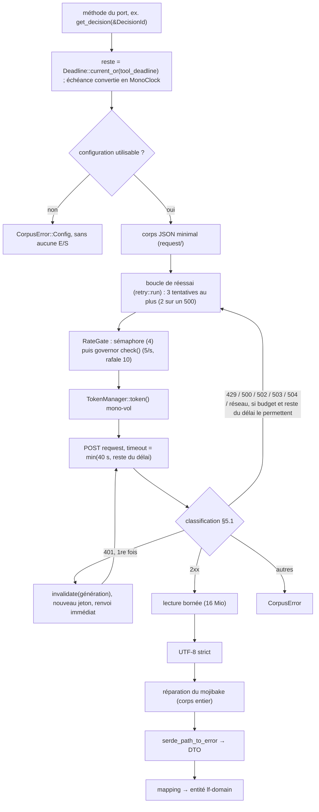

# 04 — Adapter PISTE (`lf-adapter-piste`) : OAuth, HTTP, résilience, requêtes, DTO, mapping

> **Statut** : M0-M1 livrés (plan 1), tête de M2 (plans 2a, 2b), adapter jusqu'à `PisteCorpus` (plan 2c), requêtes `/search`, DTO, classification « introuvable » et `PaginationMemo` (plan 2d), budget de décodage et mapping pur (plan 2f), `impl LegalCorpus`, branchement du décodage et du mapping sous le permis de concurrence, contrats sur fixtures et golden (plan 2g), `record-fixture` et tests live (plan 2h, PR 1 : outillage) ; reste : la campagne de sondes (plan 2h, PR 2) ; le domaine de M2 est livré au plan 2e. Ce document applique [00-decisions.md](00-decisions.md) (révision 2), qui est normatif et l'emporte en cas de doute.
> **Document propriétaire** (00 §0) : ce document fait foi pour les internes de `lf-adapter-piste` (modules, configuration, classification « introuvable », stratégies par endpoint) et pour ses fixtures (disposition, sidecars, `cargo xtask record-fixture`). Il renvoie sans recopier le détail à [02-architecture.md](02-architecture.md) (dépendances, règles d'architecture, correspondance des erreurs, spans), à [05-outils-mcp.md](05-outils-mcp.md) (gabarits des messages vus par le modèle), à [06-qualite.md](06-qualite.md) (chemins des fichiers de test, CI, lints) et à [09-risques-et-questions.md](09-risques-et-questions.md) (registres R-xx et V-xx).
> **Jalons** : tâche 0 de M2 (spikes TLS, proxy, `backon`, `governor` ; 00 §11.1 : faits au plan 2c, TLS provisoire), **M2** (tout le socle v0.1 : OAuth, client, réessais, débit, délai, DTO, mapping, mojibake, tests wiremock et fixtures, smoke tests live ; V-66, V-68, V-76 et V-96 bloquantes, 00 §11, 09 §2.18), M5 (pagination de la recherche vérifiée en direct), M6 (endpoints de résolution), M7 (endpoints de navigation).
> **Lecteurs** : développeurs de `lf-adapter-piste`, et de `lf-app` (composition, configuration) et `lf-adapter-cache` (clés, TTL).
> Les extraits Rust sont **non compilés, à valider au jalon qui les implémente**. Le domaine livré (`lf-domain`, M1) fait foi pour ses types : dates en `CivilDate` (`crates/lf-domain/src/date.rs`), identifiants `Id<K>(String)` ; ce qui manque encore au domaine est une tâche de tête de M2 (00 §11.1). Les points non vérifiés sont marqués **NON VÉRIFIÉ** avec une étiquette `[v:…]`. Le registre `V-xx` les reprend dans [09-risques-et-questions.md](09-risques-et-questions.md).

Documents liés : [02-architecture.md](02-architecture.md) (ports, erreurs, décorateurs), [03-domaine.md](03-domaine.md) (types construits par le mapping), [05-outils-mcp.md](05-outils-mcp.md) (paramètres et rendu), [06-qualite.md](06-qualite.md) (stratégie de test et CI), [plans d'implémentation](../superpowers/plans/) (tâches : « plan N, tâche M »), [08-distribution.md](08-distribution.md) (cibles de compilation, images), [09-risques-et-questions.md](09-risques-et-questions.md), [annexes/A-parite.md](annexes/A-parite.md), [annexes/C-api-legifrance.md](annexes/C-api-legifrance.md), ADR-0004, ADR-0005, ADR-0007, ADR-0010, ADR-0011, ADR-0012, ADR-0013, ADR-0014 (index : [../adr/README.md](../adr/README.md)).

---

## 0. Résumé

- `lf-adapter-piste` fournit `PisteCorpus: LegalCorpus`, la seule implémentation du port sortant jusqu'à M9. Il traduit chaque appel du port en requêtes `POST` JSON vers l'API Légifrance 2.4.2 derrière PISTE, puis convertit la réponse en entités de `lf-domain`. Il ne connaît ni MCP, ni l'audit, ni le cache.
- **Environnements** : `LF_PISTE_ENV=sandbox|production` (défaut `sandbox`) fixe ensemble l'URL OAuth et la base de l'API. Les surcharges `LF_PISTE_OAUTH_URL` et `LF_PISTE_BASE_URL` sont validées (https, pas d'identifiants dans l'URL, cohérence d'environnement). Aucune URL ne vient d'ailleurs (ADR-0005, corrige D-04).
- **OAuth2 client_credentials** : jeton en mémoire (`SecretString`), renouvelé 60 s avant expiration, rafraîchissement mono-vol. Sur l'API, un 401 déclenche **un seul** renouvellement, puis `CorpusError::Auth`. Une erreur de l'endpoint token n'est jamais `NotFound` (corrige D-10, D-12, E-20).
- **HTTP** : un `reqwest::Client` 0.13 unique (rustls, option A (aws-lc) provisoire, ADR-0013 §7), connexion 10 s, requête 40 s, aucune redirection suivie, corps plafonné à 16 Mio, User-Agent versionné (corrige D-06, D-41, D-43).
- **Résilience** : boucle maison (`retry::run`, ADR-0017 ; 3 tentatives au plus sur 429/502/503/504 et erreurs réseau, 2 au plus sur 500 puis `retryable: false` ; backoff exponentiel avec gigue, `Retry-After`), respect du délai global par outil `LF_TOOL_DEADLINE_S` (60 s), lu dans `Deadline` (variable locale de tâche posée par `Audited`, 00 §3), `governor` (5 req/s, rafale 10, `LF_PISTE_RPS`/`LF_PISTE_BURST`) consulté par `check()` sur une horloge bâtie sur `MonoClock` (jamais `until_ready`), sémaphore de 4 requêtes en vol (`LF_PISTE_CONCURRENCY`) (corrige D-12, D-13, D-14).
- **Requêtes `/search`** : payload de la référence, `typeRecherche` choisi par `match`, `DATE_VERSION` à **midi** Europe/Paris (stable sur la journée, corrige D-01 ; confirmé par V-76 en M2), facettes de date par fond tirées de la documentation officielle, `typePagination` mémorisé par l'adapter (`PaginationMemo`) et renvoyé à PISTE, jamais exposé au modèle (00 §7).
- **DTO** serde minimaux et tolérants, un module par endpoint, `serde_path_to_error` pour des `Decode` lisibles. **Mapping** en fonctions pures vers les entités de 03.
- **Mojibake** : réparation tout-ou-rien au niveau du corps, avant serde et avant toute normalisation des NBSP, active par défaut (`LF_PISTE_MOJIBAKE_REPAIR=off` la désactive), comptée et journalisée en `warn`.
- **Tests** : une cinquantaine de scénarios wiremock, des tests de contrat sur les 16 fixtures de la référence, `cargo xtask record-fixture` pour enregistrer des fixtures brutes avec métadonnées, et des smoke tests live opt-in.

---

## 1. Rôle et frontières

### 1.1 Responsabilités

| Responsabilité | Où dans le crate | Défauts corrigés |
|---|---|---|
| Configuration PISTE validée (URLs, identifiants, délais, débit) | `config.rs` | D-04, D-18, D-39, D-40 |
| Jeton OAuth2 client_credentials, mono-vol | `auth.rs` | D-10, D-12 |
| Client HTTP unique, lecture bornée des corps | `http.rs` | D-06, D-41, D-43 |
| Réessais, délai global, limitation de débit et de concurrence | `retry.rs`, `limit.rs`, `deadline.rs` | D-12, D-13, D-14 |
| Décodage UTF-8 strict et réparation du mojibake | `encoding.rs` (appelle `lf_domain::text::encoding::repair_latin1_mojibake` ; module du domaine à créer en tâche de tête de M2, 00 §11.1, reliquat de M1, avant `encoding.rs` ; nom du module de l'adapter à trancher : `encoding.rs` ici, `mojibake.rs` en 02) | D-35 (côté production) |
| Construction des corps de requête (`/search`, consultations) | `request/` | D-01, D-09, D-32 |
| DTO serde minimaux | `dto/` | D-11, D-23, D-24 |
| Mapping DTO vers entités du domaine | `map/` | D-20, D-21, D-25, D-26, D-28, D-30, D-33 |
| Classification des réponses en `CorpusError` | `classify.rs` | D-10, D-11 |
| Mémos internes (`PaginationMemo` pour `typePagination`, table des codes `CodeTable` en M6) | `memo.rs` | D-09 |

### 1.2 Ce que le crate ne fait pas

| Responsabilité | Crate | Raison |
|---|---|---|
| Noms d'outils, schémas, messages `[code] …`, rendu compact | `lf-adapter-mcp` | rien de MCP ici : ni `rmcp`, ni `schemars` (00 §2) |
| Journal d'audit, mesure de `duration_ms` | `lf-application` (`Audited`) + `lf-adapter-audit` | l'adapter ne journalise aucun appel d'outil (§12.4) |
| Cache des réponses | `lf-adapter-cache` (`CachedCorpus<PisteCorpus>`) | l'adapter ne met rien en cache, hors deux mémos techniques (§12.3) |
| « Aujourd'hui » à Paris | port `Clock` (`lf-app`) | l'application passe une `VersionDate` déjà résolue (03 §6.4) |
| Validation des paramètres utilisateur | `lf-domain` (constructeurs), appelé par les cas d'usage de `lf-application`, sous `Audited` (02 §6.1) ; `lf-adapter-mcp` ne fait que le décodage JSON des arguments (00 §5) | l'adapter reçoit des types déjà valides (`DecisionId`, `QueryText`, `PageSize`…) ; les rejets `invalid_arg` de `fr_search` (00 §7) sont faits par `SearchQuery::new` (03 §4.1), avant l'appel du port |
| Règles de citation, URLs Légifrance, découpage du texte | `lf-domain` | le mapping appelle les constructeurs du domaine |
| Lecture des variables d'environnement | `lf-app` | l'adapter reçoit une `PisteConfig` (§2.3) |

Règles de dépendance (00 §2) : `lf-adapter-piste` dépend de `lf-application` et de `lf-domain`, jamais d'un autre adapter. `reqwest` n'apparaît que dans ce crate (recherche 04 §5.3).

### 1.3 Méthodes du port implémentées

| Méthode de `LegalCorpus` (00 §3) | Endpoint(s) | Jalon |
|---|---|---|
| `search(&SearchQuery) -> SearchPage` | `POST /search` | M2 |
| `get_act(&LegiTextId, VersionDate) -> Act` | `POST /consult/lawDecree` ; `/consult/legi/tableMatieres` (nature CODE) pour un code si V-96, bloquante en M2, montre que `lawDecree` sur un code dépasse 4 Mio ou 10 s (00 §8, §7.3) | M2 |
| `get_article(&ArticleId) -> ArticleText` | `POST /consult/getArticle` (LEGIARTI et KALIARTI) | M2 |
| `get_decision(&DecisionId) -> Decision` | `POST /consult/juri` (JURITEXT, CONSTEXT, CETATEXT) | M2 |
| `get_deliberation(&CnilTextId) -> Deliberation` | `POST /consult/cnil` | M2 |
| `get_convention(&KaliTextId) -> Convention` | `POST /consult/kaliText` | M2 |
| `get_company_agreement(&AccoTextId) -> CompanyAgreement` | `POST /consult/acco` | M2 |
| `find_article(&CodeRef, &ArticleNum, VersionDate)` | `/consult/getArticleWithIdAndNum` (version en vigueur seulement) ; autre date : `/search` `EXACTE` sur `NUM_ARTICLE` + `DATE_VERSION`, hits filtrés par `cid` ; table des codes (`/list/code`) | M6 |
| `find_by_number(&NumberQuery)` | `/search` en `EXACTE` (`NUM_ARTICLE`, `NUM`, `NUM_AFFAIRE`, `NUM_DEC`, `NUM_DELIB`, `IDCC`), `/search` filtré par la facette `ECLI` (JURI, CETAT ; V-128), `/consult/getJoWithNor`, `/consult/kaliContIdcc`, `/consult/getArticleWithIdEliOrAlias` et `/consult/eliAndAliasRedirectionTexte` (ELI cités, jamais fabriqués ; V-133) — forme de `NumberQuery` : annexe B §6.6 et 03 §4.11 | M6 |
| `list_codes() -> Vec<CodeListing>` | `/list/code` (codes abrogés compris, avec leur `etat`) ; chargée paresseusement au premier besoin, jamais au démarrage ; une seule table (`CodeTable`, TTL 7 j) sert aussi `find_article` et les completions de M7 (00 §3) | M6 |
| `article_versions(&ArticleId) -> Vec<ArticleVersion>` | `/search/canonicalArticleVersion`, repli `/consult/getArticleByCid` | M7 |
| `related_links(&ArticleId) -> RelatedLinks` | `/consult/relatedLinksArticle` | M7 |

Les traits sont en async natif (RPITIT + `Send`, ADR-0012). L'implémentation utilise `async fn`. La sélection PISTE/DILA par `enum AnyCorpus` arrive en M9 (ADR-0004) et ne change rien ici.

```rust
// lf-adapter-piste/src/lib.rs — non compilé, à valider au jalon qui l'implémente
// [livré, plan 2c, tâche 11] Clone écrit à la main (Arc::clone) ; K et S doivent être Clone
pub struct PisteCorpus<K: MonoClock + Clone = TokioClock, S: Sleeper + Clone = TokioSleeper> { inner: Arc<Inner<K, S>> }

impl PisteCorpus {
    /// Aucune E/S (02 §3.3). Le client reqwest est construit au premier appel (OnceCell, mono-vol) ;
    /// un échec de construction (fournisseur TLS, racines) devient CorpusError::Config à l'appel.
    pub fn new(cfg: PisteConfig) -> Self;
}
impl<K: MonoClock + Clone, S: Sleeper + Clone> PisteCorpus<K, S> {
    pub fn environment(&self) -> PisteEnvironment;                 // lf_domain::coverage::PisteEnvironment : cache (namespace), fr_coverage
    pub fn config_problem(&self) -> Option<&ConfigProblem>;        // URL invalide ou incohérente (EnvMismatch…) ; None si les adresses sont valides
    pub fn has_credentials(&self) -> bool;                         // identifiants configurés ? (mode dégradé, §2.4)
    pub fn mojibake_repairs(&self) -> u64;                         // compteur (02 §3.3)
    pub fn stats(&self) -> StatsSnapshot;                          // tous les compteurs en mémoire, jamais exportés (ADR-0005)
    pub async fn check_credentials(&self) -> Result<(), CorpusError>; // `check-config --online` (02 §3.3, 08)
}
impl<K: MonoClock + Clone, S: Sleeper + Clone> LegalCorpus for PisteCorpus<K, S> { /* livré, plan 2g : corpus/port.rs */ }
```

`MonoClock` (temps monotone) et `Sleeper` (attente) sont deux traits **internes** au crate, pas des ports. Ils existent pour rendre déterministes les tests de jeton, de backoff, de `Retry-After`, de débit et de délai restant sans geler l'horloge `tokio` (§13.1). En production : `TokioClock` (`tokio::time::Instant`) et `TokioSleeper` (`tokio::time::sleep`). L'environnement est le `lf_domain::coverage::PisteEnvironment` (03 §4.8), seul type d'environnement du workspace : l'adapter n'en définit pas d'autre, car `lf-adapter-cache` et `lf-application` l'emploient sans dépendre de lui (R3, 02 §3.3).

**Livré (plan 2c, tâche 11)** : `PisteCorpus` jusqu'à `post_json` (appel API complet : mode dégradé sans E/S, puis, à chaque tentative, client, `RateGate`, jeton, envoi borné, classification ; réessai ; décodage du corps des 2xx par `dto::decode::decode` (plan 2d), classification des corps d'erreur), `check_credentials`, `environment`, `config_problem`, `has_credentials`, `mojibake_repairs`, `stats` ; `impl LegalCorpus` **livré au plan 2g** (`corpus/port.rs`, sous-module de `corpus`) : `post_json(kind, endpoint, body, read)` exécute le lecteur synchrone `read` sous le permis de concurrence de la tentative réussie, `fetch` y lit le DTO par `decode` puis appelle le mapper et `Stats::record_mapping` (sur `Ok` comme sur `Err`) ; l'attribut `expect(dead_code)` de `lib.rs` est retiré. Visibilité : `MonoClock`, `Sleeper`, `TokioClock` et `TokioSleeper` sont `pub` dans le module **privé** `time` (la signature de `PisteCorpus<K, S>` les nomme : `private_bounds` l'impose) ; ils ne sont pas nommables hors du crate, `PisteCorpus::new` fixe les types de production ; `TokioClock::new`, `with_parts` et les doublures de test (`ManualClock`, `RecordingSleeper`) restent `pub(crate)`. `K` et `S` sont `Clone` : la barrière de charge et le gestionnaire de jeton en gardent chacun un exemplaire.

### 1.4 Dépendances

Versions de référence relevées dans l'index crates.io le 2026-10-15 (recherche 04 §4.1), **pas des planchers** (00 §2, AM-26) : `[workspace.dependencies]` écrit l'exigence au niveau mineur (`reqwest = "0.13"`, `tokio = "1.53"`, `serde_json = "1.0"`, `rustls = "0.23"`…, 02 §3.0.1). Le `Cargo.lock` livré avec M0 (plan 1) fait foi pour les dépendances déjà verrouillées ; chaque dépendance ajoutée en M2 retient la plus haute version publiée depuis au moins 14 jours à la date de sa PR (pubtime de l'index sparse, contrôlé par script), fixée par `cargo update -p <crate> --precise <version>` ; si aucune version de la série mineure n'est assez ancienne, l'exigence descend d'une version mineure et c'est elle qui est écrite (00 §2 ; règle et versions de référence : 02 §3.0.1 ; verrou de M0-M1 livré, proptest 1.12.0, R-22). La table décrit la cible : une dépendance n'est déclarée dans le manifeste du crate que lorsqu'un code l'emploie, sans déclaration d'avance dans le squelette, pour que `cargo machete` reste vert (00 §2). Les features sont celles de ce crate. Elles se déclarent `default-features = false` au niveau du workspace quand c'est voulu (piège d'héritage, 00 §2) ; les déclarations de workspace et le confinement des crates sont fixés par 02 §3.0 et §4.1 (document propriétaire, 00 §0). Au workspace, reqwest ne porte que `json` et `form` ; ce crate ajoute `gzip`, `system-proxy` et `rustls` (option A, provisoire), puisque les features sont additives et qu'un membre ne peut pas en retirer.

| Crate | Version de référence | Features | Usage |
|---|---|---|---|
| `reqwest` | 0.13.5 | `json`, `form` (workspace) ; `gzip`, `system-proxy`, `rustls` (membre, option A provisoire) ; `rustls-no-provider` sous B | client HTTP (§4) |
| `rustls` | 0.23.46 | direct seulement sous B (`rustls-no-provider`) : `ring`, `std`, `tls12`, `logging` ; verrouillé 0.23.46 comme transitif (F1, exception `security-fix`, 00 §2) | fournisseur crypto (§4.1) |
| `tokio` | 1.53.3 | `time`, `sync` (dev : `macros`, `rt`, `rt-multi-thread`, `test-util`) | délais, sémaphore, verrou du jeton |
| `serde`, `serde_json` | 1.0.229, 1.0.154 | `derive` | DTO |
| `serde_path_to_error` | 0.1.20 | — | chemin JSON des erreurs `Decode` (§8.5) ; livré (plan 2d) |
| `secrecy` | 0.10.3 | `serde` | `client_secret` et jeton (§3.6) |
| `governor` | 0.10.4 | `std` seule (sans `quanta`, `jitter` ni `dashmap`) ; elle tire `futures-timer`, `futures-util`, `futures-sink` et `parking_lot`, jamais sollicités (pas de `until_ready`) | limitation de débit (§5.4) |
| `chrono`, `chrono-tz` | 0.4.45, 0.10.4 | `std` seul (livré : `parse_from_rfc2822`, date HTTP de `Retry-After`) ; `chrono-tz` 0.10.4, `default-features = false` (livré, plan 2d : ni `std` redondant, ni `serde`, `case-insensitive`, `filter-by-regex` ; tire `phf` 0.12.1, `phf_shared` 0.12.1, `siphasher` 1.0.4) ; binaire +1,86 Mo | midi Europe/Paris pour `singleDate` (§6.3) et date HTTP de `Retry-After` ; `chrono-tz` n'est admis que dans `lf-app` (`clock`) et dans ce crate (00 §2) ; **hors du domaine** : `lf-domain` reste limité à `thiserror` (liste blanche de `xtask/src/arch.rs`, `DOMAIN_ALLOWED`) et porte ses dates en `CivilDate` (00 §2, C3) |
| `tracing` | 0.1.44 | `["std"]`, sans `attributes` | journaux sur stderr (§12.5) |
| `thiserror` | 2.0.21 | — | erreurs internes |
| `reqwest::Url` (ré-export de `url` 2.5.8) | — | — | validation de la configuration ; **pas** de dépendance directe à `url` (02 §3.3) |
| dev livrés (plan 2c) : `wiremock`, `flate2`, `tracing-subscriber`, `tokio` (`macros`, `rt`, `rt-multi-thread`, `test-util`) | 0.6.5, 1.1.10, 0.3.23 | `flate2` : `rust_backend` (R6 le confine à `lf-adapter-dila` pour les dépendances normales et de build seulement) ; `tracing-subscriber` : `std`, `fmt` | tests (§13) |
| dev du plan 2g : `insta`, `toml` | 1.49.0 (tire `similar` 2.7.0), 1.1 (déjà au verrou par `xtask`) | `insta` : `default-features = false`, `json` seule (ni `colors` ni `redactions`, qui tirerait `pest` et `sha2`) ; `toml` : features du workspace | snapshots de `view` (`mapping_snapshots`), lecture des sidecars (`integrity.rs`) ; `proptest` n'y entre pas (mutations des fixtures énumérées, §13.3) |

`charset` (décodage selon l'en-tête `Content-Type`) est **exclu** : le corps est toujours décodé en UTF-8 strict à partir des octets (§4.4). `http2` n'est pas activé (00 §8) : HTTP/1.1 avec réutilisation des connexions suffit à 4 requêtes en vol ; non activé, HTTP/1.1, à confirmer au sondage live.

`backon` 1.6.0 n'est **pas** une dépendance : essayé au spike V-06 (plan 2c), écarté (§5.2, ADR-0017). Verrou à la fin du plan 2c : 248 paquets (`Cargo.lock`), dont trois sous l'exception `security-fix` (`rustls` 0.23.46, `rustls-webpki` 0.103.16, `webpki-root-certs` 1.0.10 ; 00 §2, 06 §13.1). `aws-lc-rs` 1.18.1 et `aws-lc-sys` 0.45.0 (option A) ont été redescendus à la plus haute version éligible. À la fin du plan 2d : 253 paquets (cinq ajoutés : `serde_path_to_error` 0.1.20, `chrono-tz` 0.10.4, `phf` 0.12.1, `phf_shared` 0.12.1, `siphasher` 1.0.4), aucun transitif redescendu, aucun nouvel avis d'âge et aucune exception `security-fix`.

Feature Cargo du crate : `record` (`record = []`, **livrée au plan 2h, aucune dépendance** : elle n'ajoute que du code, pas un crate au verrou). Sous `#[cfg(feature = "record")]` : `PisteCorpus::exchange`, l'API brute qui rend statut, en-têtes utiles et octets (`corpus/raw.rs`), et le module public `record` (`src/record.rs` : sondes, arguments, caviardage, sidecar, écriture ; §13.4). Le SHA-256 partagé (`src/sha256.rs`, `cfg(any(test, feature = "record"))`, écrit à la main : `sha2` reste confiné à `lf-adapter-audit` et `xtask`, R6) sert aux tests d'intégrité des fixtures et à l'écrivain. La feature n'est employée que par `examples/record_fixture.rs` (§13.4), qui n'est que de la colle d'E/S, et par les tests live qui lisent les octets bruts (§13.5) ; elle n'est jamais activée dans le binaire. `make cov`, `make lint`, `make test`, `make doc` et `cargo-mutants` (`all_features = true`, `.cargo/mutants.toml`) passent en `--all-features` : le code de `record` est mesuré et muté comme le reste (06 §7.1).

### 1.5 Organisation des modules

```text
crates/lf-adapter-piste/src/
  lib.rs          PisteCorpus, ré-exports (PisteConfig, PisteEndpoints, PisteCredentials, RateQuota, PisteTuning, TuningError, ConfigWarning, ConfigProblem, StatsSnapshot)
  config.rs       PisteEndpoints, PisteCredentials, PisteConfig, RateQuota, PisteTuning, TuningError, ConfigWarning,
                  ConfigProblem (champs privés, accesseurs), validation (§2) ; l'environnement est lf_domain::coverage::PisteEnvironment
  auth.rs         TokenManager, TokenLease, DTO de l'endpoint token (§3)
  http.rs         construction du client, envoi d'une tentative, lecture bornée du corps (§4)
  encoding.rs     decode_body : UTF-8 strict puis réparation du mojibake (§4.4, §10)
  classify.rs     statut, plus le corps d'un 400 de consultation, d'un 404 de consultation et d'un 2xx vide → issue d'une tentative : Outcome, Budget, EndpointKind, ErrorContext, try_send (§5.1, §11.2)
  retry.rs        boucle de réessai maison (run, backoff, Jitter), Retry-After (§5.2 ; ADR-0017)
  deadline.rs     CallDeadline : lecture de lf_application::deadline::Deadline (durée restante),
                  convertie en échéance MonoClock à l'entrée de la méthode du port (§5.3)
  limit.rs        RateGate : sémaphore + governor (check(), horloge bâtie sur MonoClock) (§5.4, §5.5)
  time.rs         MonoClock, Sleeper, TokioClock, TokioSleeper, race (+ ManualClock, RecordingSleeper en cfg(test))
  error_body.rs   message d'un corps d'erreur : UTF-8, mojibake, PisteErrorDto, secrets retirés, nettoyage, marqueur « introuvable », détection du HTML (§11.2)
  stats.rs        Stats, StatsSnapshot : compteurs du mojibake (§10.5) et du mapping (`record_mapping`, §9.3)
  testing.rs      (cfg(test)) ClosedPort, Capture, capture_at (§13.1)
  request/        search.rs (livré, plan 2d : DTO de requête privés, search_body, date_facet, paris_noon_ms), consult.rs (livré, plan 2g : Consultation, endpoint et corps des six consultations), number.rs (M6)
  dto/            mod.rs, de.rs, oauth.rs (plan 2c) ; decode.rs, error.rs, search.rs, consult_text.rs (remplace `text.rs`),
                  article.rs, juri.rs, acco.rs (plan 2d) ; budget.rs (plan 2f : budget de 200 000 éléments par document, R11, §8.5) ;
                  jorf.rs, kalicont.rs, codes.rs (M6), versions.rs, links.rs (M7)
  map/            mod.rs (Diagnostics, Field, endpoint), dates.rs, rules.rs, search.rs (livrés, plan 2f), body.rs, toc.rs,
                  act.rs, convention.rs, article.rs, decision.rs, deliberation.rs, agreement.rs (livrés, plan 2f ; M6/M7 à venir) ;
                  fixtures.rs (cfg(test) : table des fixtures, décodage, golden, contrats) ; mutations.rs (cfg(test),
                  plan 2g : fixture_mutations_never_panic)
  view.rs         (cfg(test)) projection unique et exhaustive des entités mappées en JSON, pour les contrats (§13.3)
  memo.rs         PaginationMemo, MemoKey, choose_mode, received_mode (livré, plan 2d ; `received_mode` rend `Option<PaginationMode>`) ; CodeTable (M6) (§12.3)
  corpus.rs       PisteCorpus, post_json (appel API de bout en bout, lecteur sous le permis), fetch (decode + mapping)
  corpus/port.rs  impl LegalCorpus (plan 2g) et scénarios wiremock par endpoint
  corpus/raw.rs   (feature record, plan 2h) PisteCorpus::exchange : un échange brut avec l'API par le vrai client, sans classement ni réessai (§13.4)
  golden.rs       (cfg(test)) harnais du golden : GoldenDivergence, OVERRIDES, mapping_matches_golden (plan 2g)
  integrity.rs    (cfg(test)) sidecars .meta.toml, chaînes de forme jeton (plan 2g) ; fixtures enregistrées (plan 2h, §13.4)
  sha256.rs       SHA-256 (FIPS 180-4) sans dépendance, sous cfg(any(test, feature = "record")) : intégrité et écrivain (plan 2h)
  record.rs       (feature record, plan 2h) Probe, Plan, Args, parse_args, select, Exchange, redact, Sidecar, write, RecordError, Outcome, failures, exit_code (§13.4)
crates/lf-adapter-piste/examples/
  record_fixture.rs   (feature record) colle d'E/S (identifiants, réseau, stdout) lancée par cargo xtask record-fixture ; la logique est dans src/record.rs (§13.4)
crates/lf-adapter-piste/tests/
  fixtures/reference/*.json (+ .meta.toml)   16 fixtures de la référence (attribution NOTICE)
  fixtures/recorded/<endpoint>/<nom>.json (+ .meta.toml)   fixtures enregistrées par xtask (§13.4)
  fixtures/plan.toml   lot de sondes de cargo xtask record-fixture --plan (§13.4)
  fixtures/synthetic/   cas construits (listes null, sentinelles, types mêlés, corps d'erreur)
  live.rs   smoke tests live, `#[ignore]`, enveloppés dans `#[cfg(test)] mod live` (§13.5)
```

Les tests unitaires et wiremock vivent **dans le crate**, en `#[cfg(test)] mod tests` du fichier testé (async pour wiremock), conformément à l'ADR-0002 et à 00 §10 (la liste de 06 §1.4 fait foi pour les chemins) : jeton (`auth.rs`), résilience (`retry.rs`, `limit.rs`, `deadline.rs`), corps (`http.rs`, `encoding.rs`), payloads (`request/search.rs`), mapping (`map/*.rs`), contrats sur fixtures (`map/fixtures.rs` et `view.rs` ; les fixtures y sont lues par `include_str!` dans `map/fixtures.rs` seulement) et scénarios d'endpoints (`corpus.rs`). `tests/` est réservé à `live.rs`, aux tests e2e du binaire et aux compléments, car `make cov` mesure `--lib` : un code exercé seulement par `tests/*.rs` compterait comme non couvert. Aucune exclusion n'a été nécessaire (plan 2c) : `make cov` à 100 % sans `--ignore-filename-regex`, glue HTTP incluse (wiremock), et une seule exclusion de mutation pour l'adapter : un mutant prouvé équivalent de `dto/de.rs` (`ListVisitor::visit_none`, `exclude_re` de `.cargo/mutants.toml`, preuve en commentaire, plan 2f) ; les `exclude_globs` sont `xtask/src/main.rs` et `fuzz/**` (antérieurs) et, depuis le plan 2h, `crates/lf-adapter-piste/examples/**` (la colle de `record-fixture` ; la logique est dans `src/record.rs`, mesurée et mutée) ; à revoir si la glue de `lf-app` en demande une (M4). Les noms de fichiers de test cités plus bas (`oauth.rs`, `resilience.rs`…) désignent désormais ces modules `tests`.

Les fixtures sont protégées de toute conversion de fin de ligne (`**/tests/fixtures/** -text` dans `.gitattributes`, 06 §1.2, principe PT5), condition de stabilité de `sha256_raw` sous Windows (D-35).

### 1.6 Pipeline d'un appel



---

## 2. Environnements et configuration

### 2.1 Sandbox et production

| Aspect | Sandbox | Production | Source |
|---|---|---|---|
| Endpoint token | `https://sandbox-oauth.piste.gouv.fr/api/oauth/token` | `https://oauth.piste.gouv.fr/api/oauth/token` | exemple officiel DILA (recherche 05 §3.1, `exemples-d-utilisation-de-l-api.md:115`) ; Swagger 2.4.2 `securityDefinitions…tokenUrl` (prod) |
| Base de l'API | `https://sandbox-api.piste.gouv.fr/dila/legifrance/lf-engine-app` | `https://api.piste.gouv.fr/dila/legifrance/lf-engine-app` | Swagger 2.4.2 `host` + `basePath` des copies sandbox et prod (recherche 05 §1.1) ; référence client.py:28-29 |
| Surface d'API | 68 opérations, Swagger 2.4.2 | identique (diff programmatique des deux copies : seuls `host`, `schemes` et URLs OAuth diffèrent) | recherche 05 §0 |
| Identifiants | application PISTE sandbox | application PISTE production, **distincte** : des identifiants sandbox présentés à `oauth.piste.gouv.fr` reçoivent `invalid_client` | référence SOURCES.md:12 (recherche 05 §3.2) |
| Données | « Les données ne sont pas identiques à celles de Production » ; les correctifs y arrivent d'abord | données de référence | Swagger `info.description` (recherche 05 §3.2) |
| Engagement de service | **aucun** : tests de performance, réindexation, indisponibilité « sans information préalable » | objectif de 95 % par jour, engagement de moyens, aucun niveau minimal garanti | CGU API Légifrance 2022, `cgu-legifrance-api.md:187-202` (recherche 05 §3.2) |
| Quotas | consultables dans PISTE (« Applications » → « Actions » → « Consulter les quotas ») | idem ; modifiables par la DILA avec information par courriel | `cgu-legifrance-api.md:212-231` (recherche 05 §3.3) |

Les URLs de production sont documentées (Swagger) mais n'ont jamais été appelées par nous ni par la référence, qui n'avait qu'une application sandbox : **NON VÉRIFIÉ** [V-59 · oauth-production-live]. L'ampleur de l'écart de données entre sandbox et production est **NON VÉRIFIÉ** [V-61 · sandbox-prod-donnees]. Les valeurs numériques des quotas ne sont pas publiques : **NON VÉRIFIÉ** [V-62 · quota-piste-prod].

Conséquences pour l'adapter :

- l'environnement est une donnée de premier rang : `PisteCorpus::environment()` alimente l'espace de noms du cache (00 §9, corrige D-15) et `fr_coverage` (00 §7, corrige D-18) ;
- une erreur `invalid_client` doit produire un message qui suggère un mélange d'environnements (§3.5) ;
- les fixtures enregistrées portent leur environnement dans leurs métadonnées (§13.4) : un golden sandbox n'est pas comparé à une réponse de production.

### 2.2 Variables lues (par `lf-app`)

Liste fermée de 00 §1 ; formats, priorités et messages détaillés : 02 §8.2, qui fait foi. Ce tableau ne fixe que le champ de `PisteConfig` alimenté par chaque variable.

| Variable (00 §1) | Défaut | Champ de `PisteConfig` | Remarques |
|---|---|---|---|
| `LF_PISTE_ENV` | `sandbox` | `env` (`lf_domain::coverage::PisteEnvironment`) | `sandbox` ou `production`, insensible à la casse ; toute autre valeur est un problème de configuration (mode dégradé, §2.4) |
| `LF_PISTE_CLIENT_ID` | — | `credentials.client_id` | `trim()` ; vide = absent (parité référence client.py:51-52) |
| `LF_PISTE_CLIENT_SECRET` | — | `credentials.client_secret` | idem, enveloppé immédiatement dans `SecretString` |
| `LF_PISTE_OAUTH_URL` | URL officielle de `env` | `endpoints.oauth_url` | surcharge explicite, validée (§2.3) |
| `LF_PISTE_BASE_URL` | URL officielle de `env` | `endpoints.base_url` | surcharge explicite, validée ; `/` final retiré (parité client.py:47) |
| `LF_HTTP_TIMEOUT_S` | `40` (1..=300) | `request_timeout` | délai total d'une tentative HTTP (connexion comprise, corps compris) |
| `LF_TOOL_DEADLINE_S` | `60` (1..=600) | `tool_deadline` | délai global par défaut quand aucun `Deadline` n'est publié (§5.3) |
| `FR_ELI_CLIENT_ID`, `FR_ELI_CLIENT_SECRET`, `FR_ELI_OAUTH_URL`, `FR_ELI_BASE_URL` | — | mêmes champs | compatibilité : lues seulement si la variable `LF_*` correspondante est absente, avec un avertissement de dépréciation sur stderr ; si les deux sont définies, `LF_*` l'emporte et un avertissement le signale. Les surcharges `FR_ELI_*_URL` suivent les règles du §2.3 |
| `LF_PISTE_RPS` | `5` (1..=100) | `rate.per_second` | réglage avancé (00 §1) |
| `LF_PISTE_BURST` | `10` (1..=100) | `rate.burst` | réglage avancé |
| `LF_PISTE_CONCURRENCY` | `4` (1..=16) | `max_concurrency` | requêtes API en vol (§5.5) ; réglage avancé |
| `LF_PISTE_MOJIBAKE_REPAIR` | `on` (`on`\|`off`) | `repair_mojibake` | réparation du mojibake (§10) ; réglage avancé |

Toute valeur invalide d'une variable numérique ou de `LF_PISTE_MOJIBAKE_REPAIR` est remplacée par le défaut, avec un `warn!` et une ligne de `check-config` (00 §1). Au plan 2c, `PisteConfig::new` pose les défauts nommés ; la lecture bornée des quatre réglages avancés et leur `warn!` appartiennent à `lf-app` (M4, T-M2-01 en partie). Depuis le plan 2d, `lf-app` construit un `PisteTuning` en partant de `PisteTuning::default()`, applique ses réglages bornés (1..=100, 1..=300, 1..=16 : politique d'utilisateur, **non** imposée par l'adapter), puis appelle `PisteConfig::with_tuning` ; une `TuningError` (valeur nulle) donne le défaut et un `warn!`. `lf-app` fait aussi le `trim()` et le « vide = absent » des identifiants avant `PisteCredentials::new` (le constructeur ne décide de rien). Les quatre réglages avancés ne sont déclarés ni dans `server.json` ni dans le manifeste MCPB : README et `check-config` seulement (08). Les variables héritées `FR_ELI_CACHE_DIR`, `FR_ELI_RUNTIME_URL`, `FR_ELI_ENV`, `PISTE_CLIENT_ID` et `PISTE_CLIENT_SECRET` ne sont jamais lues ; si elles sont définies, `lf-app` émet un avertissement « ignored » au démarrage et dans `check-config`.

Le connecteur ne lit aucune configuration distante, ne télécharge aucun manifeste et n'émet aucune télémétrie (ADR-0005, corrige D-04 et D-05). La configuration est lue **une fois** au démarrage (corrige E-24 : la référence relisait l'environnement à chaque appel).

### 2.3 `PisteConfig` et validation

```rust
// lf-adapter-piste/src/config.rs — [livré, plans 2c (tâche 4) et 2d (tâche 2)]
use lf_domain::coverage::PisteEnvironment;   // seul type d'environnement du workspace (03 §4.8) ; Url = reqwest::Url

// PisteEndpoints, PisteCredentials, RateQuota et PisteConfig ont des champs PRIVÉS : seuls les accesseurs
// ci-dessous les lisent. Un appelant (lf-app) ne peut donc plus fabriquer `official: true` avec une URL
// personnalisée, ce qui ferait d'un 404 d'hôte hostile un `NotFound` (§11.2, règle 4).
#[derive(Debug, Clone, PartialEq, Eq)]
pub struct PisteEndpoints { /* oauth_url: Url, base_url: Url (jamais de « / » final), official: bool */ }
impl PisteEndpoints { pub fn oauth_url(&self) -> &Url; pub fn base_url(&self) -> &Url; pub fn is_official(&self) -> bool; }

#[derive(Debug, Clone)]
pub struct PisteCredentials { /* client_id: String, client_secret: SecretString */ }
impl PisteCredentials { pub fn new(client_id: String, client_secret: SecretString) -> Self;
                        pub fn client_id(&self) -> &str; pub fn client_secret(&self) -> &SecretString; }

#[derive(Debug, Clone, Copy, PartialEq, Eq)]
pub struct RateQuota { /* per_second: NonZeroU32, burst: NonZeroU32 */ }   // nom exporté fixé par 02 §3.3
impl RateQuota { pub fn new(per_second: NonZeroU32, burst: NonZeroU32) -> Self;
                 pub fn per_second(&self) -> NonZeroU32; pub fn burst(&self) -> NonZeroU32; }

/// Réglages avancés : champs publics, validés à l'entrée par `PisteConfig::with_tuning`.
#[derive(Debug, Clone, Copy, PartialEq, Eq)]
pub struct PisteTuning {
    pub connect_timeout: Duration,                        // 10 s
    pub request_timeout: Duration,                        // LF_HTTP_TIMEOUT_S, 40 s
    pub tool_deadline: Duration,                          // LF_TOOL_DEADLINE_S, 60 s
    pub rate: RateQuota,                                  // LF_PISTE_RPS, LF_PISTE_BURST : 5/s, rafale 10
    pub max_concurrency: NonZeroU16,                      // LF_PISTE_CONCURRENCY : 4
    pub max_body_bytes: u64,                              // 16 Mio (00 §8)
    pub repair_mojibake: bool,                            // LF_PISTE_MOJIBAKE_REPAIR : true
}                                                         // Default : les valeurs ci-dessus

#[derive(Debug, Clone, PartialEq, Eq, thiserror::Error)]
pub enum TuningError { #[error("{setting} must not be zero")] Zero { setting: &'static str } }
// `setting` ∈ `connect timeout`, `request timeout`, `tool deadline`, `max body bytes`, contrôlés dans cet ordre

#[derive(Debug, Clone)]   // derive : le secret est rédigé par SecretString (« [REDACTED] »)
pub struct PisteConfig { /* env, endpoints: Result<PisteEndpoints, ConfigProblem>, credentials: Option<PisteCredentials>,
                            user_agent: String, tuning: PisteTuning */ }
impl PisteConfig {
    /// Assemble avec `PisteTuning::default()` (CONNECT_TIMEOUT, REQUEST_TIMEOUT, TOOL_DEADLINE, RATE_PER_SECOND,
    /// RATE_BURST, MAX_CONCURRENCY, MAX_BODY_BYTES, repair_mojibake = true) ; ne décide de rien.
    pub fn new(env: PisteEnvironment, endpoints: Result<PisteEndpoints, ConfigProblem>,
               credentials: Option<PisteCredentials>, user_agent: String) -> Self;
    /// Seul point de validation des réglages avancés (`rate.*` et `max_concurrency` sont déjà `NonZero*`).
    /// Consomme la configuration même en cas d'erreur : l'appelant qui veut un repli la clone avant (`Clone`).
    pub fn with_tuning(self, tuning: PisteTuning) -> Result<Self, TuningError>;
    pub fn env(&self) -> PisteEnvironment;
    pub fn endpoints(&self) -> Result<&PisteEndpoints, &ConfigProblem>;
    pub fn credentials(&self) -> Option<&PisteCredentials>;   // None ⇒ CorpusError::Config sans E/S (D-39)
    pub fn user_agent(&self) -> &str;                          // construit par lf-app (§4.2)
    pub fn tuning(&self) -> &PisteTuning;
}
impl PisteEndpoints {
    pub fn official(env: PisteEnvironment) -> Self;
    pub fn with_overrides(env: PisteEnvironment, oauth: Option<&str>, base: Option<&str>)
        -> Result<(Self, Vec<ConfigWarning>), ConfigProblem>;   // premier problème : jeton puis base
}
pub enum ConfigWarning {   // chaque variante porte `setting` (libellé de rôle : « OAuth URL » ou « base URL »)
    InsecureLoopback { setting },                 // « {setting} uses plain http on a loopback host »
    CustomHost { setting, host: String },         // « {setting} points to a non-official host {host} »
}
pub enum ConfigProblem {
    InvalidUrl { setting, reason: String },       // « invalid {setting}: {reason} » (raison de l'analyseur d'URL)
    InsecureScheme { setting },                   // « {setting} must use https (http is only accepted for loopback hosts) »
    ForbiddenPart { setting, part },              // « {setting} must not contain {part} » : credentials | query | fragment
    EnvMismatch { setting, host, env, host_env }, // « … host {host} belongs to the {host_env} environment but the environment is {env}: set LF_PISTE_ENV={host_env} or fix the URL »
    UnexpectedApiPath { setting, host },          // « {setting} path on official host {host} must be /dila/legifrance/lf-engine-app »
}
```

Règles de `with_overrides` (00 §1, AM-27), toutes testées (§13.2), communes à `LF_PISTE_OAUTH_URL`/`LF_PISTE_BASE_URL` et à leurs équivalents `FR_ELI_*`. Ordre des contrôles : analyse, schéma, parties interdites, environnement, `/` finaux (base seulement), chemin de l'API. **Aucun message ne recopie un morceau de l'entrée** : une URL surchargée peut porter des identifiants (`user:pw@hote` se lit comme un schéma `user` pour `Url::parse`) ; seuls figurent l'hôte officiel, l'hôte d'une surcharge dans `CustomHost` et la raison fixe de l'analyseur d'URL.

1. L'URL se parse avec `Url::parse`. Le schéma doit être `https`. Exception : `http` est accepté si l'hôte est une boucle locale (`127.0.0.1`, `[::1]`, `localhost`), avec `ConfigWarning::InsecureLoopback`. Cette exception sert aux tests wiremock et aux passerelles locales.
2. Ni identifiants (`userinfo`), ni requête (`?…`), ni fragment : sinon `ConfigProblem::ForbiddenPart` (une seule variante, dont `part` vaut `credentials`, `query` ou `fragment`). Une URL ne contient jamais de secret, ce qui corrige le risque de fuite par les messages d'erreur (D-40).
3. Hôte hors de la liste des quatre hôtes officiels (`sandbox-oauth.piste.gouv.fr`, `oauth.piste.gouv.fr` pour le jeton ; `sandbox-api.piste.gouv.fr`, `api.piste.gouv.fr` pour l'API) : accepté, car la surcharge est un choix explicite et local de l'utilisateur, mais `ConfigWarning::CustomHost` est affiché au démarrage, par `check-config` et dans `fr_coverage` (rendu dans 05). `official` vaut vrai quand les **deux** URL sont sur des hôtes officiels (une surcharge absente compte comme officielle). Une URL `http` de boucle locale donne **deux** avertissements (`InsecureLoopback` puis `CustomHost`) : les tests wiremock obtiennent donc `official == false` ; `lf-app` (M4) les présente.
4. Tout hôte officiel doit désigner l'environnement de `LF_PISTE_ENV`, explicite ou par défaut (`sandbox`) ; si les deux hôtes sont officiels, ils désignent donc le **même** environnement. Sinon `ConfigProblem::EnvMismatch`, dont le message demande de poser `LF_PISTE_ENV=production` (ou de corriger l'URL) : aucune déduction implicite de l'environnement à partir de l'hôte. Cela empêche d'envoyer des identifiants sandbox à la production, ou l'inverse, et de fausser l'espace de noms du cache et `fr_coverage`. Piège visé : un utilisateur de la référence qui pointait `FR_ELI_*_URL` vers la production sans définir `LF_PISTE_ENV`.
5. Sur un hôte API officiel, le chemin doit être exactement `/dila/legifrance/lf-engine-app` (`UnexpectedApiPath`). Les `/` finaux ne sont retirés que de l'URL de **base**, avec `Url::set_path` ; `base_url` n'a donc jamais de `/` final et un endpoint s'y **concatène** (`format!("{base}{endpoint}")`, `endpoint` commençant par `/`), jamais par `Url::join`, qui remplacerait le dernier segment du chemin.

Le `User-Agent` invalide reste détecté à la construction du client (`CorpusError::Config`), pas à `with_tuning` ; le `Debug` de `PisteConfig` reste rédigé.

L'URL de base ne change plus après le démarrage. Aucune URL renvoyée par l'API (`lienJo`, `urlCC`, `attachementUrl`, `href` des contenus KALI) n'est jamais appelée (§14.3).

### 2.4 Démarrage sans réseau ; identifiants absents

- `PisteCorpus::new` ne fait **aucun** appel réseau. Le jeton est demandé paresseusement, au premier appel d'outil (00 §6).
- Identifiants absents, `ConfigProblem` (dont `EnvMismatch`) ou `LF_PISTE_ENV` invalide : le serveur démarre quand même, en **mode dégradé** (00 §1) : `lf-app` journalise le problème en `error!`, chaque méthode du port renvoie immédiatement `CorpusError::Config`, sans E/S ni attente (corrige D-39), et chaque outil PISTE répond `[config_error] …`. `fr_coverage` et `check-config` décrivent le problème ; l'avertissement `CustomHost` apparaît aussi comme lacune dans `fr_coverage` (00 §7 ; rendu dans 05). Pour les identifiants absents, le message garde celui de la référence avec les nouveaux noms de variables (P-014, E-34), **sans point final** (convention des messages d'erreur, `CREDENTIALS_MISSING`) : `PISTE credentials missing: set LF_PISTE_CLIENT_ID and LF_PISTE_CLIENT_SECRET (from your piste.gouv.fr application, section OAuth Credentials)` (gabarit de 05 §7.2). Le problème d'adresses est examiné avant les identifiants (`ready`). `TokenManager` garde en défense le message court `PISTE credentials missing` (inatteignable par `post_json` et `check_credentials`, qui filtrent avant). `PisteCorpus::has_credentials()` et `config_problem()` alimentent `check-config` et `fr_coverage`.
- `check-config` (sous-commande de `lf-app`, 02 §8.1, 08) affiche l'environnement, les URLs effectives, les avertissements et les problèmes, sans le secret. L'option explicite `--online` appelle `check_credentials()` (02 §3.3) : une seule requête token, aucun appel à l'API.

---

## 3. OAuth2 client_credentials

### 3.1 Requête

`POST {oauth_url}`, `Content-Type: application/x-www-form-urlencoded` (méthode `RequestBuilder::form`, feature `form` de reqwest 0.13, recherche 04 §4.2) :

```text
grant_type=client_credentials&client_id=<id>&client_secret=<secret>&scope=openid
```

Corps et en-têtes conformes à l'exemple officiel (`exemples-d-utilisation-de-l-api.md:115-129`) et à la référence (client.py:77-86), donc à la parité P-022. En-têtes : `User-Agent` et `Accept: application/json`, communs au client.

### 3.2 Réponse

Réponse documentée : `{"access_token": "…", "token_type": "Bearer", "expires_in": 3600, "scope": "openid"}`, où `expires_in` est en secondes (`exemples-d-utilisation-de-l-api.md:135-151`). Observé en sandbox : scope `openid resource.READ` (référence DISCOVERY.md:12).

```rust
// dto/oauth.rs — non compilé, à valider au jalon qui l'implémente
#[derive(Deserialize)]
pub(crate) struct TokenResponseDto {
    #[serde(default)] pub access_token: Option<SecretString>,   // feature serde de secrecy
    #[serde(default)] pub token_type: Option<String>,
    #[serde(default, deserialize_with = "de::opt_u64_lenient")] pub expires_in: Option<u64>, // nombre, chaîne ou null
}
#[derive(Deserialize)]
pub(crate) struct OAuthErrorDto { #[serde(default)] pub error: Option<String>, #[serde(default)] pub error_description: Option<String> }
```

Règles :

- `access_token` absent ou vide ⇒ `CorpusError::Config` (`PISTE OAuth returned no access_token`, sans point final, parité S7). Une réponse 200 sans jeton indique un endpoint qui n'est pas celui de PISTE.
- `token_type` différent de `Bearer` (sans tenir compte de la casse) : `warn`, jeton utilisé quand même.
- `expires_in` absent, `null`, nul, flottant, négatif ou non numérique ⇒ **3 600 s** (une chaîne de chiffres, `"3600"`, est lue comme le nombre : `opt_u64_lenient`). La référence plantait sur `null` (recherche 02 D-10). La valeur est bornée à [1 s, 86 400 s] (`0 ⇒ défaut`, puis plafond à 86 400 s).
- Formes réelles des erreurs de l'endpoint token, statut et corps : **NON VÉRIFIÉ** [V-60 · oauth-reponses].

### 3.3 Gestionnaire de jeton

```rust
// auth.rs — [livré, plan 2c, tâche 10]
pub(crate) struct TokenManager<K, S> {     // K: MonoClock, S: Sleeper
    client: Arc<SharedClient>,             // le client partagé (§4.2), construit au premier besoin
    config: Arc<PisteConfig>,
    clock: K,
    sleeper: S,                            // seule porte d'entrée des attentes
    state: tokio::sync::Mutex<State>,      // State { cached: Option<CachedToken>, issued: u64 }
}
struct CachedToken { value: SecretString, refresh_at: Duration /* horloge MonoClock */, generation: u64 }
pub(crate) struct TokenLease { pub value: SecretString, pub generation: u64 }   // Debug rédigé

impl<K: MonoClock, S: Sleeper> TokenManager<K, S> {
    /// Mono-vol : le verrou est tenu pendant le rafraîchissement ; les appelants concurrents
    /// attendent puis lisent le jeton neuf. L'attente du verrou est une course `time::race` contre
    /// `Sleeper::sleep(reste)` (CallDeadline, §5.3), pas `tokio::time::timeout` : `Timeout` si
    /// l'échéance tombe d'abord. L'état n'est écrit qu'après un succès.
    pub(crate) async fn token(&self, deadline: &CallDeadline) -> Result<TokenLease, CorpusError>;
    /// N'invalide que si le jeton courant est celui de `generation` ; le verrou est attendu comme dans
    /// `token`, au plus jusqu'à l'échéance de l'appelant (`Timeout`, état intact, jeton refusé conservé).
    pub(crate) async fn invalidate(&self, generation: u64, deadline: &CallDeadline) -> Result<(), CorpusError>;
}
```

- **État** : au plus un jeton en mémoire, jamais écrit sur disque ni journalisé (P-026 ; référence client.py:10-13). Il n'est pas non plus dans `lf-adapter-cache`.
- **Renouvellement anticipé** : `refresh_at = obtenu_à + expires_in − marge`, avec `marge = min(60 s, expires_in / 2)`. `obtenu_à` est lu **avant** l'envoi de la requête, comme la référence (client.py:74, 93), ce qui reste prudent. La marge de 60 s est celle de la référence et de deux clients tiers (recherche 05 §3.1). Le plafond `expires_in / 2` évite un jeton déjà périmé si `expires_in ≤ 60`.
- **Mono-vol** : un `tokio::sync::Mutex` couvre la lecture et le rafraîchissement (même principe que l'`anyio.Lock` de la référence, client.py:70-73). Dix appels simultanés au démarrage produisent **une** requête token (P-022, test `concurrent_calls_share_one_token_refresh`).
- **Générations** : chaque jeton obtenu reçoit un numéro croissant, à partir de 1. `invalidate(g, …)` ne vide l'état que si le jeton courant porte `g` (`invalidate_does_not_drop_fresher_token`). Une tâche qui reçoit un 401 avec un vieux jeton n'efface donc pas le jeton neuf obtenu entre-temps par une autre.
- **Annulation** : si le futur appelant est abandonné (délai global, annulation MCP), la requête token en cours est abandonnée et le verrou est relâché sans modifier l'état. L'appelant suivant rafraîchit. L'acquisition du verrou de `tokio` est sûre vis-à-vis de l'annulation (test `cancel_during_refresh_releases_lock`).
- La requête token passe par la même politique de réessai que l'API (§5.2 : 429, 502, 503, 504 et réseau jusqu'à 3 tentatives, 500 jusqu'à 2), dans le même délai global. Elle ne passe pas par `governor`, car les quotas visent l'API Légifrance et le jeton n'est demandé qu'environ une fois par heure.

### 3.4 401 sur l'API : un seul renouvellement

Algorithme par appel du port, corrige D-12 et E-20 :

1. La tentative envoie la requête avec le jeton de génération `g`.
2. Réponse 401 et aucun renouvellement encore fait pour cet appel : `invalidate(g, &deadline)`, `token()` (mono-vol), puis **renvoi immédiat**, sans backoff. Ce renvoi ne consomme pas l'une des 3 tentatives transitoires : le renouvellement est greffé dans la fermeture de tentative de `retry::run` (`PisteCorpus::attempt`), hors du budget de la boucle. `invalidate` a lieu à **chaque** 401, le premier comme le second (un jeton refusé ne doit pas servir à l'appel suivant) ; son attente du verrou est bornée par l'échéance de l'appel et son résultat est ignoré (`Timeout` : l'échéance est atteinte, la tentative suivante rendra `Timeout` en tête, `gate.acquire`). Un `Unauthorized` qui atteint `run` est définitif.
3. Second 401 dans le même appel : `CorpusError::Auth { detail }`, sans autre requête (`detail` pour les journaux : `API returned 401 twice on {gabarit d'endpoint} ({env})`). Le modèle reçoit le gabarit `Config` des identifiants refusés de 05 §7.2 (02 §9.2 ligne 11), qui renvoie à `LF_PISTE_CLIENT_ID`, `LF_PISTE_CLIENT_SECRET` et `LF_PISTE_ENV`.
4. La suite `401, 503, 200` produit exactement **deux** requêtes token et trois requêtes API (la référence en demandait trois, recherche 02 D-12).

Un rapport tiers dit que PISTE renverrait parfois `401 invalid_client` pendant de courtes fenêtres de limitation : **NON VÉRIFIÉ** [V-64 · 401-sous-throttling]. Si c'est vrai, l'étape 3 produirait un `config_error` à tort. Le smoke test live (§13.5) cherche ce cas. La règle « un seul renouvellement » est maintenue (00 §8).

### 3.5 Classification des erreurs de l'endpoint token

Une erreur de l'endpoint token est un problème de configuration, jamais `NotFound` (00 §5, corrige D-10). `CorpusError::Auth` et `CorpusError::Config` sont rendus `config_error` côté MCP ; la correspondance `CorpusError` → `AppError` est celle de 02 §9.2 (source unique, lignes 7 à 10), et le texte vu par le modèle est le gabarit de 05 §7.2, rédigé par `lf-application::messages` (02 §9.3). La dernière colonne n'en est qu'un rappel ; le `detail` de l'erreur, lui, ne sert qu'aux journaux.

| Réponse de l'endpoint token | `CorpusError` | Réessai | Message vu par le modèle (rappel de 02 §9.2 ; 05 §7.2 fait foi) |
|---|---|---|---|
| 200, jeton présent | — | — | — |
| 200 sans `access_token` (ou vide), ou JSON illisible | `Config` | non | `PISTE OAuth returned no access_token.` (S7) ; `detail` (journaux) : `PISTE OAuth returned no access_token` (sans point final) ou `PISTE OAuth response is not valid JSON at {scheme://hôte/chemin}` |
| 200 avec un `access_token` qui n'est pas une valeur d'en-tête HTTP valide (caractère de contrôle, retour ligne, octet hors ASCII) | `Config` | non | même gabarit que la ligne précédente ; `detail` : `PISTE OAuth returned an unusable access_token`, sans le jeton ; jamais mis en cache (sinon `bearer_auth` échouerait à chaque envoi, classé réseau, sans requête partie) |
| 400 ou 401 (`invalid_client`, `invalid_grant`, `unauthorized_client`…) | `Auth` | non | `PISTE rejected the credentials (HTTP {status}): check LF_PISTE_CLIENT_ID, LF_PISTE_CLIENT_SECRET and LF_PISTE_ENV.` ; `detail` (journaux) : `OAuth token request rejected: HTTP {status}[, error {code}], environment {env}`, pour signaler un mélange sandbox/production |
| 403 | `Auth` | non | même gabarit que la ligne précédente |
| 404, 405 ; 200 en page HTML | `Config` | non | `PISTE OAuth endpoint not found: check LF_PISTE_OAUTH_URL.` (02 §9.2 ligne 8) ; `detail` : `PISTE OAuth endpoint answered HTTP {status} at {scheme://hôte/chemin}` (404, 405), sans identifiants, requête ni fragment ; une page HTML en 200 est un JSON illisible (ligne précédente) |
| 429 | réessai, puis `RateLimited` | oui (§5.2) | gabarit `rate_limited` |
| 502, 503, 504, erreur réseau | réessai (3 tentatives au plus), puis `Upstream` ou `Timeout` | oui | gabarit `upstream_error` |
| 500 | réessai (2 tentatives au plus), puis `Upstream { status: 500, retryable: false }` | oui, une fois | gabarit `upstream_error`, sans invitation à réessayer |
| erreur DNS ou réseau ; TLS (certificat refusé) | réseau : `Upstream { status: None, retryable: true }` ; TLS : `Upstream { status: None, retryable: false }` | réseau : oui ; TLS : non | gabarit `upstream_error` ; `detail` : `network error (connect) on PISTE OAuth` ; `TLS handshake failed on PISTE OAuth` (le `could not reach PISTE OAuth ({kind})` de la spec n'est jamais produit) ; pour les statuts transitoires : `HTTP {status} on PISTE OAuth` |

Sur l'endpoint token, 400, 401 et 403 sont `Auth` et jamais `NotFound` (sur l'API, un 400 est `InvalidRequest`). Le champ `error` d'`OAuthErrorDto` est repris dans le `detail` **seulement s'il vaut l'un des six codes de la RFC 6749 §5.2** (`invalid_request`, `invalid_client`, `invalid_grant`, `unauthorized_client`, `unsupported_grant_type`, `invalid_scope`), par comparaison exacte ; toute autre valeur est omise, quelle que soit sa forme. Une liste blanche et non un filtre de forme (court, ASCII visible) : une passerelle ou un proxy qui renvoie la requête dans `error` ferait passer un `client_secret`, un `client_id` ou un jeton au format UUID ou hexadécimal, et le `detail` va dans des journaux persistants. `error_description` n'est jamais recopié : il pourrait contenir un fragment de la requête. Le statut exact renvoyé pour `invalid_client` (400 ou 401 : la RFC 6749 §5.2 admet les deux ; la référence ne relève que la valeur `invalid_client`, SOURCES.md:12) est **NON VÉRIFIÉ** [V-60 · oauth-reponses] : les deux statuts suivent la même ligne.

### 3.6 Secrets

- `client_secret` et `access_token` sont des `SecretString` (secrecy 0.10.3 : `Debug` affiche `[REDACTED]`, zéroïsation à la libération ; recherche 04 §4.1).
- `expose_secret()` n'est appelé qu'à **cinq** endroits, revus et testés : la construction du formulaire OAuth (`auth.rs`), l'en-tête `Authorization` (`bearer_auth`, `http.rs`), `TokenResponseDto::usable_token` (test de longueur du jeton reçu, aucune copie), `is_header_safe` (parcours des octets du jeton reçu, aucune copie) et `PisteCorpus::send` (`corpus.rs`, plan 2d) : le jeton et le secret client sont passés à `ErrorContext.secrets` pour être **retirés** d'un message d'erreur PISTE, sans copie conservée (test `a_400_message_repeating_the_token_or_the_secret_never_reaches_the_detail`).
- L'en-tête est posé avec `RequestBuilder::bearer_auth`, qui le marque **sensible** (`header_sensitive(…, true)`, reqwest `src/async_impl/request.rs:273-279`). `http` ne l'affiche donc pas en `Debug`. La chaîne temporaire `Bearer …` construite par reqwest n'est pas zéroïsée : risque accepté, documenté.
- Aucun corps de requête OAuth n'est journalisé, à aucun niveau. `connection_verbose(false)` (défaut) est gardé.
- `Payload`, `Attempt` et `RawResponse` (`http.rs`) ont un `Debug` écrit à la main, par défense en profondeur (un `#[tracing::instrument]` ou un `{:?}` futur ne doit pas faire sortir le secret) : noms des champs de formulaire ou longueur du JSON, gabarit d'endpoint, présence d'un jeton, statut et longueur du corps, jamais une valeur, un corps, un jeton ni l'URL complète.
- Un test injecte un secret et un jeton aléatoires, collecte tous les journaux `tracing`, tous les `Display` et `Debug` des erreurs, et vérifie qu'ils n'y figurent pas (`error_messages_never_contain_secret_or_token`, corrige D-40).

---

## 4. Client HTTP

### 4.1 reqwest 0.13 et TLS

Constats sur reqwest 0.13.5 (recherche 04 §4.2, `RQ:Cargo.toml:39-80`, `RQ:CHANGELOG.md:39-52`) :

- `rustls` est le backend TLS par défaut. Le fournisseur crypto par défaut est **aws-lc** (`rustls = ["__rustls-aws-lc-rs", "dep:rustls-platform-verifier", "__rustls"]`). `rustls-no-provider` laisse le choix du fournisseur.
- `form` et `query` ne sont plus activées par défaut. `form` est indispensable pour l'OAuth (§3.1).
- Les racines de certificats viennent de `rustls-platform-verifier`, c'est-à-dire du magasin du système. Sous Unix hors Apple, il faut donc un magasin CA dans l'image OCI (08).
- Proxy et boucle locale : voir §4.2 (sans `NO_PROXY`, le formulaire OAuth et l'en-tête `Authorization` d'une URL `http` de boucle locale partent vers le proxy système).
- Avec `rustls-no-provider`, reqwest panique au premier client construit (`Client::build()`) si aucun fournisseur n'est installé (`RQ:src/async_impl/client.rs:2498-2510` ; mesuré au plan 2c).

**Spikes TLS et proxy** (tâche 0 de M2, 00 §11.1 ; **faits au plan 2c**, tâches 7 et 12). Résultat **provisoire** : option A (`reqwest/rustls`, aws-lc) retenue (ADR-0013 §7) ; la matrice des 7 cibles n'est **pas mesurée** : elle est à déclencher par le propriétaire (`.github/workflows/tls-spike.yml`, manuel, 7 cibles × 2 options = 14 jobs plus `summary` ; `cmake` et NASM sont vraisemblablement préinstallés sur les images GitHub : un succès ne prouve pas qu'un poste vierge compile). Mesures locales, `x86_64-unknown-linux-gnu`, release, banc `spikes/tls-provider` (binaire `tls-probe`), `gcc` 15.3.1, `cmake` et `nasm` absents :

| | A : aws-lc (retenue, provisoire) | B : `ring` |
|---|---|---|
| Features | `reqwest/rustls` | `reqwest/rustls-no-provider` + `rustls/ring` ; `install_default()` dans `finish_client` (**pas** dans `PisteCorpus::new`, ADR-0013 §7) |
| Compilation à froid | 22,6 s | 13,0 s |
| Pic mémoire (`time -v`, « Ko » = Kio) | 553 040 Kio (≈ 540 Mio) | 544 880 Kio (≈ 532 Mio) |
| Binaire brut / `strip` | 7 083 520 o / 5 689 832 o (5,4 Mio) | 4 918 544 o / 3 621 960 o (3,5 Mio) |
| Paquets (`-e normal,build`, hôte / `--target=all`) | 101 / 143 | 96 / 146 |
| `aws-lc-sys` 0.45.0 | `Building with: CC` (ni `cmake` ni `nasm` appelés) | sans objet (`ring` 0.17.14) |
| HTTP sans jeton vers `https://sandbox-api.piste.gouv.fr/`, TLS 1.2 / 1.3 / sans borne | 404 / 404 / 404, `highest_accepted=tls1.3` | idem |
| musl local, sans paquet système | échec : `failed to find tool "x86_64-linux-musl-gcc"` | échec identique (pas un défaut propre à aws-lc) |

Certificats refusés (sonde et adapter) : un certificat expiré, un auto-signé et une borne TLS 1.3 contre un serveur TLS 1.2 seul sont classés `tls`. **Non mesurés** : macOS, Windows msvc (NASM), aarch64, musl avec `musl-gcc` (`CC_<cible>=musl-gcc`, posé par le workflow). Sans fournisseur installé (`rustls-no-provider`), reqwest 0.13.5 **panique** dans `Client::build()` (`No rustls crypto provider is configured…`) : la panique traverse tout `Result`, elle n'est **jamais** une `CorpusError::Config`. V-02 est **partiel** (09 §2.20) ; V-18 aussi (tailles et RSS locales seulement).

V-02 reste ouverte jusqu'au résultat de la matrice, consigné ensuite dans ADR-0013 §7 (règle de choix : `cmake` ou NASM exigé chez l'utilisateur, ou échec musl propre à aws-lc, ⇒ `ring`) et dans le risque TLS de [09-risques-et-questions.md](09-risques-et-questions.md). Le fournisseur est installé **par l'adapter**, seul crate à dépendre de reqwest : `lf-app` n'a pas à dépendre de rustls.

### 4.2 Construction du client

Un seul `reqwest::Client`, construit une fois au premier appel (`OnceCell`, mono-vol ; `PisteCorpus::new` ne fait aucune E/S, 02 §3.3) et partagé par `TokenManager` et les appels API (pool de connexions par hôte). Un échec de construction (fournisseur TLS, racines) devient `CorpusError::Config`. Cela corrige D-06 et E-22 : la référence recréait un client par appel d'outil. **V-04 partiel** (plan 2c, mesure ad hoc sous Linux en profil dev seulement ; les 10 exécutions par OS sur les trois OS de la CI restent à faire) : `build_client` coûte environ 38 ms en profil dev (4 à 5 ms en release), identique aux 1er, 2e et 3e appels, avec ou sans `https_only` : les racines du magasin système sont rechargées à chaque construction, d'où l'instance unique (`SharedClient`, `OnceCell`). Un échec de construction n'est pas mémorisé : l'appel suivant reconstruit.

| Réglage | Valeur | Source / raison |
|---|---|---|
| `connect_timeout` | 10 s | 00 §8 ; parité P-025 (référence client.py:30) |
| `timeout` (total par tentative, connexion et corps compris) | `LF_HTTP_TIMEOUT_S` (40 s), réduit tentative par tentative à `min(40 s, reste du délai global)` via `RequestBuilder::timeout`, qui **remplace** celui du client : le délai effectif est `Attempt::timeout` (celui du client n'est qu'un filet) | reqwest : « applied from when the request starts connecting until the response body has finished » (`RQ:src/async_impl/client.rs:1444-1453`, `request.rs:289-299`) |
| `user_agent` | `mcp-legifrance/<version> (+https://github.com/muchiny/mcp-legifrance)`, chaîne fournie par `lf-app` avec `env!("CARGO_PKG_VERSION")` du binaire | 00 §8 ; corrige D-43 et E-08. Le dépôt porte ce nom depuis son renommage décidé le 2026-10-16 (Q1, 00 §0, C6) ; l'URL du dépôt GitHub suit le renommage |
| en-tête par défaut | `Accept: application/json` | exemple officiel (`exemples…md:155-163`) ; `Content-Type: application/json` est posé par `.json()` |
| `redirect` | `redirect::Policy::none()` | un 3xx devient `Upstream { status, retryable: false }`. Parité : la référence ne suivait pas les redirections (recherche 01 §6.3). Un `POST` authentifié n'a aucune raison d'être redirigé. reqwest suit 10 redirections par défaut (`RQ:src/redirect.rs:160-165`) |
| `https_only` | `true`, levé dès qu'**une** des deux URL est en `http` (boucle locale seulement, tests) | `RQ:src/async_impl/client.rs:2262` |
| `gzip` | activé (feature `gzip`) : envoie `Accept-Encoding: gzip`, décompression transparente | réponses JSON très compressibles ; côté client prouvé (plan 2c : négociation, décompression, borne après décompression, gzip corrompu en `Network`) ; prise en charge par PISTE **NON VÉRIFIÉ** [V-70 · piste-gzip] (09 §2.20, partiel). La borne de taille s'applique aux octets **décompressés** (§4.3) |
| `retry` | défaut de reqwest conservé : seuls les NACK de protocole sûrs sont rejoués (`RQ:src/async_impl/client.rs:1405-1414`, `src/retry.rs:9-16`). Toute la politique applicative est dans `retry::run` (§5.2) | évite deux couches de réessai concurrentes |
| proxy | défaut conservé (proxy système, feature `system-proxy` : réglages Windows et macOS, `RQ:src/lib.rs:216`) | réseaux d'entreprise ; **V-03 levé** (plan 2c, tests en sous-processus : variables lues une fois par processus) : `HTTP_PROXY` honoré (requête en forme absolue, `Host` de la cible), `HTTPS_PROXY` honoré (`CONNECT hôte:443`), `NO_PROXY=127.0.0.1,localhost` contourne ; **sans `NO_PROXY`, la boucle locale n'est pas contournée** : la CI pose `NO_PROXY=127.0.0.1,localhost,::1`, tout poste derrière un proxy aussi. **Conséquence sur les identifiants** : avec `HTTP_PROXY`/`HTTPS_PROXY` posés et sans `NO_PROXY` couvrant la boucle locale, une URL `http://127.0.0.1:…` (bouchon local ou `mitmproxy` derrière `LF_PISTE_OAUTH_URL`) envoie le formulaire OAuth (`client_secret`) puis l'en-tête `Authorization` au proxy, en clair ; en HTTPS le proxy ne voit que `CONNECT hôte:443`. Aucun changement de comportement (les tests de proxy en dépendent) : `ConfigWarning::InsecureLoopback` le rappelle, et la doc de `lf-app` (M4) devra le répéter. Non testés : variantes minuscules, `ALL_PROXY`, authentification de proxy, réglages système Windows et macOS |
| `pool_idle_timeout` | défaut (90 s) | une connexion fermée par la passerelle PISTE produit une erreur réseau, rejouée par la politique §5.2 |
| `danger_accept_invalid_certs` | **jamais** | §14.2 |

### 4.3 Lecture bornée du corps

Corrige D-41 et D-11.

1. Si `Response::content_length()` est connu et dépasse `max_body_bytes` (16 Mio), refus immédiat.
2. Sinon, lecture par `Response::chunk()` (`RQ:src/async_impl/response.rs:310`) dans un `Vec<u8>`, avec contrôle du cumul à chaque morceau. Les morceaux sont décompressés, si bien qu'une bombe gzip est arrêtée à 16 Mio.
3. Dépassement : `CorpusError::Decode { detail }`, avec un `detail` de la forme `response too large (> 16 MiB) on /consult/acco` (`format_limit` : `N MiB` si la borne est un multiple de 1 Mio, sinon `N bytes`). Pas de réessai.

Choix de 16 Mio : la plus grosse fixture fait 42 Ko (search_kali.json, recherche 03 §2), mais une réponse `/consult/lawDecree` sur un gros texte ou `/consult/acco` avec son champ `data` (`.docx` en base64, jamais désérialisé mais tout de même lu) peut être bien plus volumineuse. Tailles réelles : **partiel**, mesurées en sandbox le 2026-10-28 [V-75 · taille-max-textes] (09 §2.20) : `lawDecree` du Code civil 6 476 648 octets (6,2 Mio), du Code du travail 32 921 369 octets (31,4 Mio, au-dessus de la borne), `acco` 890 279 octets, `kaliText` 758 840 octets ; présence et taille de `data` et `attachment` sur `/consult/acco` **NON VÉRIFIÉ** [V-106 · acco-data-attachment]. La borne est une constante (00 §8), réexaminée en M5 sur les fixtures recapturées (V-75) ; toute modification amende 00 §8. La mesure de `lawDecree` sur un code (V-96) a eu lieu en M2 (2026-10-28) : le Code du travail dépasse la borne, `get_act` y échoue en `Decode` jusqu'à la Task 15 du plan 2h (§7.3).

### 4.4 Décodage

1. `std::str::from_utf8(&bytes)` **strict**. Échec : `CorpusError::Decode { detail }` (`invalid UTF-8 at byte {N} on {endpoint}`, par exemple `invalid UTF-8 at byte 12 on /consult/juri` ; seule la position de l'octet fautif est citée). JSON impose UTF-8 et l'en-tête `charset` n'est pas pris en compte (feature `charset` exclue, §1.4).
2. Réparation du mojibake sur le texte entier si `repair_mojibake` (§10).
3. `serde_path_to_error::deserialize(&mut serde_json::Deserializer::from_str(&text))` vers le DTO de l'endpoint, par `dto::decode::decode` (§8.5) ; `decode` appelle aussi `Deserializer::end()` : un texte après le document donne `Decode` (`trailing characters`).
4. Mapping vers l'entité du domaine (§9).

Le corps des **réponses d'erreur** suit les étapes 1 et 2 (lus seulement s'ils font ≤ 64 Kio), puis `decode::<PisteErrorDto>` : livré au plan 2d (`error_body.rs`, §11.2), pour que le marqueur « introuvable » soit reconnu même dans un corps en mojibake. `post_json` ne décode ensuite que le corps des 2xx.

---

## 5. Résilience

### 5.1 Statut → action → erreur

Une **tentative** produit une issue. La boucle de réessai (§5.2) décide de la suite.

| Issue d'une tentative | Réessai (≤ 3 tentatives ; ≤ 2 sur un 500) | Résultat final | Source |
|---|---|---|---|
| 2xx avec corps | — | DTO, puis entité ; corps vide : `NotFound` sur une consultation (quelle que soit l'adresse, sans réessai), `Decode` sur `/search` (livré, plan 2d ; une enveloppe `null` comme `{"text":null}` est jugée par le mapping, livré au plan 2f : `rules::require`) | Swagger : 200 et 201 déclarés pour chaque opération (recherche 05 §1.1) |
| 3xx | non | `Upstream { status, retryable: false }` | §4.2 |
| 400 sur une consultation avec le marqueur « introuvable » | non | `NotFound` (**livré, plan 2d**) | §11 |
| 400, autres cas | non | **livré (plan 2d)** : `InvalidRequest { status: Some(400), detail }` ; sur une **consultation**, `detail` = message PISTE nettoyé (§11.2), repli `HTTP 400 on {endpoint}` si le corps ne livre rien d'utilisable, et `warn!` « bug probable » avec le détail nettoyé ; sur `/search`, `detail` = **toujours** `HTTP 400 on {endpoint}` : le corps n'est pas lu, le message PISTE peut citer le texte de la requête (§12.4, §12.5), et le `warn!` ne porte que l'endpoint et le statut ; un 400 de l'endpoint token n'est pas `InvalidRequest` mais `Auth` (§3.5), son corps n'est jamais lu ; rendu `[upstream_error] Legifrance rejected the request (HTTP 400): {détail}` (00 §5, parité S10) | 00 §5 ; 02 §9.2 ligne 15 |
| 401 (API) | renouvellement unique (§3.4), hors budget | second 401 : `Auth` | 00 §8 |
| 403 | non | `Auth`, rendu `config_error` avec le message « check that the PISTE application is subscribed to the Legifrance API » (00 §5) | recherche 05 §3.4 (constaté sur Judilibre avec un jeton Légifrance ; sens exact d'un 403 de l'API Légifrance **NON VÉRIFIÉ** [V-65 · forme-403-piste], V-65) |
| 404 | non | `NotFound` ou `Config` selon §11.2 (**livré, plan 2d** ; aucun 404 observé en sandbox, V-66 : code défensif) | D-10 |
| 405 | non | `Config` | — |
| échec TLS (poignée de main, certificat refusé) | non | `Upstream { status: None, retryable: false }` (`TLS handshake failed on {endpoint}`) | §14.2 |
| autre 4xx | non | `Upstream { status, retryable: false }` | — |
| 429 | **oui**, avec `Retry-After` | `RateLimited { retry_after }` | 00 §8 |
| 500 | **oui**, 2 tentatives au plus (1 réessai) | `Upstream { status: 500, retryable: false }` (erreur déjà non réessayable : seul le budget de 2 requêtes reste à appliquer) : un 500 répété est présumé déterministe (facette ou champ refusé) ; retour à 3 tentatives si V-69 montre des 500 transitoires fréquents | 00 §8 ; 02 §9.2 ligne 17 ; [V-69 · 500-requete-invalide] |
| 502, 503, 504 | **oui**, 3 tentatives au plus, `Retry-After` respecté s'il est présent (lu sur 429, 502, 503 et 504 seulement) | `Upstream { status, retryable: true }` | 00 §8 |
| autre 5xx | non | `Upstream { status, retryable: false }` | — |
| erreur réseau (connexion, réinitialisation, corps interrompu) | **oui** | `Upstream { status: None, retryable: true }` | 00 §8 |
| délai de tentative dépassé (`reqwest::Error::is_timeout`) | **oui** | `Timeout` | — |
| reste du délai global insuffisant pour une nouvelle tentative ou attente | non | `RateLimited { retry_after }` (429 ou limiteur), sinon dernière erreur, sinon `Timeout` | 00 §3 ; §5.3 |
| corps illisible (UTF-8, JSON, trop gros) | non | `Decode` | §4.3, §8.5 |
| incohérence de domaine (`DomainError` non utilisateur, ex. `TocTooDeep`, variante ajoutée en M2 avec la TOC en arbre) | non | `Decode` | 03 §9 |

`Upstream.status` est un `Option<u16>` (`None` pour une erreur réseau). Le `detail` de chaque `CorpusError` est en anglais, court, sans URL complète ni secret, par exemple `HTTP 503 on /consult/juri` (livré, plan 2c : sans « after 3 attempts », non produit) ; il sert aux journaux (stderr). Le message vu par le modèle (et inscrit dans le champ `error` de l'audit) est le gabarit de 05 §7.2 (avec, pour `upstream_error`, le préfixe de parité `Legifrance/PISTE HTTP {status}` de P-014), rédigé par `lf-application::messages` à partir de la variante et de ses champs (02 §9.3). `retryable` ne sert qu'au message : seul un échec `retryable: true` (429, 502, 503, 504, réseau, timeout) invite à réessayer (00 §8). `Timeout`, `Decode`, le délai global et l'annulation sont rendus `upstream_error`, la cause étant détaillée dans les journaux et l'audit (`UpstreamCause`, 00 §5). Les erreurs reqwest passent par `Error::without_url()` (`RQ:src/error.rs:91`) avant tout affichage, et seul le chemin du gabarit d'endpoint est cité. `NotFound { what }` porte le **gabarit d'endpoint** (`/consult/juri`), non l'identifiant demandé : `impl LegalCorpus` le garde tel quel (plan 2g), le message vu par le modèle étant rédigé par l'application, qui connaît l'identifiant. Les noms et champs exacts des variantes sont fixés dans [02-architecture.md](02-architecture.md) §5.1.

Selon des clients tiers, une facette inconnue, un champ JSON inconnu ou `fond=ALL` avec filtres provoquent un **500** plutôt qu'un 400. Vérifié en sandbox le 2026-10-28 [V-69 · 500-requete-invalide] (09 §2.20) : une facette inconnue et `fond=ALL` avec un filtre de date donnent un 500 (201 octets, « Une exception non gérée est survenue… »), identique deux fois sur deux, donc déterministe ; un champ racine inconnu donne 200 et est ignoré. Une requête de 499 caractères ou plus donne le même 500 (V-81, §6.8). L'adapter n'envoie que des champs et facettes issus de tables vérifiées (§6), ce qui limite ce risque. C'est la raison du budget réduit sur 500 (00 §8, AM-03) : un 500 déterministe coûterait 3 requêtes de quota par appel, puis autant à chaque relance du modèle s'il était invité à réessayer.

### 5.2 Politique de réessai

| Paramètre | Valeur | Raison |
|---|---|---|
| Tentatives transitoires (429, 502, 503, 504, réseau, délai de tentative) | 3 au plus : 1 + 2 réessais | 00 §8 ; parité P-024 |
| Tentatives sur 500 | 2 au plus : 1 + 1 réessai, puis `Upstream { status: 500, retryable: false }`. Dans un même appel, la boucle s'arrête après 3 tentatives au total, ou dès la deuxième réponse 500 | 00 §8 (AM-03) ; un 500 répété est déterministe (V-69, levée en sandbox le 2026-10-28 : le réessai y est perdu mais borné) |
| Attente avant la 2e tentative | 500 ms + gigue uniforme dans [0, 500 ms) | P-024 exige au moins 0,5 s puis au moins 1 s ; la gigue s'ajoute et ne retranche rien |
| Attente avant la 3e tentative | 1 s + gigue dans [0, 1 s) | idem |
| `Retry-After` (429, 502, 503, 504) | en secondes entières (un entier qui déborde un `u64` sature au lieu d'être ignoré) ; ou en date HTTP (IMF-fixdate, parsée par `chrono`), convertie en délai par différence avec l'en-tête `Date` de la **même** réponse, sans horloge murale (l'adapter n'a que `MonoClock` ; `Utc::now` est interdit hors de `lf-app::clock`, 02 §2.2) ; date HTTP sans `Date` exploitable, ou différence négative : en-tête ignoré (attente = backoff) ; attente = `max(backoff, Retry-After)` ; **`Retry-After` > 30 s : pas d'attente**, échec immédiat avec l'erreur classée (`RateLimited { retry_after: Some(valeur) }` pour un 429), sans écrêtage de la décision (écrêter à 30 s ferait réessayer un serveur qui a dit « pas avant 2 min ») ; exactement 30 s est attendu ; seule la valeur **rangée** dans `RateLimited { retry_after }` est écrêtée à **1 h** (`MAX_REPORTED_RETRY_AFTER`, `classify.rs`), pour qu'un `Retry-After` hostile (`u64::MAX` secondes, date de l'an 9999) ne fasse pas paniquer un `Instant::now() + d` de l'appelant ; `chrono` vérifie le jour de semaine d'une date HTTP | corrige D-12 ; RFC 9110 §10.2.3 (deux formes) et §6.6.1 (`Date` obligatoire dans les réponses 4xx d'un serveur d'origine doté d'une horloge, facultatif en 5xx) ; présence et format réels de `Retry-After` (et de `Date`) chez PISTE **NON VÉRIFIÉ** [V-63 · retry-after-piste] |
| Attente prévue supérieure au reste du délai global | pas d'attente : échec immédiat, `RateLimited { retry_after }` (429) ou dernière erreur (5xx) | une réponse rapide et actionnable plutôt qu'un dépassement certain (00 §3) |
| Budget 401 | 1 renouvellement par appel du port, séparé du budget transitoire | §3.4 |
| Erreurs mises en cache | jamais | parité (recherche 01 §6.4) ; c'est au cache de ne pas les stocker (§12.2) |

Mise en œuvre : **boucle maison** `retry::run` (~25 lignes), pas `backon` (**ADR-0017**). Spike V-06 (plan 2c, tâche 9, Step 3, lu dans le source de `backon` 1.6.0 : **API confirmée, adoption refusée**) : `ExponentialBuilder`, `Retry::when`, `adjust`, `notify` et `sleep` existent et la gigue s'**ajoute** (`délai + délai × f32 ∈ [0, 1)`), donc la politique de 00 §8 tiendrait avec `backon` ; mais (a) la gigue n'est injectable que par `with_jitter_seed(u64)` (bornes non testables de façon déterministe), (b) son `Sleeper` est `'static` (il faudrait un `Arc` du `Sleeper` du crate), (c) le budget propre au 500 passerait par un `when` à effet de bord lié à l'ordre d'appel interne, (d) l'erreur devrait être le `E` d'un `Result` (donc `Outcome` deviendrait un `Result<_, Transient>`) et le 401 comme le permis de débit restent de toute façon dans la fermeture de tentative, (e) c'est une dépendance de plus à âge-vérifier. Nuance : `backon` contient de l'`unsafe` (projection de pin de `Retry::poll`, `get_unchecked_mut` et `Pin::new_unchecked`) ; son aléa vient de `fastrand` 2.5.0, qui est `#![forbid(unsafe_code)]` et n'en a pas. Le ban `backoff` (non maintenu) reste dans `deny.toml`.

Livré (plan 2c, tâches 9 et 11) :

- `Outcome<T>` (`classify.rs`) : `Success`, `Unauthorized(erreur finale Auth)`, `Transient { error, retry_after, budget }`, `Fatal` ; `Budget::{Standard, Reduced}` (le 500 consomme le budget réduit) ; `try_send` = un envoi puis sa classification.
- `run(&ctx, || attempt)` avec `RetryContext { clock, sleeper, deadline, jitter }` : au plus 3 tours (borne dure, même mutée) ; `Success` rend la valeur, `Unauthorized` et `Fatal` leur erreur sans réessai, `Transient` dort `wait_before_retry` puis recommence, sauf si le budget est épuisé (3 requêtes, ou un deuxième 500) ou si l'attente est refusée.
- `backoff(retry, jitter)` : 500 ms puis 1 s, plus une gigue dans `[0, base)` qui s'ajoute ; `Jitter` est un trait (`SystemJitter` : `RandomState::new().build_hasher().finish()` passé à `scale`, calcul entier sur 128 bits, strictement inférieur à la borne), ce qui rend les bornes testables.
- `wait_before_retry` : attente = `max(backoff, Retry-After)` ; `None` (on renonce : refus d'attendre, pas de plafonnement à 30 s) si `Retry-After` > 30 s ou si l'attente ne tient pas dans le reste du délai (l'égalité tient, `CallDeadline::fits`) ; la décision lit la valeur annoncée, pas la valeur écrêtée à 1 h de l'erreur.
- `parse_retry_after(retry_after, date)` : secondes entières, ou date HTTP lue contre l'en-tête `Date` de la même réponse (`chrono::DateTime::parse_from_rfc2822`) ; date passée, illisible, sans `Date` ou au jour de semaine discordant : `None` ; date égale : `Some(0)`.

```rust
// retry.rs — [livré, plan 2c], cœur de la boucle
for number in 1..=MAX_ATTEMPTS {                       // MAX_ATTEMPTS = 3 : borne dure
    match attempt().await {
        Outcome::Success(value) => return Ok(value),
        Outcome::Unauthorized(error) | Outcome::Fatal(error) => return Err(error),
        Outcome::Transient { error, retry_after, budget } => {
            last = error;
            if budget == Budget::Reduced { reduced_seen += 1; }
            if out_of_attempts(number, reduced_seen) { break; }          // 3 faites, ou un 2e 500
            let Some(wait) = wait_before_retry(ctx, number, retry_after) else { break };
            ctx.sleeper.sleep(wait).await;                               // attente comprise dans le délai global
        }
    }
}
Err(last)
// corps de l'appel (corpus.rs) : let response = run(&ctx, || self.attempt(&call)).await?;
// attempt = send (client, RateGate::acquire, TokenManager::token, try_send) + renvoi unique après un 401 (§3.4)
```

### 5.3 Délai global par outil

`LF_TOOL_DEADLINE_S` (60 s) borne **tout** le travail réseau d'un appel d'outil : attente du sémaphore et du limiteur, jeton, tentatives et attentes de backoff. Cela corrige D-14 : le pire cas de la référence dépassait 200 s (recherche 02 D-14).

Décision (00 §3, AM-07) ; les signatures du port n'ont pas de paramètre de délai :

- **Garde dure** : `Audited` (`lf-application`) exécute chaque cas d'usage sous `tokio::time::timeout(LF_TOOL_DEADLINE_S)`, seule garde dure, et publie l'échéance dans `lf_application::deadline::Deadline`, variable locale de tâche (`tokio::task_local!` ; feature `rt` de tokio admise dans `lf-application` pour cet usage seulement, 00 §2, 02 §3.2). Un dépassement est rendu `upstream_error` (`UpstreamCause::Deadline`) par `Audited`.
- **Lecture par l'adapter** : à l'entrée de chaque méthode du port, l'adapter lit `Deadline::current_or(tool_deadline)` comme une **durée restante** (`Duration`) et la convertit aussitôt en échéance dans sa propre horloge monotone : `CallDeadline { at: clock.now() + reste }` (module `deadline.rs`). Aucun instant absolu ne passe d'une horloge à l'autre : les horloges de test de l'adapter (`ManualClock`, §13.1) restent cohérentes. Sans `Deadline` publié (tests, appel direct), le reste vaut `tool_deadline`.
- Les sous-futurs d'un même cas d'usage (`fr_search_all`, `fr_verify_citations`) sont interrogés dans la même tâche (`join_all`, `buffer_unordered`). Ils voient donc la même échéance. Une tâche lancée par `tokio::spawn` ne la verrait pas : les cas d'usage n'en lancent pas (sinon, propagation explicite du `Deadline`). Les cas d'usage à appels multiples cessent d'en lancer à 80 % du délai et rendent un résultat partiel motivé (00 §3) ; ce n'est pas le rôle de l'adapter.
- `CallDeadline` (livré, plan 2c, tâche 5 ; non générique, durées saturées) : `start`, `from_task_local`, `remaining`, `is_expired`, `cap` (`min(délai de tentative, reste)`), `fits` (l'égalité tient). `tokio::spawn` ne voit pas le `Deadline` (testé : `spawned_task_does_not_see_the_deadline`).
- Chaque tentative reçoit `RequestBuilder::timeout(min(request_timeout, reste))`, recalculé **à chaque envoi** (`each_attempt_gets_the_time_left_not_the_time_at_the_start`). Chaque attente (`Sleeper`, sémaphore, limiteur, verrou du jeton) est bornée par `reste` : l'attente du sémaphore et du jeton est une course `time::race` contre `Sleeper::sleep(reste)`, pas `tokio::time::timeout`.
- L'adapter ne programme aucune tentative ni attente qui dépasserait l'échéance : il rend tout de suite une erreur explicite (`RateLimited { retry_after }`, `Timeout` ou dernière erreur), ce qui permet au modèle de recevoir une erreur précise plutôt que la coupure de la garde dure.
- Pire cas d'un appel du port : `≤ tool_deadline + ε`, où ε est le temps d'observer l'annulation (quelques millisecondes).
- Délais imposés par les clients MCP (Claude Code, VS Code) à un appel d'outil : **NON VÉRIFIÉ** [V-55 · delai-clients-mcp]. Si l'un coupe avant 60 s, le défaut doit baisser.

### 5.4 Limitation de débit

- Un `governor::RateLimiter` **direct** (non indexé), global au processus, **5 requêtes/s, rafale 10** par défaut (00 §8), configurable par `LF_PISTE_RPS` et `LF_PISTE_BURST` (00 §1, §2.2). Les quotas PISTE valent pour toute l'application consommatrice et sont donc partagés par tous les utilisateurs d'un éventuel serveur HTTP (recherche 05 §3.3, §4.3, Q4). Valeurs réelles **NON VÉRIFIÉ** [V-62 · quota-piste-prod] : l'utilisateur les lit dans la console PISTE et ajuste `LF_PISTE_RPS`/`LF_PISTE_BURST`.
- Le limiteur est consulté **avant chaque tentative**, réessais compris. Il ne l'est pas pour la requête token (§3.3).
- **Piège vérifié** : `RateLimiter::until_ready` attend avec `futures_timer::Delay` (governor 0.10.4, `src/state/direct/future.rs:11`, `:45-56`), pas avec `tokio::time`. Il échappe donc à toute horloge de test et ne se borne pas proprement par le délai global. L'adapter **n'utilise pas** `until_ready`. Il boucle sur `check()` (`src/state/direct.rs:73`) : en cas de refus, `wait = not_until.wait_time_from(clock.now())` ; si `wait` dépasse le reste du délai, échec immédiat `RateLimited { retry_after: Some(wait) }` ; sinon `Sleeper::sleep(wait)`.
- Horloge du limiteur : une implémentation de `governor::clock::Clock` dont l'`Instant` est un `Duration` écoulé depuis une origine `MonoClock`. C'est la seule horloge du limiteur, en production comme en test (02 §3.3, piège 3 : ni `FakeRelativeClock`, ni constructeur `with_clock`, ni horloge tokio gelée). `Duration` implémente déjà `Reference` et `Add<Nanos>` (`src/clock.rs:61-117`). En test, `ManualClock` rend le limiteur déterministe. Les features `quanta`, `jitter` et `dashmap` sont inutiles (seule `std` est activée, §1.4). **V-07 levée** (plan 2c, tâche 8, lu dans le source de `governor` 0.10.4) : `Quota::per_second(NonZeroU32)` (constante) fixe le rythme **et** la rafale, `Quota::per_second(rps).allow_burst(burst)` donne `rps` req/s avec une rafale de `burst` (`Quota::new` est déprécié, non employé) ; `RateLimiter::direct_with_clock(quota, clock)` existe avec la seule feature `std` ; `check(&self)` rend `Result<(), NotUntil<C::Instant>>` et `NotUntil::wait_time_from(from)` la durée (nulle si l'instant est passé) ; une horloge n'écrit que `type Instant = Duration; fn now(&self) -> Duration`. Écart : la feature `std` tire `futures-timer`, `futures-util`, `futures-sink` et `parking_lot` (verrouillés, compilés, jamais sollicités).
- **Livré** (`limit.rs`, `RateGate`) : `acquire(&CallDeadline)` rend un `Permit` (conservé jusqu'après la lecture du corps, le décodage et le mapping, §5.5) ; `Timeout` d'emblée si le délai est écoulé ; le permis du sémaphore s'attend par `time::race` contre `Sleeper::sleep(reste)` ; puis `take_credit` boucle sur `check()` (au plus `MAX_CHECKS = 64` tours, garde-fou de progression qui rend `RateLimited { retry_after: Some(dernière attente) }` s'il est atteint) et rend `RateLimited { retry_after: Some(attente) }` sans rien attendre si le prochain crédit tombe après l'échéance. Le limiteur ne lit que la `MonoClock` de l'adapter (`MonoLimiterClock`).

### 5.5 Concurrence et `fr_search_all`

- Un `tokio::sync::Semaphore` de **4** permis par défaut (`LF_PISTE_CONCURRENCY`, 1..=16, 00 §1) borne les requêtes API en vol pour tout le processus. Le permis est pris avant le limiteur ; celui d'une tentative réussie est rendu après le décodage et le mapping de son corps (plan 2g : `post_json` exécute le lecteur sous le permis), celui d'un échec dès sa classification. Au plus `max_concurrency` corps sont donc lus, décodés et mappés à la fois (§8.5, point 5). Valeur reprise de la pratique tierce de 4 requêtes simultanées (recherche 05 §3.3).
- `fr_search_all` (M7, 00 §7) : le cas d'usage lance `|fonds|` recherches (5 par défaut) dans la même tâche. L'adapter garantit au plus 4 requêtes en vol et le débit `governor`. Avec la rafale de 10, 5 recherches partent sans attente sous le plafond de concurrence. Le cas d'usage ne crée pas de tâche (§5.3). La sémantique d'un échec partiel (un fond en erreur) relève de [05-outils-mcp.md](05-outils-mcp.md).
- 00 retient des requêtes parallèles par fond, et non un appel unique `fond=ALL` (recherche 05 §1.13 évoquait cette alternative). Rien de `fond=ALL` n'est implémenté.

### 5.6 Bornes de temps

| Étape | Borne |
|---|---|
| attente du sémaphore | reste du délai |
| attente du limiteur | reste du délai ; échec immédiat si l'attente prévue la dépasse |
| jeton (au plus ~1 fois par heure) | 1 requête, ≤ `min(40 s, reste)`, réessais compris dans le délai |
| tentative API | ≤ `min(40 s, reste)` |
| backoff | ≈ 0,5–1 s puis 1–2 s, ou `Retry-After` s'il est ≤ 30 s (sinon refus d'attendre), toujours ≤ reste |
| **total** | **≤ `LF_TOOL_DEADLINE_S` (60 s) + ε** |

---

## 6. Construction des requêtes `/search`

### 6.1 Payload

Base : le payload de la référence (server.py:133-156, recherche 03 §3.1, recherche 01 §3.1). Exemple pour `fr_search(query="république numérique", fond=LODA, match=all, page=2, date_from=2016-01-01, date_to=2016-12-31, version_date=2026-10-15)` :

```json
{
  "fond": "LODA_DATE",
  "recherche": {
    "champs": [
      {
        "typeChamp": "ALL",
        "criteres": [
          { "typeRecherche": "TOUS_LES_MOTS_DANS_UN_CHAMP", "valeur": "république numérique", "operateur": "ET" }
        ],
        "operateur": "ET"
      }
    ],
    "filtres": [
      { "facette": "DATE_VERSION", "singleDate": 1792058400000 },
      { "facette": "DATE_SIGNATURE", "dates": { "start": "2016-01-01", "end": "2016-12-31" } }
    ],
    "pageNumber": 2,
    "pageSize": 10,
    "operateur": "ET",
    "sort": "PERTINENCE",
    "typePagination": "DEFAUT"
  }
}
```

| Champ | Valeur | Origine |
|---|---|---|
| `fond` | `Fond::api_name()` : `LODA_DATE`, `CODE_DATE`, `JURI`, `CONSTIT`, `CETAT`, `CNIL`, `KALI`, `ACCO` (`JORF` en M7) | 03 §3.1 ; référence server.py:91-100 |
| `champs[0].typeChamp` | `ALL` | 00 §8 ; parité |
| `criteres[0].typeRecherche` | selon `match` (§6.4) | 00 §8 |
| `criteres[0].valeur` | `QueryText` (déjà normalisée par le domaine, §6.8) | 03 §4.1 |
| `criteres[0].operateur`, `champs[0].operateur`, `recherche.operateur` | `ET` | parité ; requis par le Swagger (`CritereDTO`, `RechercheSpecifiqueDTO`) |
| `filtres` | toujours présent : `[]` si aucun filtre (parité server.py:149) ; ordre déterministe : `DATE_VERSION` d'abord, puis la facette de plage | tests de sérialisation, stabilité du cache |
| `pageNumber`, `pageSize` | `page` (≥ 1), `page_size` (1..=100) | 00 §7 ; Swagger : `pageSize` « (max=100) » |
| `sort` | `PERTINENCE` | 00 §8 ; seul tri attesté pour CODE (recherche 05 §2.2) |
| `typePagination` | §6.6 (`PaginationMemo` ; ici `DEFAUT`, page 2 d'une recherche LODA sans mémo) | Swagger `RechercheSpecifiqueDTO.typePagination` |
| `secondSort`, `fromAdvancedRecherche`, `proximite`, `multiValeurs`, `valeurs` | **jamais envoyés** en v0.1 | parité ; champs facultatifs dans le Swagger |

Les champs requis du Swagger sont tous présents : `fond` et `recherche` (`SearchRequestDTO`) ; `champs`, `operateur`, `pageNumber`, `pageSize`, `sort` et `typePagination` (`RechercheSpecifiqueDTO`) ; `operateur`, `typeRecherche` et `valeur` (`CritereDTO`).

Les DTO de requête de la recherche 03 §12.3 sont repris (`SearchRequestDto`, `RechercheDto`, `ChampDto`, `CritereDto`, `FiltreDto`, `DatePeriodDto`, enums en `SCREAMING_SNAKE_CASE`), avec `FiltreDto.single_date: Option<i64>` (epoch ms) et `dates: Option<DatePeriodDto { start: String, end: String }>`. Les variantes inutiles en v0.1 (`multi_valeurs`, `proximite`, sous-critères) ne sont pas déclarées. Livré (plan 2d, tâche 8) : privés à `request/search.rs` et sans `Debug` ; `search_body(&SearchQuery, PaginationMode) -> Result<Vec<u8>, CorpusError>` sérialise en un seul passage (l'ordre des clés est celui des champs) ; les enums ne déclarent que les variantes employées (`Operateur::Et`, `TypeChamp::All`, `Sort::Pertinence`, trois `TypeRecherche`) ; `fond`, `facette` et `typePagination` sont des `&'static str` d'API.

### 6.2 Fond et `DATE_VERSION`

- `LODA_DATE` et `CODE_DATE` **exigent** un filtre `DATE_VERSION` en `singleDate` (référence DISCOVERY.md:22-25, constat live). L'adapter l'ajoute toujours pour ces deux fonds, à partir de `SearchQuery.version_date`. L'application la renseigne avec `Clock::today_paris()` si l'utilisateur ne l'a pas donnée (00 §7).
- Pour les autres fonds, `version_date` n'est jamais envoyé : il est rejeté en `invalid_arg` par le cas d'usage, sans réseau (00 §7 ; `SearchQuery::new`, 03 §4.1 ; message de 05 §7.3), donc `SearchQuery.version_date` vaut `None` hors LODA et CODE.
- **Garde de l'adapter** (plan 2d) : LODA/CODE **sans** `version_date` donne `InvalidRequest { status: None }` (`version_date missing for fond LODA` ou `… fond CODE`) ; `version_date` sur un autre fond, idem (`version_date not applicable to fond JURI`… ; noms de `Fond::name()`), sans réseau. Le domaine n'impose pas la présence sur LODA/CODE, c'est l'application qui la remplit (00 §7). Alternative écartée : omettre le filtre (400/500 opaque).
- `singleDate` est un **entier epoch ms**, forme validée en direct par la référence (server.py:136). La forme chaîne (`"2025-04-15"`, exemple officiel `exemples…md:815`) n'est pas utilisée ; la sandbox l'accepte pourtant (200, même total et même texte en tête que l'entier à midi Paris du même jour : V-77 levée le 2026-10-28, 09 §2.20).

### 6.3 `DATE_VERSION` à midi Europe/Paris

Règle (00 §8, AM-02) : `singleDate` = l'instant de **midi**, heure de Paris, au jour `version_date`, exprimé en millisecondes depuis l'epoch. Il est stable toute la journée : deux recherches identiques le même jour donnent le même corps (la clé de cache repose d'ailleurs sur `VersionDate`, pas sur l'instant). Cela corrige D-01 et E-06 : la référence envoyait `now_ms`, qui changeait à chaque milliseconde.

Pourquoi midi : tous les horodatages de date observés dans les réponses sont à minuit **UTC** (recherche 02 D-20, recherche 03 §11.2 ; V-100). PISTE peut comparer l'instant à des bornes stockées à J 00:00Z, le tronquer en date UTC, ou le tronquer en date de Paris. Minuit Paris (22 h ou 23 h UTC la veille) n'est correct que dans le troisième cas : dans les deux autres, la recherche du jour J retiendrait la version **de la veille**, et un texte entrant en vigueur le jour J n'apparaîtrait pas le jour J. Midi Paris (10 h ou 11 h UTC) est correct dans les trois cas, avec 10 à 11 heures de marge de chaque côté ; c'est aussi le régime le plus proche de celui que la référence a validé en direct (`now_ms`, envoyé à des heures de journée).

```rust
// request/search.rs — [livré, plan 2d, tâche 8] ; code du dépôt (constantes DAY_MS = 86_400_000, NOON_MS = 43_200_000)
// use chrono::{DateTime, Offset, TimeDelta, TimeZone};   // Offset et TimeZone : offset_from_utc_datetime et fix
// use chrono_tz::Europe::Paris;
fn paris_noon_ms(date: VersionDate) -> i64 {                       // VersionDate : newtype borné (lf-domain)
    // Aucune branche d'erreur : jours depuis l'epoch par arithmétique entière (algorithme days_from_civil
    // de Hinnant, total sur i64), puis décalage de Paris lu à midi UTC par une API chrono-tz totale.
    let civil = date.as_civil();
    let days =
        days_from_civil(i64::from(civil.year()), i64::from(civil.month()), i64::from(civil.day()));
    let utc_noon_ms = days * DAY_MS + NOON_MS;
    // Pas de panique possible : `VersionDate` est borné à 1500..=2221, loin des limites de chrono.
    let utc = DateTime::UNIX_EPOCH.naive_utc() + TimeDelta::milliseconds(utc_noon_ms);
    let offset = Paris.offset_from_utc_datetime(&utc).fix().local_minus_utc();
    utc_noon_ms - i64::from(offset) * 1_000                        // midi local = midi UTC - décalage
}
```

Vecteurs de test (00 §8 ; calculés avec la base IANA, `zoneinfo` de Python 3.13, et reproduits avec `chrono-tz` 0.10.4 : `paris_noon_vectors`, livré) :

| `version_date` | `singleDate` | UTC |
|---|---|---|
| 2026-10-15 | `1792058400000` | 2026-10-15T10:00Z (heure d'été) — même valeur que 03 §6.4 |
| 2026-01-15 | `1768474800000` | 2026-01-15T11:00Z (heure d'hiver) |
| 2026-03-29 (passage à l'heure d'été à 2 h) | `1774778400000` | 2026-03-29T10:00Z |
| 2026-10-25 (retour à l'heure d'hiver à 3 h) | `1792926000000` | 2026-10-25T11:00Z |
| 1804-03-21 (avant 1911 : temps moyen de Paris, UTC+0:09:21) | `-5231563761000` | 1804-03-21T11:50:39Z |

Depuis 1976, les changements d'heure à Paris ont lieu à 2 h et à 3 h ; avant, il y a eu des bascules à 0 h 01 (1911) et à 23 h (1940-1945) : aucune ne touche midi, donc midi n'est jamais ambigu ni inexistant et le décalage lu à midi UTC est celui de midi local. Vérifié exhaustivement sur les **263 705 jours** de `VersionDate` (1500-01-01 à 2221-12-31, audit de sécurité de la PR 2, I5) : `days_from_civil` égale le décompte de `chrono`, l'heure locale de Paris du résultat vaut 12:00:00 le même jour, et le résultat égale `Paris.from_local_datetime(J 12:00).single()` (0 écart). La fonction est totale sans branche de repli (`NaiveDate::from_ymd_opt`, `LocalResult` et leurs cas morts sont évités) : elle respecte les 100 % de régions de 00 §10 sans test artificiel ; `days_from_civil` est couverte par les vecteurs ci-dessous. La version de la base IANA embarquée par `chrono-tz` 0.10.4 : **levé** (plan 2d, 09 §2.20). `chrono_tz::IANA_TZDB_VERSION == "2025b"` pour 0.10.4, épinglée par `iana_database_version_is_pinned` (une montée de `chrono-tz` casse le test et force à relire les vecteurs). **Limite** : les règles de Paris ne sont tabulées que jusqu'en 2099 ; dès 2100, `chrono-tz` 0.10.4 rend l'heure d'hiver toute l'année (`2100-07-01` donne `4118122800000` au lieu de `4118119200000`), soit midi à ±1 h, très en deçà de la marge de 10 h ci-dessus (`paris_noon_keeps_summer_time_until_2099`, `paris_noon_uses_standard_time_from_2100`) ; `VersionDate` va jusqu'en 2221. Coût mesuré (crate d'essai hors dépôt, `chrono` seul contre `chrono` plus `Europe::Paris`) : +1,86 Mo de binaire release, sans strip ni LTO (454 592 puis 2 313 544 octets ; toute la base IANA est liée dès qu'un `Tz` est utilisé), et de +2,3 à +2,5 s de compilation à froid.

**Deux vecteurs, deux fonctions.** `-5231563761000` est le `singleDate` de `paris_noon_ms(1804-03-21)` (midi à Paris, temps moyen UTC+0:09:21) ; `-5231606400000` est le minuit UTC de la même date, vecteur de `CivilDate::from_unix_millis` (`negative_ms_1804`, domaine) et valeur de `dateDebut` dans `consult_article.json`. Ne pas les confondre ; ni l'un ni l'autre n'est à corriger ailleurs.

**Vérification (bloquante en M2) : levée en sandbox le 2026-10-28** [V-76 · singledate-midi-paris] (V-76, R-17 ; 09 §2.20). `live_singledate_noon_paris_semantics` cherche un texte dont une version commence à une date D connue (le suffixe `_JJ-MM-AAAA` de `titles[0].id`, qui est la date de début de la version, 03 §2.4, dit quelle version l'API a retenue) et compare trois instants : midi Paris la veille de D, minuit Paris de D et midi Paris de D. Résultat : seul midi Paris de D rend la version qui commence à D, `[false, false, true]` (l'essai à blanc avait lu, pour le Code du travail et D = 2026-10-08, `_08-10-2026` à midi Paris et `_01-10-2026` la veille à midi comme à minuit Paris). PISTE compare donc l'instant à des bornes stockées à minuit UTC ou le tronque en date UTC ; il ne le tronque pas en date de Paris, sans quoi minuit Paris de D aurait rendu D, et l'ancienne règle (minuit Paris) aurait servi la version de la veille. La règle de 00 §8 est confirmée, sans amendement ni ADR. Le test ne compare pas minuit UTC de D (l'essai à blanc l'avait lu égal à midi Paris) ; la production n'est pas essayée.

### 6.4 `match` → `typeRecherche`

| `match` (00 §7) | `typeRecherche` | Remarque |
|---|---|---|
| `any` (défaut adopté jusqu'à V-79, puis `all` si V-79 le confirme, décision consignée avant le verrou des descripteurs de M4 : Q10) | `UN_DES_MOTS` | parité (server.py:144) ; « un des mots » = OU logique, d'où beaucoup de bruit (1 786 résultats LODA pour « republique numerique », recherche 02 D-32) |
| `all` | `TOUS_LES_MOTS_DANS_UN_CHAMP` | plus étroit que `any` et plus large que `exact` en sandbox (2026-10-28) : JURI « contrat de travail » 606 333 ≥ 119 868 ≥ 86 213, LODA « protection des donnees » 125 908 ≥ 4 633 ≥ 554, transmis à T-M4-10 (Q10). Sémantique exacte avec `typeChamp=ALL` (tous les mots dans un **même** champ, ou dans l'un quelconque des champs ?) et rappel sur les 9 scénarios : **partiel** [V-79 · mode-all-semantique] |
| `exact` | `EXACTE` | l'expression exacte (exemples officiels, `exemples…md:837-843`) |

Valeurs de l'enum vérifiées dans le Swagger 2.4.2 (`CritereDTO.typeRecherche`). `AUCUN_DES_MOTS` et `AUCUNE_CORRESPONDANCE_A_CETTE_EXPRESSION` ne sont pas exposés (ni déclarés dans l'enum de l'adapter, qui n'a que trois variantes).

### 6.5 Filtres de date par fond

`date_from` et `date_to` (00 §7) sont envoyés sous la forme `{"facette": <F>, "dates": {"start": "AAAA-MM-JJ", "end": "AAAA-MM-JJ"}}`. Ce format est celui des exemples officiels : `DATE_SIGNATURE` sur `LODA_DATE` (`exemples…md:535-545`), `DATE_DECISION` sur `CETAT` (`:1011-1019`) et sur `JURI` (`:1089-1097`).

| Fond | Facette `F` retenue | Ligne du document officiel « description des tris et filtres » | Autres facettes de date du fond (non utilisées) |
|---|---|---|---|
| `Loda` (`LODA_DATE`) | `DATE_SIGNATURE` | `description…md:99` ; exemple `exemples…md:535` | `DATE_PUBLICATION` (`:100`), `DATE_VERSION` (`:106`, réservée à `version_date`) |
| `Code` (`CODE_DATE`) | **aucune** : seule `DATE_VERSION` existe (`:78`) | — | — |
| `Juri` | `DATE_DECISION` | `:210` ; exemple `exemples…md:1089` | `DATE_DECISION_ATTAQUEE` (`:206`) |
| `Constit` | `DATE_DECISION` | `:159` | `DATE_LOI` (`:154`) |
| `Cetat` | `DATE_DECISION` | `:178` ; exemple `exemples…md:1011` | `DATE_VERSEMENT` (`:179`) |
| `Cnil` | `DATE_DELIB` | `:301` (champ technique `timeInterval`) | — |
| `Kali` | `DATE_SIGNATURE` | `:249` | `DATE_PUBLICATION` (`:250`), `DATE_PUBLI_TEXTE_CITE` (`:253`) |
| `Acco` | `DATE_SIGNATURE` | `:277` | `DATE_DIFFUSION` (`:283`) |
| `Jorf` (M7) | `DATE_PUBLICATION` (à confirmer en M7) | `:52` | `DATE_SIGNATURE` (`:51`) |

Règles :

- La facette retenue représente « la date du document » pour un juriste : signature d'un acte, date d'une décision ou d'une délibération. La table vit dans l'adapter (`request/search.rs`, `fn date_facet(Fond) -> Option<&'static str>`), car ce sont des noms d'API (03 §3.1) ; le domaine sait seulement si le fond en a une : `date_facet(f).is_some()` vaut `f.has_date_filter()` pour chaque fond (03 §3.1), ce que contrôle `date_facet_table_matches_doc` (§6.10).
- `Code` avec une plage de dates : rejeté en `invalid_arg` par le cas d'usage, sans réseau (00 §7 ; `SearchQuery::new`, 03 §4.1 ; message de 05 §7.3). L'adapter n'en garde qu'une copie défensive (00 §5) : `date_facet(Fond::Code)` vaut `None`, et une `SearchQuery` qui porterait quand même une plage sur CODE donne `CorpusError::InvalidRequest { status: None, detail }` sans appel réseau, avec un `warn!` « bug probable » ; aucun statut HTTP n'est fabriqué (02 §5.1).
- Borne absente : `DateRange` est toujours une période fermée (03 §6.1). `DateRange::new` complète une borne absente par l'extrémité de la plage de `VersionDate` (`1500-01-01` ou `2221-12-31`) ; l'adapter envoie donc toujours les deux champs, tels que le domaine les fournit, sans valeur de remplissage propre, et la clé de cache reste unique. Tous les exemples officiels fournissent les deux bornes. **Livré** (tâche de tête de M2) : `DateRange` avec `InvertedDateRange` et `VersionDate` en newtype borné 1500-01-01..=2221-12-31 (bornes **NON VÉRIFIÉ**).
- Noms de facettes : vérifiés dans la documentation officielle. **Effet réel** vérifié en sandbox le 2026-10-28 [V-78 · filtres-dates-effet] (09 §2.20) : sur 2020-01-01 à 2020-12-31, les sept facettes de la table réduisent le total (LODA 117 170 ⇒ 4 474 avec `DATE_VERSION` dans la même requête, JURI 188 032 ⇒ 3 188, CONSTIT 1 846 ⇒ 56, CETAT 51 985 ⇒ 1 943, CNIL 1 035 ⇒ 46, KALI 27 567 ⇒ 760, ACCO 56 475 ⇒ 8 114), donc aucune facette n'est changée ; `start` et `end` sont inclus (JURI `DATE_DECISION` : 34 le 2025-06-04 et 12 le 2025-06-05, 46 sur les deux jours) ; la combinaison avec `DATE_VERSION` marche sur LODA. Le comportement d'une borne lointaine (1500-01-01 à 2221-12-31, ce que `DateRange::new` envoie pour une borne absente) n'est pas essayé : **NON VÉRIFIÉ**. Formats : `AAAA-MM-JJ`, `AAAA-MM-JJTHH:MM:SS` sans fuseau et epoch ms sont acceptés avec le même résultat [V-77 · formats-dates-entree] ; le plan garde `AAAA-MM-JJ`. Un exemple officiel combine déjà `DATE_SIGNATURE` et `DATE_VERSION` sur `LODA_DATE` (`exemples…md:535-553`).

### 6.6 Pagination et `typePagination`

- `typePagination` : `DEFAUT` ou `ARTICLE` (Swagger). « Lors de la navigation dans plusieurs pages, il est nécessaire de passer la valeur reçue dans la réponse précédente » (`RechercheSpecifiqueDTO.typePagination`, recherche 03 §3.2). Observé : `CODE_DATE` répond `ARTICLE` à une requête `DEFAUT` (search_code.json : `typePagination: "ARTICLE"`, `totalArticleResultNumber: 1`).
- La valeur reçue est lue dans `SearchPage.pagination` (`PaginationMode`, 03 §3.1, §4.1), qui alimente le mémo et les journaux. `fr_search` ne la rend **jamais** au modèle et n'a aucun paramètre pour la recevoir (00 §7, AM-04) : `typePagination` n'est pas exposé.
- **Règle (00 §7)** : `fr_search` est sans état, l'application aussi ; `SearchQuery` ne porte pas de mode de pagination (03 §4.1). L'adapter tient donc un `PaginationMemo` (§12.3) dont la clé est la requête normalisée **sans** `page` (`fond`, `mode`, `text`, `version_date`, `date_range`, `page_size`). Il conserve la dernière `typePagination` reçue (TTL 1 h, comme le cache de recherche ; 1 024 entrées au plus). Livré (plan 2d) : clé = `MemoKey` (texte normalisé, sans `Debug`) ; la page ≤ 1 ne lit jamais le mémo pour décider.
- Valeur envoyée, dans l'ordre :
  1. `ARTICLE` pour les recherches `NUM_ARTICLE` construites par l'adapter lui-même (`find_article`, `find_by_number`, §6.9) ;
  2. si `page > 1`, la valeur du mémo ;
  3. si `page > 1`, `fond = Code` et aucun mémo (redémarrage, autre processus) : `ARTICLE`, valeur observée pour ce fond ;
  4. sinon `DEFAUT`.

  Livré (plan 2d) : la règle 1 est appliquée **par l'appelant**, qui passe `PaginationMode::Article` à `search_body` sans passer par le mémo ; les règles 2 à 4 sont `memo::choose_mode`.
- Effet réel de `DEFAUT` contre `ARTICLE` en page 2 sur CODE, et cohérence de `has_more` (calculé sur `totalResultNumber`, 03 §4.1) quand la pagination porte sur les articles : **NON VÉRIFIÉ** [V-82 · typepagination-page2]. À vérifier en M5 (§13.5). Si le mémo ne suffit pas, un paramètre opaque `pagination` de `fr_search` est ajouté (classe « ajout », 00 §7).
- Valeur reçue inconnue (ni `DEFAUT` ni `ARTICLE`) : traitée comme `Defaut` dans `SearchPage.pagination`, avec un `warn!` qui ne cite que la longueur de la valeur ; une valeur **absente** vaut `Defaut` dans `SearchPage.pagination` sans `warn!` (décision du propriétaire). **Mais le mémo n'enregistre ni l'une ni l'autre** (R12, livré) : une absence n'est pas une valeur « reçue », et mémoriser `Defaut` annulerait le repli `ARTICLE` de la règle 3 pour CODE. `memo::received_mode` rend donc un `Option<PaginationMode>` (`None` si absent ou inconnu, avec le `warn!` pour l'inconnu) ; `PaginationMemo::remember` n'écrit que sur `Some` et laisse en l'état une entrée déjà présente ; `SearchPage.pagination` reçoit `received_mode(..).unwrap_or_default()`. `typePagination` est un `Option<String>` lu par `opt_string_or_number` dans le DTO : un nombre est une valeur inconnue (sans mémo), tout autre type ou une chaîne vide donne `None`, et la page n'échoue plus (§8.5, limite 5, R13 levée au plan 2f).
- Le mémo est **global au processus** : en mode HTTP multi-client (M8), la page 1 d'un client fixerait le mode de la page 2 d'un autre pour une requête identique (canal très faible, observable seulement si PISTE répond un mode différent du repli) ; la clé ou le mémo devra être cloisonné par client en M8 (09). Une entrée expirée n'est retirée qu'à sa lecture ou par éviction : jusqu'à 1 024 textes de requête restent en mémoire au-delà d'une heure (borné à environ 2 Mio).

### 6.7 `pageSize` et pagination profonde

- `pageSize` ∈ 1..=100, garanti par `PageSize` (03 §1.4) ; maximum documenté à 100 (Swagger ; exemple officiel `pageSize: 100`, `exemples…md:1027`). `pageNumber` commence à 1 (exemples officiels ; référence server.py:150).
- Aucune limite de profondeur n'est documentée pour `/search`. Le moteur est vraisemblablement Elasticsearch, dont la fenêtre par défaut est de 10 000 résultats (recherche 05 §2.4) : **NON VÉRIFIÉ** [V-83 · pagination-profonde] (V-83).
- **Règle (00 §7, AM-04)** : `page × page_size > 10 000` est rejeté en `invalid_arg` par le cas d'usage, sans réseau (`SearchQuery::new`, constante `REACHABLE_RESULTS` de 03 §4.1, arithmétique `checked` ; message de 05 §7.3), au lieu de risquer un 500 opaque. L'adapter n'en garde qu'une copie défensive : `InvalidRequest { status: None, detail }` sans appel réseau, avec un `warn!` « bug probable » (00 §5). Le sondage live de M5 (`live_deep_pagination_limit`, V-83) confirme la fenêtre ou fait ajuster `REACHABLE_RESULTS`.

### 6.8 Assainissement de la requête

- La normalisation est faite **une fois**, par le domaine (`QueryText`, 03 §4.1) : `trim`, repli des blancs, retrait des caractères de contrôle, 1 à 450 caractères (borne du domaine, 03 §4.1, qui corrige D-32). **Limite réelle de l'API mesurée en sandbox le 2026-10-28** [V-81 · longueur-max-query] (09 §2.20) : 450 caractères passent, 499 donnent un 500 (même corps que V-69), donc la limite est entre 451 et 498 ; la borne de 500 était trop haute : la tâche C3 du plan 2h (Task 17) la ramène à 450, borne conservatrice (l'intervalle 451-498 n'est pas sondé). Un mot unique de 100 caractères donne un 403 HTML de la passerelle (page Apache de 199 octets, `text/html; charset=iso-8859-1`), que la tâche C4 distingue d'un refus d'accès à l'API (`classify`).
- L'adapter ne réécrit **pas** la requête. Il n'échappe rien, car la sérialisation JSON suffit à empêcher toute injection structurelle (recherche 02 D-32). Il ne retire ni guillemets ni opérateurs.
- La syntaxe interne du moteur dans `valeur` (guillemets, jokers, `*` seul qui signifie « tout » d'après un exemple officiel JURI, `exemples…md:1045-1119`) est vérifiée en sandbox le 2026-10-28 pour les formes essayées [V-80 · syntaxe-moteur-valeur] (09 §2.20) : `*` seul rend tout le fonds (606 350 pour JURI), des guillemets valent `EXACTE` (86 213 pour « contrat de travail »), le joker de fin est actif (`contra*` 357 711), `ET` et `OU` ne sont pas des opérateurs (605 339 pour « contrat ET travail », plus que « contrat » seul) ; `AND` et `-mot` ne sont pas essayés. Une requête `*` est transmise telle quelle ; le résultat est borné par la pagination.
- Le texte de la requête n'est **jamais** journalisé, seule sa longueur l'est (§12.5). C'est cohérent avec l'audit, qui ne garde qu'une empreinte.

### 6.9 Recherches exactes par numéro (M6)

`find_article` et `find_by_number` emploient `/search` avec `typeRecherche = EXACTE` et un `typeChamp` spécialisé (00 §8). Correspondance champ × fond tirée de la documentation officielle (recherche 05 §2.2) :

| Numéro | `typeChamp` | Fonds qui l'acceptent | Exemple de valeur |
|---|---|---|---|
| numéro d'article | `NUM_ARTICLE` | `CODE_DATE`, `LODA_DATE` (`JORF` en M7) | `L1242-2`, `9` |
| numéro de texte | `NUM` | `LODA_DATE` (`JORF` en M7) | `2016-1321` |
| numéro de pourvoi | `NUM_AFFAIRE` | `JURI` | `24-13.470` |
| numéro de décision ou de requête | `NUM_DEC` | `CONSTIT`, `CETAT` | `2025-1173`, `506507` |
| numéro de délibération | `NUM_DELIB` | `CNIL` | `SAN-2026-002` |
| IDCC | `IDCC` | `KALI`, `ACCO` | `2121` |

Les recherches `NUM_ARTICLE` envoient `typePagination: "ARTICLE"`. C'est ce que fait l'exemple officiel « article 57 de la loi du 17 juillet 1978 » (`exemples…md:497-570` : `LODA_DATE`, `NUM_ARTICLE` en `EXACTE`, filtres `DATE_SIGNATURE` sur le jour de la loi et `DATE_VERSION`). Cet exemple sert aussi de modèle pour résoudre « article N de la loi du D » en M6.

Le comportement réel de chaque recherche exacte (casse, tirets typographiques, zéros de tête) est **NON VÉRIFIÉ** [V-120 · recherche-exacte-par-numero]. La forme attendue par `NUM_ARTICLE` (`L5-8` ou `5-8`, `1er`, suffixes latins) est **NON VÉRIFIÉ** [V-119 · num-article-forme-api] (03). Les stratégies complètes de `find_article` et `find_by_number` sont au §7.2.

### 6.10 Tests de sérialisation

- `search_request_matches_reference_json` : pour chacun des 8 fonds, avec `match=any`, `page=1` et `page_size=10`, le corps est égal, comme `serde_json::Value`, au payload de la référence (recherche 01 §3.1). Seule exception : la valeur de `singleDate`, qui est midi Paris (divergence volontaire listée dans [annexes/A-parite.md](annexes/A-parite.md), P-020).
- `type_recherche_follows_match` (3 cas) ; `filtres_order_is_deterministic` ; `date_facet_table_matches_doc` (table du §6.5, cohérente avec `Fond::has_date_filter`) ; `code_date_range_is_defensive_invalid_request_without_network` (garde défensive : `InvalidRequest { status: None }` ; livré en test unitaire de `search_body`, aucun `PisteCorpus` dans le module ; une version wiremock est sans objet, `SearchQuery::new` refusant une plage sur CODE avant toute requête ; la garde atteignable, `version_date` absente sur LODA ou CODE, est prouvée sans réseau par `a_loda_or_code_query_without_version_date_never_reaches_the_network` (`corpus/port.rs`, plan 2g) ; le rejet `invalid_arg` lui-même est testé dans `lf-application`, 06 §2.2) ; `paris_noon_vectors` (table du §6.3) ; `enum_serialization_screaming_snake_case` (`TousLesMotsDansUnChamp` donne `TOUS_LES_MOTS_DANS_UN_CHAMP`, `UnDesMots` donne `UN_DES_MOTS` ; `AUCUNE_CORRESPONDANCE_A_CETTE_EXPRESSION` n'est pas déclarée en v0.1, §6.4).
- Noms livrés en plus (plan 2d, tâches 8 et 9) : `search_request_with_date_range_uses_the_fond_facet`, `search_body_reads_every_field_of_the_query`, `query_text_is_sent_verbatim`, `pagination_mode_is_sent_as_given`, `version_date_is_required_for_loda_and_code_only`, `deep_pagination_is_defensive_invalid_request_without_network`, `encode_failure_is_reported_without_serde_detail`, `a_refused_request_is_logged_as_a_probable_bug_without_the_query_text`, `paris_noon_covers_calendar_edges_and_historic_offsets`, `iana_database_version_is_pinned`. Mémo (`memo.rs`) : `code_page_two_without_memo_sends_article`, `loda_page_two_without_memo_sends_defaut`, `entry_expires_exactly_at_one_hour`, `the_1025th_entry_evicts_the_oldest_one`, `queries_that_differ_only_by_page_share_the_key`, `unknown_received_mode_is_ignored_with_a_warning_that_omits_the_value`, `received_mode_reads_known_values_and_nothing_when_absent`, `a_code_response_without_type_pagination_leaves_no_memo`, `an_unknown_type_pagination_leaves_no_memo`, `a_known_type_pagination_is_memoized`, `a_response_without_type_pagination_keeps_the_last_value_received`, `mode_for_falls_back_to_the_default_rule_after_expiry` ; `a_valid_loda_or_code_query_without_version_date_is_refused_without_network` (`request/search.rs`).

---

## 7. Endpoints par jalon

### 7.1 Table

Tous les chemins sont présents dans le Swagger 2.4.2 : vérifié par script sur la copie de pylegifrance pour les chemins de la version initiale de ce document (`paths`, `definitions`, réponses déclarées `200, 201, 401, 403, 404`) ; les chemins ajoutés par 00 §8 révision 2 (`getArticleWithIdEliOrAlias`, `eliAndAliasRedirectionTexte`, `/consult/jorf`) et la facette `ECLI` de JURI et CETAT sont relevés dans le Swagger et la documentation officielle par l'annexe C (§2.3, §3.7). Base : `{base_url}` (§2.1). Méthode : `POST` JSON partout. Liste fermée : 00 §8.

| Endpoint | Corps envoyé (champs requis du Swagger en gras) | DTO de réponse (§8.3) | Méthode du port | Jalon |
|---|---|---|---|---|
| `/search` | `SearchRequestDto` (§6.1) | `SearchResponseDto` | `search` | M2 |
| `/consult/lawDecree` | `{"**textId**": "LEGITEXT…", "**date**": "AAAA-MM-JJ"}` | `ConsultTextDto` | `get_act` | M2 |
| `/consult/getArticle` | `{"**id**": "LEGIARTI…" \| "KALIARTI…"}` | `GetArticleResponseDto` | `get_article` | M2 |
| `/consult/juri` | `{"**textId**": "JURITEXT…" \| "CONSTEXT…" \| "CETATEXT…"}` | `ConsultJuriResponseDto` | `get_decision` | M2 |
| `/consult/cnil` | `{"**textId**": "CNILTEXT…"}` | `ConsultJuriResponseDto` (même `TexteSimple`) | `get_deliberation` | M2 |
| `/consult/kaliText` | `{"**id**": "KALITEXT…"}` | `ConsultTextDto` (champs KALI) | `get_convention` | M2 |
| `/consult/acco` | `{"**id**": "ACCOTEXT…"}` | `ConsultAccoResponseDto` | `get_company_agreement` | M2 |
| `/consult/legi/tableMatieres` | `{"**textId**": "LEGITEXT…", "**date**": "AAAA-MM-JJ", "nature": "CODE"}` | `ConsultTextDto` | `get_act` quand le texte est un code (§7.3) | M2, conditionnel : seulement si V-96 (bloquante en M2) montre que `lawDecree` sur un code dépasse 4 Mio ou 10 s (00 §8). V-96 l'a montré (2026-10-28), mais la sonde de cet endpoint sur le Code du travail (18,4 Mio) dépasse la borne de 16 Mio : option (b) retenue pour la v0.1, §7.3 |
| `/consult/getArticleWithIdAndNum` | `{"id": "LEGITEXT…", "num": "L1242-2"}` | `GetArticleResponseDto` | `find_article` (version en vigueur seulement) | M6 |
| `/search` en `EXACTE` | `typeChamp` du §6.9 (+ `DATE_VERSION` pour CODE et LODA) | `SearchResponseDto` | `find_article` (autre date : `NUM_ARTICLE` + `DATE_VERSION`, hits filtrés par `cid`), `find_by_number` | M6 |
| `/search` filtré par la facette `ECLI` | `SearchRequestDto`, fond `JURI` ou `CETAT`, filtre `ECLI` à valeur exacte | `SearchResponseDto` | `find_by_number` (ECLI cité, §7.2) | M6 |
| `/consult/getJoWithNor` | `{"**nor**": "ECFI1524250L"}` | `ConsultJorfDto` | `find_by_number` (NOR) | M6 |
| `/consult/kaliContIdcc` | `{"**id**": "2121"}` | `KaliContDto` | `find_by_number` (IDCC → convention) | M6 |
| `/list/code` | `{"**pageNumber**": 1, "**pageSize**": 100, "sort": "TITLE_ASC"}` | `CodeListResponseDto` | `list_codes` et table des codes (`CodeTable`, §12.3), chargées paresseusement | M6 |
| `/consult/getArticleWithIdEliOrAlias` | `{"**idEliOrAlias**": "/eli/…/article_1"}` | `GetArticleResponseDto` | résolution d'un ELI d'article cité (§7.2) | M6 |
| `/consult/eliAndAliasRedirectionTexte` | `{"**idEliOrAlias**": "/eli/…/jo/texte"}` | `ConsultJorfDto` | résolution d'un ELI de texte cité (§7.2) | M6 |
| `/consult/getArticleByCid` | `{"**cid**": "LEGIARTI…"}` | `GetListArticleResponseDto` | `article_versions` (repli) | M7 |
| `/search/canonicalArticleVersion` | `{"**id**": "LEGIARTI…"}` | `CanonicalVersionsDto` | `article_versions` | M7 |
| `/consult/relatedLinksArticle` | `{"**articleId**": "LEGIARTI…"}` | `RelatedLinksDto` | `related_links` | M7 |
| `/search` avec `fond = JORF` | `SearchRequestDto` | `SearchResponseDto` | `search` (`Fond::Jorf`) | M7, si la surface JORF est retenue à l'ouverture de M7 (00 §4) |
| `/consult/jorf` (candidat) | `{"**textCid**": "JORFTEXT…"}` | `ConsultJorfDto` | consultation d'un hit `Jorf`, ou hits limités à `citation` + `source_url` | M7 : tranché à l'ouverture (V-135, 00 §8) |

`/suggest` est **retiré** (00 §8, AM-29) : aucun outil ni méthode de port ne le consomme ; il n'est ni appelé, ni déclaré dans `Endpoint`.

Corps des consultations : exactement ceux de la référence (client.py:187-208 ; parité P-021). Les clés diffèrent selon l'endpoint : `textId` pour `lawDecree`, `juri` et `cnil` ; `id` pour `getArticle`, `kaliText` et `acco`. `searchedString` et `fromSuggest` ne sont jamais envoyés. L'effet de `searchedString`, probablement un surlignage, n'est pas documenté (recherche 03 §3.3) ; c'est sans incidence puisqu'il n'est pas envoyé. La date de `lawDecree` est la `VersionDate` formatée `%Y-%m-%d`, forme validée en direct par la référence (client.py:190-193).

Chemins utilisés par des tiers mais **absents** du Swagger 2.4.2 (`consult/loda/version`, `consult/loda/versions`, `consult/juri/version(s)`, `consult/juri/ancienId`, recherche 05 §1.12) : interdits. Un test de dérive compare la liste des chemins appelés par le crate (constantes `Endpoint::path()`) à une copie versionnée de la liste des chemins du Swagger (`crates/lf-adapter-piste/tests/data/swagger-2.4.2-paths.txt`). Ce test empêche aussi tout chemin hors de la liste de 00 §8 (`/suggest` compris).

### 7.2 Stratégies M6

**`find_article(&CodeRef, &ArticleNum, VersionDate)`**

1. `CodeRef` → `LegiTextId` du code par la table des codes (`/list/code`, §12.3), chargée paresseusement au premier besoin (jamais au démarrage, 00 §6). Aucun identifiant de code n'est codé en dur : [annexes/donnees/codes-table.md](annexes/donnees/codes-table.md) signale même un conflit d'identifiant (Code rural et de la pêche maritime). Elle ne sert qu'au dictionnaire du parseur (03 §8).
2. Si `VersionDate` est la date du jour : `/consult/getArticleWithIdAndNum {id, num}`. L'adapter n'a pas d'horloge (§1.2) : il ne peut le savoir que si l'application le lui indique (forme à fixer avec la signature de `find_article` en M6, 02 §5.1) ; à défaut, l'étape 3 sert pour toutes les dates. Limites officielles : l'endpoint ne renvoie que la version « en vigueur au moment de la recherche », et « seuls les articles ne comportant pas de version en vigueur différée peuvent être trouvés » (Swagger, description du chemin). Sur `NotFound` ou réponse vide, passer à l'étape 3.
3. Sinon (autre date, 00 §8) : `/search` `CODE_DATE`, `typeChamp = NUM_ARTICLE`, `EXACTE`, `DATE_VERSION = VersionDate` (midi Paris, §6.3), `typePagination = ARTICLE` (§6.6), `pageSize = 100`, **sans** filtre `NOM_CODE`. Les hits CODE sont des codes porteurs d'extraits d'articles (search_code.json, recherche 03 §4.2). On garde le hit dont `titles[0].cid` est le `LEGITEXT` du code, puis l'extrait dont `num` égale le numéro demandé : il donne le `LEGIARTI`, puis `get_article`.
4. Pas de `NOM_CODE` : la documentation officielle l'utilise, mais deux clients tiers le disent cause de 500 (recherche 05 §2.2) : **NON VÉRIFIÉ** [V-121 · nom-code-filtre]. Il ne servira d'optimisation qu'après V-121 (00 §8).
5. Comportement réel de `getArticleWithIdAndNum` (forme de `num`, réponse sans article) : **NON VÉRIFIÉ** [V-118 · idandnum-comportement].

**`find_by_number(&NumberQuery)`** — signature fixée par [02-architecture.md](02-architecture.md) §5.1. `NumberQuery`, `NumberKind` et `NumberValue` sont des types de `lf-domain::search` (03 §4.11, 02 §5.1) dont la forme et les couples (fond, kind) autorisés sont fixés par [annexes/B-citations.md](annexes/B-citations.md) §6.6, qui fait foi ; ce document ne les redéfinit pas. L'adapter y lit : le fond, la nature du numéro (`NumberKind` → `typeChamp` du §6.9), la valeur (envoyée telle quelle), la plage `within` (facette du §6.5) et `version_date`, **présente pour les recherches CODE et LODA** (`Article`, `Text` ; `DATE_VERSION`, §6.2) et absente pour les autres couples (annexe B §6.6) : l'adapter n'a pas d'horloge, l'application fournit la date (§1.2).

- `Article` (CODE, LODA) : `/search` `NUM_ARTICLE` en `EXACTE`, `DATE_VERSION`, `typePagination = ARTICLE` (§6.9).
- `Nor` : `/consult/getJoWithNor`. Une réponse avec `hasLoda = true` permet de basculer vers la version consolidée. La documentation rappelle que « tous les textes n'ont pas de NOR » (`exemples…md:1209`).
- `Idcc` sur `Kali` : `/consult/kaliContIdcc` donne le conteneur (`KALICONT…`, `texteBaseId[]` → `KaliTextId`). En repli, `/search` `KALI` `IDCC` `EXACTE`. Sur `Acco` : `/search` `ACCO` `IDCC`.
- Autres : `/search` du fond, `typeChamp` du §6.9, `EXACTE`, `pageSize = 20`, `within` mappé sur la facette du §6.5 (ex. `DATE_DECISION` pour lever l'ambiguïté d'un numéro de pourvoi, comme pylegifrance, recherche 03 §11.6).
- **ECLI cité** (JURI, CETAT ; 00 §8) : `/search` du fond, requête `*` (forme de la sonde V-128 ; sens de `*` : §6.8), filtre par la facette `ECLI` à valeur exacte ; l'adapter rend les hits, et le contrôle de l'ECLI natif de la décision consultée relève de la résolution (annexe B). Sans ce filtre, un ECLI de la Cour de cassation ne serait vérifiable que par une recherche plein texte. Effet réel du filtre **NON VÉRIFIÉ** [V-128 · ecli-filtre-juri-cetat] (V-128). Un ECLI d'un autre pays n'atteint pas l'adapter (`ForeignEcli`, 00 §4).
- **ELI cité** (00 §8) : `/consult/getArticleWithIdEliOrAlias {idEliOrAlias}` pour un ELI d'article, `/consult/eliAndAliasRedirectionTexte {idEliOrAlias}` pour un ELI de texte ; l'ELI reçu de l'utilisateur est transmis tel quel, l'identifiant renvoyé (`LEGIARTI`, `JORFTEXT`…) est validé par le domaine, et aucun ELI n'est jamais fabriqué ni renvoyé s'il n'est pas natif (00 §4). Comportement réel **NON VÉRIFIÉ** [V-133 · eli-redirection-endpoints] (V-133).
- Les requêtes ECLI et ELI passent par `NumberQuery`, avec les variantes `NumberKind::Ecli` (fonds `Juri`, `Cetat`) et `NumberKind::Eli` (fond `Loda` ; valeur = chemin `/eli/…` cité, sans hôte), fixées par l'annexe B §6.6 ; l'adapter n'en dépend que par le `typeChamp`/la facette et l'endpoint ci-dessus. `Nor`, `Eli` et `Idcc` sur `Kali` passent par une consultation et rendent au plus un hit, dont l'identifiant est validé par le domaine (annexe B §6.6).
- Formes réelles des réponses de `getJoWithNor`, `kaliContIdcc` et `/list/code` (champs effectivement remplis) : **NON VÉRIFIÉ** [V-122 · endpoints-m6-reponses].

### 7.3 Stratégies M7

- **`article_versions`** : `/search/canonicalArticleVersion {id}` renvoie `articleVersions[{id, version, numero, etat, dateDebut, dateFin, ordre}]` (Swagger `ArticleVersion`), soit des métadonnées légères. Si la liste est vide ou si l'appel répond 404 : repli sur `/consult/getArticleByCid {cid}` (`listArticle[Article]`, toutes les versions avec leur texte), réduit à des `ArticleVersion`. `fr_diff_article` lit ensuite le texte des deux versions par `get_article`, mis en cache 24 h.
- **`related_links`** : `/consult/relatedLinksArticle {articleId}` renvoie `liensCite[]` et `liensCitePar[]` de `LiensRelatifsDTO {id, cidText, cidParent, nature ∈ {LODA, JORF, CODE, KALI, JORFCONT}, name, dateVigeur}` (Swagger). `dateVigeur` est une chaîne de chiffres (exemple `1470787200000`), lue par `opt_raw_date`. Le mapping produit `RelatedLinks { cites, cited_by }` de 03 §4.11 : `RelatedLink.target` vient de `id` (sinon `cidText`), validé en `DocumentId` ; un identifiant sans type consultable (`JORFCONT`, `JORFARTI`) donne `None`, le lien gardant son titre, sa nature et sa date. L'adapter rend les listes entières ; la correspondance `nature` → `kind`, la borne de 100 liens et la suite éventuelle relèvent de 05 §5.11. Forme et taille réelles : **NON VÉRIFIÉ** [V-136 · related-links-forme] (V-136).
- **`list_codes`** (M6, §7.2) : `/list/code` sans filtre `states`, paginé par 100 jusqu'à `totalResultNumber` (au plus 10 pages), chargé paresseusement au premier besoin, jamais au démarrage. Codes abrogés compris : chaque entrée (`CodeListing`, 03 §4.11) garde son `etat`, et les complétions de M7 filtrent `VIGUEUR`. 76 codes sont en vigueur (facette `FOND`, recherche 03 §5).
- Formes réelles et tailles des réponses de `tableMatieres`, `canonicalArticleVersion`, `getArticleByCid` et `relatedLinksArticle` : **NON VÉRIFIÉ** [V-135 · endpoints-m7-reponses].
- **Surface JORF** (00 §4, §8) : la recherche `fond = JORF`, la valeur `JORF` des enums, et la consultation d'un `JORFTEXT` (`/consult/jorf {textCid}`, avec bascule vers la version consolidée si `hasLoda = true`, ou hits limités à `citation` + `source_url`) sont tranchées ensemble à l'ouverture de M7 (V-135). D'ici là, l'adapter ne sert aucun `JORFTEXT` et `Fond` a 8 valeurs.

**`get_act` à une date trop ancienne (V-89, sandbox, 2026-10-28)** : `/consult/lawDecree` d'un texte existant daté avant sa première version (1500-01-01 et 1804-03-21 pour `LEGITEXT000033205014`, entré en vigueur le 2016-10-09) répond le 400 « L'expression à valider est fausse. » (151 octets, 09 §2.20), qui est le marqueur d'« introuvable » de §11.1 : le port rend `NotFound`, donc `fr_get_act` répond `not_found` pour une date trop ancienne alors que le texte existe. Le message de 05 §7.4 (« No LODA text found for … ») est alors trompeur ; un message qui dit qu'aucune version n'existe à cette date reste à prévoir en M3 (05 §5.2, note). Aucun code dans ce plan : l'adapter ne distingue pas les deux cas (même corps), seul l'application le pourrait, par la date de début du texte quand elle la connaît. À une date lointaine (2221-12-31), l'API rend 200 avec la dernière version.

**`get_act` sur un code (D-47, v0.1)** : mesurée en sandbox le 2026-10-28 (V-96, 09 §2.20), la réponse de `/consult/lawDecree` sur un code dépasse 4 Mio dans les deux cas : Code civil 6 476 648 octets (6,2 Mio) en 1,2 à 1,8 s, Code du travail 32 921 369 octets (31,4 Mio) en 6,3 à 9,2 s (sous 10 s). La borne de corps de 16 Mio (§4.3) est franchie par le Code du travail, que `get_act` rend aujourd'hui en `Decode`. La sonde de `/consult/legi/tableMatieres {textId, date, nature: "CODE"}` (2 appels par code) rend 2,7 Mio en 0,6 s pour le Code civil, mais 18,4 Mio en 2,3 s pour le Code du travail, soit encore plus que la borne : `tableMatieres` ne règle pas le cas. **Décision (option (b) de la décision 5 du plan 2h, à défaut de choix du propriétaire pour la v0.1)** : `get_act` d'un texte trop gros est refusé avec un message clair qui oriente vers `get_article` ou la recherche, détecté par la conséquence (corps de `/consult/lawDecree` au-dessus de la borne de corps), sans reconnaître les codes à l'avance ; la table des codes (`/list/code`) reste en M6 et le moyen de reconnaître un code avant l'appel (question 13 du §16) n'est donc plus nécessaire en v0.1. Le propriétaire peut préférer relever la borne (option (c)). Suite : Task 15 (C2) du plan 2h, à rédiger au ledger puis à exécuter ; ce paragraphe n'ajoute aucun code. Comportement de `lawDecree` sur un code : levé en sandbox [V-96 · lawdecree-sur-code] (V-96), production non essayée.

---

## 8. DTO

### 8.1 Principes

Repris de la recherche 03 §12.1 et figés ici :

1. **Un module par endpoint** ; aucune struct partagée entre endpoints pour des champs homonymes de types différents. `signataires` est un objet dans `/consult/kaliText` et une chaîne dans `TexteSimple` (recherche 03 §9) ; il n'est d'ailleurs pas déclaré du tout.
2. **Tolérance** : jamais `#[serde(deny_unknown_fields)]`. Serde ignore les champs inconnus par défaut. On ne déclare **que** les champs utilisés.
3. **Tout est optionnel** : `Option<T>` partout ; **convention livrée** (plan 2d) : un seul attribut de conteneur `#[serde(rename_all = "camelCase", default)]` et `#[derive(Default)]` (les champs à `deserialize_with` absents prennent la valeur du `Default` du conteneur, vérifié) ; toute nouvelle struct DTO dérive donc `Default`. Sans cela, l'absence d'un champ à désérialiseur personnalisé serait une erreur `missing field` (serde_derive, recherche 03 §12.1 point 3). Toute liste passe par `de::bounded_list`, car `Vec<T>` refuse `null` (des listes `null` existent : `textTitles[].appellations`) et que chaque élément se paie sur le budget du document (§8.5) ; `null_default` ne sert plus qu'un seul champ de struct (`ArticleDto.context`). **Exceptions** : `TokenResponseDto` et `OAuthErrorDto` (plan 2c, endpoint token) et `PisteErrorDto` (§11.3) portent `#[serde(default)]` champ par champ et ne dérivent pas `Default`.
4. **Dates brutes** (`RawDate`) dans le DTO, converties en `CivilDate` du domaine dans le mapping (§9.1) ; `chrono` ne sert dans l'adapter qu'à `singleDate` (§6.3) et à `Retry-After`.
5. **Chaînes vides** : `""` devient `None` par `opt_nonempty` pour les champs où `""` signifie « absent ». Le contenu des chaînes non vides n'est jamais retouché (pas de `trim` du texte juridique dans le DTO).
6. **Rien de volumineux inutile** : `facets` de `/search` (jusqu'à 88 % de la réponse KALI, recherche 03 §5) et `data` d'ACCO (base64) ne sont **pas déclarés**. Serde les saute sans construire de valeur (mémoire bornée par la taille du corps, §8.5). En v0.1, les facettes ne sont jamais renvoyées (00 §7) : la proposition `Option<Box<RawValue>>` de la recherche 03 est inutile.
7. Les DTO sont `pub(crate)` et **sans `Debug` hors tests** (`#[cfg_attr(test, derive(Debug, PartialEq))]`) : un `{:?}` accidentel d'un DTO ne compile pas ; un type qui en contient (`PisteCorpus`…) implémente `Debug` à la main. Le domaine ne voit jamais un type serde. **Exceptions assumées** : `PisteErrorDto` a un `Debug` écrit à la main (seul `error` est écrit, §11.3), `OAuthErrorDto` et `TokenResponseDto` dérivent `Debug` (plan 2c ; le jeton est un `SecretString` rédigé, `error_description` n'est jamais recopiée), et `RawDate` dérive `Debug` en permanence (§8.2) : un type qui les contient ne se journalise pas en `{:?}`.
8. Aucune table indexée par du texte du corps (`HashMap`/`BTreeMap`) et aucun `deny_unknown_fields` : une clé du corps pourrait apparaître dans le chemin d'une erreur (§8.5).

### 8.2 Helpers (`dto/de.rs`)

Signatures (livrées au plan 2d, `dto/de.rs` ; des `Visitor` écrits à la main, sans `#[serde(untagged)]`, lisent une valeur JSON de n'importe quel type et ignorent un tableau ou un objet à toute profondeur, §8.5) :

| Helper | Signature | Comportement |
|---|---|---|
| `null_default` | `fn<'de, D, T: Default + Deserialize<'de>>(D) -> Result<T, D::Error>` | `null` ou absent → `T::default()` (champs de struct seulement ; plus de liste depuis le plan 2f) |
| `bounded_list` (plan 2f) | `fn<'de, D, T: Deserialize<'de>>(D) -> Result<Vec<T>, D::Error>` | `null` ou absent → `Vec::new()` ; sinon le tableau, chaque élément lu coûtant 1 au budget du document (`dto/budget.rs`, 200 000) ; `too many elements` au premier élément refusé, avec son chemin ; `decoding budget not armed` hors `decode` pour une liste non vide ; un non-tableau garde l'erreur `expected a sequence` |
| `capped_list` (plan 2f) | `fn<'de, D, T: Deserialize<'de>>(D, usize) -> Result<Vec<T>, D::Error>` | comme `bounded_list`, avec au plus `cap` éléments ; le suivant donne `too many elements` sans coûter au budget (`results` : 100) |
| `opt_nonempty` | `fn<'de, D>(D) -> Result<Option<String>, D::Error>` | `null`, absent, `""` ou blanc → `None` ; sinon la chaîne **telle quelle** ; une valeur non chaîne (`12`, `true`) reste une **erreur** de type avec chemin |
| `opt_raw_date` | `fn<'de, D>(D) -> Result<Option<RawDate>, D::Error>`, `enum RawDate { Millis(i64), Text(String) }` | entier ms (négatifs compris) ; chaîne de chiffres → `Millis` ; autre chaîne non vide → `Text` ; flottant entier → `Millis` (via `format!("{v:.0}").parse::<i64>()`, pas `as i64`) ; chaîne blanche → `None` ; chaîne de chiffres débordant `i64` → `None` ; `u64` > `i64::MAX` → `None` ; `"-5231606400000"` (négatif en chaîne) → `Text` ; `"20240315"` → `Millis(20240315)` (1970), comme le veut la spec ; `bool`, tableau, objet, flottant fractionnaire → `None` (toléré) : le helper ne compte rien (aucun accès à un compteur), le comptage est du mapping (`map::dates`, livré au plan 2f : `non_midnight_timestamps`) ; `RawDate` dérive `Debug` hors tests (un `Text` peut porter du texte du corps : ne pas journaliser un DTO ni un `?raw`, voir 09 §2.20) |
| `opt_string_or_number` | `fn<'de, D>(D) -> Result<Option<String>, D::Error>` | chaîne non vide ou entier → `Some(String)` (`idcc`, `codeIdcc`, `sizeAttachment`, les six `num` et `numParution` : `SearchExtractDto.num`, `ConsultTextDto.numParution`, `ConteneurDto.num`, `TocArticleDto.num`, `ArticleDto.num`, `JuriTextDto.num` (D-24), `typePagination` (R13), où un nombre est une valeur inconnue sans mémo) ; chaîne blanche, flottant ou autre type (booléen, tableau, objet) → `None` ; `"0044"` rendu tel quel |
| `opt_u64_lenient` (ajout) | `fn<'de, D>(D) -> Result<Option<u64>, D::Error>` | nombre ou chaîne de chiffres → `Some` ; sinon `None` (`expires_in`, totaux) |

`RawDate::Text` accepte `AAAA-MM-JJ` et l'ISO `AAAA-MM-JJTHH:MM:SS.sss+0000`, dont seule la partie date est gardée (§9.1). La conversion de `RawDate` en `CivilDate` est du mapping (livrée au plan 2f : `map::dates`, §9.1 e).

### 8.3 Champs minimaux par endpoint

Noms JSON tels que vus dans les fixtures et le Swagger. Sauf mention, tous les champs sont `Option<…>` avec `#[serde(default)]`. Les structures détaillées sont celles de la recherche 03 §12.3 à §12.7 ; ce tableau en fixe la liste. **Livrés au plan 2d** : `SearchResponseDto` et ses structs (`dto/search.rs`), `ConsultTextDto` (`dto/consult_text.rs`, qui remplace `text.rs`), `GetArticleResponseDto` (`article.rs`), `ConsultJuriResponseDto` (`juri.rs`), `ConsultAccoResponseDto` (`acco.rs`) ; M6 et M7 restent à faire. **Depuis le plan 2g, seuls les champs que le mapping lit sont déclarés** (principe 2 du §8.1) : 61 champs déclarés mais jamais lus ont été retirés, dont les 16 des trois structs `LienArticleDto` (7), `TexteLienDto` (7) et `DecisionAttaqueeDto` (2), supprimées avec eux : les structs conservées perdent donc 45 champs (mesure : `#[serde(default)]` de conteneur retiré le temps d'un `cargo clippy --lib`, car la valeur par défaut qu'il lit masque ces champs à `dead_code`). Un champ non déclaré est sauté par `IgnoredAny`, sans valeur construite, et ne peut faire échouer aucun document ; M7 redéclarera ce qu'il lit (`versionPrecedente`, `citationJp`, `liens`, `decisionAttaquee`, `lstLien*`…).

**Marque `opt_nonempty` par champ** (le tableau de la recherche 03 §12.5 à §12.7 fait foi, la liste suivie d'une seule marque était ambiguë) : `ArticleDto` : `nota`, `notaHtml` ; `JuriTextDto` : `ecli` ; `SommaireDto` : `resumePrincipal`, `abstrats`, `autreResume` ; `AccordDto` : `siret`, `codeApe` ; `SearchExtractDto` : `id` ; `ConsultTextDto` : `jorfText`, `numeroBo`, `originePubli`. Les six champs `num` et `numParution` (`SearchExtractDto.num`, `ConsultTextDto.numParution`, `ConteneurDto.num`, `TocArticleDto.num`, `ArticleDto.num`, `JuriTextDto.num`) ne sont pas marqués `opt_nonempty` : ils sont lus par `opt_string_or_number` (D-24, §8.2, §8.4). Dans `ArticleDto`, `JuriTextDto` (hors la liste ci-dessus) et `AccordDto`, `id`, `texte`, `texteHtml`, `secteur`… restent des `Option<String>` simples (`texte` et `texteHtml` vides restent `Some("")` : seul le mapping juge leur vide).

**Types livrés différents du tableau ci-dessous** : `intOrdre` : `Option<i64>` (un `intOrdre` en chaîne ferait échouer tout le document, §8.5) ; `context` (`ArticleContextDto`) : struct par défaut avec `null_default`, donc « absent » et « vide » se confondent. `dateTexteComputed` et `datePubliComputed` sont déclarés (lus en priorité par le mapping) ; `originePubli` déclaré ; `moreArticlesCount` **non déclaré**. `ConsultTextDto` sert `lawDecree` **et** `kaliText` (racine = texte, pas d'enveloppe) ; `ConsultJuriResponseDto` sert `juri` et `cnil`.

**`/search` — `SearchResponseDto`** (recherche 03 §4, §12.3)

| Struct | Champs (`rename_all = "camelCase"`) |
|---|---|
| `SearchResponseDto` | `results: Vec<SearchResultDto>` (`capped_list`, ≤ 100), `totalResultNumber: u64` (`opt_u64_lenient`), `totalArticleResultNumber: u64` (idem), `typePagination: Option<String>` (`opt_string_or_number`) |
| `SearchResultDto` | `titles: Vec<SearchTitleDto>`, `text`, `nature`, `origin`, `etat`, `date`, `datePublication`, `dateSignature` (`opt_raw_date`), `idcc` (`opt_string_or_number`), `raisonSociale`, `sections: Vec<SearchSectionDto>` |
| `SearchTitleDto` | `id`, `cid`, `title` |
| `SearchSectionDto` | `extracts: Vec<SearchExtractDto>` |
| `SearchExtractDto` | `id` (`opt_nonempty`), `num` (`opt_string_or_number`), `values: Vec<String>` |

**`/consult/lawDecree` et `/consult/kaliText` — `ConsultTextDto`** (recherche 03 §6, §9, §12.4)

| Struct | Champs |
|---|---|
| `ConsultTextDto` | `id`, `cid`, `title`, `nor`, `nature`, `etat`, `jurisState`, `dateParution`, `dateDebutVersion`, `dateFinVersion` (`opt_raw_date`), `numParution` (`opt_string_or_number`), `jorfText` (`opt_nonempty`), `appellations: Vec<String>`, `sections: Vec<TocSectionDto>`, `articles: Vec<TocArticleDto>` ; KALI : `conteneurs: Vec<ConteneurDto>`, `numeroBo`, `originePubli` (`opt_nonempty`) |
| `TocSectionDto` (récursif) | `id`, `title`, `intOrdre`, `etat`, `sections`, `articles` |
| `TocArticleDto` | `id`, `num` (`opt_string_or_number`), `etat`, `intOrdre`, `content` (HTML, attesté en KALI) ; ni dates ni `lstLien*` (non lus, retirés au plan 2g ; M7) |
| `ConteneurDto` | `cid` (`KALICONT…`), `num` (IDCC, `opt_string_or_number`), `titre` |

**`/consult/getArticle` — `GetArticleResponseDto { article: Option<ArticleDto> }`** (recherche 03 §7, §12.5)

| Struct | Champs |
|---|---|
| `ArticleDto` | `id`, `cid`, `num` (`opt_string_or_number`), `etat`, `texte`, `texteHtml`, `nota`, `notaHtml` (`opt_nonempty`), `dateDebut`, `dateFin` (`opt_raw_date`), `fullSectionsTitre`, `context: ArticleContextDto`, `textTitles: Vec<TextTitleDto>` ; M7 : `articleVersions: Vec<ArticleVersionDto>` |
| `ArticleContextDto` | `titresTM: Vec<ContextEntryDto>` (**`rename = "titresTM"`**) |
| `ContextEntryDto` | `titre` |
| `TextTitleDto` | `id`, `cid`, `titre`, `nature` |

Présence en direct de `texteHtml` sur `/consult/getArticle` : **NON VÉRIFIÉ** [V-90 · texte-html-getarticle-juri] (03), d'où le repli sur `texte`.

**`/consult/juri` et `/consult/cnil` — `ConsultJuriResponseDto { text: Option<JuriTextDto> }`** (recherche 03 §8, §12.6)

| Struct | Champs |
|---|---|
| `JuriTextDto` | `id`, `origine`, `nature`, `num` (`opt_string_or_number`), `ecli` (`opt_nonempty`), `titre`, `titreLong`, `juridiction`, `formation`, `solution`, `numeroAffaire: Vec<String>`, `dateTexte`, `dateTexteComputed`, `datePubli`, `datePubliComputed` (`opt_raw_date`), `texte`, `texteHtml`, `sommaire: Vec<SommaireDto>` ; CNIL : `natureDelib`, `etat` ; non déclarés depuis le plan 2g (M7) : `citationJp`, `liens`, `publicationRecueil`, `typePublicationBulletin`, `decisionAttaquee`, `natureQualifiee`, `titreLoiDef`, `idTexteJo`, `titreJo`, `ancienId`, `titrages` |
| `SommaireDto` | `resumePrincipal`, `abstrats`, `autreResume` (`opt_nonempty`) |

Les personnes (`president`, `avocats`, `rapporteur`, `commissaire`, `avocatGl`) ne sont **pas** déclarées : elles ne servent pas au résumé, et la loi interdit d'évaluer ou de comparer les pratiques des magistrats à partir de leur identité (recherche 05 §5.1).

**`/consult/acco` — `ConsultAccoResponseDto { acco: Option<AccordDto> }`** (recherche 03 §10, §12.7)

`AccordDto` : `id`, `nature`, `titreTexte`, `raisonSociale`, `siret`, `codeIdcc` (`opt_string_or_number`), `codeApe`, `secteur`, `themes: Vec<LibelleDto>`, `syndicats: Vec<LibelleDto>`, `dateTexte`, `dateEffet`, `dateDepot` (`opt_raw_date`) ; `LibelleDto { libelle }` ; `numero`, `fileSize`, `dateDiffusion`, `dateFin`, `conformeVersionIntegrale` et le `code` d'un libellé ne sont plus déclarés (plan 2g). **`data` jamais déclaré.**

**Erreurs et OAuth** : `PisteErrorDto` (§11.3), `TokenResponseDto` et `OAuthErrorDto` (§3.2).

**M6** (Swagger 2.4.2 `definitions`)

| DTO | Champs |
|---|---|
| `ConsultJorfDto` (`/consult/getJoWithNor`) | `id`, `cid`, `title`, `nor`, `nature`, `dateTexte`, `dateParution` (`opt_raw_date`), `hasLoda: bool`, `eli` (`opt_nonempty`, jamais fabriqué), `textNumber` |
| `KaliContDto` (`/consult/kaliContIdcc`) | `id` (`KALICONT…`), `titre`, `num`, `numeroTexte` (« IDCC 1261 »), `nature`, `texteBaseId: Vec<String>`, `sections: Vec<TocSectionDto>` |
| `CodeListResponseDto` (`/list/code`) | `totalResultNumber`, `results: Vec<CodeListResultDto { id, cid, titre, etat, dateDebut, dateFin, lastUpdate }>` (dates ISO `…+0000` d'après l'exemple du Swagger) |
| `/consult/getArticleWithIdEliOrAlias` | `GetArticleResponseDto` réutilisé (Swagger `GetArticleResponse`, annexe C §2.3) |
| `/consult/eliAndAliasRedirectionTexte` | `ConsultJorfDto` réutilisé (Swagger `ConsultJorfResponse`, annexe C §2.3) |

**v0.1, conditionnel (V-96)** : `/consult/legi/tableMatieres` réutilise `ConsultTextDto`.

**M7**

| DTO | Champs |
|---|---|
| `CanonicalVersionsDto` | `articleVersions: Vec<ArticleVersionDto { id, version, numero, etat, dateDebut, dateFin, ordre: i64 }>` |
| `GetListArticleResponseDto` | `listArticle: Vec<ArticleDto>` |
| `RelatedLinksDto` | `liensCite`, `liensCitePar: Vec<LienRelatifDto { id, cidText, cidParent, nature, name, dateVigeur }>` |
| `/consult/jorf` (si retenu à l'ouverture de M7) | `ConsultJorfDto` (+ `hasLoda`) |

### 8.4 Pièges

| Piège | Où | Parade | Test |
|---|---|---|---|
| `titresTM` : `rename_all = "camelCase"` produirait `titresTm` | `article.context` | `#[serde(rename = "titresTM")]` explicite | `titres_tm_is_renamed` |
| `signataires` : objet en KALI, chaîne dans `TexteSimple` | kaliText / juri | non déclaré ; jamais de DTO commun | `kali_and_juri_dto_are_distinct` (comportement : un corps KALI lu comme JURI et inversement passe ; garde de source : `juri.rs` n'importe pas `consult_text::` et inversement, aucun des deux ne déclare `signataires:`) |
| `idcc`, `codeIdcc`, `sizeAttachment` : chaînes numériques, nombres possibles (la référence typait `str \| int`) | search ACCO, acco | `opt_string_or_number` (E-14, D-24) | `idcc_accepts_string_and_number` |
| casse de `nature` : `arret`, `qpc`, `code` en recherche ; `ARRET`, `QPC`, `Texte`, `Délibération` en consultation | partout | valeur brute conservée ; comparaisons insensibles à la casse dans le mapping | `nature_case_is_preserved` |
| NOR en minuscules en recherche (`cscl2115694s`) | search | `Nor` du domaine en majuscules (03 §4.2) | — |
| `isMultipleVersions` (fixture) contre `multipleVersions` (Swagger, KALI) | getArticle | non déclaré depuis le plan 2g : les deux graphies ensemble ne font plus `duplicate field` | `fields_the_mapping_never_reads_are_not_declared` (`dto/article.rs`) |
| `num` et `numParution` : chaînes dans toutes les fixtures (78 chaînes, 34 `null`, 0 entier), entier possible (D-24) ; `conteneurs[].num` d'une convention est son IDCC | tous les endpoints | `opt_string_or_number` | `num_accepts_int_and_string` |
| `typePagination` renvoyé différent de l'envoyé | search CODE | `PaginationMemo`, valeur rendue à PISTE en page suivante, jamais au modèle (§6.6) | `type_pagination_is_echoed_on_next_page` |
| suffixe `_JJ-MM-AAAA` sur `titles[].id` et `id` de lawDecree | search LODA/CODE, lawDecree | `parse_versioned` / `VersionedId` du domaine (03 §2.4 ; tâche de tête de M2, C4 : le suffixe est validé comme une vraie date et conservé, un suffixe mal formé est refusé, un suffixe bien formé hors `LEGITEXT` est toléré puis retiré) | `suffix_is_version_date` |
| `cid` LODA = `JORFTEXT` ≠ `id` ; `cid` d'un code = `LEGITEXT` ; `cid` KALI = `KALITEXT` = `id` | search, lawDecree, kaliText | `Option<DocumentId>` (la famille suit le texte, `TextBody.cid`) | — |
| `etat` LODA `null` mais `jurisState` = `Vigueur` | lawDecree | `status_of(etat, jurisState)` (03 §3.3, E-10) | `loda_status_falls_back_to_juris_state` |
| `liens[]` JURI : identifiants `""`, titres fragmentés | juri | non déclaré depuis le plan 2g (M7 le relira avec ses titres, passés au parseur) | — |
| `facets` absent (CODE) ou énorme (KALI) | search | non déclaré | `facets_are_skipped_without_building_a_value` (comportemental : `facets` imbriqué sur 200 niveaux ou de 30 000 éléments passe) |
| dates sous 3 encodages, parfois mêlés dans une même réponse (KALI : sections en `AAAA-MM-JJ`, articles en ms) | partout | `opt_raw_date` | `raw_date_accepts_ms_numeric_string_ymd_iso` |
| `bool` jamais une date (la référence acceptait `true` → 1970-01-01) | partout | `visit_bool` → `None` | `bool_is_not_a_date` |
| `num` des extraits KALI malformé (`"8.4 de la convention)"`) | search KALI | `num = None` pour KALI (03 §4.1) | — |
| enveloppe `null` (`{"text": null}`, `{"article": null}`) | consultations | les DTO rendent le DTO à `None` ; le `NotFound` est décidé par le mapping (plan 2f, `consult_empty_envelope_maps_to_not_found`) ; `null` seul à la racine donne `Decode` (§11) | `consult_empty_envelope_maps_to_not_found` (plan 2f) |
| `lstLienCitation` décrit « Toujours vide » par le Swagger mais rempli en KALI | kaliText | non déclaré depuis le plan 2g (M7) : sauté sans coût sur le budget | `the_links_of_an_article_are_skipped_without_cost` |
| **Tableau JSON lu comme struct** | racine d'une réponse | serde dérive `visit_seq` : `[]` donne le DTO par défaut et `[{…}]` serait lu comme le premier champ ; `null`, chaîne, nombre, HTML donnent `Decode`. Inoffensif (PISTE renvoie des objets), non refusé en v0.1 (il faudrait un `Deserializer` strict) | assertion de `a_root_that_is_not_an_object_is_a_decode_error` |

### 8.5 `serde_path_to_error` et `CorpusError::Decode`

- Toute désérialisation de corps passe par `decode<T: DeserializeOwned>(text, endpoint) -> Result<T, CorpusError>` (`dto/decode.rs`, livré au plan 2d) : `serde_path_to_error::deserialize`, puis `Deserializer::end()` (un texte après le document donne `Decode`, `trailing characters`). L'erreur devient `CorpusError::Decode { detail }` (variantes fixées par 02 §5.1).
- `detail` = `<endpoint>: <chemin>: <catégorie>`, par exemple `/consult/juri: text.numeroAffaire: invalid type: integer, expected a sequence`. Chemin : `.` à la racine, `a.b[0].c`, `?` pour une clé ou un nom de variante qui n'est pas `[A-Za-z0-9_-]{1,64}`.
- Le message ne contient **aucune valeur** du corps, car une valeur pourrait contenir des données personnelles ou un texte long. Seuls figurent le chemin JSON masqué et la catégorie serde. **Expurgation** : `serde` écrit la valeur (``invalid type: integer `12` ``, ``unknown field `x` ``) ; `redact` garde le *genre* (`integer`, `string`, `floating point`, `boolean`, `map`, `sequence`) et l'attendu (après la **dernière** occurrence de `, expected `), retire le nom d'un `unknown field`/`unknown variant`, garde `missing field`, `duplicate field` et `invalid length`, remplace tout autre message à guillemet par `invalid data` ; la position ` at line L column C` est retirée des erreurs de données, gardée pour la syntaxe et l'EOF (textes fixes).
- **Limite du masquage** : une clé de forme identifiant qui vient du corps entre dans le chemin lorsqu'elle désigne un **champ non déclaré** par le DTO, ou un champ `serde_json::Value`, dont la valeur est mal formée (`{"sk_live_ABC":[1,}` donne le chemin `sk_live_ABC`) ; une clé d'une autre forme y est masquée. Une clé de forme identifiant n'est pas un secret, d'où la limite assumée, **sauf pour le jeton et le secret client (I-5, résorbé au plan 2h)** : `post_json` passe toute `CorpusError::Decode` rendue par le lecteur dans `without_secrets` (`corpus.rs`), qui retire **par valeur** le jeton de l'appel et le secret client du `detail` (`error_body::redact`, remplacés par `[redacted]` ; les autres erreurs passent telles quelles), même si une réponse les recopie en clé (test `a_decode_detail_never_carries_the_token_or_the_secret_as_a_path_key`). Les DTO ne déclarent ni table indexée par du texte du corps ni `deny_unknown_fields` (§8.1). Le chemin n'est sûr qu'à une condition de conception : **aucune erreur serde personnalisée ne cite la valeur lue** (un lecteur écrit à la main n'appelle jamais `de::Error::custom` avec un fragment du corps).
- Limite de récursion : **levé** (V-10, plan 2d). `serde_json` 1.0.154 part de `remaining_depth: 128` (un niveau par tableau et par objet) et échoue quand le compteur atteint 0 : **127 imbrications passent, la 128e échoue** (`recursion limit exceeded`, catégorie `Syntax`, `detail` borné). Pour la TOC, N niveaux de `sections` imbriqués ont une profondeur de 2N+1 (l'objet racine, puis un tableau et un objet par niveau) ; si la section la plus profonde porte des articles, 2N+3 ; si ces articles portent des `lstLien*`, 2N+5. Le **plafond effectif** est donc de **63** niveaux de sections feuilles et **62** avec des articles (les `lstLien*` des articles, non déclarés depuis le plan 2g, ne comptent plus : le plafond de 61 avec des liens a disparu) : la TOC à 64 niveaux de 03 §1.3 est refusée dès le décodage (`Decode`), sans effet pratique (les TOC réelles sont bien moins profondes). Tests : `a_toc_of_63_levels_is_decoded` (63 niveaux décodés) et `a_toc_of_64_levels_or_more_maps_to_decode` (64 et 200 niveaux, `dto/consult_text.rs`) ; sur un DTO de test de `decode.rs`, `nesting_just_under_the_limit_is_decoded` (63 niveaux décodés, 64 en `Decode`) et `nesting_beyond_the_serde_json_limit_maps_to_decode` (200 niveaux). Cette limite n'est pas relevée (pas de feature `unbounded_depth`). **Exemption** : un champ non déclaré est sauté par `IgnoredAny` sans limite de profondeur ; le test doit viser un DTO qui *construit* l'imbrication. Les lecteurs de `dto/de.rs` n'emploient plus `#[serde(untagged)]` (tâche 6-pre) : des `Visitor` écrits à la main ignorent un tableau ou un objet à toute profondeur (pile constante, mémoire bornée par la taille du corps), donc la limite de 128 niveaux ne s'y applique pas ; elle ne vaut que pour les champs *typés* imbriqués (TOC).
- **Limites consignées** (plan 2d, jugées au plan 2f, qui pose R11 en première tâche) :
  1. *Amplification mémoire d'un tableau de petits objets* (audit de sécurité de la PR 2, constat M1, **Medium**, latent jusqu'au plan 2g, qui branche le décodage). `{"results":[{},{},…]}` coûte 3 octets par élément dans le corps pour 408 octets décodés (`SearchResultDto`), sans aucun tas. Mesure de l'audit (sonde en release, allocateur compteur) : ×136 résident et ×204 réservé pour `/search` (le `Vec` croît par doublement), ×69 et ×61 pour les `articles` et `sections` de `lawDecree`, ×13 au moins pour des chaînes d'un octet ; une réponse réelle reste vers ×1 à ×3. Un corps de 16 Mio (`max_body_bytes`) donne 5,6 millions d'éléments, **2,1 Gio résidents, 3,2 Gio réservés et 1,8 s de décodage synchrone** que `tool_deadline` n'interrompt pas. **Avant le plan 2g, le permis de concurrence ne bornait pas le décodage** : il était rendu après la lecture du corps et avant le décodage (§5.5), si bien que la concurrence de `lf-app` (M4) ne limitait rien (la prémisse « avec la concurrence de `lf-app` » de la première rédaction était fausse) ; 4 appels parallèles faisaient environ 8,5 Gio résidents, 8 appels environ 17 Gio (la VM WSL de 24 Go est tuée par le noyau), et un conteneur de 2 Gio mourait d'une seule réponse. Scénario : un hôte en amont qui répond 200 avec un tel corps (URL de base surchargée acceptée avec `ConfigWarning::CustomHost`, proxy qui intercepte TLS, incident chez PISTE). **Levée au plan 2f (R11)**, avant le branchement du décodage des DTO (plan 2g, critère d'acceptation de T-M2-09, 07) : (a) un **budget de 200 000 éléments par document** (`dto/budget.rs`, `MAX_ELEMENTS`), compteur du thread armé par `decode` (synchrone, aucun `await` ne le traverse) et remis par une garde, même sur erreur ou panique ; les 17 listes des DTO le paient, chacune lue par `de::bounded_list` (ou `de::capped_list` pour `results`) à la place de `null_default` (un plafond par tableau ne suffit pas : l'imbrication multiplie) ; le 200 001e élément échoue en `Decode` avec le texte fixe `too many elements` et le chemin de l'élément refusé (`articles[200000]`), et hors `decode` une liste non vide est refusée (`decoding budget not armed`) ; (b) `results` ≤ 100 (`PageSize` maximal) à la lecture (`capped_list`, un élément refusé ne coûte rien au budget), puis ≤ `page_size` au mapping (`SearchResponseDto::ensure_fits`) ; (c) **pas de plafond de corps par endpoint en M2** (D4 du plan 2f) : le budget borne la mémoire des DTO, et un seuil de 4 Mio (`/search`, `getArticle`, `juri`, `cnil`) ou de 16 Mio (les autres) serait deviné tant que V-75 et V-96 n'ont pas mesuré de vrais corps ; à revoir après ces sondes. Tests : `a_page_of_101_results_maps_to_decode_with_a_path` (`dto/search.rs`) et `one_element_more_maps_to_decode_with_a_path` (200 001 `{}` dans `articles`, `dto/consult_text.rs` ; 200 000 passent), `a_code_sized_toc_stays_far_under_the_budget` (une TOC de la taille d'un code, 2 000 sections de 9 articles à 3 liens, coûte 20 000 éléments, soit 10 % du budget : les liens ne sont plus déclarés depuis le plan 2g ; 74 000 éléments et 37 % au plan 2f). **Sonde de mémoire** (2026-10-23, hors dépôt : un crate jetable qui inclut les DTO par chemin, en release, avec un allocateur compteur, sous `ulimit -v` de 2 Gio ; elle remplace le « binaire de test dédié » prévu, car 06 §1.4 réserve `tests/` aux tests du crate et qu'aucune garde du pic n'est posée en CI) : (1) `results` à 101 éléments est refusé en 0 ms (pic 0,1 Mio) et `articles` à 200 001 éléments refuse `articles[200000]` en 32 ms (pic 52,0 Mio) ; (2) 200 000 `articles` coûtent 52,0 Mio en 29 ms, la forme « un article par section » 102,3 Mio en 60 ms (pire cas mesuré), « deux enfants par section » 69,8 Mio en 43 ms, 200 000 chaînes 6,0 Mio en 7 ms : le seuil de 160 Mio du plan 2f est tenu ; (3) une TOC de 20 000 nœuds est décodée (30,3 Mio, 27 ms) ; (4) un champ ignoré de 16 Mio est sauté sans aucune allocation du lecteur (25 ms ; le pic résident de 51 Mo est le corps de 16 Mio lui-même) ; (5) quatre décodages simultanés au pire cas feraient 4 × 102,3 = 409 Mio, sous les 640 Mio retenus, **mais le code livré au plan 2f ne tenait pas cette borne** (clôture du plan 2f, Ruling 6, audit Im-1) : `send` (`corpus.rs`) rendait le permis de concurrence dès que le corps est lu (`drop(permit)` juste après `try_send`, §5.5, §14.4), donc avant `decode` puis `map::*`. Le nombre de décodages et de mappings simultanés n'était alors borné que par la rafale du limiteur (10 par défaut, jusqu'à 100 avec `LF_PISTE_BURST`), le nombre de workers tokio ou, si le décodage part dans `spawn_blocking`, le pool de ce dernier : au pire cas, 10 décodages et mappings simultanés faisaient environ 1,3 à 1,8 Gio (estimation de l'audit ; la mémoire et la durée du mapping ne sont pas mesurées). La borne « 4 × pic » est **vraie depuis le plan 2g** (00 §11.1, exigence résorbée) : `post_json` exécute le lecteur (`decode` puis `map::*`) sous le permis de la tentative réussie, et rend le corps brut avant (`the_concurrency_permit_is_held_while_the_body_is_read`, `a_call_waits_while_another_reads_its_body`, `corpus.rs`). Le repli de D1 (budget à 100 000 éléments) reste inutile, car son critère est le pic **par réponse** du point (2), qui est tenu. Le pire cas réel est donc d'environ 102 Mio résidents par réponse décodée, mapping non compris (et non les 42 Mo annoncés à la première rédaction), contre 2,1 Gio avant correction.
  2. *Tableau lu comme struct* : un tableau JSON est lu positionnellement comme une struct (`[]` donne un DTO vide, `["a","b"]` remplit les premiers champs), voir le piège du §8.4 ; **jugée inoffensive au plan 2f** (clôture). Les DTO portent `#[serde(default)]` : un tableau donne exactement le DTO de l'objet qui nommerait ses premiers champs dans l'ordre de déclaration, dont le premier est `id` pour chaque consultation, donc le mapping n'en tire rien qu'un objet ne donnerait pas. Un tableau vide est un objet vide, que `rules::require` refuse en `NotFound` sans toucher aux compteurs ; un résultat de recherche vide est écarté et compté (règle i) ; `["<id>"]` donne une entité réduite à cet identifiant, contrôlé par `resolve_id` (compté s'il diffère du demandé, `Decode` s'il est illisible) ; un élément de mauvais type pour un champ strict donne `Decode` avec son chemin, comme dans un objet. Tests : `an_array_reads_as_the_object_of_its_first_fields` et `an_empty_array_maps_to_not_found_or_a_dropped_hit` (`map/fixtures.rs`).
  3. *Type d'un champ numérique ou booléen* : un `intOrdre` de mauvais type fait échouer tout le document (lu par le dérivé serde, sans lecteur tolérant) ; écart connu, signalé par un `Decode` avec chemin. `textAbroge`, l'autre champ concerné, n'est plus déclaré (plan 2g). `numeroAffaire` est une liste stricte : un scalaire donne `Decode` (test `numero_affaire_scalar_is_a_decode_error`, `dto/juri.rs`).
  4. *Deux graphies du drapeau de versions* : **sans objet depuis le plan 2g**, `isMultipleVersions` n'étant plus déclaré (les deux graphies ensemble sont sautées sans `duplicate field` ; `fields_the_mapping_never_reads_are_not_declared`, `dto/article.rs`).
  5. *`typePagination` n'est plus une `String` stricte* (`dto/search.rs`) : **levée au plan 2f (R13)**. Le champ est un `Option<String>` lu par `de::opt_string_or_number` : une chaîne non vide est gardée telle quelle, un nombre est écrit en chaîne, donc c'est une valeur inconnue qui ne s'enregistre pas dans le mémo (§6.6) ; tout autre type (objet, booléen, tableau) et la chaîne vide ou blanche donnent `None`, sans `Decode`. Une page n'est donc plus perdue pour un `typePagination` inattendu (tests `type_pagination_accepts_a_string_a_number_and_ignores_the_rest` et `a_page_with_a_non_string_type_pagination_is_still_read`).
- Corps HTML (page d'erreur d'une passerelle), JSON `null` à la racine, JSON tronqué : `Decode`, sans réessai (corrige D-11 et E-21 : la référence levait une exception sans code).

---

## 9. Mapping DTO → domaine

### 9.1 Règles communes

Fonctions pures de `map/`, du type `fn(dto, &contexte de requête) -> Result<Entité, CorpusError>`. Elles appellent les constructeurs de `lf-domain` et ne font aucune E/S (seule exception, le `warn!` d'un `typePagination` inconnu que `search_page_with_mode` émet par `memo::received_mode`, D18, §9.3).

| Règle | Contenu | Défauts corrigés |
|---|---|---|
| (a) Introuvable (livré, plan 2f : `rules::require`) | enveloppe absente ou `null`, ou objet sans `id`, `cid` ni titre non blanc ⇒ `NotFound` (les trois champs d'identité sont propres à chaque forme : `id`, `cid`, `title` d'un texte ; `id`, `cid` d'un article ; `id`, `titre`, `titreLong` d'une décision ou d'une délibération ; `id`, `titreTexte` d'un accord). Objet rempli dont l'`id` est absent ou blanc ⇒ l'identifiant **demandé** est utilisé, avec le compteur `id_mismatch` (journal `warn`, §9.3) | parité (recherche 03 §12.8 a ; S15) |
| (b) Identifiant renvoyé ≠ identifiant demandé (livré, plan 2f : `rules::resolve_id`) | les deux identifiants sont comparés **normalisés** (casse, blancs et suffixe `_JJ-MM-AAAA` ignorés) ; la famille compte (`KALIARTI` demandé et `LEGIARTI` rendu est un écart) ; l'entité garde l'identifiant renvoyé, vérité de l'API ; compteur `id_mismatch` (journal `warn`). Un identifiant renvoyé illisible ⇒ `Decode` (`invalid identifier`). Écart golden `returned_id_kept` (annexe A §4.7) | D-28 |
| (c) Identifiants | `FromStr`/`Id::parse` du domaine, tolérants (espaces, casse) ; suffixe malformé refusé ; suffixe `_JJ-MM-AAAA` conservé par `parse_versioned` (livré en tête de M2, plan 2a, C4 ; 03 §2.4) pour un `LEGITEXT`. Livré au plan 2f : `rules::parse_counted` lit l'identifiant ; un suffixe bien formé sur un identifiant **hors `LEGITEXT`** est retiré et compté (`upstream_suffix_stripped`) ; le suffixe d'un `LEGITEXT` donne la date de début de version (`rules::suffix_start`, `open_ended` comprise). Depuis la clôture du plan 2f (Ruling 8), la règle couvre aussi les **identifiants secondaires** : `cid` d'un texte (`body::cid_of`), `cid` ou `id` du texte parent d'un article (`article::parent_text`), `cid` et articles d'extraits d'un hit de recherche. Le suffixe n'est compté que pour un identifiant **retenu** (`rules::note_suffix`, la moitié comptable de `parse_counted`, appelée après la décision de garder) : un hit écarté, un `cid` omis ou un extrait ignoré ne comptent rien. Les identifiants de la table des matières (articles et sections, lus par `Toc::build` du domaine) ne sont **pas** comptés : le domaine en retire le suffixe en silence (décision du plan 2g, Mn-5 de la clôture du plan 2f) ; la sonde V-104 (plan 2h) lit les corps bruts enregistrés | D-28, D-31, E-16 |
| (d) Routage | la famille de juridiction, l'URL et la règle de citation viennent du **type** d'identifiant. `origine` n'est qu'un contrôle de cohérence (livré, plan 2f : `rules::check_origin`, compteur `origin_mismatch`, journal `warn`) sur **sept familles** mesurées (`LEGITEXT`/`LEGI`, `JURITEXT`/`JURI`, `CONSTEXT`/`CONSTIT`, `CETATEXT`/`CETAT`, `CNILTEXT`/`CNIL`, `KALITEXT`/`KALI`, `ACCOTEXT`/`ACCO`), pour les hits de recherche, les décisions et les délibérations ; un champ absent ou blanc, ou une autre famille (`JORFTEXT`, `LEGIARTI`, `KALIARTI`), ne compte rien ; la casse est ignorée | D-28, E-18 |
| (e) Dates | `RawDate::Millis(ms)` → `CivilDate::from_unix_millis` (livré, `date.rs` ; epoch négatifs compris par `div_euclid`, sans dépendance à la plateforme ; vecteur 1804-03-21 = -5231606400000, testé en tête de M2, plan 2a) ; `Text("AAAA-MM-JJ")` → `CivilDate::parse` ; `Text("AAAA-MM-JJT…+0000")` → partie date puis `CivilDate::parse` ; puis `open_ended` sur `CivilDate` (toute date ≥ 2222-01-01 devient `None` ; `open_ended` est **livrée** en tête de M2, plan 2a, 00 §11.1, et la doc des champs de date des entités y renvoie). Livré au plan 2f, `map/dates.rs` : `dates::civil` (champ par champ ; illisible ⇒ `Decode` `unreadable date`), `dates::first_civil` (recherche : premier candidat présent hors sentinelle, lecture paresseuse) et `dates::prefer_computed` (décisions et délibérations : un champ `…Computed` présent l'emporte, même si sa conversion donne `None`). Seuls `+0000`, `+00:00`, `Z` ou l'absence de fuseau sont lus comme UTC ; un autre fuseau, ou un horodatage qui n'est pas à minuit UTC, est lu comme jour civil UTC (partie date gardée) et compté (`non_midnight_timestamps`, `warn`) : convention générale **NON VÉRIFIÉ** [V-100 · convention-horaire-timestamps] (03) | D-20, D-21, E-11, E-35 |
| (f) Textes | `LongText::best_of(texteHtml, texte)` (03 §7.4), livré par `rules::long_text` (un texte trop grand ⇒ `Decode` `text too large` ; les caractères invisibles retirés sont comptés, `invisible_chars_removed`) ; les champs courts passent par `clean_field` (les invisibles y sont retirés sans être comptés, §9.3) | D-26 |
| (g) Statut | `status_of(etat, jurisState)` | D-21, E-10 |
| (h) Erreurs du domaine | il n'existe **pas** de `DomainError::is_input()` (03 §9) : le mapper range lui-même chaque variante, et les variantes non utilisateur `TocTooDeep` et `TextTooLarge` ⇒ `Decode` (livré, plan 2f : `Field::domain`, cinq catégories à texte fixe, `invalid identifier`, `invalid date`, `text too large`, `table of contents too deep` et `invalid value`, jamais le `Display` de l'erreur du domaine, qui recopie l'entrée) ; `HitKindMismatch` sur un hit de recherche ⇒ hit écarté et compté (règle i) | — |
| (i) Contrat de citation | construit par le domaine, jamais `None` (03 §5) ; un hit dont l'identifiant est invalide ou incohérent avec le fond est **écarté et compté** (`SearchPage.dropped`) au lieu d'être renvoyé à moitié | D-30 |

### 9.2 Par entité

Types et champs du domaine : `TocNode`, `LegalStatus`, `Nor`, `Idcc`, `parent`/`path`/`nota`, `SearchHit::new`, `DocumentId`, `LongText` et `OfficialSummary` sont **livrés** (plans 2a et 2e, 00 §11.1, « Faits au plan 2e ») ; `DecisionId::fond()` et `TextBody.cid: Option<DocumentId>` le sont au plan 2f (« Faits au plan 2f ») ; `LodaArticle` seulement après V-140/V-142 ; `cited_case_law`, `applied_texts`, `previous_version` et `SearchHit.solution` restent en M7. Les noms de champs livrés diffèrent parfois de ceux de 03 (`fond`, `raison_sociale`, `text_id`, `body.date_debut_version`…) : le mapper emploie les noms livrés.

Les fonctions de la colonne « Fonction » sont **livrées au plan 2f** (`pub(crate)` dans `map/<mapper>.rs`, appelées `map::<mapper>::<mapper>(..)` : aucun ré-export). Toutes reçoivent un `&mut Diagnostics` (§9.3) et en versent les compteurs ; sur `NotFound`, `Diagnostics` n'est pas touché. Leur branchement à `PisteCorpus` est livré au plan 2g (`PisteCorpus::fetch`, appelé par `corpus/port.rs`). Chaque erreur `Decode` a le détail `<endpoint>: <chemin>: <catégorie>` (§8.5) : le chemin est fait de noms de champs déclarés, `[]` pour un élément de liste, jamais une valeur du corps.

| Entité (03 §4) | Fonction | Sources principales | Points propres | Défauts |
|---|---|---|---|---|
| `SearchPage`, `SearchHit` | `map::search::search_page(dto, &SearchQuery, &mut Diagnostics)` et `map::search::search_page_with_mode(..)` (même signature, rend aussi le `typePagination` reconnu : R12, `PaginationMemo::remember` exige l'`Option` ; `search_page` n'en est que l'enveloppe, `cfg(test)` depuis le plan 2g) | `results[]`, `totalResultNumber`, `totalArticleResultNumber`, `typePagination` | `fond` = fond demandé ; `id` = `titles[0].id`, lu par `DocumentId::parse` (casse, blancs, suffixe tolérés) puis `SearchHit::new` (contrôle du préfixe), le suffixe hors `LEGITEXT` d'un hit **retenu** seul étant compté (`rules::note_suffix`, règle c) ; la date du suffixe d'un `LEGITEXT` devient `version_start` ; `cid` illisible ⇒ `None` (le hit est gardé) ; hors LODA et CODE, où le contrat de citation fait du `cid` la clé de l'URL, un `cid` d'une autre famille que l'`id` est omis (`None`, sans compteur ; écart à D19, clôture du plan 2f, Ruling 8 : il donnerait un lien mort), le suffixe d'un `cid` gardé est compté ; `title` sans `<mark>` ; `date` par `dates::first_civil(date, datePublication, dateSignature)` (D19 ; date illisible d'un hit retenu ⇒ `Decode`, un hit écarté n'est pas lu plus loin) ; `snippet` = `text`, sinon le premier `extracts[].values[0]` non vide de `sections[]` (≤ 280 caractères) ; `articles` CODE (`LEGIARTI`, `num` nettoyé) et KALI (`KALIARTI`, `num` `None`) depuis `sections[].extracts[]`, extraits invalides ignorés sans compteur, suffixe d'un article gardé compté ; `nature`, `etat`, `idcc`, `raison_sociale` pour tous les fonds ; `total` = `totalResultNumber` (même `0`) ; `total_articles` si > 0 ; `origin` contrôlé par `check_origin` (`origin_mismatch`, jamais routé) ; **`results` plus long que `page_size` ⇒ `Decode` de toute la page** (`/search: results: more results than page size`, `ensure_fits`, `==` accepté, compteurs intacts) ; les invisibles de la recherche ne sont pas comptés (textes longs seulement, D17) ; **pas de champ `has_more`** en M2 (M5) : la fonction libre `search::has_more(page, page_size, total)` du domaine suffit | D-09, D-30, D-33, E-26 |
| `Act` | `map::act::act(dto, &LegiTextId, &mut Diagnostics)` (le `VersionDate` de la version antérieure de cette ligne est retiré : aucune entité ne le porte) | lawDecree | `text_id` par `resolve_id` (règles a et b) ; `body: TextBody` par `map::body::text_body`, commun à l'`Act` et à la `Convention` : `body.date_debut_version` = date du suffixe `_JJ-MM-AAAA` de l'identifiant renvoyé (via `suffix_start`, `open_ended` appliquée), sinon `dateDebutVersion` (les trois dates `dateParution`, `dateDebutVersion`, `dateFinVersion` sont toujours lues, ordre figé : `cid`, les trois dates, puis la TOC) ; `body.date_fin_version` = `dateFinVersion` (≥ 2222-01-01 → `None` via `open_ended`, 00 §4) ; `body.cid: Option<DocumentId>` (D20 : le `cid` d'un code est un `LEGITEXT`, celui d'une loi un `JORFTEXT`, celui d'une convention son `KALITEXT` ; `cid` illisible ⇒ `Decode` de toute la consultation, D21) ; `body.etat` = `status_of(etat, jurisState)` ; `nor` illisible ⇒ `None` + `invalid_nor` ; `body.toc` par `map::toc::build` (D22 à D25) qui recopie `sections`/`articles` en brouillon (`content` devient `content_html`, dates et liens non lus) et laisse `Toc::build(TocDraft)` filtrer, nettoyer, trier (`intOrdre`), dédoublonner et borner la profondeur à 64 (03 §4.2) : les articles écartés sont comptés (`toc_dropped`) et les invisibles des textes en ligne retenus aussi (`invisible_chars_removed`) ; une TOC trop profonde ou un texte en ligne trop long ⇒ `Decode` (`table of contents too deep`, `text too large`). `nature == "CODE"` : avertissement prévu par 05, non mappé en 2f | D-25, D-47, E-10, E-11 |
| `ArticleText` | `map::article::article(dto, &ArticleId, &mut Diagnostics)` | getArticle | `article_id` par `resolve_id` (`KALIARTI` demandé et `LEGIARTI` rendu : l'entité garde le renvoyé et `id_mismatch` vaut 1, écart golden `returned_id_kept`) ; `code_title` et `parent` lus sur la **même** entrée de `textTitles` (D26 : la première de nature `CODE`, casse et blancs ignorés, sinon la première) ; `parent` = `cid`, sinon `id` (un `cid` présent et valide l'emporte sur un `id` illisible ; identifiant retenu illisible ⇒ `Decode`, D21) ; la nature du texte parent ne décide que de la règle de citation : l'URL reste `code_article`, selon le type d'identifiant seul, tant que V-140 et V-142 ne sont pas levées ; `loda_article` vient après, 03 §4.3 et §5.5 ; `etat` par `LegalStatus::parse` ; `path` = `context.titresTM[].titre` nettoyés, titres vides omis ; `texte` et `nota` par `rules::long_text` (`best_of(texteHtml, texte)` : le `texte` brut n'est pas lexé, plan 2e Ruling 12) ; `nota` vide ⇒ `None` (D26), `notaHtml` d'abord ; ordre des erreurs figé : identité, identifiant renvoyé, `cid` du parent, `dateDebut`, `dateFin`, texte, nota ; `previous_version` (M7, non livré) | D-26, D-29 |
| `Decision` | `map::decision::decision(dto, &DecisionId, &mut Diagnostics)` | juri | `decision_id` par `resolve_id` ; le fond (`DecisionId::fond()`, `pub const fn`, D28) est celui de l'identifiant **renvoyé** : il règle la répartition du sommaire, le repli du numéro d'affaire et le contrôle d'`origine` (`check_origin`, contrôle seul, jamais routé : D28 à D30) ; `ecli` natif validé (`Ecli::parse` livré, `ecli.rs` ; `Display` livré, `FromStr` ajouté en M2, M1-D11), jamais fabriqué ; refusé ⇒ `None` + `invalid_native_ecli` ; `numero_affaire` = `numeroAffaire` nettoyé entrée par entrée, vides écartées, sans dédoublonnage, sinon `[num]` pour CETAT seul (V-112) ; `title` sans repli sur `titreLong` (D30) ; `date` par `dates::prefer_computed(dateTexteComputed, dateTexte)` ; `OfficialSummary { analyses, titrages }` (livré au plan 2e) réparti par fond (D29, 00 §4, 03 §4.4) : JURI `abstrats` → analyses, `resumePrincipal` puis `autreResume` → titrages ; CETAT `resumePrincipal` → analyses, `abstrats` puis `autreResume` → titrages (`autreResume` CETAT non attesté) ; CONSTIT et CNIL ignorés ; les `titrages` de premier niveau (identifiants de nomenclature) ne sont jamais lus ; codes de classement retirés et doublons supprimés par le domaine (sémantique par fond **NON VÉRIFIÉ** [V-109 · sommaire-semantique-par-fond], V-109) ; `decisionAttaquee` non mappée (M7) ; `cited_case_law` = `citationJp` et `applied_texts` (M7, non livrés) | D-26, D-27, D-28 |
| `Deliberation` | `map::deliberation::deliberation(dto, &CnilTextId, &mut Diagnostics)` | cnil | `date` et `date_publication` par `prefer_computed` (`…Computed` d'abord) ; `nature_delib` ; `etat = status_of(etat, None)` ; `Deliberation` ignore `ecli`, `numeroAffaire`, `sommaire`, `juridiction`, `formation` et `solution` (D30) ; `origine` en contrôle seul | D-27 |
| `Convention` | `map::convention::convention(dto, &KaliTextId, &mut Diagnostics)` | kaliText | `body` par `text_body` (comme l'`Act`, sans suffixe de version) ; `conteneurs[0]` seul, les suivants sont ignorés sans diagnostic (D24) ; `idcc` = `conteneurs[0].num` (illisible ⇒ `None` sans compteur, D23) ; `container_title` nettoyé (saut de ligne final retiré) ; `container_id` = `cid` rogné puis validé (`KALICONT` suivi de 12 chiffres, sinon `None`, Ruling 10 de la clôture du plan 2f) ; `bulletin` = `originePubli`, sinon `numeroBo` ; TOC avec `content_html` depuis `content` sans condition (pas de N+1 appels) ; `textAbroge` non déclaré (plan 2g) ; pas de garde de profondeur avant `Toc::build` (serde plafonne à 62 ou 63 niveaux, `TocTooDeep` inatteignable par JSON) | D-20, D-25 |
| `CompanyAgreement` | `map::agreement::agreement(dto, &AccoTextId, &mut Diagnostics)` | acco | métadonnées seules ; `dateTexte`, `dateEffet` et `dateDepot` converties, `dateFin` et `dateDiffusion` jamais lues (D31) ; `idcc` = `codeIdcc` ; `themes` et `syndicats` = libellés nettoyés, vides écartés, ni tri ni dédoublonnage ; **aucun** champ texte (P-036) ; les champs du DTO non lus sont retirés depuis le plan 2g (`numero`, `fileSize`, `dateDiffusion`, `dateFin`, `conformeVersionIntegrale`, `code` d'un libellé) | E-14 |
| M6 : hits de résolution, `CodeListing`, `CodeTable` | `map::code_list`, `map::kali_cont`, `map::jorf_by_nor`, `map::eli_redirect` | §8.3 M6 | `CodeListing { id, title, etat }` (03 §4.11 ; pas `CodeEntry`, nom du dictionnaire statique de l'annexe B) ; entrée sans `LEGITEXT` valide ou sans titre écartée et comptée ; `CodeTable` : titre normalisé (vue repliée du domaine) → `LegiTextId`, `etat` | D-47 |
| M7 : `ArticleVersion`, `RelatedLinks` | `map::article_versions`, `map::related_links` | §8.3 M7 | versions triées par `dateDebut`, puis `ordre` ; liens : §7.3 | — |

Les tests de contrat (§13.3) figent ces mappings sur les 16 fixtures (plan 2f : `src/map/fixtures.rs` et `src/view.rs` ; snapshots `insta` au plan 2g, `mapping_snapshots`, `src/snapshots/`) et par les valeurs golden de [annexes/donnees/parite-golden.json](annexes/donnees/parite-golden.json), aux divergences volontaires près (listées dans [annexes/A-parite.md](annexes/A-parite.md) et 03 §5.6).

### 9.3 Diagnostics

Le domaine renvoie ses anomalies comme valeurs (03 §1.1). Les mappers (`map/`) les comptent dans une valeur `Diagnostics` (`map/mod.rs`, neuf compteurs `u32` saturants, `Copy`) qu'ils reçoivent en `&mut` ; ils ne journalisent rien eux-mêmes, à une exception près (D18) : `search_page_with_mode` délègue la lecture de `typePagination` à `memo::received_mode`, seul `warn!` d'un mapper, qui ne cite que la longueur de la valeur inconnue (test `an_unknown_type_pagination_is_the_only_line_a_mapper_logs` : une ligne par page, aucune pour un mode connu) ; l'appelant (`PisteCorpus::search`, plan 2g) reçoit le mode par le retour et ne relit pas `typePagination`, sinon le `warn!` serait émis deux fois. `Stats::record_mapping(endpoint, &Diagnostics)` (livré au plan 2f) verse ces compteurs dans `StatsSnapshot` puis journalise **une ligne par compteur non nul**, qui ne porte que le gabarit de chemin de l'endpoint et le nombre, jamais un identifiant ni une valeur du corps. `record_mapping` est appelé **une fois par mapping, y compris sur `Err`** (`PisteCorpus::fetch`, plan 2g ; test `a_mapping_error_keeps_the_diagnostics_counted_before_it`) : un `Decode` levé en cours de lecture laisse les anomalies déjà relevées dans `Diagnostics`, alors qu'un `NotFound` n'y touche pas.

| Compteur (`StatsSnapshot`, `u64`) | Anomalie | Niveau |
|---|---|---|
| `dropped_hits` | résultat de recherche écarté : identifiant invalide ou d'un autre fond (règle i) | `debug` |
| `id_mismatch` | identifiant renvoyé absent, blanc ou différent du demandé (règles a et b) | `warn` |
| `non_midnight_timestamps` | horodatage hors minuit UTC ou de fuseau non UTC, lu comme jour civil UTC (règle e) | `warn` |
| `upstream_suffix_stripped` | suffixe de version retiré d'un identifiant retenu hors `LEGITEXT`, principal ou secondaire (`cid`, parent d'un article, `cid` et articles d'un hit ; règle c) ; jamais les identifiants de la table des matières, que `Toc::build` (domaine) retire en silence (décision du plan 2g) | `debug` |
| `origin_mismatch` | champ d'origine en désaccord avec la famille de l'identifiant (règle d) | `warn` |
| `invalid_native_ecli` | ECLI natif refusé et omis (§9.2, `Decision`) | `debug` |
| `invalid_nor` | NOR refusé et omis (03 §4.2) | `debug` |
| `toc_dropped` | entrée de table des matières écartée : identifiant invalide ou en double | `debug` |
| `invisible_chars_removed` | caractères invisibles ou bidirectionnels retirés d'un texte long | `debug` |

Avec les deux compteurs du mojibake (plan 2c, `mojibake_repairs` et `mojibake_unrepaired`, `warn` à chaque corps concerné, §10.5), `StatsSnapshot` compte onze champs. `retries` et `rate_limited_waits` sont **à venir** (après la v0.1). Ces compteurs sont lisibles par `lf-app` (`check-config`) et éventuellement par `fr_coverage` (décision dans 05). Ils ne quittent jamais la machine (ADR-0005).

Caractères invisibles retirés (03 §7.3, **décidé au plan 2f**, D17) : seuls les **textes longs** alimentent `invisible_chars_removed`, par `LongText::invisible_removed()` (`rules::long_text` pour le texte d'une décision, d'une délibération, d'un article et le nota) et par les textes en ligne de la table des matières (`map::toc::build`). Les champs courts (`clean_field`), les extraits (`Snippet::new`) et les sommaires (`OfficialSummary::new`) les retirent sans les compter, et la recherche n'en compte aucun : compter partout exigerait de changer ces trois API du domaine (constat de la revue de fin du plan 2e, D-7).

---

## 10. Réparation du mojibake

### 10.1 Constat

6 fixtures sur 16 (`search_loda`, `search_code`, `search_juri`, `consult_loda`, `consult_article`, `consult_juri`) contiennent de l'UTF-8 décodé à tort en ISO-8859-1 : 252 séquences de 13 motifs distincts (235 dans 60 valeurs, 17 dans 14 clés de facettes), et aucun caractère accentué correct. Les « 235 séquences sur 60 champs » de la recherche 02 (D-35) correspondent aux seules valeurs ; 252 est le chiffre de référence, unité « séquence », recompté par ce document avec le motif du §10.2 sur les 6 fixtures (`python3 -I`, Python 3.13). Les 10 autres fixtures sont saines (recherche 03 §11.1 ; recherche 02 D-35, §5). La présence de caractères de contrôle C1 (`PREMIÃ\x88RE`) désigne ISO-8859-1 et non Windows-1252. La cause la plus probable est l'outil de capture : le même endpoint `/consult/juri` est sain dans une campagne ultérieure. Origine : **la capture, pas PISTE**, levé en sandbox le 2026-10-28 [V-72 · mojibake-origine] (09 §2.20) : les six requêtes sur les mêmes identifiants reviennent en UTF-8 propre (§10.7). Dans les fixtures, le mojibake est en caractères bruts, sans aucune séquence d'échappement `\uXXXX` (contrôle de ce document : 0 occurrence dans les 16 fichiers).

### 10.2 Algorithme exact

Appliqué au **texte entier du corps** (2xx et corps d'erreur, livré au plan 2d : le mojibake d'un corps d'erreur n'est **pas** compté dans `StatsSnapshot`, `classify` étant pur), après le décodage UTF-8 strict et avant serde (§4.4). La fonction pure est `lf_domain::text::encoding::repair_latin1_mojibake(&str) -> Cow<str>` (module du domaine livré à la tête de M2, plan 2a ; 03 §1.5, §7.1) ; l'esquisse est dans la recherche 03 §11.1.

1. **Détection** `has_latin1_mojibake(s)` : vrai si `s` contient un caractère C1 (U+0080 à U+009F), **ou** une paire adjacente `(p, c)` avec `p` ∈ [U+00C2, U+00F4] et `c` ∈ [U+0080, U+00BF].
2. Si la détection est fausse : identité (`Cow::Borrowed`).
3. Si un caractère de `s` dépasse U+00FF : identité. Un texte qui contient `’`, `œ`, `–` ou `…` n'a pas été décodé en latin-1.
4. Sinon, `bytes = s.chars().map(|c| c as u8)`, soit le ré-encodage latin-1, exact puisque tous les caractères sont ≤ U+00FF.
5. `String::from_utf8(bytes)` **strict**. En cas d'échec : identité.
6. Si le résultat contient encore un motif (étape 1) : identité. Sinon, le résultat remplace le corps.

Les caractères structurels JSON sont ASCII et identiques en latin-1 et en UTF-8 : la structure du document est préservée.

### 10.3 Garanties

| Garantie | Raison | Mesure |
|---|---|---|
| Identité sur des données saines | tout caractère > U+00FF bloque la réparation ; un `é` isolé (octet `E9` suivi d'ASCII) n'est pas de l'UTF-8 valide | identité sur les 10 fixtures saines : 7 bloquées par un caractère > U+00FF, 3 sans motif (recherche 03 §11.1) |
| Réparation complète des 6 fixtures | aller-retour latin-1 → UTF-8 | 100 % réparées, 0 motif résiduel |
| Idempotence | le résultat accepté ne contient plus de motif, donc un second passage est l'identité | 0 changement au second passage |
| Tout-ou-rien | une seule décision pour tout le corps | réparation du corps entier égale à la réparation champ par champ sur les 6 fixtures (égalité stricte des JSON) |
| Risque résiduel | un texte entièrement latin-1 dont tous les caractères non ASCII formeraient par hasard de l'UTF-8 valide | jamais observé ; la détection seule a un faux positif dans une fixture saine (`é` suivi d'une NBSP, « constitutionnalité ; », 2 champs de consult_juri_constit.json), neutralisé par l'étape 3 (caractère > U+00FF dans le corps) et, à défaut, par l'étape 5 (`E9 A0` n'est pas de l'UTF-8 valide) |

Angle mort : si PISTE échappait les caractères non ASCII (`é`), un mojibake éventuel serait invisible au niveau du corps, qui serait alors en ASCII. Forme des chaînes servies par PISTE : caractères bruts, 0 séquence `\uXXXX` sur 104 réponses de la sandbox (2026-10-28), donc l'angle mort n'existe pas [V-71 · json-echappements-unicode] (09 §2.20). Aucun mojibake de forme Windows-1252 (`â€`) non plus [V-73 · mojibake-cp1252]. Le test de contrat `no_mojibake_after_mapping` contrôle chaque chaîne des entités produites, et le smoke test live (§13.5) le contrôle aussi. Si l'angle mort se confirmait en production, la même fonction pure serait appliquée par champ dans le mapping, ce qui demanderait une révision de 00 §8.

### 10.4 Ordre impératif

La réparation se fait **avant toute normalisation des NBSP** (00 §8 ; 03 §7.1). La séquence mojibake de `à` est `Ã` suivi de U+00A0 : normaliser U+00A0 avant la réparation casse 10 champs des fixtures (recherche 03 §11.1 ; mesure de `docs/plan/annexes/donnees/scripts/dto_repair_check.py`, script versionné, SHA-256 `ef5c1c80c82a063a407ba9134d3afc3e5526bc659e5650810b38a3096d9d0530`, exécuté avec Python 3.13 en `python3 -I`, 00 §10). Le même script contrôle les mesures du §10.3 (identité, idempotence, égalité corps entier / champ par champ) ; toute nouvelle mesure passe par lui, jamais par une copie locale. Au niveau du corps, aucune normalisation n'a encore eu lieu. Les helpers DTO ne modifient pas les chaînes (`opt_nonempty` ne fait `trim` que pour tester le vide) ; `text::clean` (domaine) intervient après, dans le mapping.

### 10.5 Métrique et journalisation

- **Livré (plan 2c, tâche 6)** : `Stats` compte en mémoire (`AtomicU64`) et `StatsSnapshot` (`#[non_exhaustive]`) l'expose par `PisteCorpus::stats()` ; `PisteCorpus::mojibake_repairs()` lit le premier compteur. `StatsSnapshot` compte **onze champs** depuis le plan 2f : `mojibake_repairs` et `mojibake_unrepaired` (plan 2c), puis les neuf compteurs du mapping (§9.3), versés par `Stats::record_mapping`. `decode_body` rend `DecodedBody { text, detected, repaired }` (invariant : `repaired` ⇒ `detected`).
- Réparation appliquée : compteur `mojibake_repairs` (+1 par corps) et `tracing::warn!(endpoint, bytes = len, "latin1 mojibake repaired in PISTE response")` (`endpoint` est le gabarit de chemin, `bytes` la taille du texte rendu). Le corps et l'identifiant demandé ne sont pas journalisés.
- Détection positive mais réparation refusée (étapes 3, 5 ou 6) **ou coupée** par `LF_PISTE_MOJIBAKE_REPAIR=off` : un seul compteur `mojibake_unrepaired` couvre les deux causes, avec un `warn!` ("latin1 mojibake detected but left as is in PISTE response"). Le corps est gardé tel quel. Cas testés : `é` + `€` (réparation refusée, caractère hors latin-1) et `é` + NBSP (faux positif détecté, gardé). Ce cas signale des données réellement ambiguës, à recapturer.
- `LF_PISTE_MOJIBAKE_REPAIR=off` (00 §1, défaut `on`) désactive la réparation mais **pas** la détection ni ses journaux. La réparation n'est jamais appliquée par défaut au texte soumis par l'utilisateur (`fr_verify_citations`, 00 §8) : elle ne concerne que les corps de réponse PISTE.
- La recherche 02 §5 recommandait de détecter sans jamais « réparer silencieusement » un texte officiel. 00 §8 tranche pour une réparation active par défaut. Le compromis retenu : réparer, compter, journaliser en `warn`, et permettre la désactivation.

### 10.6 Tests

`repairs_all_six_corrupt_fixtures` (0 motif résiduel ; contrôle de `PREMIÈRE CHAMBRE CIVILE`, de `République numérique` et de la clé de facette `Juridictions du premier degré`) ; `identity_on_clean_fixtures` (10 fichiers, octets identiques) ; `idempotent` ; `body_level_equals_field_level` ; `nbsp_normalization_before_repair_is_a_bug` (test qui démontre le piège) ; `does_not_touch_text_with_chars_above_ff` ; `synthetic_mojibake_roundtrip` (une fixture saine encodée en UTF-8, relue en latin-1 puis réencodée, redonne exactement l'original) ; `error_body_marker_survives_mojibake` (§11) ; proptest : pour toute `String` `s`, `repair(s)` vaut `s`, ou bien son encodage UTF-8 est l'encodage latin-1 de `s` et il ne contient plus de motif ; `repair_toggle_off_keeps_detection`.

### 10.7 Vérification live et sortie de la réparation

Smoke test live (§13.5) : requêtes sur `JURITEXT000051743650`, `LEGIARTI000006419288` et `LEGITEXT000033205014` (les identifiants des fixtures corrompues, recherche 02 §7 point 1), avec enregistrement des octets bruts par `cargo xtask record-fixture`. Attendu : `é` encodé `C3 A9`, aucun motif, compteur à 0. **Résultat en sandbox (2026-10-28, 09 §2.20)** : les trois consultations et les trois recherches des identifiants corrompus reviennent en UTF-8 propre (`é` en `C3 A9`, 0 `Ã`, 0 `\uXXXX`, `Content-Type: application/json` sans `charset`), `live_no_mojibake_on_reference_ids` est vert : l'origine est la capture de la référence [V-72 · mojibake-origine]. Sur les 104 réponses du lot, le détecteur du §10.2 s'est déclenché 6 fois, toutes à tort : 4 fois `é` ou `à` suivi d'une espace insécable (faux positif connu du §10.3) et 2 fois des contrôles C1 hérités du texte source (U+008C de `ŒUVRE`, U+0085 de `…`), que la réparation refuse (étapes 3 et 5) et que `mojibake_unrepaired` compterait (§10.5). La réparation reste active, car elle ne coûte rien sur des données saines, et les 6 fixtures de la référence sont à remplacer par des captures saines (D-35, T-M2-23) ; la production n'est pas essayée. Si elle en produit, le corpus de tests est enrichi de ces cas réels.

---

## 11. « Introuvable »

### 11.1 Comportement par endpoint

| Endpoint | Réponse observée pour un identifiant bien formé mais inexistant (`…000000000000` et `…999999999999`) | Statut | Classification |
|---|---|---|---|
| `/consult/juri` (JURITEXT, CETATEXT, CONSTEXT) | **HTTP 400**, `application/json`, 151 octets : `{"timestamp":…,"error":400,"status":"Bad Request","message":"L'expression à valider est fausse.","errorCode":null,"exceptionDetails":null}` ; identique (au `timestamp` près) pour `…000000000000` et `…999999999999`, pour les trois préfixes, et pour un identifiant mal formé (`PASUNIDENTIFIANT`) ; pas de 200 vide | observé en sandbox le 2026-10-28, 7 enregistrements `tests/fixtures/recorded/consult/juri/inconnu/` ; confirme pylegifrance (`juri.py:124-135`) | `NotFound` (marqueur, §11.2 règle 2) |
| `/consult/lawDecree` | même 400 (même corps, 151 octets), pour `LEGITEXT000000000000` et `LEGITEXT999999999999` à la date du jour | observé en sandbox le 2026-10-28, `consult/lawDecree/inconnu/` ; le même corps répond aussi à un texte **existant** daté hors de ses versions (V-89, `consult/lawDecree/dates/`) | `NotFound` (marqueur) |
| `/consult/cnil` | même 400 (même corps, 151 octets) | observé en sandbox le 2026-10-28, `consult/cnil/inconnu/` | `NotFound` (marqueur) |
| `/consult/getArticle` (LEGIARTI) | **HTTP 200**, 55 octets : `{"executionTime":0,"dereferenced":false,"article":null}` ; identique pour les deux identifiants ; ni 400 ni 404 | observé en sandbox le 2026-10-28, `consult/getArticle/inconnu/` | `NotFound` par le mapping (enveloppe `article` nulle, §9.1 a) |
| `/consult/kaliText` | **HTTP 200**, 1 004 octets : l'enveloppe complète, `"dereferenced":true`, tous les champs `null` ou `[]` (`id`, `cid`, `title` nuls ; `sections`, `articles`, `liens` vides) ; identique pour les deux identifiants | observé en sandbox le 2026-10-28, `consult/kaliText/inconnu/` | `NotFound` par le mapping (aucune identité, §9.1 a) |
| `/consult/acco` | **HTTP 400**, `application/json`, 197 octets : même forme, `"message":"Le nombre de résultat retourné par le moteur de recherche n'est pas égal à 1."` (**pas** le marqueur) ; identique pour les deux identifiants | observé en sandbox le 2026-10-28, `consult/acco/inconnu/` | `NotFound` par un **second marqueur limité à `/consult/acco`** (tâche C1 du plan 2h, §11.2 règle 2) |
| `/consult/juri` avec le corps `{}` (aucun identifiant) | **HTTP 500**, `application/json`, 201 octets : même forme, `"message":"Une exception non gérée est survenue, veuillez contacter l'administrateur"` | observé en sandbox le 2026-10-28, `consult/juri/inconnu/corps-vide.json` | `Upstream { status: 500, retryable: false }` (§5.1), jamais `NotFound` |
| route inexistante (`/consult/inexistant`) | **HTTP 403**, `application/json`, 33 octets : le corps de la requête recopié (`{"textId":"…"}`) ; **aucun 404** | observé en sandbox le 2026-10-28, `consult/inexistant/inconnu/route-inexistante.json` | `Auth` (403, sens de V-65) ; jamais `NotFound` |
| M6 et M7 (`getArticleWithIdAndNum`, `getJoWithNor`, `kaliContIdcc`, `canonicalArticleVersion`, `getArticleByCid`, `relatedLinksArticle`) et `getArticle` sur un `KALIARTI` | non sondé | **NON VÉRIFIÉ** [V-68 · introuvable-par-endpoint], pour M6 et M7 | règles du §11.2 ; pour une **recherche** (`find_*`), « aucun résultat » est un résultat vide, pas une erreur |
| `/search` | 0 résultat = **succès** (`total = 0`, `hits = []`) | parité S16, E-04 | jamais `NotFound` |
| endpoint token | — | — | jamais `NotFound` (§3.5) |

Aucune des consultations sondées ne répond 404 : la sandbox répond 400 (`juri`, `lawDecree`, `cnil`, `acco`), 200 à enveloppe nulle (`getArticle`, `kaliText`), 500 (corps vide) ou 403 (route inexistante). Le smoke test live `live_unknown_ids_classification` (§13.5) rejoue ces huit consultations pour `…000000000000` et exige `NotFound` du port ; les réponses brutes sont les enregistrements `inconnu/` (§13.4). La table est définitive pour les endpoints de la v0.1 en sandbox : V-68 (réponses à un identifiant inexistant), V-66 (forme d'un 404 PISTE : aucun observé) et V-67 (forme des corps d'erreur) sont levées pour la sandbox, et restent à refaire pour M6 et M7 (V-68) et, par une sonde à la main, pour la production (Q3).

### 11.2 Classification

Arbre appliqué par `classify.rs`, après lecture bornée, décodage et réparation du corps. Cette classification « introuvable » fait foi (00 §0) : 02 §9.2 (lignes 13, 13 bis et 14) la reprend, et les messages vus par le modèle sont ceux de 05 §7.2.

1. **2xx** : corps vide (aucun octet non blanc) ⇒ `NotFound` sur une consultation, **sans réessai et quelle que soit l'adresse** (un 2xx dit que la route a répondu, ce qu'un 404 ne dit pas ; l'asymétrie avec la règle 4 est assumée : un serveur personnalisé qui répond 200 vide à tout POST donne `NotFound`) ; `Decode` (`empty response body on /search`) sur `/search` ; endpoint token inchangé. Autre corps : DTO ; une enveloppe `null` (`{"text":null}`, `{}`) est jugée par le mapping (§9.1 a, plan 2f). Pour `/search`, jamais `NotFound`.
2. **400** sur une consultation, et `PisteErrorDto.message` contient `valider est fausse` (comparaison insensible à la casse, sur le texte réparé, **avant** nettoyage, retrait des secrets et coupure : le marqueur est cherché dans le texte brut complet ; `valider est fausse` couvre déjà « à valider est fausse » et « a valider est fausse » : le fragment `a valider` seul n'est **pas** retenu, parce qu'il classerait en `NotFound` tout 400 de consultation qui le contient pour une autre raison, contre la règle 5) ⇒ `NotFound`, **quel que soit l'hôte** (comme le 2xx vide de la règle 1 : le 400 est une réponse de l'API, non une page de passerelle ; décision R7) ; écart volontaire à la lettre de la spec, test `a_400_mentioning_a_valider_alone_is_not_not_found`. **Second marqueur, limité à `/consult/acco` (tâche C1 du plan 2h, V-68)** : la sandbox répond à un identifiant ACCO inexistant par un 400 « Le nombre de résultat retourné par le moteur de recherche n'est pas égal à 1. » (§11.1) ; le fragment `moteur de recherche n'est pas` (minuscules, sans accent) vaut `NotFound` sur `/consult/acco` seulement (`error_body::is_not_found`), parce que « pas égal à 1 » peut dire zéro comme plusieurs : pour une recherche par identifiant unique il ne dit que zéro, ce que rien ne prouve sur un autre endpoint, où le message resterait un `InvalidRequest` (règle 3) ; `/search` n'est jamais lue (règle 3). Tests `the_acco_count_message_on_a_consultation_is_not_found` et `the_acco_count_message_is_not_found_only_on_the_acco_consultation`. Le marqueur ne s'applique qu'aux consultations dont l'identifiant a été validé par le domaine, comme le fait pylegifrance (`juri.py:829-838`) : un 400 ne peut alors pas venir d'un identifiant malformé. Un `errorCode` de type inattendu (nombre, objet, tableau) ne fait pas perdre le message (§11.3).
3. **400**, autres cas ⇒ `InvalidRequest { status: Some(400), detail }`, journalisé en `warn` comme bug probable (avec le détail nettoyé pour une consultation, **sans** le message PISTE pour `/search` : statut et endpoint seulement, §12.5), rendu `[upstream_error] Legifrance rejected the request (HTTP 400): {détail}` (00 §5, parité S10). Jamais `invalid_arg` : toute contrainte imputable à l'entrée (dates, fond sans facette, pagination profonde, formats, longueur de `query`) est validée avant l'appel du port, et une heuristique sur un corps d'erreur de forme inconnue (V-67) produirait des `invalid_arg` trompeurs.
   - **Consultation** : `detail` = le **message PISTE seul** (sans endpoint ni « HTTP 400 », car 05 §7.2 le recopie tel quel) : corps ≤ 64 Kio (au-delà, non décodé), UTF-8 strict, mojibake réparé si `repair_mojibake`, lu par `decode::<PisteErrorDto>`, puis, dans cet ordre : points de code « ignorables par défaut » d'Unicode (propriété `Default_Ignorable_Code_Point` : U+00AD, U+034F, U+061C, U+115F-1160, U+17B4-17B5, U+180B-180F, U+200B-200F, U+202A-202E, U+2060-206F, U+3164, U+FE00-FE0F, U+FEFF, U+FFA0, U+FFF0-FFF8, U+1BCA0-1BCA3, U+1D173-1D17A, U+E0000-E0FFF ; sélecteurs de variante et étiquettes ASCII compris) supprimés, caractères de contrôle remplacés par une espace, espaces repliées, **secrets exacts (jeton porteur, secret client) remplacés par `[redacted]`**, du plus long au plus court (après le nettoyage : un jeton coupé par un caractère invisible est retiré aussi), coupure à 200 `char` ; rien d'utilisable (corps vide, HTML, `message` absent ou non chaîne, tout nettoyé) ⇒ `HTTP 400 on {endpoint}`. Le `warn` cite ce détail nettoyé (identifiant public, §12.5).
   - **`/search`** : `detail` = **toujours** `HTTP 400 on {endpoint}` (décision R6 du plan 2d). Le corps n'est pas lu : le message de PISTE peut recopier le texte de la requête de recherche (donnée personnelle possible, interdit de journal par §12.5), et le `detail` va aux journaux de l'application et au champ `error` de l'audit (§12.4). Le `warn` ne porte que l'endpoint et le statut. Le modèle perd l'explication de PISTE sur un 400 de recherche (un 400 y est déjà un bug probable) ; le rétablir est une branche de `bad_request` à rouvrir quand `lf-application::messages` existera (M3, T-M3-03).
   - **Endpoint token** : corps jamais lu (400 ⇒ `Auth`, §3.5).
   - Limites : le retrait ne vise que les occurrences **exactes après nettoyage** (une valeur encodée, tronquée ou coupée par un caractère de contrôle n'est pas reconnue ; un secret qui contient lui-même une espace ou un caractère de contrôle n'est plus retrouvé, le texte étant replié avant l'expurgation ; le `client_id` n'est pas retiré) ; le détail d'une consultation reste du texte libre d'un tiers (données personnelles, injection de texte destiné au modèle : `lf-application::messages` doit le présenter comme une citation) ; coupure sur le `char`, non sur le graphème.
4. **404** :
   - sur l'endpoint token ⇒ `Config`, rendu `PISTE OAuth endpoint not found: check LF_PISTE_OAUTH_URL.` (05 §7.2 ; 02 §9.2 ligne 8 ; §3.5) ;
   - sur `/search` ⇒ `Config`, rendu `Legifrance endpoint not found: check LF_PISTE_BASE_URL.` (05 §7.2, 404 de routage ; 02 §9.2 ligne 14). Il n'y a pas de « ressource » à ne pas trouver : le chemin ou l'URL est faux ;
   - sur une consultation, si les deux adresses (jeton et base) sont officielles (`PisteEndpoints::is_official()`, plus strict que la seule URL de base) et que le corps n'est pas du HTML ⇒ `NotFound`. Le chemin vient de la liste vérifiée du Swagger, donc il existe. *HTML* = premier octet non blanc `<` (balisage, `<?xml`, `<!DOCTYPE`), après tous les BOM UTF-8 de tête (un BOM seul, ou suivi de JSON, n'est pas du balisage) ; plus large que `<html` pour préférer `Config` dans le doute ;
   - sinon (hôte personnalisé ou page HTML de passerelle) ⇒ `Config`, rendu par le même gabarit `Legifrance endpoint not found: check LF_PISTE_BASE_URL.` (05 §7.2).
   - **V-66 levée pour la sandbox (plan 2h, PR 2, 2026-10-28)** : aucun 404 n'a été observé, ni pour un identifiant inexistant (400 ou 200, §11.1), ni pour une route inexistante, que la passerelle refuse par un **403** (`application/json`, corps de la requête recopié) ; la sandbox ne distingue donc pas « endpoint absent » de « texte absent » par un 404. Cette règle 4 reste du code **défensif** (D-10) pour un 404 qu'on n'a jamais vu : elle est livrée (plan 2d) et prouvée par `classify` et `retry`, `official_host: true` ne s'obtenant pas en test réseau local. Le 403 d'une route inexistante est classé `Auth` (V-65), jamais `NotFound`. La production n'a pas été sondée. Marqueur : `valider est fausse`, sans faux positif observé sur les consultations sondées (le même corps répond cependant à un texte existant daté hors de ses versions, V-89).
5. **500** après 2 tentatives : `Upstream { status: 500, retryable: false }` (§5.1), jamais `NotFound`. « Ne jamais conclure à l'inexistence sans preuve », principe repris d'un client tiers (recherche 05 §1.13).

Un `not_found` signifie donc toujours que l'API a dit que la ressource n'existait pas. Un problème d'URL ou de configuration ne peut jamais faire croire au modèle qu'un texte n'existe pas, ce que la référence permettait (D-10), à deux exceptions assumées, qui ne tiennent pas compte de l'hôte : le 2xx vide d'une consultation (règle 1) et son 400 à marqueur « valider est fausse » (règle 2) ; en revanche un 404 d'hôte non officiel est `Config` (règle 4, décision R7).

### 11.3 Corps d'erreur PISTE

```rust
// dto/error.rs — [livré, plan 2d, tâche 4]
#[derive(Deserialize)]
#[serde(rename_all = "camelCase")]
pub(crate) struct PisteErrorDto {
    #[serde(default, deserialize_with = "de::opt_u64_lenient")] pub error: Option<u64>,   // 400
    #[serde(default)] pub status: Option<serde_json::Value>,   // "Bad Request" (chaîne) ; forme variable tolérée
    #[serde(default)] pub message: Option<String>,
    #[serde(default, deserialize_with = "de::opt_string_or_number")] pub error_code: Option<String>,   // chaîne ou nombre
}
```

Livré (plan 2d) : `error_code` est tolérant (chaîne ou nombre, rendu en chaîne ; objet, tableau, booléen, flottant : `None`), car un champ jamais lu ne doit pas faire perdre le `message` ni le marqueur « introuvable » (V-67) ; `Debug` écrit à la main (`PisteErrorDto { error: Some(400), .. }` : ni `message`, ni `status`, ni `errorCode`). `OAuthErrorDto` (plan 2c) dérive encore `Debug` avec `error_description` : à reconsidérer si ce DTO est journalisé.

La désérialisation est **facultative** : un corps d'erreur non JSON (HTML, texte vide) est classé par le statut seul. **V-67 levée pour la sandbox (plan 2h, PR 2, 2026-10-28).** Sur les 29 réponses d'erreur enregistrées (15 × 400, 11 × 500, 2 × 503, 1 × 403), les 28 réponses des statuts 400, 500 et 503 portent le **même corps JSON** (`application/json`) à six champs, dans cet ordre : `timestamp` (epoch en millisecondes), `error` (le statut, entier), `status` (la raison HTTP en anglais : `Bad Request`, `Internal Server Error`, `Service Unavailable`), `message` (français), `errorCode` et `exceptionDetails`, **toujours `null`** dans ces 28 corps. Messages vus : 400 « L'expression à valider est fausse. » (13) et « Le nombre de résultat retourné par le moteur de recherche n'est pas égal à 1. » (2, ACCO) ; 500 « Une exception non gérée est survenue, veuillez contacter l'administrateur » (11 : corps `{}` sur une consultation, facette inconnue, `fond=ALL` avec filtres, requêtes de recherche longues) ; 503 « Une erreur est survenue dans le moteur de recherche » (2, pagination profonde). Le 403 d'une route inexistante n'a pas cette forme : il recopie le corps de la requête (`{"textId":"…"}`) ; un 403 de la passerelle peut aussi être une page HTML Apache (`text/html; charset=iso-8859-1`, 199 octets, deux sondes de recherche à mot unique de 100 et 500 caractères, retirées du lot ; octets non versionnés). `PisteErrorDto` lit correctement les 28 corps ; sa tolérance sur `errorCode` n'a pas servi (toujours `null`) et reste utile. Le `detail` d'un 403 ne recopie pas le corps (`HTTP 403 on {endpoint}`).

---

## 12. Interaction avec le cache et l'audit

### 12.1 Opérations et clés

`lf-adapter-cache` enveloppe l'adapter : `CachedCorpus<PisteCorpus>` (00 §9, ADR-0007). La clé est `(environnement, opération, paramètres normalisés)` (`CacheKey { env: PisteEnvironment, op: Op }`, 02 §7.2). L'environnement est celui de `PisteConfig.env` (`PisteCorpus::environment()`), passé à `CachedCorpus` par `lf-app` à la composition, ce qui corrige D-15. `Hash` sur les identifiants (clés moka) : tâche de tête de M2 selon 00 §11.1 (M1-D11, avancé depuis M3).

| Opération (nom de cache) | Méthode du port | Paramètres de la clé | TTL (00 §9) |
|---|---|---|---|
| `search` | `search` | `SearchQuery` normalisée : fond, mode, texte, page, page_size, version_date (au jour), date_range ; **pas** de `typePagination`, choisie par l'adapter (03 §4.1) | 1 h |
| `act` | `get_act` | `LegiTextId`, `VersionDate` | 24 h |
| `article` | `get_article` | `ArticleId` | 24 h |
| `decision` | `get_decision` | `DecisionId` | 24 h |
| `deliberation` | `get_deliberation` | `CnilTextId` | 24 h |
| `convention` | `get_convention` | `KaliTextId` | 24 h |
| `agreement` | `get_company_agreement` | `AccoTextId` | 24 h |
| `find_article` (M6) | `find_article` | `CodeRef` normalisé, `ArticleNum`, `VersionDate` | 24 h (consultation) |
| `find_by_number` (M6) | `find_by_number` | `NumberQuery` : fond, type, valeur, `within`, `version_date` | 1 h (recherche) |
| `codes` (M6) | `list_codes` | — | 7 j |
| `article_versions`, `related_links` (M7) | idem | `ArticleId` | 24 h |

Ces TTL sont ceux de [02-architecture.md](02-architecture.md) §7.2 (`Search` et `FindByNumber` 1 h ; consultations, `FindArticle`, `Versions` et `Related` 24 h ; `Codes` 7 jours), qui fait foi pour la clé et la politique du cache.

### 12.2 Exigences sur l'adapter

1. **Déterminisme** : à paramètres de port égaux, corps de requête égal. Aucun champ ne dépend de l'horloge : `singleDate` se déduit de `VersionDate`, jamais de `now` (D-01). La seule exception est la `typePagination` mémorisée (§6.6), cohérente pendant la durée de vie du mémo. Elle n'entre pas dans la clé de cache : une page > 1 mise en cache a pu être obtenue avec le repli (`ARTICLE` pour CODE, `DEFAUT` ailleurs) plutôt qu'avec la valeur mémorisée. Le mémo et le cache de recherche ont le même TTL (1 h), et pour CODE, seul cas observé, repli et mémo donnent la même valeur ; l'écart éventuel ailleurs est mesuré par V-82 (M5).
2. **Erreurs** : toujours `Err`, jamais un `Ok` vide déguisé. `NotFound` est une erreur, donc il n'est pas mis en cache (00 §9 ; corrige D-15, où la référence gardait les « introuvables » 24 h).
3. **Réponses vides** : une `SearchPage` sans résultat est un `Ok`. C'est le cache qui décide de ne pas la stocker (00 §9).
4. **Identifiants absents** : la configuration est fixée au démarrage et le cache est vide au démarrage. Aucune réponse en cache ne peut donc exister sans configuration valide. La question de la référence, qui exigeait les identifiants avant de lire son cache disque persistant (E-23), ne se pose plus.
5. Le jeton OAuth n'est jamais dans le cache.

### 12.3 Mémos internes

Deux structures en mémoire, petites, bornées, propres à l'API PISTE, donc dans l'adapter et non dans `lf-adapter-cache` :

| Mémo | Contenu | Borne | TTL | Jalon |
|---|---|---|---|---|
| `PaginationMemo` | clé de recherche sans `page` → dernière `typePagination` reçue | 1 024 entrées, éviction de la plus ancienne **écriture** (rang `seq` ; une réécriture rajeunit l'entrée et redémarre son TTL ; TTL strict `< 1 h` ; livré, plan 2d) | 1 h | M2 |
| `CodeTable` | titre de code normalisé → `LegiTextId`, `etat` (codes abrogés compris) | ~150 entrées | 7 j, rafraîchissement mono-vol ; en cas d'échec, l'ancienne table est gardée jusqu'à 7 j de plus, sinon `Upstream` | M6 |

Implémentation : `std::sync::Mutex<…>` avec horodatage `MonoClock`, sans dépendance supplémentaire. Le mémo n'est jamais tenu pendant un `await` ; verrou empoisonné repris (`PoisonError::into_inner`) ; `MemoKey`, `State` et `PaginationMemo` sans `Debug`. **Intégration** (livrée, plan 2g, `corpus/port.rs`) : champ `memo: PaginationMemo<K>` dans `Inner` ; `mode_for` avant `search_body`, `remember(query, received_mode(dto.type_pagination.as_deref()))` après le décodage (le mémo n'enregistre rien si la valeur est absente ou inconnue, §6.6), jamais de garde à travers un `await`. La `CodeTable` est chargée paresseusement au premier besoin, jamais au démarrage (00 §6) ; c'est la seule table des codes du processus : elle sert `find_article`, `list_codes` et les completions de M7 (00 §3).

### 12.4 Audit : rien ici

- L'adapter n'écrit aucune ligne d'audit et ne mesure pas `duration_ms`. Le décorateur `Audited` de `lf-application` enveloppe **chaque** exécution d'outil, succès comme erreurs, avec une durée réelle (00 §3, corrige D-02 et D-03).
- Exigence sur l'adapter : le `detail` et le `Display` de `CorpusError`, journalisés sur stderr, ne contiennent ni secret, ni jeton, ni URL avec paramètres, ni valeur du corps, hormis le message d'erreur PISTE d'un 400 de **consultation**, nettoyé, borné à 200 caractères et privé du jeton et du secret client, qui est le `detail` de `InvalidRequest` (§5.1, §8.5, §11.2) ; le `detail` d'un 400 de `/search` est générique (`HTTP 400 on /search`). Le champ `error` de l'audit (≤ 500 caractères, 00 §7) reçoit le message final porté par `AppError`, rédigé par `lf-application::messages` (02 §3.2, §9.3), qui n'y recopie que des données de même nature (statut, détail PISTE nettoyé ≤ 200 caractères).
- Le code d'erreur de l'audit (`error_code`) découle de la variante de `CorpusError` via `AppError` (02 §9.2).

### 12.5 Journalisation (`tracing`, stderr uniquement)

- Noms et champs des spans : 02 §11.1, qui fait foi. Un span `piste_request` par **tentative** : `endpoint` (chemin seul, ex. `/consult/juri`), `fond`, `attempt`, `http_status`, `elapsed_ms`, `retry_in_ms`, `token_refreshed`, `body_bytes`, `mojibake_repaired` ; niveau `debug`, et `warn` quand les réessais sont épuisés. Un span `oauth_token` par requête token : `outcome`, `expires_in_s` (`debug` en succès, `warn` en échec). Corrige D-46.
- **Jamais** journalisés, à aucun niveau : corps de requête et de réponse, texte de la requête de recherche (seule sa longueur l'est), jeton, secret, `client_id`, en-têtes. Le `warn!` d'un 400 de `/search` ne cite donc pas le message PISTE, qui peut recopier le texte de la requête, et le `detail` de l'erreur ne le porte pas non plus : endpoint et statut seulement ; celui d'une consultation cite le détail nettoyé (identifiant public, 3e puce).
- Les identifiants de documents (publics) peuvent apparaître au niveau `debug`.
- Les journaux `debug`/`trace` de reqwest et hyper ne contiennent pas les corps. Le filtre par défaut (`LF_LOG`, défini dans `lf-app`) reste au niveau `info` pour ces crates.

---

## 13. Tests

### 13.1 Infrastructure

- **wiremock** 0.6.5 : un `MockServer` par test, dans un `#[cfg(test)] mod tests` async du crate (pas dans `tests/`, 00 §10). La `PisteConfig` de test pointe `oauth_url` vers `{server}/oauth/token` et `base_url` vers `{server}/dila/legifrance/lf-engine-app` (`ConfigWarning::InsecureLoopback`).
- **Temps** : on ne gèle **pas** l'horloge `tokio` (`start_paused`) pendant des E/S réelles avec wiremock. L'avance automatique d'une horloge gelée pourrait déclencher à tort le délai de reqwest pendant l'attente d'une socket. Ce comportement est **NON VÉRIFIÉ** [V-19 · wiremock-temps-pause], et la conception l'évite. À la place :
  - `ManualClock: MonoClock` et `RecordingSleeper: Sleeper` (qui avance la `ManualClock` de la durée demandée et la note) rendent déterministes l'expiration du jeton, le backoff, `Retry-After`, le limiteur et le délai global, sans attente réelle ;
  - les tests de délai HTTP utilisent de vraies durées courtes : `request_timeout = 200 ms`, réponse retardée de 1 s par `ResponseTemplate::set_delay` ;
  - **V-19 contournée** (plan 2c) : `start_paused` n'est employé que dans `deadline_from_task_local_is_used`, sans E/S ; l'interaction avec wiremock reste non mesurée ;
  - un test de contention réelle (`concurrent_calls_share_one_token_refresh`, `concurrency_cap_is_respected`) exige `TokioClock` et `TokioSleeper` (`PisteCorpus::new`) : `RecordingSleeper` rend la main tout de suite.
- **Convention de nommage** : un nom de test Rust ne commence pas par un chiffre ; un nom qui commencerait par un statut prend le préfixe `the_` (`retry.rs`) ou `status_` (`corpus.rs`). Les noms de 13.2 ci-dessous sont les noms livrés.
- **Comptages** : `Mock::expect(n)` (vérifié à la fin du test), et un `Respond` personnalisé qui compte les requêtes en vol (`AtomicUsize`) pour le plafond de concurrence.
- **Journaux** : un `tracing` subscriber de test capture la sortie, pour les tests de non-fuite de secrets. Livré (plan 2d) : `testing.rs` (`#[cfg(test)]`) porte `Capture` (`MakeWriter` en mémoire) et `capture_at(level)` (`auth.rs` et `stats.rs` gardent leur propre copie de `Capture`, à unifier) ; `ClosedPort` (`TcpSocket` lié, jamais en écoute, gardé vivant : le port reste réservé, `ECONNREFUSED` sous Linux ; macOS et Windows non vérifiés) remplace les cinq « lier puis fermer » (`http.rs` ×2, `auth.rs`, `retry.rs`, `corpus.rs`). Un `const fn` d'aide de test compte comme fonction non couverte ; `assert!(matches!(…))` laisse une région non couverte.
- **Fixtures** : `include_bytes!` des fichiers bruts, servis tels quels (`set_body_raw(bytes, "application/json")`), pour que la réparation du mojibake soit éprouvée sur les octets réels.

### 13.2 Scénarios wiremock

Les noms suivent la matrice de la recherche 02 §6 quand elle en propose.

**OAuth**

| Test | Mise en place | Attendu | Couvre |
|---|---|---|---|
| `oauth_success_form_body_and_token_reuse` | token 200 ; 5 appels API successifs | 1 seule requête token (`expect(1)`) ; corps formulaire exact (`grant_type`, `client_id`, `client_secret`, `scope=openid`) ; `Content-Type` formulaire ; `Authorization: Bearer <jeton>` sur l'API | P-022 |
| `oauth_token_refreshed_60s_before_expiry` | `expires_in = 3600` ; `ManualClock` avancée de 3 539 s puis de 3 541 s | pas de nouveau jeton à 3 539 s ; nouveau jeton à 3 541 s | P-022 |
| `oauth_expires_in_tiny_uses_half_margin` | `expires_in = 30` | renouvellement à 15 s | §3.3 |
| `oauth_expires_in_null_uses_default_3600` | `expires_in: null`, puis absent, puis `"3600"` | 3 600 s | D-10 |
| `concurrent_calls_share_one_token_refresh` | token retardé de 100 ms ; 10 appels simultanés | 1 requête token, 10 succès | D-12, P-022 |
| `api_401_refreshes_once_then_succeeds` | API : 401 puis 200 | 2 requêtes token, 2 requêtes API, succès | P-023 |
| `api_401_twice_maps_to_auth` | API : 401, 401 | `Auth` ; 2 requêtes token ; pas de 3e requête API | P-023, D-12 |
| `status_401_then_503_then_200_requests_exactly_two_tokens` | API : 401, 503, 200 | 2 requêtes token, 3 requêtes API | D-12, E-20 |
| `invalidate_does_not_drop_fresher_token` | deux tâches, l'une reçoit un 401 avec un vieux jeton | le jeton neuf est gardé | §3.3 |
| `oauth_invalid_client_401_maps_to_auth_no_retry` | token : 401 `{"error":"invalid_client"}`, puis variante 400 avec le même corps (statut réel inconnu, RFC 6749 §5.2 admet les deux : **NON VÉRIFIÉ** [V-60 · oauth-reponses]) | `Auth` dans les deux cas, 1 seule requête token, `detail` qui cite `invalid_client` et l'environnement | D-10 |
| `oauth_400_maps_to_auth` | token : 400 | `Auth` | D-10 |
| `oauth_404_maps_to_config_not_not_found` | token : 404 HTML | `Config` | D-10 |
| `oauth_200_without_access_token_maps_to_config` | token : `{}` | `Config` (`no access_token`) | S7 |
| `oauth_503_is_retried` | token : 503, 200 | succès, 2 requêtes token | §3.3 |
| `missing_credentials_makes_no_network_call` | `credentials = None` | `Config` immédiat ; `expect(0)` sur tous les mocks | D-39, P-014 |
| `cancel_during_refresh_releases_lock` | token retardé ; futur abandonné | l'appel suivant obtient un jeton | §3.3 |

**Résilience**

| Test | Mise en place | Attendu | Couvre |
|---|---|---|---|
| `the_429_retry_after_is_honoured` | 429 `Retry-After: 2`, puis 200 | attente notée ≥ 2 s ; succès | D-12 |
| `the_429_retry_after_http_date_is_honoured` | `Date: <D>` et `Retry-After: <D + 3 s>` (IMF-fixdate) | attente notée ≈ 3 s (différence des deux en-têtes, sans horloge murale) | D-12, §5.2 |
| `the_429_retry_after_http_date_without_date_header_uses_the_backoff` | `Retry-After: <date HTTP>` sans `Date` | en-tête ignoré : attente = backoff | §5.2 |
| `the_429_retry_after_beyond_the_deadline_fails_fast` | `Retry-After: 120`, délai 60 s | `RateLimited { retry_after: 120 s }`, aucune attente | §5.2 |
| `the_429_three_times_maps_to_rate_limited` | 429 ×3 | `RateLimited` ; exactement 3 requêtes | 00 §8 |
| `the_500_then_200_succeeds_after_backoff` | 500, 200 | succès ; attente notée dans [0,5 s ; 1 s) | P-024 |
| `the_500_twice_maps_to_upstream_not_retryable` | 500 ×2 (un 3e mock `expect(0)`) | `Upstream { 500, retryable: false }` ; exactement 2 requêtes | 00 §8 (AM-03) |
| `the_503_then_500_then_500_stops_at_the_second_500` | 503, 500, 500 | `Upstream { 500, retryable: false }` ; 3 requêtes, dont 2 sur 500 | §5.2 |
| `the_503_three_times_maps_to_upstream_retryable` | 503 ×3 | `Upstream { 503, retryable: true }` ; attentes [0,5 ; 1) puis [1 ; 2) s | P-024 |
| `the_400_is_not_retried` | 400 sans marqueur | `InvalidRequest { status: Some(400) }`, `detail` générique `HTTP 400 on {endpoint}` quand le corps ne livre rien ; avec message : `the_400_with_a_message_is_not_retried_and_carries_it` ; `expect(1)` | §5.1 |
| `the_403_maps_to_auth` | 403 | `Auth`, sans réessai | §5.1, 00 §5 |
| `the_404_is_config_not_not_found` (consultation sur un hôte personnalisé), `the_404_on_search_is_config_not_not_found` | 404 | `Config` | D-10 |
| `the_404_on_consult_official_host_is_not_found` / `the_404_html_is_config` | — | `NotFound` / `Config` | §11.2 |
| `redirect_is_not_followed` | 302 `Location` vers un 2e mock | `Upstream { 302 }` ; 2e mock `expect(0)` | §4.2 |
| `network_error_is_retried` | port local fermé | 3 tentatives, puis `Upstream { status: None, retryable: true }` | 00 §8 |
| `request_timeout_maps_to_timeout` | réponse retardée de 1 s, `request_timeout = 200 ms` | `Timeout` après 3 tentatives (ou à l'échéance) | §5.1 |
| `tool_deadline_caps_retries` | délai 1 s (virtuel), 503 permanent | rend la main avant l'échéance virtuelle ; aucune attente au-delà | D-14 |
| `deadline_from_task_local_is_used` | portée `Deadline::scope` de `lf-application` (02 §7.1) ouverte par le test, avec 1 s restante ; `ManualClock` partie d'une origine arbitraire ; 503 permanent | la durée restante est convertie dans `ManualClock` ; l'adapter rend la main avant l'échéance, sans attente au-delà | §5.3, 00 §3 |
| `no_deadline_published_uses_tool_deadline` | aucun `Deadline` publié | reste = `tool_deadline` | §5.3 |
| `rate_limiter_spaces_requests` | `ManualClock`, 2 req/s, rafale 1, 10 acquisitions | ≥ 4,5 s virtuelles cumulées | D-13 |
| `rate_limit_wait_beyond_deadline_fails_fast` | limiteur saturé, délai court | `RateLimited` local | §5.4 |
| `concurrency_cap_is_respected` | réponses retardées ; 10 appels | au plus 4 requêtes en vol | D-13 |
| `search_all_respects_concurrency_cap` (avec `lf-application`, M7) | 5 fonds | au plus 4 en vol, résultats complets | D-13 |

**Corps** (livrés au plan 2c : `oversized_body_is_rejected` à `clean_body_is_untouched` ; les cinq scénarios `invalid_json_maps_to_decode_with_path` à `error_body_marker_survives_mojibake` sont livrés au plan 2d)

| Test | Mise en place | Attendu | Couvre |
|---|---|---|---|
| `invalid_json_maps_to_decode_with_path` | `{"text":{"numeroAffaire":12}}` | `Decode`, dont le `detail` contient `text.numeroAffaire` et aucune valeur du corps | §8.5 |
| `html_body_maps_to_decode` | 200 `text/html` | `Decode` | D-11 |
| `json_null_body_maps_to_decode` (niveau `dto::decode`) | corps `null` | `Decode` | D-11 |
| `an_empty_2xx_body_on_a_consultation_is_not_found` (niveau `classify`) et `empty_2xx_body_on_consult_is_not_found` (niveau `corpus`) | 200 vide | `NotFound` | §11.2 |
| `oversized_body_is_rejected` | `Content-Length` = 17 Mio ; variante découpée en morceaux sans `Content-Length` | `Decode` (« too large »), sans réessai | D-41 |
| `gzip_body_is_limited_after_decompression` | corps gzip qui se décompresse au-delà de 16 Mio | `Decode` (« too large ») | §4.3 |
| `invalid_utf8_body_maps_to_decode` | octets `C3 28` | `Decode` (« invalid UTF-8 ») | §4.4 |
| `mojibake_body_is_repaired_and_counted` | consult_juri.json brut | `PREMIÈRE CHAMBRE CIVILE` dans le texte ; compteur 1 ; un `warn` | §10 |
| `clean_body_is_untouched` | consult_juri_constit.json | compteur 0 ; entité identique au golden | §10 |
| `error_body_marker_survives_mojibake` (niveau `corpus`) | 400 dont le message est en mojibake | `NotFound` | §11.2 |

**Endpoints** (livrés au plan 2g dans `corpus/port.rs` ; un test par fixture ; le corps de la requête est vérifié par `body_json` sur un `serde_json::Value` attendu)

| Test | Fixture | Requête vérifiée | Couvre |
|---|---|---|---|
| `search_{loda,code,juri,constit,cetat,cnil,kali,acco}_fixture_maps` (8 tests) | `search_*.json` | fond API ; `typeRecherche` ; `DATE_VERSION` à midi Paris (LODA, CODE) ; `filtres: []` ailleurs ; `pageNumber`, `pageSize` | P-020, P-032 |
| `consult_law_decree_fixture_maps` | consult_loda.json | `{"textId","date"}` | P-021, P-033 |
| `consult_get_article_fixture_maps` (+ variante KALIARTI) | consult_article.json | `{"id"}` | P-021, P-034 |
| `consult_juri_fixture_maps` ×3 | consult_juri*.json | `{"textId"}` | P-021, P-035 |
| `consult_cnil_fixture_maps` | consult_cnil.json | `{"textId"}` | P-035 |
| `consult_kali_text_fixture_maps` ; `kali_inline_content_is_available_without_extra_call` (`expect(0)` sur `getArticle` ; le test pur du même nom, livré au plan 2f, ne vérifie que le contenu en ligne, §13.3) | consult_kali.json | `{"id"}` ; aucun appel à `/consult/getArticle` | P-033, D-25 |
| `consult_acco_fixture_maps` ; `acco_large_data_field_is_skipped` | consult_acco.json ; variante synthétique avec un `data` de 5 Mio | `{"id"}` ; aucune chaîne de 5 Mio allouée dans le DTO | P-036 |
| `unknown_juri_id_400_maps_to_not_found` (livré, `corpus.rs`) | corps 400 de pylegifrance | — | §11 |
| `consult_empty_envelope_maps_to_not_found` (les six consultations, un test) | `{"text":null}`, `{"article":null}`, `{"acco":null}`, `{}` | — ; compteurs intacts | §9.1 a |
| `search_page_2_sends_page_number_2` | — | `pageNumber: 2` | D-09 |
| `type_pagination_is_echoed_on_next_page` | page 1 répond `ARTICLE` | la page 2 envoie `ARTICLE` | §6.6 |
| `code_page_2_without_memo_sends_article` | mémo vide | `ARTICLE` | §6.6 |
| `date_range_maps_to_fond_facet` (table, 7 fonds) | — | facette et format `dates` du §6.5 | §6.5 |
| `a_code_page_without_a_known_type_pagination_leaves_no_memo` | page 1 sans `typePagination`, inconnu (`PAR_PAGE`) ou numérique (`7`) | la page 2 envoie `ARTICLE` (R12, R13) | §6.6 |
| `a_loda_or_code_query_without_version_date_never_reaches_the_network` | `expect(0)` sur le jeton et `/search` | aucune requête ; `InvalidRequest { status: None }` | §6.2 |
| `ids_go_in_body_never_in_path`, `urls_in_responses_are_never_fetched` | sept méthodes ; `lienJo`, `urlCC`, `url`, `attachementUrl`, `href` KALI vers `/trap` (`expect(0)`) | chemin exact, sans requête ni fragment ; identifiant normalisé dans le corps | D-31, D-04, §14.3 |
| `unknown_ids_400_map_to_not_found_on_every_consultation` ; `the_400_without_marker_is_an_invalid_request_with_a_generic_detail_on_search` ; `api_401_refreshes_once_then_maps` ; `the_429_and_the_503_are_retried_then_classified` | — | `NotFound { what: <gabarit> }` ×6 ; `InvalidRequest` (message PISTE sur une consultation, `HTTP 400 on /search`) ; deux jetons ; trois requêtes et deux attentes | §5.1, §11.2 |
| `a_body_of_more_than_16_mib_maps_to_decode` ; `a_body_beyond_the_element_budget_maps_to_decode_with_its_path` ; `a_mapping_error_keeps_the_diagnostics_counted_before_it` ; `a_port_error_never_carries_a_body_value` | 16 Mio + 1 octet ; 200 001 articles ; hit écarté puis date illisible ; `sekret-42-Ω` | `Decode` (« too large », `articles[200000]: too many elements`, `results[].date: unreadable date`) ; `dropped_hits` versé sur `Err` ; ni `Display`, ni `Debug`, ni journal ne citent la valeur | §4.3, §8.5, §9.3 |
| `user_agent_contains_crate_version` ; `accept_json_header` | — | en-têtes ; livrés sous le nom `api_request_carries_bearer_accept_and_user_agent` (`corpus.rs`, plan 2c) | D-43, P-025 |

**Sécurité et configuration**

`config_rejects_http_scheme_except_loopback` ; `config_rejects_userinfo_query_fragment` ; `config_warns_on_custom_host` ; `config_rejects_env_mismatch` (hôte OAuth sandbox avec base production) ; `config_env_mismatch_on_production_host_with_default_env` (hôtes de production, `LF_PISTE_ENV` absent : `EnvMismatch`, message qui demande `LF_PISTE_ENV=production`, aucune déduction) ; `config_problem_starts_in_degraded_mode` (`Config` immédiat, `expect(0)`) ; `fr_eli_variables_are_read_with_deprecation_warning`, `legacy_unread_variables_warn_ignored` et `invalid_advanced_setting_falls_back_to_default_with_warn` (`LF_PISTE_RPS=0`, `LF_PISTE_MOJIBAKE_REPAIR=maybe` ; tous trois dans `lf-app`) ; `debug_of_config_redacts_secret` ; `bearer_header_is_sensitive` ; `error_messages_never_contain_secret_or_token` (secret et jeton aléatoires, contrôle des journaux capturés, des `Display` et des `Debug`) (D-40). Livrés au plan 2d : `a_400_message_repeating_the_token_or_the_secret_never_reaches_the_detail`, `a_token_split_by_a_zero_width_space_is_still_redacted` (ROUGE si l'on expurge avant de nettoyer) et `a_rejected_search_400_is_logged_without_the_pista_message`.

### 13.3 Contrats sur les fixtures de la référence

Les 16 fixtures de la référence (Apache-2.0, attribution dans `NOTICE`) sont copiées **sans modification** dans `tests/fixtures/reference/`. Chacune reçoit un `.meta.toml` : `source = "matematicsolutions/fr-eli-mcp@d3b5b13"`, `endpoint`, `fond`, `sha256_raw`, `known_issues` (par exemple `["mojibake", "truncated:texte@600"]`, d'après la recherche 03 §2), `env = "sandbox"`, `captured_at = "inconnu"`.

| Test | Contenu | Couvre |
|---|---|---|
| `dto_parses_every_fixture` (livré, plan 2f, `src/map/fixtures.rs`) | les 16 fixtures se désérialisent dans leur DTO | D-11, D-23 |
| `every_normalized_fixture_has_contract` (livré, plan 2f, `src/map/fixtures.rs`) | structurel : les 17 entrées du golden (16 fixtures plus la variante `KALIARTI`) se mappent ; chaque contrat a une citation, une URL du bon chemin, l'ECLI natif attendu et jamais d'ELI (26 contrats) ; les valeurs du golden : `mapping_matches_golden` (plan 2g) | P-030 à P-039 |
| `mapping_snapshots` (livré, plan 2g, `src/view.rs`, 17 snapshots dans `src/snapshots/`) | snapshot `insta` (feature `json`, maps triées) de chaque entité produite, sur la projection `view` (`src/view.rs`, `cfg(test)`) | P-038 |
| `mapping_matches_golden` | valeurs de [annexes/donnees/parite-golden.json](annexes/donnees/parite-golden.json), divergences volontaires exceptées (liste de [annexes/A-parite.md](annexes/A-parite.md) : typographie des citations, sentinelles (toute date ≥ 2222-01-01, 00 §4) → `None`, `etat` LODA, textes réparés des 6 fixtures en mojibake, TOC avec sections…) | P-030 à P-039 |
| `no_mojibake_after_mapping` (livré, plan 2f, `src/view.rs`) | aucune chaîne d'une entité produite ne contient de motif | §10 |
| `fixtures_have_meta_sidecar` ; `fixture_sha256_matches_meta` ; `fixtures_contain_no_token_like_strings` ; `the_reference_directory_holds_the_fixtures_their_sidecars_and_the_golden` (livrés, plan 2g, `src/integrity.rs`) | intégrité des fixtures : clés et valeurs des sidecars (lus par `toml`), `known_issues = ["mojibake"]` exactement pour les 6 corps que la production répare, SHA-256 (implémentation de test, vecteurs FIPS 180-4), aucune chaîne de forme jeton (le détecteur base64 exempte les feuilles de clé `path` ou `url`, plan 2h, §13.4) ; mêmes détecteurs sur les fixtures enregistrées | D-35 |
| `toc_preserves_section_titles` (consult_loda.json : 26 sections + 62 articles = 88 entrées) ; `kali_inline_content_is_available_without_extra_call` (contenu en ligne livré au plan 2f, test pur de `src/map/toc.rs` sur `consult_kali.json` ; l'`expect(0)` sur `getArticle`, qui prouve l'absence d'appel supplémentaire, est livré au plan 2g, `corpus/port.rs`) | TOC | D-25 |
| `null_list_is_empty_vec`, `missing_list_is_empty_vec`, `empty_string_is_none`, `raw_date_accepts_ms_numeric_string_ymd_iso`, `sentinel_2999_and_2222_are_none`, `negative_ms_1804`, `bool_is_not_a_date`, `suffix_is_version_date`, `titres_tm_is_renamed`, `idcc_accepts_string_and_number`, `loda_status_falls_back_to_juris_state` | helpers et pièges (§8.4) | D-20, D-21, D-24 |
| `fixture_mutations_never_panic` (livré, plan 2g, `src/map/mutations.rs`) : chaque nœud des 16 fixtures remplacé par `null`, retiré, changé de type ou vidé, soit 10 763 documents par le chemin de production | `Ok`, `Decode` ou `NotFound`, jamais de panique ni d'autre erreur | D-23, D-24 |

Limites connues de ces fixtures (élaguées, tronquées, sans métadonnées de capture, recherche 03 §2) : elles valident les **formes**, pas les **volumes**. Les budgets de M5 se mesurent sur des fixtures recapturées.

### 13.4 Enregistrement de nouvelles fixtures : `cargo xtask record-fixture`

Cette section fait foi pour la syntaxe, les sorties et le sidecar de `record-fixture` (00 §0 ; 02 §3.8 la reprend). *Livré au plan 2h (PR 1).*

```text
cargo xtask record-fixture --endpoint /consult/juri --body '{"textId":"JURITEXT000051743650"}' \
    --name juri/JURITEXT000051743650 [--env sandbox|production] [--allow-error] [--redact <pointeur JSON>]... [--force] [--out <dir>]
cargo xtask record-fixture --plan crates/lf-adapter-piste/tests/fixtures/plan.toml [--only <préfixe de nom>] [--force] [--out <dir>]   # lot, sandbox seulement
```

- **Où vit le code.** `xtask/src/record.rs::example_command` (pur, testé par `record_fixture_forwards_to_example`) construit la commande `cargo` ; `xtask/src/main.rs` la lance (glue, exclue de la mutation). La **logique** de l'enregistrement vit dans la bibliothèque : `lf_adapter_piste::record` (`src/record.rs`, feature `record`), testée en unitaire et couverte par `make cov` (`--lib --all-features`) ; `examples/record_fixture.rs` n'est que de la colle (variables d'environnement, réseau, stdout ; synthèse et code de sortie : `record::failures`, `record::exit_code`) et reste hors de la mutation. Un test d'intégration n'entrerait pas dans la mesure de `make cov` (`--lib`, §1.5) : l'écrivain n'est donc ni dans `xtask`, ni dans un `tests/` d'intégration, comme le laissait attendre la feuille de route avant le plan 2h.
- **Arguments** : lus et contrôlés par `record::parse_args`, sans accès au système ni aux identifiants. Refusés (`RecordError::Usage`) : un argument inconnu ou sans valeur, un argument à valeur unique donné deux fois (seul `--redact` se répète), `--only` sans `--plan`, `--plan` mêlé à `--endpoint`, `--body`, `--name`, `--allow-error` ou `--redact`, un `--env` autre que `sandbox` ou `production`, `--plan` avec `--env production` (un lot ne vise jamais la production). `--only <préfixe>` retient les sondes du plan dont le nom commence par le préfixe (`record::select` ; sélection vide : `RecordError::NoProbe`) ; `--out` change la racine d'écriture. Les sondes sont toutes contrôlées (endpoint, nom, corps JSON, pointeurs) **avant** la lecture des identifiants : une erreur d'argument ou un lot vide ne demande aucun identifiant et ne part pas sur le réseau.
- **Codes de sortie** : 0 si toutes les sondes sont enregistrées ; 1 si au moins une n'a pas été écrite (refus d'écrire ou erreur d'échange) ; 2 pour une erreur d'usage, un contrôle de sonde refusé, un plan illisible ou des identifiants absents. `cargo xtask` propage le code de l'exemple.
- **Identifiants** : `LF_PISTE_CLIENT_ID` et `LF_PISTE_CLIENT_SECRET` uniquement, jamais en argument. `sandbox` par défaut. En production (adopté par défaut, Q3 ; 00 §10) : `--env production` n'est employé qu'à la main par le mainteneur pour une sonde seule (`--plan` est refusé en production), pour des sondes en lecture seule et des fixtures de données publiques, marquées `env = "production"` dans leur sidecar ; jamais en CI, où aucun identifiant de production n'existe.
- **Client** : `xtask` ne dépend d'aucun crate `lf-*` (00 §2). Il lance `cargo run --quiet --locked --package lf-adapter-piste --example record_fixture --features record -- <arguments>` en boîte noire. L'exemple réutilise le vrai client de l'adapter (même client HTTP, même OAuth, même limiteur ; User-Agent `mcp-legifrance/<version> (+https://github.com/muchiny/mcp-legifrance) record-fixture`) au moyen de `PisteCorpus::exchange(endpoint, body) -> Exchange` (`corpus/raw.rs`, §1.4) : mode dégradé sans E/S, client, barrière de charge, jeton, envoi, puis le statut, `Content-Type`, `Content-Encoding`, `Retry-After`, la durée et les octets reçus. Aucun classement (un statut n'est jamais une erreur), aucun réessai, aucun renouvellement sur 401, aucune réparation du mojibake. Réglages de l'exemple : 1 requête/s, rafale 1, une requête en vol, **borne de corps de 64 Mio** (pour mesurer les gros textes, V-75 et V-96 ; le défaut de l'adapter reste 16 Mio), délai de requête 120 s, échéance d'appel 180 s. `record::write` calcule `sha256_raw`, `sha256_file` et `mojibake_detected` (détection de l'étape 1 du §10.2 sur les octets bruts) et écrit les fichiers.
- **Sorties** : `<racine>/<endpoint sans « / » initial>/<name>.json`, où la racine vaut par défaut `crates/lf-adapter-piste/tests/fixtures/recorded` (l'exemple ci-dessus écrit donc sous `recorded/consult/juri/juri/JURITEXT000051743650.json`), contenant les **octets bruts reçus**, non reformatés et non réparés, et `<name>.meta.toml`. Endpoint (`/` puis des segments de `[A-Za-z0-9_-]`) et nom (segments de `[A-Za-z0-9_.-]` séparés par `/`, ni `.` ni `..`) sont contrôlés : aucun chemin ne sort de la racine ; jamais d'écriture à travers un lien symbolique (fichier ou sidecar qui en est un : `RecordError::Symlink`, même avec `--force`), et un dossier qui, liens résolus, mène hors de la racine est refusé avant sa création (`RecordError::Outside`). Le sidecar compte au plus **15 clés**, dans cet ordre (`content_type` et `content_encoding` sont omises quand l'en-tête manque) :

```toml
endpoint = "/consult/juri"
request = '{"textId":"JURITEXT000051743650"}'
env = "sandbox"
captured_at = "2026-11-02T10:15:00Z"
http_status = 200
content_type = "application/json"
# content_encoding : omise ici ; jamais vue avec gzip (reqwest décompresse et retire l'en-tête)
elapsed_ms = 1234                   # durée de l'envoi et de la lecture du corps (V-96)
bytes_raw = 8239
sha256_raw = "…"
sha256_file = "…"                   # différent de sha256_raw seulement si caviardage
mojibake_detected = false           # détection du §10.2 (étape 1) sur le corps brut, calculée par l'exemple
redactions = []
tool = "xtask record-fixture 0.1.0"
license = "Licence Ouverte 2.0 — source : Légifrance / DILA"
```

- **`content_encoding` n'est jamais vu** : `reqwest` avec la feature `gzip` décompresse la réponse et en retire `Content-Encoding` et `Content-Length` (vérifié à l'essai du plan 2h : aucune des 108 réponses enregistrées n'expose l'en-tête). La clé n'apparaît donc que pour un codage que `reqwest` ne décompresse pas. Conséquence : la négociation gzip (V-70) ne se voit pas par le vrai client ; elle se consigne à la main (§13.5).
- **Caviardage** : aucun secret ne peut figurer dans un fichier, car en-têtes et jeton ne sont jamais écrits ; de plus, une réponse dont le corps recopie la **valeur exacte** du jeton, du secret client ou du Client ID (`Exchange::echoes_credentials`, comparé par valeur par l'adapter qui les détient) n'est pas écrite du tout (`RecordError::Echo`). Par défaut, seul `acco.data` (pointeur `/acco/data`, base64 du `.docx`, volumineux) d'une réponse 2xx de `/consult/acco` est remplacé par `"<redacted: N bytes base64>"` ; `--redact` ajoute des pointeurs JSON (RFC 6901), remplacés par `"<redacted: N bytes>"` (N = octets de la chaîne, ou du texte JSON d'une valeur qui n'est pas une chaîne). La valeur est remplacée **à sa place dans les octets** (le reste n'est pas reformaté) ; un pointeur absent du document est ignoré ; un pointeur dont la place ne se retrouve pas dans les octets (clé en double, par exemple), ou des pointeurs demandés sur un corps qui n'est pas du JSON, sont refusés (`RecordError::Redact`) ; sans pointeur, le corps est écrit tel quel, JSON ou non. Le fichier devient alors une dérivée : `sha256_raw` garde l'empreinte des octets d'origine et `redactions` liste les pointeurs appliqués. Les données sont publiques (Licence Ouverte 2.0), pseudonymisées par la DILA pour JURI et occultées pour la CNIL (D-45).
- `--allow-error` enregistre aussi les réponses 4xx et 5xx, pour les sondes « introuvable » du §11 ; sans lui, un statut hors 2xx n'est pas écrit. 401 et 429 (jeton refusé, quota) ne sont jamais écrits, même avec `--allow-error` (`RecordError::Unrecordable`).
- Refus d'écraser un fichier ou son sidecar sans `--force` ; un lien symbolique, même pendant, compte comme un fichier existant.
- **Stdout** : une ligne par sonde, séparée par des tabulations : nom, statut, taille, durée en ms, `mojibake=…`, puis `written`, `written (> 1 MiB: version a reduced derivative)` ou `NOT WRITTEN: <raison>` ; `error: <raison>` si l'échange a échoué.
- **Taille** : l'outil écrit quelle que soit la taille et signale un fichier de plus de 1 Mio (`MAX_VERSIONED_BYTES`). Le test d'intégrité des fixtures enregistrées refuse tout fichier versionné de plus de 1 Mio (06 §4.4 point 6) : les enregistrements plus gros (les deux codes entiers de `lawDecree`) ne sont pas versionnés, leurs mesures vont au registre (décision D11 du plan 2h).
- **Plan de lot** : `crates/lf-adapter-piste/tests/fixtures/plan.toml`, un plan d'une centaine de sondes (`[[probe]]` : `name`, `endpoint`, `body` en chaîne TOML, `allow_error`, `redact` ; clés inconnues refusées). Il couvre les 6 fixtures en mojibake (mêmes identifiants), des versions **non tronquées** de `consult_juri` (JURI), `consult_cnil` et `lawDecree`, un `getArticle` avec `texteHtml`, les sondes « introuvable » de chaque endpoint, `lawDecree` sur le Code civil et le Code du travail (taille et durée, V-96, bloquante en M2), la page 2 d'une recherche CODE, une recherche avec chaque facette de date, et les sondes de longueur de requête, d'erreurs 500, de modes et de syntaxe. Les sondes sont rangées en familles par préfixe de nom (`inconnu/`, `mojibake/`, `complet/`, `contenu/`, `identifiants/`, `lawdecree/`, `dates/`, `erreurs500/`, `modes/`, `syntaxe/`, `longueur/`, `pagination/`), que `--only` sélectionne. Le test `the_shipped_plan_parses_and_every_probe_passes_the_check` garde le fichier lisible et valide, sans en figer le nombre. Le plan de lot ne s'exécute qu'en sandbox (`--plan` avec `--env production` est refusé) ; une sonde de production se lance seule, à la main, par le mainteneur (Q3).
- **Intégrité** (`src/integrity.rs`, `cfg(test)`) : les fixtures enregistrées passent les mêmes détecteurs de secrets que celles de la référence, plus le contrôle de leur sidecar (clés obligatoires, `sha256_file` recalculé, `env` nommé, chemin sous l'endpoint, licence, 1 Mio au plus, `sha256_raw` et `mojibake_detected` cohérents avec le fichier quand rien n'est caviardé) et un décompte épinglé (`RECORDED`). Le test échoue fermé : un fichier qui n'est pas du JSON, un sidecar illisible ou une clé `redactions` qui n'est pas une liste sont signalés. Le détecteur base64 (suite de 40 caractères ou plus) **exempte les feuilles dont la dernière clé est `path` ou `url`** (D10 du plan 2h ; sous ces clés, chaque segment séparé par `/` reste soumis au détecteur : un jeton dans `?sig=…` est signalé) : les chemins de la table des matières et l'adresse d'un accord sont faits de lettres, de chiffres et de `/`, par milliers ; l'exemption vaut pour la clé seule, jamais pour une valeur ni pour un élément de tableau, et les détecteurs de mots d'authentification, d'UUID, de suites hexadécimales et de JWT s'appliquent partout.

### 13.5 Smoke tests live (opt-in)

- Fichier `crates/lf-adapter-piste/tests/live.rs` (*livré au plan 2h, PR 1*), tout entier enveloppé dans `#[cfg(test)] mod live { … }` : les aides hors `#[test]` suivent ainsi les règles de lint des tests (`unwrap` permis), sans `allow`. Chaque test porte `#[ignore = "live: needs LF_PISTE_CLIENT_ID/SECRET"]` et son nom commence par `live_`. Sans identifiants, le test écrit un message sur stderr et réussit ; si `LF_PISTE_ENV` est posé à autre chose que `sandbox`, il se saute de même, avant toute lecture d'identifiant : les tests live ne visent que la sandbox. Chaque test bâtit son propre corpus (1 requête/s, rafale 1, une requête en vol) et attend une seconde avant son premier appel : au plus un appel à l'API par seconde sur toute la suite (plus la demande de jeton de chaque test), aucun 429 provoqué. Les tests qui lisent les octets bruts (`PisteCorpus::exchange`, §13.4) n'existent qu'avec la feature `record` (`--all-features`).
- Exécution : `LF_PISTE_ENV=sandbox cargo nextest run -p lf-adapter-piste --test live --all-features --profile live --run-ignored only`. Le profil nextest `live` (`.config/nextest.toml`) tourne à un test à la fois, sans réessai, avec le filtre `test(/(^|::)live_/)` : le nom nextest d'un test d'intégration enveloppé est `live::live_x`, que `^live_` ne verrait pas. Le workflow `live.yml` lance `cargo nextest run -p lf-adapter-piste --test live --all-features --locked --profile live --run-ignored only --no-fail-fast` (06 §7.5). Politique (adoptée par défaut, Q3 ; 00 §10) : **sandbox par défaut** ; la CI ne lance les tests live qu'en sandbox, par le workflow `live.yml` décrit dans [06-qualite.md](06-qualite.md) §7.5 ; **jamais d'identifiants de production en CI**. En production, seules des sondes en lecture seule, lancées à la main par le mainteneur avant chaque étiquette, à 1 requête/s au plus (`LF_PISTE_ENV=production`, `LF_PISTE_RPS=1`, `LF_PISTE_BURST=1`), servent à lever les vérifications propres à la production (V-59, V-61).

| Test live | Vérifie | Libellés traités |
|---|---|---|
| `live_reference_scenarios` : les huit recherches de la référence (recherche 01 §11.7 : LODA, CODE, JURI, CONSTIT, CETAT, CNIL, KALI, ACCO), puis une consultation par endpoint v0.1 sur les identifiants des fixtures | parité de bout en bout | P-060 |
| `live_token_reuse_and_expires_in` — **non écrit** (plan 2h) : `expires_in` et `scope` ne sortent ni du port ni de `exchange` (la feature `record` n'expose pas le jeton) ; le constat vient de la recette manuelle (200, `expires_in` 3600, `scope` `openid resource.READ`) | `expires_in`, `scope`, réutilisation | [V-60 · oauth-reponses] |
| `live_unknown_ids_classification` (M2, bloquant : V-66, V-68) ; **était rouge sur ACCOTEXT** (la sandbox répond 400 « Le nombre de résultat … n'est pas égal à 1. », que le port classait `InvalidRequest`) ; corrigé par la tâche C1 du plan 2h (second marqueur limité à `/consult/acco`, §11.2), à relancer en sandbox par le contrôleur | pour `…000000000000` derrière chacun des huit préfixes (JURITEXT, CETATEXT, CONSTEXT, CNILTEXT, LEGITEXT, LEGIARTI, KALITEXT, ACCOTEXT), chaque consultation du port rend `NotFound` ; les réponses brutes sont enregistrées par le lot `inconnu/` de `plan.toml` (§13.4) | [V-68 · introuvable-par-endpoint], [V-66 · forme-404-piste], [V-67 · corps-erreur-piste] |
| `live_no_mojibake_on_reference_ids` (feature `record`) | §10.7 : `getArticle`, `juri` et `lawDecree` sur les identifiants des fixtures corrompues rendent 200, `application/json` et aucun mojibake sur les octets bruts | [V-72 · mojibake-origine], [V-71 · json-echappements-unicode] |
| `live_singledate_noon_paris_semantics` (M2, bloquant ; feature `record`) | §6.3 : suffixe de version du hit pour `version_date = D` avec `singleDate` à midi Paris, comparé à minuit UTC, à minuit Paris et à la veille | [V-76 · singledate-midi-paris] |
| `live_lawdecree_on_code_size` (M2, bloquant ; feature `record`) | §7.3 : statut 200, puis taille et durée de `lawDecree` sur le Code civil et le Code du travail, seuils 4 Mio et 10 s (borne de corps de 64 Mio, qui laisse la mesure aboutir) ; **rouge contre la vraie sandbox tant que la tâche conditionnelle C2 du plan 2h n'est pas décidée (PR 2)**, les seuils n'étant pas assouplis : un échec de ce test est attendu (comme l'était celui de `live_unknown_ids_classification` sur ACCOTEXT avant C1) et ne signale pas une régression | [V-96 · lawdecree-sur-code], [V-75 · taille-max-textes] |
| `live_type_pagination_page2_code` (M5) | §6.6 | [V-82 · typepagination-page2] |
| `live_deep_pagination_limit` (M5) | §6.7 : positions 9 901 à 10 000, puis au-delà | [V-83 · pagination-profonde] |
| `live_date_facets_reduce_total` | sur chaque fond sauf CODE, le total diminue avec une plage du 2020-01-01 au 2020-12-31 (facettes du §6.5) | [V-78 · filtres-dates-effet] |
| `live_match_modes_totals` | `any` ≥ `all` ≥ `exact` sur une même requête | [V-79 · mode-all-semantique] |
| `live_gzip_negotiated` — **non écrit** (plan 2h) : `reqwest` avec `gzip` décompresse et retire `Content-Encoding` (§13.4), l'en-tête est invisible par le vrai client ; V-70 se consigne à la main, par `curl --compressed` sur les en-têtes de réponse seulement, le jeton lu d'une variable (ligne à ajouter aux gabarits de 09 §2.2 par la PR 2) | en-tête `Content-Encoding` | [V-70 · piste-gzip] |
| `live_texte_html_presence` (feature `record`) | `texteHtml` sur `getArticle` et `juri` (JURI) | [V-90 · texte-html-getarticle-juri] |
| `live_dates_are_midnight_utc_and_eli_fields_are_null` (feature `record`) | sur `getArticle`, `dateDebut` et `dateFin` sont des multiples de 86 400 000 ms (minuit UTC) ; `idEli` et `idEliAlias` valent `null` | — |
| (M6) `live_find_article_today_and_past`, `live_exact_number_searches` | §7.2 | [V-118 · idandnum-comportement], [V-120 · recherche-exacte-par-numero], [V-119 · num-article-forme-api], [V-122 · endpoints-m6-reponses], [V-121 · nom-code-filtre] |
| (M6) `live_ecli_facet_and_eli_redirects` | §7.2 : facette `ECLI` sur JURI et CETAT ; `getArticleWithIdEliOrAlias`, `eliAndAliasRedirectionTexte` | [V-128 · ecli-filtre-juri-cetat], [V-133 · eli-redirection-endpoints] |
| (M7) `live_versions_links_toc` | §7.3 (`/suggest` retiré) | [V-135 · endpoints-m7-reponses], [V-136 · related-links-forme] |

Ni 429 ni `Retry-After` ne sont provoqués volontairement : ce serait contraire à l'esprit des CGU. [V-63 · retry-after-piste] et [V-62 · quota-piste-prod] se vérifient par observation fortuite (journal `warn`) et par la console PISTE.

### 13.6 Couverture des défauts

| Défauts | Tests (§13.2, §13.3) |
|---|---|
| D-01 | `search_request_matches_reference_json`, `paris_noon_vectors` (la clé de cache elle-même est testée dans `lf-adapter-cache`) |
| D-04, D-18, D-39, D-40 | tests de configuration, `missing_credentials_makes_no_network_call`, `error_messages_never_contain_secret_or_token` |
| D-06 | client unique (test de construction : un seul `Client` dans `Inner`) |
| D-09, D-32 | `search_page_2_sends_page_number_2`, `type_recherche_follows_match` |
| D-10 | `oauth_*_maps_to_*`, `404_on_search_is_config_not_not_found` |
| D-11, D-23, D-24 | tests de corps, `dto_parses_every_fixture`, fuzz |
| D-12, E-20 | `api_401_*`, `status_401_then_503_then_200_*`, `the_429_*`, `the_500_twice_maps_to_upstream_not_retryable`, `concurrent_calls_share_one_token_refresh` |
| D-13 | `rate_limiter_spaces_requests`, `concurrency_cap_is_respected` |
| D-14 | `tool_deadline_caps_retries`, `deadline_from_task_local_is_used` |
| D-20, D-21, D-25, D-26, D-28, D-30 | tests de contrat et snapshots |
| D-35 | méta-données des fixtures, tests de mojibake |
| D-41 | `oversized_body_is_rejected`, `gzip_body_is_limited_after_decompression` |
| D-43 | `user_agent_contains_crate_version` |
| D-46 | `piste_request_span_fields` : spans `piste_request` (un par tentative) et `oauth_token` de 02 §11.1, vérifiés par le subscriber de test |

---

## 14. Sécurité

### 14.1 Secrets

- `client_secret` et jeton en `SecretString`, exposés à cinq endroits (§3.6) ; en-tête `Authorization` marqué sensible ; `Debug` de `PisteConfig` expurgé ; jamais écrits sur disque, ni dans le cache, ni dans l'audit, ni dans les fixtures, ni dans les journaux (P-026).
- Mode HTTP partagé (M8, Q4) : le jeton et le secret ne sont jamais renvoyés à un client MCP ; aucune transmission de jeton entrant vers PISTE (00 §6).
- Une compromission (« surconsommation », « publication des identifiants ») impose de réinitialiser les identifiants sur PISTE (CGU 2022, recherche 05 §4.1). La documentation utilisateur (08) le rappelle.

### 14.2 TLS

- rustls uniquement, avec le fournisseur retenu provisoirement (option A, aws-lc ; §4.1, ADR-0013 §7) et la vérification par `rustls-platform-verifier` (magasin du système) ; TLS 1.2 minimum (défaut de rustls) ; `https_only`.
- Jamais `danger_accept_invalid_certs` ni vérificateur personnalisé. Un proxy d'entreprise qui intercepte TLS fonctionne si sa racine est installée dans le magasin du système. Une image OCI doit embarquer les certificats CA (08).

### 14.3 Aucune URL pilotée à distance

- Les URLs ne viennent que de `LF_PISTE_ENV` et des surcharges locales validées (§2.3). Pas de manifeste, pas de découverte, pas de redirection suivie (ADR-0005, corrige D-04).
- Aucune URL contenue dans une réponse (`lienJo`, `urlCC`, `attachementUrl`, `href` des contenus KALI, `url` d'ACCO) n'est jamais appelée. Elles ne servent que de données.
- Les chemins appelés sont des constantes contrôlées par le test de dérive du §7.1. Les identifiants ne vont que dans le **corps** JSON, jamais dans le chemin. Un identifiant hostile ne peut donc pas modifier la cible de la requête (recherche 02 D-31).

### 14.4 Limites de taille

| Limite | Valeur | Où |
|---|---|---|
| Corps de réponse (décompressé) | 16 Mio | §4.3 |
| Profondeur JSON | 127 imbrications (défaut de serde_json) ; les champs non déclarés et les lecteurs tolérants y échappent | §8.5 |
| Profondeur de TOC | 64 au domaine (03 §1.3) ; 63 côté adapter (62 ou 63 selon le contenu de la section la plus profonde) | §8.5 |
| Éléments par document | 200 000 (`dto/budget.rs`, plan 2f, R11) ; `results` ≤ 100 résultats à la lecture, puis ≤ `page_size` au mapping | §8.5 |
| Requête de recherche | 450 caractères | domaine (`QueryText`) |
| Message d'erreur PISTE recopié | 200 caractères, pour une consultation seulement (le détail d'un 400 de `/search` est générique) | §11.2 |
| `Retry-After` attendu | au plus 30 s (au-delà : refus d'attendre, échec immédiat), et toujours ≤ reste du délai | §5.2 |
| Mémos | 1 024 et ~150 entrées | §12.3 |
| Requêtes en vol | 4, et autant de corps lus, décodés et mappés à la fois : le permis d'une tentative réussie est tenu jusqu'à la fin de `decode` puis de `map::*` (plan 2g, 00 §11.1) | §5.5, §8.5 |

### 14.5 Données personnelles et journaux

Les requêtes de recherche peuvent révéler l'activité d'un juriste : elles ne sont jamais journalisées (§12.5). Les champs nominatifs des décisions (présidents, avocats, rapporteurs) ne sont pas désérialisés (§8.3). Les contenus `dereferenced` et `inap` relèvent d'une décision d'exposition prise dans 05 et 08 (recherche 05 §4.3 point 6).

---

## 15. Livrables et critères d'acceptation par jalon

**Tâche 0 de M2 — Spikes (part de ce crate ; ex-M0, 00 §11.1) — faits au plan 2c**

- [ ] *Livré en partie (plan 2c)* — Spike TLS : options A et B compilées en `x86_64-unknown-linux-gnu`, poignée de main TLS 1.2 et 1.3 testée, choix A **provisoire** consigné dans ADR-0013 §7 et dans 09 (V-02 partiel) ; **reste** : la matrice des 7 cibles, à déclencher par le propriétaire (`tls-spike.yml`).
- [x] Spike proxy (plan 2c) : `HTTP_PROXY`, `HTTPS_PROXY` et `NO_PROXY` honorés avec les features retenues (V-03 levé).
- [x] Squelette du crate compilé ; une dépendance du §1.4 n'y est déclarée que lorsqu'un code l'emploie (aucune déclaration d'avance, 00 §2), `cargo machete` vert ; `make arch` (`cargo xtask check-arch`, `xtask/src/arch.rs`) vert (pas de `rmcp`, pas d'autre adapter, pas de dépendance directe à `url`) ; la règle R2 et la fermeture transitive sont livrées avec `lf-application` (plan 2b) et R6, R8 avec ce crate (plan 2c) ; dépendances ajoutées selon la règle d'âge de 14 jours à la date de leur PR (§1.4, 00 §2, AM-26), sauf l'exception `security-fix` de trois paquets TLS.
- [x] API de `backon` 1.6 (essayé, **écarté**, ADR-0017) et de `governor` 0.10.4 (confirmée) vérifiées ([V-06 · backon-api], [V-07 · governor-api] levées) ; `backon` n'est pas une dépendance.
- [x] Lecture de `lf_application::deadline::Deadline` (`tokio::task_local!`) depuis l'adapter (`CallDeadline`, plan 2c, tâche 5).

**M2 — Adapter PISTE (v0.1)**

- [ ] *Livré en partie (plan 2c, tâches 4 et 11)* — `PisteConfig` et validation du §2.3 (`CustomHost`, `EnvMismatch` sans déduction) ; démarrage sans réseau ; mode dégradé : identifiants absents ou configuration invalide ⇒ `Config` sans E/S. **Reste** (`lf-app`, M4) : variables du §2.2 avec bornes et défauts (réglages avancés et leur `warn!`).
- [x] *Livré (plan 2c, tâches 10 et 11)* — `TokenManager` mono-vol, renouvellement anticipé, générations, annulation sûre ; classification du §3.5.
- [ ] *Livré (plans 2c et 2d)* — Client unique du §4.2 ; lecture bornée ; décodage strict ; réparation du mojibake (§10) avec compteur et `warn`, interrupteur `repair_mojibake` (la lecture de `LF_PISTE_MOJIBAKE_REPAIR` est à `lf-app`, M4) ; `decode` avec chemin JSON, scénarios « Corps » du §13.2 et décodage des corps d'erreur (plan 2d). **Reste** : V-04 (10 exécutions par OS en CI).
- [ ] *Livré en partie (plan 2c, tâches 5, 8, 9 et 11)* — Politique de réessai du §5.2 (boucle maison, 2 tentatives sur 500, `Retry-After` en secondes ou en date HTTP rapportée à `Date`), respect du délai global du §5.3 (`Deadline` converti en `CallDeadline`), `RateGate` du §5.4 et §5.5. Le `detail` nettoyé du 400 est livré (plan 2d). **Reste** (M7) : `search_all_respects_concurrency_cap`.
- [ ] Les 7 endpoints v0.1 du §7.1 ; payload `/search` du §6 (`singleDate` à midi Paris, facettes de date, `typePagination` et `PaginationMemo`, gardes défensives `InvalidRequest { status: None }`) : *livré en partie (plan 2d)* — payload `/search` du §6, `PaginationMemo`, gardes ; branchement dans `PisteCorpus::search` livré au plan 2g (`corpus/port.rs` : mémo lu avant l'envoi, retenu après le mapping) ; la garde CODE + plage est inatteignable depuis `SearchQuery::new`, la garde `version_date` absente est testée sans réseau.
- [ ] V-66 et V-68 (`live_unknown_ids_classification`), V-76 (`live_singledate_noon_paris_semantics`) et V-96 (`live_lawdecree_on_code_size`), **bloquantes** (00 §11, 09 §2.18) : résultats consignés dans 09 ; décision sur `tableMatieres` en v0.1 (§7.3) et sur le moyen de reconnaître un code (§16, question 13).
- [ ] DTO du §8.3 (v0.1) : livrés (plan 2d) ; mapping du §9 vers les entités de 03 : plan 2f (le domaine cible est livré au plan 2e).
- [ ] Classification « introuvable » du §11 : *livrée (plan 2d)* ; rendue définitive par les résultats de `live_unknown_ids_classification` (V-66, V-68).
- [ ] Tous les tests des §13.2 et §13.3 verts sous Linux, macOS et Windows (la matrice démarre en M2), sans réseau ; `make cov` à 100 % (aucune exclusion nécessaire au plan 2c).
- [ ] `cargo xtask record-fixture` opérationnel ; plan de lot exécuté en sandbox (Q3) ; résultats reportés dans le registre V-xx. *Outil livré au plan 2h (PR 1) ; l'exécution du lot et le report des résultats restent à faire (PR 2).*
- [ ] Smoke tests live du §13.5 (partie v0.1) exécutés au moins une fois en sandbox ; résultats consignés dans 09. En production, sondes manuelles en lecture seule seulement (Q3). *Suite écrite et workflow `live.yml` livrés au plan 2h (PR 1) ; première exécution en sandbox restant à faire (PR 2).*

**M5 — Économie de contexte**

- [ ] Pagination de la recherche vérifiée en direct : `typePagination` page 2 ([V-82 · typepagination-page2] : le mémo suffit, ou paramètre opaque `pagination` en classe « ajout ») et fenêtre profonde ([V-83 · pagination-profonde] : confirmation ou ajustement de `REACHABLE_RESULTS`, 03 §4.1).
- [ ] Borne de corps réexaminée sur les fixtures recapturées ([V-75 · taille-max-textes]) ; toute modification amende 00 §8.

**M6 — Citations**

- [ ] Endpoints M6 du §7.1 ; `find_article` et `find_by_number` (§7.2), dont la facette `ECLI` et les deux endpoints ELI ; `list_codes()` et `CodeTable` chargées paresseusement.
- [ ] DTO M6 ; scénarios wiremock pour chaque endpoint ; smoke tests M6.

**M7 — Navigation**

- [ ] Endpoints M7 du §7.1 ; `article_versions`, `related_links` ; surface JORF tranchée à l'ouverture de M7 (`fond = JORF`, `/consult/jorf` ou hits limités à `citation` + `source_url`, V-135).
- [ ] `fr_search_all` : plafond de concurrence vérifié (`search_all_respects_concurrency_cap`).

---

## 16. Questions ouvertes propres à l'adapter

Elles sont reportées dans [09-risques-et-questions.md](09-risques-et-questions.md). Les questions communes Q1 à Q17 de 00 §13 restent la référence (Q1 et Q2 décidées le 2026-10-16, C6 ; Q16 typographie des citations, décidée le 2026-10-15 ; Q17 URL `/codes/article_lc/` d'un article de loi, à vérifier en M2, V-141) : Q3 conditionne les tests live et les fixtures de production, Q4 le partage des quotas en mode HTTP, Q10 le mode de recherche par défaut. La numérotation des questions 1 à 10 de cette section est conservée, car d'autres documents la citent ; elles sont toutes tranchées par la révision 2 de 00.

1. **`singleDate`** — *tranchée* (00 §8, AM-02) : midi Europe/Paris (§6.3), confirmé par V-76, bloquante en M2.
2. **Variables de configuration** — *tranchée* (00 §1, AM-05) : `LF_PISTE_RPS`, `LF_PISTE_BURST`, `LF_PISTE_CONCURRENCY`, `LF_PISTE_MOJIBAKE_REPAIR`, avec bornes et défauts, hors `server.json` et MCPB (§2.2).
3. **500** — *tranchée* (00 §8, AM-03) : 2 tentatives au plus, puis `Upstream { status: 500, retryable: false }` ; retour à 3 tentatives si V-69 ([V-69 · 500-requete-invalide]) montre des 500 transitoires fréquents (§5.1, §5.2).
4. **Temps restant** — *tranchée* (00 §3, AM-07) : `Deadline` en variable locale de tâche posée par `Audited`, lue par l'adapter comme durée restante et convertie dans `MonoClock` (§5.3).
5. **Rendu de `InvalidRequest`** — *tranchée* (00 §5, AM-28) : toujours `upstream_error` (détail PISTE nettoyé pour une consultation, générique pour `/search`), jamais `invalid_arg` ; les contraintes imputables à l'entrée sont validées avant le port (§11.2 règle 3).
6. **Plafond de pagination profonde** — *tranchée* (00 §7, AM-04) : `page × page_size > 10 000` rejeté en `invalid_arg` par le cas d'usage ; V-83 (M5) confirme la fenêtre (§6.7).
7. **`/suggest`, ECLI, JORF** — *tranchée* (00 §8, AM-29) : `/suggest` retiré ; facette `ECLI` (JURI, CETAT) et ELI cités en M6 (§7.2) ; consultation d'un `JORFTEXT` tranchée à l'ouverture de M7 (question 12).
8. **`list_codes`** — *tranchée* (00 §3) : codes abrogés compris, avec leur `etat` ; méthode du port dès M6, chargée paresseusement.
9. **`check-config --online`** — *tranchée* (02 §8.1, 08) : option explicite, une seule requête token, aucun appel à l'API (§2.4).
10. **Enregistrement de fixtures en production** — *adoptée par défaut, à confirmer par l'utilisateur* (Q3, AM-40) : sandbox par défaut ; en production, sondes en lecture seule et fixtures de données publiques marquées `env = production`, lancées à la main par le mainteneur avant chaque étiquette (≤ 1 requête/s) ; jamais d'identifiants de production en CI (§13.4, §13.5).

Questions 11 à 13 (la question 11 est tranchée depuis ; 12 et 13 restent ouvertes) :

11. **Requêtes ECLI et ELI au port** — *tranchée* (annexe B §6.6) : variantes `NumberKind::Ecli` (fonds `Juri`, `Cetat`) et `NumberKind::Eli` (fond `Loda`) de `NumberQuery`, constructeur `NumberQuery::new(fond, kind, value, at)` et `with_within` (§7.2). L'adapter n'en dépend que par le `typeChamp`/la facette et l'endpoint.
12. **Surface JORF** : `/consult/jorf` (avec bascule vers LODA si `hasLoda = true`) ou hits limités à `citation` + `source_url` ; à l'ouverture de M7, avec la valeur `JORF` des enums et les instructions (00 §4, §8 ; V-135).
13. **Reconnaître un code avant `get_act`** : si V-96 impose `tableMatieres` en v0.1, comment l'adapter sait-il, avant l'appel, qu'un `LEGITEXT` est un code (table des codes chargée paresseusement, ce qui avancerait `/list/code` de M6 à M2 et amenderait 00 §8, ou autre critère) ? Décidée le 2026-10-28 avec le résultat de V-96 (§7.3) : option (b), `get_act` refuse un texte trop gros par détection de la conséquence ; la reconnaissance préalable d'un code n'est pas nécessaire en v0.1.

---

## Points NON VÉRIFIÉS de ce document

Index local des étiquettes employées ci-dessus ; le registre qui fait foi (numéros V-xx, jalons, caractère bloquant) est celui de [09-risques-et-questions.md](09-risques-et-questions.md) §2.

| Étiquette | Vérification à faire |
|---|---|
| [V-62 · quota-piste-prod] | Valeurs des quotas PISTE (sandbox et production), granularité (par application, par méthode), pour calibrer `governor` (V-62). |
| [V-59 · oauth-production-live] | L'endpoint token et la base API de production répondent comme documenté avec une application de production. |
| [V-61 · sandbox-prod-donnees] | Ampleur des écarts de données entre sandbox et production. |
| [V-60 · oauth-reponses] | Statuts et corps réels des erreurs de l'endpoint token (dont le statut, 400 ou 401, de `invalid_client`) ; valeurs de `expires_in` et `token_type`. |
| [V-64 · 401-sous-throttling] | PISTE renvoie-t-il `401 invalid_client` pendant une limitation de débit ? |
| [V-02 · tls-fournisseur-cross] | **Partiel** (plan 2c, 09 §2.20) : A compile avec `cc` seul et négocie TLS 1.2/1.3 sur x86_64 gnu ; reste la matrice des 7 cibles (`tls-spike.yml`, à déclencher par le propriétaire). |
| [V-03 · reqwest-proxy-env] | **Levé** (plan 2c, §4.2) : `HTTP_PROXY`, `HTTPS_PROXY` et `NO_PROXY` honorés ; la boucle locale n'est contournée qu'avec `NO_PROXY`. |
| [V-70 · piste-gzip] | PISTE compresse-t-il les réponses (`Content-Encoding: gzip`) ? |
| [V-75 · taille-max-textes] | Tailles maximales réelles des réponses (gros textes, codes, TOC) au regard de la borne de 16 Mio. |
| [V-106 · acco-data-attachment] | Présence et taille de `data` et `attachment` dans `/consult/acco`. |
| [V-63 · retry-after-piste] | Présence et format (secondes ou date HTTP) de `Retry-After` sur les 429 et 503 de PISTE, et présence de l'en-tête `Date` qui sert à convertir la forme date (§5.2). |
| [V-69 · 500-requete-invalide] | Une facette ou un champ inconnu provoque-t-il un 500 plutôt qu'un 400 ? |
| [V-06 · backon-api] | **Levé, adoption refusée** (plan 2c, §5.2, ADR-0017) : API confirmée, `backon` écarté au profit d'une boucle maison. |
| [V-07 · governor-api] | **Levée** (plan 2c, §5.4) : `Quota::per_second(rps).allow_burst(burst)`, `RateLimiter::direct_with_clock` avec une horloge `Duration`. |
| [V-55 · delai-clients-mcp] | Délais imposés par Claude Code et VS Code à un appel d'outil, à comparer aux 60 s de `LF_TOOL_DEADLINE_S`. |
| [V-76 · singledate-midi-paris] | Avec `singleDate` à midi Paris (règle de 00 §8), un texte entrant en vigueur le jour J est-il retenu le jour J ? Comparaison avec minuit UTC, minuit Paris et la veille (bloquante en M2, V-76, dont c'est l'étiquette de référence dans 09 §2.19). |
| [V-17 · chrono-tz-iana] | **Levé** (plan 2d, 09 §2.20) : base IANA 2025b embarquée par `chrono-tz` 0.10.4, vecteurs du §6.3 reproduits (dont 1804-03-21) ; le test de date civile de `SystemClock` (M3) reste à faire. |
| [V-79 · mode-all-semantique] | Sens de `TOUS_LES_MOTS_DANS_UN_CHAMP` avec `typeChamp = ALL`. |
| [V-78 · filtres-dates-effet] | Effet réel des facettes de date du §6.5, bornes incluses, borne lointaine, combinaison avec `DATE_VERSION`. |
| [V-82 · typepagination-page2] | Effet de `DEFAUT` ou `ARTICLE` en page 2 (CODE) et cohérence de `has_more`. |
| [V-83 · pagination-profonde] | Fenêtre maximale de résultats accessibles par `/search` (10 000 ?) et réponse au-delà. |
| [V-80 · syntaxe-moteur-valeur] | Syntaxe interprétée dans `valeur` (guillemets, jokers, `*`). |
| [V-120 · recherche-exacte-par-numero] | Comportement des recherches `EXACTE` sur `NUM`, `NUM_ARTICLE`, `NUM_AFFAIRE`, `NUM_DEC`, `NUM_DELIB`, `IDCC` (casse, tirets, zéros). |
| [V-121 · nom-code-filtre] | Le filtre `NOM_CODE` (ou `TEXT_NOM_CODE`) sur `CODE_DATE` provoque-t-il un 500 ? |
| [V-118 · idandnum-comportement] | Comportement de `/consult/getArticleWithIdAndNum` (forme de `num`, réponse sans article, versions différées). |
| [V-122 · endpoints-m6-reponses] | Formes réelles des réponses de `getJoWithNor`, `kaliContIdcc` et `/list/code`. |
| [V-135 · endpoints-m7-reponses] | Formes et tailles réelles des réponses de `tableMatieres`, `canonicalArticleVersion`, `getArticleByCid` et `relatedLinksArticle` (`/suggest` retiré). |
| [V-128 · ecli-filtre-juri-cetat] | (B, C) Effet du filtre par la facette `ECLI` sur JURI et CETAT avec une valeur exacte (§7.2). |
| [V-133 · eli-redirection-endpoints] | (B, C) Comportement de `getArticleWithIdEliOrAlias` et `eliAndAliasRedirectionTexte` pour un ELI cité (§7.2). |
| [V-136 · related-links-forme] | (03) Forme et taille de `relatedLinksArticle` ; prise en charge des `KALIARTI` (§7.3). |
| [V-109 · sommaire-semantique-par-fond] | (03) Sens de `resumePrincipal` et `abstrats` (titrage ou analyse) en JURI et en CETAT, pour `OfficialSummary` (§9.2). |
| [V-71 · json-echappements-unicode] | PISTE sert-il les caractères non ASCII bruts ou échappés en `\uXXXX` (angle mort de la réparation au niveau du corps) ? |
| [V-10 · serde-json-recursion] | **Levé** (plan 2d, 09 §2.20) : 127 imbrications passent avec `serde_json` 1.0.154, soit 62 ou 63 niveaux de sections (§8.5). |
| [V-68 · introuvable-par-endpoint] | Réponse de chaque consultation (CETATEXT et CONSTEXT compris : seul JURITEXT a été sondé en direct, par pylegifrance) à un identifiant bien formé mais inexistant (bloquante en M2, V-68) ; hypothèse codée au plan 2d (§11.2), **levée pour la sandbox** (plan 2h, PR 2) pour les endpoints de la v0.1 : table de §11.1 ; M6 et M7 restent **NON VÉRIFIÉS**. |
| [V-66 · forme-404-piste] | Forme d'un 404 PISTE (routage ou ressource), pour la règle du §11.2 (bloquante en M2, V-66) ; hypothèse codée au plan 2d (§11.2) ; **levée pour la sandbox** (plan 2h, PR 2) : aucun 404 observé, une route inexistante répond 403. |
| [V-67 · corps-erreur-piste] | Forme générale des corps d'erreur de l'API (champs `error`, `status`, `message`) ; hypothèse codée au plan 2d (§11.2) ; **levée pour la sandbox** (plan 2h, PR 2) : §11.3. |
| [V-65 · forme-403-piste] | (02) Sens exact d'un 403 de l'API Légifrance (application non abonnée ou autre cause). |
| [V-19 · wiremock-temps-pause] | Interaction entre une horloge `tokio` gelée et les E/S réelles de wiremock (motive le choix de `ManualClock`). |
| [V-72 · mojibake-origine] | (03) Le mojibake vient-il de la capture ou de l'API ? |
| [V-96 · lawdecree-sur-code] | (03) Comportement, taille et durée de `/consult/lawDecree` avec le `LEGITEXT` d'un code ; bloquante en M2 (V-96) : au-delà de 4 Mio ou 10 s, `tableMatieres` dès v0.1 (§7.3). |
| [V-90 · texte-html-getarticle-juri] | (03) Présence de `texteHtml` sur `/consult/getArticle` et sur `/consult/juri` pour JURI. |
| [V-100 · convention-horaire-timestamps] | (03) Tous les horodatages de date sont-ils à minuit UTC ? |
| [V-81 · longueur-max-query] | (03) Longueur maximale de `query` acceptée par `/search`. |
| [V-119 · num-article-forme-api] | (03) Forme attendue par `NUM_ARTICLE`. |

---

## Sources

**Plan et décisions**
- [00-decisions.md](00-decisions.md) (révision 2) : §0 (documents propriétaires), §1 (variables, surcharges, mode dégradé), §2 (crates et dépendances, `chrono-tz`, `xtask`), §3 (ports, délai global `Deadline`), §5 (erreurs, `InvalidRequest`, 403), §6 (démarrage sans réseau), §7 (paramètres et règles de `fr_search`, `PaginationMemo`), §8 (adapter PISTE), §9 (cache), §10 (tests, scripts versionnés, tests live et fixtures), §11 (jalons), §11.1 (écarts et reports), §13 (Q1 à Q17), §14 (amendements AM-02 à AM-07, AM-16, AM-26 à AM-29, AM-31, AM-36, AM-40 ; contrôle final du 2026-10-16 : versions de référence, dépendances des squelettes, bloquantes de M2).
- [02-architecture.md](02-architecture.md) : §2.2 (`clippy.toml`), §3.0 (déclarations de workspace), §3.2 (`lf-application`, `Deadline`), §3.3 (fiche du crate : `PisteCorpus::new` sans E/S, `check_credentials`, `mojibake_repairs`, `RateQuota`, feature `record`), §3.8 (`xtask`), §5.1 (`LegalCorpus`, `CorpusError`, `find_by_number(&NumberQuery)`), §7.1 (délai global), §7.2 (clés et TTL du cache), §8.1-§8.2 (CLI, variables), §9.2-§9.3 (correspondance des erreurs, messages), §11.1 (spans).
- [03-domaine.md](03-domaine.md) : §1.5–§1.6 (frontières, `repair_latin1_mojibake`), §2.4 (`VersionedId`), §3.1 (`Fond`, `PaginationMode`), §3.3 (`status_of`), §4 (entités ; §4.1 `SearchQuery::new` et ses rejets ; §4.8 `PisteEnvironment` ; §4.11 `NumberQuery`, `CodeListing`, `RelatedLinks`), §6 (dates : `CivilDate`, midi Paris), §7.1 (ordre mojibake/NBSP), §9 (erreurs), étiquettes partagées.
- [annexes/B-citations.md](annexes/B-citations.md) §6.6 (`NumberQuery`, `NumberKind::Ecli` et `Eli`, couples autorisés), §10.1 ; [annexes/C-api-legifrance.md](annexes/C-api-legifrance.md) §2.3, §3.7 (chemins ELI, `/consult/jorf`, facette `ECLI`) ; [05-outils-mcp.md](05-outils-mcp.md) §5.11, §7.2-§7.3 (liens, gabarits) ; [06-qualite.md](06-qualite.md) §1.2 (PT5, `.gitattributes`), §1.4, §2.2, §7.5 (fichiers de test, tests de `lf-application`, `live.yml`).
- Scripts versionnés (00 §10) : `docs/plan/annexes/donnees/scripts/dto_repair_check.py` (SHA-256 `ef5c1c80c82a063a407ba9134d3afc3e5526bc659e5650810b38a3096d9d0530`), relancé par ce document sur les 16 fixtures (Python 3.13, `python3 -I`).

**Rapports de recherche** (`docs/recherche/`)
- [01-parite.md](../recherche/01-parite.md) : §2.4–§2.6 (erreurs, scénarios S1–S17), §3.1–§3.7 (payloads, corps des consultations), §6.1–§6.5 (client de la référence), §11.4–§11.7 (tests, golden, smoke), §13 (fixtures), §14 (E-01 à E-36), §15 (P-014, P-020 à P-026, P-030 à P-039, P-060), §16.
- [02-defauts.md](../recherche/02-defauts.md) : §2.a–§2.d ; §3.3 (D-04, D-05, D-18, D-39) ; §3.4 (D-06, D-10, D-11, D-12, D-13, D-14, D-41) ; §3.5 (D-07, D-08) ; §3.6 (D-19 à D-26) ; §3.11 (D-35, D-36, D-37) ; D-40, D-43, D-46 ; §5 (mojibake) ; §6 (matrice de tests) ; §7.
- [03-dto.md](../recherche/03-dto.md) : §2 (fiabilité des fixtures), §3 (payloads, identifiant inconnu), §4–§10 (formes des réponses), §11 (anomalies, dont §11.1 mojibake), §12 (DTO, helpers, mapping), §14–§15.
- [04-rmcp-rust.md](../recherche/04-rmcp-rust.md) : §4.1 (versions de reqwest, secrecy, governor, backon, wiremock, rustls, aws-lc-rs, serde_path_to_error), §4.2 (reqwest 0.13 et TLS), §4.3, §5.3, §6 points 5, 6, 8.
- [05-piste-dila.md](../recherche/05-piste-dila.md) : §0 (Swagger 2.4.2, copies sandbox et prod identiques), §1.1–§1.14 (catalogue des endpoints, pièges de données), §2 (options de recherche, facettes par fond, pagination), §3 (OAuth, sandbox/production, quotas, codes d'erreur), §4.1–§4.3 (CGU), §5.1, §7, §8.

**Référence Python** (`matematicsolutions/fr-eli-mcp@d3b5b13`, lecture seule)
- `src/fr_eli_mcp/client.py:28-35` (URLs par défaut, délais, User-Agent, statuts réessayés, marge de 60 s), `:42-58` (variables), `:61-99` (`TokenManager`), `:117-142` (client par appel), `:149-183` (boucle `_post`), `:187-208` (endpoints et corps).
- `src/fr_eli_mcp/server.py:91-100` (`_FOND_MAP`), `:110-122` (`_map_upstream`), `:125-136` (`_today`, `_now_ms`), `:133-156` (payload `/search`).
- `DISCOVERY.md:9-13` (OAuth, scope, production), `:22-33` (`DATE_VERSION` requis), `:78-82` (`/consult/juri` pour les trois juridictions) ; `SOURCES.md:12` (identifiants sandbox refusés en production par la valeur `invalid_client`, sans statut ni corps relevés ; Judilibre), `:14-15` (KALIARTI sur `getArticle`, ACCO).
- Fixtures `tests/fixtures/*.json` (16 fichiers), dont search_code.json (`typePagination: "ARTICLE"`), consult_juri.json, consult_loda.json, consult_article.json (mojibake en caractères bruts, aucun `\uXXXX` : contrôle de ce document).

**Documentation officielle DILA** (copies archivées dans `pylegifrance/docs/raw/legifrance/`, via la recherche 05)
- Swagger 2.4.2 `legifrance.json` : `paths` des 16 chemins de la version initiale du §7.1 (dont `/suggest`, retiré depuis) et `definitions` (`SearchRequestDTO`, `RechercheSpecifiqueDTO`, `ChampDTO`, `CritereDTO`, `FiltreDTO`, `DatePeriod`, `LawDecreeConsultRequest`, `ArticleRequest`, `JuriConsultRequest`, `CnilConsultRequest`, `KaliTextConsultRequest`, `AccoConsultRequest`, `ArticleConsultWithIdAndNum`, `JorfConsultWithNorRequest`, `KaliContConsultIdccRequest`, `CodeListRequest`, `CodeListResult`, `ArticleCidRequest`, `ArticleVersion`, `RelatedLinksArticleRequest`, `LiensRelatifsDTO`, `LegiSommaireConsultRequest`, `SuggestSupplyRequest`, `SuggestValue`, `ConsultKaliContResponse`), `info.description`, `securityDefinitions` (vérifiés par script dans ce document).
- `exemples-d-utilisation-de-l-api.md:107-163` (OAuth, en-têtes), `:221`, `:497-570` (article d'une loi par `NUM_ARTICLE`, `typePagination: "ARTICLE"`), `:535-553`, `:815`, `:1011-1019`, `:1027`, `:1045-1119`, `:1089-1097`, `:1209`.
- `description-des-tris-et-filtres-de-l-api.md:51-52, 78, 99-112, 154-165, 178-186, 206-216, 229, 249-265, 277-288, 301-307` (facettes et tris par fond).
- `cgu-legifrance-api.md:171-183, 187-202, 212-231` (clés, disponibilité, quotas).

**Code tiers lu** (clones en lecture seule)
- reqwest 0.13.5 (https://github.com/seanmonstar/reqwest) : `Cargo.toml:39-80` (features), `src/lib.rs:205-217`, `src/async_impl/client.rs:1392-1478` (redirections, réessais, proxy, délais), `:2262` (`https_only`), `src/async_impl/request.rs:273-299` (`bearer_auth` sensible, délai par requête), `src/async_impl/response.rs:90, 290-351` (`content_length`, `chunk`), `src/error.rs:91-201` (`without_url`, `is_timeout`), `src/redirect.rs:155-165, 239`, `src/retry.rs:1-104`.
- governor 0.10.4 (https://github.com/boinkor-net/governor, commit 9f3a79d) : `src/state/direct.rs:43-58, 73`, `src/state/direct/future.rs:11, 30-56` (`until_ready` sur `futures_timer::Delay`), `src/clock.rs:55-117` (traits `Clock`, `Reference`, implémentation pour `Duration`).
- pylegifrance (https://github.com/rdassignies/pylegifrance, d8e0e59) : `pylegifrance/fonds/juri.py:116-135, 760-840` (marqueur « L'expression à valider est fausse » ; sonde live du 2026-04-13 sur des `JURITEXT` seulement), `tests/unit/fonds/test_juri_verification_endpoints.py:104-121` (forme du corps 400, réponse simulée) ; `tests/integration/fonds/juri/test_verification_endpoints.py:57-59` (sonde `JURITEXT000000000000` et `JURITEXT999999999999`). Lecture rapportée par la revue du plan ; non relue dans cette révision (dépôt hors d'atteinte du réseau du conteneur).
- Index crates.io (copies `index04/*.jsonl`, 2026-10-15) : backon 1.6.0 (features ; essayé, écarté, ADR-0017), governor 0.10.4, secrecy 0.10.3, serde_path_to_error 0.1.20, reqwest 0.13.5, rustls 0.23.46, wiremock 0.6.5.

**Calculs de ce document** : vecteurs de midi Europe/Paris en epoch ms (Python 3.13 `zoneinfo`, base IANA ; identiques à ceux de 00 §8) ; recherche de séquences `\uXXXX` dans les 16 fixtures ; décompte des séquences de mojibake par valeur et par clé (§10.1 : 252 = 235 + 17) et du faux positif de détection de consult_juri_constit.json (§10.3), avec le motif de `dto_repair_check.py` ; extraction des chemins et définitions du Swagger 2.4.2 par script (`python3 -I`).
