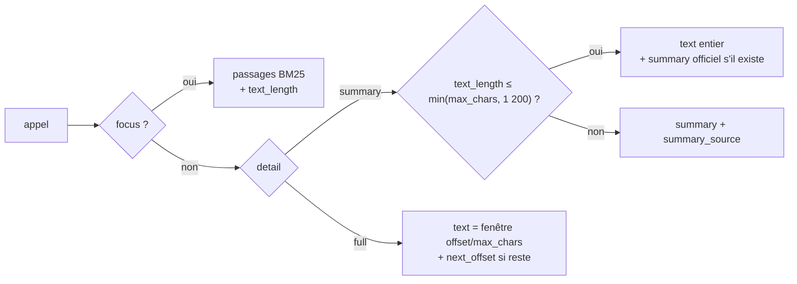

# 05 — Outils MCP : contrat, protocole et mise en œuvre (`lf-adapter-mcp`)

> **Statut** : plan, sans implémentation. Ce document détaille [00-decisions.md](00-decisions.md) §6 et §7, qui restent **normatifs** : en cas de doute, 00 l'emporte. Il fixe ce que [02-architecture.md](02-architecture.md) §3.6 et [03-domaine.md](03-domaine.md) §4.0 lui délèguent : les noms des champs JSON, les schémas d'entrée et de sortie, les textes des descriptions et des instructions, les messages d'erreur, les budgets de réponse et le verrou des descripteurs.
>
> **Jalons** : M4 (adapter MCP) et M5 (économie de contexte) livrent la v0.1.0 ; M6 la v0.2.0 ; M7 la v0.3.0 ; M8 (HTTP, optionnel) la v0.4.0 ([07-feuille-de-route.md](07-feuille-de-route.md)).
>
> **Conventions** : « caractère » = scalaire Unicode (`char` Rust). Les tailles de JSON sont en caractères de JSON compact (sans espaces), comme dans la recherche 03 §13. Tout extrait Rust est **non compilé, à valider en M0**. Les versions de crates citées (schemars 1.2.3, par exemple) sont des versions de référence relevées les 2026-10-15 et 2026-10-16, pas des planchers (00 §2) ; seuls `rmcp` et `rmcp-macros` sont épinglés `=3.5.1` (00 §6). Un comportement lu au tag d'une version de référence est revérifié sur la version verrouillée par le verrou des descripteurs (§9) et les tests du §11. Ce qui n'est pas vérifié porte la mention **NON VÉRIFIÉ** et une étiquette `[v:…]`, recensée au §12 et reprise dans le registre de [09-risques-et-questions.md](09-risques-et-questions.md).
>
> **Révision** : alignée sur 00 révision 2 du 2026-10-15 (amendements AM-01…AM-43, journal en 00 §14) et sur ses corrections du contrôle final du 2026-10-16. Les choix adoptés par défaut sur une question de l'utilisateur sont appliqués ici et restent à confirmer : Q10 (mode de recherche), Q11 (`openWorldHint`), Q14 (langues), Q15 (attribution), notamment (00 §13).

## Sommaire

0. [Résumé](#0-résumé)
1. [Principes de conception des outils](#1-principes-de-conception-des-outils)
2. [Protocole : 2026-07-28 dual-era](#2-protocole--2026-07-28-dual-era)
3. [Mise en œuvre avec rmcp 3.5.1](#3-mise-en-œuvre-avec-rmcp-351)
4. [Instructions serveur](#4-instructions-serveur)
5. [Catalogue des outils v0.1 → v0.3](#5-catalogue-des-outils-v01--v03)
6. [Rendu et budgets](#6-rendu-et-budgets)
7. [Erreurs](#7-erreurs)
8. [Resources, templates, completions et prompts (M7)](#8-resources-templates-completions-et-prompts-m7)
9. [Descriptor lock et politique de version de la surface](#9-descriptor-lock-et-politique-de-version-de-la-surface)
10. [Mode HTTP (M8) et compatibilité des clients](#10-mode-http-m8-et-compatibilité-des-clients)
11. [Critères d'acceptation par jalon](#11-critères-dacceptation-par-jalon)
12. [Points NON VÉRIFIÉS](#12-points-non-vérifiés)
13. [Divergences entre sources et questions ouvertes](#13-divergences-entre-sources-et-questions-ouvertes)
14. [Sources](#sources)

---

## 0. Résumé

- **Ce que voit le modèle.** Sur un succès, Claude Code et VS Code transmettent au modèle le `structuredContent`, pas le texte. Sur une erreur, Claude Code ne transmet que le texte (recherche 06 §3.3). Le `structuredContent` **est** donc la réponse compacte : champs `None` omis, aucun doublon, pas de notes répétées. Le `TextContent` de repli contient la sérialisation JSON du même objet. Une erreur métier est un texte seul `[code] message actionnable` (ADR-0010).
- **Protocole.** Révision 2026-07-28 servie en mode « modern » (`server/discover`, `_meta` par requête) et versions 2025-11-25 et 2025-06-18 servies en mode « legacy » (`initialize`), dans le même binaire, par `rmcp`/`rmcp-macros` `=3.5.1`. Capacités : `tools` en v0.1 et v0.2 ; `resources`, `prompts` et `completions` en plus en v0.3. Pas de `logging`, ni sampling, ni roots, ni élicitation, ni MRTR, ni `x-mcp-header`.
- **Outils.** 8 outils en v0.1 (noms de la référence), 10 en v0.2, 13 en v0.3. Chaque outil a une description anglaise de 3 à 6 phrases, un `inputSchema` strict (`enum`, bornes, `additionalProperties: false`), un `outputSchema` à racine objet et les annotations `readOnlyHint: true`, `destructiveHint: false`, `idempotentHint: true`, `openWorldHint: true` (Q11). `title` et descriptions en anglais, prompts en français (Q14).
- **Retour progressif.** Les trois outils à texte long (`fr_get_text`, `fr_get_decision`, `fr_get_deliberation`) renvoient par défaut un résumé (officiel, dispositif ou début du texte) ; `detail="full"` donne une fenêtre `offset`/`max_chars` (4 000 par défaut) avec `next_offset` ; `focus` donne des passages classés par BM25. Sur la décision CONSTIT des fixtures, la sortie passe de 15 140 caractères (référence) à 1 147 (résumé).
- **Coût fixe.** Instructions : 2 879 caractères en v0.1, 3 278 en v0.3 (référence : 4 470, coupée par Claude Code à 4 096). Descripteurs estimés à 19,4 Ko en v0.1 (référence : 17,6 Ko), dont 11,8 Ko hors `outputSchema`.
- **Stabilité.** `tests/tools.lock.json` contient le SHA-256 du JSON canonique de chaque descripteur, servi dans les deux ères et vérifié identique, plus les instructions et les capacités. `cargo xtask lock-descriptors --update` le régénère et `--check` (mode par défaut) le contrôle en CI (§9.4). Toute modification de la surface suit une politique SemVer (§9.5).

---

## 1. Principes de conception des outils

### 1.1 Sources et règles qui en découlent

| Principe | Énoncé source | Application ici |
|---|---|---|
| Peu d'outils, ciblés, sans recouvrement | « More tools don't always lead to better outcomes » ; consolider les étapes ; les outils qui se recouvrent distraient l'agent (guide Anthropic, recherche 06 §7.1) | 13 outils au plus en v0.3 (00 §7). Le recouvrement `fr_search`/`fr_search_all` est assumé ; chaque description dit quand préférer l'autre (§5.13) |
| Espace de noms | préfixe par service (`asana_search`) (recherche 06 §7.1) | préfixe `fr_` ; noms de la référence conservés (00 §1) |
| Paramètres non ambigus | `user_id` plutôt que `user` | `text_id`, `article_id`, `decision_id`… ; un seul `id` générique, pour `fr_get_related` qui accepte deux familles |
| Réponses à haut signal | retirer les identifiants inutiles ; concis par défaut, détaillé sur demande (72 contre 206 tokens dans l'exemple du guide) (recherche 06 §7.1) | `detail="summary"` par défaut ; identifiants de section (`LEGISCTA`) non rendus, faute d'outil qui les consomme ; `title` omis quand `citation` le contient (§5.0) |
| Pagination, filtrage, troncature avec des défauts raisonnables et un message qui guide | « pagination, range selection, filtering, and/or truncation with sensible default parameter values » (recherche 06 §7.1) | `page`/`has_more`, `toc_offset`/`next_toc_offset`, `offset`/`next_offset` ; la manière de continuer est dite dans la description et dans les instructions, pas répétée dans chaque réponse |
| Erreurs actionnables | « clearly communicate specific and actionable improvements, rather than opaque error codes or tracebacks » (recherche 06 §3.5) | `[code]` + cause + correctif + outil à appeler (§7) |
| Descriptions soignées | 3 à 4 phrases au moins ; dire quand utiliser, quand ne pas utiliser, ce que l'outil ne renvoie pas ; mots-clés en tête, car la recherche d'outils de Claude Code ne lit que le début (recherche 06 §3.2, §7.3 f) | 3 à 6 phrases en anglais (00 §6), premier mot-clé dans la première phrase, renvoi vers l'outil adéquat |
| Instructions serveur | relations entre outils, déroulé, contraintes ; pas de duplication des descriptions ; concises (recherche 06 §7.1, §7.3 e) | §4 : 3 278 caractères au plus |
| Pas d'état serveur | les handles sont un vecteur d'attaque ; préférer des curseurs explicites rejouables (recherche 06 §3.6) | aucun handle : `page`, `offset`, `toc_offset` sont des entiers rejouables ; le `PaginationMemo` de l'adapter PISTE n'est qu'un cache interne, sans lequel la page est servie avec la valeur de repli (00 §7, §1.4 règle 7) |

### 1.2 Ce que voit réellement le modèle

| Client | Succès (`structuredContent` + texte) | Erreur (`isError: true`) | Source |
|---|---|---|---|
| Claude Code | `structuredContent` remplace les blocs `content` ; le texte n'est pas transmis | seuls les blocs texte et `resource_link` sont transmis ; `structuredContent` est ignoré | commentaire d'un mainteneur du 2026-08-15 (v2.1.233), reproduit en 2.1.260 ; ticket ouvert (recherche 06 §3.3, https://github.com/anthropics/claude-code/issues/86032). À re-tester à chaque version : **NON VÉRIFIÉ** [v:cc-structured-content-succes] |
| VS Code (`main` du 2026-10-15) | `JSON.stringify(structuredContent)` envoyé au modèle à la place des blocs texte ; les `resource_link` restent transmis | même chemin de code | `mcpLanguageModelToolContribution.ts:328-337`, `:389-392` (recherche 06 §3.3) |
| VS Code | `outputSchema` non transmis au modèle | — | `…ToolContribution.ts:144-160` (recherche 06 §3.3) |
| Claude Code | transmission de l'`outputSchema` au modèle : **NON VÉRIFIÉ** [v:cc-output-schema-contexte] | — | recherche 06 §3.3 point 6 |
| Claude Desktop, claude.ai | **NON VÉRIFIÉ** [v:desktop-structured-content] | **NON VÉRIFIÉ** [v:desktop-structured-content] | recherche 06 §11 |

Conséquences, appliquées à tous les outils :

- (a) Toute information utile au modèle est **dans `structuredContent`** : résumé, fenêtre, `next_offset`, `has_more`, notes exceptionnelles. Rien n'existe seulement dans le texte (recherche 06 §3.3).
- (b) Le `TextContent` de succès est la sérialisation JSON compacte du même objet, ce que demande la spécification (« SHOULD also return the serialized JSON in a TextContent block », recherche 06 §3.3) et ce que produit `CallToolResult::structured` de rmcp (`model.rs:4155-4163`, recherche 04 §2.6). Il double les octets sur le fil, pas le contexte du modèle (00 §6, ADR-0006).
- (c) Une erreur n'a **pas** de `structuredContent` : le code, la cause et le correctif sont tous dans `content[0].text` (recherche 06 §3.3 point 3).
- (d) L'`outputSchema` et le `structuredContent` sont **toujours des objets** à la racine (§2.5).
- (e) Aucun `resource_link` en v0.1 et v0.2 : il disparaîtrait côté Claude Code sur un succès. En v0.3, la question est ouverte (§13.2).

### 1.3 Seuils de Claude Code

Source : documentation « Connect Claude Code to tools via MCP », lue le 2026-10-15 (recherche 06 §1 point 8 et §7.2).

| Seuil | Valeur | Ce que nous en faisons |
|---|---|---|
| Avertissement de sortie | > 10 000 tokens | réponses par défaut entre 0,4 et 6 Ko de JSON (§6.5) |
| Limite de sortie | 25 000 tokens (`MAX_MCP_OUTPUT_TOKENS`) | jamais atteinte avec le plafond dur du §6.4 |
| Persistance sur disque | résultat texte > 50 000 caractères, sauf `_meta["anthropic/maxResultSizeChars"]` (plafond 500 000) | `max_chars` ≤ 40 000 (00 §7) et plafond dur de 45 000 caractères par réponse (§6.4) ; aucune clé `anthropic/*` émise |
| `instructions` serveur | coupées à 4 096 caractères | ≤ 3 500 (00 §6), mesuré : 3 278 en v0.3 (§4) |
| Description d'un outil chargé d'emblée / via tool search | 4 096 / 16 384 caractères | 349 à 830 caractères (§5) |
| Nom complet `mcp__<serveur>__<outil>` | 128 caractères | `fr_get_company_agreement` (24 caractères) laisse 97 caractères au nom du serveur |
| Schéma d'entrée | pas de `anyOf`/`oneOf`/`allOf` à la racine ; propriétés de premier niveau sur 1 à 64 caractères `[A-Za-z0-9_.-]` ; schéma valide 2020-12, sinon l'outil est exclu | §2.5, vérifié par le verrou (§9.4) |
| Arguments de prompt | « Claude Code splits the arguments on whitespace » | `verifier_citations` et `etat_du_droit` sans argument ; `analyser_decision` n'a qu'un argument d'un seul jeton (00 §7, §8.5) |
| Tool search | seuls les noms d'outils et les `instructions` sont chargés au démarrage ; les descriptions le sont à la demande | les mots-clés de recherche figurent dans la première phrase des instructions et de chaque description. Seuil de déclenchement : **NON VÉRIFIÉ** [v:cc-tool-search-seuil] |

### 1.4 Règles de conception retenues

1. **Le `structuredContent` est la réponse.** Les champs `Option` sont omis s'ils valent `None` (`#[serde(skip_serializing_if = "Option::is_none")]`) ; les listes vides sont omises (`Vec::is_empty`) sauf les listes principales d'une réponse (`hits`, `toc`, `candidates`, `citations`, `links`, `hunks`, `groups`, et `passages` en mode `focus`), toujours présentes pour que « vide » se distingue d'« absent ». Tout champ non-`Option` omis conditionnellement (liste vide, booléen par défaut) porte `#[serde(default, skip_serializing_if = …)]` : sans `default`, schemars 1.2.3 le laisse dans `required`, car rmcp génère les schémas en contrat `Deserialize` (`schemars_derive/src/schema_exprs.rs:726-739` au tag `v1.2.3` ; `handler/server/common.rs:15-48` au tag `rmcp-v3.5.1`, lus le 2026-10-15), et un `structuredContent` qui l'omet ne serait plus conforme à l'`outputSchema` annoncé (MUST, `server/tools.mdx:514`). Contrôle : `structured_content_validates_against_output_schema` porte aussi sur des vues dont toutes les listes omissibles sont vides (§11 ; 02 §3.6 piège 10).
2. **Aucun doublon.** `eli_uri` n'existe plus (contrat v2, 00 §4) ; `title` est omis quand `citation` le contient déjà ; les notes constantes (`eli_note`, `dataset_note`, 506 caractères par recherche dans la référence, recherche 03 §13.1) ne figurent que dans les instructions et `fr_coverage`.
3. **Le contrat de citation est toujours présent.** `citation` et `source_url` sont requis dans chaque entité citable de chaque `outputSchema` ; `ecli` et `eli` n'apparaissent que s'ils sont natifs (03 §5).
4. **Les paramètres disent leurs défauts et leurs bornes dans le schéma**, pas seulement en prose : `enum` pour `fond`, `match`, `detail` ; `minimum`/`maximum` pour les entiers ; `format: "date"` pour les dates (D-31).
5. **L'analyse est tolérante, le schéma est strict.** Le schéma annonce l'`enum` en majuscules ; le serveur accepte `" loda "` (parité P-010). Les entiers peuvent arriver sous forme de chaîne (`"10"`), comme le tolérait pydantic (recherche 01 §2.1). Un argument inconnu est refusé (`additionalProperties: false`, parité) avec un message qui liste les paramètres acceptés.
6. **Un paramètre superflu mais inoffensif est ignoré ; une combinaison qui changerait le sens est refusée.** `passages` sans `focus` est ignoré ; `offset > 0` avec `detail="summary"` explicite est refusé (`[invalid_arg]`), car le modèle attendrait une suite de texte.
7. **Aucun état serveur exposé entre deux appels.** Toute continuation passe par un entier rejouable. Le `PaginationMemo` de l'adapter PISTE (00 §7) garde la `typePagination` reçue pour la page suivante, mais n'est qu'un cache : sans lui (redémarrage, autre processus), la page est servie avec la valeur de repli, sans erreur (§5.1).
8. **Les identifiants rendus sont ceux que d'autres outils consomment** (`article_id` d'une TOC pour `fr_get_text`, `id` d'un hit pour `fr_get_*`). Les autres (`cid` JORF, `LEGISCTA`, `KALICONT`) ne sont pas rendus en v0.1.
9. **Les dates sont des chaînes ISO `AAAA-MM-JJ`.** Toute date ≥ 2222-01-01 (sentinelles observées `2999-01-01` et `2222-02-22`, règle des champs `…Computed` de l'OpenAPI) et tout `…Computed` nul sont omis (00 §4). Le sens d'une absence dépend du champ et figure dans les descriptions des outils concernés : date de fin (`date_fin`, `date_fin_version`) → « en vigueur sans date de fin » ; date de début (`date_debut`, `date_debut_version`) → « date d'entrée en vigueur non déterminée », l'`etat` `VIGUEUR_DIFF` portant l'information (**NON VÉRIFIÉ** [v:sentinelle-2222-debut], V-101) ; date de publication ou du texte (`date_parution`, `date_publication`, `date`) → « inconnue ».
10. **Textes officiels verbatim.** Seuls `clean` (balises `<mark>`, blancs, NBSP) et la réparation du mojibake s'appliquent (03 §7.1) ; aucune reformulation.
11. **Messages en anglais**, comme les descriptions, les `title` et les instructions ; seuls les noms et textes des prompts sont en français (00 §6, adopté par défaut, Q14 ; 02 §9.3).
12. **Aucune directive visant d'autres serveurs ou outils** dans les descriptions (prévention du « tool poisoning », recherche 06 §6).

---

## 2. Protocole : 2026-07-28 dual-era

### 2.1 Révision, ères et versions annoncées

- **Cible** : révision 2026-07-28, la plus récente au 2026-10-15 ; aucune RC postérieure (recherche 08 §2, recherche 09 §1).
- **Dual-era** (00 §6) : une requête qui porte `_meta["io.modelcontextprotocol/protocolVersion"]` est servie sans état, en ère moderne ; une requête `initialize` ouvre la sémantique legacy pour le processus stdio (recherche 08 §4.6). rmcp 3.5.1 fait ce routage lui-même (`service/server.rs:573-690`, recherche 09 §3.3). Le détail du routage, des formes de résultat par ère et des codes `-32022`/`-32021`/`-32020` est dans [annexes/D-mcp-2026-07-28.md](annexes/D-mcp-2026-07-28.md).
- **Pourquoi dual-era** : VS Code n'envoie que `initialize` en 2025-11-25 (`modelContextProtocol.ts:43`, recherche 08 §1 point 6) ; Claude Code sonde `server/discover` sur stdio par défaut depuis la 2.1.292 (`CHANGELOG.md:652`) ; un client legacy face à un serveur modern-only échoue (`versioning.mdx:159-172`).
- **`supported_protocol_versions()` explicite** : `[2026-07-28, 2025-11-25, 2025-06-18]` (00 §6). Par défaut, rmcp annonce tout `KNOWN_VERSIONS`, et `LATEST` a changé dans une mineure (3.5.0) : on ne s'y fie pas (recherche 09 §3.2). 2025-03-26 est exclue, car elle n'a ni `structuredContent` ni `title` (Q7, recherche 08 §15.1).
- **`supportedVersions` de `server/discover`** : les trois versions servies (00 §6), passées explicitement à `DiscoverResult::from_server_info` (§3.2), comme dans l'exemple de l'erreur `-32022` de la spécification (recherche 08 §13 point 7). Le SDK TypeScript n'annonce que `2026-07-28` ; la spécification ne tranche pas. D'après la lecture du code de rmcp 3.5.1 (annexe D §4.4), une requête à enveloppe moderne portant une version legacy est acceptée et servie sans `resultType` ni indices de cache (**NON VÉRIFIÉ** [v:rmcp-enveloppe-version-legacy], V-34). Si V-34 le confirme en M4, repli décidé par 00 §6 : `[2026-07-28]` seul dans `discover`, sans toucher `supported_protocol_versions()`, et `-32022` (`data.supported = ["2026-07-28"]`) répondu par `PreLifecycleFilter` à toute requête non-`initialize` dont le `_meta` déclare une version antérieure ; sinon, écart consigné dans l'annexe D. `serverInfo` dans le `_meta` des autres résultats modernes : posé si rmcp le permet (**NON VÉRIFIÉ** [v:rmcp-meta-serverinfo-resultats], V-32), sinon écart accepté et documenté.
- **Démarrage** : aucune E/S réseau avant le premier appel d'outil. `server/discover` et `initialize` sont servis depuis un `ServerConfig` précalculé (§3.2). Depuis la 2.1.292, Claude Code négocie 2026-07-28 par défaut en stdio, avec une sonde `server/discover` (`CHANGELOG.md:652`) qui tournerait dans un processus frère éphémère, comme dans le SDK TypeScript (**NON VÉRIFIÉ** [v:cc-sonde-delai], V-49, recherche 08 §5.1). La note de la 2.1.238 (« Fixed stdio MCP servers receiving a `server/discover` request before `initialize` », `CHANGELOG.md:3400`) montre le coût d'une sonde qui forcerait le démarrage du backend à chaque ouverture de session. Le délai de la sonde, mesuré par le même essai, est **NON VÉRIFIÉ** [v:cc-sonde-delai] (« 3 s » selon un tiers).
- **Ne jamais quitter sur un message inattendu** (00 §6). D'après la lecture du code (annexe D §4.2), aucune requête, prématurée ou inconnue, ne fait quitter rmcp 3.5.1 ; en revanche, une notification ou une réponse reçue avant l'ouverture d'une ère arrête le service (`service/server.rs:681-685`). `PreLifecycleFilter` enveloppe donc le transport stdio dès le spike M0 et écarte (`debug!`) ces messages (**NON VÉRIFIÉ** [v:rmcp-transport-enveloppe], V-29) ; il sera retiré quand rmcp le corrigera. Un EOF avant toute ère (processus de sonde) termine le processus avec le code 0 (§3.2). Écarts acceptés et testés : `ping` avant toute ère → `{}` ; `initialize` à paramètres legacy complets portant aussi un `_meta` moderne → poignée de main legacy ; ligne non JSON ignorée (§7.5 ; confirmation à l'exécution : **NON VÉRIFIÉ** [v:rmcp-methode-inattendue], V-30, §11).

### 2.2 `ServerConfig` et capacités par jalon

| Jalon | Version | `capabilities` (`DiscoverResult` et `InitializeResult`) | Méthodes servies en plus du cœur |
|---|---|---|---|
| M4–M5 | v0.1.0 | `{"tools": {}}` | `tools/list`, `tools/call` |
| M6 | v0.2.0 | `{"tools": {}}` | idem (2 outils de plus) |
| M7 | v0.3.0 | `{"tools": {}, "resources": {}, "prompts": {}, "completions": {}}` | `resources/list`, `resources/templates/list`, `resources/read`, `prompts/list`, `prompts/get`, `completion/complete` |
| M8 | v0.4.0 | identiques à M7 | transport Streamable HTTP en plus de stdio |

- Jamais de `listChanged` (listes statiques pour un binaire donné), ni de `subscribe`, ni de `logging`, ni d'`extensions`, ni d'`experimental` (recherche 08 §4.4).
- `serverInfo` : `Implementation::new("mcp-legifrance", <version du crate>)` avec `title` « Légifrance (PISTE) » et `websiteUrl` du dépôt (nom actuel, gardé jusqu'au renommage éventuel du dépôt : Q1, 00 §0). Jamais `Implementation::from_build_env()`, qui renvoie l'identité de rmcp (`model.rs:1556-1565`, recherche 04 §2.3). La version vient de `lf-app` par `ServerIdentity` (02 §3.6).
- `instructions` : texte du §4, identique dans `DiscoverResult` et `InitializeResult`.
- `subscriptions/listen` (00 §6) : en ère moderne, accusé minimal (`accepted_subscription_filter` → filtre vide ; premier message `notifications: {}`), puis aucune notification jusqu'à l'annulation ; en ère legacy, `-32601` (ni `resources/subscribe` ni `listChanged`). Critère M4 : un EOF de stdin avec un `listen` ouvert termine le processus (code 0) en moins d'une seconde (**NON VÉRIFIÉ** [v:rmcp-listen-cloture], V-35 ; §11). Aucun effet sur les outils.

### 2.3 Indications de cache `ttlMs` et `cacheScope`

En ère moderne, les résultats « cachables » DOIVENT porter `ttlMs` et `cacheScope` (`caching.mdx:13-21`, recherche 08 §7.1). En legacy, ces champs n'existent pas.

| Méthode | `ttlMs` | `cacheScope` | Jalon | Justification |
|---|---|---|---|---|
| `server/discover` | 3 600 000 | `public` | M4 | `DiscoverResult extends CacheableResult` (`schema.ts:678`, recherche 08 §4.3 et §13, point 1) ; contenu statique par binaire |
| `tools/list` | 3 600 000 | `public` | M4 | Q8 ; identique pour tous les utilisateurs |
| `prompts/list`, `resources/list`, `resources/templates/list` | 3 600 000 | `public` | M7 | Q8 ; `list_prompts` écrit à la main, sans `#[prompt_handler]` qui poserait `ttlMs: 0` (§3.6) |
| `resources/read` | 3 600 000 | `public` | M7 | Q8 ; données publiques identiques pour tous ; mises à jour de Légifrance quotidiennes (recherche 08 §17 question 4) |
| `tools/call`, `prompts/get`, `completion/complete` | — | — | — | non cachables (`schema.ts:1634-1640`, recherche 06 §4.4) |

Mise en œuvre : rmcp remplit `ttl_ms: 0` et `cache_scope: Public` dans le `list_tools` généré par `#[tool_handler]`, et `0`/`Private` pour toute indication manquante (`tool_handler.rs:71-81`, `model.rs:4830-4854`, recherche 09 §3.5). On écrit donc `list_tools` et `discover` à la main (§3.2), comme `list_prompts` en M7, et l'on pose les valeurs seulement si `ctx.protocol_version() >= 2026-07-28`. La lecture du code (annexe D §3.4) tranche les deux questions qui restaient ouvertes : pour un pair legacy, rmcp ne retire que `resultType` (`model.rs:4788-4801`), d'où la pose conditionnelle ; `DiscoverResult` et `ListToolsResult` ont bien `with_ttl_ms` et `with_cache_scope`. Confirmation à l'exécution par les tests (b) et (f) de M4 (§11) : **NON VÉRIFIÉ** [v:rmcp-ttl-legacy] (V-33).

### 2.4 Ce que nous n'implémentons pas, et pourquoi

| Fonction | Statut 2026-07-28 | Décision | Raison et source |
|---|---|---|---|
| Logging MCP (`logging`, `notifications/message`, `logging/setLevel`) | déprécié (SEP-2577) ; `logging/setLevel` supprimé | non déclaré ; `tracing` sur **stderr** uniquement | `logging.mdx:7-18` ; rmcp ne doit jamais tourner en `debug` en production, car il journalise les réponses complètes (`service.rs:1609`, recherche 04 §2.13) |
| Sampling | déprécié | non | le résumé est déterministe, calculé côté serveur sans LLM (recherche 06 §4.9) |
| Roots | déprécié | non | aucun fichier local à exposer |
| Élicitation (via MRTR) | actif | non | inutile en lecture seule ; demander un secret par formulaire est interdit (`elicitation.mdx:30-33`) ; les ambiguïtés sont rendues au modèle comme candidats (`fr_resolve`) |
| MRTR (`InputRequiredResult`, `requestState`) | actif | non ; feature `request-state` non activée | le serveur ne renvoie jamais `input_required` ; les champs `inputResponses`/`requestState` reçus sont tolérés par rmcp (recherche 08 §8) |
| Tasks (extension) | hors cœur | non | appels courts (recherche 08 §7.7) |
| `x-mcp-header` / `Mcp-Param-*` | actif (HTTP) | non | bug rmcp #1348 : cache de schéma jamais invalidé (recherche 09 §4) |
| `listChanged`, `subscribe` | actif | non | listes statiques, corpus en lecture |
| `notifications/progress` | actif | optionnel, seulement pour `fr_search_all` (M7) quand le client fournit un `progressToken` ; aucune notification après une annulation (`ct.is_cancelled()` testé avant chaque `notify_progress`) | recherche 06 §4.7 ; non exigé pour l'acceptation de v0.3. Après `notifications/cancelled`, rmcp ne jette que la réponse (`service.rs:1497-1507`) et laisse partir les notifications (`:1537-1556`), alors que la spécification interdit tout message ultérieur pour cette requête (`basic/transports/stdio.mdx:76-83`) |
| Icônes | actif | non en v0.x | aucun bénéfice pour le modèle ; risque SVG (recherche 06 §6) |
| Clés `_meta` `anthropic/*` (`alwaysLoad`, `maxResultSizeChars`) | propriétaires | non | couplage à un client ; réponses sous 50 000 caractères (§6.4) ; aucune clé `anthropic/*` (00 §7), réexamen éventuel après V-48 (§13.2 question 4) |

### 2.5 Contraintes de schéma

| Contrainte | Règle | Source | Contrôle |
|---|---|---|---|
| Racine objet | `inputSchema` et `outputSchema` ont `"type": "object"` à la racine ; `structuredContent` est toujours un objet | `schema.ts` 2025-11-25 :1113, :1279-1284 (recherche 06 §3.2) ; bug rmcp **#1337** : un `Json<Vec<T>>` part tel quel vers les pairs legacy (recherche 09 §4) | types de sortie toujours des `struct` (`SearchView { hits: Vec<…> }`) ; test du verrou |
| Pas de combinateur racine | pas de `anyOf`/`oneOf`/`allOf` à la racine d'un schéma d'entrée | Claude Code aplatit ou écarte l'outil (recherche 06 §3.2) | test du verrou ; un enum Rust de paramètres racine est interdit |
| Pas de `$ref` externe | aucun `$ref` hors `#/…` ; `$defs` locaux tolérés en sortie, évités en entrée | `index.mdx:299-318` (recherche 06 §3.2) | test du verrou |
| Pas de `$schema` | aucune clé `$schema` dans `inputSchema` ni `outputSchema` : sans elle, le dialecte est 2020-12 (`server/tools.mdx:290-301`). schemars 1.2.3 en insère une à la racine (`generate.rs:492-493`) et rmcp ne retire que `title` et `description` (`common.rs:52-68`, `:101-106`) | recherche 06 §10.1 T-03 ; test `test_complex_schema.rs:76` de rmcp | retirée par `params::input_schema` (§3.3) et par `views::output_schema` (§3.4) ; contrôle du verrou (§9.2 point 8) |
| Propriétés de premier niveau | 1 à 64 caractères `[A-Za-z0-9_.-]` ; en pratique `snake_case` ASCII | Claude Code (recherche 06 §3.2) | test du verrou |
| Noms d'outils | `^[a-zA-Z0-9_-]{1,64}$` (00 §6) ; en pratique `^fr_[a-z_]+$` ; aucun point (l'API Claude les interdit) | recherche 06 §3.2 | test |
| Entrée fermée | `additionalProperties: false` sur chaque `inputSchema`, y compris sans paramètre (`{"type":"object","properties":{},"additionalProperties":false}`) | `tools.mdx:294-296` ; parité du verrou de la référence | `#[serde(deny_unknown_fields)]` sur chaque struct de paramètres |
| Sortie ouverte | pas d'`additionalProperties: false` en sortie : ajouter un champ optionnel reste un changement de classe « ajout » (§9.5) | recherche 06 §8.4 | revue |
| Racine des paramètres | une `struct` nommée, jamais un enum, un tuple ou un primitif : sinon `panic!` à la construction du routeur | `rmcp-macros/src/tool.rs:200-208` (recherche 09 §5 point 7) | test `tool_router_builds_and_roots_are_objects` |
| Valeurs fermées | `enum` JSON pour `fond`, `match`, `detail`, et pour les éléments de `fonds` | D-31 | attributs schemars : **NON VÉRIFIÉ** [v:schemars-enum-chaine] |
| Dates | `{"type": "string", "format": "date"}` et rappel `YYYY-MM-DD` dans la description ; pas de `pattern` (le serveur valide, et chaque `pattern` coûte environ 45 octets) | §6.6 | — |
| Identifiants | pas de `pattern` : le serveur accepte `legitext…` en minuscules et des blancs de bord (03 §2.6), qu'un `pattern` ferait refuser par un client validant | 03 §2.6 | — |

---

## 3. Mise en œuvre avec rmcp 3.5.1

### 3.1 Organisation de `lf-adapter-mcp`

Arborescence de référence : 02 §2.1, document propriétaire des crates (00 §0). Ce tableau dit ce que chaque fichier porte du contrat des outils.

| Fichier | Contenu | Jalon |
|---|---|---|
| `lib.rs` | API publique sans type rmcp : `serve_stdio`, `serve_http` (M8), `ServerIdentity`, `registered_tool_names()` (02 §3.6) | M4 |
| `server.rs` | `LegifranceServer<C, A, K>`, `impl ServerHandler`, `server_config()` | M4 |
| `versions.rs` | `SUPPORTED = [2026-07-28, 2025-11-25, 2025-06-18]` (00 §6) | M4 |
| `tools.rs` | bloc `#[tool_router]` : une méthode par outil, sans logique métier | M4, M6, M7 |
| `params.rs` | structs de paramètres (`serde` + `schemars`), `input_schema::<P>()` (sans `$schema`, §2.5), désérialiseurs tolérants | M4 |
| `decode.rs` | `JsonObject` → `ToolCall<I>` (décodage audité, §3.3) ; message de décodage `chemin: motif`, seul message rédigé par l'adapter (02 §9.3) | M4 |
| `views.rs` | structs de sortie (`Serialize` + `JsonSchema`), conversions `XOutput → XView`, règles d'omission (§1.4 règle 1), `output_schema::<V>()` (sans `$schema`), mesure exacte de la taille sérialisée (plafond, §6.4) | M4 |
| `failure.rs` | `ToolFailure` (`IntoContents`) : préfixe `[code] ` + message final porté par l'`AppError` (rédigé par `lf-application::messages`, 02 §9.3) ; erreurs des resources → `ErrorData` (M7) | M4 |
| `text.rs` | `const` des `title`, des descriptions (anglais) et des instructions (avec l'attribution des données, Q15), textes des prompts (français, Q14) ; seule source de ces textes | M4 |
| `canonical.rs` | `CanonicalInput` : JSON canonique des arguments **bruts**, pour l'empreinte d'audit (02 §6.1) | M4 |
| `stdio.rs` | `serve_stdio` : `PreLifecycleFilter` autour d'`AsyncRwTransport::new_server(stdin(), stdout())` (le tuple de `stdio()` n'est pas un `Transport`) ; `ConnectionClosed` et `Cancelled` avant toute ère → fin normale, code 0 (annexe D §4.3) | M4 |
| `resources.rs`, `prompts.rs`, `completions.rs` | §8 ; `get_prompt` et `list_prompts` écrits à la main (§3.6) | M7 |
| `http.rs` | §10.1 (feature `http`) | M8 |

### 3.2 Squelette

Le squelette suit la recherche 09 §8, avec trois écarts imposés par le plan : `lf-adapter-mcp` ne dépend pas de `lf-app` (02 §13.1 #2) ; les arguments sont reçus bruts (§3.3) ; `list_tools` et `discover` sont écrits à la main (§2.3). Pour `discover`, `server_config` et `serve_stdio`, l'annexe D §3.2 et §4.3, établie par lecture du code de rmcp 3.5.1, fait foi ; les extraits ci-dessous la reprennent.

```rust
// crates/lf-adapter-mcp/src/server.rs (le bloc #[tool_router] vit dans tools.rs) — non compilé, à valider en M0
use std::{borrow::Cow, sync::Arc};
use rmcp::{
    ErrorData as McpError, Json, RoleServer, ServerHandler,
    handler::server::router::tool::ToolRouter,
    model::{CacheScope, DiscoverResult, Implementation, JsonObject, ListToolsResult,
            PaginatedRequestParams, ProtocolVersion, ServerCapabilities, ServerConfig},
    service::RequestContext,
    tool, tool_handler, tool_router,
};
use tokio_util::sync::CancellationToken;
use lf_application::{AuditLog, Clock, LegalCorpus, LegalService};
use crate::{decode, failure::ToolFailure, params::{self, SearchParams}, text, versions::SUPPORTED,
            views::{self, SearchView}, ServerIdentity};

const LIST_TTL_MS: u64 = 3_600_000;                                // Q8
// SUPPORTED (versions.rs) = [2026-07-28, 2025-11-25, 2025-06-18] : 00 §6 ; jamais KNOWN_VERSIONS

pub(crate) struct LegifranceServer<C: LegalCorpus, A: AuditLog, K: Clock> {
    service: Arc<LegalService<C, A, K>>,
    info: Arc<ServerConfig>,          // précalculé : rmcp appelle get_info() souvent (recherche 04 §2.2)
    tool_router: ToolRouter<Self>,    // champ : sinon reconstruit à chaque requête (recherche 04 §2.4)
    // M7 : prompt_router: PromptRouter<Self>, lu par get_prompt et list_prompts écrits à la main (§3.6)
}
// Clone écrit à la main : #[derive(Clone)] exigerait C: Clone (recherche 04 §3).

#[tool_router]
impl<C: LegalCorpus, A: AuditLog, K: Clock> LegifranceServer<C, A, K> {
    pub(crate) fn new(service: Arc<LegalService<C, A, K>>, id: &ServerIdentity) -> Self {
        Self { service, info: Arc::new(server_config(id)), tool_router: Self::tool_router() }
    }

    #[tool(
        name = "fr_search",
        title = "Search Légifrance",
        description = text::FR_SEARCH,                              // const, accepté depuis rmcp 3.4.1
        input_schema = params::input_schema::<SearchParams>(),      // remplace le schéma déduit
        output_schema = views::output_schema::<SearchView>(),       // explicite, sans $schema (§2.5, §3.4)
        annotations(title = "Search Légifrance", read_only_hint = true, destructive_hint = false,
                    idempotent_hint = true, open_world_hint = true) // littéraux : répétés sur chaque outil (Q11)
    )]
    async fn fr_search(&self, args: JsonObject, ct: CancellationToken)
        -> Result<Json<SearchView>, ToolFailure>                    // Json<T> : structuredContent + texte JSON (§1.2 b)
    {
        let call = decode::to_call::<SearchParams, _>(args);        // ToolCall<SearchInput>, jamais d'échec ici
        let out = self.service.search(call, ct.cancelled()).await?; // AppError -> ToolFailure (From)
        Ok(Json(SearchView::from(out)))
    }
    // v0.1 : fr_get_act, fr_get_text, fr_get_decision, fr_get_deliberation, fr_get_convention,
    //        fr_get_company_agreement, fr_coverage — même forme.
    // M6 : fr_verify_citations, fr_resolve ; M7 : fr_get_related, fr_diff_article, fr_search_all.
}

#[tool_handler(router = self.tool_router)]   // génère call_tool et get_tool ; get_info et list_tools sont ci-dessous
impl<C: LegalCorpus, A: AuditLog, K: Clock> ServerHandler for LegifranceServer<C, A, K> {
    fn get_info(&self) -> ServerConfig { (*self.info).clone() }

    fn supported_protocol_versions(&self) -> Cow<'static, [ProtocolVersion]> { Cow::Borrowed(&SUPPORTED) }

    async fn list_tools(&self, _req: Option<PaginatedRequestParams>, ctx: RequestContext<RoleServer>)
        -> Result<ListToolsResult, McpError>
    {
        let mut res = ListToolsResult::with_all_items(self.tool_router.list_all()); // trié par nom (router/tool.rs:581-589)
        if is_modern(&ctx) { res = res.with_ttl_ms(LIST_TTL_MS).with_cache_scope(CacheScope::Public); }
        Ok(res)
    }

    async fn discover(&self, _ctx: RequestContext<RoleServer>) -> Result<DiscoverResult, McpError> {
        // Statique, sans réseau ; jamais _ctx.peer (pair muet avant toute ère, annexe D §3.2).
        Ok(DiscoverResult::from_server_info(SUPPORTED.to_vec(), self.get_info()) // (versions, config) : model.rs:1374-1392
            .with_ttl_ms(LIST_TTL_MS).with_cache_scope(CacheScope::Public))
    }
    // M7 : list_resources, list_resource_templates, read_resource, complete, et get_prompt/list_prompts
    //      écrits à la main sur self.prompt_router, SANS #[prompt_handler] (§3.6, §8.5)
}

fn server_config(id: &ServerIdentity) -> ServerConfig {
    ServerConfig::new(ServerCapabilities::builder().enable_tools().build()) // M7 : + enable_resources/prompts/completions
        .with_protocol_version(ProtocolVersion::V_2025_11_25)   // repli explicite d'initialize, indépendant de LATEST (C-12)
        .with_server_info(Implementation::new(id.name, id.version)        // jamais from_build_env()
            .with_title("Légifrance (PISTE)")
            .with_website_url("https://github.com/muchiny/mcp-ligitfrance")) // dépôt : Q1
        .with_instructions(text::INSTRUCTIONS)
}

fn is_modern(ctx: &RequestContext<RoleServer>) -> bool {
    ctx.protocol_version().is_some_and(|v| v >= ProtocolVersion::V_2026_07_28)  // service.rs:1234
}
```

```rust
// crates/lf-adapter-mcp/src/failure.rs — non compilé, à valider en M0
use rmcp::model::{ContentBlock, IntoContents};
use lf_application::{AppError, ErrorCode};

/// Erreur métier in-band : rmcp met is_error = true quand Err(E) produit un CallToolResult
/// (handler/server/tool.rs:125-146). Aucun structuredContent n'est émis (§1.2 c).
pub(crate) struct ToolFailure { code: ErrorCode, message: String }

impl From<AppError> for ToolFailure {
    // Message final rédigé par lf_application::messages (02 §9.3), déjà inscrit tel quel dans l'audit :
    // l'adapter n'ajoute que le préfixe « [code] ».
    fn from(e: AppError) -> Self { Self { code: e.code(), message: e.into_message() } }
}

impl IntoContents for ToolFailure {   // IntoContents n'existe que pour String, ContentBlock et () (content.rs:359-379)
    fn into_contents(self) -> Vec<ContentBlock> {
        vec![ContentBlock::text(format!("[{}] {}", self.code.as_str(), self.message))]
    }
}
```

```rust
// crates/lf-adapter-mcp/src/stdio.rs — non compilé, à valider en M0 ; PreLifecycleFilter : annexe D §4.3
pub async fn serve_stdio<C: LegalCorpus, A: AuditLog, K: Clock>(
    service: Arc<LegalService<C, A, K>>, identity: ServerIdentity, shutdown: CancellationToken,
) -> Result<ServeOutcome, ServeError> {
    let server = LegifranceServer::new(service, &identity);
    // Écarte les notifications et réponses reçues avant toute ère (rmcp arrêterait le service, service/server.rs:681-685).
    // stdio() renvoie un tuple qui n'implémente que IntoTransport : on enveloppe le Transport qu'il construirait.
    let transport = PreLifecycleFilter::new(                           // feature transport-io ; tokio io-std (02 §3.6)
        AsyncRwTransport::new_server(tokio::io::stdin(), tokio::io::stdout()));
    match server.serve_with_ct(transport, shutdown).await {
        Ok(running) => Ok(match running.waiting().await? {
            rmcp::service::QuitReason::Cancelled => ServeOutcome::Shutdown,
            _ => ServeOutcome::StdinClosed,                                           // QuitReason est non exhaustif
        }),
        Err(ServerInitializeError::ConnectionClosed(_)) => Ok(ServeOutcome::StdinClosed), // EOF de la sonde : code 0
        Err(ServerInitializeError::Cancelled) => Ok(ServeOutcome::Shutdown),
        Err(e) => Err(ServeError::from(e)),                                           // error! puis code 1 dans lf-app
    }
}
```

API rmcp à confirmer au spike M0 : la combinaison `JsonObject` + `input_schema` + `output_schema` explicite + `Result<Json<T>, ToolFailure>` est **NON VÉRIFIÉE** [v:rmcp-jsonobject-input-schema] ; `ListToolsResult::with_all_items`, `with_ttl_ms` et `with_cache_scope` existent d'après la lecture du code (macro `paginated_result!`, `model.rs:1782-1806`, annexe D §3.4), compilation à confirmer : **NON VÉRIFIÉ** [v:rmcp-ttl-legacy] (V-33) ; l'enveloppe `PreLifecycleFilter` acceptée par `serve_with_ct` : **NON VÉRIFIÉ** [v:rmcp-transport-enveloppe].

### 3.3 Décodage des arguments : `JsonObject` plutôt que `Parameters<T>`

| Option | Comportement en 3.5.1 | Conséquence | Choix |
|---|---|---|---|
| `Parameters<T>` (extracteur typé) | un échec de désérialisation devient un résultat in-band `failed to deserialize parameters: …`, produit par le routeur **avant** notre code (`router/tool.rs:144-156` ; CHANGELOG 3.5.1, #1322 ; recherche 04 §2.5) | ni audité (D-02, E-02), ni préfixé `[invalid_arg]` (E-01, E-29) | repli seulement |
| `JsonObject` (arguments bruts, `handler/server/tool.rs:252-258`) + `input_schema = params::input_schema::<P>()` (`schema_for_input` public, `common.rs:77-95`, qui renvoie un `Result`) | l'outil reçoit l'objet tel quel ; l'adapter décode, l'application audite | `ToolCall { input: Result<I, InputError>, canonical }` : l'échec de décodage devient un `invalid_arg` audité (02 §5.4) | **retenu** (02 §13 « Décodage des arguments ») |

Repli si le spike M0 échoue (V-28), à acter par un ADR (00 §5, ADR-0008) : `Parameters<P>` avec des champs tous `Option<…>` et numériques tolérants. La désérialisation devient alors quasi infaillible et la validation reste dans le cas d'usage ; seul un JSON de type aberrant (`query: [1]`) échapperait à l'audit.

```rust
// crates/lf-adapter-mcp/src/params.rs et decode.rs — non compilé, à valider en M0
pub(crate) fn input_schema<P: schemars::JsonSchema + 'static>() -> std::sync::Arc<rmcp::model::JsonObject> {
    // schema_for_input renvoie Result<Arc<JsonObject>, String> (common.rs:77-95) ; l'attribut attend
    // un Into<Arc<JsonObject>>. Panique à la construction du routeur, captée par tool_router_builds_and_roots_are_objects.
    let schema = rmcp::handler::server::common::schema_for_input::<P>()
        .unwrap_or_else(|e| panic!("invalid inputSchema for {}: {e}", std::any::type_name::<P>()));
    crate::views::without_dollar_schema(schema)              // §2.5 : aucune clé $schema
}

// decode.rs
pub(crate) fn to_call<P, I>(args: rmcp::model::JsonObject) -> lf_application::ToolCall<I>
where P: serde::de::DeserializeOwned + Into<I> {
    let canonical = crate::canonical::of(&args);             // empreinte de l'entrée BRUTE (02 §6.1)
    let input = serde_path_to_error::deserialize::<_, P>(serde_json::Value::Object(args))
        .map(Into::into)
        .map_err(|e| lf_application::InputError { message: decode_message(&e) }); // « chemin: motif »
    lf_application::ToolCall { input, canonical }
}

/// Paramètres de fr_search. Les champs « requis mais tolérants » sont des Option marqués required
/// dans le schéma, pour que le cas d'usage produise le message de parité « query is required. » (P-012).
#[derive(serde::Deserialize, schemars::JsonSchema)]
#[serde(deny_unknown_fields)]
pub(crate) struct SearchParams {
    /// Free-text query, e.g. "republique numerique".
    #[schemars(required, with = "String", length(min = 1, max = 500))]
    pub query: Option<String>,
    /// Fond to search (case-insensitive).
    #[schemars(with = "String", extend("enum" = ["LODA","CODE","JURI","CONSTIT","CETAT","CNIL","KALI","ACCO"],
                                        "default" = "LODA"))]
    pub fond: Option<String>,
    #[serde(rename = "match")]                                // `match` est un mot-clé Rust
    #[schemars(with = "String", extend("enum" = ["any","all","exact"], "default" = "any"))]
    pub match_mode: Option<String>,
    #[serde(default, deserialize_with = "lenient::opt_int")] // 10, 10.0 ou "10" ; bornes vérifiées par le cas d'usage
    #[schemars(with = "u32", range(min = 1, max = 100), extend("default" = 10))]
    pub page_size: Option<i64>,
    // page, date_from, date_to, version_date : même principe (§5.1)
}
```

Règles de décodage :

- Les entiers sont lus en `i64` tolérant : nombre JSON entier, flottant à partie fractionnaire nulle, chaîne décimale. Les bornes sont vérifiées par le cas d'usage, qui produit le message de parité (`page_size=0 out of range (1..100).`, P-011).
- `null` vaut « absent » pour tout paramètre optionnel (des clients envoient `null`, recherche 01 §3.2 : `date` était `anyOf [string, null]`).
- Le message d'un échec de décodage reprend le chemin et l'erreur serde : `page_size: invalid type: sequence, expected an integer` ; `unknown field 'foo', expected one of 'text_id', 'date', 'toc_offset', 'toc_limit'`.
- Le schéma produit doit annoncer `type: "string"` (et non `["string","null"]`) pour ces `Option<String>`. Les attributs exacts (`with`, `extend`, `required`) sont **NON VÉRIFIÉS** [v:schemars-enum-chaine] ; le verrou fige le résultat (§9).
- Comparaison avec le verrou de la référence (parité P-003, annexe A) : `anyOf [T, null]` équivaut à `T` non requis, `null` étant accepté à l'exécution comme absent (règle ci-dessus) ; `default: null` équivaut à l'absence de défaut. C'est le cas de `fr_get_act.date`.

### 3.4 Vues de sortie

- Une struct `XView` par outil, `#[derive(Serialize, JsonSchema)]`, construite depuis le `XOutput` de l'application. L'`outputSchema` est donné explicitement par `output_schema = views::output_schema::<XView>()` : `schema_for_output::<XView>()` de rmcp (`common.rs:121`), privé de sa clé `$schema` (§2.5). L'attribut explicite l'emporte sur la déduction depuis `Json<XView>` (`rmcp-macros/src/tool.rs:249-256`), qui ne marche que si `Json<T>` est écrit littéralement, un alias de type la désactivant (piège 7 de la recherche 04 §2.19).
- Champs omis : règle 1 du §1.4 (`#[serde(default, skip_serializing_if = …)]` sur tout champ non-`Option` omissible).
- `views.rs` sérialise la vue et en mesure la taille exacte, en caractères de JSON compact : c'est la garde du plafond dur du §6.4.
- Les descriptions de champs de sortie sont **courtes**, et seulement là où le nom ne suffit pas (`next_offset`, `title`, `etat` de TOC) : l'`outputSchema` coûte des octets de descripteur et VS Code ne le transmet pas au modèle (§1.2).
- Sous-structures : schemars produit des `$defs` locaux. Ils sont admis en sortie (§2.5) ; `#[schemars(inline)]` est préféré pour les petits types si la mesure du §6.6 le justifie. Le comportement des clients face à ces `$defs` est **NON VÉRIFIÉ** [v:schemars-sortie-defs].
- Champs `eli` présents dans les vues de législation (`fr_get_act`, `fr_get_text`) mais toujours omis tant que l'API renvoie `null` ([v:eli-natif-null], 03 §5.3). Leur présence dans le schéma permet au test de dérive de valider la mention de `eli` dans les instructions (§4.3).

### 3.5 Annulation, délai, concurrence

- L'extracteur `CancellationToken` est annulé à la réception de `notifications/cancelled` (`common.rs:161-168`, recherche 04 §2.5) ; l'outil passe `ct.cancelled()` à la façade, qui abandonne le travail dans `Audited` (02 §7.1). rmcp jette la réponse d'une requête annulée (`service.rs:1503-1505`, 02 §7.1).
- Délai global `LF_TOOL_DEADLINE_S` (défaut 60 s) appliqué dans `Audited`, autour du décodage et du cas d'usage (02 §10).
- Chaque requête tourne dans sa propre tâche tokio (`service.rs:1322-1328`) : les futurs d'outils doivent être `Send` (recherche 04 §2.4). Les ports sont RPITIT `+ Send` (ADR-0012).
- Après une annulation, rmcp ne jette que la réponse : un outil qui émet `notifications/progress` (`fr_search_all`, M7) teste `ct.is_cancelled()` avant chaque notification (§2.4).
- Débit des invocations : le limiteur PISTE (00 §8) ne borne que les appels amont, pas les invocations servies par le cache, `fr_coverage` ni les `invalid_arg`. L'exigence « rate limit tool invocations » de la spécification (`server/tools.mdx:789-794`) est tranchée par 00 §6 et l'annexe D (C-34) : sur stdio, écart justifié, car l'unique appelant est le client qui a lancé le processus et toute invocation qui consomme le quota PISTE passe par le limiteur (annexe D §4.7) ; en HTTP (M8), limiteur dans la couche axum, au-delà 429 + `Retry-After`, valeurs figées en M8 (annexe D §5.2 ; ici §10.1).

### 3.6 Pièges rmcp vérifiés par un test

| Piège | Source | Test (M4) |
|---|---|---|
| Racine non objet d'un paramètre : `panic!` à la construction du routeur | `rmcp-macros/src/tool.rs:200-208` | `tool_router_builds_and_roots_are_objects` |
| `outputSchema` déduit seulement d'un `Json<T>` écrit littéralement | recherche 04 §2.19 point 7 | `every_tool_has_object_output_schema` |
| `get_info` écrit à la main : penser à `enable_tools()` | recherche 04 §2.4 | `discover_and_initialize_announce_tools` |
| `from_build_env()` = identité de rmcp | `model.rs:1556-1565` | `server_info_is_mcp_legifrance_with_crate_version` |
| `#[non_exhaustive]` : bras `_` obligatoire (`QuitReason`, `Reference`, `ContentBlock`) | recherche 09 §5 point 6 | compilation |
| Aucun `println!` : stdout est le canal JSON-RPC | recherche 09 §5 point 3 | e2e `stdout_contains_only_jsonrpc` (02 §11.3) |
| La dépendance doit s'appeler `rmcp` (les macros émettent `rmcp::…`) | recherche 04 §2.4 | compilation |
| #1337 (`structuredContent` non objet vers les pairs legacy) | recherche 09 §4 | `legacy_tools_call_structured_content_is_object` |
| #1347 (méthode connue + params invalides → `-32601` au lieu de `-32602`) | recherche 09 §4 | test documentaire (attendu `-32601` tant que non corrigé) |
| `schema_for_input` renvoie un `Result`, que l'attribut `input_schema` n'accepte pas tel quel | `handler/server/common.rs:77-95` | compilation ; `tool_router_builds_and_roots_are_objects` |
| schemars insère `$schema` (2020-12) à la racine de chaque schéma ; rmcp ne le retire pas | schemars `generate.rs:492-493` ; rmcp `common.rs:52-68` | contrôle du verrou (§9.2 point 8) |
| Champ non-`Option` omis sans `#[serde(default)]` : il reste `required` dans l'`outputSchema` (contrat `Deserialize`) | schemars `schema_exprs.rs:726-739` | `structured_content_validates_against_output_schema` sur des vues à listes vides |
| `#[prompt_handler]` **remplace** un `get_prompt`/`list_prompts` écrit à la main, pose `ttlMs: 0` aux pairs modernes et reconstruit `Self::prompt_router()` à chaque appel (contrairement à `#[tool_handler]`, qui respecte un `list_tools` écrit à la main) | `rmcp-macros/src/prompt_handler.rs:28-30`, `:56-75`, `:77-104` (tag `rmcp-v3.5.1`) | M7 : pas de `#[prompt_handler]` ; `raw_list_cache_hints_modern` étendu à `prompts/list` |
| Notification ou réponse reçue avant toute ère : arrêt du service (`ExpectedInitializeRequest`) | `service/server.rs:681-685` | `PreLifecycleFilter` ; transcription `premature_notification` (06 §6.1) |
| EOF avant toute ère : `ServerInitializeError::ConnectionClosed`, qui finirait en code 1 sans traitement | `service/server.rs:433-444` | `e2e_eof_after_discover_exits_zero` (annexe D C-09) |
| Après `notifications/cancelled`, seule la réponse est jetée ; les notifications de progression partent encore | `service.rs:1497-1507`, `:1537-1556` | M7 : transcription d'annulation de `fr_search_all` avec `progressToken` (annexe D C-23, à ajouter) |

---

## 4. Instructions serveur

### 4.1 Texte (v0.3, complet)

Brouillon en anglais (00 §6). Les jetons entre accents graves sont des noms réels d'outils, de paramètres ou de champs (test de dérive, §4.3). Le texte est servi tel quel : titres Markdown `##` compris, sauts de ligne LF, pas de saut de ligne final.

```text
French law from Légifrance through the official PISTE API (read-only): consolidated laws and decrees (LODA), codes (CODE), Cour de cassation and courts of appeal (JURI), Conseil constitutionnel (CONSTIT), Conseil d'État and administrative courts (CETAT), CNIL deliberations (CNIL), collective labour agreements (KALI) and company agreements (ACCO). Use these tools for any question on French legislation, code articles or case law.

## Workflow
1. Find: `fr_search` searches one fond, paged with `page` and `has_more`; `fr_search_all` returns a few hits from several fonds. `fr_resolve` turns a free-text citation (code article, law number, ECLI, case number) into Legifrance ids.
2. Read by id prefix: LEGITEXT -> `fr_get_act` (metadata and table of contents); LEGIARTI or KALIARTI -> `fr_get_text`; JURITEXT, CONSTEXT or CETATEXT -> `fr_get_decision`; CNILTEXT -> `fr_get_deliberation`; KALITEXT -> `fr_get_convention`; ACCOTEXT -> `fr_get_company_agreement` (metadata only: the full text is a .docx on Légifrance).
3. Check and navigate: `fr_verify_citations` checks every citation of a draft against the official record; `fr_get_related` lists what an article or a decision cites or is cited by; `fr_diff_article` compares two versions of an article.
4. Limits: `fr_coverage` says what this server does not cover and whether it runs on the PISTE sandbox.

## Long texts
`fr_get_text`, `fr_get_decision` and `fr_get_deliberation` return a short summary by default. For the text itself pass `detail="full"`; while `next_offset` is present, call again with `offset` set to it. To reach the relevant part directly, pass `focus` with a few words: you get the best passages and their `offset`.

## Hard rules
- Cite every source with its `citation` and `source_url`; for case law add the `ecli` when present.
- Never invent an id, an ECLI, an ELI or a citation: take each one from tool output. Many CAA and TA decisions have no ECLI.
- ELI: the API returns no native ELI for legislation. `source_url` is the stable Légifrance page, not an ELI; an `eli` field appears only when the API provides one.
- Attribution: Source : Légifrance / DILA — Licence Ouverte 2.0. When you reuse the data, give this source and the consultation date (`consulted_on` in `fr_coverage`).
- Versions default to today's date in Paris; to get the law in force on another day, pass `date` to `fr_get_act` (`version_date` in `fr_search`) as YYYY-MM-DD, then read the article ids of that version with `fr_get_text`. Texts are verbatim: this server does not decide whether a provision applies to a case.
- An empty result does not mean the law is silent: call `fr_coverage` and tell the user what is missing.

## Errors
A failed call returns isError with a text that starts with a code:
- `[invalid_arg]` an argument is missing or malformed: fix it as the message says.
- `[not_found]` nothing exists for that id: search again.
- `[rate_limited]` PISTE quota reached: wait the delay given, then retry.
- `[upstream_error]` Légifrance/PISTE failure: retry if the message asks, else report it.
- `[config_error]` credentials or settings are missing or rejected: ask the user to fix the server configuration.
- `[audit_error]` the local audit log could not be written, so the result was withheld: tell the user.
```

### 4.2 Variantes par jalon et comptage

Le test de dérive exige que les outils cités soient exactement les outils enregistrés. Les instructions changent donc à chaque jalon qui ajoute des outils. Seules les lignes de la section « Workflow » diffèrent :

| Version | Ligne 1 de « Workflow » | Ligne 3 | Ligne 4 | Caractères | Octets UTF-8 | Outils cités |
|---|---|---|---|---|---|---|
| v0.1 | `` 1. Find: `fr_search` searches one fond, paged with `page` and `has_more`. `` | `` 3. Limits: `fr_coverage` … `` | — | **2 879** | 2 887 | 8 |
| v0.2 | ligne v0.1 suivie de `` `fr_resolve` turns a free-text citation (…) into Legifrance ids. `` | `` 3. Check: `fr_verify_citations` checks every citation of a draft against the official record. `` | `` 4. Limits: … `` | **3 080** | 3 088 | 10 |
| v0.3 | texte du §4.1 | texte du §4.1 | texte du §4.1 | **3 278** | 3 286 | 13 |

Comptage : `len()` Python sur le texte exact, sans saut de ligne final, refait le 2026-10-15 sur ce brouillon après la révision 2 (ligne « Attribution », Q15 ; règle des versions qui renvoie à `fr_get_act`), puis le 2026-10-16 après la reformulation, à longueur égale, de la ligne `[upstream_error]` : l'invitation à réessayer vient du message, qui ne la porte que pour un échec réessayable (00 §8, §7.2). Les six codes d'erreur sont cités dans les trois versions. Marge sous la limite de 3 500 (00 §6) : 222 caractères en v0.3. L'attribution est la même dans les trois versions et ne contient pas de date, car le texte est statique et verrouillé (§4.3 règle 5) : la date de consultation du jour est rendue par `fr_coverage` (`consulted_on`, §5.8).

### 4.3 Règles de maintenance

1. **Source unique** : `lf-adapter-mcp::text::INSTRUCTIONS`. Aucune copie dans la documentation utilisateur : le README renvoie au verrou, qui contient le texte (§9.3).
2. **Test de taille** : `instructions_fit_budget` vérifie `INSTRUCTIONS.chars().count() <= 3_500`. `cargo xtask instructions-size` imprime le compte, la marge et la plus longue ligne (00 §2).
3. **Test de dérive** (`instructions_drift`), qui étend celui de la référence (`test_instructions_drift.py:40-92`, recherche 01 §11.3) :
   - l'ensemble des jetons `` `fr_[a-z_]+` `` est **égal** à `registered_tool_names()` (inclusion dans les deux sens) ;
   - l'ensemble des jetons `` `[code]` `` est **égal** à `ErrorCode::ALL` (six codes, 00 §5) ;
   - tout autre jeton `` `snake_case` `` (`page`, `has_more`, `detail`, `next_offset`, `offset`, `focus`, `citation`, `source_url`, `ecli`, `eli`, `consulted_on`, `date`, `version_date`) est le nom d'un paramètre ou d'une propriété de sortie d'au moins un descripteur ; un paramètre cité avec un outil (« pass `date` to `fr_get_act` ») doit être un paramètre de cet outil ;
   - les valeurs d'`enum` citées (`"full"`) appartiennent à l'`enum` du paramètre cité.
4. **Descriptions** : un test analogue vérifie que chaque nom `fr_*` cité dans une description d'outil est enregistré **dans la même version**. Une description v0.1 ne peut donc pas renvoyer à `fr_resolve`.
5. **Pas de contenu dépendant de l'environnement** : le texte est le même en sandbox et en production. L'environnement réel est donné par `fr_coverage`, sinon le verrou dépendrait de la configuration.
6. **Revue** : toute modification passe par `cargo xtask lock-descriptors --update` et une entrée « Tool surface » du CHANGELOG (§9.5).

### 4.4 Écarts avec les instructions de la référence

| Sujet | Référence (`server.py:31-66`, recherche 01 annexe A.1) | Ici | Raison |
|---|---|---|---|
| Taille | 4 470 caractères, coupés à 4 096 par Claude Code | 2 879 à 3 278 | 00 §6 |
| Attribution des données | absente | ligne « Attribution » : « Source : Légifrance / DILA — Licence Ouverte 2.0 », avec renvoi à la date de consultation de `fr_coverage` | 00 §6, §12 ; Q15 |
| `eli_uri`, `human_readable_citation` | promis dans chaque réponse | `citation`, `source_url`, `eli` natif seulement | contrat v2 (00 §4, D-30) |
| `not_found` | « … or a search returned nothing » | recherche vide = succès avec `hits: []` ; `not_found` = identifiant inexistant | E-04 (parité de comportement, phrase corrigée) |
| Format d'erreur | « structured error with a `[code]` prefix », mais le texte réel commence par `Error calling tool …` | le texte commence réellement par `[code]` | E-01 |
| Variables d'identifiants | `FR_ELI_CLIENT_ID / FR_ELI_CLIENT_SECRET` | pas de nom de variable dans les instructions ; ils figurent dans le message `[config_error]` | E-34 |
| Journal d'audit | chemin `~/.matematic/audit/fr-eli-mcp.jsonl` | non cité (inutile au modèle ; le chemin local ne doit pas fuiter, D-40) | E-34 |
| `rate_limited`, `audit_error` | absents | présents | 00 §5 |
| Lecture progressive | absente | section « Long texts » | 00 §7 |

---

## 5. Catalogue des outils v0.1 → v0.3

### 5.0 Conventions communes

#### 5.0.1 Matrice

| Outil | Version | `title` (descripteur et `annotations.title`) | Cas d'usage (02 §6.2) | Métrique d'audit (00 §7) | Cache du port (00 §9) |
|---|---|---|---|---|---|
| `fr_search` | v0.1 | Search Légifrance | `SearchUseCase` | nombre de hits renvoyés | `Search` 1 h |
| `fr_get_act` | v0.1 | Read a law, decree or code | `GetActUseCase` | entrées de TOC renvoyées | `Act` 24 h |
| `fr_get_text` | v0.1 | Read an article | `GetTextUseCase` | caractères renvoyés | `Article` 24 h |
| `fr_get_decision` | v0.1 | Read a court decision | `GetDecisionUseCase` | caractères renvoyés | `Decision` 24 h |
| `fr_get_deliberation` | v0.1 | Read a CNIL deliberation | `GetDeliberationUseCase` | caractères renvoyés | `Deliberation` 24 h |
| `fr_get_convention` | v0.1 | Read a collective agreement | `GetConventionUseCase` | entrées de TOC renvoyées | `Convention` 24 h |
| `fr_get_company_agreement` | v0.1 | Read a company agreement (metadata) | `GetCompanyAgreementUseCase` | 1 | `Agreement` 24 h |
| `fr_coverage` | v0.1 | Coverage and known gaps | `CoverageUseCase` | nombre de lacunes | aucun (pas d'appel au port) |
| `fr_verify_citations` | v0.2 | Verify legal citations | `VerifyCitationsUseCase` | nombre de citations vérifiées | `FindArticle` 24 h, `FindByNumber` 1 h, `get_*` 24 h |
| `fr_resolve` | v0.2 | Resolve a legal citation | `ResolveUseCase` | 1 | idem |
| `fr_get_related` | v0.3 | Related texts and decisions | `GetRelatedUseCase` | nombre de liens | `Related` 24 h, `Decision` 24 h |
| `fr_diff_article` | v0.3 | Compare article versions | `DiffArticleUseCase` | nombre de hunks | `Versions` 24 h, `Article` 24 h |
| `fr_search_all` | v0.3 | Search several fonds | `SearchAllUseCase` | nombre total de hits | `Search` 1 h par fond |

- Annotations identiques sur les 13 outils : `readOnlyHint: true`, `destructiveHint: false`, `idempotentHint: true`, `openWorldHint: true` (00 §6, parité P-002 ; contenu externe traité comme non fiable). `openWorldHint: true` est adopté par défaut (Q11) et réexaminé avant v0.1.0 au vu de V-53 (confirmation des résultats dans VS Code, **NON VÉRIFIÉ** [v:vscode-openworld-confirm]) ; tout changement passe par le verrou des descripteurs et le CHANGELOG (§9.5). `title` est renseigné deux fois avec la même valeur, car VS Code lit `annotations.title` en premier et la spécification `title` en premier (recherche 06 §3.2). `title` est en anglais, comme les descriptions (00 §6, adopté par défaut, Q14).
- En erreur, la métrique vaut 0 (00 §7). « Caractères renvoyés » = somme des caractères de `text`, `summary` et des `passages[].text` de la réponse, hors métadonnées ; c'est aussi la métrique d'une lecture de resource (M7, §8.2).
- Le cache n'enregistre ni les erreurs ni les réponses vides (00 §9) ; un succès servi depuis le cache est audité comme les autres (02 §7.2).
- Erreurs communes à tous les outils qui appellent PISTE : `config_error`, `rate_limited`, `upstream_error`, `audit_error` (§7.2). `fr_coverage` ne peut renvoyer que `invalid_arg` (argument inconnu) et `audit_error`.

#### 5.0.2 Paramètres communs aux lectures longues (`fr_get_text`, `fr_get_decision`, `fr_get_deliberation`)

| Nom | Type JSON | Requis | Défaut | Contraintes | Description (anglais, dans le schéma) |
|---|---|---|---|---|---|
| `detail` | string, `enum ["summary","full"]` | non | `"summary"`, mais `"full"` si `offset > 0` est fourni sans `detail` | insensible à la casse ; `"summary"` explicite avec `offset > 0` → `invalid_arg` | `"summary" (default): metadata and a short summary. "full": the text from offset, up to max_chars.` |
| `offset` | integer | non | 0 | ≥ 0 ; < `text_length` (sauf texte vide) ; ignoré si `focus` est présent | `Start position in characters for detail="full"; pass the next_offset of the previous call.` |
| `max_chars` | integer | non | 4 000 | 500 à 40 000 | `Maximum characters of text returned (500 to 40000).` |
| `focus` | string | non | — | 1 à 500 caractères après `trim` ; au moins un mot qui ne soit pas un mot vide (03 §7.8) | `A few words: return the best matching passages instead of the summary or window.` |
| `passages` | integer | non | 3 | 1 à 10 ; ignoré sans `focus` | `Number of passages returned with focus.` |

Bornes : 00 §7. Ordre de validation : identifiant, puis `detail`, `offset`, `max_chars`, `focus`, `passages`.

#### 5.0.3 Champs de lecture communs en sortie

| Champ | Type | Présent quand | Règle |
|---|---|---|---|
| `summary` | string | mode résumé, si `text_length > min(max_chars, 1 200)` ou si un résumé officiel existe | §6.2 ; au plus `min(max_chars, 1 200)` caractères, coupé en fin de phrase (03 §7.9) |
| `summary_source` | string, `enum ["official","dispositif","lead"]` | avec `summary` | origine du résumé (00 §4) |
| `text` | string | mode `full` ; ou mode résumé quand `text_length ≤ min(max_chars, 1 200)` (texte entier, 00 §7) | fenêtre `text::window` (03 §7.6) |
| `text_length` | integer | toujours (lectures longues) | longueur du texte canonique entier, en caractères (paragraphes joints par `\n\n`) |
| `next_offset` | integer | mode `full`, si la fenêtre n'atteint pas la fin | à repasser tel quel dans `offset` ; absent en fin de texte (00 §7) |
| `passages` | array of `{offset, text, score}` | mode `focus` | au plus `passages` éléments, Σ des longueurs ≤ `max_chars` ; `score` arrondi à 2 décimales ; `offset` utilisable comme `offset` de fenêtre (03 §7.7-7.8) |
| `note` | string | cas exceptionnels seulement | ex. `No passage matches focus; read the text with detail="full".` ; `No text is available from Légifrance for this record.` |



#### 5.0.4 Règles de rendu communes

- `title` est omis quand `citation` le contient déjà (égalité ou inclusion, après `clean`). Exemples : titre JURI ou CETAT égal à la citation ⇒ omis ; titre Cons. const. (« Décision 2025-1173 QPC - … [objet] - Conformité ») absent de la citation ⇒ rendu ; titre ACCO contenu dans « {titre} ({raison sociale}) » ⇒ omis.
- `etat` est rendu en code API normalisé (`VIGUEUR`, `ABROGE`, `VIGUEUR_ETEN`…), via `LegalStatus::as_api_code` (03 §3.3).
- Entrées de TOC : une section rend `{depth, title}` ; un article rend `{depth, article_id, num?, etat?}`. L'`etat` d'un article de TOC est omis quand il est égal à l'`etat` du texte (sur consult_loda.json, aucun des 62 articles ne porte donc `etat`). Une section sans titre n'est pas une entrée : le domaine l'exclut à l'aplatissement (`Toc::page` et `Toc::len`, 03 §4.2) et ses enfants gardent leur profondeur ; `toc_total`, `toc_offset`, `next_toc_offset` et la métrique d'audit comptent donc exactement les entrées rendues. Les identifiants de section ne sont pas rendus (§1.4 règle 8).

### 5.1 `fr_search` (v0.1)

**Objectif.** Trouver des textes, articles de code ou décisions par mots-clés dans un fond, avec pagination et filtres de date (corrige D-09, D-32 en partie, D-33).

**Description** (830 caractères, 5 phrases) :

```text
Keyword search in one Légifrance fond (default LODA): laws and decrees (LODA), codes (CODE), case law (JURI, CONSTIT, CETAT), CNIL deliberations (CNIL), collective agreements (KALI) or company agreements (ACCO). Returns one page of hits (default 10) with id, title, snippet, citation and source_url; ask for the next `page` while `has_more` is true. `match` defaults to any word; use `all` or `exact` for precise queries, and `date_from`/`date_to` to filter by date. LODA and CODE hits are the versions in force on `version_date` (default: today in Paris). Open a hit with the fr_get_* tool for its id prefix (LEGITEXT: fr_get_act, JURITEXT/CONSTEXT/CETATEXT: fr_get_decision, CNILTEXT: fr_get_deliberation, KALITEXT: fr_get_convention, ACCOTEXT: fr_get_company_agreement); CODE hits also list matching `articles` for fr_get_text.
```

**Entrée** (ordre de validation : `fond`, `query`, `page_size` comme la référence, P-011 ; puis `page`, `match`, dates) :

| Nom | Type JSON | Requis | Défaut | Contraintes | Description (anglais) |
|---|---|---|---|---|---|
| `query` | string | oui | — | `trim` ; 1 à 500 caractères ; caractères de contrôle retirés (D-32) ; borne API **NON VÉRIFIÉE** [v:longueur-max-query] | `Free-text query, e.g. "republique numerique".` |
| `fond` | string, `enum` des 8 fonds | non | `"LODA"` | `trim`, insensible à la casse (P-010) | `Fond to search (case-insensitive).` |
| `match` | string, `enum ["any","all","exact"]` | non | `"any"` (adopté par défaut, Q10 : parité jusqu'à V-79 en M2 ; passage à `all` si V-79 confirme la sémantique « tous les mots dans un champ quelconque » et un rappel acceptable sur les 9 scénarios de la référence ; décision consignée avant le verrou des descripteurs de M4) | `any` → `UN_DES_MOTS`, `all` → `TOUS_LES_MOTS_DANS_UN_CHAMP`, `exact` → `EXACTE` (00 §8) ; sens de `all` avec `typeChamp = ALL` **NON VÉRIFIÉ** [v:mode-all-semantique] | `"any": any word (default); "all": all words; "exact": exact phrase.` (le défaut cité suit Q10) |
| `page` | integer | non | 1 | ≥ 1 ; `page × page_size ≤ 10 000` (limite de fenêtre Elasticsearch supposée, recherche 05 et [04-adapter-piste.md](04-adapter-piste.md) §6.7 : **NON VÉRIFIÉ** [v:pagination-profonde]) | `Page number, from 1.` |
| `page_size` | integer | non | 10 | 1 à 100 (P-011) | `Hits per page (1..100).` |
| `date_from` | string, `format: date` | non | — | `AAAA-MM-JJ` valide ; ≤ `date_to` ; le fond doit avoir une facette de date (`Fond::has_date_filter`, 03 §3.1) ; seule, une borne est admise : `DateRange::new` complète l'autre par l'extrémité de la plage de `VersionDate` (`1500-01-01` ou `2221-12-31`), et l'adapter envoie toujours une période fermée (03 §6.1, 04 §6.5) | `Earliest date YYYY-MM-DD (fond date filter).` |
| `date_to` | string, `format: date` | non | — | idem | `Latest date YYYY-MM-DD.` |
| `version_date` | string, `format: date` | non | aujourd'hui (Europe/Paris) pour LODA et CODE | refusé pour les autres fonds ; au jour près, d'où une clé de cache stable (00 §7, D-01) | `LODA and CODE only: version in force on this date, YYYY-MM-DD (default today, Paris).` |

- `date_from`/`date_to` sont traduits par l'adapter PISTE vers la facette de date du fond ([04-adapter-piste.md](04-adapter-piste.md) §6.5 : `DATE_SIGNATURE` pour LODA, KALI et ACCO ; `DATE_DECISION` pour JURI, CONSTIT et CETAT ; `DATE_DELIB` pour CNIL ; noms tirés de la documentation officielle). **CODE n'a pas de facette de date** : seule `DATE_VERSION` existe, réservée à `version_date`. Une plage de dates sur CODE renvoie donc `[invalid_arg]` dès le cas d'usage, sans réseau (00 §7, règles de `fr_search`), plutôt qu'un filtre ignoré en silence ; l'adapter n'en garde qu'une copie défensive (00 §5). L'effet réel des filtres est **NON VÉRIFIÉ** [v:filtres-dates-effet].
- Rejets `invalid_arg` dans le cas d'usage, sans réseau (00 §7) : `version_date` hors LODA/CODE ; `date_from`/`date_to` sur un fond sans facette de date (CODE) ; `date_from` > `date_to` ; `page × page_size` > 10 000 (fenêtre supposée, **NON VÉRIFIÉ** [v:pagination-profonde], V-83).
- `typePagination` : jamais exposé au modèle, ni en entrée ni en sortie (00 §7). L'adapter mémorise la valeur reçue par requête normalisée sans `page` (`PaginationMemo`, TTL 1 h, 1 024 entrées) et la renvoie à PISTE pour la page suivante ; sans mémo (redémarrage, autre processus), il envoie `ARTICLE` pour CODE en page > 1 et `DEFAUT` sinon ([04-adapter-piste.md](04-adapter-piste.md) §6.6). L'effet réel en page 2 est **NON VÉRIFIÉ** [v:typepagination-page2] (V-82) ; si le mémo ne suffit pas, un paramètre opaque `pagination` sera ajouté (classe « ajout », §9.5).

**Sortie** (`SearchView`) :

| Champ | Type | Présence | Règle |
|---|---|---|---|
| `total` | integer | toujours | `totalResultNumber`, sinon nombre de hits (parité) |
| `page` | integer | toujours | page servie |
| `has_more` | boolean | toujours | vrai si la page suivante existe **et** est atteignable : `page × page_size < total` et `(page + 1) × page_size ≤ 10 000`, même borne que la validation de `page`. Cela revient à `page × page_size < min(total, 10 000)` (03 §4.1) quand `page_size` divise 10 000 (10, 20, 25, 50, 100…). À la fin de la fenêtre atteignable, `has_more` vaut `false` même si `total` est plus grand, et `note` le dit |
| `total_articles` | integer | v0.2, CODE, si l'API le donne | nombre total d'articles correspondants (classe « ajout », 00 §7 ; porté dès v0.1 par `SearchPage.total_articles`, 03 §4.1) |
| `hits` | array | toujours (peut être vide) | ordre de l'API (`PERTINENCE`) |
| `hits[].kind` | string | toujours | `loda`, `code`, `juri`, `constit`, `cetat`, `cnil`, `kali`, `acco` (03 §3.1) |
| `hits[].id` | string | toujours | identifiant sans suffixe de version ; le préfixe donne l'outil de lecture |
| `hits[].title` | string | si différent de `citation` | §5.0.4 |
| `hits[].date` | string | si connue | premier présent parmi `date`, `datePublication`, `dateSignature`, hors sentinelle ; absent pour JURI, CONSTIT et CETAT (03 §4.1) |
| `hits[].nature`, `hits[].etat` | string | si présents | — |
| `hits[].idcc` | string | v0.2, hits KALI et ACCO, si présent | IDCC de la convention (classe « ajout », 00 §7 ; porté dès v0.1 par `SearchHit.idcc`) |
| `hits[].snippet` | string | si l'API en fournit | ≤ 280 caractères, `…` inclus (03 §7.3) |
| `hits[].articles` | array of `{article_id, num?, snippet?}` | CODE (et KALI, sans `num`) si non vide | extraits d'articles, lisibles avec `fr_get_text` |
| `hits[].citation`, `hits[].source_url` | string | toujours | contrat v2 ; un hit sans URL constructible est écarté et compté (03 §5.6 #19) |
| `note` | string | exceptionnel | ex. extraits retirés pour respecter le plafond du §6.4 ; fin de la fenêtre atteignable : `Results beyond the first 10,000 are not reachable; narrow the query with match or date_from/date_to.` (FR-008) |

**Exemple** (`{"query": "urbanisme", "fond": "CETAT", "page_size": 3}` ; fixture search_cetat.json ; 1 501 caractères compacts contre 1 949 pour la référence, qui n'avait pas d'extraits) :

```json
{
  "total": 51531,
  "page": 1,
  "has_more": true,
  "hits": [
    {
      "kind": "cetat",
      "id": "CETATEXT000054242861",
      "nature": "texte",
      "snippet": "[...] d'urbanisme, en fonction de la demande présentée : / a) Indique les dispositions d'urbanisme, les limitations administratives au droit de propriété et la liste des taxes et participations d'urbanisme [...] de l'urbanisme \". 10. [...]",
      "citation": "CAA de MARSEILLE, 4ème chambre, 09/06/2026, 24MA02429",
      "source_url": "https://www.legifrance.gouv.fr/ceta/id/CETATEXT000054242861"
    },
    {
      "kind": "cetat",
      "id": "CETATEXT000051655317",
      "nature": "texte",
      "snippet": "[...] Aux termes de l'article L. 123-6 du code de l'urbanisme en vigueur à la date de la délibération prescrivant l'élaboration du PLUiH litigieux : \" Le plan local d'urbanisme est élaboré à l'initiative et [...] S'il est loisible aux auteurs des plans locaux d'urbanisme de…",
      "citation": "CAA de NANCY, 3ème chambre, 22/05/2025, 22NC02259",
      "source_url": "https://www.legifrance.gouv.fr/ceta/id/CETATEXT000051655317"
    },
    {
      "kind": "cetat",
      "id": "CETATEXT000054178503",
      "nature": "texte",
      "snippet": "[...] Aux termes de l'article L. 600-4-1 du code de l'urbanisme : \" Lorsqu'elle annule pour excès de pouvoir un acte intervenu en matière d'urbanisme ou en ordonne la suspension, la juridiction administrative [...] En deuxième lieu, toutefois, aux termes de l'article L. 104-7…",
      "citation": "Conseil d'État, 2ème - 7ème chambres réunies, 29/05/2026, 506507",
      "source_url": "https://www.legifrance.gouv.fr/ceta/id/CETATEXT000054178503"
    }
  ]
}
```

Hit CODE (fixture search_code.json, mojibake réparé, 408 caractères pour la réponse entière contre 1 141) :

```json
{"kind":"code","id":"LEGITEXT000006070721","nature":"code","etat":"VIGUEUR",
 "articles":[{"article_id":"LEGIARTI000006419288","num":"9","snippet":"[...]Chacun a droit au respect de sa vie privée. Les juges peuvent, sans préjudice de la réparation [...]"}],
 "citation":"Code civil","source_url":"https://www.legifrance.gouv.fr/codes/texte_lc/LEGITEXT000006070721"}
```

**Erreurs** : `invalid_arg` (`fond`, `query`, `page_size`, `page` dont `page × page_size` > 10 000, `match`, dates, `version_date` hors LODA/CODE, filtre de date sans facette, paramètre inconnu, réponse impossible à loger sous le plafond du §6.4 ; §7.3) ; erreurs communes. **Jamais `not_found`** : une recherche vide est un succès `{"total":0,"page":1,"has_more":false,"hits":[]}` (parité E-04).

**Audit, cache, limites** : métrique = nombre de hits renvoyés (pas `total`, parité). Cache `Search` 1 h, clé (environnement, `SearchQuery` normalisée), recherche vide non mise en cache. Limites : 100 hits par page, 10 000 résultats atteignables, plafond de réponse du §6.4 (au-delà, extraits retirés en partant de la fin, avec `note`, puis dernières étapes du §6.4).

**Écarts avec la référence** : pagination, `match`, dates (nouveaux) ; `fond` et `query` non renvoyés en écho ; `eli_note`, `dataset_note`, `eli_uri`, `human_readable_citation`, `cid`, `raison_sociale` supprimés des hits (00 §7 ; la société reste dans la citation ACCO) ; `idcc` absent en v0.1 et rendu en v0.2 (hits KALI et ACCO), comme `total_articles` pour CODE (00 §7) ; extraits pour tous les fonds (03 §5.6 #16) ; `date` des hits (03 §5.6 #17). Liste complète dans [annexes/A-parite.md](annexes/A-parite.md).

### 5.2 `fr_get_act` (v0.1)

**Objectif.** Métadonnées, citation et table des matières paginée d'une loi, d'un décret ou d'un code consolidé (corrige D-25, E-10).

**Description** (630 caractères, 5 phrases) :

```text
Read a consolidated law, decree or code by its LEGITEXT id (from fr_search on LODA or CODE): metadata, citation, source_url and a table of contents of sections and articles with their `article_id`. Returns the version in force on `date` (YYYY-MM-DD; default: the version named by a suffixed text_id, else today in Paris); without `date_fin_version` that version has no end date. The table of contents is paged: up to `toc_limit` entries (default 100) from `toc_offset`; continue with `next_toc_offset`. It does not return article text: read an article with fr_get_text. For a collective agreement (KALITEXT) use fr_get_convention.
```

**Entrée** :

| Nom | Type JSON | Requis | Défaut | Contraintes | Description (anglais) |
|---|---|---|---|---|---|
| `text_id` | string | oui | — | `LEGITEXT` + 12 chiffres après `trim` et majuscules (03 §2.6) ; le suffixe `_JJ-MM-AAAA` est accepté (sur `LEGITEXT` seulement, 00 §4) | `A LEGITEXT... id (from fr_search on LODA or CODE).` |
| `date` | string, `format: date` | non | date du suffixe de `text_id` s'il y en a un, sinon aujourd'hui (Europe/Paris) (00 §7) | date valide (D-22) ; bornes extrêmes **NON VÉRIFIÉES** [v:version-date-bornes] | `Version date YYYY-MM-DD (default: the version named by a suffixed text_id, else today in Paris).` |
| `toc_offset` | integer | non | 0 | ≥ 0 ; < `toc_total` si `toc_total > 0` | `First table-of-contents entry (pass next_toc_offset).` |
| `toc_limit` | integer | non | 100 | 1 à 500 | `Maximum table-of-contents entries (1..500).` |

Le suffixe comme date par défaut est décidé par 00 §7 (AM-43) et répond à la question 6 de 03 §11 : un identifiant suffixé désigne une version, et c'est elle que le modèle veut lire. Une `date` explicite l'emporte.

**Sortie** (`ActView`) : `text_id`, `title?` (§5.0.4), `nature?`, `etat?` (`etat`, sinon `jurisState`, E-10), `nor?`, `date_parution?` (absente : inconnue), `num_parution?`, `jo_reference?` (`jorfText`), `aliases?` (`appellations`, utiles pour reconnaître « loi Lemaire »), `date_debut_version?` (absente : entrée en vigueur non déterminée), `date_fin_version?` (absente : sans date de fin), ces dates étant omises au-delà du seuil des sentinelles (§1.4 règle 9), `date` (version servie), `eli?` (natif seulement), `citation`, `source_url`, `toc` (toujours), `toc_total`, `next_toc_offset?`, `note?`.

- `note` quand `nature = CODE` : `This is a whole code: its table of contents can be very long. Page it with toc_offset/toc_limit, or find an article with fr_search fond=CODE.` (D-47 ; comportement de `/consult/lawDecree` sur un code **NON VÉRIFIÉ** [v:lawdecree-sur-code], V-96, bloquante en M2 : si `lawDecree` dépasse 4 Mio ou 10 s sur un code, l'adapter lit la TOC par `/consult/legi/tableMatieres`, 00 §8, sans changement du contrat de sortie).
- Noms `date_parution`, `num_parution`, `date_debut_version`, `date_fin_version` repris de la référence (même sens) ; `version_start`/`version_end` restent des noms du domaine.

**Exemple** (`{"text_id": "LEGITEXT000033205014", "toc_limit": 8}` ; fixture consult_loda.json réparée ; 1 002 caractères ; avec le `toc_limit` par défaut, les 88 entrées tiennent en une page de 6 035 caractères, contre 4 847 pour la référence qui ne rendait que 62 articles sans titres de sections) :

```json
{
  "text_id": "LEGITEXT000033205014",
  "nature": "LOI",
  "etat": "VIGUEUR",
  "nor": "ECFI1524250L",
  "date_parution": "2016-10-08",
  "num_parution": "0235",
  "jo_reference": "JORF n°0235 du 8 octobre 2016",
  "aliases": ["loi Lemaire", "loi numérique", "loi Lemaire [2016]"],
  "date_debut_version": "2023-09-08",
  "date": "2026-10-15",
  "citation": "LOI n° 2016-1321 du 7 octobre 2016 pour une République numérique (1)",
  "source_url": "https://www.legifrance.gouv.fr/loda/id/LEGITEXT000033205014",
  "toc": [
    {"depth": 1, "title": "Titre Ier : LA CIRCULATION DES DONNÉES ET DU SAVOIR"},
    {"depth": 2, "title": "Chapitre Ier : Economie de la donnée"},
    {"depth": 3, "title": "Section 1 : Ouverture de l'accès aux données publiques"},
    {"depth": 4, "article_id": "LEGIARTI000033205126", "num": "1"},
    {"depth": 4, "article_id": "LEGIARTI000033205128", "num": "2"},
    {"depth": 4, "article_id": "LEGIARTI000033205130", "num": "3"},
    {"depth": 4, "article_id": "LEGIARTI000033205132", "num": "4"},
    {"depth": 4, "article_id": "LEGIARTI000033205062", "num": "5"}
  ],
  "toc_total": 88,
  "next_toc_offset": 8
}
```

**Erreurs** : `invalid_arg` (`text_id` absent, mauvaise famille avec renvoi vers l'outil adéquat, chiffres, suffixe invalide, `date`, `toc_offset` au-delà de la fin, `toc_limit`) ; `not_found` `No LODA text found for {text_id}.` (parité P-013) ; erreurs communes.

**Audit, cache, limites** : métrique = entrées de TOC renvoyées (88 sur la fixture, contre 62 dans la référence, 03 §4.2). Cache `Act` 24 h par (`LegiTextId`, `VersionDate`). Une TOC de 500 entrées tient d'ordinaire sous le plafond du §6.4 ; sinon la page est raccourcie et `next_toc_offset` posé en conséquence (étape 1 du §6.4).

### 5.3 `fr_get_text` (v0.1)

**Objectif.** Lire un article (LEGI ou KALI), avec sa citation, son statut, ses dates de validité, sa place dans le code, et la lecture progressive.

**Description** (726 caractères, 5 phrases) :

```text
Read one article by id: LEGIARTI (from fr_get_act or a CODE search hit) or KALIARTI (from fr_get_convention). Returns its citation (e.g. "Code civil, art. 9"), source_url, status, validity dates and parent code or text. By default (`detail`="summary") a short article comes back whole and a long one is cut after about 1,200 characters; `detail`="full" returns up to `max_chars` (default 4,000) from `offset`, and `next_offset` tells where to continue. `focus` returns the most relevant passages instead (default 3). Each LEGIARTI id is one version of the article: `date_debut` and `date_fin` bound its validity; without `date_fin` it has no end date, and without `date_debut` its entry into force is not set yet (see `etat`).
```

**Entrée** : `article_id` (string, requis, `LEGIARTI` ou `KALIARTI` + 12 chiffres ; description `A LEGIARTI... id (from fr_get_act or a CODE hit) or a KALIARTI... id (from fr_get_convention).`) et les paramètres communs du §5.0.2.

**Sortie** (`ArticleView`) : `article_id`, `num?`, `etat?`, `code_title?`, `parent_id?` (`LEGITEXT` ou `KALITEXT` du texte parent, pour enchaîner avec `fr_get_act` ou `fr_get_convention`), `path?` (titres hiérarchiques `context.titresTM`, 03 §4.3), `date_debut?` (absente : date d'entrée en vigueur non déterminée, `etat` `VIGUEUR_DIFF`), `date_fin?` (absente : en vigueur sans date de fin), omises au-delà du seuil des sentinelles (§1.4 règle 9), `nota?` (≤ 1 200 caractères), `eli?`, `citation`, `source_url`, puis les champs de lecture du §5.0.3.

- Résumé d'un article : `summary_source = "lead"` (début du texte, ≤ `min(max_chars, 1 200)` caractères). Un article de `min(max_chars, 1 200)` caractères au plus est rendu entier dans `text`, sans `summary`.

**Exemple** (`{"article_id": "LEGIARTI000006419288"}` ; fixture consult_article.json réparée ; 686 caractères contre 949) :

```json
{
  "article_id": "LEGIARTI000006419288",
  "num": "9",
  "etat": "VIGUEUR",
  "code_title": "Code civil",
  "parent_id": "LEGITEXT000006070721",
  "path": ["Livre Ier : Des personnes", "Titre Ier : Des droits civils"],
  "date_debut": "1970-07-19",
  "citation": "Code civil, art. 9",
  "source_url": "https://www.legifrance.gouv.fr/codes/article_lc/LEGIARTI000006419288",
  "text": "Chacun a droit au respect de sa vie privée. Les juges peuvent, sans préjudice de la réparation du dommage subi, prescrire toutes mesures, telles que séquestre, saisie et autres, propres à empêcher ou faire cesser une atteinte à l'intimité de la vie privée : ces mesures peuvent, s'il y a urgence, être ordonnées en référé.",
  "text_length": 322
}
```

`date_fin` est absent car la donnée vaut la sentinelle `2999-01-01` (03 §5.6 #6) : l'article est en vigueur sans date de fin. Sur cette fixture, l'article forme un seul paragraphe faute de `texteHtml` (D-26) ; sa présence en direct est **NON VÉRIFIÉE** [v:texte-html-getarticle-juri].

**Erreurs** : `invalid_arg` (identifiant, paramètres de lecture, `offset` au-delà de la fin, `focus` sans mot utile) ; `not_found` `No article found for {article_id}.` (P-013) ; erreurs communes.

**Audit, cache, limites** : métrique = caractères renvoyés (322 ici). Cache `Article` 24 h. Réponse ≤ `max_chars` + métadonnées ; la fenêtre est raccourcie si la réponse sérialisée dépasserait le plafond du §6.4.

### 5.4 `fr_get_decision` (v0.1)

**Objectif.** Lire une décision judiciaire, constitutionnelle ou administrative, avec son ECLI natif et un résumé déterministe (corrige D-26, D-28, D-33).

**Description** (687 caractères, 4 phrases) :

```text
Read a court decision by id: JURITEXT (Cour de cassation, courts of appeal), CONSTEXT (Conseil constitutionnel) or CETATEXT (Conseil d'État, administrative courts), as found by fr_search. Returns court, formation, solution, case numbers, date, the native `ecli` when Légifrance has one (never invented), citation and source_url. By default it adds a short `summary`: the official summary when published, else the operative part or the beginning of the text; a short decision comes back whole in `text`. Use `detail`="full" with `offset`/`max_chars` (default 4,000 characters) to read the text page by page (follow `next_offset`), or `focus` to get the best matching passages (default 3).
```

**Entrée** : `decision_id` (string, requis, `JURITEXT`, `CONSTEXT` ou `CETATEXT` + 12 chiffres ; description `A JURITEXT..., CONSTEXT... or CETATEXT... id (from fr_search on JURI, CONSTIT or CETAT).`) et les paramètres communs.

**Sortie** (`DecisionView`) : `decision_id`, `ecli?` (natif, validé, jamais fabriqué), `juridiction?`, `formation?` (brut : code en JURI, texte en CETAT), `solution?`, `numero_affaire?` (omis si vide ; `[num]` pour CETAT, 03 §4.4), `date?`, `nature?`, `title?` (§5.0.4), `citation`, `source_url`, puis les champs de lecture.

Résumé (00 §4, 03 §7.9) : sommaire officiel (`analyses`, sinon `titrages` ; `OfficialSummary` mappé par fond dans l'adapter : JURI `abstrats` → analyses, CETAT `resumePrincipal` → analyses) → `official` ; sinon dispositif pour CONSTIT et CETAT → `dispositif` ; sinon début du texte (au moins 600 caractères) → `lead`. Pas d'heuristique « PAR CES MOTIFS » pour la Cour de cassation en v0.1 (00 §4). Variantes de dispositif **NON VÉRIFIÉES** [v:dispositif-constit-variantes] [v:dispositif-cetat-variantes] ; sens des champs du sommaire par fond **NON VÉRIFIÉ** [v:sommaire-semantique-par-fond].

**Exemple 1 — résumé par défaut** (`{"decision_id": "CONSTEXT000052555275"}` ; fixture consult_juri_constit.json ; 1 147 caractères contre 15 140 pour la référence) :

```json
{
  "decision_id": "CONSTEXT000052555275",
  "ecli": "ECLI:FR:CC:2025:2025.1173.QPC",
  "juridiction": "Conseil constitutionnel",
  "solution": "Conformité",
  "date": "2025-11-07",
  "nature": "QPC",
  "title": "Décision 2025-1173 QPC - 07 novembre 2025 - M. Amine G. [Absence de publicité des débats devant le juge des libertés et de la détention statuant sur la détention provisoire du prévenu] - Conformité",
  "citation": "Cons. const., décision n° 2025-1173 QPC du 7 novembre 2025",
  "source_url": "https://www.legifrance.gouv.fr/cons/id/CONSTEXT000052555275",
  "summary": "Article 1er. - Le renvoi opéré par la première phrase du troisième alinéa de l’article 397-1-1 du code de procédure pénale, dans sa rédaction résultant de la loi du 23 mars 2019 de programmation 2018-2022 et de réforme pour la justice, aux mots « en chambre du conseil » figurant au premier alinéa de l’article 396 du même code est conforme à la Constitution.\n\nArticle 2. - Cette décision sera publiée au Journal officiel de la République française et notifiée dans les conditions prévues à l’article 23-11 de l’ordonnance du 7 novembre 1958 susvisée.",
  "summary_source": "dispositif",
  "text_length": 14332
}
```

**Exemple 2 — `focus`** (`{"decision_id": "CONSTEXT000052555275", "focus": "publicité des débats"}` ; prototype BM25 de ce document sur la même fixture, 1 716 caractères ; offsets et scores indicatifs : le texte canonique du prototype fait 14 363 caractères contre 14 332 dans 03 §7.5, à cause d'un découpage des paragraphes légèrement différent ; valeurs à figer par snapshot en M5 ; le troisième passage est abrégé ici par `[…]`) : mêmes métadonnées, puis

```json
"passages": [
  {"offset": 11008, "text": "14. Dès lors, le grief tiré de la méconnaissance du principe de publicité des débats du procès pénal ne peut qu’être écarté.", "score": 6.44},
  {"offset": 8853, "text": "8. M. A. conteste l’absence de publicité des débats devant le juge des libertés et de la détention non pas dans le cadre de la procédure de comparution à délai différé, mais dans celui de la procédure de comparution immédiate. Par conséquent, son intervention, qui ne porte pas sur les dispositions contestées telles que définies au paragraphe 6, n’est pas admise.", "score": 4.98},
  {"offset": 7016, "text": "4. Le requérant reproche à ces dispositions de ne pas prévoir d’audience publique lorsque le juge des libertés et de la détention statue sur les réquisitions du ministère public aux fins de détention provisoire d’une personne poursuivie selon la procédure de comparution à délai différé. […]", "score": 3.91}
],
"text_length": 14332
```

Le classement (considérant 14, puis 8) correspond au test d'acceptation de 03 §7.8.

**Exemple 3 — sommaire officiel CETAT** (fixture consult_juri_cetat.json ; 1 171 caractères contre 15 191) : `"summary_source": "official"`, `summary` = l'analyse dédoublonnée (« Projet de plan local d’urbanisme dont la mise en œuvre est susceptible d’avoir des effets notables sur l’environnement d’un autre Etat membre … »), `numero_affaire: ["506507"]`, `ecli: "ECLI:FR:CECHR:2026:506507.20260529"`, `title` omis (égal à la citation).

**Mode `full`** : la première page de 4 000 caractères pèse environ 4 350 caractères de JSON (recherche 03 §13.1 : 4 233). Sur le texte CONSTIT (14 332 caractères), il faut 4 à 5 pages (03 §7.6).

**Erreurs** : `invalid_arg` (identifiant, avec renvoi : `CNILTEXT… identifies a CNIL deliberation: use fr_get_deliberation.`, 03 §2.7) ; `not_found` (§7.4) ; erreurs communes. Un HTTP 400 de `/consult/juri` contenant « L'expression à valider est fausse » est traduit en `not_found` par l'adapter (recherche 03 §3.4 ; 04 §11.2 règle 2, qui fait foi pour la classification « introuvable »).

**Audit, cache** : caractères renvoyés ; `Decision` 24 h.

### 5.5 `fr_get_deliberation` (v0.1)

**Objectif.** Lire une délibération ou une décision de la CNIL.

**Description** (485 caractères, 3 phrases) :

```text
Read a CNIL deliberation or decision by its CNILTEXT id (from fr_search on fond CNIL): number, nature (e.g. Sanction), status, dates, citation and source_url. By default a short text comes back whole in `text` and a long one as a `summary` (its beginning); `detail`="full" pages through the text with `offset`/`max_chars` (default 4,000 characters) and `next_offset`, and `focus` returns the most relevant passages (default 3). Personal data is redacted by the CNIL in published texts.
```

**Entrée** : `deliberation_id` (string, requis, `CNILTEXT` + 12 chiffres ; `A CNILTEXT... id (from fr_search on fond CNIL).`) et les paramètres communs.

**Sortie** (`DeliberationView`) : `deliberation_id`, `num?`, `nature?`, `nature_delib?`, `etat?`, `date?`, `date_publication?`, `title?` (`titreLong` s'il n'est pas contenu dans la citation, sinon `titre` selon la même règle), `citation`, `source_url`, puis les champs de lecture. Résumé : `lead` (la CNIL ne publie pas de sommaire).

**Exemple** (fixture consult_cnil.json, texte tronqué à 593 caractères, donc rendu entier ; 1 099 caractères contre 1 258) :

```json
{
  "deliberation_id": "CNILTEXT000053352643",
  "num": "SAN-2026-002",
  "nature": "Délibération",
  "nature_delib": "Sanction",
  "etat": "VIGUEUR",
  "date": "2026-01-08",
  "date_publication": "2026-01-14",
  "title": "Délibération de la formation restreinte n° SAN-2026-002 du 8 janvier 2026 prononçant une sanction pécuniaire à l'encontre de la société FREE",
  "citation": "CNIL, délibération n° SAN-2026-002 du 8 janvier 2026",
  "source_url": "https://www.legifrance.gouv.fr/cnil/id/CNILTEXT000053352643",
  "text": "- Les développements de la délibération comportant des données à caractère personnel ou des secrets protégés par la loi sont remplacés par le signe […] -\n\nLa Commission nationale de l’informatique et des libertés, réunie en sa formation restreinte composée de M. Philippe-Pierre CABOURDIN, président, […]",
  "text_length": 593
}
```

(`text` abrégé ici par `[…]` pour la lisibilité ; la sortie réelle le contient en entier.)

**Erreurs** : `invalid_arg` ; `not_found` `No CNIL deliberation found for {deliberation_id}.` ; erreurs communes. **Audit, cache** : caractères renvoyés ; `Deliberation` 24 h.

### 5.6 `fr_get_convention` (v0.1)

**Objectif.** Lire un texte de convention collective (KALI) : métadonnées, IDCC, convention parente et TOC dont les articles se lisent avec `fr_get_text`.

**Description** (432 caractères, 4 phrases) :

```text
Read a collective labour agreement text (convention collective, avenant, annexe) by its KALITEXT id from fr_search on fond KALI: title, IDCC, parent convention, status, citation, source_url and a table of contents. Article entries carry KALIARTI ids: read them with fr_get_text. Page the table of contents with `toc_offset`/`toc_limit` (default 100) and `next_toc_offset`. For a company-level agreement use fr_get_company_agreement.
```

**Entrée** : `convention_id` (string, requis, `KALITEXT` + 12 chiffres ; `A KALITEXT... id (from fr_search on fond KALI).`), `toc_offset` (défaut 0), `toc_limit` (défaut 100, 1 à 500), comme `fr_get_act`. Pas de `date` (00 §7).

**Sortie** (`ConventionView`) : `convention_id`, `title?`, `idcc?` (de `conteneurs[0].num`), `nor?` (comme `fr_get_act`, 00 §7), `container_title?`, `etat?` (`etat`, sinon `jurisState`), `bulletin?`, `date_publication?` (omise au-delà du seuil des sentinelles ; absente : inconnue), `citation`, `source_url`, `toc`, `toc_total`, `next_toc_offset?`. Le contenu HTML des articles fourni par `/consult/kaliText` n'est pas rendu en v0.1 (03 §4.2 règle 4) : question ouverte §13.2.

**Exemple** (fixture consult_kali.json ; 710 caractères contre 1 127, dont 21 pour `nor` ajouté en révision 2 ; l'`etat` de l'article est omis car égal à celui du texte) :

```json
{
  "convention_id": "KALITEXT000049878950",
  "idcc": "2121",
  "nor": "ASET2450455M",
  "container_title": "Convention collective nationale de l'édition du 14 janvier 2000",
  "etat": "VIGUEUR_ETEN",
  "bulletin": "BO n°2024-20",
  "citation": "Annexe IX - Stipulations spécifiques applicables aux techniciens du spectacle et aux artistes interprètes, engagés pour la production de phonogrammes et vidéogrammes musicaux",
  "source_url": "https://www.legifrance.gouv.fr/conv_coll/id/KALITEXT000049878950",
  "toc": [
    {"depth": 1, "title": "Chapitre 1er : Recours au CDD d'usage"},
    {"depth": 2, "article_id": "KALIARTI000049886059", "num": "19 (des dispositions communes de la convention collective nationale de l'édition phonographique)"}
  ],
  "toc_total": 2
}
```

**Erreurs** : `invalid_arg` ; `not_found` `No collective agreement text found for {convention_id}.` ; erreurs communes. **Audit, cache** : entrées de TOC renvoyées ; `Convention` 24 h.

### 5.7 `fr_get_company_agreement` (v0.1)

**Objectif.** Métadonnées d'un accord d'entreprise (ACCO) ; le texte n'existe qu'en `.docx`.

**Description** (349 caractères, 3 phrases) :

```text
Read a company-level agreement (accord d'entreprise) by its ACCOTEXT id from fr_search on fond ACCO. Returns METADATA ONLY: company, SIRET, IDCC, APE code, sector, themes, signatory unions, dates, citation and source_url. Légifrance distributes the full text only as a .docx attachment, which this tool does not return: point the user to source_url.
```

**Entrée** : `agreement_id` (string, requis, `ACCOTEXT` + 12 chiffres ; `An ACCOTEXT... id (from fr_search on fond ACCO).`).

**Sortie** (`CompanyAgreementView`, noms de la référence conservés) : `agreement_id`, `title?` (`titreTexte`, omis quand la citation le contient, §5.0.4 ; rendu si la citation a été coupée à 1 000 caractères, 03 §5.1), `nature?`, `raison_sociale?`, `siret?`, `idcc?`, `code_ape?`, `secteur?`, `themes?`, `syndicats?`, `date_texte?`, `date_effet?`, `date_depot?`, `attachment_note` (texte de la référence, recherche 01 annexe A.6, parité P-036), `citation`, `source_url`. **Aucun champ `text`** (P-036).

**Exemple** (fixture consult_acco.json ; 664 caractères contre 804) :

```json
{
  "agreement_id": "ACCOTEXT000053643828",
  "nature": "ACCORD",
  "raison_sociale": "CORSAIR (Télétravail)",
  "siret": "32862158600143",
  "idcc": "275",
  "code_ape": "5110Z",
  "secteur": "Transports aériens de passagers",
  "themes": ["Télétravail"],
  "syndicats": ["CFTC", "CFE-CGC", "Autre"],
  "date_texte": "2025-12-19",
  "date_effet": "2025-12-20",
  "date_depot": "2026-02-27",
  "attachment_note": "Full text is only distributed by Legifrance as a .docx attachment; consult source_url for the human-readable page. This tool returns metadata only.",
  "citation": "Accord d'entreprise relatif au télétravail (CORSAIR (Télétravail))",
  "source_url": "https://www.legifrance.gouv.fr/acco/id/ACCOTEXT000053643828"
}
```

**Erreurs** : `invalid_arg` ; `not_found` `No company agreement found for {agreement_id}.` ; erreurs communes. **Audit, cache** : métrique 1 ; `Agreement` 24 h.

### 5.8 `fr_coverage` (v0.1)

**Objectif.** Dire ce que le serveur couvre et ne couvre pas, sur quel environnement il tourne et dans quel état est sa configuration, sans appel réseau (corrige D-18, D-34, D-45).

**Description** (497 caractères, 5 phrases) :

```text
Describe what this server covers, how it is sourced and what it does NOT cover. Call it before telling a user that the law "does not contain" something, and whenever a search comes back empty: the gap may be in this server, not in the law. Each gap comes with a fallback. It also reports the PISTE environment (sandbox or production), whether the configuration is complete, the data source and licence with today's consultation date, and the note on ELI identifiers. No arguments, no network call.
```

**Entrée** : aucune. Schéma `{"type":"object","properties":{},"additionalProperties":false}` ; tout argument → `invalid_arg`. Empreinte d'audit de `{}` (02 §6.2).

**Sortie** (`CoverageView`) :

| Champ | Type | Règle |
|---|---|---|
| `status` | `enum ["ok","degraded","failed"]` | `ok` : identifiants présents et aucun problème de configuration ; `degraded` : identifiants absents ou problème détecté, dont le mode dégradé et `EnvMismatch` (00 §1, 02 §8.2) ; `failed` : réservé (énumération de parité), jamais produit en v0.x. Un hôte personnalisé (`CustomHost`) est un avertissement, pas un problème : il donne FR-103 sans changer `status`. Statut et lacunes calculées viennent de la fonction pure `coverage(env, &ConfigFacts, served)` du domaine (03 §4.8) |
| `environment` | `enum ["sandbox","production"]` | `LF_PISTE_ENV` (00 §1) |
| `configuration` | objet `{credentials_configured, audit_mode, problems?}` | `problems` : liste de phrases sans valeur secrète (variable, problème), tirées du `ConfigurationState` de `lf-application` (03 §4.8) |
| `source` | string | constante de `lf-adapter-mcp` : `Légifrance (DILA), through the official PISTE API.` (03 §4.8) |
| `attribution` | string | constante : `Source : Légifrance / DILA — Licence Ouverte 2.0` (mention exacte, 00 §12, adoptée par défaut, Q15) |
| `consulted_on` | string, `format: date` | date de consultation : date du jour Europe/Paris (`Clock::today_paris()`, 00 §12, Q15). Un champ `last_update?` par document ne sera ajouté (classe « ajout ») qu'une fois un champ fiable de l'API identifié (**NON VÉRIFIÉ** [v:date-maj-par-document], V-108) |
| `as_of_note` | string | constante de `lf-adapter-mcp` : texte de la référence (recherche 01 annexe A.5) |
| `eli_note` | string | note ELI unique (00 §4, 03 §5.3) |
| `general_tools` | array of string | outils transverses (`fr_search`, `fr_coverage` ; + `fr_resolve`, `fr_verify_citations` en v0.2 ; + `fr_search_all` en v0.3) |
| `families` | array of `{fond, label, tools}` | une famille par fond servi ; `tools` = outils de lecture du fond ; en v0.3, `fr_get_related` s'ajoute aux familles LODA, CODE, JURI, CONSTIT et CETAT, et `fr_diff_article` aux familles LODA et CODE (tout outil enregistré est dans une famille ou dans `general_tools`) |
| `gaps` | array of `{id, fond?, missing, fallback}` | jamais vide (invariant, D-34) : catalogue statique + lacunes calculées (00 §7) |

Catalogue des lacunes (rédaction définitive demandée par 03 §4.8) :

| Id | Fond | `missing` | `fallback` | Présente |
|---|---|---|---|---|
| FR-001 | — | The API returns no native ELI for legislation. | Cite source_url; never build an /eli/ path. | toujours (référence) |
| FR-002 | — | Legal force for a given case is not evaluated: texts are returned as published. | Check etat, validity dates and transitional provisions on the record itself. | toujours (référence) |
| FR-003 | ACCO | The full text of company agreements is only a .docx attachment and is not returned. | Send the user to source_url. | toujours |
| FR-004 | CETAT | Many CAA and TA decisions have no ECLI, and tribunal decisions are only partly published. | Cite citation and source_url; never invent an ECLI. | toujours |
| FR-005 | JURI | Only a selection of courts of appeal and almost no first-instance decisions are on Légifrance; Judilibre is not integrated. | Search Judilibre (Cour de cassation open data) for other judicial decisions. | toujours |
| FR-006 | JURI | Published decisions are pseudonymised (JURI) and CNIL texts redacted: party names are replaced. | Do not try to re-identify parties. | toujours (D-45) |
| FR-007 | — | The Journal officiel (JORF) fond is not searchable yet. | Search LODA: consolidated texts carry their JO reference. | tant que le fond JORF n'est pas servi ; la surface JORF est tranchée à l'ouverture de M7 (00 §4, §8 ; **NON VÉRIFIÉ** [v:endpoints-m7-reponses], V-135) |
| FR-008 | — | Search pages hold at most 100 hits and results beyond 10,000 are not reachable. | Narrow the query (match=all or exact, date_from/date_to). | toujours ([v:pagination-profonde]) |
| FR-009 | — | Not covered: EU law, CJEU and ECHR case law, doctrine, circulars, parliamentary documents. | Use EUR-Lex, HUDOC or the relevant official source. | toujours (recherche 07 §7.3) |
| FR-101 | — | Running on the PISTE sandbox: data may differ from production and availability is not guaranteed. | Set LF_PISTE_ENV=production with production credentials. | si `sandbox` (D-18) |
| FR-102 | — | PISTE credentials are not configured: every tool except fr_coverage fails with config_error. | Set LF_PISTE_CLIENT_ID and LF_PISTE_CLIENT_SECRET. | si identifiants absents |
| FR-103 | — | A custom API host is configured (LF_PISTE_BASE_URL or LF_PISTE_OAUTH_URL): responses may not come from Légifrance. | Remove the override unless it is intended. | si un hôte est hors des quatre hôtes officiels (avertissement `CustomHost`, 00 §1) |
| FR-104 | — | The server configuration is invalid (see configuration.problems): every tool except fr_coverage fails with config_error. | Fix the variables listed in configuration.problems; run mcp-legifrance check-config. | si un problème de configuration est détecté (mode dégradé, dont `EnvMismatch`, 00 §1) |

**Exemple** (v0.1, sandbox, identifiants présents ; 3 389 caractères contre 1 343 pour la référence, qui ne déclarait que 3 familles et 2 lacunes ; 3 358 avant l'ajout de `attribution` et `consulted_on` en révision 2) : voir l'objet complet dans le snapshot `coverage_v01_sandbox` (06) ; extrait :

```json
{
  "status": "ok",
  "environment": "sandbox",
  "configuration": {"credentials_configured": true, "audit_mode": "strict"},
  "source": "Légifrance (DILA), through the official PISTE API.",
  "attribution": "Source : Légifrance / DILA — Licence Ouverte 2.0",
  "consulted_on": "2026-10-15",
  "eli_note": "The API returns no native ELI for legislation: source_url is the stable Légifrance URL, not an ELI. An eli field appears only when the API provides one; never build an /eli/ path.",
  "general_tools": ["fr_search", "fr_coverage"],
  "families": [
    {"fond": "LODA", "label": "Laws, ordinances and decrees (consolidated)", "tools": ["fr_get_act", "fr_get_text"]},
    {"fond": "CETAT", "label": "Conseil d'État, administrative courts of appeal and tribunals (selection)", "tools": ["fr_get_decision"]}
  ],
  "gaps": [
    {"id": "FR-003", "fond": "ACCO", "missing": "The full text of company agreements is only a .docx attachment and is not returned.", "fallback": "Send the user to source_url."},
    {"id": "FR-101", "missing": "Running on the PISTE sandbox: data may differ from production and availability is not guaranteed.", "fallback": "Set LF_PISTE_ENV=production with production credentials."}
  ]
}
```

**Tests propres** : `every_registered_tool_is_in_a_family_or_general` (D-34, 03 §4.8) ; `every_served_fond_has_a_family` ; `gaps_never_empty` ; `coverage_degraded_without_credentials` ; `coverage_makes_no_port_call` ; propositions de la révision 2 : `coverage_degraded_on_config_problem` (FR-104), `coverage_custom_host_is_a_gap_not_a_problem` (FR-103), `coverage_attribution_and_consultation_date` (horloge injectée, Europe/Paris).

**Audit** : métrique = nombre de lacunes (10 dans l'exemple complet). Pas de cache.

### 5.9 `fr_verify_citations` (v0.2, M6)

**Objectif.** Contrôler en un appel toutes les citations juridiques d'un texte, typiquement une réponse rédigée par le modèle, contre le registre officiel (consolidation recommandée par le guide Anthropic, recherche 06 §7.3 a).

**Description** (715 caractères, 5 phrases) :

```text
Check every legal citation found in a text of up to 20,000 characters, for example a draft answer, against the official Légifrance record. Recognises code articles, laws and decrees, court decisions, ECLI, CNIL deliberations and collective agreements. For each citation returns its `span`, a `status` (verified, not_found, ambiguous, unresolvable or invalid), the official record when found and a `note` explaining any mismatch; a quoted excerpt right after a citation is compared with the official text. It checks the first `max_citations` (default 50); if `truncated` is true, call again on the rest of the text. Use it before giving the user an answer that cites law; for a single citation fr_resolve is lighter.
```

**Entrée** :

| Nom | Type JSON | Requis | Défaut | Contraintes | Description (anglais) |
|---|---|---|---|---|---|
| `text` | string | oui | — | 1 à 20 000 caractères (00 §7) | `The text whose citations must be checked (up to 20000 characters).` |
| `max_citations` | integer | non | 50 | 1 à 100 (00 §7) | `Maximum citations checked, in order of appearance.` |

**Sortie** (`VerifyView`) : `found` (citations reconnues), `checked` (≤ `max_citations`), `truncated?` (`true` si `found > checked`), `citations` (toujours), chaque élément :

| Champ | Type | Règle |
|---|---|---|
| `span` | `{start, end}` | en **points de code Unicode** (scalaires, `char`) du texte reçu, ni nettoyé ni réparé (00 §4, §8), intervalle semi-ouvert, même unité que `offset`/`max_chars` (00 §7) ; le domaine travaille en octets et convertit (03 §8.6 : `Span::to_chars`) |
| `raw` | string | extrait d'origine |
| `kind` | string | `code_article`, `text_article`, `text`, `decision`, `ecli`, `cnil_deliberation`, `convention`, `jorf`, `nor`, `eli`, `legifrance_id`, `unsupported` (variantes de `CitationRef` en `snake_case`) |
| `status` | `enum ["verified","not_found","ambiguous","unresolvable","invalid"]` | voir ci-dessous |
| `resolved` | `{id, citation, source_url}` | si un enregistrement officiel a été trouvé (y compris quand il contredit la citation) |
| `quote` | `enum ["match","quote_mismatch"]` | calculé automatiquement (00 §7) si un extrait entre guillemets (`« … »`, `"…"`) jouxte la citation et que le texte officiel a été lu |
| `note` | string | explication actionnable : écart, candidats, motif de non-résolution. Gabarit à paramètres typés : vocabulaire fermé (titre d'un code tiré du dictionnaire statique `CodeKey` de l'annexe B, famille, juridiction), dates ISO, identifiants validés, nombres ; jamais une chaîne libre de l'API (assainissement des sorties) |

Statuts (00 §7, 03 §8.7) :

- `verified` : enregistrement trouvé et champs cités cohérents (date, numéro, chambre, ECLI natif).
- `not_found` : citation bien formée, aucun enregistrement (ex. « article 9999 du code civil », corpus N24, recherche 07 §8).
- `ambiguous` : plusieurs candidats, ou sigle ambigu sans contexte (`CP`, `CE`) ; `note` invite à `fr_resolve`.
- `unresolvable` : hors périmètre (droit de l'UE, CEDH, doctrine), anaphore sans antécédent, ou vérification impossible (budget de temps de 80 % du délai épuisé, erreur amont sur cette citation) ; `note` donne le motif.
- `invalid` : syntaxe impossible (chambre inexistante, ECLI mal formé, année du numéro ≠ année de la date, N07) **ou** contradiction avec l'enregistrement officiel (ECLI à un jour près, N14) ; `resolved` donne alors l'enregistrement réel.
- **Sandbox** (00 §7) : quand `LF_PISTE_ENV=sandbox`, une citation bien formée sans enregistrement est rendue `unresolvable` avec la note `sandbox data differ from production`, jamais `not_found` : un faux négatif y est possible (données sandbox différentes de la production, **NON VÉRIFIÉ** [v:sandbox-prod-donnees], V-61). `not_found` est réservé à la production.

Comparaison de l'extrait : vue repliée (`text::fold`) et similarité ; seuil **NON VÉRIFIÉ** [v:seuil-quote-mismatch]. Pas de paramètre dédié : le contrôle est automatique quand un extrait jouxte la citation (00 §7).

**Exemple** (illustratif ; environnement production ; identifiants des fixtures, résolution en direct non testée ; le titre « Code civil » de la note vient de `CodeKey`) :

Entrée `text` : `Selon l'article 9 du code civil, « Chacun a droit au respect de sa vie privée ». La Cour de cassation l'a rappelé (Cass. 1re civ., 4 juin 2025, n° 24-13.470), comme le Conseil constitutionnel (décision n° 2025-1173 QPC du 7 novembre 2025). Voir aussi l'article 9999 du code civil.`

```json
{
  "found": 4,
  "checked": 4,
  "citations": [
    {"span": {"start": 8, "end": 31}, "raw": "article 9 du code civil", "kind": "code_article", "status": "verified",
     "resolved": {"id": "LEGIARTI000006419288", "citation": "Code civil, art. 9", "source_url": "https://www.legifrance.gouv.fr/codes/article_lc/LEGIARTI000006419288"},
     "quote": "match"},
    {"span": {"start": 115, "end": 156}, "raw": "Cass. 1re civ., 4 juin 2025, n° 24-13.470", "kind": "decision", "status": "verified",
     "resolved": {"id": "JURITEXT000051743650", "citation": "Cour de cassation, civile, Chambre civile 1, 4 juin 2025, 24-13.470, Publié au bulletin", "source_url": "https://www.legifrance.gouv.fr/juri/id/JURITEXT000051743650"}},
    {"span": {"start": 193, "end": 237}, "raw": "décision n° 2025-1173 QPC du 7 novembre 2025", "kind": "decision", "status": "verified",
     "resolved": {"id": "CONSTEXT000052555275", "citation": "Cons. const., décision n° 2025-1173 QPC du 7 novembre 2025", "source_url": "https://www.legifrance.gouv.fr/cons/id/CONSTEXT000052555275"}},
    {"span": {"start": 253, "end": 279}, "raw": "article 9999 du code civil", "kind": "code_article", "status": "not_found",
     "note": "Code civil has no article 9999 in force on 2026-10-15."}
  ]
}
```

**Erreurs** : `invalid_arg` (`text` absent, vide ou trop long : `text is too long (25000 characters, max 20000): split it into several calls.` ; `max_citations`) ; `config_error` et `audit_error` font échouer l'appel ; une erreur amont sur une citation la rend `unresolvable`, sauf si **toutes** les citations vérifiées ont échoué pour cette raison : l'appel échoue alors avec le code amont, pour ne pas laisser croire à une vérification faite.

**Audit, cache, limites** : métrique = `checked`. Résolutions concurrentes `buffer_unordered(4)`, débit régulé par le limiteur PISTE (02 §10). Cache au niveau du port (`FindArticle`, `FindByNumber`, `get_*`). Fenêtre d'analyse par ancre bornée (03 §8.8). Taille : environ 300 caractères par citation, soit ≤ 30 000 pour 100 citations.

### 5.10 `fr_resolve` (v0.2, M6)

**Objectif.** Transformer une citation libre en identifiants Légifrance, sans jamais deviner (recherche 07 §7.1).

**Description** (579 caractères, 4 phrases) :

```text
Turn one free-text legal citation into Légifrance ids, e.g. "article 1240 du code civil", "loi n° 78-17 du 6 janvier 1978", "Cass. civ. 1re, 4 juin 2025, n° 24-13.470" or an ECLI. Returns `candidates` (id, kind, citation, source_url, confidence high/medium/low), best first; nothing is guessed or fabricated, and an empty list comes with a `note` saying why. Pass `date` (YYYY-MM-DD, default: today in Paris) for the article version in force on that day. Then open a candidate with the fr_get_* tool for its kind; to check all citations of a text at once use fr_verify_citations.
```

**Entrée** :

| Nom | Type JSON | Requis | Défaut | Contraintes | Description (anglais) |
|---|---|---|---|---|---|
| `citation` | string | oui | — | 1 à 1 000 caractères (03 §8.8) | `One citation in free text, e.g. "art. L. 1234-5 du code du travail" or an ECLI.` |
| `date` | string, `format: date` | non | aujourd'hui (Europe/Paris) | date valide | `Date YYYY-MM-DD for the article version (default: today in Paris).` |

**Sortie** (`ResolveView`) : `interpreted_as?` (forme canonique de la citation reconnue, ex. « Code civil, art. 9 », pour que le modèle détecte une mauvaise lecture), `candidates` (toujours, ≤ 5, meilleure d'abord : `{id, kind, citation, source_url, confidence}` avec `kind` ∈ `article`, `loda`, `code`, `juri`, `constit`, `cetat`, `cnil`, `kali`, `acco` (+ `jorf` si la surface JORF est retenue à l'ouverture de M7, 00 §4) et `confidence` ∈ `high`, `medium`, `low`), `note?`.

Chemins de résolution (00 §3, §8 ; détail : annexe B, 04 §7) :

- article de code : table des codes `list_codes()` (M6, chargée paresseusement au premier besoin, jamais au démarrage, TTL 7 j), puis `find_article` : `/consult/getArticleWithIdAndNum` pour la version en vigueur ; pour une autre `date`, `/search` en `EXACTE` sur `NUM_ARTICLE` + `DATE_VERSION`, hits filtrés par `cid`, jamais `NOM_CODE` (**NON VÉRIFIÉ** [v:nom-code-filtre], V-121) ;
- numéros (loi, décret, affaire, décision, délibération, IDCC) : `/search` en `EXACTE` sur `NUM`, `NUM_AFFAIRE`, `NUM_DEC`, `NUM_DELIB` ou `IDCC` ;
- ECLI : `/search` filtré par la facette `ECLI` en JURI et CETAT (**NON VÉRIFIÉ** [v:ecli-filtre-juri-cetat], V-128) ; un ECLI d'un autre pays n'est pas résolu : `candidates: []` et `note` (famille `ForeignEcli`, code `ecli_etranger`, 00 §4) ;
- ELI cité par l'utilisateur, jamais fabriqué : `/consult/getArticleWithIdEliOrAlias` et `/consult/eliAndAliasRedirectionTexte` (**NON VÉRIFIÉ** [v:eli-redirection-endpoints], V-133).

- Rien de trouvé : succès avec `candidates: []` et `note` (`unsupported: EU directive, not on Légifrance` ; `no record matches`). Pas de `not_found` : un résultat vide n'est pas une erreur, comme pour `fr_search`.
- Plusieurs citations dans l'entrée : la première est résolue, `note` signale les autres et renvoie à `fr_verify_citations`.

**Exemple** (`{"citation": "art. 9 c. civ."}` ; illustratif) :

```json
{"interpreted_as":"Code civil, art. 9",
 "candidates":[{"id":"LEGIARTI000006419288","kind":"article","citation":"Code civil, art. 9",
   "source_url":"https://www.legifrance.gouv.fr/codes/article_lc/LEGIARTI000006419288","confidence":"high"}]}
```

**Erreurs** : `invalid_arg` (`citation` vide ou trop longue, `date`) ; erreurs communes. **Audit, cache** : métrique 1 ; cache du port.

### 5.11 `fr_get_related` (v0.3, M7)

**Objectif.** Naviguer dans les liens d'un article ou d'une décision.

**Description** (489 caractères, 4 phrases) :

```text
List the legal links of an article (LEGIARTI) or a decision (JURITEXT, CONSTEXT, CETATEXT): texts it cites, texts citing it, and case law it refers to. Article links come from Légifrance with their ids; decision links are parsed from the decision's references and may lack an id (pass them to fr_resolve). Each link has a `relation`, a `citation` and, when known, an `id` and `source_url`. At most 100 links are returned: `truncated` is true when there are more, and there is no next page.
```

**Entrée** : `id` (string, requis ; `A LEGIARTI... article id or a JURITEXT..., CONSTEXT... or CETATEXT... decision id.`). `KALIARTI` est refusé en v0.3 : la prise en charge par `/consult/relatedLinksArticle` est **NON VÉRIFIÉE** [v:related-links-forme].

**Sortie** (`RelatedView`) : `id`, `citation`, `source_url`, `total` (nombre de liens avant troncature), `links` (toujours, ≤ 100), `truncated?`. Pas de suite : au-delà de 100 liens, ou si le plafond du §6.4 l'impose, la liste est tronquée avec `truncated: true` (00 §7), sans paramètre de continuation. Chaque lien : `relation` (`cites`, `cited_by` pour un article, d'après `liensCite`/`liensCitePar` ; `cites_case_law`, `applies_text` pour une décision, d'après `citationJp` et `liens`), `kind` (valeurs de `fr_verify_citations`), `citation` (forme canonique, ou titre de l'API nettoyé), `id?`, `source_url?`. Les liens d'une décision sont analysés par le parseur M6 ; les fragments sans ancre (« 1 du code civil. », cas N01) ne sont pas émis ; les doublons sont fusionnés.

Liens d'un article (`RelatedLinks` de 03 §4.11, d'après `LiensRelatifsDTO.nature`, 04 §7.3) : `id` et `source_url` ne sont rendus que si la cible est un identifiant typé qu'un outil servi sait lire (`LEGIARTI`, `LEGITEXT`, `KALIARTI`, `KALITEXT` ; `JORFTEXT` seulement si la surface JORF est retenue en M7, 00 §4), conformément au §1.4 règle 8 ; sinon le lien n'a que `citation`.

| `nature` | Cible | `kind` |
|---|---|---|
| `CODE` | `LEGIARTI` | `code_article` |
| `CODE` ou `LODA` | `LEGITEXT` | `text` |
| `LODA` | `LEGIARTI` | `text_article` |
| `KALI` | `KALIARTI` ou `KALITEXT` | `convention` |
| `JORF`, `JORFCONT` | `JORFTEXT`, `JORFCONT`, `JORFARTI` ou aucune | `jorf` (sens de `JORFCONT` **NON VÉRIFIÉ** [v:jorfcont-semantique], V-138) |
| autre | — | `unsupported` |

**Exemple** (`{"id": "JURITEXT000051743650"}` ; analyse de `citationJp` et `liens` de consult_juri.json ; illustratif) :

```json
{"id":"JURITEXT000051743650",
 "citation":"Cour de cassation, civile, Chambre civile 1, 4 juin 2025, 24-13.470, Publié au bulletin",
 "source_url":"https://www.legifrance.gouv.fr/juri/id/JURITEXT000051743650",
 "total":2,
 "links":[
  {"relation":"cites_case_law","kind":"decision","citation":"1re Civ., 25 mai 2023, pourvoi n° 21-23.174"},
  {"relation":"applies_text","kind":"unsupported","citation":"Article 10 de la directive 85/374/CEE du Conseil, du 25 juillet 1985"}]}
```

**Erreurs** : `invalid_arg` ; `not_found` (identifiant inexistant, message de l'outil de lecture correspondant) ; erreurs communes. **Audit, cache** : nombre de liens ; `Related` 24 h, `Decision` 24 h. Forme réelle de `relatedLinksArticle` **NON VÉRIFIÉE** [v:related-links-forme].

### 5.12 `fr_diff_article` (v0.3, M7)

**Objectif.** Montrer ce qui a changé dans un article entre deux dates.

**Description** (403 caractères, 4 phrases) :

```text
Compare the versions of a code or law article (LEGIARTI) in force on `date_a` and `date_b` (YYYY-MM-DD; `date_b` defaults to today in Paris). Returns both versions with their validity dates (no `date_fin`: no end date) and a compact word-level diff: removed and added passages with a little context. `identical` is true when both dates fall in the same version. To read a single version use fr_get_text.
```

**Entrée** :

| Nom | Type JSON | Requis | Défaut | Contraintes | Description (anglais) |
|---|---|---|---|---|---|
| `article_id` | string | oui | — | `LEGIARTI` + 12 chiffres (n'importe quelle version de l'article) | `A LEGIARTI... id of any version of the article.` |
| `date_a` | string, `format: date` | oui | — | date valide | `First date YYYY-MM-DD.` |
| `date_b` | string, `format: date` | non | aujourd'hui (Europe/Paris) | date valide | `Second date YYYY-MM-DD (default: today in Paris).` |

**Sortie** (`DiffView`) : `article_id`, `citation`, `version_a` et `version_b` (`{article_id, date_debut?, date_fin?, etat?}`, dates omises selon le §1.4 règle 9), `identical`, `hunks` (toujours ; `{at, context?, removed?, added?}` où `at` est la position en caractères dans la version A et `context` au plus 60 caractères qui précèdent), `truncated?` (texte des hunks plafonné à 8 000 caractères). Diff mot à mot avec la crate `similar` (00 §7).

**Exemple** (schématique : aucune fixture de versions ; une fixture recapturée le remplacera en M7) :

```json
{"article_id":"LEGIARTI00000000000A","citation":"Code …, art. …",
 "version_a":{"article_id":"LEGIARTI00000000000A","date_debut":"2016-10-09","date_fin":"2023-09-07"},
 "version_b":{"article_id":"LEGIARTI00000000000B","date_debut":"2023-09-08"},
 "identical":false,
 "hunks":[{"at":120,"context":"… est puni de","removed":"un an","added":"deux ans"}]}
```

**Erreurs** : `invalid_arg` ; `not_found` `No version of {article_id} is in force on {date}.` (date antérieure à la première version) ; erreurs communes. **Audit, cache** : nombre de hunks ; `Versions` 24 h, `Article` 24 h. Endpoints `getArticleByCid` et `canonicalArticleVersion` **NON VÉRIFIÉS** [v:diff-versions-endpoints].

### 5.13 `fr_search_all` (v0.3, M7)

**Objectif.** Premier repérage multi-fonds en un appel. Le recouvrement avec `fr_search` est assumé (00 §7) ; la description oriente vers `fr_search` pour affiner (recherche 06 §7.3 a).

**Description** (403 caractères, 3 phrases) :

```text
Search several Légifrance fonds at once (default LODA, CODE, JURI, CETAT, CONSTIT) and return the top `per_fond` hits of each (default 3, max 10), grouped by fond with their totals. Use it for a first overview when you do not know where the answer is; then refine with fr_search on the relevant fond, which supports paging and filters. A fond that fails yields an error entry without failing the others.
```

**Entrée** :

| Nom | Type JSON | Requis | Défaut | Contraintes | Description (anglais) |
|---|---|---|---|---|---|
| `query` | string | oui | — | comme `fr_search` | `Free-text query.` |
| `fonds` | array of string (`enum` des fonds) | non | `["LODA","CODE","JURI","CETAT","CONSTIT"]` | 1 à 8 éléments uniques, insensibles à la casse (9 si la surface JORF est retenue à l'ouverture de M7, 00 §4) | `Fonds to search (default LODA, CODE, JURI, CETAT, CONSTIT).` |
| `per_fond` | integer | non | 3 | 1 à 10 | `Hits per fond (1..10).` |

`match` vaut `any` et `version_date` aujourd'hui pour LODA et CODE ; pas de filtre de date (affiner avec `fr_search`).

**Sortie** (`SearchAllView`) : `groups` (toujours, dans l'ordre de `fonds`) ; chaque groupe : `fond`, puis soit `total`, `has_more`, `hits` (même forme que `fr_search`), soit `error` (`[code] message`).

**Exemple** (forme seulement : hits tirés de deux fixtures enregistrées avec des requêtes différentes) :

```json
{"groups":[
  {"fond":"CETAT","total":51531,"has_more":true,"hits":[{"kind":"cetat","id":"CETATEXT000054178503","nature":"texte","snippet":"[...] Aux termes de l'article L. 600-4-1 du code de l'urbanisme : …","citation":"Conseil d'État, 2ème - 7ème chambres réunies, 29/05/2026, 506507","source_url":"https://www.legifrance.gouv.fr/ceta/id/CETATEXT000054178503"}]},
  {"fond":"JURI","error":"[upstream_error] Legifrance/PISTE HTTP 503 (service unavailable); retry once, then report it."}]}
```

**Erreurs** : `invalid_arg` (paramètres) ; si **tous** les fonds échouent avec le même code (cas typique : `config_error`), l'appel échoue avec ce code ; sinon erreurs par groupe. `audit_error` fait échouer l'appel.

**Audit, cache, limites** : métrique = somme des hits. Requêtes parallèles (`join_all`), régulées par le limiteur ([v:quota-piste-prod]) ; annulation propagée à toutes les sous-requêtes ; notifications de progression optionnelles si `progressToken` (§2.4), jamais émises après l'annulation (`ct.is_cancelled()` testé avant chaque notification, §3.5). Taille ≤ 8 × 10 hits ≈ 44 000 caractères avec extraits : le plafond du §6.4 retire les extraits en partant de la fin, avec `note`.

---

## 6. Rendu et budgets

### 6.1 Sémantique de `offset`, `max_chars`, `next_offset`, `text_length`

- **Unité** : scalaires Unicode du **texte canonique** (paragraphes joints par `\n\n`, 03 §7.5). Pas d'octets, pas de graphèmes, pas d'UTF-16. Les offsets sont opaques pour le client, qui renvoie `next_offset` tel quel (03 §7.6).
- **`max_chars`** borne tout texte rendu (00 §7) : la fenêtre `text` (G1 de 03 §7.6) ; le texte entier du mode résumé, rendu seulement si `text_length ≤ min(max_chars, 1 200)` ; la somme des `passages[].text` ; le résumé, à `min(max_chars, 1 200)`. Il ne borne pas les métadonnées (au plus 1 à 2 Ko). La fenêtre effective peut être plus courte que `max_chars` si le plafond dur l'impose (§6.4), `next_offset` restant exact.
- **Coupure** : en fin de paragraphe, sinon de phrase, de proposition ou de mot, dans `[offset + max_chars/2, offset + max_chars]` (03 §7.6). Une page fait donc entre la moitié et la totalité de `max_chars`.
- **`next_offset`** : premier caractère non blanc après la coupure ; **absent en fin de texte** (00 §7). Enchaîner les pages depuis 0 reconstruit exactement le texte (G3, test `paged_reading_reconstructs_full_text`).
- **`offset` ≥ `text_length`** : `[invalid_arg] offset=20000 is past the end of the text (text_length=14332); restart from offset=0 or omit offset.` (03 §7.6).
- **`text_length`** : toujours présent dans les trois lectures longues, pour que le modèle sache combien il reste à lire avant de décider.

### 6.2 Résumé par outil

| Outil | Source du résumé, par ordre de préférence | Remarque |
|---|---|---|
| `fr_get_decision` | sommaire officiel (`official`) → dispositif CONSTIT/CETAT (`dispositif`) → début (`lead`) | 03 §7.9 |
| `fr_get_deliberation` | début (`lead`) | pas de sommaire CNIL |
| `fr_get_text` | début (`lead`) | un article de `min(max_chars, 1 200)` caractères au plus est rendu entier dans `text` |
| tous | si `text_length ≤ min(max_chars, 1 200)` : `text` entier, sans `next_offset`, plus `summary` seulement s'il existe un sommaire officiel (00 §7) | ex. JURI tronqué de la fixture (§6.5) |

Le plafond de 1 200 caractères est fixé par 00 §4 (et §7) ; les mesures de M5 sur des fixtures recapturées ([v:taille-max-textes]) ne servent qu'à un éventuel amendement.

### 6.3 Passages (`focus`)

Segments de 1 200 caractères au plus, BM25 (k1 = 1,2, b = 0,75) sur le seul document, repli des accents et de la casse, mots vides français, aucune racinisation (03 §7.7-7.8). Les passages sont triés par score décroissant puis par `offset` ; au plus `passages` éléments ; Σ des longueurs ≤ `max_chars`. Aucun passage pertinent : `passages: []` et `note`.

### 6.4 Plafond dur de réponse

Les bornes de 00 §7 (`max_chars` ≤ 40 000, `page_size` ≤ 100, `toc_limit` ≤ 500, `per_fond` ≤ 10) laissent quelques combinaisons approcher ou dépasser les 50 000 caractères de Claude Code (§1.3) : 100 hits avec extraits (≈ 55 000), 8 fonds × 10 hits (≈ 44 000), 500 entrées de TOC avec titres longs, et même 100 hits sans extraits quand les citations sont longues (une citation va jusqu'à 1 000 caractères, 03 §5.1 : jusqu'à ≈ 119 000). Règle (00 §7) : **le `structuredContent` sérialisé (JSON compact) ne dépasse jamais 45 000 caractères**. Deux crates y concourent, selon la règle de dépendance (`lf-application` n'a pas `serde_json`, 02 §3.2) :

- **Estimation** : la politique de budget de `lf-application` estime la taille de la réponse (somme des longueurs en caractères des chaînes + 64 par champ ou élément, cible 42 000) et applique la dégradation ci-dessous ;
- **Mesure exacte** : `lf-adapter-mcp` sérialise la vue et mesure sa taille (§3.4). Si la mesure dépasse quand même 45 000 (estimation prise en défaut : échappements JSON de `\n` ou de guillemets, par exemple), il reprend la dégradation sur la vue, dans le même ordre, et journalise un `warn!` ; le test `every_tool_response_under_hard_cap` (06) garantit que ce chemin n'est pas emprunté sur les combinaisons extrêmes.

Ordre de dégradation (00 §7, complété pour les cas qu'il ne couvre pas) :

1. TOC : réduire le nombre d'entrées renvoyées (pagination exacte, `next_toc_offset` ajusté) ;
2. recherches : retirer `snippet` et `articles[].snippet` en partant du dernier hit, sans jamais retirer un hit (cohérence de `page`), avec `note: "Snippets were removed from the last N hits to keep the response under 45,000 characters; use a smaller page_size to get them."` ; puis, si cela ne suffit pas, retirer les `articles[]` et les champs optionnels (`title`, `nature`, `etat`, `date`) en partant du dernier hit ; si la page ne tient toujours pas, l'appel échoue en `[invalid_arg] page_size={n} would exceed the 45,000-character response cap for this query; use page_size <= {m}.` (`m` calculé ; règle déterministe et rejouable) plutôt que de retirer un hit ;
3. `fr_verify_citations`, `fr_get_related` : tronquer la liste et poser `truncated: true` ;
4. lectures longues (`fr_get_text`, `fr_get_decision`, `fr_get_deliberation`) : la fenêtre effective est raccourcie à la coupure G1 qui fait tenir la réponse sous le plafond (`max_chars` 40 000, `nota` ≤ 1 200, `path`, `title` ≤ 1 000 et échappements JSON peuvent ensemble le dépasser) ; `next_offset` reste exact.

Le test `every_tool_response_under_hard_cap` couvre les combinaisons extrêmes sur données synthétiques, dont 100 hits à citations de 1 000 caractères et une fenêtre de 40 000 caractères riche en sauts de ligne et en guillemets. La conversion « 4 caractères par token » de D-33 est **NON VÉRIFIÉE** pour du français juridique [v:tokens-par-caractere] ; 45 000 caractères peuvent donc dépasser l'avertissement de 10 000 tokens : ces combinaisons ne sont atteintes que sur demande explicite du modèle.

### 6.5 Tailles mesurées : référence et cible

Caractères de JSON compact du `structuredContent`. Référence : `tool_output` de [annexes/donnees/parite-golden.json](annexes/donnees/parite-golden.json) (recherche 03 §13), produit par [annexes/donnees/scripts/golden.py](annexes/donnees/scripts/golden.py) et contrôlé par `check_golden.py` (Python 3.13, `python3 -I` ; empreintes SHA-256 des versions utilisées : 00 §10). Cible : prototype Python de ce document sur les fixtures (mojibake réparé), avec les règles des §5 et §6 ; à remplacer par les snapshots de M5. Ce tableau est la seule référence des tailles cibles et des budgets de M5 : 03 §7.10 et 06 §12.2 y renvoient.

| Cas (fixture) | Référence | Cible, appel par défaut | Autres modes | Commentaire |
|---|---|---|---|---|
| `fr_search` LODA, 2 hits (search_loda.json) | 2 034 | 782 | — | pas d'extrait dans la fixture LODA ; ni notes ni doublons |
| `fr_search` CODE, 1 hit (search_code.json) | 1 141 | 408 | — | `title` = citation, omis |
| `fr_search` CETAT, 3 hits (search_cetat.json) | 1 949 | 1 501 | — | extraits ≤ 280 ajoutés |
| `fr_search` JURI / CONSTIT / CNIL / KALI / ACCO | 1 645 / 2 518 / 1 883 / 1 761 / 1 491 | 1 099 / 1 853 / 1 108 / 1 031 / 821 | — | prototype de la recherche 03 §13.2 (champs voisins) |
| `fr_get_act` (consult_loda.json, élaguée) | 4 847 (62 articles) | 6 035 (88 entrées, une page) | 1 002 avec `toc_limit=8` | sections ajoutées (D-25) ; TOC réelle de taille **NON VÉRIFIÉE** [v:taille-max-textes] |
| `fr_get_text` (consult_article.json) | 949 | 686 | — | article entier |
| `fr_get_decision` CONSTIT | 15 140 | **1 147** (dispositif) | `focus` 1 716 ; page `full` ≈ 4 350 | ÷ 13 |
| `fr_get_decision` CETAT | 15 191 | **1 171** (sommaire officiel) | page `full` ≈ 4 240 (recherche 03) | ÷ 13 |
| `fr_get_decision` JURI (texte tronqué à 600) | 1 225 | 1 881 | — | plus long que la référence : texte entier (577) **et** sommaire officiel (854) ; sur un arrêt réel, seul le sommaire serait rendu |
| `fr_get_deliberation` (consult_cnil.json, tronquée) | 1 258 | 1 099 | — | texte entier (593) |
| `fr_get_convention` (consult_kali.json) | 1 127 | 710 | — | `nor` ajouté (00 §7) ; 689 sans lui |
| `fr_get_company_agreement` (consult_acco.json) | 804 | 664 | — | — |
| `fr_coverage` | 1 343 | 3 389 | — | 8 familles et 10 lacunes au lieu de 3 et 2 (D-34) ; `attribution` et `consulted_on` compris (Q15) |

### 6.6 Coût fixe par session

Estimation de ce document : prototype qui reconstitue les descripteurs (descriptions du §5, schémas d'entrée du §5, schémas de sortie compacts) ; le JSON réel de schemars sera mesuré en M4 et figé dans le verrou.

| Élément | Référence 0.5.3 | v0.1 | v0.2 | v0.3 |
|---|---|---|---|---|
| `instructions` | 4 470 caractères | 2 879 | 3 080 | 3 278 |
| `tools/list` complet | 17 643 octets, dont 12 167 d'`outputSchema` (D-33) | ≈ 19 400 octets | ≈ 22 900 | ≈ 27 900 |
| `tools/list` sans `outputSchema` | ≈ 5 500 | ≈ 11 800 | ≈ 14 300 | ≈ 17 400 |
| Descriptions seules | 55 à 81 caractères pour la plupart (recherche 06 §3.2) | 4 636 caractères | 5 930 | 7 225 |

Révision 2 : descriptions recomptées exactement (sens des dates absentes, défauts et suites demandés par 00 §6, 00 §4), puis le 2026-10-16 (défaut de `fond` dans `fr_search`, de `passages` dans `fr_get_text` : 27 caractères, sans effet sur les arrondis des lignes `tools/list`) ; les deux lignes `tools/list` sont l'estimation initiale augmentée de ces écarts et des champs ajoutés (`attribution`, `consulted_on`, `nor`, `title`, puis `idcc`, `total_articles` en v0.2), sans `$schema` (§2.5).

Lecture :

- Le coût en **contexte** dépend du client. Si l'`outputSchema` n'est pas transmis au modèle (VS Code vérifié, Claude Code [v:cc-output-schema-contexte]), la v0.1 coûte environ 11,8 Ko + 2,9 Ko, contre 5,5 Ko + 4,5 Ko pour la référence : les descriptions de 3 à 6 phrases imposées par 00 §6 et les schémas bornés coûtent environ 4,7 Ko de plus, au bénéfice de la sélection d'outil et des appels corrects (recherche 06 §7.1). Si l'`outputSchema` est transmis, v0.1 et référence sont à égalité (≈ 22 Ko).
- Avec la recherche d'outils de Claude Code, seuls les noms et les instructions sont chargés d'emblée (§1.3) : le coût fixe tombe à environ 3 Ko.

Leviers de réduction, par ordre d'efficacité, à appliquer si la mesure de M4 dépasse le budget :

1. Descriptions de champs de **sortie** limitées aux champs non évidents (gain estimé 2 à 3 Ko) ;
2. `#[schemars(inline)]` ou fusion des petits types pour éviter les `$defs` (gain à mesurer) ;
3. pas de `pattern` en doublon de `format` (déjà appliqué : ≈ 45 octets par date) ;
4. descriptions des paramètres de lecture communs raccourcies (elles sont répétées 3 fois) ;
5. en dernier recours, phrases de description fusionnées, en restant à 3 phrases au moins (00 §6).

Budgets CI (test `descriptor_size_budget`, valeurs initiales à recalibrer en M4 sur la mesure réelle + 10 %) : `tools/list` ≤ 20 000 octets en v0.1, 24 000 en v0.2, 29 000 en v0.3 ; `instructions` ≤ 3 500 caractères ; chaque description ≤ 1 000 caractères (bien sous 4 096).

---

## 7. Erreurs

### 7.1 Principes

| Cas | Mécanisme | Source |
|---|---|---|
| Erreur métier : validation d'argument, ressource absente, erreur PISTE, configuration, audit | résultat `isError: true`, **texte seul** `[code] message` | `tools.mdx:738-785` (recherche 06 §3.5) ; SEP-1303 ; ADR-0010 ; 00 §5 |
| Outil inconnu, requête JSON-RPC mal formée, enveloppe moderne incomplète, version non supportée | erreur JSON-RPC (§7.5) | recherche 08 §5.2 ; 02 §9.2 lignes 3-4 |
| Erreur interne inattendue (panique interceptée) | JSON-RPC `-32603`, message générique | recherche 06 §3.5 |

Aucun code JSON-RPC maison : les six codes métier vivent dans le texte (recherche 06 §3.5). Aucun secret, jeton, en-tête, chemin local ni URL avec paramètres dans un message (00 §5, D-40). Les erreurs attendues (`invalid_arg`, `not_found`) sont journalisées en `info` (02 §11.2).

Forme sur le fil, ère moderne (en legacy, `resultType` est absent) :

```json
{"jsonrpc":"2.0","id":7,"result":{"resultType":"complete","isError":true,
 "content":[{"type":"text","text":"[invalid_arg] decision_id='CNILTEXT000053352643' must start with one of ('JURITEXT', 'CONSTEXT', 'CETATEXT'). CNILTEXT... identifies a CNIL deliberation: use fr_get_deliberation."}]}}
```

### 7.2 Table `AppError` → `[code]` → message

Correspondance complète cause → `CorpusError` → `AppError` → code : 02 §9.2 ; classification « introuvable » : 04 §11.2, qui fait foi. Ce tableau et les §7.3-§7.4 sont la **seule source** des gabarits de message (02 §9.3) : ils sont rédigés une seule fois, dans `lf-application::messages` ; l'`AppError` porte le message final, inscrit tel quel dans le champ `error` de la ligne d'audit (≤ 500 caractères, 00 §7), et `lf-adapter-mcp` n'ajoute que le préfixe `[code] `. Seuls les messages de décodage (`chemin: motif`) sont rédigés par `lf-adapter-mcp::decode`, avant `Audited`.

| `AppError` | Code | Gabarit de message (anglais) | Exemple | Quand le modèle doit… |
|---|---|---|---|---|
| `InvalidArgument` (décodage) | `invalid_arg` | `{chemin}: {erreur serde}` | `[invalid_arg] page_size: invalid type: sequence, expected an integer` | corriger l'argument |
| `InvalidArgument` (domaine) | `invalid_arg` | message de parité + phrase d'aide (03 §2.7, §7.3) | `[invalid_arg] text_id='JURITEXT000051743650' must be a Legifrance LEGITEXT... identifier. JURITEXT... identifies a court decision: use fr_get_decision.` | changer d'outil ou d'argument |
| `NotFound` | `not_found` | message de parité par outil + aide (§7.4) | `[not_found] No article found for LEGIARTI000006419999. Check the id, or find the article with fr_get_act or fr_search.` | chercher autrement |
| `RateLimited` | `rate_limited` | `PISTE quota reached; retry in {n} s.` (ou `retry in a few seconds` sans `Retry-After`, [v:retry-after-piste]) | `[rate_limited] PISTE quota reached; retry in 12 s.` | attendre puis réessayer |
| `Upstream` (HTTP 5xx, réseau, `Timeout`) | `upstream_error` | cause : `Legifrance/PISTE HTTP {status} ({raison})` (HTTP 5xx ; préfixe de parité P-014, sans URL, D-40), `could not reach Legifrance/PISTE ({kind})` (réseau, `status: None` ; `{kind}` : catégorie fixe sans hôte ni URL, comme `connection failed` ou `TLS error`) ou `Legifrance/PISTE did not answer within {n} s` (`Timeout`, `LF_HTTP_TIMEOUT_S`) ; puis `; retry once, then report it.` pour un échec réessayable (502, 503, 504, réseau, timeout : `retryable: true`, 00 §8), sinon `; report it.` (500 après deux tentatives, ou tout autre échec `retryable: false`, 04 §3.5) | `[upstream_error] Legifrance/PISTE HTTP 503 (service unavailable); retry once, then report it.` ; `[upstream_error] Legifrance/PISTE HTTP 500 (internal server error); report it.` | réessayer une fois si le message l'y invite, sinon signaler |
| `Upstream` (`CorpusError::InvalidRequest` : HTTP 400 sans marqueur « introuvable », ou garde défensive de l'adapter) | `upstream_error` | `Legifrance rejected the request (HTTP 400): {détail PISTE nettoyé, ≤ 200 caractères}` (parité S10 ; `warn!` « bug probable » ; 00 §5) | `[upstream_error] Legifrance rejected the request (HTTP 400): …` | reformuler la requête, sinon signaler |
| `Upstream` (`Decode`) | `upstream_error` | `unexpected response from Legifrance; report it.` (E-21 ; `Decode` n'est pas réessayable, donc sans invitation à réessayer, 00 §8) | `[upstream_error] unexpected response from Legifrance; report it.` | signaler |
| `Upstream` (`Deadline`) | `upstream_error` | `tool deadline of {n} s exceeded; retry, or narrow the request (smaller page_size, fewer fonds).` | `[upstream_error] tool deadline of 60 s exceeded; …` | réduire la demande |
| `Upstream` (`Cancelled`) | — | aucune réponse émise (rmcp jette la réponse d'une requête annulée) ; audit `status: error`, `error_code` absent, `error: cancelled by client` (00 §7) | — | — |
| `Config` (identifiants absents) | `config_error` | `PISTE credentials missing: set LF_PISTE_CLIENT_ID and LF_PISTE_CLIENT_SECRET (from your piste.gouv.fr application, section OAuth Credentials).` (S6, E-34) | — | prévenir l'utilisateur |
| `Config` (OAuth 400/401, API 401 après un renouvellement) | `config_error` | `PISTE rejected the credentials (HTTP {status}): check LF_PISTE_CLIENT_ID, LF_PISTE_CLIENT_SECRET and LF_PISTE_ENV.` (jamais `not_found`, 00 §5 ; corrige D-10) | — | prévenir l'utilisateur |
| `Config` (API 403) | `config_error` | `PISTE denied access (HTTP 403): check that the PISTE application is subscribed to the Legifrance API.` (00 §5 ; la parité S10 donnait `upstream_error`) | — | prévenir l'utilisateur |
| `Config` (OAuth 404) | `config_error` | `PISTE OAuth endpoint not found: check LF_PISTE_OAUTH_URL.` (jamais `not_found`, 00 §5) | — | prévenir l'utilisateur |
| `Config` (OAuth 200 sans `access_token`, ou réponse OAuth illisible) | `config_error` | `PISTE OAuth returned no access_token.` (S7) | — | prévenir l'utilisateur |
| `Config` (404 de routage : `/search`, corps HTML, hôte non officiel) | `config_error` | `Legifrance endpoint not found: check LF_PISTE_BASE_URL.` | — | prévenir l'utilisateur |
| `Config` (configuration invalide, mode dégradé, 00 §1) | `config_error` | `LF_PISTE_ENV='prod' is invalid: expected sandbox or production.` ; `EnvMismatch` : `LF_PISTE_BASE_URL points to the PISTE production host but LF_PISTE_ENV is sandbox: set LF_PISTE_ENV=production, or fix the URL.` (aucune déduction implicite de l'environnement) | — | prévenir l'utilisateur |
| `Audit` | `audit_error` | `audit log unavailable; the call was not recorded and its result is withheld (see server logs).` + `Original error: [code].` s'il y en avait une | — | prévenir l'utilisateur |

Le 403 PISTE est classé `config_error` par décision (00 §5) ; son sens reste à confirmer (02 §9.2 ligne 12 : **NON VÉRIFIÉ** [v:forme-403-piste], V-65), comme la forme d'un 404 PISTE ([v:forme-404-piste], V-66). `Timeout`, `Decode`, délai global et annulation sont tous `upstream_error` (ou sans réponse pour l'annulation), la cause exacte (`UpstreamCause`) n'allant que dans les journaux et l'audit (00 §5).

### 7.3 Messages `invalid_arg` par paramètre

Les messages de parité gardent la première phrase de la référence (`server.py:191-197`, recherche 01 §2.6, P-012) ; les nouveaux paramètres suivent le même style. `Shown` cite la valeur entre apostrophes, échappe les contrôles et tronque à 64 caractères (03 §2.7, E-27).

| Paramètre | Cas | Message (après `[invalid_arg] `) |
|---|---|---|
| `fond` | inconnu | `fond='XYZ' must be one of ['ACCO', 'CETAT', 'CNIL', 'CODE', 'CONSTIT', 'JURI', 'KALI', 'LODA'].` (parité ; liste triée ; `JORF` ajouté si la surface JORF est retenue à l'ouverture de M7, 00 §4) |
| `query` | vide | `query is required.` (parité) |
| `query` | trop long | `query is too long (612 characters, max 500); shorten it or use match="all".` |
| `page_size` | hors bornes | `page_size=0 out of range (1..100).` (parité) |
| `page` | < 1 ou trop profond | `page=0 out of range (1..).` ; `page=200 with page_size=100 goes beyond the 10000 reachable results; narrow the query with match or date_from/date_to.` |
| `match`, `detail` | inconnu | `match='or' must be one of ['all', 'any', 'exact'].` ; `detail='long' must be one of ['full', 'summary'].` |
| dates | format | `date='2016-13-45' is not a valid date (expected YYYY-MM-DD, e.g. 2026-10-15).` (D-22) |
| `date_from`/`date_to` | ordre ; fond sans facette | `date_from=2026-01-01 is after date_to=2025-01-01.` ; `date_from/date_to are not supported for fond=CODE; use version_date.` (une borne seule n'est pas une erreur, §5.1) |
| `version_date` | fond non LODA/CODE | `version_date only applies to fond LODA or CODE; remove it, or use date_from/date_to.` |
| identifiants | absent ; famille ; chiffres ; suffixe | messages de 03 §2.7 (`text_id is required.` ; `… must be a Legifrance LEGITEXT... identifier. …: use fr_get_decision.` ; `… must be LEGITEXT followed by exactly 12 digits (e.g. LEGITEXT000006070721).` ; suffixe invalide, ou présent sur un autre préfixe que `LEGITEXT`, 00 §4) |
| `offset` | au-delà de la fin ; combiné à `detail="summary"` | §6.1 ; `offset requires detail="full" (or omit detail).` |
| `max_chars`, `passages`, `toc_limit`, `per_fond`, `max_citations` | hors bornes | `max_chars=100 out of range (500..40000).` (même forme pour chacun) |
| `toc_offset` | au-delà de la fin | `toc_offset=300 is past the end of the table of contents (toc_total=88); restart from toc_offset=0.` |
| `focus` | vide de sens | `focus contains no searchable word (only stop words or punctuation); give a few meaningful words or omit focus.` (03 §7.8) |
| `text` (`fr_verify_citations`) | trop long | `text is too long (25000 characters, max 20000): split it into several calls.` |
| `fonds` | vide, doublon, inconnu | `fonds must list 1 to 8 distinct fonds among ['ACCO', …, 'LODA'].` |
| `page_size` (`fr_search`) | page impossible à loger sous le plafond (§6.4, dernier recours) | `page_size=100 would exceed the 45,000-character response cap for this query; use page_size <= 40.` |
| tout | paramètre inconnu | `unknown field 'foo', expected one of 'text_id', 'date', 'toc_offset', 'toc_limit'` (message serde) |

### 7.4 Messages `not_found` par outil

| Outil | Message (après `[not_found] `) | Parité |
|---|---|---|
| `fr_get_act` | `No LODA text found for {text_id}. Check the id, or search with fr_search fond=LODA or CODE.` | 1re phrase identique (P-013) |
| `fr_get_text` | `No article found for {article_id}. Check the id, or find the article with fr_get_act or fr_search.` | idem |
| `fr_get_decision` | JURITEXT : `No JURI decision found for {id}.` ; CONSTEXT : `No CONSTIT decision found for {id}.` ; CETATEXT : `No CETAT decision found for {id}.` ; puis `Check the id, or search with fr_search.` | identique pour JURITEXT ; **divergence décidée** pour CONSTEXT/CETATEXT (00 §5, E-15, listée dans l'annexe A) |
| `fr_get_deliberation` | `No CNIL deliberation found for {id}. …` | 1re phrase identique |
| `fr_get_convention` | `No collective agreement text found for {id}. …` | idem |
| `fr_get_company_agreement` | `No company agreement found for {id}. …` | idem |
| `fr_get_related` | message de l'outil de lecture de la famille de `id` | — |
| `fr_diff_article` | `No version of {article_id} is in force on {date}.` | nouveau |

### 7.5 Erreurs JSON-RPC

Comportement de rmcp 3.5.1 lu dans le code et écarts acceptés : annexe D §3.5, §4.2 et §4.7, qui font foi ; ce tableau sert d'attendu aux tests de M4.

| Cas | Code | Ère | Source |
|---|---|---|---|
| Ligne non JSON | **aucune réponse** : ligne ignorée sur stdio (écart JSON-RPC accepté, pas de tempête d'erreurs) ; `-32700` seulement en HTTP (M8) | les deux | `transport/async_rw.rs:166-172` (issue #938) ; annexe D §3.5, §4.7 |
| JSON valide qui n'est pas un message JSON-RPC, dont un tableau (batch, supprimé depuis 2025-06-18) | `-32600` sans `id` | les deux | `async_rw.rs:174-189` ; recherche 08 §14.1 |
| Outil inconnu (`tools/call {name: "x"}`) | `-32602` (« tool not found », rmcp) | les deux | `router/tool.rs:566-571` (02 §9.2 ligne 3) |
| `_meta` moderne sans `protocolVersion` ou `clientCapabilities` | `-32602` | moderne | `index.mdx:380-382` |
| Version non supportée | `-32022` avec `data.supported`/`data.requested` | moderne | `versioning.mdx:48-66` |
| `ping` | `{}` avant toute ère, même avec un `_meta` moderne (écart accepté), et en ère legacy ; `-32601` une fois l'ère moderne ouverte | les deux | `service/server.rs:581-596`, `handler/server.rs:111-117` |
| `initialize` | poignée de main legacy s'il porte des paramètres legacy complets (`protocolVersion`, `capabilities`, `clientInfo`), `_meta` moderne ou non (écart accepté, annexe D §4.7) ; `-32601` s'il ne porte que `_meta` (paramètres non désérialisables, #1347 : cas du scénario de conformité) | les deux | `service/server.rs:600`, `model.rs:1071-1081` ; conformance `stateless.ts:815-849` |
| Méthode inconnue, `logging/setLevel`, `resources/subscribe`, `resources/unsubscribe` | `-32601` ; avant toute ère et sans `_meta` moderne complet : `-32602` | les deux | `on_custom_request` ; annexe D §4.2 ; recherche 08 §4.6 |
| Méthode connue dont les `params` ne se désérialisent pas, dont un `tools/call` dont `arguments` n'est pas un objet (00 §5) | `-32601` au lieu de `-32602` (bug rmcp #1347, accepté) | les deux | recherche 09 §4 |
| `subscriptions/listen` | accusé minimal (moderne, §2.2) ; `-32601` (legacy) | les deux | 00 §6 |
| Resource inconnue ou introuvable (M7) | `ErrorData::resource_not_found` avec `data.uri` : `-32002` aux pairs legacy (spécification 2025-11-25), `-32602` aux pairs 2026-07-28 (rmcp réécrit le code selon l'ère) | les deux | 00 §6 ; `handler/server.rs:264-270` ; `resources.mdx:404-410` |
| Identifiant invalide dans une URI de gabarit (M7) | `-32602` (`invalid_params`) avec `data.uri` | les deux | 00 §6 |
| Prompt inconnu ou argument requis manquant (M7) | `-32602` | les deux | `prompts.mdx:319-325` |
| Erreur interne | `-32603` | les deux | — |

Dans tous les cas : aucune sortie du processus ; aucune ligne d'audit quand rien n'a été exécuté (02 §9.2), mais une lecture de resource introuvable, qui a exécuté un cas d'usage, est auditée (`not_found`, §8.2) ; l'`id` de la requête est repris quand il est lisible. Une notification ou une réponse reçue avant toute ère est écartée sans réponse par `PreLifecycleFilter` (§2.1).

---

## 8. Resources, templates, completions et prompts (M7)

### 8.1 Capacités et cache

`resources: {}`, `prompts: {}`, `completions: {}` en v0.3 (§2.2) ; ni `subscribe` ni `listChanged`. `ttlMs`/`cacheScope` selon le §2.3. Les resources sont *application-driven* (l'hôte décide de les joindre) et les prompts *user-controlled* (commandes slash) (recherche 06 §4.1, §4.4). Un `resource_link` n'est pas émis par les outils en v0.3 (§1.2 e, §13.2).

### 8.2 Resource statique et templates

| URI | Type | `name` / `title` | `mimeType` | Contenu | Cas d'usage réutilisé |
|---|---|---|---|---|---|
| `legifrance://coverage` | resource (`resources/list`) | `coverage` / Coverage and known gaps | `application/json` | l'objet `CoverageView` de `fr_coverage` | `CoverageUseCase` |
| `legifrance://article/{article_id}` | template | `article` / Article (full text) | `text/markdown` | §8.3 | `GetTextUseCase` |
| `legifrance://decision/{decision_id}` | template | `decision` / Court decision (full text) | `text/markdown` | §8.3 | `GetDecisionUseCase` |
| `legifrance://act/{text_id}` | template | `act` / Law, decree or code (table of contents) | `text/markdown` | §8.3 | `GetActUseCase` |
| `legifrance://code/{code}/article/{num}` | template | `code_article` / Code article by number | `text/markdown` | comme `article` | `find_article` (M6), date du jour à Paris |

- Gabarits RFC 6570 de niveau 1 seulement (`{var}`) ; correspondance inverse écrite à la main avec une grammaire stricte (préfixe d'identifiant, `[A-Za-z0-9-]` pour `code`, `[A-Za-z0-9 .*-]` décodé pour `num`) : toute URI est validée (MUST, `resources.mdx:430`, recherche 06 §4.2).
- `{code}` : **slug** du titre officiel d'un code (`code-civil`, `code-du-travail`, `code-general-des-impots`), calculé par repli ASCII, minuscules et tirets depuis `/list/code` (mis en cache 7 jours, 00 §9). L'unicité des slugs sur la liste réelle est **NON VÉRIFIÉE** [v:list-code-forme].
- Lecture d'une resource = lecture complète **bornée** : texte jusqu'à 40 000 caractères ; au-delà, dernière ligne `Text truncated at 40,000 characters: use {tool} with detail="full" and offset=40000.`, où `{tool}` est l'outil de lecture de la famille (`fr_get_text` pour `article` et `code_article`, `fr_get_decision` pour `decision`) ; pour `act`, au-delà de 500 entrées : `Table of contents truncated at 500 entries: use fr_get_act with toc_offset=500.`
- Audit (00 §7) : chaque `resources/read` est audité avec `tool: resource:<nom du gabarit>` (`resource:article`, `resource:decision`, `resource:act`, `resource:code_article`, `resource:coverage`) et la métrique « caractères renvoyés ». Les prompts et les completions ne sont pas audités (aucun cas d'usage d'outil exécuté).

### 8.3 Contenu Markdown renvoyé

```markdown
# Code civil, art. 9

- Source: https://www.legifrance.gouv.fr/codes/article_lc/LEGIARTI000006419288
- Id: LEGIARTI000006419288 · Status: VIGUEUR · In force since 1970-07-19
- Location: Livre Ier : Des personnes > Titre Ier : Des droits civils

Chacun a droit au respect de sa vie privée. Les juges peuvent, sans préjudice de la réparation du dommage subi, prescrire toutes mesures, telles que séquestre, saisie et autres, propres à empêcher ou faire cesser une atteinte à l'intimité de la vie privée : ces mesures peuvent, s'il y a urgence, être ordonnées en référé.
```

- `decision` : titre = `citation` ; lignes `ECLI`, `Court`, `Date`, `Solution`, `Source` ; section `## Official summary` si elle existe ; puis `## Text` (paragraphes du texte canonique).
- `act` : titre = `citation` ; métadonnées ; TOC en liste Markdown imbriquée (`- Titre Ier …`, `  - Art. 1 (LEGIARTI…)`), 500 entrées au plus avec mention de troncature.
- Erreurs (00 §6) : URI non reconnue ou enregistrement introuvable → `ErrorData::resource_not_found` avec `data.uri`, émis en `-32002` aux pairs legacy et en `-32602` aux pairs 2026-07-28 (jamais `contents: []`) ; identifiant invalide dans une URI de gabarit → `-32602` (`invalid_params`) dans les deux ères ; autre erreur → `-32603` dont le message reprend `[code] message` (02 §9.2 lignes 24-26).

### 8.4 Completions

| `ref` | Argument | Valeurs | Source | Limites |
|---|---|---|---|---|
| `ref/resource` `legifrance://code/{code}/article/{num}` | `code` | slugs de codes dont le slug ou le titre replié contient la saisie, triés par pertinence (préfixes d'abord) | `list_codes()` (M6), cache 7 j, coalescé | ≤ 100 valeurs (`CompletionInfo::MAX_VALUES`), `total` et `hasMore` renseignés |
| `ref/resource` (autres templates) | `article_id`, `decision_id`, `text_id`, `num` | aucune (identifiants non énumérables) | — | liste vide |
| `ref/prompt` (tout prompt) | — | aucune : seule la variable `code` est complétée (00 §7) ; pas de completion sur `fond`, qu'aucun argument de prompt ni variable de gabarit ne porte | — | liste vide |

Débit limité (MUST, `completion.mdx:207-214`) : seau à jetons du processus, 10 complétions par seconde (00 §7) ; au-delà, liste vide. Erreur amont ou cache vide : liste vide et `warn!`, jamais d'erreur JSON-RPC (02 §9.2 ligne 27). Les completions ne sont pas auditées (02 §6.2). La prise en charge des templates et completions par les clients est **NON VÉRIFIÉE** [v:clients-templates-completions].

### 8.5 Prompts

Noms et arguments de 00 §7 (`analyser_decision(decision_id)`, `verifier_citations`, `etat_du_droit`). Les noms et les textes sont en **français** (00 §6, adopté par défaut, Q14) : ce sont des messages insérés au nom de l'utilisateur francophone. Arguments : chaînes uniquement (`Record<string,string>`, recherche 09 §5 point 4). Les définitions passent par `#[prompt_router]`/`#[prompt]` avec `Parameters<T>`, les erreurs de prompt étant des erreurs de protocole (`-32602`, 00 §5) ; `get_prompt` et `list_prompts` sont écrits à la main sur le champ `self.prompt_router`, **sans** `#[prompt_handler]`, qui remplacerait ces méthodes, poserait `ttlMs: 0` aux pairs modernes et reconstruirait le routeur à chaque appel (§3.6) ; `list_prompts` porte les indications de cache de Q8 pour les pairs modernes (§2.3).

Claude Code découpe les arguments de prompt sur les blancs (§1.3) : un texte ou une question de plusieurs mots ne passe pas en un seul argument. `verifier_citations` et `etat_du_droit` n'ont donc **aucun argument** (00 §7) : leur message demande à l'utilisateur de fournir le texte ou la question au tour suivant. Un argument optionnel ne sera ajouté (classe « ajout ») que si V-50 montre que le reste de la ligne est transmis intact (**NON VÉRIFIÉ** [v:cc-prompt-args-espaces]). `analyser_decision` garde son argument, d'un seul jeton.

**`analyser_decision`** — argument `decision_id` (requis ; validé comme `fr_get_decision`). Description : « Analyser une décision de justice (Cour de cassation, Conseil d'État, Conseil constitutionnel) à partir de son identifiant Légifrance. »

```text
Analyse la décision Légifrance {decision_id}.
1. Appelle `fr_get_decision` avec decision_id="{decision_id}" pour obtenir ses métadonnées et son résumé ; lis ensuite les passages utiles avec `focus`, ou le texte avec detail="full", si le résumé ne suffit pas.
2. Présente : juridiction et formation, date, numéros, solution, faits et procédure en bref, question de droit, motifs déterminants, portée.
3. Vérifie les textes et décisions que tu cites avec `fr_verify_citations`.
Cite la décision avec sa `citation`, son `ecli` s'il existe et son `source_url`. N'invente aucune référence.
```

**`verifier_citations`** — aucun argument. Description : « Vérifier les citations juridiques d'un texte contre Légifrance (le texte est demandé au tour suivant). »

```text
Je vais te donner un texte dont il faut vérifier les citations juridiques. Si je ne l'ai pas encore fourni, demande-le-moi et attends ma réponse.
Vérifie alors ses citations avec `fr_verify_citations`. Pour chaque citation, indique son statut et la référence officielle (`citation`, `source_url`). Pour une citation `not_found`, `invalid` ou `ambiguous`, propose une correction à l'aide de `fr_resolve`, sans rien inventer. Ne modifie pas le reste du texte.
```

**`etat_du_droit`** — aucun argument. Description : « Établir l'état du droit français en vigueur sur une question, sources officielles à l'appui (la question est demandée au tour suivant). »

```text
Je vais te poser une question de droit français. Si je ne l'ai pas encore posée, demande-la-moi et attends ma réponse.
Établis ensuite l'état du droit français en vigueur aujourd'hui sur cette question.
Démarche :
1. Repère les textes et la jurisprudence avec `fr_search_all`, puis affine avec `fr_search` sur les fonds pertinents.
2. Lis les articles utiles avec `fr_get_text` et les décisions avec `fr_get_decision` ; vérifie que les versions sont en vigueur (dates de validité).
3. Si un point n'est pas couvert, appelle `fr_coverage` et dis-le explicitement.
Réponds en distinguant la loi et la jurisprudence, avec des citations exactes (`citation` et `source_url`), puis vérifie ta réponse avec `fr_verify_citations` avant de la donner.
```

Les noms d'outils cités dans les prompts sont soumis au test de dérive (§4.3) ; les textes sont verrouillés (§9.1).

---

## 9. Descriptor lock et politique de version de la surface

### 9.1 Pourquoi et quoi

- **Pourquoi** : ordre et contenu stables pour le cache du client et le cache de prompt du LLM (`tools.mdx:71-74`) ; protection contre le « rug pull » et compatibilité avec les clients qui épinglent les définitions (`local-server-security.mdx:96-100`, `:205-208`) ; une montée de rmcp ou de schemars peut changer les schémas sans changement de code (recherche 06 §8.1).
- **Périmètre** (recherche 06 §8.3, étend la référence `test_descriptor_lock.py`, D-37) : tous les champs de chaque descripteur de `tools/list` (`name`, `title`, `description`, `inputSchema`, `outputSchema`, `annotations`, `_meta`) ; `prompts/list`, `resources/list`, `resources/templates/list` (M7) ; `instructions` ; `capabilities` ; `supportedVersions`. Hors périmètre : `resultType`, `ttlMs`, `cacheScope`, `nextCursor`, `_meta.serverInfo` (la version est vérifiée à part).

### 9.2 Algorithme

1. `cargo xtask lock-descriptors` construit puis lance le **binaire** `mcp-legifrance serve` en stdio, avec un environnement vidé (pas d'identifiants : le démarrage ne fait aucune E/S réseau). C'est le chemin réel du protocole, indépendant du SDK (02 §12.3).
2. **Ère moderne** : `server/discover`, puis `tools/list` (et, en M7, `prompts/list`, `resources/list`, `resources/templates/list`) avec `_meta` 2026-07-28 et `clientCapabilities: {}`.
3. **Ère legacy** : nouveau processus ; `initialize` 2025-11-25, `notifications/initialized`, mêmes listes ; puis un troisième processus en 2025-06-18.
4. **Normalisation** : retrait des champs hors périmètre ; aplatissement des pages (une seule attendue).
5. **Égalité des ères** : chaque descripteur doit être identique dans les trois sessions, ainsi que `instructions` et `capabilities`. Toute différence fait échouer la commande (aucune n'est attendue : schémas compatibles avec les deux ères, §2.5).
6. **JSON canonique** : clés triées récursivement par ordre des points de code ; séparateurs `,` et `:` sans espace ; UTF-8 brut (pas d'échappement `\uXXXX` hors caractères de contrôle) ; entiers tels quels ; **aucun nombre flottant** dans les descripteurs (échec sinon). Le résultat est identique, octet pour octet, à `json.dumps(sort_keys=True, ensure_ascii=False, separators=(",", ":"))` de la référence (recherche 01 §11.2), ce qui permet de recalculer les empreintes en Python.
7. **Empreintes SHA-256** (crate `sha2`) : par élément ; `toolset_sha256` = empreinte de `{nom: descripteur}` ; `surface_sha256` = empreinte de `{tools, prompts, resources, resource_templates, instructions, capabilities, supported_versions}`.
8. **Contrôles** appliqués en même temps (échec bloquant) : noms `^fr_[a-z_]{1,61}$` ; `title == annotations.title` ; annotations exactes (§5.0.1) ; racine `type: object` sans combinateur ni `$ref` externe ; aucune clé `$schema` (§2.5) ; propriétés de premier niveau `^[A-Za-z0-9_.-]{1,64}$` ; `additionalProperties: false` en entrée ; validité 2020-12 des schémas (crate `jsonschema`, dépendance de `xtask`, 02 §3.8) ; description de 3 à 6 phrases (heuristique, avertissement) et ≤ 1 000 caractères ; noms d'outils cités dans les descriptions ou les prompts tous enregistrés ; instructions ≤ 3 500 caractères ; budgets du §6.6 ; `serverInfo.name == "mcp-legifrance"` et `serverInfo.version` = version du crate.

### 9.3 Fichier `tests/tools.lock.json`

```json
{
  "lock_format": 1,
  "server_version": "0.1.0",
  "protocol_versions": ["2026-07-28", "2025-11-25", "2025-06-18"],
  "eras_identical": true,
  "toolset_sha256": "…",
  "surface_sha256": "…",
  "sizes": {"tools_list_bytes": 19400, "instructions_chars": 2879},
  "capabilities": {"tools": {}},
  "instructions": {"sha256": "…", "chars": 2879, "text": "French law from Légifrance …"},
  "tools": {
    "fr_coverage": {"sha256": "…", "descriptor": {"name": "fr_coverage", "title": "Coverage and known gaps", "…": "…"}},
    "fr_search":   {"sha256": "…", "descriptor": {"…": "…"}}
  },
  "prompts": {}, "resources": {}, "resource_templates": {}
}
```

Écrit en JSON indenté de 2 espaces, clés triées, saut de ligne final (diff lisible, comme la référence). Les snapshots `insta` des tests in-process (02 §12.1) restent un second filet, plus rapide, sur les mêmes données.

### 9.4 `cargo xtask lock-descriptors`

Ce paragraphe fait foi pour la commande (00 §2 et §10 y renvoient ; 02 §3.8 s'aligne).

| Mode | Usage | Effet |
|---|---|---|
| `--check` (défaut) | CI, à chaque PR | régénère en mémoire, compare au fichier ; en cas d'écart, imprime les outils ajoutés, retirés et modifiés, avec les chemins JSON modifiés, puis échoue |
| `--update` | développeur | réécrit le fichier ; refuse si un contrôle du §9.2 échoue |
| `--compare <ref-git>` | job de release | compare au verrou du tag précédent, classe chaque différence selon le §9.5 et échoue si le saut de version de `Cargo.toml` est inférieur à la classe calculée |

Le manifeste MCPB (`tools`, `prompts`) est **généré depuis ce fichier** par la même commande, et contrôlé par `--check` avec la version de `server.json` (00 §2 ; [08-distribution.md](08-distribution.md) §4.4 ; recherche 06 §8.1 point 6). `server.json` ne porte pas de liste d'outils : son schéma n'en prévoit pas, et `_meta` n'est pas détourné pour cela (08 §6.2). La version du verrou, du crate, de `serverInfo.version` et de `server.json` doivent être égales (recherche 06 §8.3).

### 9.5 Politique SemVer de la surface d'outils

Classement d'une différence entre deux verrous (recherche 06 §8.4) :

| Classe | Changements |
|---|---|
| **Rupture** | retrait ou renommage d'un outil, d'un paramètre, d'un champ de sortie ou d'un prompt ; nouveau paramètre requis ; type ou `enum` d'entrée restreint ; borne resserrée ; sens d'un champ changé ; annotation vers « moins sûr » (`readOnlyHint` false…) ; retrait d'une version de protocole servie |
| **Ajout** | nouvel outil, prompt, template ou resource ; paramètre optionnel ; champ de sortie optionnel ; valeur d'`enum` d'entrée ; borne élargie ; nouvelle capacité ; nouvelle version de protocole servie |
| **Correctif** | reformulation d'une description, d'un `title`, des `instructions` ou d'un prompt, à sens constant |

- **Avant 1.0** (convention Cargo) : une rupture fait passer de `0.x` à `0.(x+1).0` ; un ajout aussi (les jalons M6 et M7 ajoutent des outils : v0.2.0, v0.3.0) ; un correctif donne `0.x.(y+1)`.
- **À partir de 1.0** : rupture = majeure ; ajout = mineure ; correctif = corrective.
- Un correctif change quand même l'empreinte, et les clients qui épinglent redemandent une approbation : chaque changement de surface a une entrée « Tool surface » dans le CHANGELOG.
- **Dépréciation** : la description commence par `Deprecated: use X.` pendant au moins une version d'ajout avant le retrait.
- La v0.1.0 ne prétend à **aucune** compatibilité de descripteurs avec la référence 0.5.3 (schemars ≠ pydantic, recherche 01 §11.2) ; les divergences sont listées dans [annexes/A-parite.md](annexes/A-parite.md) ; une comparaison « sémantique » avec l'ancien verrou (noms d'outils, paramètres, défauts, annotations) est un test de parité (P-003, P-007), avec les équivalences du §3.3 (`anyOf [T, null]` ≡ `T` non requis, `default: null` ≡ pas de défaut).

---

## 10. Mode HTTP (M8) et compatibilité des clients

### 10.1 Streamable HTTP, en résumé

Détails, en-têtes et statuts : [annexes/D-mcp-2026-07-28.md](annexes/D-mcp-2026-07-28.md) ; conditions d'usage : Q4.

- Feature `http` de `lf-adapter-mcp` (`rmcp/transport-streamable-http-server`, axum) ; sous-commande `serve-http` de `lf-app` (02 §8.1).
- **Sans session** : POST seul ; GET et DELETE → 405 (gestionnaire de sessions sans event store, **NON VÉRIFIÉ** [v:rmcp-http-get-405], V-40) ; aucun `Mcp-Session-Id` émis ; pas de reprise SSE (`with_legacy_session_mode(false)`, `with_json_response(true)`, recherche 04 §2.15). Les clients legacy sont servis par `initialize` sans session (recherche 08 §15.2). La fabrique sans état, appelée à chaque requête, clone un prototype `LegifranceServer` dont le routeur est construit une fois (00 §6).
- Sécurité de l'endpoint (00 §6) : écoute sur `127.0.0.1` par défaut, `allowed_hosts` (loopback par défaut dans rmcp) ; validation d'`Origin` **à notre charge** (`with_allowed_origins(liste)` + `enforce_origin_validation()`, car rmcp ne valide rien avec la liste vide par défaut), `Origin` invalide → 403 ; en-têtes `MCP-Protocol-Version` (forme), `Mcp-Method` et `Mcp-Name` validés par rmcp ; tout POST autre qu'`initialize` sans `MCP-Protocol-Version` → 400 + `-32020` par une couche axum, car rmcp supposerait 2025-03-26, non servie (**NON VÉRIFIÉ** [v:rmcp-http-entete-absent], V-39). rmcp compare l'en-tête à `KNOWN_VERSIONS`, pas à `supported_protocol_versions()` (`transport/streamable_http_server/tower.rs:293-326`) : une version connue mais non servie (`2025-03-26`, `2024-11-05`) doit être rejetée par la même couche (annexe D §5.2). Débit des invocations limité dans la couche axum, au-delà 429 + `Retry-After` (C-34 ; valeurs figées en M8, sans nouvelle variable d'environnement, 00 §6). Corps ≤ 256 Kio ; **pas de `x-mcp-header`** (#1348).
- Deux profils (00 §6) : **local**, jeton statique lu dans `LF_MCP_HTTP_TOKEN` (nom proposé, figé en M8, 00 §1) ; **distant**, resource server OAuth (PRM RFC 9728, audience RFC 8707, 401/403 `insufficient_scope`), **jamais** de transmission du jeton du client MCP vers PISTE (`security-considerations.mdx:116-126`). `cacheScope` passe à `private` si les listes dépendent des scopes (recherche 08 §10).
- Les outils, schémas, messages et budgets de ce document sont **identiques** en HTTP ; le verrou est produit sur stdio et un test vérifie l'égalité des descripteurs servis en HTTP.
- La suite officielle `@modelcontextprotocol/conformance` s'exécute sur ce transport (00 §10).

### 10.2 Compatibilité des clients

| Client | Ère utilisée | Ce que voit le modèle | Prompts, resources, completions | Statut |
|---|---|---|---|---|
| Claude Code ≥ 2.1.292 | moderne : sonde `server/discover` en stdio ; repli `MCP_PROTOCOL_NEGOTIATION=legacy` | succès : `structuredContent` ; erreur : texte seul | prompts en commandes slash, arguments coupés sur les blancs ; resources mentionnables par `@` ; templates **NON VÉRIFIÉS** [v:clients-templates-completions] | ère : **vérifié** (`CHANGELOG.md:652`, recherche 08 §12.2) ; contenu transmis : commentaire d'un mainteneur, [v:cc-structured-content-succes] |
| VS Code (Copilot, `main` du 2026-10-15) | legacy : `initialize` 2025-11-25 | `JSON.stringify(structuredContent)` | **NON VÉRIFIÉ** [v:clients-templates-completions] | ère et contenu : **vérifiés** par lecture du code (recherche 08 §12.2, recherche 06 §3.3). Effet de `openWorldHint: true` (confirmation des résultats) : UI **NON VÉRIFIÉE** [v:vscode-openworld-confirm] (V-53, réexamen de Q11 avant v0.1.0) |
| Claude Desktop | **NON VÉRIFIÉE** [v:desktop-structured-content] | **NON VÉRIFIÉ** [v:desktop-structured-content] | installation en un clic via MCPB (08) ; prise en charge des prompts et resources **NON VÉRIFIÉE** [v:clients-templates-completions] | **NON VÉRIFIÉ** [v:desktop-structured-content] |
| Cursor | probablement `initialize` seul (rapport de forum non lu) : **NON VÉRIFIÉ** [v:cursor-ere-et-contenu] | **NON VÉRIFIÉ** [v:cursor-ere-et-contenu] | **NON VÉRIFIÉ** [v:clients-templates-completions] | **NON VÉRIFIÉ** [v:cursor-ere-et-contenu] |
| MCP Inspector | `legacy` (défaut), `auto`, `modern` | affiche les deux formes | oui | vérifié (documentation de la spécification, recherche 08 §12.2) ; outil de test manuel |

Le dual-era rend le serveur utilisable par tous ces clients : un client legacy fonctionne face à un serveur dual-era (`versioning.mdx:159-172`).

---

## 11. Critères d'acceptation par jalon

**M4 — Adapter MCP** (dans la v0.1.0)

- [ ] `tool_router()` se construit sans panique ; les 8 descripteurs ont des racines objet en entrée et en sortie, sans combinateur racine (`tool_router_builds_and_roots_are_objects`).
- [ ] Noms, titres, annotations et descriptions conformes au §5 ; descriptions de 3 à 6 phrases ; P-001, P-002.
- [ ] `get_info` : `Implementation::new("mcp-legifrance", version du crate)`, capacités `{tools: {}}`, instructions du §4 ; `supported_protocol_versions()` = `[2026-07-28, 2025-11-25, 2025-06-18]` ; repli d'`initialize` explicite en 2025-11-25 (`with_protocol_version`, annexe D C-12).
- [ ] JSON-RPC brut sur le binaire stdio, deux ères (recherche 09 §8 ; transcriptions : 06 §6.1) : (a) `initialize` 2025-11-25 → `notifications/initialized` → `tools/list` sans `resultType` ni `ttlMs` ; (b) `server/discover` moderne : les trois `supportedVersions`, `ttlMs = 3 600 000`, `cacheScope = public` ([v:rmcp-ttl-legacy]) ; (c) `tools/call` moderne : `resultType: "complete"` ; (d) `_meta` sans `clientCapabilities` → `-32602` ; (e) même scénario en 2025-06-18 ; (f) `tools/list` legacy sans indications de cache ([v:rmcp-ttl-legacy]) ; (g) EOF juste après `server/discover` → code 0 en moins d'une seconde (C-09) ; (h) notification reçue avant toute ère écartée, processus vivant (`PreLifecycleFilter`, [v:rmcp-transport-enveloppe]) ; (i) ligne non JSON ignorée sans réponse, `ping` avant toute ère → `{}` (§7.5) ; (j) `subscriptions/listen` moderne : accusé minimal, et EOF avec un `listen` ouvert → code 0 en moins d'une seconde ([v:rmcp-listen-cloture]) ; legacy → `-32601` ; (k) enveloppe moderne portant une version legacy (V-34) : résultat consigné, repli de 00 §6 appliqué s'il est servi sans `resultType` ([v:rmcp-enveloppe-version-legacy]).
- [ ] `tools/call` réussi : `structuredContent` objet conforme à l'`outputSchema` (validation `jsonschema`) **et** `content[0].text` = sérialisation JSON de ce même objet ; conformité vérifiée aussi sur des vues dont toutes les listes omissibles sont vides (§1.4 règle 1) ; aucun `$schema` dans les schémas (§2.5).
- [ ] `tools/call` en erreur : `isError: true`, un seul bloc texte commençant par `[code] `, aucun `structuredContent` ; un cas par code applicable à l'outil (matrice §5.0.1 : par exemple, ni `not_found` pour `fr_search`, ni `config_error` pour `fr_coverage`).
- [ ] Argument mal typé ou inconnu → `[invalid_arg]` **audité** ([v:rmcp-jsonobject-input-schema]) ; outil inconnu → `-32602` sans ligne d'audit ; méthode inconnue → `-32601` sans sortie du processus ([v:rmcp-methode-inattendue]).
- [ ] Q10 tranchée au vu de V-79 et Q14 confirmée ou remplacée **avant** le premier verrou des descripteurs (00 §11, §13) ; sans réponse de l'utilisateur sur Q14, la proposition par défaut est verrouillée telle quelle (00 §13).
- [ ] Démarrage et réponse à `server/discover` sans aucune connexion réseau (test avec un proxy qui échoue sur toute connexion).
- [ ] stdout ne contient que du JSON-RPC ; aucun secret dans stderr, les messages ou l'audit.
- [ ] Instructions : test de taille et test de dérive (§4.3).
- [ ] `cargo xtask lock-descriptors --check` vert ; `tests/tools.lock.json` versionné ; égalité des trois ères.

**M5 — Économie de contexte** (fin de la v0.1.0)

- [ ] Modes `summary`, `full`, `focus` des trois lectures longues ; reconstruction exacte du texte par pages ; `next_offset` absent en fin.
- [ ] Pagination de `fr_search` (`page`, `has_more`) et de la TOC (`toc_offset`, `next_toc_offset`).
- [ ] Snapshots `insta` des sorties par défaut sur les 16 fixtures ; budgets : décision CONSTIT et CETAT en résumé ≤ 2 000 caractères (D-33), chaque sortie par défaut ≤ la colonne « Cible » du §6.5 + 10 %.
- [ ] Plafond dur de 45 000 caractères sur les combinaisons extrêmes (§6.4), mesuré exactement dans `lf-adapter-mcp`, dont 100 hits à citations de 1 000 caractères et une fenêtre de 40 000 caractères riche en échappements JSON.
- [ ] `has_more` faux à la fin de la fenêtre atteignable de 10 000 résultats, avec `note` (§5.1).
- [ ] Mesure réelle du coût fixe (§6.6) et budgets CI recalibrés.

**M6 — Citations** (v0.2.0)

- [ ] `fr_verify_citations` et `fr_resolve` selon §5.9 et §5.10 ; corpus de l'annexe B vert pour la partie hors ligne ; statuts et spans en points de code testés ; en sandbox, aucun `not_found` (`unresolvable` + note, §5.9) ; chemins de résolution du §5.10 (`find_article` daté, facette ECLI, ELI cités).
- [ ] Champs `idcc?` (hits KALI et ACCO) et `total_articles?` (CODE) dans `fr_search` (§5.1, 00 §7).
- [ ] Instructions v0.2 (3 080 caractères) ; verrou mis à jour ; classe « ajout » vérifiée par `--compare`.

**M7 — Navigation** (v0.3.0)

- [ ] Surface JORF tranchée à l'ouverture de M7 (00 §4, V-135) : soit FR-007 maintenue et `fond` à 8 valeurs, soit lecture d'un `JORFTEXT`, valeur `JORF` des enums `fond`/`fonds` et ligne des instructions.
- [ ] `fr_get_related`, `fr_diff_article`, `fr_search_all` ; erreurs par groupe pour `fr_search_all` ; aucune `notifications/progress` après une annulation (§2.4).
- [ ] Resources, templates, completions, prompts du §8 : resource inconnue ou introuvable → `resource_not_found` + `data.uri` (`-32002` legacy, `-32602` moderne), identifiant invalide → `-32602` ; completion de `code` seulement, ≤ 100 valeurs, 10 par seconde ; `verifier_citations` et `etat_du_droit` sans argument ; `prompts/list` moderne avec `ttlMs = 3 600 000` (sans `#[prompt_handler]`) ; lectures de resource auditées (`resource:<gabarit>`).
- [ ] Instructions v0.3 (3 278 caractères) ; prompts et templates dans le verrou.

**M8 — HTTP** (v0.4.0) : §10.1 (`Origin` validé par nous, 400 + `-32020` sans `MCP-Protocol-Version`, rejet d'une version connue non servie, débit des invocations limité avec 429 + `Retry-After`, corps ≤ 256 Kio, GET/DELETE → 405) ; suite de conformité officielle ; égalité des descripteurs HTTP et stdio.

---

## 12. Points NON VÉRIFIÉS

Registre de référence : 09 §2 (identifiants V-xx, entre parenthèses ci-dessous pour les lignes ajoutées en révision 2) ; ce tableau sert d'index local.

| Étiquette | Vérification à faire |
|---|---|
| [v:rmcp-jsonobject-input-schema] | (02) `JsonObject` + `input_schema` + `output_schema` explicite + `Result<Json<T>, ToolFailure>` compilent ensemble et produisent l'`outputSchema` attendu (V-28, spike M0). |
| [v:rmcp-ttl-legacy] | (02) `ListToolsResult::with_all_items`, `with_ttl_ms`, `with_cache_scope` et `DiscoverResult::from_server_info(versions, config)` : présents d'après la lecture du code (annexe D §3.2, §3.4), compilation au spike M0 ; rmcp ne retire que `resultType` pour un pair legacy (lecture, annexe D §3.4), d'où la pose conditionnelle ; confirmé par les tests (b) et (f) de M4 (V-33, qui regroupe les étiquettes fusionnées de 09 §2.1). |
| [v:rmcp-methode-inattendue] | (02) Aucun message inattendu ne fait quitter le processus : requêtes tranchées par lecture (annexe D §4.2), notifications prématurées écartées par `PreLifecycleFilter` ; confirmé par les transcriptions de M4 (V-30). |
| [v:rmcp-transport-enveloppe] | `PreLifecycleFilter` (enveloppe `Transport<RoleServer>`) compile et est accepté par `serve_with_ct` (V-29, spike M0). |
| [v:rmcp-enveloppe-version-legacy] | Réponse de rmcp à une requête à enveloppe moderne portant 2025-11-25 ou 2025-06-18, et repli de 00 §6 si elle est servie sans `resultType` (V-34, M4). |
| [v:rmcp-meta-serverinfo-resultats] | Moyen de poser `serverInfo` dans le `_meta` des résultats modernes autres que `discover` (V-32). |
| [v:rmcp-listen-cloture] | Messages émis à l'arrêt avec un `subscriptions/listen` ouvert ; EOF → code 0 en moins d'une seconde (V-35). |
| [v:rmcp-http-entete-absent] | (M8) POST non-`initialize` sans `MCP-Protocol-Version`, ou avec une version connue non servie : rejet par notre couche axum (V-39). |
| [v:rmcp-http-get-405] | (M8) GET et DELETE → 405 en mode sans session (V-40). |
| [v:schemars-enum-chaine] | (02) Attributs schemars (`with`, `extend`, `required`, `range`) qui produisent les schémas d'entrée voulus pour des `Option<String>`/`Option<i64>`. |
| [v:schemars-sortie-defs] | Forme des `$defs` produits pour les sorties et acceptation par les clients. |
| [v:cc-structured-content-succes] | Claude Code transmet `structuredContent` sur un succès et le texte seul sur une erreur (version courante). |
| [v:cc-output-schema-contexte] | Claude Code transmet ou non l'`outputSchema` au modèle. |
| [v:cc-tool-search-seuil] | Seuil à partir duquel Claude Code diffère le chargement des descriptions (tool search). |
| [v:cc-sonde-delai] | Délai de la sonde `server/discover` de Claude Code, et sonde lancée dans un processus frère éphémère ou dans le processus de session : même essai (V-49). |
| [v:cc-prompt-args-espaces] | Effet du découpage des arguments de prompt sur les blancs (arguments perdus, concaténés ?). |
| [v:desktop-structured-content] | Ère et forme transmise au modèle par Claude Desktop et claude.ai. |
| [v:cursor-ere-et-contenu] | Cursor : `initialize` seul ? forme transmise au modèle ? |
| [v:vscode-openworld-confirm] | Interface de VS Code pour `openWorldHint: true` (confirmation des résultats). |
| [v:clients-templates-completions] | Prise en charge des resource templates et des completions par Claude Code et VS Code. |
| [v:tokens-par-caractere] | Ratio caractères/tokens réel sur du français juridique (D-33 suppose 4). |
| [v:pagination-profonde] | (04) Limite de pagination profonde de `/search` (10 000 résultats ?). |
| [v:filtres-dates-effet] | (04) Effet réel des filtres `date_from`/`date_to` (le total diminue-t-il ? borne `end` inclusive ?). |
| [v:typepagination-page2] | (04) Effet de `DEFAUT` contre `ARTICLE` en page 2 (CODE) et cohérence de `has_more`. |
| [v:mode-all-semantique] | (04) Sens de `TOUS_LES_MOTS_DANS_UN_CHAMP` avec `typeChamp = ALL`, préalable au choix de Q10 avant le verrou de M4 (V-79). |
| [v:sentinelle-2222-debut] | (03) `2222-02-22` en date de début = entrée en vigueur différée non déterminée, portée par `etat = VIGUEUR_DIFF` (V-101). |
| [v:sandbox-prod-donnees] | (04) Écarts entre les données sandbox et production, qui justifient `unresolvable` au lieu de `not_found` en sandbox (V-61). |
| [v:nom-code-filtre] | (04) Filtre `NOM_CODE` de `/search` (500 signalés) ; `find_article` daté s'en passe (V-121). |
| [v:ecli-filtre-juri-cetat] | (04) Facette `ECLI` de `/search` en JURI et CETAT pour résoudre un ECLI (V-128). |
| [v:eli-redirection-endpoints] | (04) `/consult/getArticleWithIdEliOrAlias` et `/consult/eliAndAliasRedirectionTexte` pour les ELI cités (V-133). |
| [v:endpoints-m7-reponses] | (04) Endpoints de M7, dont la consultation d'un `JORFTEXT` (`/consult/jorf`) qui conditionne la surface JORF (V-135). |
| [v:jorfcont-semantique] | (04) Sens de la nature `JORFCONT` des liens de `relatedLinksArticle` (V-138). |
| [v:date-maj-par-document] | (C) Champ fiable de date de mise à jour par document, préalable à un `last_update?` (V-108). |
| [v:longueur-max-query] | (03) Longueur maximale de `query` acceptée par `/search`. |
| [v:version-date-bornes] | (03) Réponse de l'API pour des dates de version extrêmes. |
| [v:lawdecree-sur-code] | (03) `/consult/lawDecree` sur le `LEGITEXT` d'un code : taille et forme. |
| [v:texte-html-getarticle-juri] | (03) Présence de `texteHtml` sur `/consult/getArticle` et `/consult/juri` (JURI). |
| [v:taille-max-textes] | (03) Tailles réelles des textes et des TOC, pour calibrer les budgets. |
| [v:dispositif-constit-variantes] | (03) Marqueurs du dispositif du Conseil constitutionnel sur d'autres décisions. |
| [v:dispositif-cetat-variantes] | (03) Marqueurs du dispositif du CE, des CAA et des TA. |
| [v:sommaire-semantique-par-fond] | (03) Sens de `resumePrincipal` et `abstrats` selon le fond. |
| [v:eli-natif-null] | (03) `eli`/`idEli` restent `null` en production. |
| [v:seuil-quote-mismatch] | Seuil de similarité qui distingue `match` de `quote_mismatch`. |
| [v:related-links-forme] | Forme de `/consult/relatedLinksArticle` et prise en charge des `KALIARTI`. |
| [v:diff-versions-endpoints] | `/consult/getArticleByCid` et `/search/canonicalArticleVersion` pour retrouver la version en vigueur à une date. |
| [v:list-code-forme] | Titres de `/list/code` : unicité des slugs, nombre de codes ≤ 100 par page. |
| [v:quota-piste-prod] | (02) Quotas réels PISTE, pour le parallélisme de `fr_search_all` et `fr_verify_citations`. |
| [v:retry-after-piste] | (02) Présence de `Retry-After` sur un 429 PISTE (délai cité dans `[rate_limited]`). |
| [v:forme-403-piste] | (02) Sens d'un 403 PISTE (classé `config_error`). |
| [v:forme-404-piste] | (02) Forme d'un 404 PISTE (ressource ou routage). |

---

## 13. Divergences entre sources et questions ouvertes

### 13.1 Divergences (décision 00 appliquée ; recommandation pour 09)

Révision 2 : les lignes 1 à 4 et 7 à 14 sont tranchées par 00 révision 2 (amendement cité dans la colonne « Recommandation » ; ligne 14 par les corrections du contrôle final du 2026-10-16) ; elles restent ici pour l'historique.

| # | Sources | Divergence | Appliqué ici | Recommandation |
|---|---|---|---|---|
| 1 | Brief de rédaction de ce document ; 02 §3.6 et §13 | Le brief cite `Parameters<T>` ; 02 retient `JsonObject` + `input_schema` pour auditer et préfixer les erreurs de décodage | `JsonObject` (§3.3) ; `Parameters<T>` en repli et pour les prompts | tranché : 00 §5 (AM-08), repli par ADR si le spike M0 échoue (V-28) |
| 2 | 00 §7 (completions sur `fond`) ; 00 §7 (prompts sans argument `fond`, templates sans `{fond}`) | La completion de `fond` n'a aucun argument à servir en M7 | aucune completion sur `fond` ; seule la variable `code` est complétée (§8.4) | tranché : 00 §7 (AM-22) |
| 3 | 00 §7 (prompts `verifier_citations(texte)`, `etat_du_droit(question)`) ; recherche 06 §4.4 (Claude Code découpe les arguments sur les blancs) | Un texte ou une question de plusieurs mots ne passe pas en un argument dans Claude Code | prompts sans argument ; le message demande le texte ou la question au tour suivant (§8.5) | tranché : 00 §7 (AM-23) ; argument optionnel seulement si [v:cc-prompt-args-espaces] le permet |
| 4 | 00 §6 (`openWorldHint: true`) ; billet officiel du 2026-03-16 (`openWorldHint: false` pour un domaine fermé) ; VS Code (confirmation des résultats si `true`) | coût d'une étape d'approbation dans VS Code | `true` (parité P-002) | adopté par défaut (AM-14, Q11) ; réexamen avant v0.1.0 au vu de [v:vscode-openworld-confirm] |
| 5 | recherche 02 D-08 (erreur dans `structuredContent` avec `retryable`, `hint`) ; recherche 06 §3.3 | forme des erreurs | texte seul (00 §5, ADR-0010) | conserver (Claude Code ignore `structuredContent` en erreur) |
| 6 | recherche 06 §7.3 d (`max_chars` vers 8 000, champ `hint` dans chaque réponse) | défauts du retour progressif | 4 000 (00 §7) ; pas de `hint` répété : la continuation est dans les descriptions et les instructions ; `note` seulement en cas exceptionnel | conserver ; mesurer en M5 |
| 7 | 00 §7 initial (« `typePagination` renvoyé tel que reçu ») ; outils sans état ; 04 §6.6 (« `fr_search` la renvoie telle quelle ») | aucun moyen pour le modèle de rendre la valeur au tour suivant sans paramètre ni handle | ni paramètre ni champ de sortie ; `PaginationMemo` dans l'adapter, repli `ARTICLE` pour CODE (§5.1) | tranché : 00 §7 (AM-04) ; paramètre opaque `pagination` (classe « ajout ») si [v:typepagination-page2] montre que le mémo ne suffit pas |
| 8 | 00 §7 initial (`date_from`/`date_to` « mappés sur la facette de date du fond quand elle existe ») | comportement si la facette n'existe pas (seul CODE, 04 §6.5) | `[invalid_arg]` explicite dès le cas d'usage | tranché : 00 §7, règles de `fr_search` (AM-04) |
| 9 | 00 §7 initial (champs des hits) ; référence (hits ACCO avec `idcc`, `raison_sociale`) ; 03 §4.1 (`total_articles` CODE, D-09) | perte d'`idcc` en recherche ACCO et du total d'articles CODE | `idcc?` (KALI, ACCO) et `total_articles?` (CODE) en v0.2 ; `nor?` dans `fr_get_convention` dès v0.1 ; la société reste dans la citation | tranché : 00 §7 (AM-37) |
| 10 | 00 §7 initial (`quote_mismatch` « en option ») | paramètre ou contrôle automatique ? | contrôle automatique quand un extrait entre guillemets jouxte la citation ; champ `quote` | tranché : 00 §7 (AM-20) |
| 11 | recherche 01 E-15 ; P-013 | « No JURI decision found » renvoyé pour un `CONSTEXT`/`CETATEXT` | `No CONSTIT…`/`No CETAT…` pour ces préfixes (divergence de parité listée dans l'annexe A) | tranché : 00 §5 (AM-24) |
| 12 | 00 §7 (`page_size` ≤ 100, `toc_limit` ≤ 500, `per_fond` ≤ 10, `max_chars` ≤ 40 000) ; Claude Code (50 000 caractères) | certaines combinaisons extrêmes dépassent 50 000 caractères | plafond dur de 45 000 caractères (§6.4), complété ici pour les recherches à citations longues et les lectures longues | tranché : 00 §7 (AM-15) ; le dernier recours `invalid_arg` du §6.4 est à confirmer par les mesures de M5 |
| 13 | recherche 06 §10.1 (`title` en français) ; 00 §6 (descriptions en anglais) | langue des titres d'affichage | anglais (cohérence des descripteurs) | adopté par défaut (AM-38, Q14) |
| 14 | 00 §6, §12 dans leur première rédaction (« les instructions serveur portent […] la date de consultation ») ; §4.3 règle 5 (texte statique, verrouillé) | les instructions ne peuvent pas contenir la date du jour | mention exacte de la source et de la licence dans les instructions, qui renvoient à `consulted_on` de `fr_coverage` (§4.2) | tranché : 00 §6 et §12 (AM-39, corrections du 2026-10-16) disent désormais que les instructions, texte statique, renvoient à `consulted_on` ; Q15 reste adoptée par défaut |

### 13.2 Questions ouvertes propres aux outils

1. **Langue des `title` d'outils** : anglais, adopté par défaut (00 §6, Q14), à confirmer par l'utilisateur avant le verrou de M4 ; l'alternative est le français (utilisateurs juristes francophones, affichage dans VS Code).
2. **Langue des prompts et des contenus de resources** : prompts en français et libellés Markdown des resources en anglais, adoptés par défaut (00 §6, Q14).
3. **`resource_link` et `resource_uri`** en v0.3 : ajouter l'URI `legifrance://…` dans les sorties de lecture (doublée dans `structuredContent`, recherche 06 §4.3) ou s'en abstenir (« pas de métadonnées inutiles ») ? Proposition de 09 §3.16.3 : non en v0.3, réexamen après V-54.
4. **Clés `_meta` `anthropic/alwaysLoad`** sur `fr_search` pour qu'il reste chargé sous tool search ? Tranché par 00 §7 (AM-15) : aucune clé `_meta` `anthropic/*` ; réexamen éventuel après V-48, par amendement de 00 (09 §3.16.3).
5. **Texte KALI en ligne** : rendre en option le contenu des articles déjà fourni par `/consult/kaliText` (économise N appels à `fr_get_text`) ? Proposition de 09 §3.16.3 : non en v0.1 ; option en v0.2 si les mesures de M5 le justifient.
6. **Plafond du résumé** (1 200 caractères) et **défaut de `max_chars`** (4 000) : fixés par 00 §4 et §7 ; les mesures de M5 sur fixtures recapturées ne servent qu'à un éventuel amendement.
7. **`max_citations` ≤ 100** et **`fr_resolve` ≤ 5 candidats** : tranché, désormais dans 00 §7 (AM-20).
8. **Audit des lectures de resources** : tranché par 00 §7 (`tool: resource:<nom du gabarit>`, métrique « caractères renvoyés », §8.2).
9. **Dernier recours du plafond dur** (§6.4) : `[invalid_arg]` avec un `page_size` conseillé quand une page de recherche ne tient pas sous 45 000 caractères sans retirer de hit ; à confirmer sur les mesures de M5.

---

## Sources

**Plan**
- [00-decisions.md](00-decisions.md) (normatif) : §1 (noms, variables), §2 (crates), §3 (ports), §4 (contrat de citation, dates, texte), §5 (erreurs), §6 (protocole), §7 (outils, paramètres, métriques), §8 (adapter PISTE), §9 (cache), §10 (qualité, scripts versionnés), §11 (jalons), §12 (licence, attribution), §13 (Q1-Q15), §14 (journal des amendements AM-01…AM-43).
- [02-architecture.md](02-architecture.md) : §3.6 (`lf-adapter-mcp`), §5.4 (`ToolCall`), §6.1-§6.3 (cas d'usage, budget, façade), §7.1-§7.2 (`Audited`, cache), §8.1-§8.8 (CLI, configuration, arrêt), §9.1-§9.3 (erreurs), §10, §11.2-§11.3, §12.1, §12.3, §13 et §13.1.
- [03-domaine.md](03-domaine.md) : §2.6-§2.7 (identifiants, messages), §3.1-§3.3 (fonds, statuts), §4.0-§4.8 (entités, TOC, couverture), §5.1-§5.6 (contrat de citation, URL, divergences), §7.3-§7.10 (texte, fenêtre, passages, BM25, résumé, tailles), §8.6-§8.8 (citations), §11 (questions).

**Rapports de recherche** (`docs/recherche/`)
- 06-mcp-spec.md : §1 (synthèse : `structuredContent`, seuils de Claude Code), §3.1-§3.7 (tools : descripteur, résultat, annotations, erreurs, handles), §4.1-§4.9 (resources, templates, prompts, completions, logging, progress, élicitation), §5 (transports), §6 (sécurité), §7.1-§7.3 (conception économe en contexte), §8 (descriptor lock, versionnage), §10 (check-list), §11-§12.
- 08-mcp-2026-07-28.md : §1, §2, §3 (changelog), §4.1-§4.6 (cycle sans session, `server/discover`, dual-era), §5.1-§5.2 (stdio, sonde de Claude Code, HTTP), §6, §7.1-§7.6 (cache, resources, prompts, completions, abonnements), §8 (MRTR), §10, §12.2 (clients), §13, §14.1, §15.1-§15.2, §17.
- 09-rmcp-2026.md : §0, §1, §3.2-§3.5 (versions, cycle de vie, cache hints, `Json<T>`, annotations, completions), §4 (bugs #1337, #1347, #1348), §5 (pièges), §7a, §8 (squelette et tests).
- 04-rmcp-rust.md : §2.1-§2.19 (API rmcp 3.5.1 : `ServerHandler`, `get_info`, macros, extracteurs, retours, `ErrorData`, annotations, resources, prompts, completions, annulation, stdio, HTTP, schemars, tests, pièges), §3 (squelette), §5.5.
- 01-parite.md : §2.1-§2.6 (surface, annotations, sérialisation, erreurs S1-S17), §3.1-§3.9 (outils), §4.6-§4.12 (normalisation), §5 (modèles), §10, §11.2-§11.5 (verrou, dérive, golden), §13, §14 (E-01 à E-36), §15 (P-001 à P-060), annexe A (A.1 instructions, A.5, A.6, A.9, A.10 descripteurs).
- 03-dto.md : §0, §3.3-§3.4, §4.1-§4.2, §5 (facettes), §8.1-§8.3 (tailles des consultations), §9, §10, §12.9, §13.1-§13.2 (économie de contexte mesurée).
- 02-defauts.md : D-01, D-02, D-08, D-09, D-10, D-18, D-22, D-25, D-26, D-28 à D-34, D-37, D-40, D-45, D-47 ; §4 (tailles).
- 05-piste-dila.md : §3.3 (quotas), pagination profonde (recommandation `pageNumber × pageSize ≤ 10 000`), §4 (CGU).
- 07-citations.md : §7.1-§7.4 (résolution, statuts, contrôles), §8 (corpus : N01, N07, N14, N24).

**Référence Python** (`/home/user/matematicsolutions/fr-eli-mcp`, `d3b5b13`, lecture seule)
- `src/fr_eli_mcp/server.py:31-66` (INSTRUCTIONS), `:69-79` (`ToolError`), `:81-86` (annotations), `:91-100` (fonds), `:110-122` (mapping amont), `:191-197` (validations de `fr_search`) ; `src/fr_eli_mcp/coverage.py:57-77` ; `src/fr_eli_mcp/citations.py:480-481` (`attachment_note`) ; `tests/test_descriptor_lock.py:35-93` ; `tests/test_instructions_drift.py:20-92` ; `tests/tools.lock.json`.
- Fixtures (`tests/fixtures/`) utilisées pour les exemples : search_cetat.json, search_loda.json, search_code.json, consult_loda.json, consult_article.json, consult_juri.json, consult_juri_constit.json, consult_juri_cetat.json, consult_cnil.json, consult_kali.json, consult_acco.json (mojibake réparé au niveau du corps pour les fixtures LODA, CODE et JURI, 00 §8 ; stratégies contrôlées par [annexes/donnees/scripts/dto_repair_check.py](annexes/donnees/scripts/dto_repair_check.py), 00 §10).

**Spécification et clients** (via les rapports 06 et 08)
- Spécification MCP 2026-07-28, dépôt `modelcontextprotocol/modelcontextprotocol` (`86f6e0c`) : `server/tools.mdx`, `server/resources.mdx`, `server/prompts.mdx`, `server/utilities/{caching,completion,logging}.mdx`, `basic/{index,versioning}.mdx`, `basic/transports/{stdio,streamable-http}.mdx`, `schema/2026-07-28/schema.ts`, `schema/2025-11-25/schema.ts`.
- Documentation Claude Code « Connect Claude Code to tools via MCP » : https://code.claude.com/docs/en/mcp ; ticket https://github.com/anthropics/claude-code/issues/86032 ; `CHANGELOG.md` de `anthropics/claude-code` (`94506ff`).
- VS Code `microsoft/vscode` (`3f98d21`) : `src/vs/workbench/contrib/mcp/common/mcpLanguageModelToolContribution.ts`, `src/vs/platform/mcp/common/modelContextProtocol.ts`.
- Anthropic Engineering, « Writing effective tools for agents — with agents » : https://www.anthropic.com/engineering/writing-tools-for-agents ; documentation « Define tools » : https://platform.claude.com/docs/en/agents-and-tools/tool-use/define-tools.
- SDK `modelcontextprotocol/rust-sdk`, tag `rmcp-v3.5.1` (`79437f2`).

**Mesures faites pour ce document (2026-10-15)**
- Comptage des instructions (§4.2) et des descriptions (§5) : `len()` Python (`python3 -I`) sur les textes exacts de ce document, refait après la révision 2 (instructions v0.1, v0.2 et v0.3 reconstruites selon le tableau du §4.2), puis le 2026-10-16 (ligne `[upstream_error]` des instructions ; défauts de `fond` et de `passages` dans les descriptions de `fr_search` et `fr_get_text`).
- Exemples et tailles du §6.5 : script Python de prototypage (`python3 -I`) appliquant les règles des §5 et §6 aux fixtures de la référence, dans le répertoire de travail temporaire de la session ; non versionné, remplacé en M5 par les snapshots `insta`.
- Estimation des descripteurs (§6.6) : même script, schémas reconstitués à la main à partir des tableaux du §5.
