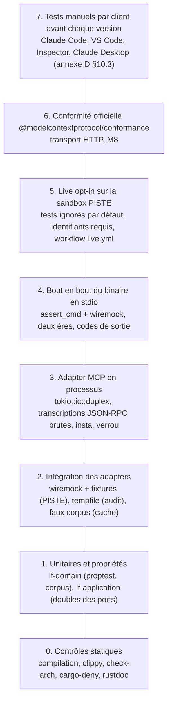
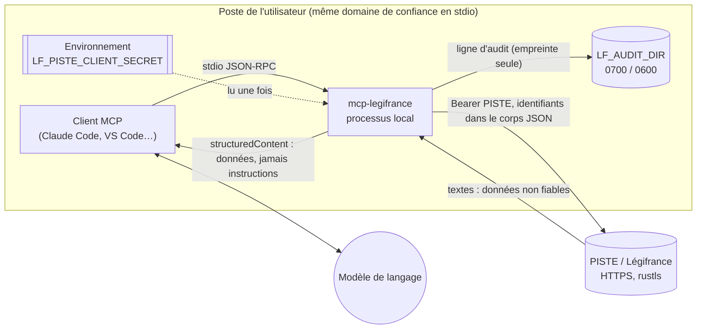
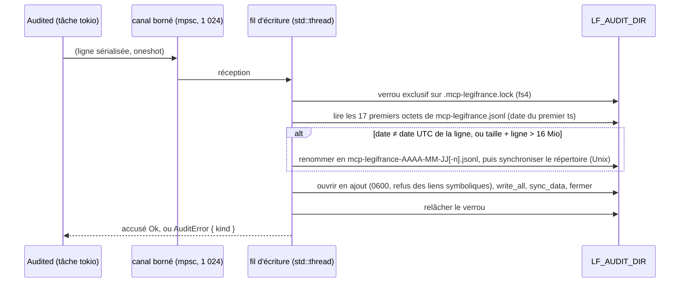

# 06 — Qualité : tests, CI, lints, sécurité, audit et performance

> **Statut** : M0-M1 livrés (plan 1), le reste est un plan ; rédigé le 2026-10-15, révision 2 du même jour alignée sur 00 révision 2 (amendements `AM-01…AM-43`, 00 §14), réconcilié avec le livré et les décisions C1-C7 le 2026-10-16. Ce document applique [00-decisions.md](00-decisions.md), qui est normatif et l'emporte en cas de doute. **L'exigence qualité de 00 §10 (couverture 100 %, mutation à 0 survivant, ADR-0002) l'emporte sur tout passage de ce document** ; pour M0 et M1, le code livré et le plan 1 font foi, et leurs écarts avec ce document sont listés en 00 §11.1.
> **Document propriétaire** (00 §0) : ce document fait foi pour les tests, les chemins et les noms de tests, la CI, les lints et les règles de `cargo xtask check-arch` (dont R9) ; les autres documents y renvoient. Il renvoie à son tour à 04 pour les fixtures de `lf-adapter-piste`, à 05 pour le contrat des outils et les budgets par outil, à l'annexe D pour l'énoncé des exigences protocolaires `C-xx`, à 08 pour la distribution et à 09 pour les registres.
> **Jalons concernés** : M0 (CI, lints, `cargo-deny`, `xtask`, CONTRIBUTING ; `SECURITY.md` : hygiène, 00 §11.1), M1 à M5 (tests par crate, budgets mesurés, v0.1.0), M6 et M7 (corpus de citations, navigation), M8 (conformité HTTP), M9 (adapter DILA).
> **Lecteurs** : développeurs (humains ou agents) qui écrivent les tests, la CI et les règles de qualité, sans accès aux échanges qui ont mené aux décisions.
> **Conventions** :
> - Les extraits Rust sont **non compilés, à valider au jalon qui l'implémente**. Les extraits YAML et TOML sont des **esquisses, à valider au jalon qui l'implémente**.
> - Un point non vérifié est marqué **NON VÉRIFIÉ** suivi d'une étiquette `[V-xx · étiquette]`, reprise par le registre V-xx de [09-risques-et-questions.md](09-risques-et-questions.md). Les étiquettes déjà employées par d'autres documents du plan sont reprises telles quelles, sauf les alias des groupes fusionnés (09 §2.1), remplacés par leur étiquette de référence (index de 09 §2.19).
> - Identifiants : défauts `D-01…D-47` ([recherche 02](../recherche/02-defauts.md) §1) ; points de parité `P-0xx`, écarts `E-xx` et scénarios d'erreur `S1…S17` ([recherche 01](../recherche/01-parite.md) §15, §14, §2.6) ; exigences protocolaires `C-xx` ([annexes/D-mcp-2026-07-28.md](annexes/D-mcp-2026-07-28.md) §8) ; questions ouvertes `Q1…Q17` (00 §13 : Q1 et Q2 sont décidées le 2026-10-16, Q16 et Q17 sont propres au livré, les autres portent une proposition adoptée par défaut, appliquée ici jusqu'à la réponse de l'utilisateur) ; amendements `AM-xx` (00 §14) ; décisions du propriétaire `C1…C7` du 2026-10-16 (00 §14, table des décisions). Les tâches `T-Mx-yy` sont celles de [07-feuille-de-route.md](07-feuille-de-route.md), déclinées par les plans exécutables de `docs/superpowers/plans/` (forme « plan N, tâche M ») ; ce document ne crée ni tâche `T-…`, ni risque `R-…`, ni vérification `V-…`. Les points différés de la revue de clôture M1 portent l'identifiant `M1-D1…M1-D24` (00 §11.1), distinct des défauts `D-01…`.
> - Repères locaux, non transverses et propres à ce document : principes de test `PT1…PT11` (§1.2) et menaces `MEN-01…MEN-23` (§10.2). Ils ne se confondent ni avec les scénarios d'erreur `S1…S17`, ni avec les tâches `T-…`.
> - « La référence Python » désigne `matematicsolutions/fr-eli-mcp@d3b5b13` (v0.5.3, Apache-2.0).

Documents liés : [02-architecture.md](02-architecture.md) (crates, ports, décorateurs, erreurs), [03-domaine.md](03-domaine.md) (types et algorithmes purs), [04-adapter-piste.md](04-adapter-piste.md) (OAuth, résilience, fixtures, tests wiremock), [05-outils-mcp.md](05-outils-mcp.md) (outils, instructions, verrou, budgets), [docs/superpowers/plans/](../superpowers/plans/) (plans exécutables, tâches), [08-distribution.md](08-distribution.md) (release, signature), [09-risques-et-questions.md](09-risques-et-questions.md) (registres), [annexes/A-parite.md](annexes/A-parite.md) (parité et golden), [annexes/B-citations.md](annexes/B-citations.md) (corpus de citations), [annexes/D-mcp-2026-07-28.md](annexes/D-mcp-2026-07-28.md) (protocole et conformité), ADR-0002 (`portes-qualite.md`, livré), ADR-0008, ADR-0010 et ADR-0016 ([index des ADR](../adr/README.md)).

---

## Sommaire

0. [Résumé](#0-résumé)
1. [Stratégie de test](#1-stratégie-de-test)
2. [Plan de test par crate](#2-plan-de-test-par-crate)
3. [Catalogue des tests de non-régression](#3-catalogue-des-tests-de-non-régression)
4. [Politique des fixtures](#4-politique-des-fixtures)
5. [Tests live (smoke) opt-in](#5-tests-live-smoke-opt-in)
6. [Conformité MCP](#6-conformité-mcp)
7. [CI GitHub Actions](#7-ci-github-actions)
8. [Lints, style et documentation](#8-lints-style-et-documentation)
9. [cargo-deny et chaîne d'approvisionnement](#9-cargo-deny-et-chaîne-dapprovisionnement)
10. [Sécurité](#10-sécurité)
11. [Journal d'audit : spécification](#11-journal-daudit--spécification)
12. [Performance et budgets](#12-performance-et-budgets)
13. [Processus](#13-processus)
14. [Critères d'acceptation qualité par jalon](#14-critères-dacceptation-qualité-par-jalon)
15. [Divergences et questions ouvertes](#15-divergences-et-questions-ouvertes)
16. [Points NON VÉRIFIÉS de ce document](#16-points-non-vérifiés-de-ce-document)
17. [Sources](#sources)

---

## 0. Résumé

- **Pyramide** : la base est faite de tests unitaires et de propriétés (`proptest`) du domaine et de l'application, avec des doubles des ports. Viennent ensuite les tests d'intégration des adapters (`wiremock`, fixtures, `tempfile`), puis les tests MCP en processus (`tokio::io::duplex`, transcriptions JSON-RPC brutes, snapshots `insta`), puis les tests de bout en bout du binaire en stdio (deux ères). Au sommet : les tests live opt-in (sandbox par défaut ; en production, seulement des sondes en lecture seule lancées à la main par le mainteneur, Q3), la suite de conformité officielle en HTTP (M8) et un protocole de test manuel par client.
- **Principes** : aucun réseau hors boucle locale en CI, horloges injectées (port `Clock`, horloges monotones et sommeils simulés dans l'adapter PISTE), aucune lecture de l'environnement réel dans les tests, aucun test instable toléré.
- **Catalogue** : chacun des 47 défauts de la référence reçoit au moins un test nommé (§3.1). Les tests proposés par la recherche 02 qui contredisent 00 sont remplacés, et chaque remplacement est justifié. Les points de parité P-xxx et le harnais golden suivent l'annexe A (§3.2).
- **Portes bloquantes (00 §10, ADR-0002)** : couverture de 100 % des lignes, régions et fonctions (`cargo llvm-cov --workspace --lib`, `make cov`) ; mutation `cargo-mutants` à 0 `MISSED` et 0 `TIMEOUT` (`make mutants FILE=…` en local sous contrôle mémoire WSL, mutation du diff de chaque PR en CI, balayage hebdomadaire en 4 shards avec fuzz). Chiffres de clôture M0-M1 : 137 tests, 369 mutants, 0 survivant.
- **CI** : livré (M0) : `make ci` = `fmt-check`, `lint` (`clippy -D warnings`), `test` (nextest et doc-tests), `doc`, `arch` (`cargo xtask check-arch`), `deny`, `machete`, `cov` ; jobs `check`, `test`, `coverage`, `deny`, `msrv` (1.88) et `mutants` de `ci.yml`, plus `weekly.yml`. Prévu : matrice Linux, macOS et Windows dès M2, âge minimal des dépendances (14 jours, 00 §2), verrou des descripteurs, reproduction du golden par son script versionné, lint des workflows, actions épinglées par SHA ; cible de 12 minutes au p50 pour les jobs hors `mutants`.
- **Données dérivées** : le golden de parité et le contrôle du mojibake viennent des scripts versionnés de `docs/plan/annexes/donnees/scripts/` (`golden.py`, `check_golden.py`, `dto_repair_check.py` ; Python 3.13, `python3 -I` ; empreintes : 00 §10), jamais d'une copie locale.
- **Sécurité** : modèle de menaces en 23 lignes (secrets, injection de prompt, rug pull, SSRF, déni de service, chaîne d'approvisionnement, journaux…), chacune reliée à une mesure et à un test ; plan de `SECURITY.md`.
- **Audit** : spécification complète du journal JSONL (ordre normatif des clés, empreinte SHA-256 canonique avec ses vecteurs, permissions `0600`/`0700`, rotation sûre entre processus, modes `strict` et `best-effort`, emplacement par OS).
- **Budgets** : démarrage jusqu'à `server/discover` en 100 ms au p95 ; réponse de 45 000 caractères au plus ; `tools/list` sous 20 000 octets en v0.1 ; instructions sous 3 500 caractères ; cibles par outil.
- **Processus** : revue de code avec liste de contrôle, ADR, CHANGELOG avec une rubrique « Tool surface » obligatoire, et une définition de « terminé » commune à toutes les tâches.

---

## 1. Stratégie de test

### 1.1 Pyramide



| Niveau | Où | Outils | Réseau | Bloquant en CI | Part visée | Durée cible (exécution seule) |
|---|---|---|---|---|---|---|
| 0 Statique | tout le workspace | rustc, clippy, `cargo xtask check-arch`, `cargo deny`, rustdoc | non | oui | — | 5 min (compilation comprise) |
| 1 Unitaires et propriétés | tous les crates, dans le fichier testé (`#[cfg(test)] mod tests`) | `#[test]`, `proptest`, `insta`, `tokio::time::pause` | non | oui | environ 60 % des tests | < 30 s |
| 2 Intégration des adapters | `lf-adapter-piste`, `-cache`, `-audit` (en `#[cfg(test)] mod tests`, comptés par `--lib`) | `wiremock`, `tempfile`, fixtures | boucle locale seulement | oui | environ 20 % | < 60 s |
| 3 MCP en processus | `lf-adapter-mcp` (en `#[cfg(test)] mod tests`) | client `rmcp` (feature `client`), `tokio::io::duplex`, `jsonschema`, `insta` | non | oui | environ 12 % | < 30 s |
| 4 Bout en bout | `lf-app/tests` | `assert_cmd`, `predicates`, `wiremock`, `tempfile` | boucle locale seulement | oui | environ 8 % | < 90 s |
| 5 Live | `lf-adapter-piste/tests/live.rs`, `lf-app/tests` (`live_*`) | `#[ignore]`, profil nextest `live` | **oui** (sandbox PISTE) | non | — | < 10 min, séquentiel |
| 6 Conformité HTTP | job `conformance-http` (M8) | suite officielle (npx), binaire de test dédié | boucle locale | oui à partir de M8 | — | < 5 min |
| 7 Manuel | poste du mainteneur | clients réels | oui | avant chaque étiquette | — | 1 h |

Les « parts visées » sont des ordres de grandeur, pas des seuils : elles disent où doit porter l'effort. Un comportement se teste au niveau le plus bas qui peut l'observer. Une règle de citation se teste dans le domaine, pas à travers le binaire. Le niveau 4 ne refait que ce que seul le binaire peut prouver : câblage, environnement, stdout, codes de sortie, deux ères sur le vrai transport.

**Mesure de couverture** : la porte (`cargo llvm-cov --workspace --lib`, 100 % lignes, régions et fonctions, 00 §10) ne compte que les tests de bibliothèque. Les niveaux 1 à 3 s'écrivent donc en `#[cfg(test)] mod tests` du fichier testé (§1.4) ; les niveaux 4 et 5 (`tests/`) s'ajoutent à la mesure sans y compter, mais tournent sous `make test` et tuent des mutants en complément.

### 1.2 Principes

| # | Principe | Mise en œuvre | Sources |
|---|---|---|---|
| PT1 | **Aucun réseau hors boucle locale en CI.** | Tout HTTP passe par un `wiremock::MockServer` sur `127.0.0.1`. `PisteConfig` de test pointe vers la boucle locale en `http`, ce que la validation n'admet que pour la boucle locale (`ConfigWarning::InsecureLoopback`). Les tests de bout en bout lancent le binaire avec `env_clear()`, PISTE pointé vers `127.0.0.1:1` (port fermé) quand aucun mock n'est utile, et `HTTPS_PROXY=http://127.0.0.1:9`. Le job de test exécute `cargo fetch` puis `cargo nextest run --offline` avec ces proxys : toute sortie non locale échoue. `HTTPS_PROXY` est honoré par reqwest (V-03 levé au plan 2c, 04 §4.2) : la boucle locale n'est contournée qu'avec `NO_PROXY=127.0.0.1,localhost,::1`, que la CI pose, et que tout poste derrière un proxy doit poser pour lancer les tests réseau locaux. Sur Linux, une exécution dans un espace de noms réseau isolé (`unshare -rn`, boucle locale réactivée) est tentée en plus ; sa faisabilité sur les runners GitHub est **NON VÉRIFIÉ** [V-23 · ci-unshare-reseau]. | 00 §10 ; 04 §2.3, §13.1 ; annexe D §8.3 |
| PT2 | **Horloge injectée, jamais lue directement.** | Le domaine ne lit aucune horloge (`lf-domain` n'a que `thiserror` en dépendance normale : dates en `CivilDate`, liste blanche de `check-arch`, 00 §2 et §4). L'application passe par le port `Clock` (`FixedClock` en test). L'adapter PISTE utilise `ManualClock` et `RecordingSleeper` pour le jeton, le backoff, `Retry-After`, le limiteur et le délai global, lu dans `Deadline` comme une durée restante convertie dans l'horloge de l'adapter (00 §3 ; 04 §13.1). `tokio::time::pause` n'est employé que dans les tests **sans socket réelle** (application avec faux corpus), car l'avance automatique d'une horloge gelée peut déclencher à tort les délais de reqwest **NON VÉRIFIÉ** [V-19 · wiremock-temps-pause]. Le limiteur `governor` reçoit une horloge factice (V-07 levée au plan 2c : `Duration` implémente `Reference`, 04 §5.4). Les TTL de moka se testent par la fonction `Expiry`, faute d'horloge injectable **NON VÉRIFIÉ** [V-08 · moka-horloge-tests]. `SystemClock` (dans `lf-app::clock`, avec l'adapter PISTE les seuls endroits qui emploient `chrono-tz`, et la feature `clock` de `chrono` pour `lf-app::clock` ; `lf-application` et `lf-adapter-audit` emploient `chrono` sans cette feature : 02 §3.0.1, ADR-0011) expose une fonction pure `paris_date(DateTime<Utc>) -> CivilDate`, testée sur des instants fixes. `clippy.toml` interdit `Utc::now`, `Local::now` et `SystemTime::now` hors de `SystemClock` (02 §2.2). | 02 §3.2, §5.3 ; 03 §6.4 ; 04 §13.1 |
| PT3 | **Hasard maîtrisé.** | `proptest` : graines d'échec conservées dans `proptest-regressions/`, versionné ; 256 cas en PR, 4 096 la nuit (`PROPTEST_CASES`) ; graine fixable par l'environnement **NON VÉRIFIÉ** [V-20 · proptest-graine-env]. La gigue du backoff n'est jamais figée : les tests vérifient des intervalles (`[0,5 s ; 1 s)`, 04 §13.2). Aucun aléa dans le domaine. | recherche 04 §4.1 |
| PT4 | **Environnement du processus intouché.** | `std::env::set_var` est `unsafe` en édition 2024 et `unsafe_code = "forbid"` l'interdit (02 §3.0.3). La configuration se teste par un `EnvSource` injecté (02 §8.2). Les processus fils reçoivent `env_clear()` puis une liste explicite : un `LF_PISTE_CLIENT_SECRET` réel du développeur ne peut donc jamais atteindre un test. `LF_AUDIT_DIR` vaut toujours un répertoire temporaire ; `HOME` et `dirs::data_dir()` ne sont jamais utilisés par un test. | 02 §3.0.3, §8.2 |
| PT5 | **Système de fichiers jetable.** | `tempfile::TempDir` par test ; fixtures en lecture seule ; `**/tests/fixtures/** -text` dans `.gitattributes`, pour que l'empreinte `sha256_raw` reste stable sous Windows (02 §2.2). | 02 §2.2 ; D-35 |
| PT6 | **Indépendance et parallélisme.** | nextest exécute chaque test dans son propre processus. Aucun état global ; ports éphémères ; aucune hypothèse sur l'ordre des clés JSON (`sort_maps` dans les snapshots, comparaison sur `serde_json::Value`, la feature `preserve_order` pouvant être unifiée, recherche 04 §4.1). | recherche 04 §2.18 |
| PT7 | **Fuseau et locale neutres.** | « Aujourd'hui » vient de `chrono-tz` (Europe/Paris), jamais de `TZ`. Un test de bout en bout lance le binaire avec `TZ=Pacific/Kiritimati` (UTC+14) et vérifie que la date par défaut reste celle de Paris. | D-19 ; 03 §6.4 |
| PT8 | **Pas de sommeil réel long.** | Aucun test n'attend plus d'une seconde de temps réel, sauf les délais HTTP volontairement courts de 04 §13.1 (200 ms contre 1 s). Les fenêtres de « silence » des transcriptions durent 500 ms (annexe D §8.3). | 04 §13.1 |
| PT9 | **Zéro test instable.** | Profil nextest `ci` sans réessai. Un test instable est mis en quarantaine par `#[ignore = "flaky: <lien du ticket>"]`, avec un ticket et une correction dans le jalon en cours. Il ne reste jamais ignoré au-delà de l'étiquette suivante. | — |
| PT10 | **Les tests sont la spécification.** | Les noms du catalogue (§3) sont des identifiants stables. Un test de non-régression porte le défaut dans son commentaire de documentation (`/// Régression : D-12.`), ce qui permet de le retrouver par `grep`. Un snapshot modifié se relit comme du code (`cargo insta review`). | D-36 |
| PT11 | **Aucun secret réel dans le dépôt.** | Les tests de non-fuite génèrent des secrets aléatoires (préfixe `lf-test-secret-`, 32 caractères aléatoires). Les fixtures ne contiennent jamais d'en-tête ni de jeton (§4.4). `.env` est ignoré par Git, comme dans la référence (référence `.gitignore:13-15`). | 04 §14.1 ; D-40 |

### 1.3 Outils de test

Versions relues dans l'index crates.io les 2026-10-15 et 2026-10-16 (recherche 04 §4.1 ; 02 §3.0.1). Ce sont des **versions de référence**, pas des planchers (00 §2) : pour les crates, `[workspace.dependencies]` écrit l'exigence au niveau mineur (`insta = "1.49"`, `tokio = "1.53"`…), sauf `rmcp` et `rmcp-macros`, épinglés `"=3.5.1"` ; le verrou de M0 est livré (toolchain flottante, `proptest` 1.12.0 : écart de la règle d'âge accepté, la dépendance étant de test seulement, 09 R-22) ; à partir de M2, tout paquet ajouté ou changé dans `Cargo.lock` est publié depuis au moins 14 jours, et l'exigence descend d'une version mineure si aucune version de la série n'est assez ancienne (02 §3.0.1) ; règle d'âge contrôlée au §9.4. Les outils installés en binaire (nextest, cargo-machete, cargo-deny, cargo-llvm-cov) ne passent pas par `Cargo.lock` : les workflows épinglent leur version exacte, relue au jalon qui les installe (§7.2).

| Outil ou crate | Version de référence | Usage | Remarques |
|---|---|---|---|
| `cargo-nextest` | 0.9.148 | exécution des tests (profils `default`, `ci`, `live`) | MSRV de compilation 1.91 : on l'installe **en binaire** (recherche 04 §4.1). nextest n'exécute pas les doc-tests, d'où une étape `cargo test --doc` distincte **NON VÉRIFIÉ** [V-21 · nextest-config-cles]. |
| `insta` + `cargo-insta` | 1.49.0 | snapshots JSON (`json`, `redactions`) | `sort_maps => true` ; `insta::with_settings!` est synchrone, sans `.await` dans le bloc (recherche 04 §3). Comportement en CI (aucune écriture, échec sur écart) **NON VÉRIFIÉ** [V-22 · insta-options-ci]. |
| `wiremock` | 0.6.5 | faux PISTE (OAuth, API) | un `MockServer` par test ; `Mock::expect(n)` vérifié à la fin. Ne tire ni reqwest ni async-trait (02 §4.3). |
| `proptest` | 1.12.0 | propriétés | MSRV 1.88 : avec `rmcp` 3.5.1, c'est le plancher de la MSRV du projet (00 §2). |
| `tempfile` | 3.27.0 | répertoires d'audit, fixtures écrites | — |
| `assert_cmd` / `predicates` | 2.2.2 / 3.1.4 | lancement du binaire | — |
| `jsonschema` | 0.58.6 | validation de `structuredContent` contre `outputSchema` (fixtures et vues à listes omissibles vides), des lignes d'audit, et validité 2020-12 des schémas dans `lock-descriptors` (dépendance de `xtask`, 02 §3.8 ; 05 §9.2 point 8) | **`default-features = false`**, sinon il tire reqwest (02 §3.0.1). |
| client `rmcp` | `=3.5.1`, feature `client` (dev) | tests MCP en processus | `().serve(client_io)` ; l'ère choisie par défaut par ce client est **NON VÉRIFIÉ** [V-37 · rmcp-client-ere-tests] : les transcriptions brutes (§6.1) couvrent donc les deux ères explicitement. |
| `tokio` (`test-util`, `io-util`) | 1.53.3 | `start_paused`, `duplex` | — |
| `cargo-fuzz` | installé en CI (`taiki-e/install-action`) | fuzzing hebdomadaire (`weekly.yml`), non bloquant pour la PR | demande une toolchain nightly ; répertoire `fuzz/` hors du workspace (`exclude`) ; cibles `dto_decode`, `from_html`, `ids`, `text` et `version_date` livrées (`weekly.yml`). |
| `cargo-llvm-cov` | 0.9.1 | couverture **bloquante** : 100 % des lignes, régions et fonctions, `--workspace --lib` (`make cov`, §7.6) | demande le composant `llvm-tools-preview` dans `rust-toolchain.toml` (livré). |
| `cargo-mutants` | 27 | mutation **bloquante** : 0 `MISSED`, 0 `TIMEOUT` (`make mutants FILE=…`, diff de PR, balayage hebdomadaire ; §7.6) | `.cargo/mutants.toml` (nextest, profil `mutants`) ; toute exclusion est justifiée en commentaire ; sous WSL, `TMPDIR=/var/tmp`, `-j 1`, un fichier à la fois, contrôle mémoire (§7.6). |
| `cargo-deny` | 0.20.2 | §9 | — |
| `cargo-machete` | 0.9.2 | dépendances inutilisées | vert dès M0 : un crate ne déclare une dépendance que lorsqu'un code l'emploie, et les squelettes n'en déclarent pas d'avance (00 §2) ; seule exception, `rmcp-macros`, déclaré pour son épinglage sans emploi direct : `[package.metadata.cargo-machete] ignored = ["rmcp-macros"]` (02 §3.0.1). |
| Python | 3.13, lancé en `python3 -I` | scripts versionnés de `docs/plan/annexes/donnees/scripts/` : `golden.py` (production du golden de parité), `check_golden.py` (assertions de `test_parse.py` sur le golden), `dto_repair_check.py` (stratégies de réparation du mojibake sur les fixtures) | outil de données, pas de test Rust ; empreintes SHA-256 des versions qui ont produit les données du plan : 00 §10 ; job `surface` (§7.1). |

`mockall` n'est pas retenu. Les doubles des ports sont écrits à la main dans `lf-application::testing`, derrière la feature `test-support` (02 §3.2). Ils sont plus lisibles, et l'absence de méthode par défaut dans les ports oblige à les compléter quand le port évolue. Le code de ces doubles compte dans la mesure `--lib` : ils sont soit compilés en `#[cfg(test)]`, soit exclus nommément de la couverture (`--ignore-filename-regex` de `COV_FLAGS`, avec justification ; aucune exclusion n'a été nécessaire au plan 2c) ; jamais laissés partiellement exercés.

### 1.4 Organisation des fichiers de test

**Règle (ADR-0002, 00 §10)** : un test unitaire vit dans un `#[cfg(test)] mod tests` du fichier qu'il teste. La porte de couverture mesure `cargo llvm-cov --workspace --lib` : un test placé dans `tests/` n'y compte pas. Sont donc des tests unitaires, dans le crate : le mapping des DTO, le classement HTTP vers `CorpusError`, la politique de retry, les scénarios `wiremock` (modules de test `async`), `Audited` sur doubles, les harnais MCP en processus. `tests/` est réservé à `live.rs` (`#[ignore]`), aux tests de bout en bout du binaire (`assert_cmd`) et aux compléments qui ne portent pas la couverture. Les doubles de `lf-application::testing` sont compilés en `#[cfg(test)]` ou exclus nommément de la mesure ; la glue d'E/S irréductible l'est aussi (§7.6).

Dans les sections suivantes, un nom de test cité avec un ancien chemin `tests/<x>.rs` désigne le module de test `<x>` du crate (même nom, même contenu), sauf pour `live.rs` et pour `lf-app`.

```text
crates/lf-domain/                       (livré, M1)
  src/**                       #[cfg(test)] mod tests : unitaires table-driven et proptest (129 tests)
  proptest-regressions/        versionné
  tests/data/citations/*.jsonl (M6) copies de l'annexe B, `cmp` via `make surface` (job `surface` de la CI) ; lues par include_str! depuis les tests unitaires
crates/lf-application/
  src/testing.rs               FakeCorpus, FixedClock, MemoryAuditLog, FailingAuditLog : cfg(test) ou exclu nommément ;
                               (M9) contract::corpus_contract, suite de contrat commune aux corpus
  src/**                       mod tests : audited, usecases, budget, coverage, error_matrix ; (M6) verify_citations ; (M7) search_all
crates/lf-adapter-piste/
  src/**                       mod tests : oauth (auth.rs), resilience (retry.rs, limit.rs, deadline.rs), bodies (http.rs, encoding.rs),
                               endpoints, config, fixtures_contract, ported_test_parse, parity_golden (map/)
  src/time.rs                  ManualClock et RecordingSleeper en cfg(test) (04 §1.5)
  tests/live.rs                #[ignore], seul fichier d'intégration obligatoire (§5)
  tests/record_fixture.rs      (feature record, required-features) test de l'écrivain de fixtures de l'exemple, sur wiremock : complément hors couverture
  tests/fixtures/reference/    16 fixtures de la référence + .meta.toml + parite-golden.json (A §5.3)
  tests/fixtures/recorded/     captures de cargo xtask record-fixture (04 §13.4)
  tests/fixtures/synthetic/    cas construits (null, sentinelles, types mêlés)
  examples/record_fixture.rs   (feature record) appelé par cargo xtask record-fixture
crates/lf-adapter-cache/src/**       mod tests (cache)
crates/lf-adapter-audit/src/**       mod tests (format, hash_vectors, rotation, concurrency, permissions, errors)
crates/lf-adapter-mcp/
  src/**                       mod tests : inprocess, protocol_raw, descriptors, instructions, rendering, budgets, http (M8) ;
                               snapshots insta à l'emplacement par défaut (src/**/snapshots/)
  tests/reference/tools.lock.reference.json   verrou de la référence, copié sans modification (P-003), lu par include_str!
crates/lf-app/
  src/**                       mod tests : clock (paris_date), config, check_config
  tests/cli.rs e2e_stdio.rs stdout_only_jsonrpc.rs composition.rs parity_tool_output.rs
  tests/audit_e2e.rs security_leaks.rs docs_consistency.rs perf.rs (#[ignore])     e2e du binaire : hors couverture
tests/tools.lock.json          verrou des descripteurs (cargo xtask lock-descriptors, M4)
tests/jsonrpc/*.jsonl          transcriptions JSON-RPC brutes, deux ères (§6.1)
tests/conformance-baseline.yml (M8) échecs attendus de la suite officielle, chacun justifié
fuzz/                          hors workspace : fuzz_targets/{dto_decode, from_html, ids, text, version_date} livrés ; citation_parse au jalon de son objet (`dto_decode` **livré** au plan 2f : les DTO étant `pub(crate)`, la cible inclut leurs fichiers par `#[path]`, sans feature ni point d'entrée ajouté à l'adapter ; voir 04 §8.5 et 07 T-M2-06)
xtask/src/arch.rs              tests unitaires dans le fichier : liste blanche, frontières, échec fermé (livré)
Makefile, .cargo/mutants.toml  pipeline local et configuration de cargo-mutants (livrés)
```

Chemins : cette arborescence fait foi pour les chemins et les noms de tests (00 §0) ; 02 §2 y renvoie. Les fixtures PISTE sont **locales au crate** `lf-adapter-piste` (04 §1.5 et §13.3, qui font foi pour les fixtures ; annexe A §5.3). Les transcriptions vivent dans `tests/jsonrpc/` (02 §2), et non dans `tests/protocol/` comme le proposait l'annexe D §8.3 (§15.1 n° 2). Les données dérivées du plan et leurs scripts restent dans `docs/plan/annexes/donnees/` (§4.1). La glue d'E/S irréductible (une tentative HTTP dans `http.rs`, le fil d'écriture de l'audit, `main.rs`) est amincie d'abord, puis exclue nommément, avec sa justification : `exclude_globs` pour la mutation, `--ignore-filename-regex` dans `COV_FLAGS` pour la couverture (M2 ; aucune exclusion nécessaire au plan 2c).

---

## 2. Plan de test par crate

Chaque fiche donne l'objectif, la technique, les doubles employés et les cas obligatoires. Les noms de tests déjà fixés par 02, 03, 04, 05 ou les annexes sont repris tels quels ; les autres sont fixés ici.

### 2.1 `lf-domain`

**Objectif** : prouver les invariants des types (03 §1.4) et les algorithmes purs, sans I/O. `serde_json` n'est autorisé qu'en dépendance de développement, pour charger les fixtures et le corpus (03 §1.1).

**Unitaires table-driven** (M1) :

| Groupe | Tests | Couvre |
|---|---|---|
| Identifiants | `id_error_messages_table` (tous les cas de 03 §2.7, première phrase de la référence), `versioned_id_splits_suffix`, `suffix_kept_on_legitext_stripped_elsewhere` (suffixe bien formé sur un autre préfixe : toléré puis retiré ; mal formé : `BadSuffix`, C4), `upstream_suffix_on_other_prefix_is_stripped_with_diagnostic` (données amont : `debug!` et compteur, 00 §4), `id_parse_is_tolerant_on_whitespace_and_case` (`parse_param` est abandonné : `Id::parse` et `FromStr` restent tolérants) | D-31, D-28, P-012, P-030 |
| Fonds et statuts | `fond_parse_is_case_and_space_insensitive`, `fond_error_message_matches_reference`, `legal_status_from_etat_or_juris_state` | P-010, D-21 |
| Contrat de citation (v1 livré ; contrat v2 : tâche de tête de M2, 00 §11.1) | `constit_citation_golden` (« Cons. const., décision n° 2025-1173 QPC du 7 novembre 2025 »), `cnil_citation_golden` (« CNIL, délibération n° SAN-2026-002 du 8 janvier 2026 »), `juri_and_cetat_citation_is_clean_title`, `article_citation_rules_table` (« Code civil, art. 9 »), `citation_never_empty`, `ecli_is_never_fabricated` | D-27, D-30, P-034, P-035, P-039 |
| URL | `source_url_snapshot_all_kinds` (10 kinds livrés, 11 après `loda_article` en M2, après V-140/V-142 ; `insta`), `law_article_url_uses_loda_article_lc`, `unknown_parent_nature_falls_back_to_codes_url` (repli de parité, 00 §4), `url_depends_on_id_type_not_payload_origine` | D-28, D-29, P-031 |
| Dates | `from_epoch_ms_vectors` (`CivilDate::from_unix_millis` ; `-5231606400000` ⇒ 1804-03-21 ; `17193600000` ⇒ 1970-07-19 ; `1762473600000` ⇒ 2025-11-07 ; `32472144000000` ⇒ 2999-01-01, puis `None`), `open_ended_maps_sentinels_to_none` (2999-01-01, 2222-02-22, 2222-01-01 exclus ; 2221-12-31 conservé), `format_fr_twelve_months_and_premier` (`CivilDate::to_french`), `version_date_rejects_bad_formats` (« 07/10/2016 », « 2016-13-45 », « hier », 2026-02-29) | D-20, D-22, D-27, P-030 |
| Texte | `clean_strips_mark_tags`, `clean_folds_whitespace_after_repair`, `clean_removes_invisible_and_control_chars`, `clean_removes_bidi_controls` (U+202A–U+202E et U+2066–U+2069 retirés, compteur de diagnostic incrémenté ; 00 §4, AM-25 ; M2), `from_html_block_tags_split_paragraphs`, `from_html_drops_rech_and_script_with_content`, `from_html_unclosed_tag_at_end`, `from_html_literal_less_than`, `from_html_invalid_numeric_entity_kept`, `snippet_is_truncated_to_280_chars` (ellipse comprise) | D-26, P-030, P-032, MEN-06 |
| Table des matières | `toc_preserves_section_titles` (88 entrées sur consult_loda.json), `toc_sorted_by_int_ordre`, `toc_dedups_articles`, `toc_depth_65_is_too_deep` | D-25, P-033 |
| Fenêtre et résumé | `window_last_page_has_no_next_offset`, `offset_past_end_is_empty_window` (la fenêtre est totale ; `OffsetPastEnd` est vérifié par le cas d'usage de M5), `summary_constit_dispositif_551_chars`, `summary_cetat_official_analysis` (CETAT : `resumePrincipal` → analyses ; JURI : `abstrats` → analyses, 00 §4), `summary_source_order_official_dispositif_lead`, `summary_falls_back_to_lead` | D-33, P-037 |
| Recherche | `query_too_long_is_invalid_arg` (501 caractères), `query_control_chars_are_stripped`, `page_size_bounds` (0, 1, 100, 101), `has_more_false_at_reachable_window_end` (`has_more` vrai seulement si `page × page_size < total` et `(page + 1) × page_size ≤ 10 000`, règle de 05 §5.1 et 03 §4.1 : `page × page_size = 10 000 < total` ⇒ `has_more = false` ; `page_size = 30`, `page = 333` : 9 990 < `total`, mais la page 334 serait refusée ⇒ `has_more = false` ; 03 §10), `date_range_with_one_bound_uses_range_limit` (borne absente remplacée par 1500-01-01 ou 2221-12-31, 03 §6.1), `inverted_date_range_is_rejected` | D-32, D-31, D-09 |

**Propriétés** (`proptest`, M1, M5 pour la fenêtre) :

| Propriété | Énoncé | Couvre |
|---|---|---|
| `id_parse_roundtrip` | Pour tout préfixe et tout nombre de 12 chiffres, `Display ∘ FromStr` est l'identité ; pour toute chaîne, `FromStr` ne panique pas. | D-31 |
| `pre_1970_dates_roundtrip` | Pour tout `ms` de [−10¹³, 10¹³], `CivilDate::from_unix_millis(ms)` est égal au calcul de référence `1970-01-01 + ms.div_euclid(86_400_000)` jours. Exécuté aussi en **CI Windows** dès M2 (la matrice démarre avec les premières E/S). | D-20, E-35 |
| `version_date_roundtrip` | Toute date valide de la plage de 03 §6.1 survit à `format` puis `parse` ; toute chaîne hors format est refusée sans panique. | D-22 |
| `window_guarantees_g1_to_g7` | G1 à G7 de 03 §7.6 pour tout texte (paragraphes, phrases, NBSP, caractères hors plan de base), tout `offset` et tout `max_chars` de 500 à 40 000. | D-33 |
| `paged_reading_reconstructs_full_text` | Enchaîner les fenêtres depuis 0 reconstruit exactement le texte canonique (G3). | D-33 |
| `window_offsets_are_char_based` | `offset` et `next_offset` comptent des scalaires Unicode, jamais des octets. | P-037 |
| `from_html_never_panics_and_preserves_text` | Pour tout HTML généré, aucune panique ; la concaténation des paragraphes est égale au HTML débalisé, aux blancs près. | D-26 |
| `rank_is_deterministic_and_within_budget` | Mêmes entrées ⇒ même sortie ; au plus `n` passages ; Σ des longueurs ≤ `max_chars` ; tri par score décroissant puis par `offset` ; un segment sans terme du focus n'est jamais rendu. | D-33 |
| `repair_mojibake_inverts_latin1_misdecoding` | Pour toute chaîne française `s` sans motif de mojibake, `repair(misdecode(s)) == s`, où `misdecode` décode en latin-1 les octets UTF-8 de `s` ; `repair` est l'identité sur toute chaîne qui contient un caractère au-delà de U+00FF ; `repair` est idempotente. | D-35 ; 03 §7.1 |

**Périmètre par jalon** : M1 est livré (plan 1) ; la table de correspondance du §3.1 donne les noms livrés. Les lignes dont l'objet est reporté (00 §11.1) ne sont dues qu'au jalon qui le livre : en tête de M2, `contract` (contrat de citation v2), `TocArticle` puis `TocNode`, `parse_versioned`, le module `lf_domain::text::encoding` (`repair_latin1_mojibake`, `has_latin1_mojibake`, reliquat de M1), le vecteur 1804-03-21 de `CivilDate`, `VersionDate` borné, `open_ended`, `DateRange`, `VersionedId` (type de retour de `parse_versioned`), `Hash`, le membre inconnu de check-arch, les spikes TLS, proxy, `backon` et `governor` (V-02, V-03, V-06, V-07 : faits au plan 2c, `backon` écarté) et le `#[non_exhaustive]` de `DomainError` tranché d'abord (M1-D13 ; reste de la tâche 0 de 00 §11.1) ; ensuite `from_html`, `LongText`, `LegalStatus`, `SearchQuery` et ses types ; en M5 le résumé, les mots vides, le repli NFD, `Focus`, `MaxChars` et `PassageCount` ; en M6 le parseur de citations.

**Fixtures** : les tests qui lisent un JSON de la référence (paragraphes CONSTIT 49, CETAT 43, CNIL 3 ; dispositif CONSTIT de 551 caractères ; `focus_returns_relevant_paragraphs`, où « publicité des débats » met le considérant 14 en tête) chargent `../lf-adapter-piste/tests/fixtures/reference/` par chemin relatif. Si le chemin est absent, par exemple dans un paquet publié, ils s'arrêtent avec un message, comme `golden_copy_matches_plan_data` (annexe A §5.3). Ce couplage de test est accepté ; une copie dans le domaine dupliquerait 16 fichiers.

**Corpus de citations (M6)** : `corpus_citations` et `corpus_matches_are_substrings` (annexe B §8.5), sur le fichier de données tel quel, sans aucune surcharge dans le harnais : l'attente de P159 (`ECLI:EU:…` ⇒ `Unsupported`, `ecli_etranger`) est corrigée dans le fichier (annexe B §8.4, AM-21) ; propriété `parse(format::canonical(c)) == c` ; snapshots de l'extraction sur consult_juri_cetat.json et consult_juri_constit.json ; `perf_parse_20k` (§12).

**Fuzzing** (hebdomadaire, `weekly.yml`, non bloquant pour la PR) : cibles `ids` (les `FromStr`), `text` (`clean`, `window`, `passages`), `from_html`, `VersionDate::parse` et `dto_decode` (plan 2f : les cinq DTO de réponse par `dto::decode::decode`, budget armé) livrées ; en M6 `citation::parse_with` s'ajoute avec son objet. Le critère est « aucune panique, spans valides » (03 §8.8). Le corpus de départ vient des fixtures. Le durcissement (`-timeout`, `-max_len`, corpus persistant, assertions d'écho) est reporté en M5 avec la correction de `passages` (M1-D1, M1-D2).

**Lints propres** : `unwrap_used` et `expect_used` (livrés), puis `clippy::panic`, `clippy::unreachable` et `clippy::unimplemented` en `warn` de `[workspace.lints.clippy]`, donc bloquants par `-D warnings` (tâche de tête de M2, 00 §11.1 ; C7). `indexing_slicing`, `string_slice` et `arithmetic_side_effects` sont écartés : ils imposeraient de réécrire environ 28 lignes avec des branches mortes, incompatibles avec 100 % des régions. L'absence de panique est prouvée par proptest, fuzz et mutation.

### 2.2 `lf-application`

**Objectif** : prouver, en `#[cfg(test)] mod tests` des modules testés (§1.4), l'orchestration (ordre de validation, rejets locaux, messages finaux rédigés par `lf_application::messages`, dates par défaut, métriques), le décorateur `Audited` dans **toutes** les issues, le délai global et sa publication dans `Deadline` (variable locale de tâche, 00 §3), l'annulation et la politique de budget (estimation et dégradation, 00 §7), sans réseau ni disque.

**Doubles** (`lf-application::testing`, feature `test-support`) :

| Double | Comportement | Remarques |
|---|---|---|
| `FakeCorpus` | réponses programmées par méthode (file de `Result<T, CorpusError>`), délai optionnel (`tokio::time::sleep`, donc compatible avec `start_paused`), compteur d'appels par méthode, mesure de la concurrence maximale observée | Aucune méthode par défaut dans le port : `FakeCorpus` doit tout implémenter (02 §3.2). |
| `FixedClock` | `now_utc` et `today_paris` (un `CivilDate`) fournis séparément | `lf-application` n'a pas besoin de `chrono-tz` (02 §5.3). |
| `MemoryAuditLog` | conserve les `AuditRecord` ; porte optionnelle qui retient l'accusé tant qu'elle n'est pas ouverte | sert à `audit_write_is_acknowledged_before_tool_returns`. |
| `FailingAuditLog` | renvoie `AuditError { kind }` (`Io`, `DiskFull`, `PermissionDenied`, `Encode`, `WriterGone`) | modes `strict` et `best-effort`. |

Les tests tournent sous `#[tokio::test(start_paused = true)]` : aucune socket réelle n'est en jeu, le temps virtuel est donc sûr (PT2). La durée se mesure avec `tokio::time::Instant` (02 §3.2, piège 3).

**`Audited` : une ligne par issue** (`audit_written_for_every_outcome`, table pilotée ; corrige D-02, D-03 ; issues de 02 §7.1) :

| # | Issue simulée | Mise en place | `status` | `error_code` | `output_count_or_size` | `duration_ms` | Retour attendu |
|---|---|---|---|---|---|---|---|
| 1 | succès (`fr_get_decision`) | `get_decision` → `Ok`, délai de 150 ms | `ok` | — | caractères renvoyés | ≥ 150 | `Ok` |
| 2 | décodage impossible | `ToolCall { input: Err(InputError) }` | `error` | `invalid_arg` | 0 | ≥ 0 | `InvalidArgument` ; 0 appel au port |
| 3 | validation du domaine | `decision_id = "CNILTEXT000053352643"` | `error` | `invalid_arg` | 0 | ≥ 0 | `InvalidArgument` ; 0 appel |
| 4 | introuvable | `NotFound` (404 de ressource, puis 200 vide : deux variantes de `what`) | `error` | `not_found` | 0 | réelle | `NotFound`, message propre à l'outil (P-013 ; fond selon le préfixe pour `fr_get_decision`, E-15) |
| 5 | erreur amont | `Upstream { 503, retryable: true }` après 200 ms | `error` | `upstream_error` | 0 | ≥ 200 | `Upstream` |
| 6 | quota | `RateLimited { retry_after: 12 s }` | `error` | `rate_limited` | 0 | réelle | `RateLimited` |
| 7 | identifiants absents | `Config` | `error` | `config_error` | 0 | réelle | `Config` |
| 8 | identifiants refusés | `Auth` | `error` | `config_error` | 0 | réelle | `Config` (jamais `not_found`, 00 §5) |
| 9 | réponse illisible | `Decode` | `error` | `upstream_error` | 0 | réelle | `Upstream { cause: Decode }` |
| 10 | délai global | futur du port jamais résolu ; délai de 1 s | `error` | `upstream_error` | 0 | ≈ 1 000 (± 10) | `Upstream { cause: Deadline }` |
| 11 | annulation | futur `cancel` résolu à 100 ms | `error` | absent | 0 | ≈ 100 | erreur `cancelled` |
| 12 | recherche vide | `search` → `Ok(SearchPage { hits: [] })` | `ok` | — | 0 | réelle | `Ok`, `total: 0` (S16) |
| 13 | audit impossible, mode `strict`, succès | `FailingAuditLog(DiskFull)` | aucune ligne | — | — | — | `Audit`, sans chemin |
| 14 | audit impossible, mode `strict`, erreur d'origine | `FailingAuditLog` + `NotFound` | aucune ligne | — | — | — | `Audit`, message suivi de « Original error: [not_found]. » |
| 15 | audit impossible, mode `best-effort` | `FailingAuditLog` + succès | aucune ligne | — | — | — | `Ok`, `warn!` et compteur incrémenté |

```rust
// crates/lf-application/src/audited.rs, mod tests — non compilé, à valider au jalon qui l'implémente
#[tokio::test(start_paused = true)]
async fn audit_written_for_every_outcome() {
    for case in OUTCOMES {                               // table ci-dessus, une entrée par ligne
        let (svc, log, corpus) = case.build();           // FakeCorpus programmé, FixedClock, MemoryAuditLog ou FailingAuditLog
        let got = case.invoke(&svc).await;               // passe toujours par LegalService::<outil>
        let lines = log.records();
        assert_eq!(lines.len(), case.lines, "{}", case.name);
        if let Some(l) = lines.first() {
            assert_eq!((l.status, l.error_code), (case.status, case.code), "{}", case.name);
            assert!(l.duration_ms >= case.min_ms, "{}: {} ms", case.name, l.duration_ms);
            assert_eq!(l.output_count_or_size, case.metric, "{}", case.name);
        }
        assert_eq!(got.err().map(|e| e.code()), case.returned, "{}", case.name);
        assert_eq!(corpus.calls(), case.port_calls, "{}", case.name);
    }
}
```

**Autres cas obligatoires** :

| Test | Vérifie | Couvre | Jalon |
|---|---|---|---|
| `error_duration_is_nonzero`, `duration_includes_normalization` | durée réelle sur erreur ; le mapping et le rendu sont inclus | D-03 | M3 |
| `deadline_maps_to_upstream_error_before_deadline_plus_epsilon` | le délai global est respecté à 10 ms près (temps virtuel) | D-14 | M3 |
| `deadline_is_published_to_the_port` | un `FakeCorpus` qui lit `Deadline::current_or(défaut)` pendant l'appel obtient la durée restante (`LF_TOOL_DEADLINE_S` moins le temps écoulé), y compris après un premier appel au port ; hors portée d'`Audited`, il obtient le défaut | D-14, 00 §3 | M3 |
| `multi_call_use_case_stops_at_80_percent` | un cas d'usage à appels multiples (`fr_verify_citations`, `fr_search_all`) dont le faux corpus est lent ne lance plus d'appel après 80 % du délai et rend un résultat partiel motivé, jamais `UpstreamCause::Deadline` | D-14, 00 §3 | M6, M7 |
| `cancelled_call_is_audited` | une ligne `error` sans code, `error = "cancelled by client"` | D-02, 02 §9.2 ligne 21 | M3 |
| `audit_failure_returns_audit_error`, `audit_failure_does_not_mask_original_cause`, `best_effort_keeps_result` | issues 13 à 15 | D-02, P-043, Q9 | M3 |
| `audit_write_is_acknowledged_before_tool_returns` | l'appel ne rend pas la main tant que l'accusé d'écriture n'est pas reçu | D-16 | M3 |
| `invalid_arg_is_not_logged_as_error` | une erreur attendue est journalisée en `info` (subscriber de capture) | D-08 | M3 |
| `search_validation_order_matches_reference` | ordre `fond` → `query` → `page_size`, puis nouveaux paramètres | P-011 | M3 |
| `page_beyond_reachable_window_is_invalid_arg_without_network`, `code_date_range_is_invalid_arg`, `version_date_outside_loda_code_is_invalid_arg`, `inverted_date_range_is_invalid_arg` | rejets `invalid_arg` de `fr_search` dans le cas d'usage, 0 appel au port (00 §7) : `page × page_size` > 10 000, `date_from`/`date_to` sur CODE, `version_date` hors LODA/CODE, `date_from` > `date_to` ; messages de 05 §7.3 ; le rejet a lieu avant l'appel du port, si bien que la copie défensive de l'adapter (`InvalidRequest`, 00 §5 ; `code_date_range_is_defensive_invalid_request_without_network`, 04 §6.10) n'est jamais atteinte par ce chemin | D-09, D-22 | M3 |
| `not_found_messages_match_reference` | 6 outils × 3 origines ; première phrase de la référence, sauf `fr_get_decision` sur CONSTEXT et CETATEXT (`No CONSTIT decision found for {id}.`, `No CETAT decision found for {id}.`, divergence E-15, 00 §5) ; message final rédigé par `lf_application::messages` (02 §9.3) | P-013, E-15 | M3 |
| `corpus_error_maps_to_app_error_table` | chaque variante de `CorpusError` donne l'`AppError` et le code de 02 §9.2 | P-014 | M3 |
| `error_matrix_s1_to_s17` | scénarios S1 à S17 transposés (annexe A §2.2) | P-014, P-015 | M3 |
| `get_act_default_date_is_today_paris` | `FixedClock` 2026-07-14T22:30Z ⇒ `2026-07-15` | D-19, P-021 | M3 |
| `get_act_suffix_date_is_default_date` | `text_id` suffixé (`LEGITEXT…_15-07-2020`) sans `date` ⇒ `VersionDate` 2020-07-15 et identifiant nu envoyé au port ; une `date` explicite l'emporte (00 §7 ; annexe A E-17) | E-17, P-021 | M3 |
| `cache_key_changes_when_paris_day_changes` | `FixedClock` 2026-03-28T22:59Z (23:59 à Paris) puis 23:01Z (00:01 le 29) ⇒ deux `VersionDate`, donc deux `SearchQuery` différentes | D-01, D-19 | M3 |
| `invalid_date_is_rejected_locally` | `date = "2016-13-45"` ⇒ `invalid_arg`, 0 appel au port | D-22 | M3 |
| `audit_metric_per_tool` | métrique de 00 §7 pour chaque outil, et « caractères renvoyés » pour une lecture de resource (M7) | P-042 | M3, M7 |
| `input_hash_of_invalid_arguments_is_computed` | l'empreinte existe même quand le décodage échoue | P-041, D-02 | M3 |
| `coverage_invariants_ported`, `coverage_degraded_without_credentials`, `coverage_degraded_on_config_problem` (FR-104, mode dégradé et `EnvMismatch`), `coverage_custom_host_is_a_gap_not_a_problem` (FR-103, `status` inchangé), `coverage_makes_no_port_call`, `coverage_lists_known_gaps` | couverture calculée (05 §5.8) : lacunes statiques FR-001 à FR-006, FR-008 et FR-009 toujours présentes, FR-007 tant que le fond JORF n'est pas servi (surface JORF tranchée à l'ouverture de M7) ; lacunes calculées FR-101 à FR-104 | D-34, P-050 | M3 |
| `reading_request_modes`, `focus_takes_precedence_over_window`, `offset_with_summary_is_invalid_arg`, `offset_without_detail_defaults_to_full`, `passages_without_focus_is_ignored`, `summary_mode_returns_whole_text_only_within_max_chars` | politique de lecture (00 §7 ; 02 §6.1, 05 §1.4 règle 6) : `detail` vaut `"full"` quand `offset > 0` est fourni sans `detail` ; en mode résumé, un texte n'est rendu entier que si sa longueur est ≤ min(`max_chars`, 1 200) | D-33 | M5 |
| `snippets_removed_from_last_hits_when_over_cap`, `toc_entries_reduced_when_over_cap`, `oversized_page_is_invalid_arg_with_max_page_size` | politique de budget de `lf-application` : estimation (somme des longueurs des chaînes + 64 par champ ou élément, cible 42 000) et ordre de dégradation de 00 §7 et 05 §6.4 ; la mesure exacte et le plafond de 45 000 caractères se testent dans `lf-adapter-mcp` (`every_tool_response_under_hard_cap`, §2.6), seul crate qui sérialise | D-33 | M5 |
| tests de l'annexe B §8.6 (N24, N14, N07, N25, N20, N02, N32, P110, erreurs partielles, budget épuisé, dédoublonnage, concurrence ≤ 4) | `fr_verify_citations` et `fr_resolve` | annexe B | M6 |
| `search_all_respects_concurrency_cap`, `search_all_partial_failure_is_per_group` | `fr_search_all` (02 §6.2) | D-13 | M7 |

### 2.3 `lf-adapter-piste`

**Objectif** : prouver le contrat HTTP (OAuth, résilience, corps, endpoints), le mapping vers le domaine et la réparation du mojibake, contre un faux PISTE et sur les octets réels des fixtures. **04 §13 fait foi** pour la liste détaillée des scénarios ; ce paragraphe en fixe l'organisation et les compléments. Les ensembles du tableau sont des `#[cfg(test)] mod tests` (async pour `wiremock`) des modules du crate, comptés par `--lib` ; seul `tests/live.rs` reste dans `tests/`. La colonne « Ensemble » donne le nom du module de tests (sans préfixe `tests/` ni suffixe `.rs`), le module hôte figurant au §1.4. Aucune exclusion n'a été nécessaire (plan 2c : `make cov` à 100 % sans `--ignore-filename-regex`, glue HTTP incluse). Livré au plan 2c : les ensembles `oauth`, `resilience`, `bodies` et `config` vivent dans les modules `auth`, `retry`, `classify`, `limit`, `deadline` et `corpus`, `http`, `encoding` et `stats`, et `config` ; le plan 2d y ajoute les tests de `dto` (helpers, `decode`, DTO de réponse), `error_body`, `request/search.rs`, `memo` et `testing` (512 tests dans le crate, 791 au workspace, mesurés par `cargo nextest run --workspace --all-features --locked` à la fin du plan 2d) ; `endpoints`, `fixtures_contract`, `ported_test_parse`, `parity_golden` et `record_fixture` attendent le plan 2g et suivants. Convention de nommage : un nom qui commencerait par un statut prend le préfixe `the_` (`retry.rs`) ou `status_` (`corpus.rs`), 04 §13.1.

| Ensemble (module `#[cfg(test)]` du crate, §1.4 ; `live.rs` seul est un fichier) | Contenu (04 §13.2, §13.3) | Nombre indicatif |
|---|---|---|
| `oauth` | 16 scénarios OAuth : réutilisation du jeton, renouvellement 60 s avant expiration, `expires_in` nul, mono-vol, 401 renouvelé une seule fois, classification des erreurs de l'endpoint token, identifiants absents sans E/S, annulation pendant le renouvellement | 16 |
| `resilience` | 429 et `Retry-After` (secondes ; date HTTP, attente calculée par différence avec l'en-tête `Date` de la réponse, sans horloge murale, et backoff ordinaire sans `Date` : `the_429_retry_after_http_date_is_honoured`, `the_429_retry_after_http_date_without_date_header_uses_the_backoff`, 04 §13.2, [V-63 · retry-after-piste] ; au-delà du délai), 502, 503 et 504 réessayés 3 fois avec backoff et gigue, 500 limité à 2 tentatives puis `Upstream { 500, retryable: false }` (`the_500_twice_maps_to_upstream_not_retryable`, `the_503_then_500_then_500_stops_at_the_second_500` ; 00 §8, AM-03), 400 non réessayé, 403, 404 de routage contre 404 de ressource, redirection non suivie, erreur réseau, délai HTTP, délai global (dont `deadline_from_task_local_is_used`, qui ouvre lui-même une portée `Deadline::scope`, publique comme `Deadline::current_or` (02 §7.1), et `no_deadline_published_uses_tool_deadline`), limiteur consulté par `check()`, plafond de concurrence | 24 |
| `bodies` | JSON invalide (avec chemin), HTML, `null`, 200 vide, corps trop gros (avec et sans `Content-Length`), bombe gzip, UTF-8 invalide, mojibake réparé et compté, corps sain intact, marqueur d'erreur en mojibake, `repair_toggle_off_keeps_detection` (`LF_PISTE_MOJIBAKE_REPAIR=off` : corps non réparé, détection et `warn` maintenus, 04 §10) | 12 |
| `endpoints` | un test par fixture et par endpoint (`body_json` du corps envoyé), pagination, `typePagination`, facettes de date, en-têtes | 25 |
| `config` | `config_rejects_http_scheme_except_loopback`, `config_rejects_userinfo_query_fragment`, `config_warns_on_custom_host` (hors des quatre hôtes officiels), `config_rejects_env_mismatch`, `config_env_mismatch_on_production_host_with_default_env` (aucune déduction ; message qui demande `LF_PISTE_ENV=production`), `config_problem_starts_in_degraded_mode` (`Config` immédiat, `expect(0)`), `debug_of_config_redacts_secret`, `bearer_header_is_sensitive`, `error_messages_never_contain_secret_or_token` (00 §1, AM-27 ; 04 §13.2) | 9 |
| `tests/record_fixture.rs` (complément hors couverture) | `record_fixture_writes_raw_bytes_and_meta`, `record_fixture_refuses_overwrite`, `record_fixture_redacts_acco_data`, `record_fixture_never_writes_authorization` : l'exemple `record_fixture` (feature `record`), qui écrit les fichiers et calcule `sha256_raw`, `sha256_file` et `mojibake_detected` (04 §13.4), testé contre wiremock dans un répertoire temporaire | 4 |
| `fixtures_contract` | `dto_parses_every_fixture`, `mapping_snapshots`, `no_mojibake_after_mapping`, `fixtures_have_meta_sidecar`, `fixture_sha256_matches_meta`, helpers de 04 §8.4, `fixture_mutations_never_panic` | 20 |
| `ported_test_parse` | les 19 tests de `test_parse.py`, préfixés `ported_` (annexe A §2.3) | 19 |
| `parity_golden` | `mapping_matches_golden` (niveau 1), `golden_divergences_match_annex_a`, `every_golden_divergence_is_exercised`, `overrides_point_to_existing_golden_values`, `golden_meta_is_expected`, `golden_copy_matches_plan_data` (annexe A §5.4) ; le golden lui-même est reproduit par son script versionné dans le job `surface` (§7.1) | 6 |
| `tests/live.rs` | §5, `#[ignore]` | — |

**Compléments fixés ici** :

| Test | Vérifie | Couvre |
|---|---|---|
| `urls_in_responses_are_never_fetched` | une réponse dont `lienJo`, `urlCC`, `attachementUrl` ou un `href` KALI pointent vers un second mock : ce mock reçoit 0 requête (`expect(0)`). | D-04, SSRF (§10) |
| `ids_go_in_body_never_in_path` | un identifiant hostile valide syntaxiquement est envoyé dans le corps JSON ; le chemin appelé est exactement la constante de l'endpoint. | D-31, SSRF |
| `piste_client_is_built_once` | après 5 appels, un seul `reqwest::Client` a été construit (compteur interne exposé aux tests). | D-06 |
| `fixture_mutations_never_panic` | propriété : toute mutation d'une fixture (`null` injecté, champ supprimé, type changé, liste vidée) donne `Ok` ou `Err(Decode)`, jamais une panique. | D-23, D-24 |
| `sentinel_occurrences_in_fixtures_become_none` | les 22 occurrences de `2999-01-01` des fixtures (11 en ms, 6 en `AAAA-MM-JJ`, 5 en ISO, 03 §6.2) donnent `None`. | D-20 |
| `toc_article_projection_matches_reference_order` | la projection « articles seuls » de la TOC redonne les 62 `article_id` de la référence, dans l'ordre. | P-033 |

**Infrastructure** : un `MockServer` par test ; `ManualClock` et `RecordingSleeper` (04 §13.1), définis dans `time.rs` en `#[cfg(test)]` ; fixtures chargées par `include_bytes!` et servies par `set_body_raw`, pour éprouver la réparation sur les octets réels ; subscriber `tracing` de capture pour les tests de non-fuite.

### 2.4 `lf-adapter-cache`

**Objectif** : prouver la clé, les TTL, la coalescence et les exclusions du cache (02 §7.2), avec un `FakeCorpus` qui compte ses appels. La règle R8 de 02 §4.1 interdit à ce crate de dépendre de `lf-adapter-piste`, même en développement : l'essai de bout en bout avec wiremock (D-01) vit donc dans `lf-app` (§2.7).

| Test | Vérifie | Couvre |
|---|---|---|
| `second_identical_search_calls_inner_once` | deux `search` identiques ⇒ 1 appel au corpus décoré | D-01 |
| `cache_key_is_stable_across_calls_same_day` | deux `SearchQuery` construites à 10 ms d'écart, même `VersionDate` ⇒ même clé | D-01 |
| `cache_namespaced_by_env` | même requête en `sandbox` puis en `production` ⇒ 2 appels | D-15 |
| `concurrent_identical_calls_coalesce` | 10 tâches simultanées, corpus retardé ⇒ 1 appel, 10 réponses identiques | 02 §7.2 |
| `errors_and_empty_results_are_not_cached` | `Err` puis `Ok` ⇒ 2 appels ; page vide puis page vide ⇒ 2 appels, et l'appelant reçoit bien `Ok` (chemin `Bypass`) | D-15, 00 §9 |
| `ttl_policy_per_operation` | la fonction `Expiry` donne 1 h pour `Search` et `FindByNumber`, 24 h pour les consultations, 7 jours pour `Codes` | 00 §9 |
| `weight_saturates_u32` | un poids supérieur à `u32::MAX` est saturé, sans débordement | 02 §3.4 |
| `capacity_is_bounded_by_weight` | des insertions au-delà de la capacité finissent par évincer (après `run_pending_tasks`) | 00 §9 |
| `cancelled_initializer_lets_next_caller_retry` | un appelant abandonné pendant l'initialisation ne bloque pas le suivant | 02 §3.4 piège 3 |

Le cas « échec d'écriture du cache » de la recherche 02 (`cache_write_failure_does_not_fail_tool`) est **sans objet** : le cache est en mémoire et ne peut pas échouer en écriture. L'absence d'accès disque est garantie par construction, puisque `check-arch` limite les dépendances du crate à `moka`, `tracing` et aux crates internes (02 §3.4).

### 2.5 `lf-adapter-audit`

**Objectif** : prouver le format exact, l'empreinte, la rotation, la durabilité, la concurrence et les permissions du journal (§11), dans des répertoires temporaires. Les ensembles ci-dessous sont des `#[cfg(test)] mod tests` du crate (un module par ligne). Le mode `strict` ou `best-effort` est appliqué par `Audited` (§2.2) ; l'adapter, lui, renvoie une erreur typée.

| Ensemble (module `#[cfg(test)]` du crate, §1.4 ; `live.rs` seul est un fichier) | Tests | Couvre |
|---|---|---|
| `format.rs` | `audit_line_key_order_is_normative`, `audit_ts_uses_plus_00_00`, `audit_error_truncated_to_500_chars` (troncature en caractères, avec un texte multi-octets), `audit_line_is_compact_unescaped_utf8`, `audit_line_validates_against_schema` (schéma JSON du §11.3, crate `jsonschema`), `audit_record_schema_snapshot` (`insta`, rédaction de `ts` et `duration_ms`), `audit_never_contains_argument_values` (seule l'empreinte figure dans la ligne) | P-040, D-17 |
| `hash_vectors.rs` | `input_hash_reference_vectors` : les 8 vecteurs de l'annexe A §6.6 (SHA-256 de la chaîne canonique) ; `input_hash_escape_vector` (§11.4) | P-041 |
| `rotation.rs` | `rotation_creates_new_file_after_limit`, `rotation_on_utc_date_change`, `rotation_suffix_increments`, `rotation_never_deletes`, `rotation_renames_under_lock` | D-16 |
| `concurrency.rs` | `concurrent_writers_produce_valid_jsonl` (N tâches × M lignes, chaque ligne se lit en JSON), `two_writers_same_dir_interleave_whole_lines` (deux `JsonlAuditLog` sur le même répertoire, donc deux descriptions de fichier et deux verrous), `record_returns_only_after_sync` | D-16 |
| `permissions.rs` | Unix : `audit_dir_mode_is_0700`, `audit_file_mode_is_0600`, `existing_broad_permissions_warn` ; `audit_file_symlink_is_refused` ; `readonly_dir_maps_to_permission_denied` (ignoré, avec un message, si le test tourne en root) | §11.6, §10 |
| `errors.rs` | `io_error_kind_maps_to_audit_error_kind` : `ErrorKind::StorageFull` ⇒ `DiskFull`, `PermissionDenied` ⇒ `PermissionDenied`, autre ⇒ `Io` (fonction de classement testée sur des `io::Error` synthétiques, donc portable) ; `writer_gone_after_thread_panic` ; `new_does_no_io` (aucun répertoire créé avant le premier `record`) | 02 §5.2, D-39 |

### 2.6 `lf-adapter-mcp`

**Objectif** : prouver le protocole dual-era, les descripteurs, le rendu des erreurs, la conformité des sorties et les budgets, en processus et sans réseau. Le service applicatif est construit avec `FakeCorpus` (`test-support`).

**Trois harnais** (en `#[cfg(test)] mod tests` du crate, comptés par `--lib`, §1.4) :

1. **Client rmcp en processus** (module de test `inprocess`) : `tokio::io::duplex(64 * 1024)`, serveur `serve(server_io)` dans une tâche, client `().serve(client_io)`, puis `list_all_tools`, `call_tool` (recherche 04 §2.18). Ce harnais vérifie l'ergonomie et les formes, dans l'ère choisie par le client rmcp ([V-37 · rmcp-client-ere-tests]).
2. **Transcriptions brutes** (module de test `protocol_raw`) : le serveur tourne sur `duplex`, enveloppé par `PreLifecycleFilter` comme en production (annexe D §4.3). Le tuple de flux n'implémente que `IntoTransport` : le harnais construit donc `let (r, w) = tokio::io::split(server_io); PreLifecycleFilter::new(AsyncRwTransport::new_server(r, w))` (rmcp 3.5.1, `transport/async_rw.rs`), comme la production enveloppe `AsyncRwTransport::new_server(tokio::io::stdin(), tokio::io::stdout())` ; esquisse non compilée, à valider au spike rmcp, avant la conception des ports de M3 ([V-29 · rmcp-transport-enveloppe]). Le test écrit des lignes JSON brutes et lit les réponses (§6.1). Les deux ères sont couvertes explicitement.
3. **Assertions de descripteurs** (modules de test `descriptors` et `instructions`) : sur la sortie de `tools/list` des deux ères.

| Test | Vérifie | Couvre | Jalon |
|---|---|---|---|
| `tool_router_builds_and_roots_are_objects` | aucune panique à la construction ; racines objet en entrée et en sortie, sans combinateur racine | 05 §3.6, #1337 | M4 |
| `tools_list_matches_v01_surface` | exactement les 8 outils en v0.1 (10 en v0.2, 13 en v0.3) | P-001 | M4 |
| `tools_list_snapshot` | snapshot `insta` normalisé de `tools/list` (second filet derrière le verrou) | D-37 | M4 |
| `annotations_are_read_only_on_all_tools` | `readOnlyHint`, `destructiveHint`, `idempotentHint`, `openWorldHint` exacts (`openWorldHint: true`, adopté par défaut, Q11 ; réexamen avant v0.1.0 au vu de V-53), `title == annotations.title` | P-002 | M4 |
| `reference_parameters_preserved`, `null_date_is_absent` | comparaison avec `tests/reference/tools.lock.reference.json`, paramètre par paramètre, aux équivalences de 05 §3.3 près ; à l'exécution, `fr_get_act` avec `"date": null` se comporte comme sans `date` (annexe A, P-003) | P-003 | M4 |
| `schema_has_enum_for_fond_and_bounds_for_page_size` | `enum`, `minimum`, `maximum`, `additionalProperties: false` | D-31 | M4 |
| `every_tool_has_object_output_schema`, `structured_content_validates_against_output_schema` | `outputSchema` présent, objet, sans clé `$schema` (05 §2.5) ; chaque `structuredContent` produit sur les fixtures le respecte, ainsi que celui de vues construites avec toutes les listes et tous les champs omissibles vides ou absents : un champ omis conditionnellement qui resterait `required` (contrat `Deserialize` de schemars, 05 §1.4 règle 1 et §3.6) fait échouer le test | P-004, C-33 | M4 |
| `text_content_is_json_of_structured_content` | `content[0].text` = sérialisation JSON de `structuredContent` | P-004, ADR-0006 | M4 |
| `structured_content_identical_across_eras` | même appel en moderne et en legacy ⇒ même `structuredContent` | 00 §6 ; annexe A §5.4 | M4 |
| `legacy_tools_call_structured_content_is_object` | `structuredContent` objet pour un pair 2025-06-18 et 2025-11-25 | #1337, C-21 | M4 |
| `error_results_are_text_with_code_prefix` | `isError: true`, un seul bloc texte qui commence par `[code] `, aucun `structuredContent` ; un cas par code applicable à l'outil (matrice de 05 §5.0.1 : ni `not_found` pour `fr_search`, ni `config_error` pour `fr_coverage`, par exemple) | D-08, P-015, ADR-0010 | M4 |
| `error_text_snapshot_per_code` | snapshot des gabarits de message (05 §7.2), rédigés une seule fois par `lf_application::messages` (02 §9.3) | D-08 | M4 |
| `rendered_error_equals_audited_error` | pour chaque code, le texte vu par le modèle, préfixe `[code] ` retiré, est exactement le champ `error` de la ligne d'audit (tronqué à 500 caractères) : aucun texte d'aide n'est ajouté après `Audited` (§11.2) | P-040, D-08 | M4 |
| `invalid_id_message_starts_with_reference_sentence`, `hint_messages_cite_existing_tools` | messages `invalid_arg` (03 §2.7) | P-012, P-006 | M4 |
| `invalid_input_audited` | argument mal typé ou inconnu ⇒ `[invalid_arg]` **et** une ligne d'audit ([V-28 · rmcp-jsonobject-input-schema]) | E-29, D-02, C-34 | M4 |
| `unknown_tool_is_jsonrpc_32602_without_audit` | outil inconnu ⇒ `-32602`, aucune ligne | 00 §5 | M4 |
| `every_tool_goes_through_audited` | chaque outil enregistré, appelé avec `FakeCorpus`, produit exactement une ligne | D-07 | M4 |
| `instructions_fit_budget` | `INSTRUCTIONS.chars().count() <= 3_500` | 00 §6, P-005 | M4 |
| `instructions_carry_attribution` | les instructions des trois versions contiennent la mention exacte « Source : Légifrance / DILA — Licence Ouverte 2.0 » (00 §12, adoptée par défaut, Q15 ; la date de consultation est rendue par `fr_coverage`, 05 §4.2) | Q15 | M4 |
| `instructions_drift` | jetons `fr_*` = outils enregistrés ; jetons `[code]` = `ErrorCode::ALL` ; autres jetons = paramètres ou champs réels ; valeurs d'`enum` citées valides (05 §4.3) | P-006, D-43 | M4 |
| `descriptions_cite_only_registered_tools` | outils cités dans une description enregistrés **dans la même version** | P-006 | M4 |
| `descriptions_have_no_cross_server_directives` | heuristique : aucune description ni instruction ne contient `mcp__`, « other server », « ignore previous », ni d'URL hors `legifrance.gouv.fr` | §10, rug pull | M4 |
| `notes_are_static_templates` | toute valeur de `note` produite correspond à l'un des gabarits du code, dont chaque paramètre a un type fermé : vocabulaire fermé du code (titre d'un code tiré de `CodeKey`, famille, juridiction), date ISO, identifiant validé ou nombre ; jamais une chaîne libre issue de l'API. Le test reconnaît le gabarit puis vérifie le type de chaque paramètre (gabarits de 05 et de l'annexe B) | §10, injection, C-34 | M4 |
| `server_info_is_mcp_legifrance_with_crate_version` | `Implementation::new("mcp-legifrance", version)` dans les deux ères, jamais l'identité de rmcp | D-43, E-09 | M4 |
| `discover_and_initialize_announce_tools`, `capabilities_same_in_both_eras`, `supported_versions_are_explicit` | capacités et versions (C-12, C-18) | 00 §6 | M4 |
| `no_view_has_eli_uri`, `acco_view_has_no_text_field` | contrat v2 (00 §4) | P-031, P-036 | M4 |
| `get_act_on_code_adds_note` | `nature = CODE` ⇒ `note` de 05 §5.2 | D-47 | M4 |
| `coverage_v01_sandbox` (snapshot), `every_registered_tool_is_in_a_family_or_general` (en v0.3, `fr_get_related` et `fr_diff_article` rattachés à leurs familles, 05 §5.8), `every_served_fond_has_a_family`, `gaps_never_empty`, `coverage_lists_sandbox_gap`, `coverage_lists_pseudonymisation_gap`, `coverage_attribution_and_consultation_date` (`attribution` exacte, `consulted_on` = date Europe/Paris de `FixedClock`) | couverture (05 §5.8) | D-18, D-34, D-45, Q15 | M4 |
| `canonical_input_matches_python_vectors` | `CanonicalInput` produit exactement les chaînes canoniques des 8 vecteurs de l'annexe A §6.6 et du vecteur d'échappement du §11.4 | P-041 | M4 |
| `default_outputs_within_target`, `default_decision_response_under_budget`, `descriptor_size_budget` | budgets du §12 | D-33 | M5 |
| `every_tool_response_under_hard_cap` (`mod tests` du module `budgets`, `lf-adapter-mcp/src`, §1.4) | mesure exacte du `structuredContent` sérialisé (JSON compact) ≤ 45 000 caractères sur les combinaisons extrêmes, sur données synthétiques : 100 hits avec extraits, 100 hits à citations de 1 000 caractères, 8 fonds × 10 hits, 500 entrées de TOC à titres longs, fenêtre de 40 000 caractères riche en sauts de ligne et en guillemets ; le repli de l'adapter (dégradation reprise sur la vue, avec `warn!`) n'est jamais emprunté, ce qui prouve que l'estimation de `lf-application` majore la taille réelle (00 §7 ; 05 §6.4) | D-33 | M5 |
| transcriptions et tests du §6.1 | C-01 à C-30, C-33 et C-34 de l'annexe D (correspondance au §6.1) | annexe D §8 | M4 |
| `tool_invocations_are_rate_limited` | **sans objet en M4** : sur stdio, l'annexe D retient l'écart justifié (§4.7 ; 00 §6) pour l'exigence « rate limit tool invocations », l'unique appelant étant le client qui a lancé le processus, et toute invocation qui consomme le quota PISTE passe par le limiteur de l'adapter (tests D-13) ; le limiteur d'invocations de la couche axum est testé en M8 par `http_tool_invocations_are_rate_limited` (§6.2) | C-34, annexe D §8.1 | M4 (sans objet), M8 |
| transcriptions M7 du §6.1 : `resource_not_found_by_era`, `malformed_resource_uri`, `modern_resources_and_prompts_lists`, `cancel_search_all_with_progress_then_silence` ; tests `resource_read_is_audited`, `completion_only_for_code_variable`, `completions_are_rate_limited`, `prompts_without_free_text_arguments` | ressource introuvable : `-32002` + `data.uri` aux pairs legacy, `-32602` + `data.uri` aux pairs 2026-07-28, jamais `contents: []` ; identifiant invalide ou URI hors grammaire (traversée, encodage invalide) : `-32602` dans les deux ères (00 §6) ; lecture auditée avec `tool: resource:<nom du gabarit>` et la métrique « caractères renvoyés » (00 §7) ; completions sur la seule variable `code` du gabarit `legifrance://code/{code}/article/{num}`, ≤ 100 valeurs, liste vide en cas d'erreur, 10 par seconde et par processus au plus, non auditées, jamais sur `fond` (00 §7) ; `verifier_citations` et `etat_du_droit` sans argument, `analyser_decision` avec `decision_id` validé (`-32602` sinon) ; aucune `notifications/progress` après l'annulation de `fr_search_all` | C-15, C-23, C-31, C-32 | M7 |
| `http_*` (C-40 à C-60) | M8, en processus par `tower::ServiceExt::oneshot` sur le routeur axum (§6.2) | annexe D §8.2 | M8 |

Une seule source pour les textes : les tests lisent `lf_adapter_mcp::text` (instructions, descriptions) et `lf_application::messages` (messages d'erreur, 02 §9.3). Aucune copie des descriptions ni des messages dans un test : le verrou et les snapshots suffisent.

### 2.7 `lf-app` (binaire)

Paquet Cargo `mcp-legifrance`, répertoire `crates/lf-app` (00 §2 ; Q1) : les commandes ciblent le paquet (`cargo test -p mcp-legifrance`), les chemins le répertoire.

**Objectif** : prouver ce que seul le binaire montre : le câblage réel, la lecture de l'environnement, stdout réservé au protocole, les deux ères sur le vrai transport stdio, les codes de sortie, et le démarrage sans réseau.

**Lancement** : `assert_cmd` (ou `std::process::Command` pour l'interaction ligne à ligne), toujours avec `env_clear()` puis : `LF_AUDIT_DIR` temporaire, `LF_PISTE_OAUTH_URL` et `LF_PISTE_BASE_URL` vers wiremock ou vers `http://127.0.0.1:1`, identifiants factices ou absents selon le cas, `HTTPS_PROXY=http://127.0.0.1:9`. Les sorties stdout et stderr sont capturées séparément.

| Test | Vérifie | Couvre | Jalon |
|---|---|---|---|
| `e2e_stdio` (rejoue chaque fichier de `tests/jsonrpc/`) | transcriptions des deux ères sur le binaire réel (§6.1), y compris `expect_exit` | 00 §6 ; C-01 à C-30, C-33 et C-34, selon la correspondance du §6.1 | M4 |
| `stdio_tools_list_both_eras` | `server/discover` 2026-07-28 puis `initialize` 2025-11-25 : même liste | P-001 | M4 |
| `stdout_contains_only_jsonrpc` | chaque ligne de stdout est un message JSON-RPC 2.0 valide, sur un scénario qui couvre succès, erreurs métier, erreurs de protocole, annulation et arrêt ; aussi avec `LF_LOG=trace` | D-46, C-01 | M4 |
| `e2e_discover_without_network` | `server/discover` et `initialize` répondent avec PISTE vers un port fermé et un proxy en échec, sans identifiants | 00 §6, C-06 | M4 |
| `e2e_eof_after_discover_exits_zero`, `e2e_eof_in_session_exits_zero`, transcription `eof_with_open_listen` | sortie avec le code 0 en moins d'une seconde, y compris quand un `subscriptions/listen` est ouvert (critère M4 de 00 §6, V-35 [V-35 · rmcp-listen-cloture]) | C-09, C-24 | M4 |
| `e2e_sigterm_exits_quickly` (Unix) | SIGTERM pendant un appel en vol : sortie en moins de 500 ms | 02 §8.8 ; recherche 08 §5.1 | M4 |
| `e2e_missing_credentials_config_error_audited` | sans identifiants : `[config_error]`, 0 requête vers wiremock, une ligne d'audit `config_error` | D-39, S6 | M4 |
| `e2e_invalid_config_starts_degraded` | valeur PISTE invalide, puis hôtes de production sans `LF_PISTE_ENV` (`EnvMismatch`) : le processus démarre (`error!` sur stderr), `server/discover` répond, chaque outil PISTE rend `[config_error] …` sans E/S réseau, `fr_coverage` rend `status: degraded` et la lacune FR-104, `check-config` décrit le problème (00 §1, AM-27) | D-39, D-18 | M4 |
| `no_network_call_except_piste` | sur un scénario complet, toute requête reçue par wiremock vise un chemin PISTE connu, et aucune autre connexion ne réussit (proxy en échec) | D-04 | M4 |
| `fr_eli_runtime_url_is_ignored` | `FR_ELI_RUNTIME_URL` défini vers un mock ⇒ 0 requête, et avertissement « ignored » sur stderr | D-04, `no_remote_manifest` | M4 |
| `second_identical_loda_search_hits_cache` | composition réelle : deux `fr_search` LODA identiques ⇒ `/search` reçu une fois (`expect(1)`) | D-01 | M4 |
| `tool_output_matches_golden` | niveau 2 du harnais golden, dans les deux ères (annexe A §5.4) | P-004, P-038 | M5 |
| `audit_unwritable_dir_fails_call`, `best_effort_unwritable_dir_returns_result` | modes `strict` et `best-effort` sur un vrai système de fichiers (Unix, hors root), dans les deux cas du scénario S17 (annexe A, P-043) : `LF_AUDIT_DIR` répertoire existant en lecture seule, et `LF_AUDIT_DIR` chemin non créable sous un parent en lecture seule ; même issue dans les deux cas : `[audit_error]` en `strict`, résultat rendu avec `warn!` en `best-effort` | P-043, Q9, S17 | M4 |
| `two_processes_share_audit_file` | deux binaires appelés en parallèle sur le même `LF_AUDIT_DIR` : toutes les lignes sont complètes et lisibles | D-16 | M4 |
| `error_messages_never_contain_secret_or_userinfo` | un secret et un identifiant aléatoires, injectés par l'environnement, n'apparaissent ni dans stdout, ni dans stderr (en `LF_LOG=trace`), ni dans le journal d'audit, ni dans les messages | D-40, C-02, C-34 | M4 |
| `logs_never_contain_query_text` | une requête marquée (`lf-test-query-…`) n'apparaît pas dans stderr, même en `trace` | §10, D-15 | M4 |
| `default_log_filter_caps_rmcp` | avec `LF_LOG=debug`, aucune réponse complète de rmcp dans stderr (02 §8.6) | C-02 | M4 |
| `fr_eli_variables_are_read_with_deprecation_warning` | `FR_ELI_CLIENT_ID` lu, avertissement sur stderr ; `LF_*` prioritaire | E-25, 00 §1 | M4 |
| `legacy_unread_variables_warn_ignored` | `FR_ELI_CACHE_DIR`, `FR_ELI_RUNTIME_URL`, `FR_ELI_ENV`, `PISTE_CLIENT_ID` et `PISTE_CLIENT_SECRET` définies : jamais lues, avertissement « ignored » au démarrage et dans `check-config` (00 §1, AM-05) | E-25, D-42 | M4 |
| `invalid_advanced_setting_falls_back_to_default_with_warn` | `LF_PISTE_RPS=0`, `LF_PISTE_BURST=1000`, `LF_PISTE_CONCURRENCY=x`, `LF_PISTE_MOJIBAKE_REPAIR=maybe` : défaut appliqué, `warn!`, valeur affichée par `check-config` (00 §1, 02 §8.2 ; 04 §13.2) | D-13, D-42 | M4 |
| `check_config_*` (`_exit_codes`, `_masks_secret`, `_lists_every_variable`, `_online_makes_one_token_request`) | codes 0, 2, 3, 4 ; secrets jamais affichés ; une ligne par variable de 02 §8.2, réglages avancés compris, et une ligne par variable héritée ignorée | D-42, 02 §8.1 | M4 |
| `today_is_paris_date_at_2230_utc_in_summer`, `today_paris_in_winter`, `dst_transition_days` | `paris_date` : 2026-07-14T22:30Z ⇒ 07-15 ; 2026-01-14T23:30Z ⇒ 01-15 ; 2026-03-29 et 2026-10-25 | D-19 | M3 |
| `tz_env_does_not_change_today` | `TZ=Pacific/Kiritimati` sans effet sur la date par défaut | PT7 | M4 |
| `user_agent_contains_crate_version` | User-Agent reçu par wiremock | D-43, P-025 | M4 |
| `readme_mentions_only_supported_env_vars` | les jetons `[A-Z][A-Z0-9_]{5,}` du README qui ressemblent à des variables sont dans la table de 02 §8.2 (ou dans la liste des variables obsolètes) | D-42 | M4 |
| `production_sources_contain_only_allowlisted_urls` | aucune URL littérale hors liste blanche (`*.piste.gouv.fr`, `www.legifrance.gouv.fr`, dépôt du projet) dans `crates/*/src` | D-04 | M4 |
| `versions_are_consistent` | version du paquet `mcp-legifrance` = `serverInfo.version` = `server_version` du verrou = version de `server.json` = version du manifeste MCPB (les deux derniers générés et contrôlés par `cargo xtask lock-descriptors`, 00 §2) | recherche 06 §8.3 | M4 |
| `regression_catalog_is_implemented` | chaque nom de test du §3.1 dont le jalon est atteint existe dans le code, ou est couvert par la table de correspondance « livré » du §3.1 (lecture de ce document ; ignoré, avec un message, si `docs/` est absent) ; les quelque 130 tests livrés ne sont pas renommés | D-43 | M5 |
| `perf_*` (`#[ignore]`) | mesures du §12 | — | M5 |

### 2.8 `xtask`

| Test | Vérifie |
|---|---|
| `clean_graph_has_no_violation`, `domain_only_allows_thiserror`, `application_and_adapters_respect_boundaries` | livrés (`xtask/src/arch.rs`) : liste blanche de `lf-domain` (`thiserror` seul), frontières de `lf-application` et des adapters |
| `missing_domain_is_a_violation`, `fails_closed_without_members`, `fails_closed_on_member_without_name`, `fails_closed_on_member_without_dependencies`, `reads_cargo_metadata_members_and_normal_deps` | livrés : la porte échoue fermé (métadonnées sans membre, sans nom, sans `dependencies`, ou sans `lf-domain`) |
| `check_arch_detects_each_rule` | extensions du moteur `check(&Metadata, &[CrateRule])`, ajoutées au jalon où elles servent (00 §11.1) : un membre inconnu est une violation (tâche de tête de M2, plan 2a) ; livrés à la création de `lf-application` (plan 2b) : règle R2 (liste fermée), features `tokio` hors de `{time, macros, rt}` dans `lf-application` (lues dans les déclarations de dépendance et dans la table `[features]` du membre) et 5e ; la fermeture transitive et R9 sont testées dans `xtask/src/graph.rs` (lignes suivantes) ; en M4, épinglage de `rmcp` (renommé, déclaré sans `=` ou résolu à une autre version que 3.5.1) ; contrôles de manifeste (02 §4.2 étapes 5 et 6 ; §9.3) : exigence interne de `[workspace.dependencies]` sans `=` ou à une autre version que `[workspace.package]`, membre sans `[lints] workspace = true`, `[[bin]]` hors de `lf-app` et de `xtask`, dépendance vers `lf-app`, `async-trait` direct ; toute dépendance de `lf-domain` hors `thiserror` est déjà une violation (livré) |
| `confined_crates_have_one_door`, `confinement_ignores_development_dependencies`, `rmcp_must_not_be_renamed`, `dev_dependencies_of_pure_crates_take_no_adapter`, `adapters_may_take_application_in_dev`, `dev_dependencies_do_not_trigger_other_rules`, `reads_dev_dependencies_separately` | (livrés, plan 2c, `xtask/src/arch.rs`) R6 (`DOORS`, copie indépendante de `CONFINED` : 21 crates × 8 membres ; `rmcp` jamais renommé) et R8 (dev-dependencies lues à part ; un adapter peut prendre `lf-application` en dev) |
| `application_features_are_bounded`, `reads_features_enabled_through_the_member_features_table`, `application_features_enabled_through_its_own_table_are_bounded` | (livrés, plan 2b) bornes de features de R2 : `tokio` et `chrono` dans `lf-application`, y compris les features activées par la table `[features]` du membre (`dep/feat`, `dep?/feat`, dépendance renommée) |
| `each_forbidden_crate_is_reported_once_by_its_shortest_path`, `domain_must_not_reach_io_crates`, `application_must_not_reach_network_or_mcp_crates`, `other_members_reach_anything` | (livrés, plan 2b, `xtask/src/graph.rs`) fermeture transitive : chaque crate interdit est signalé une fois, par le plus court chemin complet (« lf-domain -> b -> tokio ») |
| `critical_crates_have_a_single_version`, `reads_production_edges_of_the_resolve_graph`, `fails_closed_without_resolve_graph` | (livrés, plan 2b, `xtask/src/graph.rs`) R9 : deux versions d'un crate critique dans le graphe résolu (« duplicate versions of tokio … »), arêtes de production lues dans `resolve.nodes`, échec fermé sans graphe résolu |
| `canonical_json_matches_python` | JSON canonique du verrou (`ensure_ascii=False`) : `{"b":1,"a":"é","c":{"z":null,"y":[true,2]}}` ⇒ `{"a":"é","b":1,"c":{"y":[true,2],"z":null}}`, SHA-256 `ba3d64630739f6049ffe92346e10b9805aa8833d82fb2f08d2ba379cd5471296` ; `{"name":"fr_coverage","inputSchema":{"type":"object","properties":{},"additionalProperties":false}}` ⇒ SHA-256 `662718e129b8211e1a3da8d30d1200902cffe8f3f3009c55dbbcc78bab1775b2` (vecteurs calculés pour ce document avec `json.dumps(sort_keys=True, ensure_ascii=False, separators=(",", ":"))`) |
| `canonical_json_rejects_floats` | un nombre flottant dans un descripteur fait échouer le verrou (05 §9.2 point 6) |
| `lock_diff_classification` | paires de verrous synthétiques classées en rupture, ajout ou correctif (05 §9.5) |
| `descriptor_lock_rejects_empty_baseline` | un verrou vide ou absent n'est jamais accepté comme base (P-007) |
| `lock_controls_reject_forbidden_shapes` | contrôles du verrou (05 §9.2 point 8) sur des descripteurs synthétiques : clé `$schema`, racine non objet, combinateur racine, `$ref` externe, propriété de premier niveau de plus de 64 caractères, nom d'outil hors grammaire |
| `lock_generates_mcpb_manifest_and_server_json_version` | `lock-descriptors --update` génère le manifeste MCPB et la version de `server.json` depuis les descripteurs ; `--check` échoue si l'un d'eux diffère (00 §2 ; 08 §4.4) |
| `record_fixture_forwards_to_example` | `cargo xtask record-fixture` lance `cargo run -p lf-adapter-piste --example record_fixture --features record` avec ses arguments, sans dépendre d'aucun crate `lf-*` (00 §2) ; l'écrivain de fixtures est testé dans `lf-adapter-piste` (`tests/record_fixture.rs`, §2.3) |

### 2.9 `lf-adapter-dila` (M9)

- **Suite de contrat commune** : `lf_application::testing::contract::corpus_contract`, générique sur `C: LegalCorpus` et sur un fournisseur de cas. Elle vérifie les formes de sortie : contrat de citation v2, sentinelles à `None`, TOC ordonnée et dédoublonnée, `NotFound` sur un identifiant absent. Elle est exécutée par `FakeCorpus` (M3), `PisteCorpus` sur wiremock et fixtures (M3, rétroactivement), puis `DilaCorpus` sur un petit dump de test (M9), comme le demande 02 §12.2.
- Tests propres : extraction `tar`/`flate2` d'un dump fixture, analyse `quick-xml`, index `tantivy` dans un répertoire temporaire, analyseur français (racinisation, mots vides), opérations indisponibles hors ligne ⇒ erreur documentée dans `fr_coverage` (rendu tranché en M9, 00 §5).
- Les tests ne téléchargent rien : selon la proposition par défaut de 02 §3.9, le binaire ne lit qu'un répertoire local de dumps, téléchargés hors binaire (`reqwest` reste confiné à `lf-adapter-piste`, R6 et ban `wrappers` du §9.1). Toute autre option amende R3 ou R6, le `deny.toml` du §9.1 et ce paragraphe.

---

## 3. Catalogue des tests de non-régression

### 3.1 Défauts D-01…D-47

Ce catalogue **fait foi** pour les tests de non-régression et pour le jalon de clôture de chaque défaut (00 §0) ; 01 §4.16 en est la projection par jalon et y renvoie. La colonne « Jalon » donne les jalons où les tests du défaut deviennent verts ; un défaut traité à plusieurs jalons est clos au dernier. Trois cas sont répartis explicitement : D-25 (modèle de TOC en M1–M2 ; la pagination de la TOC relève de D-47), D-32 (borne de `query` en M1, `match` en M2 ; la valeur par défaut, Q10, est consignée avant le verrou de M4 sans conditionner la clôture) et D-44 (partie CI en M0, partie release avec la distribution, 08).

Colonne « Écart » : différence avec la matrice de la recherche 02 §6, quand la mesure proposée par la recherche contredit 00 ou un document du plan. Le test remplaçant est alors justifié.

| D | Défaut (résumé) | Test(s) de non-régression | Crate | Jalon | Écart avec la recherche 02 §6 |
|---|---|---|---|---|---|
| D-01 | cache de recherche LODA/CODE jamais réutilisé | `cache_key_is_stable_across_calls_same_day`, `second_identical_search_calls_inner_once` ; `cache_key_changes_when_paris_day_changes` ; `search_request_matches_reference_json`, `paris_noon_vectors` (`singleDate` à midi Europe/Paris, vecteurs de 00 §8 ; V-76 bloquante en M2) ; `second_identical_loda_search_hits_cache` | cache ; app ; piste ; bin | M2–M4 | le test wiremock passe dans `lf-app` (R8 de 02 §4.1) |
| D-02 | audit absent pour `invalid_arg`, `not_found` et erreurs de parsing | `audit_written_for_every_outcome` (15 issues), `invalid_input_audited`, `every_tool_goes_through_audited`, `audit_failure_returns_audit_error`, `audit_failure_does_not_mask_original_cause`, `audit_unwritable_dir_fails_call` | app ; mcp ; bin | M3–M4 | 15 issues au lieu de 8 |
| D-03 | `duration_ms = 0` en erreur | `error_duration_is_nonzero`, `duration_includes_normalization`, `cancelled_call_is_audited` | app | M3 | — |
| D-04 | manifeste distant qui redirige le Bearer ; télémétrie | `no_network_call_except_piste`, `fr_eli_runtime_url_is_ignored`, `production_sources_contain_only_allowlisted_urls`, `config_rejects_http_scheme_except_loopback`, `config_rejects_userinfo_query_fragment`, `config_warns_on_custom_host`, `urls_in_responses_are_never_fetched` | bin ; piste | M2–M4 | `config_rejects_non_allowlisted_host` devient `config_warns_on_custom_host` : 02 §13.1 n° 8 et 04 §2.3 acceptent un hôte personnalisé avec avertissement et lacune FR-103 |
| D-05 | E/S réseau bloquante dans un outil async | `server_answers_discover_while_tool_waits_upstream` (amont lent de 2 s ; `server/discover` répond en moins de 100 ms) | mcp | M4 | `ping` est supprimé en ère moderne (`-32601`, annexe D §7) : on sonde avec `server/discover`, et `ping` reste utilisé en legacy |
| D-06 | client HTTP recréé à chaque appel | `piste_client_is_built_once` ; `clippy.toml` interdit `reqwest::Client::new` et `ClientBuilder::new` hors de `http.rs` (§8.3) | piste | M2 | — |
| D-07 | boilerplate d'audit dupliqué | `every_tool_goes_through_audited` ; `check-arch` (aucun adapter ne dépend d'un autre) | mcp ; xtask | M4 | — |
| D-08 | erreurs en chaînes, code perdu, trace de pile ERROR | `error_results_are_text_with_code_prefix`, `error_text_snapshot_per_code`, `invalid_arg_is_not_logged_as_error` | mcp ; app | M3–M4 | `error_result_has_structured_code` remplacé : ADR-0010 impose un texte seul, sans `structuredContent` |
| D-09 | ni pagination, ni facettes | `search_page_2_sends_page_number_2`, `has_more_computed_from_total`, `has_more_false_at_reachable_window_end`, `page_beyond_reachable_window_is_invalid_arg_without_network`, `type_pagination_is_echoed_on_next_page`, `code_page_2_without_memo_sends_article`, `date_range_maps_to_fond_facet` | domain ; piste ; app | M1–M3, M5 | `code_search_reports_article_totals` reporté : `total_articles?` arrive en v0.2 (classe « ajout », 00 §7), porté dès v0.1 par le domaine |
| D-10 | erreurs OAuth et 404 mal classés | `oauth_invalid_client_401_maps_to_auth_no_retry`, `oauth_400_maps_to_auth`, `oauth_404_maps_to_config_not_not_found`, `404_on_search_is_config_not_not_found`, `404_html_is_config`, `oauth_expires_in_null_uses_default_3600`, `corpus_error_maps_to_app_error_table` | piste ; app | M2–M3 | — |
| D-11 | corps non JSON ou `null` non mappés | `html_body_maps_to_decode`, `json_null_body_maps_to_decode`, `invalid_json_maps_to_decode_with_path`, `invalid_utf8_body_maps_to_decode`, ligne 9 de `audit_written_for_every_outcome` | piste ; app | M2–M3 | `invalid_response` n'est pas un code : `Decode` devient `upstream_error` (00 §5) |
| D-12 | politique de réessai incorrecte | `status_401_then_503_then_200_requests_exactly_two_tokens`, `api_401_twice_maps_to_auth`, `the_429_retry_after_is_honoured`, `the_429_retry_after_http_date_is_honoured`, `the_429_retry_after_http_date_without_date_header_uses_the_backoff`, `the_500_then_200_succeeds_after_backoff`, `the_500_twice_maps_to_upstream_not_retryable`, `the_503_then_500_then_500_stops_at_the_second_500`, `concurrent_calls_share_one_token_refresh` | piste | M2 | un 500 n'a que 2 tentatives, puis `retryable: false` (00 §8, AM-03 ; retour à 3 si V-69 montre des 500 transitoires fréquents) |
| D-13 | aucune limitation de débit ni de concurrence | `rate_limiter_spaces_requests`, `rate_limit_wait_beyond_deadline_fails_fast`, `concurrency_cap_is_respected`, `invalid_advanced_setting_falls_back_to_default_with_warn`, `search_all_respects_concurrency_cap` | piste ; bin ; app | M2, M4, M7 | défauts réglables par `LF_PISTE_RPS`, `LF_PISTE_BURST`, `LF_PISTE_CONCURRENCY` (00 §1) |
| D-14 | aucun délai global | `tool_deadline_caps_retries`, `deadline_from_task_local_is_used`, `no_deadline_published_uses_tool_deadline`, `the_429_retry_after_beyond_the_deadline_fails_fast`, `request_timeout_maps_to_timeout`, `deadline_maps_to_upstream_error_before_deadline_plus_epsilon`, `deadline_is_published_to_the_port` | piste ; app | M2–M3 | code `upstream_error` (00 §5), pas `timeout` ; échéance publiée dans `Deadline` (00 §3, AM-07) |
| D-15 | cache non namespacé, négatifs cachés, pickle | `cache_namespaced_by_env`, `errors_and_empty_results_are_not_cached` | cache | M3 | `negative_result_ttl_is_short` remplacé : 00 §9 ne met en cache ni erreur ni réponse vide ; les tests disque sont **sans objet** (aucun cache disque en v0.1) |
| D-16 | journal sans rotation, sans durabilité, append concurrent | `rotation_creates_new_file_after_limit`, `rotation_on_utc_date_change`, `rotation_renames_under_lock`, `concurrent_writers_produce_valid_jsonl`, `two_writers_same_dir_interleave_whole_lines`, `two_processes_share_audit_file`, `record_returns_only_after_sync`, `audit_write_is_acknowledged_before_tool_returns` | audit ; app ; bin | M3–M4 | — |
| D-17 | enregistrement d'audit pauvre ; empreinte non salée | `audit_record_schema_snapshot`, `audit_line_key_order_is_normative`, `audit_line_validates_against_schema` | audit | M3 | `input_digest_differs_between_installations` (HMAC) écarté : 00 §7 fixe un SHA-256 canonique non salé (02 §13.1 n° 6) ; `request_id` reste dans `tracing` |
| D-18 | sandbox par défaut, non signalée | `config_rejects_env_mismatch` (sélection de l'environnement dans l'adapter, M2), `default_env_is_sandbox` (config), `coverage_lists_sandbox_gap` (FR-101), `startup_logs_sandbox_notice` (stderr) | piste ; bin ; mcp | M2, M4 | `startup_fails_without_env` remplacé : 00 §1 fixe `sandbox` par défaut ; `coverage_reports_sandbox_as_degraded` remplacé par la lacune FR-101 (05 §5.8 : `status` reste `ok`) |
| D-19 | « aujourd'hui » en UTC | `today_is_paris_date_at_2230_utc_in_summer`, `today_paris_in_winter`, `dst_transition_days`, `get_act_default_date_is_today_paris`, `tz_env_does_not_change_today` | bin ; app | M3–M4 | — |
| D-20 | dates pré-1970 sous Windows, sentinelle exposée, booléen accepté | `pre_1970_dates_roundtrip` (aussi en CI Windows), `from_epoch_ms_vectors`, `negative_ms_1804`, `sentinel_2999_and_2222_are_none`, `sentinel_occurrences_in_fixtures_become_none`, `bool_is_not_a_date` | domain ; piste | M1–M2 | — |
| D-21 | formats de date hétérogènes ; `etat` LODA `null` | `raw_date_accepts_ms_numeric_string_ymd_iso`, `iso_plus0000_string_parses`, `loda_status_falls_back_to_juris_state` | piste | M2 | — |
| D-22 | paramètre `date` non validé | `version_date_rejects_bad_formats`, `invalid_date_is_rejected_locally` | domain ; app | tête de M2, M3 | 0 appel au faux corpus au lieu de wiremock `expect(0)` (même garantie, niveau plus bas) |
| D-23 | `null` dans les listes ⇒ `AttributeError` | `null_list_is_empty_vec`, `missing_list_is_empty_vec`, `fixture_mutations_never_panic`, cible de fuzzing `dto_decode` (plan 2f) | piste | M2 | — |
| D-24 | typage rigide (`int` refusé pour `str`) | `idcc_accepts_string_and_number`, `num_accepts_int_and_string` (un test par module de DTO qui lit `num` ou `numParution`), `numero_affaire_scalar_is_a_decode_error` | piste | M2 | — |
| D-25 | TOC aplatie, désordonnée, dupliquée | `toc_preserves_section_titles`, `toc_sorted_by_int_ordre`, `toc_dedups_articles`, `toc_article_projection_matches_reference_order`, `kali_inline_content_is_available_without_extra_call` | domain ; piste | M2 (tâche de tête : `TocNode`) ; contenu KALI en ligne : M2 | livré : `TocEntry` (à renommer `TocArticle`) ; `TocNode`, `Toc::build` et `Toc::page` : tâche de tête de M2 (00 §11.1) ; la pagination de la TOC (`toc_offset`, `toc_limit`, `next_toc_offset`) est suivie avec D-47 |
| D-26 | structure en alinéas perdue | `cetat_fixture_yields_multiple_paragraphs` (43), `constit_fixture_yields_49_paragraphs`, `verbatim_text_is_unchanged_except_markup`, `article_9_has_two_paragraphs` (sur fixture recapturée avec `texteHtml`) | domain ; piste | M2 | le dernier dépend de [V-90 · texte-html-getarticle-juri] |
| D-27 | typographie des citations fautive | `constit_citation_golden`, `cnil_citation_golden`, `format_fr_twelve_months_and_premier` | domain | M2 (tâche de tête) | `nested_brackets_are_balanced` sans objet : la citation n'inclut plus l'objet entre crochets (P-035 ; formes complémentaires adoptées par défaut, Q12, arrêtées en M2, avant T-M2-10 (génération des golden)) ; il est remplacé par `constit_citation_ignores_bracketed_subject` ; livré : typographie v1 avec suffixe « - objet » ; contrat v2 sans suffixe dû en M2 (00 §11.1) ; CivilDate::to_french livré |
| D-28 | URL routée par `origine` ; préfixes incomplets | `url_depends_on_id_type_not_payload_origine`, `origine_mismatch_emits_diagnostic`, `suffix_kept_on_legitext_stripped_elsewhere` | domain ; piste | M1–M2 ; suffixe daté : M2 (tâche de tête) | `strip_date_suffix_handles_all_known_prefixes` adapté : suffixe conservé (`parse_versioned`) sur `LEGITEXT` ; bien formé ailleurs : toléré puis retiré ; mal formé : `BadSuffix` (C4, 00 §4) ; livré : suffixe jeté ; `parse_versioned` conservant la date dû en M2 (00 §11.1) |
| D-29 | URL `/codes/` pour un article de loi | `law_article_url_uses_loda_article_lc`, `unknown_parent_nature_falls_back_to_codes_url` ; scénario live 3 (P-060) | domain ; live | M2 | dépend de [V-142 · texttitles-nature-loi] et [V-140 · url-loda-article-lc], bloquantes pour v0.1.0 (V-142, V-140 ; 00 §4) |
| D-30 | contrat de citation optionnel ; `eli_uri` trompeur | `every_normalized_fixture_has_contract`, `invalid_hit_is_dropped_and_counted`, `citation_never_empty`, `no_view_has_eli_uri`, `ported_no_fabricated_eli` (16 fixtures) | domain ; piste ; mcp | M2 (tâche de tête) – M4 | livré : v1 (`eli_uri` copie de `source_url`) ; contrat v2 (`citation` jamais vide, `source_url`, `ecli`, `eli`, module `contract`) dû en M2 (00 §11.1) |
| D-31 | validation par préfixe seul ; schémas permissifs | `id_parse_roundtrip`, `id_error_messages_table`, `schema_has_enum_for_fond_and_bounds_for_page_size`, `ids_go_in_body_never_in_path` | domain ; mcp ; piste | M1–M4 | — |
| D-32 | mode de recherche figé ; requête non bornée | `type_recherche_follows_match`, `query_too_long_is_invalid_arg`, `query_control_chars_are_stripped` ; `live_match_modes_totals` (V-79) | piste ; domain ; live | M2 | défaut `any` (parité) jusqu'à V-79, puis `all` si V-79 confirme la sémantique et un rappel acceptable ; décision consignée avant le verrou des descripteurs de M4 (adoptée par défaut, Q10 ; ADR-0014) |
| D-33 | taille des réponses non maîtrisée | `default_decision_response_under_budget`, `paged_reading_reconstructs_full_text`, `focus_returns_relevant_paragraphs`, `descriptor_size_budget`, `every_tool_response_under_hard_cap`, `default_outputs_within_target` | domain ; app ; mcp | M5 | — |
| D-34 | `fr_coverage` incomplet et figé | `every_registered_tool_is_in_a_family_or_general`, `every_served_fond_has_a_family`, `gaps_never_empty`, `coverage_degraded_without_credentials`, `coverage_degraded_on_config_problem`, `coverage_custom_host_is_a_gap_not_a_problem`, `coverage_lists_known_gaps` | mcp ; app | M3–M4 | — |
| D-35 | fixtures en mojibake, tronquées, sans métadonnées | `fixtures_have_meta_sidecar`, `fixture_sha256_matches_meta`, `recorded_fixtures_have_no_mojibake`, `mojibake_body_is_repaired_and_counted`, `repair_toggle_off_keeps_detection`, `no_mojibake_after_mapping`, `ported_search_loda_hits` | piste | M2 | `fixtures_have_no_mojibake` restreint aux fixtures **enregistrées** : les 6 fixtures en mojibake de la référence sont conservées exprès pour tester la réparation (§4.3) |
| D-36 | couverture de tests et CI insuffisantes | la CI elle-même : jobs requis du §7, couverture 100 % (`make cov`), mutation du diff de PR, MSRV 1.88 (livrés avec M0) ; matrice Linux, macOS et Windows (dès M2) | CI | M0, M2 | garanti par la protection de branche, pas par un test |
| D-37 | verrou des descripteurs fragile | `cargo xtask lock-descriptors --check` (trois sessions, deux ères), `tools_list_snapshot`, `descriptor_lock_rejects_empty_baseline`, `lock-descriptors --compare <étiquette précédente>` (job de release), `versions_are_consistent` | xtask ; mcp ; bin | M4 | le contrôle de version se fait par `--compare` (05 §9.4) |
| D-38 | E/S synchrones dans la boucle d'événements | `tool_calls_progress_while_audit_write_is_slow` (audit retenu 500 ms pour un appel, un second appel progresse) ; lint `disallowed-methods` (§8.3) | app ; mcp | M3–M4 | `concurrent_tool_calls_progress_while_disk_is_slow` adapté : il n'y a pas de cache disque, seul l'audit écrit sur disque |
| D-39 | fuites de ressources, ordre de construction | `missing_credentials_makes_no_network_call`, `config_problem_starts_in_degraded_mode`, `e2e_missing_credentials_config_error_audited`, `e2e_invalid_config_starts_degraded`, `new_does_no_io` (piste et audit) | piste ; audit ; bin | M2–M4 | la recherche demandait « aucune E/S disque » : la ligne d'audit reste obligatoire (00 §3), seul le réseau est exclu |
| D-40 | messages avec URL, userinfo, chemin local | `error_messages_never_contain_secret_or_userinfo`, `error_messages_never_contain_secret_or_token`, `debug_of_config_redacts_secret`, `bearer_header_is_sensitive`, `redact_url_drops_userinfo_and_query`, `audit_error_message_has_no_path` | bin ; piste ; app | M2–M4 | — |
| D-41 | taille des corps non bornée | `oversized_body_is_rejected`, `gzip_body_is_limited_after_decompression`, `acco_large_data_field_is_skipped` | piste | M2 | — |
| D-42 | variables du README fausses | `readme_mentions_only_supported_env_vars`, `check_config_lists_every_variable`, `legacy_unread_variables_warn_ignored`, `invalid_advanced_setting_falls_back_to_default_with_warn` | bin | M4 | les quatre réglages avancés figurent dans la table de 02 §8.2 et dans le README, jamais dans `server.json` ni le manifeste MCPB (00 §1) |
| D-43 | dérives documentation et code | `user_agent_contains_crate_version`, `instructions_drift`, `server_info_is_mcp_legifrance_with_crate_version`, `changelog_has_entry_for_version` (job de release, §13.3), `regression_catalog_is_implemented` | bin ; mcp ; CI | M4–M5 | — |
| D-44 | chaîne CI et release non épinglée | job `workflow-lint` (zizmor, actionlint) qui exige des actions épinglées par SHA ; publication par cargo-dist avec sommes de contrôle et signature ([08-distribution.md](08-distribution.md), Q5) | CI | hygiène du dépôt, tout de suite (en retard ; M1-D15, au plus tard début de M2) | partie release vérifiée par 08 ; clos à la première release signée |
| D-45 | pseudonymisation non signalée ; attribution | `coverage_lists_pseudonymisation_gap` (FR-006), `coverage_attribution_and_consultation_date`, `instructions_carry_attribution` | mcp | M4 | `juri_and_cnil_responses_carry_redaction_note` remplacé : 05 §5.8 signale la pseudonymisation par une lacune de couverture, pas dans chaque réponse ; attribution et date de consultation adoptées par défaut (Q15) |
| D-46 | aucun journal de diagnostic | `stdout_contains_only_jsonrpc`, `tool_call_emits_one_info_event`, `piste_request_span_fields` (span `piste_request` de 02 §11.1, un événement par tentative) | bin ; app ; piste | M2–M4 | — |
| D-47 | `fr_get_act` sur un code | `live_lawdecree_on_code_size` (V-96, bloquante en M2 : taille et durée de `lawDecree` sur un code, seuils 4 Mio et 10 s) ; `get_act_on_code_adds_note`, `toc_page_bounds` (`toc_limit` ≤ 500) ; pagination de la TOC et plafond dur (M5) ; `get_act_on_code_uses_table_matieres` dès la v0.1 si V-96 l'exige (00 §8) | live ; mcp ; app ; piste | M2, M4–M5 | `get_act_rejects_code_id_with_hint` écarté : 00 §3 garde `get_act(&LegiTextId)` pour les codes, et 05 §5.2 ajoute une `note` |

**Correspondance avec les tests livrés de M1 (plan 1).** Les noms du catalogue ci-dessus restent les identifiants de référence ; les tests livrés de `lf-domain` ne sont pas renommés. `regression_catalog_is_implemented` lit cette table pour les noms livrés.

| Nom du catalogue | Test(s) livré(s) (`lf-domain/src/…`) | Reste dû |
|---|---|---|
| `id_error_messages_table` | `rejects_wrong_prefix_with_actionable_error`, `rejects_malformed_digits`, `error_echo_is_truncated` (`id.rs`) ; `messages_are_actionable` (`error.rs`) | phrases de parité de `render.rs`, M4 |
| `id_parse_roundtrip` | `valid_shape_roundtrips`, `any_id_roundtrips`, `parse_never_panics` (`id.rs`) | `valid_shape_roundtrips` à corriger (dates valides, C4) |
| `versioned_id_splits_suffix`, `suffix_kept_on_legitext_stripped_elsewhere` | `strips_version_suffix`, `strips_version_suffix_on_constext_too` (`id.rs`) | `parse_versioned`, suffixes malformés refusés : tâche de tête de M2 |
| `parse_param_trims_and_uppercases_prefix` | `tolerates_whitespace_and_lowercase` (`id.rs`) | — (`parse_param` abandonné) |
| `fond_parse_is_case_and_space_insensitive` | `parse_is_case_and_space_insensitive`, `parse_rejects_api_names_and_unknowns`, `parse_round_trips` (`fond.rs`) | — |
| `fond_error_message_matches_reference` | `names_match_reference`, `api_names_match_reference` (`fond.rs`) | message de parité, M4 |
| `constit_citation_golden`, `cnil_citation_golden`, `juri_and_cetat_citation_is_clean_title`, `article_citation_rules_table` | `constit_full_citation_from_fixture`, `constit_optional_parts`, `cnil_rules`, `article_rules`, `company_rules` (`citation.rs`) ; `constit_uses_french_convention`, `juri_cites_title`, `cetat_cites_title`, `cites_with_cnil_convention`, `legi_article_cites_code_and_number` (`entity/`) | contrat v2 (`contract`, `CitationText`), sans suffixe « - objet » : tâche de tête de M2 ; les tests de `bracketed` disparaissent |
| `citation_never_empty`, `ecli_is_never_fabricated` | `accepts_fixture_eclis`, `rejects_malformed`, `valid_eclis_roundtrip` (`ecli.rs`) | `CitationText` jamais vide, M2 |
| `source_url_snapshot_all_kinds`, `url_depends_on_id_type_not_payload_origine` | `urls_match_reference`, `fond_maps_to_its_page_kind` (`url.rs`) | règle `/loda/article_lc/` après V-140 et V-142, M2 |
| `from_epoch_ms_vectors`, `pre_1970_dates_roundtrip` | `from_unix_millis_matches_fixtures`, `from_unix_millis_edges`, `civil_roundtrips_through_oracle`, `millis_in_range_always_give_a_date` (`date.rs`) | vecteur 1804-03-21 (-5231606400000) : tâche de tête de M2 |
| `format_fr_twelve_months_and_premier` | `french_prose`, `french_prose_covers_all_twelve_months` (`date.rs`) | — |
| `version_date_rejects_bad_formats` | `new_validates_calendar`, `parse_rejects_other_shapes`, `display_parse_roundtrip` (`date.rs`) | `VersionDate` borné, M2 |
| `clean_strips_mark_tags`, `clean_folds_whitespace_after_repair` | `strips_search_marks`, `normalizes_whitespace`, `html_fragments_give_trimmed_output` (`text/clean.rs`) | réparation du mojibake (`text::encoding`), M2 |
| `clean_removes_invisible_and_control_chars` | `output_has_no_decoded_controls`, `every_bidi_and_c1_control_ref_is_removed_and_counted` (`text/clean.rs`) | filtrage des caractères bruts et des références numériques, livré (plan 2e, M1-D7) |
| `snippet_is_truncated_to_280_chars` | `snippet_is_cleaned_and_cut`, `snippet_never_exceeds_cap` (`entity/search.rs`) | espace final après la coupe : M2 (M1-D18) |
| `window_last_page_has_no_next_offset`, `offset_past_end_is_empty_window` | `whole_text_fits`, `offset_past_end_is_empty` (`text/window.rs`) | `OffsetPastEnd` dans le cas d'usage, M5 |
| `window_guarantees_g1_to_g7`, `paged_reading_reconstructs_full_text`, `window_offsets_are_char_based` | `windows_partition_the_text`, `windows_partition_with_soft_boundaries`, `extreme_bounds_do_not_overflow`, `zero_max_chars_still_progresses`, `offsets_are_in_chars` (`text/window.rs`) ; `passages_partition_the_text` (`text/passages.rs`) | coupe douce, règle (b) : M5 (M1-D9) |
| `rank_is_deterministic_and_within_budget` | `ranking_is_bounded_positive_and_sorted`, `ties_keep_input_order_and_k_truncates`, `score_sums_terms_in_sorted_order` (`text/rank.rs`) | borne des termes de `focus`, M5 (M1-D3) |
| `coverage_invariants_ported` | `refuses_empty_gaps`, `exposes_its_parts` (`coverage.rs`) | remodelage et `fr_coverage`, M3-M4 (M1-D20) |

Les lignes `toc_*`, `from_html_*`, `summary_*`, `query_*` et `page_size_bounds` du §2.1 n'ont pas de test livré : leur objet arrive en M2 ou M5 (00 §11.1).

### 3.2 Points de parité et golden

L'annexe A §2.1 **fait foi** pour chaque point P-xxx (décision, comportement, test) ; ce tableau en donne la vue par groupe, pour le pilotage de la CI.

| Groupe | Points | Tests principaux | Crates | Jalons |
|---|---|---|---|---|
| Surface MCP | P-001 à P-007 | `tools_list_matches_v01_surface`, `stdio_tools_list_both_eras`, `annotations_are_read_only_on_all_tools`, `reference_parameters_preserved`, `null_date_is_absent`, `structured_content_validates_against_output_schema`, `text_content_is_json_of_structured_content`, `instructions_fit_budget`, `instructions_drift`, `descriptions_cite_only_registered_tools`, `hint_messages_cite_existing_tools`, `descriptor_lock_matches`, `descriptor_lock_rejects_empty_baseline` | mcp, bin, xtask | M4 |
| Validation et erreurs | P-010 à P-015 | `fond_parse_is_case_and_space_insensitive`, `fond_error_message_matches_reference`, `search_validation_order_matches_reference`, `id_error_messages_table`, `invalid_id_message_starts_with_reference_sentence`, `not_found_messages_match_reference`, `corpus_error_maps_to_app_error_table`, `error_results_are_text_with_code_prefix`, `error_matrix_s1_to_s17` | domain, app, mcp, piste | M1–M4 |
| Requêtes PISTE | P-020 à P-026 | `search_request_matches_reference_json`, `search_*_fixture_maps`, `paris_noon_vectors`, `consult_*_fixture_maps`, `oauth_*`, `api_401_*`, `the_500_then_200_succeeds_after_backoff`, `user_agent_contains_crate_version`, `redirect_is_not_followed`, `bearer_header_is_sensitive` | piste, app | M2–M3 |
| Normalisation (golden niveau 1) | P-030 à P-039 | `mapping_matches_golden`, les 19 `ported_*`, `source_url_snapshot_all_kinds`, `toc_article_projection_matches_reference_order`, `constit_citation_golden`, `cnil_citation_golden`, `consult_acco_fixture_maps`, `text_length_counts_chars_of_canonical_text`, `ported_no_fabricated_eli` | domain, piste | M1–M2 |
| Sortie d'outil (golden niveau 2) | P-004, P-038 | `tool_output_matches_golden` (deux ères), `golden_divergences_match_annex_a`, `every_golden_divergence_is_exercised`, `overrides_point_to_existing_golden_values`, `golden_meta_is_expected`, `golden_copy_matches_plan_data` | bin, piste | M5 |
| Audit | P-040 à P-043 | `audit_written_for_every_outcome`, `audit_line_key_order_is_normative`, `audit_ts_uses_plus_00_00`, `audit_error_truncated_to_500_chars`, `input_hash_reference_vectors`, `canonical_input_matches_python_vectors`, `audit_metric_per_tool`, `audit_failure_returns_audit_error`, `best_effort_keeps_result`, `audit_unwritable_dir_fails_call` | app, audit, mcp, bin | M3–M4 |
| Couverture et live | P-050, P-060 | `coverage_invariants_ported`, tests de 05 §5.8 ; `live_reference_scenario_1` à `_9`, `live_e2e_reference_scenarios` | app, mcp, piste, bin | M3–M4 ; P-060 avant l'étiquette v0.1.0 |

**Règles du harnais golden** (rappel de l'annexe A §5.4) : le golden est figé ; les divergences volontaires sont des **données** (`GoldenDivergence`, 18 variantes, et `OVERRIDES`, 4 entrées) ; une divergence non déclarée fait échouer `golden_divergences_match_annex_a` ; un champ Rust absent du golden transformé doit figurer dans `ADDED_FIELDS`.

**Origine du golden** (00 §10) : `docs/plan/annexes/donnees/parite-golden.json` est produit par [annexes/donnees/scripts/golden.py](annexes/donnees/scripts/golden.py) (réimplémentation indépendante des normaliseurs de la référence, sans importer son code) et contrôlé par `check_golden.py` (assertions de `test_parse.py`), tous deux exécutés en Python 3.13 par `python3 -I` ; les empreintes SHA-256 des versions qui ont produit les données du plan sont dans 00 §10. Contrôle fait pour ce document le 2026-10-15 : `golden.py` relancé sur les 16 fixtures de la référence redonne le fichier versionné octet pour octet, et `check_golden.py` passe. Le job `surface` (§7.1) refait ce contrôle sur les copies de `crates/lf-adapter-piste/tests/fixtures/reference/` ; toute régénération passe par ces scripts versionnés, jamais par une copie locale.

### 3.3 Règles du catalogue

1. Un nom de test du catalogue est **stable**. Le renommer impose de mettre à jour ce document dans la même PR ; `regression_catalog_is_implemented` (M5) le vérifie.
2. Chaque test de non-régression porte une ligne de documentation `/// Régression : D-xx.` (ou `P-xxx`, `C-xx`), qui permet de le retrouver par `grep`.
3. Un défaut trouvé après la v0.1.0 (en production, en live ou par un client) reçoit **d'abord** un test qui échoue, puis sa correction. Pour une citation, le cas entre d'abord dans le corpus de l'annexe B (§8.10).
4. Un test du catalogue n'est jamais marqué `#[ignore]` sans ticket ni échéance (PT9).

---

## 4. Politique des fixtures

### 4.1 Familles et emplacements

| Famille | Emplacement | Contenu | Modifiable ? |
|---|---|---|---|
| Référence | `crates/lf-adapter-piste/tests/fixtures/reference/` | les 16 JSON de `tests/fixtures/` de la référence, **octet pour octet**, plus un `.meta.toml` par fichier, plus `parite-golden.json` et son `.meta.toml` (annexe A §5.3) | **jamais** |
| Enregistrées | `crates/lf-adapter-piste/tests/fixtures/recorded/<endpoint>/<nom>.json` | octets bruts reçus de PISTE, produits par `cargo xtask record-fixture`, plus `<nom>.meta.toml` (04 §13.4) | seulement par une nouvelle capture (`--force`) |
| Dérivées | à côté de la fixture d'origine, `<nom>.reduced.json` | réduction produite par un script versionné (élagage d'une TOC trop longue, par exemple), avec `derived_from` et `sha256_raw` de l'original dans le `.meta.toml` | par le script seulement |
| Synthétiques | `crates/lf-adapter-piste/tests/fixtures/synthetic/` | cas construits à la main : listes `null`, sentinelles 2222-02-22, entiers en chaîne, corps d'erreur, `data` ACCO de 5 Mio généré à l'exécution | oui, revue en PR |
| Données du plan | `docs/plan/annexes/donnees/` | golden, corpus de citations, table des codes ; scripts versionnés `scripts/golden.py`, `scripts/check_golden.py`, `scripts/dto_repair_check.py` (Python 3.13, `python3 -I` ; empreintes : 00 §10) | par modification de l'annexe (le golden : par régénération avec `golden.py`, jamais à la main ni par une copie locale du script), puis de la copie (contrôle `cmp`) |

### 4.2 Provenance, licence et attribution

- **Référence Python** : sous Apache-2.0 (référence `LICENSE`, `pyproject.toml:10`). La référence n'a pas de fichier `NOTICE` (constat de ce document : aucun fichier `NOTICE` à la racine du clone `d3b5b13`). Les 16 fixtures sont redistribuées sans modification, avec la licence et une attribution dans notre `NOTICE` (Apache-2.0 §4 ; 00 §12).
- **Données** : le contenu des fixtures provient de Légifrance (DILA), sous Licence Ouverte 2.0. L'attribution « Légifrance / DILA » et la date de capture figurent dans `NOTICE` et dans chaque `.meta.toml` (`license`), comme l'exige 00 §12. Les CGU de l'API ne limitent pas le stockage local des réponses (recherche 05 §4, « absence de clause »).
- **Texte proposé pour `NOTICE`** (extrait) :

```text
This product includes test fixtures and parity data derived from fr-eli-mcp
(https://github.com/matematicsolutions/fr-eli-mcp, commit d3b5b13), licensed under the Apache License 2.0.
Legal texts and decisions in test fixtures: source Légifrance / DILA (https://www.legifrance.gouv.fr),
Licence Ouverte 2.0; capture dates are recorded in each fixture's .meta.toml.
```

- **Sidecar d'une fixture de la référence** (04 §13.3) :

```toml
# crates/lf-adapter-piste/tests/fixtures/reference/consult_juri.meta.toml — esquisse, à valider en M2
source        = "matematicsolutions/fr-eli-mcp@d3b5b13:tests/fixtures/consult_juri.json"
endpoint      = "/consult/juri"
fond          = "JURI"
env           = "sandbox"                 # supposé (annexe A §5.5 point 8)
captured_at   = "inconnu"
sha256_raw    = "…"
known_issues  = ["mojibake", "truncated:text.texte@600"]
license       = "Apache-2.0 (référence) ; données Légifrance / DILA, Licence Ouverte 2.0"
```

### 4.3 Fixtures en mojibake : conservées pour tester la réparation

- Les 6 fixtures touchées (`consult_article`, `consult_juri`, `consult_loda`, `search_code`, `search_juri`, `search_loda`) contiennent **252 séquences** de mojibake (13 motifs distincts) : 235 dans 60 valeurs et 17 dans 14 clés de facettes, toutes ces clés dans `search_juri.json` (recherche 02 §5 pour les valeurs, recherche 03 §11.1 pour le total). Toutes sont réparables par un aller-retour latin-1 → UTF-8. Décompte refait pour ce document le 2026-10-15 avec le script versionné `docs/plan/annexes/donnees/scripts/dto_repair_check.py` (Python 3.13, `python3 -I`) : 60 valeurs et 14 clés réparées, réparation du corps entier égale à la réparation champ par champ sur les 6 fixtures, aucun changement à un second passage, et 10 champs cassés si les NBSP étaient normalisées avant la réparation. Ces fixtures sont **gardées telles quelles**, avec `known_issues = ["mojibake"]`.
- Elles servent d'oracle : `mojibake_body_is_repaired_and_counted` (« PREMIÈRE CHAMBRE CIVILE » attendu, compteur à 1, un `warn`), `no_mojibake_after_mapping`, `clean_body_is_untouched` sur les 10 fixtures saines, et le niveau 1 du golden, qui répare d'abord la valeur golden (annexe A §5.4, transformation 1).
- Le motif `[U+00C2–U+00F4][U+0080–U+00BF]` n'est pas un oracle suffisant : `consult_juri_constit.json`, saine, contient `é` suivi d'une NBSP (annexe A §5.5 point 3). Ce sont la garde « aucun caractère au-delà de U+00FF » et le marqueur `known_issues` qui décident.
- Les fixtures **enregistrées** doivent être exemptes de mojibake (`recorded_fixtures_have_no_mojibake`, avec le champ `mojibake_detected = false` de leur sidecar). Si une capture en direct en contient, c'est un résultat de [V-72 · mojibake-origine] : la fixture est gardée avec `known_issues = ["mojibake:source"]`, et le registre V-xx est mis à jour.

### 4.4 Nouvelles fixtures : enregistrement et caviardage

Procédure (04 §13.4 fait foi pour la commande) :

1. Identifiants dans l'environnement uniquement (`LF_PISTE_CLIENT_ID`, `LF_PISTE_CLIENT_SECRET`), sandbox par défaut. En production (politique adoptée par défaut, Q3 ; 00 §10) : `--env production` n'est lancé qu'à la main par le mainteneur, pour des sondes en lecture seule et des fixtures de données publiques marquées `env = "production"` dans leur sidecar ; jamais en CI, où aucun identifiant de production n'existe (04 §13.4).
2. `cargo xtask record-fixture --plan …` exécute le lot à 1 requête par seconde au plus.
3. Les sorties contiennent les **octets bruts**, non reformatés et non réparés, et un `.meta.toml` (`endpoint`, `request`, `env`, `captured_at`, `http_status`, `content_type`, `content_encoding`, `bytes_raw`, `sha256_raw`, `sha256_file`, `mojibake_detected`, `redactions`, `tool`, `license`).
4. **Caviardage** : aucun en-tête ni jeton n'est jamais écrit. Par défaut, seul `acco.data` (base64 du `.docx`) est remplacé par `"<redacted: N bytes base64>"` ; le fichier devient alors une dérivée, et `sha256_raw` garde l'empreinte d'origine.
5. **Contrôles avant commit**, automatisés par `fixtures_contain_no_token_like_strings` : aucune chaîne `Bearer `, `access_token`, `client_secret`, aucun JWT (`eyJ…` suivi de deux points), aucune valeur de plus de 40 caractères en base64 hors pointeurs déclarés dans `redactions`.
6. **Taille** : 1 Mio au plus par fichier versionné. Au-delà, on versionne une dérivée réduite, et l'original reste hors dépôt, décrit par son empreinte.
7. **Données personnelles** : les décisions JURI sont pseudonymisées et les textes CNIL occultés par la DILA (D-45). Aucune donnée personnelle n'est ajoutée ; un nom de personne qui apparaîtrait dans une fixture enregistrée est signalé en revue.
8. Le lot par défaut recapture les 6 fixtures en mojibake (mêmes identifiants), des versions **complètes** de `consult_juri` (JURI), `consult_cnil` et `lawDecree`, un `getArticle` avec `texteHtml`, les sondes « introuvable » de chaque endpoint, `lawDecree` sur le Code civil et le Code du travail (taille et durée, V-96), une page 2 de recherche CODE et une recherche par facette de date (04 §13.4). Il s'exécute en sandbox ; ses éventuelles entrées de production sont lancées à la main par le mainteneur (point 1).

### 4.5 Fixtures tronquées et fixtures complètes

| Propriété | Fixtures de la référence | Fixtures enregistrées complètes |
|---|---|---|
| Valident | les **formes** : DTO, mapping, contrat, golden | les formes **et les volumes** |
| Limites | `consult_juri.json` coupé à 600 caractères ; `consult_cnil.json` à 606 ; TOC de `consult_loda.json` élaguée (5 éléments au plus par liste) ; 1 à 3 hits par recherche (recherche 02 D-35) | dépendent de la sandbox ; date de capture connue |
| Servent à | M1 à M4 | budgets de M5 ([V-75 · taille-max-textes]), borne de corps de 16 Mio ([V-75 · taille-max-textes]), seuil `best_of` de 03 §7.4 ([V-92 · texthtml-vs-texte-complet]) |
| Oracle | golden Python (annexe A §5) | snapshots `insta` de la sortie Rust (annexe A §5.5 point 10) |

### 4.6 Tests d'intégrité des fixtures

`fixtures_have_meta_sidecar`, `fixture_sha256_matches_meta`, `golden_meta_is_expected`, `golden_copy_matches_plan_data`, `fixtures_contain_no_token_like_strings`, `recorded_fixtures_have_no_mojibake`, et le contrôle `cmp` des copies du corpus de citations (annexe B §8.1).

---

## 5. Tests live (smoke) opt-in

### 5.1 Règles

- Chaque test live porte `#[ignore = "live: needs LF_PISTE_CLIENT_ID/SECRET"]` et un nom préfixé `live_`. Sans identifiants, il s'arrête aussitôt avec un message (04 §13.5).
- Variables requises : `LF_PISTE_CLIENT_ID`, `LF_PISTE_CLIENT_SECRET`. Variable facultative : `LF_PISTE_ENV` (défaut `sandbox`, 00 §1). Aucune autre variable n'est inventée pour les tests.
- Exécution locale : `LF_PISTE_ENV=sandbox cargo nextest run --profile live --run-ignored only -p lf-adapter-piste --test live` (syntaxe nextest **NON VÉRIFIÉ** [V-21 · nextest-config-cles]), ou `cargo test -p lf-adapter-piste --test live -- --ignored --test-threads=1` (04 §13.5). Exécution séquentielle, 200 ms au moins entre deux appels (recherche 05 §3.3).
- Aucune provocation volontaire de 429 ou de `Retry-After`, contraire à l'esprit des CGU (04 §13.5) : [V-63 · retry-after-piste] et [V-62 · quota-piste-prod] se vérifient par observation fortuite et dans la console PISTE.
- Les tests live **ne bloquent jamais** une PR. Ils tournent dans un workflow distinct (§7.5), en sandbox seulement.
- Politique adoptée par défaut (Q3 ; 00 §10, AM-40) : sandbox par défaut ; en production, uniquement des sondes en lecture seule lancées à la main par le mainteneur avant chaque étiquette, à 1 requête/s au plus, et des fixtures de données publiques marquées `env = production` ; jamais d'identifiants de production en CI (§5.2).

### 5.2 Sandbox et production

| Aspect | Sandbox (défaut) | Production |
|---|---|---|
| Identifiants | application PISTE sandbox | application **distincte** ; des identifiants sandbox y reçoivent `invalid_client` (04 §2.1) |
| Données | « pas identiques à celles de Production » ; écart **NON VÉRIFIÉ** [V-61 · sandbox-prod-donnees] | référence |
| Engagement de service | aucun (CGU 2022, recherche 05 §3.2) | objectif de 95 % par jour |
| Qui, quand | CI (`live.yml`, hebdomadaire et manuel) et développeur | mainteneur seulement, à la main, avant chaque étiquette, à 1 requête/s au plus (`LF_PISTE_RPS=1`, `LF_PISTE_BURST=1`) ; jamais en CI, qui n'a aucun identifiant de production (adopté par défaut, Q3) |
| Ce qu'on vérifie | tout le §5.3 | sondes en lecture seule : `live_oauth_production_endpoints` et les 9 scénarios P-060 ([V-59 · oauth-production-live]), puis les vérifications propres à la production (V-59, V-61) |
| Fixtures | enregistrées par défaut (§4.4) | admises pour des données publiques, sidecar `env = "production"` (§4.4 point 1) |
| Résultat | registre du §5.4 | idem, colonne `env` |

### 5.3 Ce que vérifient les tests live, et les étiquettes qu'ils lèvent

| Test live | Vérifie | Étiquettes levées | Jalon |
|---|---|---|---|
| `live_reference_scenario_1` à `_9` (adapter) et `live_e2e_reference_scenarios` (binaire) | les 9 scénarios de la référence, avec les assertions transposées de l'annexe A §2.3 (scénario 3 : `/loda/article_lc/` ; scénario 5 : « Cons. const., décision ») | P-060, [V-142 · texttitles-nature-loi], [V-140 · url-loda-article-lc] | M2, M4 |
| `live_token_reuse_and_expires_in` | `expires_in`, `scope`, réutilisation du jeton | [V-60 · oauth-reponses] | M2 |
| `live_unknown_ids_classification` (bloquant) | réponse de chaque consultation à `…000000000000` et `…999999999999` (enregistrée par xtask), et forme d'un 404 de routage ou de ressource : classification « introuvable » définitive de 04 §11.2 | [V-68 · introuvable-par-endpoint] (V-68), [V-66 · forme-404-piste] (V-66), toutes deux bloquantes en M2 (00 §11 ; 09 §2.18) ; [V-67 · corps-erreur-piste] | M2 |
| `live_no_mojibake_on_reference_ids` | les identifiants des 6 fixtures en mojibake reviennent sans mojibake | [V-72 · mojibake-origine], [V-71 · json-echappements-unicode] | M2 |
| `live_singledate_noon_paris_semantics` (bloquant) | avec `singleDate` à midi Europe/Paris (00 §8), un texte qui entre en vigueur le jour J est retenu avec `version_date = J` ; comparaison avec minuit UTC, minuit Paris et la veille (04 §6.3) | [V-76 · singledate-midi-paris] (V-76) | M2 |
| `live_lawdecree_on_code_size` (bloquant) | taille et durée de `lawDecree` sur le Code civil et le Code du travail, seuils 4 Mio et 10 s : décide de `tableMatieres` en v0.1 (00 §8, 04 §7.3) | [V-96 · lawdecree-sur-code] (V-96), [V-75 · taille-max-textes] | M2 |
| `live_type_pagination_page2_code`, `live_deep_pagination_limit` | `typePagination` en page 2 ; fenêtre maximale de `/search` | [V-82 · typepagination-page2], [V-83 · pagination-profonde] | M5 |
| `live_date_facets_reduce_total` | chaque facette de date réduit le total ; bornes incluses | [V-78 · filtres-dates-effet] | M2 |
| `live_match_modes_totals` | `any` ≥ `all` ≥ `exact` sur une même requête ; sémantique de `all` et rappel sur les 9 scénarios de la référence, qui tranchent Q10 avant le verrou de M4 | [V-79 · mode-all-semantique] (V-79) | M2 |
| `live_gzip_negotiated` | en-tête `Content-Encoding` | [V-70 · piste-gzip] | M2 |
| `live_texte_html_presence` | `texteHtml` sur `getArticle` et sur `juri` (JURI) | [V-90 · texte-html-getarticle-juri] | M2 |
| `live_dates_are_midnight_utc` | les horodatages de date sont à minuit UTC | [V-100 · convention-horaire-timestamps] | M2 |
| `live_eli_fields_are_null` | `eli` et `idEli` restent `null` | [V-102 · eli-natif-null] | M2 |
| `live_401_under_load_is_not_misclassified` (observation passive dans les journaux) | `401 invalid_client` pendant une limitation | [V-64 · 401-sous-throttling] | M2 |
| (M6) `live_find_article_today_and_past`, `live_exact_number_searches`, les 26 `resolve_hint` de l'annexe B §8.7 | résolution des citations | [V-118 · idandnum-comportement], [V-120 · recherche-exacte-par-numero], [V-119 · num-article-forme-api], [V-122 · endpoints-m6-reponses], [V-121 · nom-code-filtre], [V-163 · corpus-cas-de-memoire] | M6 |
| (M6) `live_ecli_facet_and_eli_redirects` | facette `ECLI` sur JURI et CETAT ; `getArticleWithIdEliOrAlias` et `eliAndAliasRedirectionTexte` pour des ELI cités, jamais fabriqués (04 §7.2) | [V-128 · ecli-filtre-juri-cetat], [V-133 · eli-redirection-endpoints] | M6 |
| (M7) `live_versions_links_toc` | endpoints de navigation (`/suggest` retiré, 00 §8) | [V-135 · endpoints-m7-reponses], [V-136 · related-links-forme] | M7 |
| (production) `live_oauth_production_endpoints` | URL OAuth et API de production, en lecture seule, lancé à la main | [V-59 · oauth-production-live], [V-61 · sandbox-prod-donnees] | avant v0.1.0 (Q3) |

### 5.4 Registre des exécutions live

L'annexe A §2.1 demande que le résultat de P-060 soit consigné ici. Une ligne par exécution ; les étiquettes levées sont reportées dans le registre V-xx de [09-risques-et-questions.md](09-risques-et-questions.md), avec un lien vers l'artefact du workflow.

| Date (UTC) | Version / commit | `env` | Tests exécutés | Résultat | Étiquettes levées (V-xx) | Remarques |
|---|---|---|---|---|---|---|
| — | — | — | — | — | — | aucune exécution à la date de rédaction (pas d'identifiants PISTE, Q3) |

---

## 6. Conformité MCP

### 6.1 stdio : tests maison (M4)

La suite officielle ne teste pas stdio : son option `--url` est obligatoire (annexe D §8.3), et la CI de rmcp ne l'exécute qu'en HTTP (recherche 09 §3.1). La conformité stdio repose donc sur nos **transcriptions JSON-RPC brutes**, rejouées par deux exécuteurs : en processus (`crates/lf-adapter-mcp/tests/protocol_raw.rs`, serveur sur `duplex` derrière `PreLifecycleFilter`) et sur le binaire (`crates/lf-app/tests/e2e_stdio.rs`).

**Format d'un fichier `tests/jsonrpc/<nom>.jsonl`** (proposition) : une instruction par ligne.

```jsonl
{"comment": "legacy 2025-11-25 : initialize, initialized, tools/list, puis EOF"}
{"send": {"jsonrpc":"2.0","id":1,"method":"initialize","params":{"protocolVersion":"2025-11-25","capabilities":{},"clientInfo":{"name":"t","version":"0"}}}}
{"expect": {"jsonrpc":"2.0","id":1,"result":{"protocolVersion":"2025-11-25","serverInfo":{"name":"mcp-legifrance"}}}, "mode": "subset"}
{"send": {"jsonrpc":"2.0","method":"notifications/initialized"}}
{"send": {"jsonrpc":"2.0","id":2,"method":"tools/list","params":{}}}
{"expect": {"id":2}, "mode": "subset", "absent": ["/result/resultType", "/result/ttlMs", "/result/cacheScope"], "snapshot": "legacy_2025_11_25_tools_list"}
{"expect_silence_ms": 500}
{"close_stdin": true}
{"expect_exit": {"code": 0, "within_ms": 1000}}
```

| Instruction | Sens |
|---|---|
| `send` | écrit l'objet sur une ligne (ou `send_raw` : chaîne brute, pour une ligne non JSON ou un tableau) |
| `expect` + `mode` | lit le prochain message ; une attente qui porte un `id` est appariée par `id`. `subset` : chaque clé attendue existe avec la même valeur ; `exact` : égalité complète |
| `absent` | pointeurs JSON qui ne doivent pas exister |
| `snapshot` | nom d'un snapshot `insta` du message complet, avec rédaction de `serverInfo.version` |
| `expect_silence_ms` | aucune ligne pendant la durée donnée (annulation, messages ignorés) |
| `expect_alive` | envoie `server/discover` et exige une réponse : le processus n'a pas quitté |
| `close_stdin`, `expect_exit` | binaire seulement : EOF, code et délai de sortie |

**Modèle** : une transcription par fichier `tests/jsonrpc/<nom>.jsonl`, rejouée par les deux exécuteurs ; chaque fichier est un cas nommé par son `<nom>`, sans préfixe. La colonne « Transcription ou test » de l'annexe D §8.1 reprend ces noms de fichiers et les noms de tests ci-dessous : **l'annexe D fait foi pour l'énoncé des exigences C-xx** (niveau, source), **ce document pour les noms et les chemins** des transcriptions et des tests (00 §0, AM-36).

**Correspondance avec la check-list** : chaque exigence C-01 à C-30 de l'annexe D §8.1 a son test ou sa transcription (colonne « Test prévu » de l'annexe D, qui fait foi). Le spike rmcp (avant la conception de `ToolCall` et des cas d'usage de M3, V-28) fait passer `modern_discover`, `legacy_2025_11_25` et `premature_notification` (annexe D §8.4), ce qui tranche [V-29 · rmcp-transport-enveloppe], [V-30 · rmcp-methode-inattendue] et [V-31 · rmcp-mrtr-champs-toleres].

**Liste minimale pour M4** (annexe D §8.3 ; cas (a) à (f) de 05 §11) : `modern_discover`, `modern_tools_list`, `modern_tools_call`, `modern_meta_incomplete`, `modern_unsupported_version`, `modern_envelope_legacy_version`, `modern_removed_methods`, `modern_listen`, `legacy_2025_11_25`, `legacy_2025_06_18`, `legacy_then_modern`, `discover_after_initialize`, `initialize_negotiation`, `unknown_method_lifecycle`, `premature_notification`, `garbage_and_batch`, `cancel_then_silence`, `eof_after_discover`, `eof_with_open_listen` (binaire seulement), `interleaved_two_conversations`, `mrtr_fields_tolerated`, `results_carry_server_info`. En M7 s'ajoutent `modern_resources_and_prompts_lists`, `resource_not_found_by_era`, `malformed_resource_uri` et `cancel_search_all_with_progress_then_silence` (§2.6).

`modern_envelope_legacy_version` tranche V-34 ([V-34 · rmcp-enveloppe-version-legacy]) : d'après la lecture du code de rmcp 3.5.1, une requête à enveloppe moderne portant une version legacy est acceptée et servie sans `resultType` ni indices de cache. Si l'exécution le confirme en M4, le repli de 00 §6 s'applique : la transcription attend alors `-32022` avec `data.supported = ["2026-07-28"]` (réponse de `PreLifecycleFilter`), et `modern_discover` n'annonce plus que `2026-07-28` ; sinon, elle fige le comportement observé et l'écart est consigné dans l'annexe D.

**Correspondance avec la check-list** (annexe D §8.1) :

| C-xx | Transcription (`tests/jsonrpc/`) ou test |
|---|---|
| C-01 | `stdout_contains_only_jsonrpc` (lf-app) |
| C-02 | `default_log_filter_caps_rmcp`, `error_messages_never_contain_secret_or_userinfo` |
| C-03 | contrôle commun à toutes les transcriptions : aucun message du serveur ne porte à la fois `method` et `id` ; `disallowed-methods` (§8.3) |
| C-04, C-05 | `garbage_and_batch` (tableau JSON → `-32600` sans `id` ; ligne non JSON ignorée sans réponse ; puis `expect_alive`) |
| C-06 | `e2e_discover_without_network` |
| C-07 | `unknown_method_lifecycle` |
| C-08 | `premature_notification` |
| C-09 | `eof_after_discover` ; `e2e_eof_after_discover_exits_zero`, `e2e_eof_in_session_exits_zero` |
| C-10 | `modern_meta_incomplete` |
| C-11 | `modern_unsupported_version` |
| C-12 | `supported_versions_are_explicit` |
| C-13 | `modern_discover` (snapshot), `discover_after_initialize` |
| C-14 | `modern_tools_list`, `modern_tools_call` (`resultType` présent) ; `legacy_2025_11_25`, `legacy_2025_06_18` (absent) ; `modern_envelope_legacy_version` (enveloppe moderne à version legacy, V-34) |
| C-15 | `modern_tools_list` (`ttlMs`, `cacheScope` présents) ; `legacy_2025_11_25`, `legacy_2025_06_18` (absents) ; M7 : `modern_resources_and_prompts_lists` |
| C-16 | `interleaved_two_conversations` |
| C-17 | `modern_removed_methods` |
| C-18, C-19, C-22 | `capabilities_same_in_both_eras` ; verrou des descripteurs (05 §9) |
| C-20 | `modern_tools_call` ; `unknown_tool_is_jsonrpc_32602_without_audit`, `error_results_are_text_with_code_prefix` |
| C-21 | `legacy_2025_06_18`, `legacy_tools_call_structured_content_is_object` |
| C-23 | `cancel_then_silence` ; M7 : `cancel_search_all_with_progress_then_silence` |
| C-24 | `modern_listen` (accusé minimal, puis silence jusqu'à l'annulation), `eof_with_open_listen` ; en legacy, `subscriptions/listen` → `-32601` (`legacy_2025_11_25`) |
| C-25 | `mrtr_fields_tolerated` |
| C-26 | contrôle commun à toutes les transcriptions (aucun code maison ; `id` repris) |
| C-27 | `initialize_negotiation` |
| C-28 | `legacy_then_modern`, `legacy_2025_11_25` |
| C-29 | `instructions_fit_budget`, `instructions_drift` (deux ères) |
| C-30 | `results_carry_server_info` (ou écart acté, V-32) |
| C-31 (M7) | `resource_not_found_by_era`, `malformed_resource_uri` |
| C-32 (M7) | `completion_only_for_code_variable`, `completions_are_rate_limited`, `prompts_without_free_text_arguments`, `cancel_search_all_with_progress_then_silence` |
| C-33 | `structured_content_validates_against_output_schema` (fixtures, et vues à listes et champs omissibles vides ou absents, §2.6) |
| C-34 | (1) entrées validées : `invalid_input_audited` ; (2) débit des invocations : sur stdio, écart justifié de l'annexe D §4.7, `tool_invocations_are_rate_limited` sans objet en M4 (§2.6) ; en M8, `http_tool_invocations_are_rate_limited` (§6.2) ; (3) sorties assainies : `notes_are_static_templates`, `clean_removes_bidi_controls`, `error_messages_never_contain_secret_or_userinfo` |

**Spike rmcp** (avant la conception de `ToolCall` et des ports de M3, 00 §11.1) : `modern_discover`, `legacy_2025_11_25`, `premature_notification` et `mrtr_fields_tolerated` passent en processus (annexe D §8.4). Ils lèvent V-29 ([V-29 · rmcp-transport-enveloppe]) et V-31 ([V-31 · rmcp-mrtr-champs-toleres]). V-30 ([V-30 · rmcp-methode-inattendue]) n'est levée que partiellement au spike (en processus) : elle l'est en M4, sur le binaire, par `garbage_and_batch`, `premature_notification` et `modern_removed_methods` suivies d'`expect_alive` (09, V-30).

**Écarts acceptés** : `ping` avant toute ère (`{}`, même avec un `_meta` moderne), `initialize` portant un `_meta` moderne et des paramètres legacy complets (poignée de main legacy ; sans paramètres legacy : `-32601`), ligne non JSON ignorée, longueur de ligne non bornée en 3.5.1 (annexe D §4.7 ; 05 §7.5). Les transcriptions les figent comme comportements attendus : une montée de rmcp qui les change fait échouer le test, ce qui oblige à relire l'annexe D.

**Test documentaire de bug** : #1347 (méthode connue avec des `params` non désérialisables ⇒ `-32601` au lieu de `-32602`). Le test attend `-32601` tant que l'issue est ouverte, et doit être inversé à sa correction (05 §3.6 ; annexe D §9.1). Statut des issues **NON VÉRIFIÉ** [V-38 · rmcp-bugs-statut].

### 6.2 HTTP : suite officielle (M8)

- **Suite** : `@modelcontextprotocol/conformance`, version épinglée, exécutée par `npx` dans le job `conformance-http`. La CI de rmcp utilise `0.2.0-alpha.10` avec `--spec-version 2025-11-25` puis `2026-07-28` (recherche 09 §3.1). La version à épingler en M8, les options exactes (`--url`, `--spec-version` ou `--requirements`, `--expected-failures`) et la prise en charge d'un en-tête d'authentification sont **NON VÉRIFIÉ** [V-43 · conformance-suite-cli].
- **Serveur testé** : la suite exige des outils de test dédiés (`test_missing_capability`, etc., recherche 08 §14.1). On ne les ajoute pas au serveur de production. Un **binaire de test** (`crates/lf-adapter-mcp/examples/conformance_server.rs`, jamais distribué) sert `LegifranceServer` sur `127.0.0.1` avec `FakeCorpus`, sans authentification, les outils de test enregistrés à part, et la même configuration HTTP que la production (annexe D §5.2). Ce choix suit la recherche 08 §14.1 (« prévoir un binaire de test séparé »).
- **Échecs attendus** : `tests/conformance-baseline.yml`, versionné ; chaque entrée porte une raison et un lien (écart accepté, bug rmcp, fonction non servie). Une entrée sans raison fait échouer le job. La liste est revue à chaque montée de rmcp. Que rmcp 3.5.1 passe la suite dans notre configuration est **NON VÉRIFIÉ** [V-42 · rmcp-conformance-http].
- **Tests maison HTTP** (C-40 à C-60 de l'annexe D §8.2) : en processus par `tower::ServiceExt::oneshot` sur le routeur axum, sans socket ; et un test de bout en bout du binaire `serve-http` avec un client HTTP/1.1 minimal écrit sur `std::net::TcpStream`. Ni l'un ni l'autre n'ajoute reqwest en dépendance de développement, que le ban `cargo-deny` de 02 §4.3 interdirait (00 §0 ; §15.1 n° 6).
- **En-tête de version** (00 §6 ; V-39 [V-39 · rmcp-http-entete-absent]) : `http_missing_version_header_rejected` (POST autre qu'`initialize` sans `MCP-Protocol-Version` → 400 + `-32020`, posé par notre couche axum) et `http_unsupported_known_version_header_rejected` (`MCP-Protocol-Version: 2025-03-26`, version connue de rmcp mais non servie, Q7 → 400 + `-32022`, avec `data.supported`, `data.requested` et l'`id` repris, annexe D §5.2, C-48) ; `http_origin_forbidden` (`Origin` hors liste → 403) ; `http_body_too_large_413` (corps > 256 Kio).
- **Débit des invocations** (C-34 ; 00 §6 ; annexe D §5.2) : `http_tool_invocations_are_rate_limited` (une rafale de `tools/call` au-delà du seau à jetons de la couche axum reçoit 429 + `Retry-After` ; selon la proposition de l'annexe D §5.2, seau par processus en profil local et par empreinte du `sub` en profil distant). Les valeurs du limiteur sont figées en M8, sans nouvelle variable d'environnement (00 §1).
- **Profils** : le profil local (jeton statique) est testé par `http_local_token_required` ([V-56 · clients-entete-statique]) ; le profil distant (resource server OAuth) par `http_prm_document`, `http_401_challenge`, `http_token_wrong_audience_401`, `http_insufficient_scope_403` et `http_inbound_token_never_reaches_piste` (C-57 à C-59), conditionnés à Q4.

### 6.3 Tests manuels par client

Le protocole de l'annexe D §10.3 s'exécute avant chaque étiquette : Claude Code par défaut, puis avec `MCP_PROTOCOL_NEGOTIATION=legacy` ; VS Code ; MCP Inspector en `legacy`, `auto` et `modern` ; Claude Desktop par le bundle MCPB ; Cursor. Les constats lèvent [V-46 · cc-structured-content-succes], [V-49 · cc-sonde-delai] (délai de la sonde et processus frère, V-49), [V-53 · vscode-openworld-confirm], [V-51 · desktop-structured-content] et [V-52 · cursor-ere-et-contenu]. Ils sont notés dans la PR de release. Deux constats conditionnent la v0.1.0 : le réexamen d'`openWorldHint` (Q11) au vu de la confirmation des résultats dans VS Code (V-53), et l'acceptation par les clients legacy (MCP Inspector en `legacy`, VS Code) de schémas sans clé `$schema` (05 §2.5), **NON VÉRIFIÉ** [V-12 · schemars-sortie-defs] (V-12). Un argument de prompt multi-mots n'est ajouté que si V-50 ([V-50 · cc-prompt-args-espaces]) montre que Claude Code transmet le reste de la ligne intact (00 §7).

---

## 7. CI GitHub Actions

### 7.1 Jobs

| Job | Déclencheur | OS | Commandes principales | Requis pour fusionner | Durée cible |
|---|---|---|---|---|---|
| `fmt` | PR, `main` | Linux | livré : job `check` (`make fmt-check lint doc arch machete`) ; cible : `make fmt-check` (`cargo fmt --all -- --check`) | oui | 1 min |
| `clippy` | PR, `main` | Linux | livré : job `check` (`make fmt-check lint doc arch machete`) ; cible : `make lint`, dont la cible reçoit en M2 `--all-features --locked` puis une seconde passe `--no-default-features` | oui | 5 min |
| `test` | PR, `main` | Linux (livré) ; macOS et Windows dès M2 | livré : `make test` (`cargo nextest run --workspace` puis `cargo test --workspace --doc`) ; cible dès M2 : `make test`, dont la cible reçoit `cargo fetch --locked` puis `cargo nextest run --workspace --all-features --locked --offline --profile ci` (proxys en échec, PT1) ; `cargo test --doc --workspace --all-features --locked --exclude lf-app --exclude xtask` (le paquet de `crates/lf-app` devient `mcp-legifrance` en M4, 00 §2) | oui (Linux ; les 3 dès M2) | Linux 7, macOS 9, Windows 12 min |
| `msrv` | PR, `main` | Linux | job `MSRV 1.88` (livré) : `cargo +1.88 check --workspace --all-targets` (la toolchain de la ligne de commande l'emporte sur `rust-toolchain.toml`) ; `--all-features --locked` dès M2 | oui | 5 min |
| `deny` | PR, `main`, nuit | Linux | livré (plan 2c) : `cargo deny --all-features check -A license-exception-not-encountered` (workspace), puis le même sur `fuzz/` (`manifest-path: fuzz/Cargo.toml`, `-A license-not-encountered -A unused-wrapper`), puis `make audit-fuzz` (`cargo-audit` 0.22.1 sur `fuzz/Cargo.lock`) ; advisories, bans, licenses, sources ; sur une PR, étape `min-age` : cible `make min-age`, qui appelle `.github/scripts/check-min-age.sh` (§9.4, prévue en M2 ; 00 §10) | oui | 3 min |
| `tls-spike` | manuel (`workflow_dispatch`) | 7 cibles × {aws-lc, ring} (14 jobs + `summary`) | compilation à froid, taille, sonde TLS, `$GITHUB_STEP_SUMMARY` (`.github/workflows/tls-spike.yml`, plan 2c) ; les jobs musl font `apt-get update` avant `apt-get install musl-tools` ; sous Windows `cc` est absent par construction (le compilateur est MSVC `cl`) : le tableau « outils présents » se lit en conséquence | non requis | à mesurer |
| `architecture` | PR, `main` | Linux | livré : job `check` (`make fmt-check lint doc arch machete`) ; cible : `cargo xtask check-arch` (`make arch`) ; `cargo check -p lf-domain --locked` ; `cargo check -p lf-application --locked` (02 §4.4) ; `cargo tree -p lf-domain -e normal --prefix none` (artefact) ; `cargo machete` | oui | 4 min |
| `surface` | PR, `main` | Linux | cible : `make surface` (`cargo xtask lock-descriptors --check`, `cargo xtask instructions-size`, `cmp` des copies du golden et du corpus : annexe A §5.3, annexe B §8.1) ; dès M2, reproduction du golden par `docs/plan/annexes/donnees/scripts/golden.py` depuis les fixtures de la référence copiées dans le crate, `cmp` avec le fichier versionné, puis `check_golden.py` (Python 3.13, `python3 -I`, §3.2) | oui | 5 min |
| `docs` | PR, `main` | Linux | livré : job `check` (`make fmt-check lint doc arch machete`) ; cible : `make doc` (`RUSTDOCFLAGS="-D warnings"` déjà dans la cible ; `--all-features --locked` ajoutés à la cible en M2) | oui | 4 min |
| `workflow-lint` | PR qui touche `.github/` | Linux | zizmor et actionlint, versions épinglées **NON VÉRIFIÉ** [V-27 · outils-lint-workflows] | oui | 1 min |
| `extended` | nuit | Linux, Windows | nextest avec `PROPTEST_CASES=4096` ; `perf_*` (§12) | non (alerte) | 20 min |
| `fuzz` | hebdomadaire (`weekly.yml`, lundi) | Linux | `cargo +nightly fuzz run <cible> -- -max_total_time=300` pour `dto_decode`, `from_html`, `ids`, `text` et `version_date` (livrés, matrice `target` de `weekly.yml`) ; autres cibles avec leur objet | non (alerte) | 30 min |
| `coverage` | PR, `main` | Linux | `make cov` = `cargo llvm-cov --workspace --lib --summary-only --fail-under-lines 100 --fail-under-regions 100 --fail-under-functions 100` (toolchain avec `llvm-tools-preview`) | **oui** (livré) | à mesurer |
| `sonar` | PR du dépôt, `main` | Linux | job `SonarQube Cloud` (après `coverage`) : `make clippy-json` (rapport Clippy JSON, lints du workspace), récupération de `cobertura.xml` (étape `make cov-cobertura` de `coverage`, relue des profils de `make cov` sans recompilation), puis `SonarSource/sonarqube-scan-action` ; réglages dans `sonar-project.properties` ; sauté pour les PR de Dependabot et de forks (pas de `SONAR_TOKEN`) | non (informatif) : voir §7.6 | à mesurer |
| `mutants` | PR uniquement | Linux | `cargo mutants --in-diff pr.diff -j 2 --baseline skip --timeout 60` sur le diff de la PR ; `MISSED` (code 2) et `TIMEOUT` (code 3) bloquent | **oui** (livré) | suit la taille du diff ; `timeout-minutes: 60` ; exempt de la cible globale |
| `weekly` | lundi 03:17 UTC, manuel | Linux | `cargo mutants --shard k/4 -j 2 --timeout 60` sur tout le workspace (4 shards), plus le job `fuzz` | non requis (un mutant survivant ouvre un correctif) | 120 min par shard |
| `release-plan` | PR qui touche la configuration de distribution ; release | Linux | `dist plan`, via le `release.yml` généré par `dist init` en mode `pr-run-mode = "plan"` **NON VÉRIFIÉ** [V-170 · cargo-dist-pr-run-mode] ; à la release : `cargo xtask lock-descriptors --compare <étiquette précédente>` et `changelog_has_entry_for_version` | oui pour ces PR | 3 min |
| `conformance-http` | PR (à partir de M8) | Linux | §6.2 | oui à partir de M8 | 5 min |
| `live` | manuel, hebdomadaire | Linux | §5 et §7.5, sandbox seulement (Q3) | non | 10 min |

**Cible globale** : une PR obtient tous les jobs requis, hors `mutants`, en 12 minutes au p50 et en 20 minutes au p95, avec cache chaud ; Windows (dès M2) est le chemin critique. Le job `mutants` est exempté : son coût suit la taille du diff (mesure unique : la PR #2 mutait tout M0-M1, soit 20 fichiers et 369 mutants). Ces cibles sont des propositions, à mesurer en M2 puis en M5. Les jobs `check`, `test` et `coverage` appellent les cibles `make` (`fmt-check`, `lint`, `doc`, `arch`, `machete`, `test`, `cov`) ; `deny` (`cargo-deny-action`), `msrv` (`cargo +1.88 check`) et `mutants` (`cargo mutants --in-diff`, diff de la PR) appellent directement leur outil. Une porte nouvelle du plan (`xtask lock-descriptors`, `instructions-size`, contrôle des fixtures) s'ajoute au `Makefile`, jamais directement en CI.

### 7.2 Esquisse de `ci.yml`

```yaml
# .github/workflows/ci.yml — esquisse de la cible, à valider au jalon qui l'implémente.
# Livré (M0) : jobs check, test et coverage (cibles make), deny (cargo-deny-action), msrv (`cargo +1.88 check`) et mutants (`cargo mutants --in-diff`, appel direct).
# Chaque `uses:` est épinglé par SHA complet, version en commentaire (D-44) : [V-26 · actions-versions-sha].
name: ci
on:
  pull_request:
  push: { branches: [main] }
  merge_group:
  schedule: [{ cron: "23 3 * * *" }]          # nuit : advisories, propriétés étendues ; fuzz et mutation complète : weekly.yml
  workflow_dispatch:
permissions: { contents: read }
concurrency:
  group: ci-${{ github.ref }}
  cancel-in-progress: ${{ github.event_name == 'pull_request' }}
env:
  CARGO_TERM_COLOR: always
  CARGO_INCREMENTAL: "0"
  CARGO_NET_RETRY: "10"
  RUST_BACKTRACE: "1"
defaults: { run: { shell: bash } }

jobs:
  fmt:
    runs-on: ubuntu-24.04
    timeout-minutes: 5
    steps:
      - uses: actions/checkout@<sha>                  # vX.Y.Z
        with: { persist-credentials: false }
      - run: make fmt-check                           # toolchain lue dans rust-toolchain.toml (1.99.0)

  clippy:
    runs-on: ubuntu-24.04
    timeout-minutes: 20
    steps:
      - uses: actions/checkout@<sha>
        with: { persist-credentials: false }
      - uses: Swatinem/rust-cache@<sha>
        with: { shared-key: clippy, save-if: "${{ github.ref == 'refs/heads/main' }}" }
      - run: make lint        # drapeaux --all-features --locked et passe --no-default-features : à ajouter à la cible (M2)

  test:
    strategy:
      fail-fast: false
      matrix: { os: [ubuntu-24.04, macos-14, windows-2022] }
    runs-on: ${{ matrix.os }}
    timeout-minutes: 30
    steps:
      - uses: actions/checkout@<sha>
        with: { persist-credentials: false }
      - uses: Swatinem/rust-cache@<sha>
        with: { shared-key: "test-${{ matrix.os }}", save-if: "${{ github.ref == 'refs/heads/main' }}" }
      - uses: taiki-e/install-action@<sha>
        with: { tool: "cargo-nextest@0.9.148" }
      - run: cargo fetch --locked
      - name: tests (aucun réseau hors boucle locale)
        env:
          HTTPS_PROXY: http://127.0.0.1:9
          HTTP_PROXY: http://127.0.0.1:9
          NO_PROXY: 127.0.0.1,localhost,::1
        run: make test          # --all-features --locked --offline --profile ci, --exclude lf-app --exclude xtask en doc-test : à ajouter à la cible (M2)
      - if: always()
        uses: actions/upload-artifact@<sha>
        with: { name: "junit-${{ matrix.os }}", path: target/nextest/ci/junit.xml }

  msrv:
    runs-on: ubuntu-24.04
    timeout-minutes: 20
    steps:
      - uses: actions/checkout@<sha>
        with: { persist-credentials: false }
      - run: rustup toolchain install 1.88 --profile minimal
      - uses: Swatinem/rust-cache@<sha>
        with: { shared-key: msrv, save-if: "${{ github.ref == 'refs/heads/main' }}" }
      - run: cargo +1.88 check --workspace --all-targets --all-features --locked

  deny:
    runs-on: ubuntu-24.04
    timeout-minutes: 10
    steps:
      - uses: actions/checkout@<sha>
        with: { persist-credentials: false, fetch-depth: 0 }   # historique : comparaison de Cargo.lock avec la base
      - uses: EmbarkStudios/cargo-deny-action@<sha>   # cargo-deny 0.20.2
        with: { command: check, arguments: --all-features, command-arguments: -A license-exception-not-encountered }
      - uses: EmbarkStudios/cargo-deny-action@<sha>   # le même, sur fuzz/ (livré, plan 2c)
        with: { manifest-path: fuzz/Cargo.toml, command: check, arguments: --all-features, command-arguments: -A license-not-encountered -A unused-wrapper }
      - uses: taiki-e/install-action@<sha>
        with: { tool: cargo-audit@0.22.1 }
      - run: make audit-fuzz                             # base RustSec, réseau, hors make ci
      - name: âge minimal des dépendances (00 §2 ; §9.4)
        if: github.event_name == 'pull_request'
        env:
          BASE_REF: ${{ github.base_ref }}                  # jamais interpolé directement dans le script (zizmor)
          SECURITY_FIX: ${{ contains(github.event.pull_request.labels.*.name, 'security-fix') }}
        run: make min-age MIN_AGE_BASE="origin/$BASE_REF" MIN_AGE_DAYS=14   # cible du Makefile (00 §10), qui appelle .github/scripts/check-min-age.sh

  architecture:
    runs-on: ubuntu-24.04
    timeout-minutes: 15
    steps:
      - uses: actions/checkout@<sha>
        with: { persist-credentials: false }
      - uses: Swatinem/rust-cache@<sha>
        with: { shared-key: arch, save-if: "${{ github.ref == 'refs/heads/main' }}" }
      - run: make arch
      - run: cargo check -p lf-domain --locked && cargo check -p lf-application --locked
      - run: cargo tree -p lf-domain -e normal --prefix none > lf-domain.tree
      - uses: taiki-e/install-action@<sha>
        with: { tool: "cargo-machete@0.9.2" }
      - run: cargo machete
      - uses: actions/upload-artifact@<sha>
        with: { name: lf-domain-tree, path: lf-domain.tree }

  surface:
    runs-on: ubuntu-24.04
    timeout-minutes: 15
    steps:
      - uses: actions/checkout@<sha>
        with: { persist-credentials: false }
      - uses: Swatinem/rust-cache@<sha>
        with: { shared-key: surface, save-if: "${{ github.ref == 'refs/heads/main' }}" }
      - uses: actions/setup-python@<sha>                # à partir de M2 (scripts versionnés du golden)
        with: { python-version: "3.13" }
      - run: make surface   # lock-descriptors --check, instructions-size, et le `cmp` des copies du golden
                            # (docs/plan/annexes/donnees/parite-golden.json et sa copie de fixtures) et du corpus
                            # de citations (à partir de M6) ; dès M2, reproduction du golden par golden.py puis
                            # check_golden.py (python3 -I, docs/plan/annexes/donnees/scripts/) et `cmp` avec le fichier versionné :
                            # ces contrôles vivent dans la cible, pas dans le job

  docs:
    runs-on: ubuntu-24.04
    timeout-minutes: 15
    steps:
      - uses: actions/checkout@<sha>
        with: { persist-credentials: false }
      - uses: Swatinem/rust-cache@<sha>
        with: { shared-key: docs, save-if: "${{ github.ref == 'refs/heads/main' }}" }
      - run: make doc         # -D warnings dans la cible ; --all-features --locked : à ajouter à la cible (M2)

  coverage:                                       # livré : requis à chaque PR (ADR-0002)
    runs-on: ubuntu-24.04
    timeout-minutes: 30
    steps:
      - uses: actions/checkout@<sha>
        with: { persist-credentials: false }
      - uses: Swatinem/rust-cache@<sha>
        with: { shared-key: cov, save-if: "${{ github.ref == 'refs/heads/main' }}" }
      - uses: taiki-e/install-action@<sha>
        with: { tool: cargo-llvm-cov }
      - run: make cov                             # --workspace --lib, 100 % lignes, régions et fonctions

  mutants:                                        # livré : diff de la PR, bloquant (MISSED code 2, TIMEOUT code 3)
    if: github.event_name == 'pull_request'
    runs-on: ubuntu-24.04
    timeout-minutes: 60
    steps:
      - uses: actions/checkout@<sha>
        with: { fetch-depth: 0, persist-credentials: false }
      - uses: Swatinem/rust-cache@<sha>
        with: { shared-key: mutants-diff }
      - uses: taiki-e/install-action@<sha>
        with: { tool: "cargo-nextest,cargo-mutants" }
      - name: muter le diff
        env: { BASE_REF: "${{ github.base_ref }}" }       # jamais interpolé dans le script
        run: |
          git diff "origin/${BASE_REF}...HEAD" > pr.diff
          cargo mutants --in-diff pr.diff -j 2 --baseline skip --timeout 60
```

Les jobs `workflow-lint`, `extended` et `conformance-http` suivent le même modèle et ne sont pas détaillés ici. `fuzz` et le balayage de mutation complet (4 shards) sont dans `weekly.yml`.

### 7.3 Configuration nextest

```toml
# .config/nextest.toml — esquisse, à valider au jalon qui l'implémente ([V-21 · nextest-config-cles])
[profile.default]
slow-timeout = { period = "30s", terminate-after = 4 }

[profile.ci]
fail-fast = false
retries = 0                                  # PT9 : aucun réessai, un test instable est corrigé
failure-output = "immediate-final"
slow-timeout = { period = "30s", terminate-after = 4 }
junit = { path = "junit.xml" }

[profile.live]
test-threads = 1                             # quota PISTE (02 §2.2)
retries = 0
slow-timeout = { period = "60s", terminate-after = 5 }
default-filter = "test(/^live_/)"

[test-groups]
stdio-e2e = { max-threads = 4 }              # les tests qui lancent le binaire

[[profile.default.overrides]]
filter = "package(mcp-legifrance) & kind(test)"   # paquet du binaire, répertoire crates/lf-app (00 §2)
test-group = "stdio-e2e"
```

### 7.4 Cache, toolchain et réseau

- **Toolchain** : `rust-toolchain.toml` épingle 1.99.0 avec `rustfmt`, `clippy` et `llvm-tools-preview`, ce dernier requis par `make cov` (00 §2 ; date de sortie **NON VÉRIFIÉ** [V-16 · date-rust-1-99], 1.99.0 étant la stable installée, build du 2026-09-28). Livré : `channel = "stable"` avec les trois composants ; l'épinglage à 1.99.0 est une **tâche de tête de M2** (00 §11.1), qui aligne sur le fichier les 5 étapes `dtolnay/rust-toolchain@stable` de `ci.yml` et `weekly.yml`. Raison : la prochaine stable (mi-novembre 2026) peut casser `clippy::pedantic` en `-D warnings` et changer le comptage des régions de couverture sans aucun changement de code. Le job MSRV force 1.88 par `cargo +1.88` et ne change pas. Si le conteneur de développement ne peut pas installer la toolchain épinglée (Q6, adoptée par défaut), `RUSTUP_TOOLCHAIN=<stable installée>` la remplace en local (au moins la MSRV 1.88) ; la CI garde l'épinglage, si bien que les lints propres à une version plus récente ne sont vus qu'en CI.
- **Cache** : `Swatinem/rust-cache`, une clé par job et par OS, sauvegardée **seulement sur `main`** (`save-if`), pour éviter que des PR n'évincent le cache utile. `CARGO_INCREMENTAL=0` réduit la taille du cache. On ne fixe pas `RUSTFLAGS` au niveau du workflow, ce qui invaliderait le cache : `-D warnings` passe par les arguments de clippy et par `RUSTDOCFLAGS` dans le seul job `docs`.
- **Outils** : nextest, cargo-machete, cargo-llvm-cov et cargo-mutants sont installés en binaire par `taiki-e/install-action` (recherche 04 §4.1 : nextest demande Rust 1.91 pour être compilé ; action **NON VÉRIFIÉ** [V-26 · actions-versions-sha]).
- **Réseau** : la construction a besoin de l'index (`index.crates.io`), des archives (`static.crates.io`) et, pour la toolchain, de `static.rust-lang.org`, ouverts sur les runners GitHub ; dans le conteneur de développement, leur ouverture est la proposition adoptée par défaut de Q6 (puis `echanges.dila.gouv.fr` en M9). Les tests n'ont besoin d'aucun réseau (PT1). `cargo fetch` précède les tests, qui tournent en `--offline`. L'étape `min-age` du job `deny` interroge en plus l'index sparse et l'API de crates.io (§9.4).

### 7.5 Workflow `live.yml`

```yaml
# .github/workflows/live.yml — esquisse, à valider en M2
name: live
on:
  workflow_dispatch:
    inputs: { scope: { type: choice, options: [v01, m6, m7, all], default: v01 } }
  schedule: [{ cron: "41 5 * * 1" }]                  # lundi matin, hors des heures de pointe
permissions: { contents: read }
concurrency: { group: live, cancel-in-progress: false }   # un passage à la fois : quota PISTE
jobs:
  sandbox:                                                # seul job : aucun identifiant de production en CI (Q3, 00 §10)
    if: github.repository == 'muchiny/mcp-legifrance'    # jamais sur un fork ; nom du dépôt depuis le 2026-10-16 (Q1 décidée, 00 §0)
    runs-on: ubuntu-24.04
    environment: piste-sandbox                            # secrets protégés, approbation possible
    timeout-minutes: 30
    env:
      LF_PISTE_ENV: sandbox
      LF_PISTE_CLIENT_ID: ${{ secrets.LF_PISTE_CLIENT_ID }}
      LF_PISTE_CLIENT_SECRET: ${{ secrets.LF_PISTE_CLIENT_SECRET }}
    steps:
      - uses: actions/checkout@<sha>
        with: { persist-credentials: false }
      - uses: Swatinem/rust-cache@<sha>
      - uses: taiki-e/install-action@<sha>
        with: { tool: "cargo-nextest@0.9.148" }
      - run: cargo nextest run --workspace --locked --profile live --run-ignored only
      - if: always()
        uses: actions/upload-artifact@<sha>
        with: { name: live-report, path: target/nextest/live/ }
```

Le workflow ne s'exécute pas sur `pull_request` : une PR venue d'un fork n'a jamais accès aux secrets. Les journaux ne contiennent aucun secret (§10, ligne MEN-01), puisque GitHub masque les secrets déclarés et que le code ne les journalise jamais. Il n'existe ni job ni environnement `production` : les sondes de production sont lancées à la main par le mainteneur, hors CI (§5.2).

### 7.6 Protection de branche et portes de qualité

- **Checks requis sur `main`** : `check` (fmt, clippy, doc, arch, machete), `test`, `coverage`, `mutants` (sur PR), `msrv` et `deny` (livrés) ; puis, quand ils existent, `surface`, `workflow-lint`, les trois OS du job `test` (dès M2) et `conformance-http` (à partir de M8). Le réglage de protection de branche n'est pas versionné : il se vérifie sur GitHub.
- **SonarQube Cloud, informatif** : le job `sonar` n'est pas un check requis. L'exigence qualité de 00 §10 (couverture 100 %, mutation à 0 survivant) reste portée par `coverage` et `mutants` ; Sonar y ajoute l'analyse statique (Rust, shell, workflows), le suivi dans le temps et la porte « code neuf » (Sonar way) sur les PR. Prérequis côté services, non versionnés : projet `muchiny_mcp-legifrance` importé dans l'organisation `muchiny`, analyse automatique **désactivée** (elle ignore Rust et entre en conflit avec l'analyse CI), secret de dépôt `SONAR_TOKEN`. Dépôt privé : l'offre gratuite plafonne l'organisation à 50 000 lignes privées (le code analysé en compte environ 18 000 à l'ajout du job, hors `docs/`). Le job devient requis une fois la porte qualité réglée et vue verte sur `main`.
- **Fusion par commit de merge** (C7, pratique des PR #1 et #2) : il conserve les commits atomiques utiles à `git bisect`. La protection « historique linéaire » de GitHub n'est de toute façon pas disponible sur un dépôt privé sans offre payante (l'API répond 403) ; la fusion par rebase donnerait un historique linéaire en gardant les commits.
- **Couverture bloquante à 100 %** (00 §10, ADR-0002) : `cargo llvm-cov --workspace --lib` à 100 % des lignes, des régions et des fonctions, sans repère inférieur ; les seuils ne baissent jamais et tout nouveau crate y entre directement. La glue d'E/S irréductible serait exclue nommément (`--ignore-filename-regex` de `COV_FLAGS`), avec sa justification ; au plan 2c, aucune exclusion n'a été nécessaire. Les formes de test qui laissent une région non exécutée sont interdites (CONTRIBUTING.md).
- **Mutation bloquante** : 0 `MISSED` et 0 `TIMEOUT`. Un mutant survivant signale un test manquant, qu'on écrit ; seules exceptions, déclarées dans `.cargo/mutants.toml` avec leur preuve en commentaire : un mutant prouvé équivalent (`exclude_re`) et un fichier de glue d'E/S irréductible (`exclude_globs`, par exemple `xtask/src/main.rs`). Toute boucle garantit sa progression, même mutée.
- **Mutation en local, sous WSL** : `make mutants FILE=<chemin>` (contrôle mémoire `mem-check` d'au moins 8 Gio disponibles, `TMPDIR=/var/tmp`, `NEXTEST_TEST_THREADS=2`, `-j 1`, un fichier à la fois), ou `make mutants-diff` pour chaque fichier modifié depuis `BASE`. Jamais de mutation du workspace entier sur cette machine.
- **Mutation en CI** : le diff de chaque PR est muté (job `mutants`, `-j 2 --timeout 60`) ; le lundi, `weekly.yml` mute tout le workspace en 4 shards et lance les cibles de fuzz. Le fuzz est hebdomadaire, non nocturne.
- **Fin de jalon** : les agents de revue de fin de jalon s'ajoutent à ces portes (00 §10).

---

## 8. Lints, style et documentation

### 8.1 Lints de workspace

Cette liste fait foi pour les lints (00 §0) ; 02 §3.0.3 y renvoie et est réécrit à partir de cette base. Base : les lints **livrés** de `Cargo.toml` (M0), puis les ajouts datés ci-dessous.

```toml
# Cargo.toml racine — [workspace.lints] livré (M0)
[workspace.lints.rust]
unsafe_code = "forbid"
missing_docs = "warn"                     # API publique documentée (§8.5)
unreachable_pub = "warn"

[workspace.lints.clippy]
pedantic = { level = "warn", priority = -1 }   # inclut missing_errors_doc (actif) et large_futures
must_use_candidate = "allow"
unwrap_used = "warn"
expect_used = "warn"
dbg_macro = "warn"
todo = "warn"

# Ajouts, au jalon qui en a besoin
# tâche de tête de M2 (C7, 00 §11.1) : trois lints gratuits, aujourd'hui sans occurrence
panic = "warn"
unreachable = "warn"
unimplemented = "warn"
# M4 : print_stdout, print_stderr et exit, avec #[expect(…, reason)] dans xtask/src/main.rs (l.20 et l.35)
# après correction de rank.rs:38 : allow_attributes_without_reason
```

- **Bloquant par `-D warnings`** : un lint en `warn` bloque la CI, `make lint` passant `-D warnings` à clippy et `make doc` `RUSTDOCFLAGS="-D warnings"`. `await_holding_lock` (groupe par défaut de clippy) et `large_futures` (pedantic) sont donc déjà actifs.
- **Retraits par rapport à l'esquisse initiale** : `clippy::all` (déjà actif par défaut), l'`allow` de `module_name_repetitions`, la section `[workspace.lints.rustdoc]` (les liens cassés sont couverts par `make doc`) et `allow(missing_docs)` pour `xtask`. `missing_errors_doc` n'est pas désactivé. Les lints `rust_2018_idioms`, `missing_debug_implementations`, `unused_lifetimes`, `let_underscore_drop` et `unused_qualifications` (schemars ≥ 1.2.3) ne sont pas adoptés ; ils se décident au jalon qui les rend utiles.
- **Anti-panique du domaine (C7)** : seuls `clippy::panic`, `unreachable` et `unimplemented` sont retenus. `indexing_slicing`, `string_slice` et `arithmetic_side_effects` sont écartés : ils imposeraient de réécrire environ 28 lignes (`date.rs`, `window.rs`, `clean.rs`) avec des branches mortes, incompatibles avec 100 % des régions. L'absence de panique reste prouvée par proptest, fuzz et mutation.
- **pedantic, ciblé** : le groupe est actif en `warn` avec une seule exclusion globale (`must_use_candidate`) et des `#[expect(…, reason = "…")]` locaux. Deux points restent à mesurer au spike rmcp (avant la conception de `ToolCall` et des cas d'usage de M3) : le bruit de pedantic sur le code des macros rmcp, et la compatibilité de ce code avec `forbid(unsafe_code)` (**NON VÉRIFIÉ** [V-15 · rmcp-macros-unsafe-forbid], 02 §3.0.3).
- **Dérogations** : toujours `#[expect]` (stabilisé en Rust 1.81, sous la MSRV 1.88), qui signale une dérogation devenue inutile, et jamais `#[allow]` sans `reason`.
- **Tests** : `clippy.toml` autorise `unwrap` et `expect` dans les tests (livré). Un test qui écrit sur stderr (message « identifiants absents » des tests live, 04 §13.5) le fait par `#[expect(clippy::print_stderr, reason = "message de test live")]` ; l'option de clippy qui l'autoriserait globalement est **NON VÉRIFIÉ** [V-14 · clippy-config-cles].
- **Lints par crate** : `[lints] workspace = true` ne peut pas être complété dans le `Cargo.toml` d'un membre. Un durcissement propre à un crate passe par un attribut de crate, ajouté au jalon qui le justifie (par exemple `#![deny(clippy::panic, clippy::expect_used)]` pour `lf-application` et les adapters).

### 8.2 `rustfmt.toml`

```toml
# rustfmt.toml — livré (M0) ; options stables uniquement
max_width = 100
use_small_heuristics = "Max"
# newline_style = "Unix"   # à l'arrivée de la matrice Windows (M2)
```

Les fixtures JSON, les transcriptions et les snapshots ne sont jamais reformatés (`.gitattributes`, M2 : `**/tests/fixtures/** -text`, `tests/jsonrpc/** -text`, `**/snapshots/** -text`).

### 8.3 `clippy.toml`

Livré (M0) (ce document fait foi pour les entrées, 00 §0 ; 02 §2.2 y renvoie) : `msrv = "1.88.0"`, `allow-unwrap-in-tests` et `allow-expect-in-tests`. Chaque entrée `disallowed-methods` s'ajoute au jalon qui introduit la dépendance concernée : `reqwest` en M2 ; l'horloge (`chrono::Utc::now`, `chrono::Local::now`, `std::time::SystemTime::now`), les variables d'environnement (`std::env::var*`) et `std::process::exit` en M3-M4 ([V-13 · clippy-disallowed-chrono]). Le tableau donne la cible, à confirmer au spike rmcp :

| Méthode interdite | Raison | Seul usage admis (`#[expect]`) |
|---|---|---|
| `reqwest::Client::new`, `reqwest::ClientBuilder::new` | un seul client par processus (D-06) | `lf-adapter-piste/src/http.rs` |
| `reqwest::ClientBuilder::danger_accept_invalid_certs`, `danger_accept_invalid_hostnames` | jamais de TLS affaibli (04 §14.2) | aucun |
| `std::thread::sleep` | aucune attente bloquante dans une tâche async (D-05, D-38) | tests |
| `std::env::set_var`, `std::env::remove_var` | environnement intouché (PT4) | aucun |
| méthodes émettrices de `rmcp::Peer` (liste à établir au spike rmcp, annexe D C-03) | aucune requête serveur → client | aucun |

### 8.4 Conventions de nommage

| Élément | Convention | Exemples |
|---|---|---|
| Crates | `lf-<rôle>` (00 §1), sauf le paquet du binaire, `mcp-legifrance`, dont le répertoire reste `crates/lf-app` (00 §1, §2 ; Q1, décidée le 2026-10-16, C6) | `lf-adapter-piste`, `cargo test -p mcp-legifrance` |
| Types | `UpperCamelCase` ; erreurs `<Couche>Error` ; cas d'usage `<Outil>UseCase` ; entrées et sorties `<Outil>Input`, `<Outil>Output` ; vues `<Outil>View` ; paramètres `<Outil>Params` ; décorateurs nommés par l'adjectif et le port | `CorpusError`, `GetDecisionUseCase`, `DecisionView`, `CachedCorpus`, `Audited` |
| Fonctions | `snake_case` ; constructeurs `new`, `with_*`, `try_*` ; conversions par `From` et `TryFrom` ; analyse par `FromStr` ou `parse` | `VersionDate::parse` |
| Constantes | `SCREAMING_SNAKE_CASE` ; textes servis au modèle dans `lf_adapter_mcp::text` | `INSTRUCTIONS`, `FR_GET_DECISION` |
| Features Cargo | `kebab-case` | `test-support`, `http`, `dila`, `record` |
| Tests | `snake_case` en anglais, `<sujet>_<comportement attendu>` ; préfixes réservés : `live_` (live), `ported_` (portage de la référence), `raw_` (test JSON-RPC brut écrit en Rust, hors fichier de transcription), `e2e_` (binaire), `http_` (M8), `perf_` (mesure). Une transcription de `tests/jsonrpc/` est nommée par son fichier, sans préfixe (§6.1) | `api_401_twice_maps_to_auth`, `garbage_and_batch` |
| Snapshots | nommés explicitement (`assert_json_snapshot!("nom", …)`), jamais par numéro d'ordre | `legacy_2025_11_25_tools_list` |
| Variables d'environnement | `LF_*` (00 §1) ; aucune variable de test propre | `LF_AUDIT_DIR` |
| Langue | identifiants et texte servi au modèle (messages d'erreur, `title` et descriptions des outils, instructions) en **anglais** ; noms et textes des prompts en **français** (00 §6, adopté par défaut, Q14) ; rustdoc, commentaires de code, documents du plan, ADR et CHANGELOG en **français** | — |

Décision du 2026-10-16 (C7, consignée en 09 §3.16.4) : le rustdoc et les commentaires de code sont en français, comme dans le code livré ; tout texte servi au modèle reste en anglais (02 §9.3). Une publication éventuelle sur crates.io (décision reportée à M5, C6 ; Q13) rouvrirait la question pour le rustdoc des crates publiés.

### 8.5 Documentation rustdoc obligatoire

- Chaque crate a une documentation de tête (`//!`) : rôle, place dans l'hexagone, dépendances autorisées (02 §4.1), et ce que le crate ne fait pas.
- Chaque élément public des crates bibliothèques est documenté (`missing_docs`, bloquant en CI par `-D warnings`). Le résumé tient en une phrase. Les ports et les cas d'usage ont une section `# Errors` qui liste les variantes possibles, et `missing_errors_doc` (pedantic) est actif. Aucune section `# Panics` n'est attendue : le code de production ne panique pas.
- Les invariants des types (03 §1.4) figurent dans la documentation du type, avec un exemple **exécuté** en doc-test pour les analyseurs du domaine (`FromStr` des identifiants, `VersionDate::parse`, `CivilDate::to_french`, `window`).
- Les liens intra-documentation sont vérifiés par `make doc` (`RUSTDOCFLAGS="-D warnings"`), qui tourne en CI (§7.1).
- Les décisions ne se recopient pas dans le rustdoc : celui-ci renvoie à l'ADR ou à la section du plan (par exemple « voir ADR-0010 »).

---

## 9. cargo-deny et chaîne d'approvisionnement

### 9.1 `deny.toml` proposé

Livré (plan 2c) : `deny.toml` à 7 licences (liste exacte du graphe, dev et toutes plateformes comprises ; retirer l'une fait échouer `licenses`), exception `libfuzzer-sys` / `NCSA` (graphe de `fuzz/`), `ignore = []`, wrappers `reqwest` et `governor` ; l'esquisse reste la cible, réajustée à l'arrivée de chaque licence (M1-D16, M1-D17). Elle complète l'extrait de 02 §4.3, qui fait foi pour les bans confinés. Le schéma exact des clés en 0.20.2 est **partiellement vérifié** (V-24, 09 §2.20) : `exceptions`, `wrappers`, `ignore = []`, `yanked = "deny"` et les lints `-A` sont éprouvés en cargo-deny 0.19.6 (local), la CI emploie 0.20.2.

```toml
# deny.toml — esquisse de la cible, à valider au jalon qui l'implémente
[graph]
all-features = true                     # inclut http (M8), dila (M9) et les dev-dependencies
# targets : non posé (livré). Sans `targets`, cargo-deny contrôle toutes les plateformes, ce qui est plus strict ;
# les 7 cibles de cargo-dist (00 §12) sont reportées à la distribution (T-MD).

[advisories]
yanked = "deny"
# unmaintained : valeur par défaut ("all"), non surchargée
ignore = [                              # livré : vide (jamais d'`ignore` contre une version corrigée trop récente : §13.1)
  # { id = "RUSTSEC-AAAA-NNNN", reason = "<pourquoi c'est sans effet ici> ; revu le AAAA-MM-JJ ; échéance AAAA-MM-JJ ; ticket #N" },
]

[licenses]
version = 2
include-dev = true                      # livré : liste exacte, dev-dependencies comprises
# confidence-threshold : inutile (expressions SPDX, pas de détection de texte)
allow = [                               # livré : 7 licences, liste exacte du graphe (09 §2.20, V-25)
  "MIT", "Apache-2.0", "Unicode-3.0", "ISC", "BSD-3-Clause", "CDLA-Permissive-2.0", "Zlib",
]
exceptions = [                          # licences admises pour un crate précis seulement
  { crate = "libfuzzer-sys", allow = ["NCSA"] },   # graphe de fuzz/ seulement
]
[licenses.private]
ignore = true                           # crates internes (Apache-2.0 de toute façon)

[bans]
multiple-versions = "warn"              # M0 ; "deny" à partir de M5 (§9.3)
wildcards = "deny"
allow-wildcard-paths = true
highlight = "all"
deny = [
  { crate = "openssl",     reason = "TLS = rustls uniquement (00 §8)" },
  { crate = "openssl-sys", reason = "TLS = rustls uniquement" },
  { crate = "native-tls",  reason = "TLS = rustls uniquement" },
  { crate = "backoff",     reason = "non maintenu ; réessais maison (ADR-0017)" },
  { crate = "rmcp",    wrappers = ["lf-adapter-mcp"],   reason = "SDK MCP confiné (ADR-0003)" },
  { crate = "reqwest", wrappers = ["lf-adapter-piste"], reason = "HTTP sortant confiné" },
  { crate = "governor", wrappers = ["lf-adapter-piste"], reason = "limiteur de débit confiné" },
  { crate = "moka",    wrappers = ["lf-adapter-cache"], reason = "cache confiné (ADR-0007)" },
  # M9 : { crate = "tantivy", wrappers = ["lf-adapter-dila"], reason = "index hors ligne confiné" },
]
skip = []                               # { crate = "x@1.2.3", reason = "…" }, chaque entrée justifiée
skip-tree = []

[sources]
unknown-registry = "deny"
unknown-git = "deny"
allow-registry = ["https://github.com/rust-lang/crates.io-index"]   # valeur par défaut, écrite pour documenter
allow-git = []
```

Parmi les 11 licences d'origine de l'esquisse, `BSL-1.0`, `CC0-1.0` et `Apache-2.0 WITH LLVM-exception` n'apparaissent qu'en alternative `OR` (jamais requises), `BSD-2-Clause` et `Unicode-DFS-2016` sont absentes du graphe : tableau d'inventaire de 09 §2.20.

**Deux graphes, un fichier** (M1-D16). `make deny` lance `cargo deny --locked check -A license-exception-not-encountered` (workspace) puis `cargo deny --locked --manifest-path fuzz/Cargo.toml check -A license-not-encountered -A unused-wrapper` (`fuzz/`, hors workspace, son propre `Cargo.lock`) : les `-A` masquent les avertissements propres à l'autre graphe (licence ou wrapper non rencontrés, exception `NCSA` non employée), sans configuration par graphe ; `unused-allowed-license = "deny"` est écarté (il casserait `fuzz/`). `make audit-fuzz` (`cargo-audit audit --deny warnings --file fuzz/Cargo.lock`, réseau, hors `make ci`) couvre les avis RustSec de `fuzz/`. Les jobs `deny` de `ci.yml` et `deny-nightly.yml` font la même chose avec cargo-deny 0.20.2 et cargo-audit 0.22.1 (`taiki-e/install-action`). Les lints `-A` sont éprouvés en cargo-deny 0.19.6 (V-24 partiel).

### 9.2 Licences

- Liste blanche : licences permissives compatibles avec la distribution Apache-2.0 du binaire (Q2). Elle exclut de fait l'AGPL, la GPL et la LGPL, ce qui protège la règle « aucune ligne des projets AGPL » de 00 §12 (juridix, mcp-legifrance de Ktulu-Analog).
- `Unicode-3.0` est nécessaire : `unicode-normalization` est sous « (MIT OR Apache-2.0) AND Unicode-3.0 » (recherche 07, tableau des crates).
- Inventaire du graphe fait au plan 2c (V-25 **levée**, tableau en 09 §2.20) : les affirmations « `option-ext` sous MPL-2.0 » et « `aws-lc-sys` sous la licence OpenSSL » sont **infirmées** (`option-ext` hors graphe ; expressions SPDX d'`aws-lc-sys` 0.45.0 et de `ring` 0.17.14 sans `OpenSSL`). `CDLA-Permissive-2.0` est une licence **globale** (un seul paquet, `webpki-root-certs`, structurel à toute option TLS) ; `LGPL-2.1-or-later` (`r-efi`) n'apparaît qu'en alternative `OR` ; `NCSA` est une exception de `libfuzzer-sys`. AGPL, GPL et LGPL restent exclues. Le choix du fournisseur TLS ([V-02 · tls-fournisseur-cross]) ne change pas la liste : l'option B garde ISC et BSD-3-Clause.
- Les fixtures et données ne sont pas du code : leur licence (Licence Ouverte 2.0, Apache-2.0 pour les fichiers de la référence) est tracée par `NOTICE` et les sidecars (§4.2).

### 9.3 Avis de sécurité, bans et doublons

- **Avis** : `yanked = "deny"` et vulnérabilités refusées (02 §2.2). Le job `deny` tourne aussi **chaque nuit** sur `main`, car un avis apparaît sans changement de code. Un avis bloquant se traite par une montée de version ; si la version corrigée a moins de 14 jours, par l'exception `security-fix` de la règle d'âge (§13.1), **jamais** par un `ignore` (`deny.toml` n'en a aucun) ; faute de version corrigée, par une entrée `ignore` justifiée (raison, date de revue, échéance, ticket), relue à chaque étiquette.
- **Bans** : TLS par rustls uniquement (`openssl`, `openssl-sys`, `native-tls` refusés) ; `backoff` refusé (réessais maison, ADR-0017) ; confinement de `rmcp`, `reqwest`, `governor` et `moka` par `wrappers` (02 §4.3 ; `reqwest` et `governor` livrés) ; `rustls` par R6 (`wrappers` ne regarde que le parent direct). `[graph] all-features = true` inclut les dépendances de développement : c'est pourquoi `jsonschema` est déclaré sans ses features par défaut (02 §3.0.1), et pourquoi les tests HTTP de M8 n'emploient pas reqwest (§6.2).
- **Doublons** : `multiple-versions = "warn"` en M0 (02 §4.3), pendant que le graphe se stabilise. À partir de M5 (avant v0.1.0) : `deny`, avec une liste `skip` dont chaque entrée porte une raison (dépendance tierce non maîtrisable, montée en attente). En complément, `cargo xtask check-arch` refuse (règle **R9**, livrée au plan 2b) toute double version des crates **critiques** : `tokio`, `rustls`, `reqwest`, `hyper`, `http`, `serde`, `schemars`, `rmcp`, `chrono`. R9 est une règle de plus pour le moteur de 02 §4.2, dont ce document est propriétaire (00 §0) ; 02 §4.1 et §4.2 (étape 7) la reprennent. Ce document inscrit aussi parmi les règles de `check-arch` le contrôle de manifeste proposé par 02 §4.2 (étape 5) : chaque exigence interne de `[workspace.dependencies]` vaut `=` suivi de la version de `[workspace.package]`.
- **Sources** : crates.io uniquement ; aucune dépendance git. Un correctif amont non publié de rmcp (plafond de ligne stdio, annexe D §9.4) n'est pas utilisé avant sa publication.

### 9.4 Chaîne d'approvisionnement, au-delà de cargo-deny

| Mesure | Détail | Où |
|---|---|---|
| `Cargo.lock` versionné, `--locked` partout | produit binaire (02 §2) ; toute commande de CI échoue si le verrou n'est pas à jour | CI |
| rmcp et rmcp-macros épinglés `=3.5.1` | contrôlé par `check-arch` (02 §4.2 étape 6 ; M4) ; montée manuelle selon l'annexe D §9.4 | xtask |
| Dependabot | `cargo` et `github-actions`, hebdomadaire ; `rmcp` et `rmcp-macros` ignorés (02 §2.2) ; ni `fuzz/` ni `spikes/tls-provider` (2026-10-21 : décision future) | `.github/dependabot.yml` |
| Âge minimal (00 §2) | toute version figée dans `Cargo.lock` est publiée depuis au moins 14 jours à la date du verrouillage (`pubtime` de l'index sparse), sauf correctif de sécurité justifié dans la PR. Les versions citées par le plan sont des **versions de référence** relevées les 2026-10-15 et 2026-10-16, pas des planchers : `[workspace.dependencies]` écrit l'exigence au niveau mineur (`tokio = "1.53"`, `schemars = "1.2"`, `serde_json = "1.0"`, `reqwest = "0.13"`…), sauf `rmcp` et `rmcp-macros`, épinglés `"=3.5.1"` ; si aucune version de la série mineure n'est assez ancienne, l'exigence descend d'une version mineure (02 §3.0.1). Le verrou livré en M0 n'est pas refait : la règle s'applique à tout paquet du registre ajouté ou changé dans `Cargo.lock` à partir de M2. **Contrôle** : cible `make min-age` du `Makefile` (00 §10 : toute nouvelle porte y entre), appelée par l'étape `min-age` du job `deny` (§7.1) et qui lance le script `.github/scripts/check-min-age.sh` (esquisse, à valider en M2 avec l'hygiène du dépôt, 00 §11.1) qui, pour chaque paquet du registre ajouté ou changé dans `Cargo.lock` par rapport à la branche de base, lit la date de publication (`pubtime` de l'index sparse, à défaut `created_at` de l'API crates.io) et échoue en dessous de 14 jours, sauf libellé `security-fix` et justification dans la description de la PR (procédure : §13.1) ; 2026-10-21 : la règle n'est **pas** appliquée en CI à `fuzz/Cargo.lock` (décision future ; `MIN_AGE_LOCKFILE` le permettrait) ni à `spikes/tls-provider/Cargo.lock` ; un verrou nouveau compte tous ses paquets comme neufs (`syn` 3.0.9, `unicode-ident` 1.0.27 au spike) | CI et revue |
| Toolchain épinglée | `rust-toolchain.toml` (1.99.0, tâche de tête de M2) ; montée par PR dédiée | dépôt |
| Actions épinglées par SHA | et contrôlées par zizmor ([V-27 · outils-lint-workflows]) ; `permissions: contents: read` par défaut ; jamais `pull_request_target` ; `persist-credentials: false` | CI |
| Artefacts de release | sommes de contrôle, signature Authenticode (Azure Artifact Signing si éligible, sinon SSL.com) et notarisation macOS (`codesign` + `notarytool`), adoptées par défaut (Q5), `fileSha256` du bundle MCPB unique, attestation de provenance et SBOM : outils à choisir dans [08-distribution.md](08-distribution.md) (`cargo auditable`, SBOM CycloneDX, attestations GitHub : **NON VÉRIFIÉ** [V-171 · sbom-provenance-outils]) | 08 |
| Publication | OIDC (`mcp-publisher login github-oidc`), après les gates de CI (recherche 06 §10.8) | 08 |

---

## 10. Sécurité

### 10.1 Actifs et frontières de confiance

**Actifs** : identifiants PISTE (`client_secret`) et jeton d'accès ; intégrité des textes juridiques restitués, qui sont le livrable ; confidentialité des recherches du juriste ; journal d'audit ; disponibilité du serveur ; quota PISTE de l'application ; réputation des artefacts publiés.



« The stdio transport is not a sandbox » (recherche 06 §5.1) : le client et le serveur partagent un domaine de confiance. Le serveur ne cherche donc pas à se protéger de son client stdio (pas de plafond de ligne en 3.5.1, annexe D §4.7). Il protège ses secrets, l'amont et l'intégrité de ce qu'il rend. Le mode HTTP (M8) ajoute une frontière réseau, traitée par l'annexe D §5.2 et §6.

### 10.2 Modèle de menaces

| # | Menace | Vecteur | Mesure | Test(s) | Jalon |
|---|---|---|---|---|---|
| MEN-01 | Fuite du `client_secret` | journaux, messages d'erreur, ligne d'audit, `check-config`, fixtures, `Debug`, argument de ligne de commande visible dans `ps` | `SecretString` dès la lecture ; aucune option CLI pour un secret ; `Debug` expurgé ; `expose_secret()` à cinq endroits revus et testés (04 §3.6) ; `check-config` affiche « défini (n caractères) » (02 §8.1, §8.3) | `error_messages_never_contain_secret_or_userinfo`, `debug_of_config_redacts_secret`, `check_config_masks_secret`, `fixtures_contain_no_token_like_strings` | M2–M4 |
| MEN-02 | Vol ou abus du jeton PISTE | journal, cache, disque, redirection vers un autre hôte | jeton en mémoire seulement, jamais dans le cache ni l'audit ; `bearer_auth` marque l'en-tête sensible ; redirections non suivies ; `https_only` (04 §3.6, §4.2) | `bearer_header_is_sensitive`, `redirect_is_not_followed` | M2 |
| MEN-03 | Redirection de la cible par configuration distante | manifeste téléchargé (D-04), surcharge silencieuse | aucune configuration distante (ADR-0005) ; URL locales validées (`https`, sans userinfo ni requête) ; hôte hors des quatre hôtes officiels ⇒ avertissement `CustomHost` et lacune FR-103 ; hôte officiel d'un autre environnement ⇒ `EnvMismatch`, sans déduction implicite ; configuration invalide ⇒ mode dégradé, outils PISTE en `[config_error]` sans E/S (00 §1 ; 04 §2.3) | `no_network_call_except_piste`, `fr_eli_runtime_url_is_ignored`, `production_sources_contain_only_allowlisted_urls`, `config_warns_on_custom_host`, `config_rejects_env_mismatch`, `config_env_mismatch_on_production_host_with_default_env`, `e2e_invalid_config_starts_degraded` | M2–M4 |
| MEN-04 | SSRF | argument d'outil, URL contenue dans une réponse, URI de resource | aucun paramètre d'outil n'est une URL ; identifiants validés strictement (8 lettres + 12 chiffres) et envoyés dans le **corps** ; chemins constants ; aucune URL de réponse n'est jamais appelée (04 §14.3) ; URI `legifrance://` analysées par une grammaire stricte (M7) | `ids_go_in_body_never_in_path`, `urls_in_responses_are_never_fetched`, `tool_schemas_have_no_url_parameter` (contrôle du verrou), `resource_uri_parser_rejects_foreign_schemes` et transcription `malformed_resource_uri` (M7) | M2, M4, M7 |
| MEN-05 | Injection de prompt par les textes juridiques | contenu amont (décision, titre, note) contenant des consignes adressées au modèle | les textes sont des **données** : champs de `structuredContent`, jamais concaténés aux instructions ni aux descriptions ; HTML ramené à du texte (`script`, `style`, `RECH_*` supprimés) ; caractères invisibles, de contrôle et bidirectionnels retirés (03 §7.3) ; les `note` sont des gabarits dont les paramètres ont un type fermé, jamais une chaîne libre de l'API (§2.6) ; aucune action à effet de bord n'existe (lecture seule) ; les instructions disent que les textes sont restitués verbatim. Risque résiduel documenté dans `SECURITY.md` : la décision d'obéir ou non appartient au client et au modèle. | `from_html_drops_rech_and_script_with_content`, `clean_removes_invisible_and_control_chars`, `notes_are_static_templates` | M1, M4 |
| MEN-06 | Texte caché par des contrôles bidirectionnels | U+202A–U+202E, U+2066–U+2069 dans un texte amont, qui peuvent masquer ou réordonner l'affichage | `text::clean` retire ces caractères (et les tags U+E0000) des textes issus de l'API, avec un compteur de diagnostic (00 §4, AM-25 ; 03 §7.3), en M2 avec la réparation d'encodage (00 §11.1, M1-D7) ; invariant de sortie en M4. Le texte soumis à `fr_verify_citations` n'est pas nettoyé : ses spans s'y rapportent. | `clean_removes_bidi_controls` ; `verify_citations_input_is_not_cleaned` (M6) | M2 (invariant de sortie : M4), M6 |
| MEN-07 | Empoisonnement de nos propres descriptions | modification d'une description ou des instructions qui y glisse une directive visant d'autres serveurs | textes `const` en anglais, relus comme du code ; aucune directive inter-serveurs (05 §1.4 règle 12) ; verrou des descripteurs | `descriptions_have_no_cross_server_directives`, `descriptions_cite_only_registered_tools`, `descriptor_lock_matches` | M4 |
| MEN-08 | Rug pull : changement silencieux des définitions après approbation | nouvelle version, montée de rmcp ou de schemars qui change les schémas | verrou (`tests/tools.lock.json`, trois sessions, deux ères, 05 §9) ; politique SemVer de la surface et `--compare` à la release ; rubrique « Tool surface » du CHANGELOG ; listes statiques (pas de `listChanged`) ; binaires signés (08) | `descriptor_lock_matches`, `lock_diff_classification`, `tools_list_is_static_across_calls`, `changelog_has_entry_for_version` | M4 |
| MEN-09 | Usurpation de l'amont (interception TLS, faux serveur) | réseau, proxy d'entreprise | rustls avec `rustls-platform-verifier`, TLS ≥ 1.2, jamais `danger_accept_invalid_certs` (interdit par `clippy.toml`), `https_only` (04 §14.2) | `disallowed-methods` (§8.3) ; `tls_invalid_cert_is_rejected` (proposition, avec un serveur rustls local et un certificat auto-signé, si le coût en dépendances de test est acceptable) | M2 |
| MEN-10 | Réponse amont hostile ou volumineuse | corps géant, bombe gzip, JSON profond, TOC très profonde, HTML pathologique | corps borné à 16 Mio après décompression ; profondeur de TOC 64 ; texte ≤ 16 000 000 caractères ; analyseurs linéaires sans récursion non bornée ; aucune panique (03 §1.3, 04 §14.4) | `oversized_body_is_rejected`, `gzip_body_is_limited_after_decompression`, `toc_depth_65_is_too_deep`, `fixture_mutations_never_panic`, fuzzing | M2 (tête) |
| MEN-11 | Déni de service par les entrées du client | requêtes géantes, paramètres extrêmes, rafales | bornes de 00 §7 (`query` ≤ 500, `text` ≤ 20 000, `max_chars` ≤ 40 000, `page_size` ≤ 100, `toc_limit` ≤ 500, `per_fond` ≤ 10) ; plafond de réponse de 45 000 caractères ; délai global de 60 s ; une tâche par requête ; en M8, corps HTTP ≤ 256 Kio et flux `listen` bornés (annexe D §5.2, §5.3) | `*_out_of_range_is_invalid_arg`, `every_tool_response_under_hard_cap`, `deadline_maps_to_upstream_error_before_deadline_plus_epsilon`, `http_body_too_large_413` | M1–M8 |
| MEN-12 | Épuisement du quota PISTE | boucle d'un modèle, `fr_search_all`, `fr_verify_citations` | limiteur par défaut 5 req/s (rafale 10) et 4 requêtes en vol, réglables (`LF_PISTE_RPS`, `LF_PISTE_BURST`, `LF_PISTE_CONCURRENCY`, 00 §1) ; un 500 n'est réessayé qu'une fois (00 §8) ; cache et coalescence ; aucune provocation de 429 en live ; sondes de production à 1 requête/s au plus (Q3) ; une surconsommation impose la réinitialisation des identifiants selon les CGU (recherche 05 §4) | tests D-12, D-13 ; règles du §5.1 | M2, M7 |
| MEN-13 | Chaîne d'approvisionnement | crate compromise ou vulnérable, action GitHub compromise, toolchain | §9 : cargo-deny, `Cargo.lock`, `--locked`, rmcp épinglé, âge minimal de 14 jours contrôlé en CI (§9.4), actions épinglées par SHA, zizmor, toolchain épinglée, artefacts signés (08, Q5) | jobs `deny` (dont `min-age`), `architecture`, `workflow-lint` | M0 (livré en partie), M2 (hygiène du dépôt, 00 §11.1) |
| MEN-14 | Compromission de la CI ou de ses secrets | PR d'un fork, workflow vulnérable | `permissions: contents: read` ; jamais `pull_request_target` ; secrets live (sandbox seulement) dans un environnement protégé, jamais sur une PR ; aucun identifiant de production en CI (Q3) ; publication par OIDC (08) | `workflow-lint` | M2 (hygiène du dépôt, 00 §11.1) |
| MEN-15 | Journaux (stderr) trop bavards | `LF_LOG=debug` qui vide les réponses de rmcp ; requêtes en clair | `tracing` sur stderr seulement ; `rmcp=warn` imposé sauf mention explicite (02 §8.6) ; `RUST_LOG` ignoré ; aucun contenu, aucune valeur d'argument, `redact_url` (02 §11.3) | `default_log_filter_caps_rmcp`, `logs_never_contain_query_text`, `redact_url_drops_userinfo_and_query` | M4 |
| MEN-16 | Pollution de stdout | `println!`, journal mal dirigé | `print_stdout` et `print_stderr` refusés ; seule `check-config` écrit sur stdout (02 §3.7) | `stdout_contains_only_jsonrpc` | M4 |
| MEN-17 | Confidentialité du journal d'audit | empreinte non salée, réversible par énumération pour une entrée courte (D-17) ; lecture par un autre utilisateur | aucune valeur d'argument dans la ligne ; fichiers `0600`, répertoire `0700` (§11.6) ; limite documentée dans `SECURITY.md` | `audit_never_contains_argument_values`, `audit_file_mode_is_0600`, `audit_dir_mode_is_0700` | M3 |
| MEN-18 | Altération du journal d'audit | utilisateur local, processus du même compte, lien symbolique posé à la place du fichier | fichier en ajout seul, liens symboliques refusés pour le fichier (§11.6), rotation sans suppression. Limite : aucune chaîne d'empreintes, donc aucune preuve d'intégrité contre le même utilisateur (question §15.2 n° 2). | `audit_file_symlink_is_refused`, `rotation_never_deletes` | M3 |
| MEN-19 | Confidentialité des recherches | requête qui révèle l'activité d'un juriste | jamais journalisée ni auditée en clair ; aucun cache disque ; envoyée à PISTE seulement (nécessaire) | `logs_never_contain_query_text`, `audit_never_contains_argument_values` | M3–M4 |
| MEN-20 | Ré-identification de personnes | décisions pseudonymisées (JURI) et textes occultés (CNIL) | données restituées telles que publiées ; lacune FR-006 qui demande de ne pas ré-identifier ; champs nominatifs (présidents, avocats, rapporteurs) non désérialisés (04 §14.5) | `coverage_lists_pseudonymisation_gap`, snapshot des DTO | M2–M4 |
| MEN-21 | Exécution de code à la désérialisation | cache pickle de la référence (D-15) | serde uniquement, aucun cache disque, aucune désérialisation de code | par construction (`check-arch`) | M3 |
| MEN-22 | Arrêt du serveur provoqué | panique dans un outil, notification prématurée, méthode inconnue | aucune panique en production (lints), `panic = "unwind"` (02 §2.2), une tâche par requête ; `PreLifecycleFilter` (annexe D §4.3) ; ne jamais quitter sur une méthode inattendue (00 §6) | transcriptions `premature_notification`, `garbage_and_batch` ; `panic_in_tool_is_contained` (faux corpus qui panique : processus vivant, réponse d'erreur ; comportement exact de rmcp **NON VÉRIFIÉ** [V-36 · rmcp-panique-outil]) | M4 |
| MEN-23 | Mode HTTP (M8) : rebinding DNS, absence d'authentification, transmission du jeton | page web malveillante, client distant | validation d'`Origin` (403) à configurer explicitement, écoute sur 127.0.0.1, jeton statique en profil local, resource server OAuth en profil distant, **jamais** de transmission du jeton entrant à PISTE (annexe D §5.2, §6) | C-40 à C-60 (`http_origin_forbidden`, `http_local_token_required`, `http_inbound_token_never_reaches_piste`…) | M8 |

### 10.3 Plan de `SECURITY.md`

Fichier à la racine (02 §2.2), rédigé en anglais et en français, à livrer dans l'hygiène du dépôt (00 §11.1 ; absent du livré) :

```markdown
# Security policy — esquisse, à valider au jalon qui l'implémente
## Supported versions
Seule la dernière version mineure publiée reçoit des correctifs (pré-1.0).
## Reporting a vulnerability
Signalement privé par « Private vulnerability reporting » de GitHub (onglet Security du dépôt).
Adresse électronique de repli : à définir par le mainteneur. Ne jamais joindre d'identifiants PISTE,
de jeton, ni de journal d'audit réel. Accusé de réception sous 5 jours ouvrés ; évaluation sous 15 jours ;
divulgation coordonnée (avis GHSA, CVE si applicable, rubrique « Security » du CHANGELOG).
## Scope
Dans le périmètre : binaire mcp-legifrance, bundle MCPB, image OCI, workflows du dépôt.
Hors périmètre : l'API PISTE et Légifrance (contacter la DILA), les clients MCP, le modèle de langage.
## Threat model (résumé de 06-qualite §10) et limites connues
- stdio n'est pas un bac à sable : le client local est de confiance.
- Le secret reste présent dans l'environnement du processus (inévitable).
- input_hash est un SHA-256 non salé : réversible par énumération pour une entrée courte.
- Le journal d'audit n'a pas de preuve d'intégrité contre l'utilisateur local.
- Les textes renvoyés peuvent contenir n'importe quel contenu : ce sont des données, pas des instructions.
- La sandbox PISTE n'a ni engagement de service ni données identiques à la production.
## Hardening advice
Identifiants dans la configuration du client avec des droits restreints ; sandbox pour les essais ;
vérifier le fileSha256 d'un MCPB et la signature des binaires ; ne jamais publier ses clés PISTE ;
en cas de compromission, réinitialiser les identifiants sur PISTE et prévenir la DILA (CGU).
```

---

## 11. Journal d'audit : spécification

Cette section consolide 00 §3 et §7, 02 §3.5, §5.2 et §7.1, et l'annexe A §4.8 et §6.6. Elle fait foi pour l'implémentation de `lf-adapter-audit` et de `Audited`. La référence justifiait son journal par l'article 12 de l'AI Act (référence audit.py:1) ; ce plan reprend l'exigence technique sans se prononcer sur la conformité juridique.

### 11.1 Principe

- **Une ligne par exécution d'outil**, quelle qu'en soit l'issue (00 §3, ADR-0008). `Audited` construit l'`AuditRecord` ; `JsonlAuditLog` le sérialise, l'écrit et l'acquitte.
- Ne sont pas audités (00 §7) : les erreurs de protocole (outil inconnu, JSON-RPC malformé : rien n'a été exécuté, 02 §9.2), les prompts et les completions (aucun cas d'usage d'outil exécuté). Les lectures de resources (M7) sont auditées avec `tool: resource:<nom du gabarit>` (`resource:article`, `resource:decision`, `resource:act`, `resource:code_article`, `resource:coverage` ; 05 §8.2) et la métrique « caractères renvoyés », y compris une lecture introuvable qui a exécuté un cas d'usage (`not_found`, 05 §7.5).
- Une annulation donne `status: "error"`, sans `error_code`, avec `error: "cancelled by client"` (00 §7).

### 11.2 Format de ligne

JSON compact, UTF-8 **non échappé** (comme `ensure_ascii=False` de la référence, référence audit.py:72), une ligne terminée par `\n`, clés dans cet **ordre normatif** :

| # | Clé | Type | Présence | Règle |
|---|---|---|---|---|
| 1 | `ts` | chaîne | toujours | instant d'entrée dans la façade (`Clock::now_utc()`), format `AAAA-MM-JJTHH:MM:SS.mmm+00:00`, suffixe `+00:00` et non `Z` (parité E-33) |
| 2 | `tool` | chaîne | toujours | nom enregistré (`fr_search`…), ou `resource:<nom du gabarit>` pour une lecture de resource (M7) |
| 3 | `input_hash` | chaîne | toujours | 64 caractères hexadécimaux minuscules (§11.4) |
| 4 | `output_count_or_size` | entier ≥ 0 | toujours | métrique de 00 §7 ; 0 en erreur |
| 5 | `duration_ms` | entier ≥ 0 | toujours | durée réelle mesurée par `tokio::time::Instant`, troncature à la milliseconde |
| 6 | `status` | `"ok"` ou `"error"` | toujours | — |
| 7 | `error_code` | chaîne | si `status = "error"`, sauf annulation | l'un des 6 codes de 00 §5 |
| 8 | `error` | chaîne | si `status = "error"` | message final porté par l'`AppError`, rédigé par `lf_application::messages` (02 §9.3) avant que `Audited` ne construise la ligne : c'est exactement le texte que voit le modèle, **sans** le préfixe `[code] ` (ajouté ensuite par `ToolFailure` dans `lf-adapter-mcp`, et porté ici par `error_code`) ; aucun texte d'aide n'est ajouté après `Audited` (test `rendered_error_equals_audited_error`, §2.6) ; au plus 500 caractères Unicode ; `"cancelled by client"` pour une annulation (02 §9.2 ligne 21) ; jamais de secret, de jeton, de chemin ni d'URL à paramètres |
| 9 | `env` | `"sandbox"` ou `"production"` | toujours | `LF_PISTE_ENV` |
| 10 | `server_version` | chaîne | toujours | `env!("CARGO_PKG_VERSION")` |

Exemples :

```json
{"ts":"2026-10-15T15:09:12.345+00:00","tool":"fr_get_decision","input_hash":"26eab19dad0d8885c5c5d5ab0716f3eccfb7f14ca193c26e8378e111203fad48","output_count_or_size":1147,"duration_ms":412,"status":"ok","env":"sandbox","server_version":"0.1.0"}
{"ts":"2026-10-15T15:09:13.002+00:00","tool":"fr_get_text","input_hash":"…","output_count_or_size":0,"duration_ms":3,"status":"error","error_code":"invalid_arg","error":"article_id='LEGITEXT000006070721' must be a Legifrance LEGIARTI... or KALIARTI... identifier. LEGITEXT... identifies a whole text: use fr_get_act, then pick an article_id from its table of contents.","env":"sandbox","server_version":"0.1.0"}
```

### 11.3 Schéma JSON d'une ligne

Sert à `audit_line_validates_against_schema` et aux consommateurs du journal.

```json
{
  "$schema": "https://json-schema.org/draft/2020-12/schema",
  "title": "mcp-legifrance audit line, format 1",
  "type": "object",
  "additionalProperties": false,
  "required": ["ts", "tool", "input_hash", "output_count_or_size", "duration_ms", "status", "env", "server_version"],
  "properties": {
    "ts": {"type": "string", "pattern": "^\\d{4}-\\d{2}-\\d{2}T\\d{2}:\\d{2}:\\d{2}\\.\\d{3}\\+00:00$"},
    "tool": {"type": "string", "pattern": "^(fr_[a-z_]{1,61}|resource:.+)$"},
    "input_hash": {"type": "string", "pattern": "^[0-9a-f]{64}$"},
    "output_count_or_size": {"type": "integer", "minimum": 0},
    "duration_ms": {"type": "integer", "minimum": 0},
    "status": {"enum": ["ok", "error"]},
    "error_code": {"enum": ["invalid_arg", "not_found", "upstream_error", "rate_limited", "config_error", "audit_error"]},
    "error": {"type": "string", "maxLength": 500},
    "env": {"enum": ["sandbox", "production"]},
    "server_version": {"type": "string", "minLength": 1}
  },
  "if": {"properties": {"status": {"const": "ok"}}},
  "then": {"not": {"anyOf": [{"required": ["error_code"]}, {"required": ["error"]}]}},
  "else": {"required": ["error"]}
}
```

`audit_error` figure dans l'énumération pour être complète, mais n'apparaît jamais dans une ligne : quand l'écriture échoue, il n'y a pas de ligne. `maxLength` de JSON Schema compte des points de code, comme la troncature.

### 11.4 Empreinte canonique (`input_hash`)

- **Entrée hachée** : l'objet `arguments` **brut** reçu par `tools/call`, avant tout décodage. Des arguments invalides ont donc eux aussi une empreinte. Des `arguments` absents valent `{}` (02 §6.1 ; annexe A §4.8, clé `audit_hash_raw_arguments`).
- **Calcul** : `input_hash = hex(SHA-256(octets UTF-8 de la chaîne canonique))`. La chaîne canonique est produite par `lf-adapter-mcp::canonical` (02 §6.1) ; le hachage, par `lf-adapter-audit` (02 §3.5).
- **Forme canonique « Python »**, identique à `json.dumps(obj, sort_keys=True, separators=(",", ":"))` (référence audit.py:35-38) :
  1. clés d'objet triées récursivement par ordre des points de code (pour de l'UTF-8 valide, c'est l'ordre des octets) ;
  2. séparateurs `,` et `:` sans espace ;
  3. échappement `ensure_ascii` : `\"`, `\\`, `\n`, `\r`, `\t`, `\b`, `\f` ; tout autre caractère hors de l'intervalle U+0020–U+007E en `\uXXXX` **hexadécimal minuscule**, y compris DEL (U+007F) ; au-delà du plan de base, paire de substitution (`😀` ⇒ `\ud83d\ude00`) ; `/` n'est pas échappé ;
  4. `true`, `false`, `null` ; entiers en décimal ;
  5. nombres non entiers au format `repr` de Python : `1.0`, `0.1`, `123.456`, `1e+16`, `1e-05`, `1.5e-07`, `1000000000000000.0` (mesures de ce document, Python 3, `python3 -I`). `serde_json` écrirait `1e16` : un formateur dédié est donc nécessaire. Aucun vecteur P-041 ne contient de flottant ; le test `canonical_float_matches_python_repr` fige ces sept valeurs.
- **Vecteurs** : les 8 vecteurs de l'annexe A §6.6 (`{}` ⇒ `44136fa3…`, `{"query":"emoji 😀",…}` ⇒ `b097b014…`…), plus un vecteur d'échappement calculé pour ce document : l'objet `{"q": …}` dont la valeur est la suite « `a`, DEL (U+007F), `b`, U+2028, `c` » ⇒ chaîne canonique `{"q":"a\u007fb\u2028c"}`, SHA-256 `e572d0bdd4ef1a25a73c32790c9d221a7050b5684cbda7cc2c6c7f178fa44928`.
- **Piège** : le verrou des descripteurs utilise une autre forme canonique, `ensure_ascii=False`, qui n'échappe que U+0000–U+001F, `"` et `\` (05 §9.2 ; vecteurs du §2.8). Les deux fonctions sont distinctes, nommées différemment (`canonical_input` et `canonical_descriptor`), et testées séparément.
- **Limite connue** (D-17) : sans sel, l'empreinte d'une entrée courte est retrouvable par énumération. 00 §7 retient ce choix (SHA-256 non salé des arguments bruts canonicalisés, non compatible avec les empreintes de la référence : P-041 documenté) ; un sel ou un HMAC sera réexaminé par ADR après v0.1.0 (00 §7 ; ADR-0008).

### 11.5 Écriture, durabilité et rotation



1. **Paresse** : rien n'est créé avant le premier `record()`. Le démarrage ne fait aucune E/S disque (02 §3.5 ; test `new_does_no_io`).
2. **Fil dédié** : un `std::thread` reçoit les lignes par un canal `tokio::sync::mpsc` borné (capacité proposée : 1 024) et répond par un `oneshot`. Le cas d'usage attend l'accusé, ce qu'exige le mode `strict` (D-16). Si le fil disparaît, l'erreur est `WriterGone`.
3. **Verrou** : verrou consultatif exclusif `fs4`, pris sur un fichier dédié `.mcp-legifrance.lock` plutôt que sur le journal, pour que la rotation puisse renommer le journal. Plusieurs processus (Claude Code et VS Code) écrivent ainsi le même répertoire. L'API exacte de `fs4` 1.1 est **NON VÉRIFIÉ** [V-09 · fs4-verrou-api] ; l'atomicité multi-processus, surtout sous Windows, est **NON VÉRIFIÉ** [V-164 · audit-multi-processus].
4. **Ouverture à chaque ligne, sous le verrou** : le fichier est ouvert, écrit, synchronisé et fermé pour chaque ligne. Aucun descripteur ne reste ouvert entre deux lignes. Ainsi, un renommage fait par un autre processus ne laisse jamais un écrivain sur un fichier obsolète, et Windows ne refuse pas le renommage d'un fichier encore ouvert. Le coût (une ligne par appel d'outil) est négligeable devant un appel PISTE. C'est le schéma d'écriture de 00 §7 (AM-30), repris par 02 §3.5.
5. **Durabilité** : `write_all` d'une ligne complète, puis `sync_data` avant l'accusé. Une ligne acquittée survit à un arrêt brutal. Le coût de `sync_data` selon le système de fichiers (SSD, répertoire personnel réseau, Windows) est **NON VÉRIFIÉ** [V-166 · cout-sync-data].
6. **Rotation** : le fichier actif est `mcp-legifrance.jsonl` (annexe A §4.8). Comme `ts` est la première clé, la date UTC de la première ligne occupe les octets 7 à 16 du fichier (`{"ts":"AAAA-MM-JJ…`). Sous le verrou, si cette date diffère de la date UTC de la nouvelle ligne, ou si la taille du fichier plus celle de la ligne dépasse 16 Mio (02 §3.5), le fichier actif est renommé en `mcp-legifrance-AAAA-MM-JJ.jsonl`, suivi de `-1`, `-2`… si ce nom existe déjà. Sous Unix, le répertoire est ensuite synchronisé (`File::open(dir)?.sync_all()`).
7. **Rétention** : aucune suppression automatique (02 §3.5). La purge relève de l'utilisateur, qui en est informé par le README (question §15.2 n° 1).

### 11.6 Emplacement et permissions

| OS | Défaut de `LF_AUDIT_DIR` (`dirs::data_dir()` + `mcp-legifrance/audit`) | Permissions |
|---|---|---|
| Linux | `$XDG_DATA_HOME/mcp-legifrance/audit`, sinon `$HOME/.local/share/mcp-legifrance/audit` | répertoire créé en `0700`, fichiers en `0600` (`DirBuilderExt::mode`, `OpenOptionsExt::mode`) |
| macOS | `$HOME/Library/Application Support/mcp-legifrance/audit` | idem |
| Windows | `%APPDATA%\mcp-legifrance\audit` (dossier itinérant `FOLDERID_RoamingAppData`) | ACL héritées du profil utilisateur, a priori privées : **NON VÉRIFIÉ** [V-165 · audit-acl-windows] |
| Image OCI | aucun défaut fiable : `LF_AUDIT_DIR` pointé vers un volume ([08-distribution.md](08-distribution.md)) | idem Linux |

Les chemins par OS sont ceux qu'on attend de `dirs` 6.0.0 ; ils sont **NON VÉRIFIÉ** [V-167 · chemin-donnees-plateforme], comme le cas sans `HOME`. Si `data_dir()` ne renvoie rien, c'est un problème de configuration : `[audit_error]` au premier appel en mode `strict`.

Règles complémentaires :

- Un répertoire ou un fichier **préexistant** dont les permissions sont plus larges (groupe ou autres) n'est pas modifié, puisqu'il peut appartenir à l'utilisateur : `warn!` au premier `record`, et mention dans `check-config`.
- Le fichier journal ne doit pas être un lien symbolique : `symlink_metadata` est vérifié avant l'ouverture, et un lien est refusé (`AuditErrorKind::Io`). Le cas d'une course entre la vérification et l'ouverture est accepté : il suppose un attaquant du même compte (§10.2, MEN-18). Un **répertoire** lié reste admis.
- Le chemin n'apparaît jamais dans un message destiné au modèle, seulement dans `tracing` (02 §3.5 piège 1 ; D-40).

### 11.7 Modes `strict` et `best-effort`

| Situation | `strict` (défaut, Q9) | `best-effort` |
|---|---|---|
| Écriture réussie | résultat rendu | résultat rendu |
| Écriture impossible (disque plein, droits, fil disparu, sérialisation) | résultat **écarté** ; `[audit_error] audit log unavailable; the call was not recorded and its result is withheld (see server logs).`, suivi de `Original error: [code].` s'il y en avait une ; `error!` dans les journaux | résultat rendu ; `warn!` et compteur `audit_failures` (consigné à l'arrêt) |
| `LF_AUDIT_MODE` inconnu | `strict` et `error!` (02 §8.2) | — |
| `fr_coverage` | indique `audit_mode` dans `configuration` | idem |

Classement des erreurs : `io::ErrorKind::StorageFull` ⇒ `DiskFull` ; `PermissionDenied` ⇒ `PermissionDenied` ; échec de sérialisation ⇒ `Encode` ; canal fermé ⇒ `WriterGone` ; autre ⇒ `Io` (02 §5.2).

### 11.8 Tests de l'audit

`lf-adapter-audit` (§2.5), `lf-application` (issues 1 à 15 du §2.2) et `lf-app` (`audit_unwritable_dir_fails_call`, `best_effort_unwritable_dir_returns_result`, `two_processes_share_audit_file`, `error_messages_never_contain_secret_or_userinfo`).

---

## 12. Performance et budgets

### 12.1 Cibles

Les cibles marquées « proposition » ne viennent d'aucune décision : elles sont à confirmer par la première mesure de M5. Une cible non bloquante déclenche une alerte dans le job `extended` ; elle n'échoue qu'au-delà de trois fois la cible, pour signaler une régression grossière sans rendre la CI instable.

| Mesure | Cible | Conditions | Méthode (test) | Bloquant |
|---|---|---|---|---|
| Lancement → réponse à `server/discover` | p95 ≤ 100 ms sous Linux (annexe D §4.5) ; ≤ 250 ms sous macOS et Windows (proposition) | binaire release, aucun réseau, sans identifiants | `perf_startup_to_discover` (50 lancements) | non |
| EOF de stdin → fin du processus | ≤ 1 s (C-09) | avant et après toute ère | `e2e_eof_after_discover_exits_zero`, `e2e_eof_in_session_exits_zero` | oui |
| SIGTERM → fin du processus | ≤ 500 ms : Claude Code envoie SIGINT, SIGTERM 100 ms plus tard, puis SIGKILL 400 ms après (recherche 08 §5.1) | Unix ; Windows **NON VÉRIFIÉ** [V-168 · arret-windows] | `e2e_sigterm_exits_quickly` | oui (Unix) |
| Mémoire résidente au repos (après `discover`) | ≤ 20 Mio (proposition) | Linux | `perf_rss_idle` (lecture de `/proc/<pid>/status`) | non |
| Mémoire résidente en charge | ≤ 120 Mio sur le scénario de référence (proposition) ; plafond théorique ≈ 64 Mio de cache (02 §7.2) + 4 × 16 Mio de corps en vol (04 §14.4) + environ 30 Mio de base | Linux | `perf_rss_under_load` | non |
| Latence ajoutée, appel servi par le cache | p95 ≤ 5 ms sans écriture disque, ≤ 15 ms avec `sync_data` (proposition, [V-166 · cout-sync-data]) | en processus | `perf_cached_call_latency` | non |
| Latence ajoutée, appel amont (hors temps PISTE) | p95 ≤ 20 ms pour une décision de 16 000 caractères : lecture, réparation, DTO, mapping, rendu (proposition) | wiremock local | `perf_upstream_overhead` (durée totale moins délai simulé) | non |
| Premier appel d'outil (jeton et client TLS) | temps PISTE + 50 ms au plus (proposition) ; coût de construction du client d'environ 38 ms en profil dev, 4 à 5 ms en release (V-04 levé au plan 2c, 04 §4.2 ; à refaire en release sur les trois OS) | live | `live_token_reuse_and_expires_in` | non |
| Débit amont | par défaut ≤ 5 req/s, rafale 10, ≤ 4 requêtes en vol, réglables par `LF_PISTE_RPS`, `LF_PISTE_BURST` et `LF_PISTE_CONCURRENCY` (00 §1, §8 ; 04 §5.5) ; quotas réels **NON VÉRIFIÉ** [V-62 · quota-piste-prod] | — | tests D-13 | oui |
| Analyse de citations | texte de 20 000 caractères dense en citations : ≤ 50 ms (proposition ; plafond fixé en M6, annexe B §8.8) | release | `perf_parse_20k` | non |
| Taille du binaire | ≤ 25 Mio par cible, release et symboles retirés (proposition) ; mesure réelle **NON VÉRIFIÉ** [V-18 · binaire-taille-memoire] | 7 cibles | job `release-plan` | non |

### 12.2 Coût fixe par session et tailles de réponse

| Budget | Cible | Source | Test | Bloquant |
|---|---|---|---|---|
| `instructions` | ≤ 3 500 caractères ; mesures par version et marge : 05 §4.2, qui fait foi (attribution de Q15 comprise) | 00 §6 ; 05 §4.2 | `instructions_fit_budget`, `cargo xtask instructions-size` | oui |
| `tools/list` complet | ≤ 20 000 octets (v0.1), 24 000 (v0.2), 29 000 (v0.3) ; à recalibrer en M4 sur la mesure réelle + 10 % | 05 §6.6 | `descriptor_size_budget` | oui |
| Une description d'outil | ≤ 1 000 caractères (Claude Code coupe à 4 096) | 05 §6.6 | verrou (05 §9.2) | oui |
| Toute réponse | `structuredContent` sérialisé (JSON compact) ≤ 45 000 caractères (Claude Code écrit sur disque au-delà de 50 000) ; estimation conservatrice dans `lf-application` (cible 42 000), mesure exacte dans `lf-adapter-mcp` | 00 §7 ; 05 §6.4 | `every_tool_response_under_hard_cap` (`lf-adapter-mcp`, §2.6) | oui |
| Lecture longue, mode `full` | `max_chars` ≤ 40 000 (00 §7) ; une page fait de `max_chars / 2` à `max_chars` caractères de texte | 03 §7.6 | `window_guarantees_g1_to_g7` | oui |
| Ratio caractères par token | 4 supposé par D-33 ; **NON VÉRIFIÉ** [V-58 · tokens-par-caractere] pour le français juridique | 05 §6.4 | mesure manuelle (§6.3) | non |

**Tailles par outil**, appel par défaut sur les fixtures de la référence (caractères de JSON compact du `structuredContent`) : le tableau de **05 §6.5 est la seule référence** des tailles de la référence (golden produit par `golden.py`) et des cibles (00 §0 : contrat des outils → 05). Ce document n'en garde que la règle de test : le budget, bloquant à partir de M5 (`default_outputs_within_target`), vaut la colonne « Cible » de 05 §6.5 + 10 %, lue par le test depuis une table de constantes dérivée de 05 §6.5 et modifiée avec lui ; les décisions CONSTIT et CETAT en résumé restent en outre ≤ 2 000 caractères (`default_decision_response_under_budget`, D-33). Les valeurs mesurées en M5 remplacent la colonne « Cible » de 05 §6.5 dans le même changement.

Les volumes réels (grandes décisions, longues TOC, codes) ne sont connus qu'après recapture : **NON VÉRIFIÉ** [V-75 · taille-max-textes]. Les tests de budget sur données extrêmes (100 hits avec extraits, 100 hits à citations de 1 000 caractères, 8 fonds × 10 hits, 500 entrées de TOC, fenêtre de 40 000 caractères riche en échappements JSON) utilisent des données synthétiques (05 §6.4 ; `every_tool_response_under_hard_cap`, §2.6).

### 12.3 Méthode de mesure

- Les tests `perf_*` vivent dans `crates/lf-app/tests/perf.rs`, marqués `#[ignore = "perf"]`. Le job nocturne `extended` les exécute (`--run-ignored only`, filtre `test(/^perf_/)`) sur un binaire release ; ils mesurent avec `std::time::Instant` et impriment p50, p95 et maximum dans un artefact. Aucune dépendance de banc d'essai n'est ajoutée.
- Les tailles de réponse sont calculées dans les tests MCP (`serde_json::to_string(&view)?.chars().count()`) sur les mêmes entrées que les snapshots.
- Une mesure de performance n'est comparée qu'à elle-même, sur le même type de runner : les écarts entre machines rendraient un seuil absolu instable.

---

## 13. Processus

### 13.1 Revue de code

- Tout changement passe par une PR vers `main`, protégée par les checks du §7.6. Une PR produite par un agent est relue par un humain avant la fusion.
- **Modèle de PR** (`.github/pull_request_template.md`, 02 §2) :

```markdown
- [ ] Jalon et tâche concernés (plan et tâche, `docs/superpowers/plans/`) :
- [ ] Surface MCP modifiée ? (descripteurs, instructions, capacités, versions de protocole)
      → `cargo xtask lock-descriptors --update`, diff du verrou relu, rubrique « Tool surface » du CHANGELOG
- [ ] Règles de dépendance touchées ? (nouvelle dépendance : licence, âge ≥ 14 jours, exigence au niveau mineur dans `[workspace.dependencies]`, déclarée seulement dans le crate dont le code l'emploie, justification, `cargo deny` et `cargo machete` verts)
- [ ] Sécurité : aucun secret, jeton, chemin local ni contenu juridique dans un journal ou un message ; aucun `println!`
- [ ] Tests : cas nominal, chaque code d'erreur, une ligne d'audit par issue, test de non-régression nommé (06 §3)
- [ ] Snapshots modifiés relus (`cargo insta review`), aucun `.snap.new` committé
- [ ] Divergence de parité ? clé ajoutée dans annexes/A-parite.md §4 avant la fusion
- [ ] Décision de 00 ou d'un ADR modifiée ? ADR nouveau ou amendé, et 00-decisions.md mis à jour dans la même PR
- [ ] Question Q1…Q17 tranchée par l'utilisateur ? réponse datée dans 09 §3, puis 00 §13 et §14 et l'ADR concerné (00 §13)
- [ ] CHANGELOG mis à jour
```

- **Exception `security-fix` à la règle d'âge** (00 §2) : (1) avis et version corrigée (`cargo deny check advisories`) ; (2) `cargo update -p <crate> --precise <version>` ; (3) libellé `security-fix` sur la PR ; (4) chaque avis et chaque paquet (version, âge, date d'éligibilité) dans la description ; (5) relance manuelle du job `deny` (l'étiquette ne relance pas la CI) ; en local `make min-age SECURITY_FIX=true`. Seuls les paquets en infraction passent en avertissement ; aucun `ignore` ; extinction seule à la date d'éligibilité (plan 2c : `rustls` 0.23.46, `rustls-webpki` 0.103.16 et `webpki-root-certs` 1.0.10 contre six avis RUSTSEC, éligibles les 2026-10-28, 2026-11-03 et 2026-11-02).
- **Points d'attention du relecteur** : mapping des erreurs (02 §9.2) ; aucune E/S bloquante dans une tâche async ; propagation de l'annulation ; déterminisme des tests (PT1 à PT11) ; aucune `unwrap` hors tests ; rustdoc des éléments publics ; textes servis au modèle (anglais, 3 à 6 phrases, aucune directive inter-serveurs).
- **Changements à revue renforcée**, avec un délai de 24 h avant fusion pour permettre une relecture : surface MCP, `deny.toml`, workflows, `SECURITY.md`, `lf-adapter-audit`, gestion des secrets, montée de rmcp (procédure de l'annexe D §9.4).
- Titres de PR au format Conventional Commits (`feat:`, `fix:`, `docs:`…), proposé pour faciliter la rédaction du CHANGELOG ; fusion par commit de merge (C7, §7.6).

### 13.2 ADR

- Emplacement : `docs/adr/NNNN-titre-en-kebab-case.md`, index dans [../adr/README.md](../adr/README.md). Les ADR 0001 et 0002 ont été livrés avec M0 (0001 « Architecture hexagonale en workspace de crates », remplacé par ADR-0016 ; 0002 « Tests unitaires, couverture et mutation au maximum ») ; ce plan crée les ADR 0003 à 0016, le plan 2c l'ADR 0017 (réessais sans `backon`) ; la numérotation continue à 0018, sans jamais réutiliser un numéro.
- Gabarit : **Titre** ; **Statut** (proposé, accepté, déprécié, remplacé par ADR-NNNN) ; **Date** ; **Contexte** (avec les sources : D-xx, rapports de recherche, URL) ; **Décision** ; **Conséquences** (positives, négatives, tests qui la gardent) ; **Alternatives écartées** et raisons ; **Références**.
- Un ADR est requis pour : toute modification d'une décision de [00-decisions.md](00-decisions.md) ; une nouvelle dépendance structurante (SDK, TLS, base de données, crate de validation de jetons en M8) ; un changement de protocole servi ; un changement de posture de sécurité (mode d'audit, empreinte salée, mode HTTP partagé).
- Un ADR est **accepté avant** la fusion du code qui l'applique. Un ADR accepté n'est plus modifié sur le fond : on le remplace.

### 13.3 CHANGELOG

- Format Keep a Changelog 1.1.0 et SemVer, avec la règle d'avant 1.0 de 05 §9.5 (une rupture ou un ajout fait passer de `0.x` à `0.(x+1).0`).
- Rubriques : `Added`, `Changed`, `Deprecated`, `Removed`, `Fixed`, `Security`, plus trois rubriques propres au projet :
  - **Tool surface** : obligatoire dès que le verrou change, même pour une simple reformulation, car les clients qui épinglent redemandent une approbation (05 §9.5) ;
  - **Parity** : divergences de parité introduites, avec leur clé de l'annexe A §4 ;
  - **Protocol** : versions servies, comportements par ère, montée de rmcp.
- Une section `Unreleased` en tête ; chaque version porte sa date ISO et un lien de comparaison.
- La v0.1.0 contient la note de migration depuis la référence (annexe A §6).
- Contrôles du job de release (§7.1) : `changelog_has_entry_for_version` (une section existe pour la version du crate) ; `cargo xtask lock-descriptors --compare <étiquette précédente>` (la classe de changement de la surface correspond au saut de version, et la rubrique « Tool surface » est présente si le verrou a changé).

### 13.4 Définition de « terminé »

Commune à toutes les tâches des plans exécutables de `docs/superpowers/plans/`. Une tâche est terminée quand **toutes** les cases applicables sont cochées :

- [ ] Le code respecte [00-decisions.md](00-decisions.md) ; tout écart est un ADR accepté.
- [ ] `make ci` est vert (`fmt-check`, `lint`, `test`, `doc`, `arch`, `deny`, `machete`, `cov`), `make cov` est à 100 % des lignes, régions et fonctions, et le diff a 0 `MISSED` et 0 `TIMEOUT` (`make mutants FILE=…`, 00 §10).
- [ ] Les tests prévus par ce document pour la tâche existent et sont verts sous Linux (macOS et Windows dès M2) ; les noms du catalogue (§3) sont respectés ; aucun test ignoré sans ticket.
- [ ] Chaque nouveau comportement d'erreur a son test : code, message, ligne d'audit.
- [ ] Le job MSRV 1.88 est vert ; les portes nouvelles du plan (`cargo xtask lock-descriptors`, `instructions-size`, contrôle des fixtures) sont ajoutées au `Makefile` et appelées par lui, jamais directement en CI.
- [ ] Aucune E/S réseau dans les tests hors `live_*` ; aucune dépendance au temps réel ni à l'environnement du développeur.
- [ ] Éléments publics documentés (rustdoc), invariants énoncés.
- [ ] Surface MCP : verrou régénéré et relu, instructions sous 3 500 caractères, test de dérive vert, budgets du §12 respectés.
- [ ] Sécurité : aucun secret, jeton, chemin ni contenu dans les journaux ou les messages ; lignes du modèle de menaces concernées toujours couvertes.
- [ ] Les points **NON VÉRIFIÉS** levés ou découverts sont reportés dans le registre de [09-risques-et-questions.md](09-risques-et-questions.md).
- [ ] CHANGELOG mis à jour ; documentation utilisateur (README, `check-config --help`) cohérente avec le code (`readme_mentions_only_supported_env_vars`).
- [ ] Revue humaine faite selon le §13.1.

---

## 14. Critères d'acceptation qualité par jalon

**Portes communes (00 §10 ; §13.4 de ce document)** : à chaque jalon, `make ci` est vert, `make cov` est à 100 % des lignes, régions et fonctions, et le diff a 0 `MISSED` et 0 `TIMEOUT`. Elles s'ajoutent aux critères propres ci-dessous.

**M0 — Fondations (livré, plan 1)** : `rust-toolchain.toml` (stable flottante, avec `clippy`, `rustfmt` et `llvm-tools-preview`), `rustfmt.toml`, `clippy.toml`, `[workspace.lints]` (§8), `deny.toml` minimal (§9), `Makefile`, `.cargo/mutants.toml`, `ci.yml` (jobs `check`, `test`, `coverage`, `deny`, `msrv` 1.88, `mutants`), `weekly.yml`, `xtask check-arch` (liste blanche, échec fermé), `cargo machete` vert (un crate ne déclare que les dépendances que son code emploie, seule exception `rmcp-macros`, §1.3), `CONTRIBUTING.md`, `LICENSE`, `NOTICE`, ADR-0001 et ADR-0002. **Reportés** (00 §11.1) : hygiène du dépôt (`.gitignore` avec `.env` et `*.snap.new`, `SECURITY.md`, `CHANGELOG.md`, `dependabot.yml`, actions épinglées par SHA, `--locked` partout, `cargo deny` planifié, `workflow-lint`, `cancel-in-progress` sur les PR seulement) ; `.gitattributes`, `.config/nextest.toml` et la matrice des trois OS en M2 ; spike rmcp avant la conception de `ToolCall` et des cas d'usage de M3 ; spike TLS en tâche 0 de M2.

**M1 — Domaine (livré, plan 1)** : 137 tests (129 pour `lf-domain`, 8 pour `xtask`), 100 % des lignes, régions et fonctions, 369 mutants à 0 survivant (ADR-0002) ; noms de tests selon la table de correspondance du §3.1 ; fuzz `ids` et `text` hebdomadaires. Le reste du §2.1 (contrat v2, `TocNode`, `parse_versioned`, `text::encoding`, `from_html`, `VersionDate` borné…) est dû au jalon indiqué par 00 §11.1. Formes de citation complémentaires (Q12, adoptées par défaut) arrêtées en M2, avant T-M2-10 (génération des golden).

**M2 — Adapter PISTE** : tâches de tête (00 §11.1) : contrat de citation v2, `TocArticle` puis `TocNode`, `parse_versioned`, toolchain 1.99.0 et étapes CI alignées, lints `panic`/`unreachable`/`unimplemented`, `lf_domain::text::encoding`, vecteur 1804-03-21, `VersionDate` borné, `open_ended`, `DateRange`, `VersionedId`, `Hash`, membre inconnu de check-arch, R2 fermée, 5e, fermeture transitive et R9 de check-arch (plan 2b), R6 et R8 de check-arch (plan 2c), spikes proxy, `backon` (écarté, ADR-0017) et `governor` faits, TLS provisoire (plan 2c ; V-03, V-06, V-07 levés, V-02 partiel), `#[non_exhaustive]` de `DomainError` tranché d'abord (M1-D13 ; reste de la tâche 0 de 00 §11.1) ; hygiène du dépôt (modèle de PR, script `.github/scripts/check-min-age.sh` et sa cible `make min-age`, §9.4) ; matrice Linux, macOS et Windows, `.gitattributes`, `.config/nextest.toml` ; aucune exclusion de couverture nécessaire (plan 2c) ; élargissement de `deny.toml` fait (plan 2c) ; tests du §2.3 verts ; fixtures de la référence installées avec leurs sidecars ; `cargo xtask record-fixture` opérationnel et lot exécuté en sandbox (Q3) ; golden reproduit par son script versionné dans le job `surface` (§3.2) ; V-66 et V-68 (`live_unknown_ids_classification` : forme des 404 et classification « introuvable » définitive), V-76 (`live_singledate_noon_paris_semantics`) et V-96 (`live_lawdecree_on_code_size`), **bloquantes** (00 §11 ; 09 §2.18), levées et consignées (§5.4, 09) ; V-79 (`live_match_modes_totals`) exécutée pour trancher Q10 ; premier passage du workflow `live` consigné au §5.4.

**M3 — Application** : spike rmcp (V-28) avant la conception de `ToolCall` et des cas d'usage de M3 ; remodelage de `Coverage` (M1-D20) ; tests des §2.2, §2.4 et §2.5 verts, dont les 15 issues d'`Audited`, les rejets locaux de `fr_search` et la publication de `Deadline` ; spécification du §11 implémentée ; suite de contrat du port exécutée sur `FakeCorpus` et `PisteCorpus`.

**M4 — Adapter MCP** : `xtask lock-descriptors` et `instructions-size` (cibles `make`) ; lints `print_stdout`, `print_stderr` et `exit` ; épinglage de `rmcp` contrôlé par `check-arch` ; réévaluation de la MSRV ; tests des §2.6 et §2.7 verts ; transcriptions de la liste minimale du §6.1 versionnées et vertes dans les deux exécuteurs, dont l'EOF avec un `listen` ouvert en moins d'une seconde (V-35) ; C-01 à C-30, C-33 et C-34 de l'annexe D verts ou écart acté, selon la correspondance du §6.1 (C-34 : débit des invocations sur stdio couvert par l'écart justifié de l'annexe D §4.7) ; Q10 tranchée (au vu de V-79) et Q14 confirmée ou remplacée avant le premier verrou ; verrou versionné ; modèle de menaces MEN-01 à MEN-22 couvert.

**M5 — Économie de contexte (v0.1.0)** : durcissement du fuzz (`-timeout=10`, `-max_len=65536`, corpus persistant) avec la correction de `passages` (M1-D1, M1-D2) ; budgets du §12 mesurés et devenus bloquants, dont le plafond dur mesuré dans `lf-adapter-mcp` ; `tool_output_matches_golden` vert ; `regression_catalog_is_implemented` vert ; `multiple-versions = "deny"` ; P-060 exécuté en sandbox et consigné (§5.4) ; sondes de production lancées à la main avant l'étiquette (Q3) ; protocole manuel du §6.3 exécuté, `openWorldHint` réexaminé au vu de V-53 (Q11) ; V-140 et V-142 levées (00 §4) ; CHANGELOG v0.1.0 avec la note de migration.

**M6 — Citations (v0.2.0)** : corpus de l'annexe B vert (copie identique, contrôle `cmp`) ; tests de l'annexe B §8.6 verts ; fuzzing de `parse_with` sans panique ; `perf_parse_20k` mesuré ; tests live M6 exécutés.

**M7 — Navigation (v0.3.0)** : C-15 étendu, C-31 et C-32, avec les transcriptions M7 du §6.1 ; completions sur la seule variable `code` ; `verifier_citations` et `etat_du_droit` sans argument ; `search_all_respects_concurrency_cap` ; lecture de resources auditée (`resource:<nom du gabarit>`) ; tests live M7 exécutés.

**M8 — HTTP (v0.4.0)** : job `conformance-http` requis, avec un fichier d'échecs attendus revu ; C-40 à C-60 verts, dont les deux tests d'en-tête de version du §6.2, et limiteur d'invocations de C-34 (`http_tool_invocations_are_rate_limited`) ; ligne MEN-23 du modèle de menaces couverte ; `SECURITY.md` complété pour le mode HTTP.

**M9 — Hors ligne (v1.0.0)** : suite de contrat exécutée sur `DilaCorpus` ; licence de tantivy et de ses dépendances dans `deny.toml` ; ban `tantivy` confiné.

---

## 15. Divergences et questions ouvertes

### 15.1 Divergences entre sources (décision appliquée, à reporter dans 09-risques-et-questions)

| # | Sources | Divergence | Appliqué ici | Recommandation |
|---|---|---|---|---|
| 1 | 02 §2 (`tests/fixtures/piste/reference/` à la racine) ; 04 §13.3-§13.4 et annexe A §5.3 (`crates/lf-adapter-piste/tests/fixtures/{reference,recorded}/`) | emplacement des fixtures | local au crate (04 fait foi, 00 §0) | aligné en révision 2 : 02 §2 et §2.2 (`**/tests/fixtures/** -text`) |
| 2 | 02 §2 (`tests/jsonrpc/`, `lf-app/tests/e2e_stdio.rs`, `lf-adapter-piste/tests/live_smoke.rs`) ; annexe D §8.3 (`tests/protocol/*.jsonl`, `stdio_e2e.rs`) ; 04 §13.5 (`tests/live.rs`) ; annexe D C-01 (`e2e_stdout_only_jsonrpc`) contre 02 §11.3 (`stdout_contains_only_jsonrpc`) ; annexe D §8.1 (fonctions `raw_*`, deux tests pour C-04 et C-05) | chemins et noms de tests | `tests/jsonrpc/<nom>.jsonl`, `crates/lf-adapter-mcp/tests/protocol_raw.rs`, `crates/lf-app/tests/e2e_stdio.rs`, `crates/lf-adapter-piste/tests/live.rs`, `stdout_contains_only_jsonrpc` ; correspondance C-xx → transcription au §6.1 (ce document fait foi pour les noms, 00 §0) | aligné : 02 §2, annexe D §8.1 (colonne « Transcription ou test »), §8.3 et §12.1 n° 14 |
| 3 | 02 et 04 pour le fournisseur TLS en compilation croisée ; 02 et 03, 04, A pour l'origine du mojibake ; 04 et 02, 05, A pour les quotas PISTE ; puis, à la révision 2, 05 et ce document pour l'acceptation des schémas sans `$schema`, et 05, ce document et D pour la sonde de Claude Code | deux étiquettes pour la même vérification | étiquette de référence de chaque groupe : [V-02 · tls-fournisseur-cross], [V-72 · mojibake-origine], [V-62 · quota-piste-prod], [V-12 · schemars-sortie-defs], [V-49 · cc-sonde-delai] | fusionnées par le registre de 09 (§2.1 : V-02, V-72, V-62, V-12, V-49) ; alias remplacés ici par l'étiquette de référence (09 §2.19) |
| 4 | 02 §3.3 piège 5 (borne de corps proposée à 32 Mio) ; 04 §4.3 et §14.4 (16 Mio, tests à 17 Mio) | borne de corps | 16 Mio (00 §8) | aligné en révision 2 (02 §3.3) |
| 5 | recherche 02 §6 (tests `startup_fails_without_env`, `negative_result_ttl_is_short`, `input_digest_differs_between_installations`, `error_result_has_structured_code`, `config_rejects_non_allowlisted_host`, `get_act_rejects_code_id_with_hint`, `juri_and_cnil_responses_carry_redaction_note`, `server_answers_ping_while_tool_waits_upstream`, `missing_credentials_makes_no_network_or_disk_io`) ; 00 §1, §5, §7, §9 ; 02 §13.1 ; 05 §5.8 | mesures de la recherche contraires aux décisions | tests remplacés, colonne « Écart » du §3.1 | conserver 00 |
| 6 | annexe D §8.3 (transcriptions HTTP « rejouées par POST, reqwest en dev-dependency ») ; 02 §4.3 (ban `reqwest`, `wrappers = ["lf-adapter-piste"]`, graphe `all-features` incluant les dev-dependencies) | client HTTP des tests M8 | `tower::ServiceExt::oneshot` en processus et client HTTP/1.1 minimal sur `TcpStream` ; aucun reqwest de développement | tranché par 00 §0 (AM-36) ; mettre à jour l'annexe D §8.3 |
| 7 | 03 §7.3 (liste des caractères invisibles retirés par `clean`) ; menace MEN-06 du §10.2 | contrôles bidirectionnels (U+202A–U+202E, U+2066–U+2069) conservés | tranché par 00 §4 (AM-25) : retirés par `clean`, avec un compteur, sur les textes issus de l'API seulement ; appliqué en M2 (00 §11.1, M1-D7) | appliqué (§2.1, MEN-06) ; 03 §7.3 aligné ; invariant de sortie en M4 |
| 8 | recherche 02 D-35 (`fixtures_have_no_mojibake` sur toutes les fixtures) ; 04 §13.3 et annexe A §5.5 (fixtures en mojibake gardées) | test anti-mojibake | restreint aux fixtures enregistrées (§4.3) | — |
| 9 | 02 §4.2 (algorithme de `check-arch`, règles R1 à R8) | règle des doublons de crates critiques | règle R9 de `check-arch`, dont ce document est propriétaire (00 §0 ; §9.3), livrée au plan 2b, à la création de `lf-application` | aligné en révision 2 : 02 §4.1 et §4.2 (étape 7) la reprennent |
| 10 | 02 §3.5 (« un fil d'exécution dédié qui possède le fichier ») | sûreté de la rotation entre processus | réouverture du fichier à chaque ligne, sous un verrou pris sur un fichier dédié (§11.5) | tranché par 00 §7 (AM-30) ; 02 §3.5 aligné |
| 11 | 02 §3.0.3 (lints) | lints supplémentaires (`missing_docs`, `print_stderr`, `allow_attributes_without_reason`, `large_futures`, `exit`, `[workspace.lints.rustdoc]`) | `missing_docs` livré ; `large_futures` actif via pedantic ; section rustdoc retirée (§8.1, C7) ; `panic`, `unreachable` et `unimplemented` entrent en M2 ; `print_*` et `exit` en M4 ; `allow_attributes_without_reason` après rank.rs:38 | ce document fait foi pour les lints (00 §0) ; réécrire 02 §3.0.3 à partir des lints livrés et renvoyer au §8.1 |
| 12 | 04 §13.4 (xtask réutilise le client de l'adapter « au moyen d'une API brute exposée derrière une feature `record` ») ; 02 §3.8 et 00 §2 (`xtask` ne dépend d'aucun `lf-*`) | dépendances de `xtask record-fixture` | `xtask` lance `cargo run -p lf-adapter-piste --example record_fixture --features record` ; seul l'exemple utilise l'API brute (§1.4) | tranché par 00 §2 (AM-31) ; confirmer dans 04 §13.4 et 02 §3.8 |
| 13 | recherche 04 §5.2 (MSRV 1.88) ; 00 §2 (1.91 avant amendement) | MSRV | 1.88 (livré : plancher imposé par `rmcp` 3.5.1 et `proptest` 1.12 ; 00 §2 amendé le 2026-10-16, C5) | réévaluer par un ADR seulement si le job MSRV casse à l'arrivée de `rmcp` en M4 |
| 14 | 01 §4.16 (jalons de clôture des défauts, version initiale) ; §3.1 | 16 défauts sur 47 rangés à des jalons différents | ce document fait foi (00 §0) ; D-25, D-32, D-44 et D-47 répartis explicitement (§3.1) | 01 §4.16 aligné en révision 2 comme projection du §3.1 |
| 15 | 02 §10 (`server_answers_ping_while_tool_waits_upstream`, D-05) ; §3.1 (`server_answers_discover_while_tool_waits_upstream`) | nom du test de D-05 | `server/discover` (`ping` est supprimé en ère moderne, annexe D §7) | aligné : 02 §10 et ADR-0005 |
| 16 | version initiale de l'annexe B §8.4 (surcharge P159 dans le harnais : `ECLI:EU:…` attendu `Unsupported`) ; 03 §10 (« sans surcharge dans le harnais », attente portée par le fichier de données) | harnais du corpus de citations | aucune surcharge : l'attente de P159 est corrigée dans le fichier de données (annexe B §8.4, AM-21 ; §2.1) | aligné : annexe B §8.4 et 03 §10 |
| 17 | annexe D §4.3 et 05 §3.2 (`PreLifecycleFilter { inner: rmcp::transport::stdio(), … }`) ; rmcp 3.5.1 (`stdio()` renvoie un tuple qui n'implémente que `IntoTransport`) | construction du transport enveloppé | `AsyncRwTransport::new_server(…)` enveloppé, en production comme dans le harnais (§2.6) | aligné : extraits de l'annexe D §4.3 et de 05 §3.2 ; features tokio de `lf-adapter-mcp` dans 02 §3.6 (`io-std`, et `io-util` en développement) |

### 15.2 Questions ouvertes propres à la qualité

1. **Rétention du journal d'audit** : aucune suppression (02 §3.5). Faut-il une variable de rétention, ou une simple consigne dans le README ? (Proposition : consigne en v0.1, réévaluation en M9.)
2. **Preuve d'intégrité du journal** : une chaîne d'empreintes (chaque ligne contenant l'empreinte de la précédente) rendrait une altération détectable. Elle change le format de 00 §7 : à porter par une révision d'ADR-0008 ? (Proposition : non en v0.x.)
3. **Rotation** — *tranchée* (00 §7, AM-30) : fichier actif renommé sous le verrou (§11.5) ; les fichiers quotidiens écrits sous leur nom daté sont écartés, car ils changeraient le nom du fichier actif fixé par l'annexe A §4.8.
4. **Langue du rustdoc et des commentaires de code** : **tranchée le 2026-10-16 (C7)** : français pour le rustdoc et les commentaires, anglais pour tout texte servi au modèle (§8.4 ; consignée en 09 §3.16.4).
5. **Contrôles bidirectionnels** — *tranchée* (00 §4, AM-25) : retirés par `clean` sur les textes issus de l'API, avec un compteur (§15.1 n° 7) ; livrés en M2 (00 §11.1, M1-D7).
6. **Couverture de code** : **tranchée** par l'ADR-0002 (livré) et 00 §10 : seuil bloquant, 100 % des lignes, régions et fonctions en `--lib` (§7.6).
7. **Fuzzing** : **tranché** par 00 §10 : job hebdomadaire (`weekly.yml`), non bloquant pour la PR, avec la mutation complète ; durcissement en M5 (M1-D2).
8. **Revue avec un seul mainteneur** : la règle « une PR produite par un agent est relue par un humain » suffit-elle, ou faut-il un second relecteur pour les changements de surface et de sécurité ?
9. **Exécutions live en production** — *adoptée par défaut, à confirmer par l'utilisateur (Q3 ; 00 §10, AM-40)* : sandbox par défaut ; en production, sondes en lecture seule lancées à la main par le mainteneur avant chaque étiquette, à 1 requête/s au plus, et fixtures de données publiques marquées `env = production` ; jamais d'identifiants de production en CI (§5.1, §5.2).
10. **Cibles de performance** du §12.1 (mémoire, latence ajoutée, taille du binaire) : à confirmer après la première mesure de M5.
11. **`regression_catalog_is_implemented`** lit ce document depuis un test : ce couplage entre `docs/` et le code est-il acceptable ? (Il suit le précédent de `golden_divergences_match_annex_a`, annexe A §5.4, et du job `surface`, qui exécute les scripts versionnés de `docs/plan/annexes/donnees/scripts/`.)
12. **Liens symboliques** : refuser un lien à la place du fichier journal (proposé, §11.6) ou l'accepter pour les utilisateurs qui redirigent un seul fichier ?

---

## 16. Points NON VÉRIFIÉS de ce document

Les étiquettes reprises d'autres documents sont suivies de leur origine entre parenthèses.

| Étiquette | Vérification à faire |
|---|---|
| [V-03 · reqwest-proxy-env] | **Levé** (plan 2c, 04 §4.2) : reqwest 0.13 applique `HTTPS_PROXY`/`NO_PROXY`, ce qui fait échouer toute sortie non locale dans les tests. |
| [V-23 · ci-unshare-reseau] | `unshare -rn` (avec réactivation de la boucle locale) fonctionne sur les runners Ubuntu de GitHub. |
| [V-19 · wiremock-temps-pause] | (04) Interaction d'une horloge tokio gelée avec les E/S réelles de wiremock. |
| [V-07 · governor-api] | **Levée** (plan 2c, 04 §5.4) : horloge factice injectable dans le limiteur `governor` 0.10.4. |
| [V-08 · moka-horloge-tests] | (02) Possibilité de tester les TTL de moka sans attente réelle. |
| [V-20 · proptest-graine-env] | Moyen de fixer la graine de proptest 1.12 par l'environnement ou la configuration. |
| [V-21 · nextest-config-cles] | Clés exactes de `.config/nextest.toml` (`default-filter`, `junit`, `test-groups`), option `--run-ignored only`, et absence d'exécution des doc-tests par nextest 0.9.148. |
| [V-22 · insta-options-ci] | Comportement d'insta 1.49 en CI (aucune écriture de snapshot, échec sur écart) et option `--unreferenced=reject` de cargo-insta. |
| [V-37 · rmcp-client-ere-tests] | Ère utilisée par défaut par le client rmcp 3.5.1 dans les tests en processus. |
| [V-28 · rmcp-jsonobject-input-schema] | (02) `JsonObject` et `input_schema` explicite avec détection de l'`outputSchema`, en 3.5.1. |
| [V-29 · rmcp-transport-enveloppe] | (annexe D) `PreLifecycleFilter`, enveloppe d'un `AsyncRwTransport::new_server(…)` (le tuple de `stdio()` n'implémente que `IntoTransport`), compile et est accepté par `serve_with_ct`. |
| [V-34 · rmcp-enveloppe-version-legacy] | (annexe D) Requête à enveloppe moderne portant une version legacy : acceptée et servie sans `resultType` ni indices de cache (lecture du code), à confirmer à l'exécution en M4 (V-34) ; sinon repli de 00 §6. |
| [V-35 · rmcp-listen-cloture] | (annexe D) Un EOF de stdin avec un `subscriptions/listen` ouvert termine le processus (code 0) en moins d'une seconde (V-35). |
| [V-39 · rmcp-http-entete-absent] | (annexe D) Comportement de rmcp 3.5.1 sur un POST sans `MCP-Protocol-Version` ou avec une version connue mais non servie (V-39). |
| [V-30 · rmcp-methode-inattendue] | (02) Aucun message inattendu ne fait quitter le processus. |
| [V-31 · rmcp-mrtr-champs-toleres] | (annexe D) Champs MRTR tolérés sans la feature `request-state`. |
| [V-38 · rmcp-bugs-statut] | (annexe D) Statut des issues rmcp #1337, #1347, #1348, #1325, #1321, #1362, #1108. |
| [V-36 · rmcp-panique-outil] | Comportement de rmcp 3.5.1 quand la tâche d'un outil panique (réponse d'erreur, silence, arrêt du service). |
| [V-15 · rmcp-macros-unsafe-forbid] | (02) Code des macros rmcp compatible avec `forbid(unsafe_code)` ; bruit de pedantic. |
| [V-42 · rmcp-conformance-http] | (annexe D) rmcp 3.5.1 passe la suite officielle dans notre configuration ; scénarios qui exigent des outils dédiés. |
| [V-43 · conformance-suite-cli] | Version de `@modelcontextprotocol/conformance` à épingler en M8, options de la CLI (`--url`, `--spec-version`/`--requirements`, `--expected-failures`) et prise en charge d'un en-tête d'authentification. |
| [V-56 · clients-entete-statique] | (annexe D) Les clients savent envoyer un en-tête `Authorization` statique en HTTP. |
| [V-13 · clippy-disallowed-chrono] | (02) Correspondance des chemins ré-exportés de chrono dans `disallowed-methods`. |
| [V-14 · clippy-config-cles] | Options de `clippy.toml` disponibles (par exemple une autorisation des impressions dans les tests). |
| [V-16 · date-rust-1-99] | (02) Date de sortie de Rust 1.99.0 (stable installée, build du 2026-09-28 ; sortie vers le 2026-10-01 d'après la cadence de six semaines, à confirmer, V-16). |
| [V-26 · actions-versions-sha] | Versions et SHA des actions (`actions/checkout`, `Swatinem/rust-cache`, `taiki-e/install-action`, `EmbarkStudios/cargo-deny-action`, `actions/upload-artifact`, `actions/setup-python`) à épingler. |
| [V-27 · outils-lint-workflows] | Versions de zizmor et d'actionlint, et règles qui exigent l'épinglage par SHA. |
| [V-170 · cargo-dist-pr-run-mode] | Option `pr-run-mode = "plan"` de cargo-dist 0.33 pour le plan de release sur les PR. |
| [V-24 · cargo-deny-schema-0-20] | **Partiel** (plan 2c) : schéma de `deny.toml` éprouvé en cargo-deny 0.19.6 ; reste à confirmer en 0.20.2 (CI) : options `-A`, `manifest-path`. |
| [V-25 · licences-graphe-m0] | **Levée** (plan 2c) : inventaire en 09 §2.20 ; 7 licences, ni `OpenSSL` ni `MPL-2.0`. |
| [V-02 · tls-fournisseur-cross] | **Partiel** (plan 2c) : (04) fournisseur TLS (aws-lc ou ring) selon les cibles de compilation croisée ; reste la matrice (`tls-spike.yml`). |
| [V-171 · sbom-provenance-outils] | Outils d'attestation de provenance et de SBOM pour les artefacts (`cargo auditable`, CycloneDX, attestations GitHub). |
| [V-09 · fs4-verrou-api] | API de verrou exclusif de `fs4` 1.1.0 (noms et comportement sous Windows). |
| [V-164 · audit-multi-processus] | (02) Atomicité de l'écriture du journal par plusieurs processus, surtout sous Windows. |
| [V-166 · cout-sync-data] | Coût de `sync_data` par ligne selon le système de fichiers. |
| [V-165 · audit-acl-windows] | ACL des fichiers créés dans `%APPDATA%` : privés pour l'utilisateur ? |
| [V-167 · chemin-donnees-plateforme] | (02) Chemins de `dirs::data_dir()` par OS, et cas sans `HOME`. |
| [V-168 · arret-windows] | (02) Arrêt sous Windows (fermeture de stdin, événements console). |
| [V-04 · cout-init-reqwest] | **Levé** (plan 2c, 04 §4.2) : coût de construction du client reqwest ~38 ms en dev, 4 à 5 ms en release. |
| [V-18 · binaire-taille-memoire] | Taille réelle du binaire par cible et mémoire résidente au repos et en charge. |
| [V-75 · taille-max-textes] | (03) Tailles maximales réelles des textes et des TOC. |
| [V-92 · texthtml-vs-texte-complet] | (03) Pertinence du seuil de 90 % de `best_of`. |
| [V-58 · tokens-par-caractere] | (05) Ratio caractères par token sur du français juridique. |
| [V-62 · quota-piste-prod] | (02) Quotas réels PISTE. |
| [V-63 · retry-after-piste] | (02) Présence et format de `Retry-After` sur les 429 et 503 de PISTE, et présence de l'en-tête `Date`, qui sert à calculer l'attente d'un `Retry-After` en date HTTP (04 §5.2). |
| [V-61 · sandbox-prod-donnees] | (04) Écart de données entre sandbox et production. |
| [V-59 · oauth-production-live] | (04) Fonctionnement des URL OAuth et API de production. |
| [V-60 · oauth-reponses] | (04) Statuts et corps réels de l'endpoint token. |
| [V-68 · introuvable-par-endpoint] | (04) Réponse de chaque consultation à un identifiant bien formé mais inexistant (bloquante en M2, V-68). |
| [V-66 · forme-404-piste] | (02) Forme d'un 404 PISTE, de routage et de ressource (bloquante en M2, V-66). |
| [V-67 · corps-erreur-piste] | (04) Forme générale des corps d'erreur de l'API. |
| [V-72 · mojibake-origine] | (03) Origine du mojibake : capture ou API. |
| [V-71 · json-echappements-unicode] | (04) Caractères non ASCII bruts ou échappés dans les réponses PISTE. |
| [V-76 · singledate-midi-paris] | (04) Avec `singleDate` à midi Europe/Paris (00 §8), un texte entrant en vigueur le jour J est-il retenu le jour J ? Comparaison avec minuit UTC, minuit Paris et la veille (bloquante en M2, V-76 ; étiquette de référence renommée au contrôle final du 2026-10-16, l'ancien nom restant un alias dans 09 §2.19). |
| [V-82 · typepagination-page2] | (04) Effet de `typePagination` en page 2. |
| [V-83 · pagination-profonde] | (04) Fenêtre maximale de `/search`. |
| [V-78 · filtres-dates-effet] | (04) Effet réel des facettes de date. |
| [V-79 · mode-all-semantique] | (04) Sens de `TOUS_LES_MOTS_DANS_UN_CHAMP` avec `typeChamp = ALL`, et rappel sur les 9 scénarios de la référence (V-79 ; tranche Q10 avant le verrou de M4). |
| [V-70 · piste-gzip] | (04) Compression des réponses par PISTE. |
| [V-90 · texte-html-getarticle-juri] | (03) Présence de `texteHtml` sur `getArticle` et `juri` (JURI). |
| [V-100 · convention-horaire-timestamps] | (03) Horodatages de date à minuit UTC. |
| [V-102 · eli-natif-null] | (03) `eli` et `idEli` restent `null`. |
| [V-64 · 401-sous-throttling] | (04) `401 invalid_client` pendant une limitation de débit. |
| [V-142 · texttitles-nature-loi] | (annexe A) `textTitles[].nature` d'un article de loi (scénario live 3). |
| [V-140 · url-loda-article-lc] | (03) Forme canonique `/loda/article_lc/` d'un article de texte non codifié. |
| [V-118 · idandnum-comportement] | (04) Comportement de `/consult/getArticleWithIdAndNum`. |
| [V-120 · recherche-exacte-par-numero] | (04) Recherches `EXACTE` par numéro. |
| [V-119 · num-article-forme-api] | (03) Forme attendue par `NUM_ARTICLE`. |
| [V-121 · nom-code-filtre] | (04) Le filtre `NOM_CODE` (ou `TEXT_NOM_CODE`) sur `CODE_DATE` provoque-t-il un 500 ? Jamais employé sans cette vérification (00 §8 ; V-121). |
| [V-128 · ecli-filtre-juri-cetat] | (annexes B et C) Effet de la facette `ECLI` de `/search` sur JURI et CETAT avec une valeur exacte (V-128). |
| [V-133 · eli-redirection-endpoints] | (annexes B et C) `getArticleWithIdEliOrAlias` et `eliAndAliasRedirectionTexte` pour un ELI cité, jamais fabriqué (V-133). |
| [V-122 · endpoints-m6-reponses] | (04) Formes des réponses des endpoints de M6. |
| [V-135 · endpoints-m7-reponses] | (04) Formes et tailles des réponses des endpoints de M7. |
| [V-136 · related-links-forme] | (03) Forme et taille de `/consult/relatedLinksArticle` ; prise en charge des `KALIARTI` (V-136). |
| [V-96 · lawdecree-sur-code] | (03) `/consult/lawDecree` sur le `LEGITEXT` d'un code : taille et durée, seuils 4 Mio et 10 s, qui décident de `tableMatieres` en v0.1 (bloquante en M2, V-96). |
| [V-163 · corpus-cas-de-memoire] | (annexe B) Cas du corpus construits de mémoire. |
| [V-46 · cc-structured-content-succes] | (05) Ce que Claude Code transmet au modèle, en succès et en erreur. |
| [V-49 · cc-sonde-delai] | (05, annexe D) Délai de la sonde `server/discover` de Claude Code, et sonde lancée ou non dans un processus frère éphémère (V-49). |
| [V-53 · vscode-openworld-confirm] | (05) Interface de VS Code pour `openWorldHint: true` (V-53 ; réexamen de Q11 avant v0.1.0). |
| [V-50 · cc-prompt-args-espaces] | (05) Claude Code transmet-il intact le reste de la ligne d'une commande de prompt, ou le découpe-t-il sur les blancs (V-50) ? |
| [V-12 · schemars-sortie-defs] | (05) Forme des `$defs` produits pour les `outputSchema`, et acceptation par les clients, legacy compris (MCP Inspector en mode `legacy`, VS Code), des `inputSchema` et `outputSchema` sans clé `$schema` (dialecte 2020-12 par défaut, 05 §2.5) (V-12). |
| [V-51 · desktop-structured-content] | (05) Ère et forme transmise par Claude Desktop et claude.ai. |
| [V-52 · cursor-ere-et-contenu] | (05) Ère et forme transmise par Cursor. |

---

## Sources

**Plan et décisions**
- [00-decisions.md](00-decisions.md) (normatif, révision 2, réconcilié avec le livré le 2026-10-16) : §0 (documents propriétaires), §1 (variables `LF_*`, réglages avancés, surcharges d'URL, mode dégradé), §2 (workspace, MSRV, toolchain, âge minimal des dépendances, lints, xtask, règles de dépendance), §3 (ports, `Audited`, `Deadline`), §4 (domaine), §5 (erreurs), §6 (protocole, instructions, sortie), §7 (outils, plafond dur, métriques et ligne d'audit), §8 (adapter PISTE), §9 (cache), §10 (qualité, données dérivées, tests live), §11 (jalons ; §11.1 écarts du livré et reports), §12 (distribution, licence, attribution), §13 (Q1 à Q17), §14 (journal des amendements AM-01 à AM-43 et décisions C1-C7 du 2026-10-16).
- Scripts versionnés de [annexes/donnees/scripts/](annexes/donnees/scripts/) (Python 3.13, `python3 -I`) : `golden.py`, `check_golden.py`, `dto_repair_check.py` ; empreintes SHA-256 dans 00 §10.
- [02-architecture.md](02-architecture.md) : §1.2, §2 et §2.2 (arborescence, fichiers racine, `clippy.toml`, profils nextest), §3.0.1 à §3.0.3 (versions, `Cargo.toml`, lints), §3.2 à §3.8 (fiches des crates, `test-support`, audit, xtask), §4.1 à §4.4 (règles, `check-arch`, `deny.toml`, pureté), §5.2 et §5.3 (`AuditLog`, `Clock`), §6.1 et §6.2 (empreinte, budgets, cas d'usage), §7.1 et §7.2 (`Audited`, cache), §8.1 à §8.8 (CLI, configuration, secrets, journalisation, arrêt), §9.2 (correspondance des erreurs), §10, §11, §12.1 à §12.3, §13.1.
- [03-domaine.md](03-domaine.md) : §1.1 à §1.4, §2.3 à §2.7, §6.1 à §6.5, §7.1 à §7.10, §8.8, §9, §10, §11, points non vérifiés.
- [04-adapter-piste.md](04-adapter-piste.md) : §2.1 à §2.4, §3.3 à §3.6, §4.1 à §4.4, §5, §10, §11, §13.1 à §13.6, §14, §15, §16, points non vérifiés.
- [05-outils-mcp.md](05-outils-mcp.md) : §1.2 à §1.4, §2.1 à §2.5, §3.6, §4.1 à §4.4, §5.2, §5.8, §6.1 à §6.6, §7.1 à §7.5, §9.1 à §9.5, §10, §11, §12, §13.
- [annexes/A-parite.md](annexes/A-parite.md) : §1.2, §1.4, §2.1 à §2.3, §4.8, §4.9, §5.1 à §5.5, §6.6, §7.
- [annexes/B-citations.md](annexes/B-citations.md) : §8.1 à §8.10, §9.
- [annexes/D-mcp-2026-07-28.md](annexes/D-mcp-2026-07-28.md) : §4.3 à §4.7, §5.1 à §5.3, §6, §7, §8.1 à §8.4, §9.1 à §9.4, §10.1 à §10.3, §11, §12.1.

**Rapports de recherche** (`docs/recherche/`)
- [02-defauts.md](../recherche/02-defauts.md) : §0 (méthode), §1 (D-01 à D-47), §2.a à §2.d, §3.1 à §3.14 (mesures et tests proposés), en particulier §3.11 (D-35 à D-37) et §3.13 (D-40, D-46) ; §4 (tailles mesurées), §5 (mojibake), §6 (matrice des tests), §7 (questions).
- [04-rmcp-rust.md](../recherche/04-rmcp-rust.md) : §1.1 (versions de rmcp), §2.13 (journalisation `debug` de rmcp), §2.14 (stdio), §2.18 (tests en processus, `insta` et `sort_maps`), §2.19 (pièges), §3 (squelette de test), §4.1 (versions des crates et des outils : nextest, cargo-deny, insta, wiremock, proptest, jsonschema), §4.2 (TLS), §4.3 (héritage des features, lints de workspace), §5.2 (MSRV, toolchain, rustfmt), §5.4 (lints proposés).
- [06-mcp-spec.md](../recherche/06-mcp-spec.md) : §1 (structuredContent, seuils de Claude Code), §3.7 (sécurité des tools), §5.1 à §5.3 (transports, autorisation), §6 (tableau des menaces de « Security Best Practices »), §7.2 (seuils), §8.1 à §8.4 (descriptor lock, versionnage), §10.6, §10.9 (check-list sécurité et interopérabilité).
- [08-mcp-2026-07-28.md](../recherche/08-mcp-2026-07-28.md) : §4.6 (piège de conformance), §5.1 (sonde de Claude Code, arrêt par signaux), §5.2 (statuts HTTP), §12 (SDK et clients), §14.1 et §14.2 (check-list, tests de conformance), §15.1 (routage dual-era).
- [09-rmcp-2026.md](../recherche/09-rmcp-2026.md) : §3.1 (CI de conformité de rmcp : `@modelcontextprotocol/conformance@0.2.0-alpha.10`, HTTP seulement), §4 (bugs ouverts).
- [05-piste-dila.md](../recherche/05-piste-dila.md) : §3.2 (sandbox et production), §3.3 (quotas, 200 ms entre appels), §4 (CGU : clés « strictement réservées », surconsommation, absence de clause sur le stockage).
- [07-citations.md](../recherche/07-citations.md) : tableau des crates (licence d'`unicode-normalization`).
- [01-parite.md](../recherche/01-parite.md) : §8 (empreinte et vecteurs), §11 (tests de la référence), §15 (P-xxx), via l'annexe A.

**Référence Python** (`/home/user/matematicsolutions/fr-eli-mcp`, `d3b5b13`, lecture seule)
- `src/fr_eli_mcp/audit.py:1-80` (justification par l'AI Act, `hash_input` avec `sort_keys` et séparateurs compacts, ligne `ensure_ascii=False`, troncature de `error` à 500).
- `.github/workflows/ci.yml` (Python 3.12 seul, smoke exclus par `-k "not smoke"`) ; `pyproject.toml:10` (Apache-2.0), sections `[tool.ruff]` et `[tool.mypy]` jamais exécutées en CI ; `LICENSE` (Apache-2.0, aucun fichier `NOTICE` dans le dépôt) ; `.gitignore:13-15` (`.env` ignoré) ; `tests/conftest.py` (chargement de `.env`) ; `tests/test_smoke.py:26-27` (tests sautés sans identifiants) ; `tests/test_descriptor_lock.py`, `tests/test_instructions_drift.py`, `tests/test_coverage.py` (noms des tests portés) ; `tests/fixtures/*.json` (16 fixtures).

**Mesures faites pour ce document (2026-10-15)**, scripts Python lancés en `python3 -I`, sans lire de code de la référence :
- JSON canonique `ensure_ascii=False` et SHA-256 des deux vecteurs du §2.8 (`ba3d6463…`, `662718e1…`).
- JSON canonique `ensure_ascii=True` du vecteur d'échappement du §11.4 (`{"q":"a\u007fb\u2028c"}` ⇒ `e572d0bd…`), règles d'échappement de DEL, des contrôles C0 et C1.
- Format `repr` des flottants de Python (`1e+16`, `1e-05`, `1.5e-07`, `1000000000000000.0`…).
- Révision 2, Python 3.13.16 : `golden.py` relancé sur les 16 fixtures de la référence, sortie identique octet pour octet à `docs/plan/annexes/donnees/parite-golden.json`, et `check_golden.py` vert (§3.2) ; `dto_repair_check.py` sur les 16 fixtures (60 valeurs et 14 clés réparées, 10 champs cassés si les NBSP étaient normalisées d'abord) et décompte des séquences de mojibake par valeur et par clé (252 = 235 + 17, 13 motifs ; §4.3). Les fixtures et le golden sont lus comme données.

**Web**
- Spécification MCP 2026-07-28 et suite de conformité : https://github.com/modelcontextprotocol/modelcontextprotocol, https://github.com/modelcontextprotocol/conformance (via les rapports 06, 08 et 09).
- Keep a Changelog 1.1.0 : https://keepachangelog.com/fr/1.1.0/ ; SemVer : https://semver.org/lang/fr/.
- RustSec Advisory Database : https://github.com/rustsec/advisory-db ; cargo-deny : https://github.com/EmbarkStudios/cargo-deny (tag `0.20.2`, via 02 §4.3).
- nextest : https://nexte.st (comportement à confirmer, [V-21 · nextest-config-cles]).
