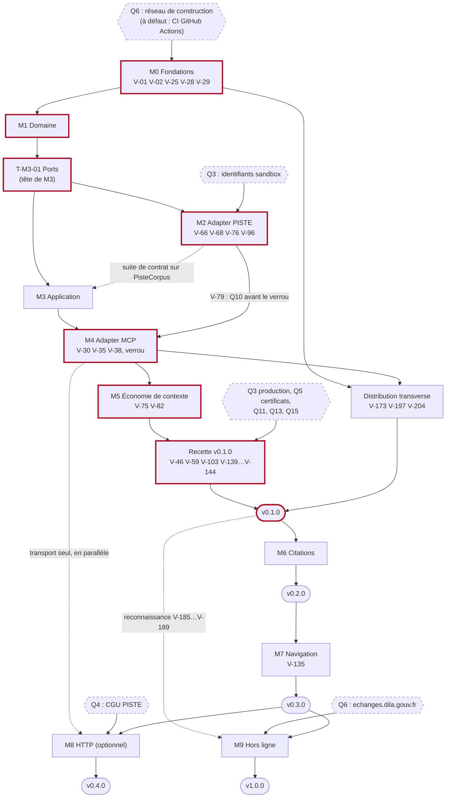

# 07 — Feuille de route : jalons, tâches et critères d'acceptation

> Plan de réécriture en Rust, en architecture hexagonale, du serveur MCP Légifrance (`mcp-legifrance`), cible MCP 2026-07-28 (« MCP v2 ») servie en dual-era par `rmcp =3.5.1`. Ce document ordonne le travail : jalons M0 à M9 et Distribution transverse, tâches `T-Mx-yy` à cocher, critères d'acceptation (définition de terminé de chaque jalon), risques `R-xx` et vérifications `V-xx` à lever pendant chaque jalon.
>
> [00-decisions.md](00-decisions.md) est normatif (révision 2 du 2026-10-15) ; ce document l'applique et ne le modifie pas. Il ne détaille aucun sujet technique : chaque tâche renvoie à la section du document propriétaire qui la spécifie (00 §0). Il crée les identifiants de tâches `T-Mx-yy` annoncés par 00 §0 (`T-MD-yy` pour la Distribution transverse, §0.2), et aucun autre : risques, vérifications et questions sont ceux de [09-risques-et-questions.md](09-risques-et-questions.md), qui fait foi en cas d'écart (09 §0.1).
>
> Rédigé le 2026-10-16, sur le plan dans sa révision 2 du 2026-10-15. « La référence Python » désigne `matematicsolutions/fr-eli-mcp@d3b5b13` (v0.5.3).

Documents liés : [00-decisions.md](00-decisions.md) (normatif : §11 jalons, §13 questions), [01-existant.md](01-existant.md) (§4.16 : clôture des défauts par jalon), [02-architecture.md](02-architecture.md) (crates, dépendances, ports), [03-domaine.md](03-domaine.md) (§11), [04-adapter-piste.md](04-adapter-piste.md) (§13, §15), [05-outils-mcp.md](05-outils-mcp.md) (§9, §11), [06-qualite.md](06-qualite.md) (§7 CI, §13.4 définition de « terminé », §14), [08-distribution.md](08-distribution.md) (§7, §10), [09-risques-et-questions.md](09-risques-et-questions.md) (§2.18 synthèse par jalon, §3 questions, §5 critères), annexes [A](annexes/A-parite.md), [B](annexes/B-citations.md), [C](annexes/C-api-legifrance.md), [D](annexes/D-mcp-2026-07-28.md), [index des ADR](../adr/README.md).

## Sommaire

0. [Mode d'emploi](#0-mode-demploi)
1. [Vue d'ensemble](#1-vue-densemble)
2. [Jalons](#2-jalons) : [M0](#20-m0--fondations), [M1](#21-m1--domaine), [M2](#22-m2--adapter-piste), [M3](#23-m3--application), [M4](#24-m4--adapter-mcp), [M5 et v0.1.0](#25-m5--économie-de-contexte-et-v010), [M6](#26-m6--citations-v020), [M7](#27-m7--navigation-v030), [M8](#28-m8--http-optionnel-v040), [M9](#29-m9--hors-ligne-v100), [Distribution](#210-distribution-transverse)
3. [Ordre conseillé et parallélisation](#3-ordre-conseillé-et-parallélisation)
4. [Suivi](#4-suivi)
5. [Sources](#sources)

---

## 0. Mode d'emploi

### 0.1 Ce que fixe ce document

- **Il fixe** l'ordre des jalons et des tâches, leurs dépendances, le prérequis externe de chacune (réseau, identifiants, question à trancher) et les critères mesurables de clôture de chaque jalon.
- **Il ne fixe pas** le contenu technique : chaque tâche renvoie au document propriétaire (00 §0) ; les noms et chemins de tests sont ceux de 06 §1.4 et §2 ; l'énoncé, le statut et le caractère bloquant des vérifications sont ceux de 09 §2 ; la clôture des défauts `D-xx` suit 06 §3.1 et sa projection 01 §4.16.
- **Synthèse par jalon.** Les tableaux « Risques et vérifications » de chaque jalon reprennent la synthèse de 09 §2.18 (vérifications) et la colonne « Jalons » de 09 §1.1 (risques). En cas d'écart, 09 l'emporte et ce document est corrigé.

### 0.2 Forme d'une tâche

```markdown
- [ ] T-Mx-yy — **Titre court.** Action à réaliser, en une ou deux phrases.\
  Où : crate ou fichiers · Livrable : … · Vérification : test nommé ou critère observable · Spéc. : document §x · Taille : S, M ou L · Après : T-…
```

- **Identifiant.** `T-Mx-yy` : `x` est le numéro du jalon (0 à 9), `yy` un rang à deux chiffres dans le jalon. Les tâches de la Distribution transverse portent `T-MD-yy` (`x` = D). Le rang n'impose pas l'ordre : la mention « Après » donne les dépendances. Un identifiant n'est jamais réutilisé ni renuméroté (§4.5).
- **Taille** (estimation pour une personne ou un agent, hors relecture et hors délais externes : comptes, certificats, réponses aux questions) : **S** ≤ 1 jour ; **M** 2 à 5 jours ; **L** 1 à 2 semaines (au-delà, découper). Les tailles sont recalibrées à la clôture de M0.
- **Terminé.** Une tâche est terminée quand sa vérification est obtenue **et** que la définition de « terminé » commune de 06 §13.4 est satisfaite (tests sur les trois OS, lints, `cargo deny`, `check-deps`, rustdoc, sécurité, CHANGELOG, report des points **NON VÉRIFIÉS** dans 09, revue humaine).
- **Prérequis.** Codes de 09 §2.1 : `N` réseau de construction (Q6), `R` runners de CI, `S` identifiants PISTE sandbox, `P` production, `C` console PISTE, `K` clients MCP installés, `L` navigateur vers legifrance.gouv.fr, `W`/`M` postes Windows 11/macOS réels, `J` relecture juridique, `G` accès Web et GitHub, `A` certificats de signature, `T` clé d'API Anthropic, `D` accès aux dumps DILA.
- **Vérifications.** Un `V-xx` en **gras** est bloquant pour le jalon où il figure (09 §2.18). Une vérification « levée » donne une ligne au journal de 09 §2.20, avec sa preuve.

### 0.3 Décisions adoptées par défaut

Les questions Q1 à Q15 portent chacune une proposition adoptée par défaut (00 §13). Les tâches appliquent cette proposition. **Repli sans réponse** (00 §13) : si l'utilisateur n'a pas répondu à l'ouverture de M0, M0 démarre avec les propositions par défaut de Q1 à Q15, sans attendre ; le dépôt porte déjà son nom définitif (`muchiny/mcp-legifrance`, renommé le 2026-10-16 : volet « dépôt » de Q1 réglé). Une tâche « Trancher… » obtient la réponse de l'utilisateur et la consigne dans 09 §3, puis dans 00 §13 et §14 et dans l'ADR concerné (cycle de vie : [ADR README](../adr/README.md) §2). Une réponse contraire à la proposition modifie les tâches qui en dépendent (§4.5).

---

## 1. Vue d'ensemble

### 1.1 Jalons et versions

| Jalon | Objectif | Version | Prérequis externes | Questions à trancher | Vérifications bloquantes (09 §2.18) | Tâches |
|---|---|---|---|---|---|---|
| M0 Fondations | dépôt compilé et contrôlé en CI, conventions, spikes, verrou initial | — | N (ou CI GitHub), R, G | Q1, Q2, Q6 | **V-01**, **V-02**, **V-25**, **V-28**, **V-29** | 20 |
| M1 Domaine | `lf-domain` v0.1, pur et testé | — | N | Q12 | — | 12 |
| M2 Adapter PISTE | `PisteCorpus` v0.1 et sondes live prioritaires | — | N, S, C | Q3 (sandbox) ; base de Q10 | **V-66**, **V-68**, **V-76**, **V-96** | 23 |
| M3 Application | ports, cas d'usage, `Audited`, `Deadline`, audit, cache, horloge | — | N, R, W | Q9 | — | 9 |
| M4 Adapter MCP | serveur dual-era, 8 outils, binaire, verrou des descripteurs | — | N, K, G | Q7, Q8, Q10, Q14 | **V-30**, **V-35**, **V-38** | 14 |
| M5 Économie de contexte | lecture progressive, pagination, plafond dur, budgets mesurés ; recette et release | **v0.1.0** (M0→M5) | S, P, K, L, T, J + Distribution | Q3 (production), Q5, Q11, Q13, Q15 | **V-75**, **V-82** ; recette : **V-46**, **V-59**, **V-103**, **V-139**, **V-140**, **V-142**, **V-143**, **V-144** | 13 |
| M6 Citations | parseur, `fr_verify_citations`, `fr_resolve`, `list_codes()` | **v0.2.0** | S, J | Q12 (réexamen) | **V-119**, **V-120**, **V-122**, **V-163** | 9 |
| M7 Navigation | `fr_get_related`, `fr_diff_article`, `fr_search_all`, resources, prompts, completions | **v0.3.0** | S, K | Q8 (resources) | **V-135** | 8 |
| M8 HTTP (optionnel) | Streamable HTTP local, puis distant | v0.4.0 | G, K, J | Q4 | **V-42** ; profil partagé : **V-62**, **V-175**, **V-176** | 7 |
| M9 Hors ligne | `lf-adapter-dila`, sélection d'adapter | **v1.0.0** | D, G | Q6 (DILA), Q13 (réexamen) | **V-180**, **V-185**, **V-186**, **V-187** | 6 |
| Distribution (transverse) | binaires, signature, MCPB, OCI, registre MCP, `cargo install --git` | dès v0.1.0 | A, W, M, K, R, G | Q1 (avant publication immuable), Q5, Q13 | **V-173** (si certificat, Q5), **V-197**, **V-204** | 15 |

Versions : SemVer de la surface d'outils de 05 §9.5 (avant 1.0, une rupture ou un ajout fait passer de `0.x` à `0.(x+1).0`). M8 étant optionnel, M9 peut suivre directement v0.3.0. Hors de cette feuille de route : Judilibre (après v0.3.0, V-181 à V-183), fonds JUFI (après v1.0, V-184), canaux supplémentaires (MSI, Homebrew, winget… après v0.1.0, 09 §3.16.3).

### 1.2 Dépendances entre jalons



Légende : les hexagones sont des prérequis externes (questions, accès) ; les nœuds à bord épais forment le chemin critique de la v0.1.0 (§1.3) ; un trait pointillé indique un travail qui peut commencer avant la fin du jalon source, sans en lever la dépendance d'acceptation.

Points à retenir :

- **Ports avant l'adapter.** 00 §11 place les ports en M3, mais `PisteCorpus` les implémente : la tâche T-M3-01 est donc faite dès que les entités de M1 existent (T-M1-05), avant T-M2-09. Le reste de M3 avance en parallèle de M2 sur `FakeCorpus` ; seule la suite de contrat sur `PisteCorpus` (T-M3-05) attend M2.
- **M4 dépend de M2 par une décision**, pas seulement par du code : V-79 (sondée en M2) fonde Q10, tranchée avant le premier verrou des descripteurs (00 §13).
- **M7 suit M6** : `fr_get_related` analyse les liens avec le parseur, et les completions de `code` lisent `list_codes()` (00 §3, §7).
- **M9 implémente toutes les méthodes du port**, dont celles de M6 et M7 (02 §3.9) : il suit v0.3.0, mais la reconnaissance des dumps peut commencer dès v0.1.0 si l'hôte DILA est ouvert.

### 1.3 Chemin critique

Le chemin critique de la v0.1.0 est dicté par des prérequis externes plus que par le volume de code :

1. **Q6, ou la CI comme environnement de compilation** (R-13, score 12). Sans `static.crates.io`, aucune ligne qui dépend d'un crate externe ne compile dans le conteneur (§1.4). Tant que Q6 n'est pas réglée, les agents travaillent par PR et la CI GitHub Actions compile et teste (hypothèse 2 de 09 §4).
2. **Spikes de M0** (T-M0-13, T-M0-14, T-M0-16) : ils lèvent V-28, V-29 et V-02 et figent les signatures de 02, 04 et 05. Un échec (repli `Parameters<T>`, option TLS B) se répercute sur M3, M4 et la Distribution.
3. **M1 puis T-M3-01** (entités, puis ports) : prérequis de tout l'adapter PISTE.
4. **Q3 sandbox puis sondes bloquantes de M2** (T-M2-14 à T-M2-16 : V-66, V-68, V-76, V-96). Une journée en sandbox suffit à la plupart des campagnes (09 §2.18) ; le délai réel est celui de l'obtention des identifiants.
5. **M4** : décisions Q7, Q8, Q10, Q14 avant le verrou (T-M4-10), puis transcriptions sur le binaire (T-M4-08 : V-30, V-35).
6. **M5 puis recette v0.1.0** : V-75 et V-82 en sandbox ; V-59 en production (application PISTE de production, Q3) ; V-139 à V-144 dans un navigateur ; V-46 dans Claude Code ; certificats de signature (Q5, V-173) et MCPB dans Claude Desktop (V-197).

Les deux délais externes les plus longs, l'application PISTE de production et les certificats (Azure Artifact Signing ou SSL.com, compte Apple Developer), se demandent dès M0 (T-M0-01) pour ne pas retarder la release. M3 est quasi critique : il s'exécute en parallèle de M2 mais M4 a besoin de `LegalService`.

### 1.4 Ce qui peut être fait tout de suite

**État constaté le 2026-10-16 depuis le conteneur de développement** (complète 09 §0.3, relevé la veille) :

| Ressource | Résultat | Effet |
|---|---|---|
| index sparse `index.crates.io` | répond ; `pubtime` lisible (rmcp 3.5.1 publié le 2026-10-05 à 18:35 UTC ; aucune version plus récente) | résolution des versions et règle d'âge applicables |
| `static.crates.io` (archives) | refusé (CONNECT 403 du proxy) | aucune archive de crate téléchargeable |
| cache Cargo local (`~/.cargo/registry`) | aucune archive (index seul) | aucun repli `--offline` sur des crates déjà présents |
| `static.rust-lang.org` | refusé | toolchain 1.99.0 non installable : `RUSTUP_TOOLCHAIN=1.97.0` en local (00 §2, Q6) |
| toolchain locale | `rustc` et `cargo` 1.97.0, `clippy` 0.1.97, `rustfmt` 1.9.0 | compilation locale possible pour du code sans dépendance externe |
| `*.piste.gouv.fr` | refusés (`sandbox-oauth.piste.gouv.fr` revérifié ; les quatre hôtes l'étaient en 09 §0.3) | aucune sonde live depuis le conteneur, même avec des identifiants |
| Python | 3.13.16 ; référence Python présente en lecture seule (`/home/user/matematicsolutions/fr-eli-mcp`) | scripts de `docs/plan/annexes/donnees/scripts/` exécutables |
| `git ls-remote` | fonctionne (09 §0.3) | SHA des actions relevables (V-26) |

**Essais faits pour ce document** (projets jetables hors du dépôt, cargo 1.97.0) :

1. `cargo generate-lockfile` sur un projet qui dépend de `thiserror` et `chrono` produit un `Cargo.lock` avec l'index seul ; `cargo update -p thiserror --precise 2.0.20` rétrograde une version. Le verrou initial de M0 et sa règle d'âge (T-M0-05) sont donc faisables depuis le conteneur.
2. Sur ce même projet, `cargo check --offline` et `cargo metadata` échouent (archives absentes). `cargo xtask check-deps`, `cargo deny` et toute compilation qui touche un crate externe sont donc impossibles en local.
3. Dans un workspace de deux membres, l'un sans dépendance et l'autre dépendant de `thiserror`, verrou généré, `cargo test -p <membre sans dépendance> --offline` passe. Un crate **sans aucune dépendance externe** se compile et se teste en local même si d'autres membres du workspace déclarent des dépendances absentes.
4. `golden.py` régénère `parite-golden.json` à l'identique (`cmp`) depuis les fixtures de la référence, `check_golden.py` passe et `dto_repair_check.py` s'exécute ; les empreintes SHA-256 des trois scripts sont celles de 00 §10.

**Conséquence honnête pour `lf-domain`.** Tel que 00 §2 le définit, `lf-domain` dépend de `thiserror`, `chrono` (sans `clock`) et `unicode-normalization` dès M1 : **il ne compile pas dans le conteneur actuel.** Ce qui est possible, c'est une avance facultative (T-M1-12) : `lf-domain` déclare provisoirement des `[dependencies]` vides et ne contient que des modules qui n'ont besoin que de `std`.

| Possible en local, sans dépendance | Attend le réseau (ou la CI) |
|---|---|
| `id` : newtypes à préfixe et `FromStr` strict (sans `VersionedId`) ; `fond`, `status` ; `text::from_html`, `text::clean` (NBSP, `<mark>`, contrôles bidirectionnels), `text::encoding::repair_latin1_mojibake`, fins de phrase, `text::window`, `text::passages`, `LongText` ; construction des URL (`contract/url.rs`) ; parsing d'`Ecli`, `Nor`, `Idcc` | `DomainError` dérivé par `thiserror` (en attendant : `impl Display` et `impl Error` écrits à la main, remplacés ensuite sans changer les messages) ; tout ce qui manipule une `NaiveDate` (`chrono`) : `VersionDate`, `DateRange`, `VersionedId`, `format_fr`, la plupart des entités et des règles de citation datées ; la vue repliée (`unicode-normalization`) donc `text::rank` et la détection du dispositif ; `proptest`, `insta` et `serde_json` en dev-dependencies (tests de propriétés, snapshots, fixtures) ; fuzzing (`cargo-fuzz`, nightly) |

Ce code n'avance pas la clôture de M1 : M1 n'est acceptée qu'en CI, avec les dépendances de 00 §2, les tests de propriétés et la toolchain épinglée (les lints propres à 1.98 et 1.99 ne sont vus qu'en CI, 00 §2).

**Ce qui est faisable selon les conditions réunies :**

| Conditions | Tâches |
|---|---|
| Maintenant, dans le conteneur (ni archives de crates, ni PISTE) | T-M0-01 (décisions, démarches à délai), T-M0-02, T-M0-11, T-M0-12, T-M0-20 ; rédaction, non validée localement, des manifestes et fichiers de T-M0-03, T-M0-04, T-M0-06, T-M0-08, T-M0-09 et T-MD-01, puis, au plus tôt le 2026-10-19, T-M0-05 (verrou par l'index sur ces manifestes, §2.0) ; relevé des SHA de T-M0-10 ; T-M1-06, T-M1-11, T-M1-12 (facultatif) ; T-MD-02 |
| CI GitHub Actions (ou Q6 réglée), sans identifiants PISTE | tout M0 (la poignée de main TLS de V-02 se fait sans jeton) ; tout M1 ; le code et les tests hors ligne de M2 (T-M2-01 à T-M2-13, sur wiremock et fixtures de la référence) ; tout M3 ; M4 sauf T-M4-13 ; M5 sauf T-M5-06 et la partie live de T-M5-10 ; T-MD-01 à T-MD-04 |
| Identifiants sandbox (Q3), depuis `live.yml` ou un poste du mainteneur | T-M2-14 à T-M2-22, T-M4-13, T-M5-06 ; avant que l'outillage Rust existe, la recette shell provisoire de 09 §2.2 (non exécutée, à valider en M2) |
| Production, clients, navigateur, relecture juridique, certificats | T-M5-10, T-M5-11, T-MD-08 à T-MD-10 |

Sans identifiants PISTE, M2 ne peut pas être **accepté** (V-66, V-68, V-76 et V-96 bloquantes), mais M3, M4 et l'essentiel de M5 avancent sur `FakeCorpus` et sur les fixtures de la référence.

---

## 2. Jalons

### 2.0 M0 — Fondations

**Objectif.** Un dépôt dont chaque PR est compilée, testée et contrôlée sous Linux, macOS et Windows ; les conventions en place (lints, licences, règles de dépendance, CHANGELOG, ADR) ; les quatre incertitudes techniques qui conditionnent les signatures du plan levées par des spikes : squelette `rmcp =3.5.1` stdio dual-era, arguments `JsonObject` contre `Parameters<T>`, fournisseur TLS en compilation croisée, `tokio::task_local!` dans `lf-application` ; un verrou initial de `Cargo.lock` conforme à la règle d'âge (00 §2, §11).

**Prérequis.**

- Réseau : `static.crates.io` et `static.rust-lang.org` (Q6), ou à défaut la CI GitHub Actions comme environnement de compilation ; runners Linux, macOS et Windows (R) ; GitHub (G) pour les SHA d'actions.
- Identifiants : aucun. La poignée de main TLS de V-02 vise `https://sandbox-api.piste.gouv.fr/` sans jeton, depuis la CI.
- Questions : Q1 (réponse avant le premier commit de M0, 00 §13), Q2 (premier commit), Q6 (avant M0). Sans réponse à l'ouverture de M0, M0 démarre sous le nom actuel du dépôt avec les propositions par défaut, et le renommage éventuel suit (§0.3, T-M0-02) ; pour Q6, la CI GitHub Actions sert d'environnement de compilation (§1.3). Q5 n'est pas un critère de sortie de M0 : aucune ligne de signature active (08 §10).
- Dates de la règle d'âge (pubtime de l'index sparse, relevé le 2026-10-16). Les versions citées par le plan sont des **versions de référence**, pas des planchers (00 §2) : `[workspace.dependencies]` écrit l'exigence au niveau mineur (`tokio = "1.53"`…), sauf `rmcp` et `rmcp-macros`, épinglés `"=3.5.1"`. `rmcp` et `rmcp-macros` 3.5.1 (2026-10-05) deviennent éligibles le 2026-10-19 : le verrou initial (T-M0-05) n'est pas fait avant cette date, mais les spikes peuvent commencer avant (00 §2, §11). Pour chaque crate, transitifs compris, le verrou retient la **plus haute version publiée depuis au moins 14 jours** à sa date, et non le correctif précédent ; si aucune version de la série mineure n'est éligible, l'exigence descend d'une version mineure et c'est elle qui est écrite. Les versions de référence marquées ⚠ dans 02 §3.0.1, avec ce que retient un verrou fait le 2026-10-19 :

| Crate | Version de référence (pubtime) | Éligible le | Retenue par un verrou du 2026-10-19 |
|---|---|---|---|
| `rmcp`, `rmcp-macros` | 3.5.1 (2026-10-05) | 2026-10-19 | 3.5.1 (`"=3.5.1"`) |
| `insta` (dev) | 1.49.0 (2026-10-03) | 2026-10-17 | 1.49.0 |
| `jsonschema` | 0.58.6 (2026-10-06) | 2026-10-20 | 0.58.5 (2026-10-02) |
| `tokio-util` | 0.7.20 (2026-10-09) | 2026-10-23 | 0.7.19 (2026-07-21) |
| `proptest` (dev) | 1.12.0 (2026-10-10), seule version de la série 1.12 | 2026-10-24 | 1.11.0 (2026-03-24, MSRV 1.85), exigence écrite `"1.11"` |
| `serde_json` | 1.0.154 (2026-10-11) | 2026-10-25 | 1.0.151 (2026-07-20) : 1.0.152 (2026-10-10) et 1.0.153 (2026-10-11) sont trop récents eux aussi |
| `schemars` | 1.2.3 (2026-10-12) | 2026-10-26 | 1.2.2 (2026-07-27) ; `unused_qualifications` reste désactivé (R-22) |
| `sha2` | 0.11.1 (2026-10-12) | 2026-10-26 | 0.11.0 (2026-03-25, MSRV 1.85) |
| `aws-lc-rs` (transitif, option TLS A) | 1.18.2 (2026-10-12) | 2026-10-26 | 1.18.1 (2026-09-01) |
| `tokio` | 1.53.3 (2026-10-13) | 2026-10-27 | 1.53.2 (2026-10-03, éligible le 2026-10-17) |
| `rustls` (dépendance directe en option TLS B seulement) | 0.23.46 (2026-10-14) | 2026-10-28 | 0.23.45 (2026-09-14) |

Ce tableau vaut pour un verrou du 2026-10-19 ; un verrou plus tardif est recalculé par le script de T-M0-05 à sa propre date. Une dépendance ajoutée après le verrou initial (spikes, jalons suivants) suit la même règle à la date de sa PR (06 §9.4).

**Tâches.**

- [ ] T-M0-01 — **Trancher ou confirmer Q1, Q2 et Q6 ; ouvrir les démarches à délai.** Obtenir du propriétaire une réponse datée, ou la confirmation de la proposition adoptée par défaut ; sans réponse à l'ouverture de M0, consigner en 09 §3 que M0 démarre sous le nom actuel avec les propositions par défaut (§0.3), sans bloquer les autres tâches ; traiter V-215 (marque « Légifrance ») avant le choix du nom et V-214 (titulaire des droits de la référence) avant `NOTICE` ; demander dès maintenant l'application PISTE sandbox puis celle de production (Q3), l'éligibilité à Azure Artifact Signing ou un certificat SSL.com, et un compte Apple Developer (Q5).\
  Où : 09 §3.1, §3.2, §3.6 ; 00 §13, §14 · Livrable : réponses consignées et répercutées (09 §3) · Vérification : première case de 09 §5 M0 cochée · Spéc. : 00 §13 ; 08 §9.1, §9.6 · Taille : S

- [ ] T-M0-02 — **Finaliser le renommage du dépôt.** Le dépôt `muchiny/mcp-ligitfrance` a été renommé en `muchiny/mcp-legifrance` le 2026-10-16 et les URL du plan sont déjà à jour (00 §0, §13). Reste : mettre à jour le remote des clones (`git remote set-url origin https://github.com/muchiny/mcp-legifrance.git`), vérifier la redirection de l'ancienne URL et porter le nouveau nom dans `repository` de `[workspace.package]` dès sa création.\
  Où : GitHub, clones locaux, `README.md`, `Cargo.toml` · Livrable : remotes à jour, redirection vérifiée · Vérification : plus aucune occurrence de l'ancien nom hors mentions historiques · Spéc. : 00 §1, §8, §12 ; 02 §2 · Taille : S · Après : T-M0-01

- [ ] T-M0-03 — **Racine du workspace.** `Cargo.toml` virtuel (`resolver = "3"` explicite, `members` en liste, `[workspace.package]`, `[workspace.dependencies]` aux exigences de niveau mineur des versions de référence de 02 §3.0.1 (`tokio = "1.53"`, `schemars = "1.2"`, `serde_json = "1.0"`, `reqwest = "0.13"`…), sauf `rmcp` et `rmcp-macros` épinglés `"=3.5.1"`, avec `default-features = false` déclaré au niveau du workspace quand c'est voulu, `[workspace.lints]` dont `unsafe_code = "forbid"`, `[profile.release]`), `rust-toolchain.toml` (1.99.0, `rustfmt`, `clippy`), `rustfmt.toml`, `clippy.toml` (`disallowed-methods`), `.cargo/config.toml` (alias `xtask`), `.config/nextest.toml`, `.gitattributes`, `.gitignore`.\
  Où : racine du dépôt · Livrable : fichiers de 02 §2.2 · Vérification : `cargo metadata --locked` sans erreur en CI ; `cargo clippy` sans avertissement de clé inconnue (V-14) · Spéc. : 00 §2 ; 02 §2.2, §3.0.2, §3.0.3 ; 06 §7.3, §8.1 à §8.3 · Taille : M

- [ ] T-M0-04 — **Squelettes des sept crates et de `xtask`.** Créer `lf-domain`, `lf-application`, `lf-adapter-piste`, `lf-adapter-cache`, `lf-adapter-audit`, `lf-adapter-mcp`, `crates/lf-app` (paquet `mcp-legifrance`, seul `[[bin]]`) et `xtask` (`publish = false`), avec `[lints] workspace = true` et sans dépendance déclarée d'avance : un crate ne déclare une dépendance (`x = { workspace = true, features = [...] }`) que lorsqu'un code l'emploie, pour que `cargo machete` reste vert (00 §2 ; 02 §3.0.2) ; les listes « Dépendances » de 02 §3.1 à §3.8 décrivent la cible, atteinte au fil des tâches (spikes de M0, puis jalons suivants). Seule exception : `rmcp-macros`, déclaré dans `lf-adapter-mcp` pour son épinglage sans emploi direct et ignoré par `cargo machete` (`[package.metadata.cargo-machete] ignored`, 02 §3.0.1). Corriger chaque extrait « non compilé » qui échoue dans le document qui le porte.\
  Où : `crates/*`, `xtask/` · Livrable : workspace compilable · Vérification : **V-01** levée : `cargo check --workspace --all-targets`, `cargo clippy --workspace --all-targets -- -D warnings` et `cargo test --workspace` verts en CI ; `cargo check -p lf-domain` seul vert (02 §4.4) ; `cargo machete` vert · Spéc. : 00 §2 ; 02 §2.1, §3.1 à §3.8 · Taille : M · Après : T-M0-03

- [ ] T-M0-05 — **Verrou initial de `Cargo.lock` (règle d'âge).** Au plus tôt le 2026-10-19, date d'éligibilité de `rmcp`/`rmcp-macros` 3.5.1 (00 §2) ; aucun `Cargo.lock` n'est fusionné dans `main` avant cette date, mais les spikes peuvent commencer. Générer le verrou sur les exigences de niveau mineur de T-M0-03 ; relever par script le `pubtime` de chaque version dans l'index sparse ; fixer chaque crate, transitifs compris, à la plus haute version publiée depuis au moins 14 jours à la date du verrou (`cargo update -p <crate> --precise <version>` ; tableau du §2.0 pour un verrou du 2026-10-19) ; si aucune version de la série mineure n'est éligible, descendre l'exigence d'une version mineure et l'écrire dans `[workspace.dependencies]` (`proptest = "1.11"` avant le 2026-10-24) ; `rmcp`/`rmcp-macros` restent `"=3.5.1"`, éligibles à cette date ; laisser `unused_qualifications` désactivé si le `schemars` retenu est antérieur à 1.2.3 (R-22) ; écrire `.github/scripts/check-min-age.sh`. Le verrou couvre les dépendances déclarées à sa date (T-M0-04) ; chaque dépendance ajoutée ensuite, par les spikes T-M0-13 à T-M0-17 ou par les jalons suivants, suit la même règle à la date de sa PR. Faisable depuis le conteneur actuel (§1.4).\
  Où : `Cargo.lock`, `.github/scripts/check-min-age.sh` · Livrable : verrou versionné et script · Vérification : `check-min-age.sh` vert sur le verrou (étape `min-age` du job `deny`) ; la PR liste, pour chaque crate, la version retenue et son `pubtime`, ainsi que chaque exigence descendue d'une version mineure · Spéc. : 00 §2 ; 02 §3.0.1 ; 06 §9.4 · Taille : S · Après : T-M0-04

- [ ] T-M0-06 — **cargo-deny et licences.** `deny.toml` (avis refusés, licences en liste blanche compatible Apache-2.0, bans `wrappers`, `openssl-sys` et `native-tls` refusés, sources crates.io seulement) ; inventaire versionné des licences du graphe (`cargo deny list -l crate`) ; `about.toml`, `about.hbs`, `THIRD_PARTY_LICENSES.md` généré.\
  Où : `deny.toml`, `about.*`, `THIRD_PARTY_LICENSES.md`, 06 §9.2 · Livrable : configuration et inventaire · Vérification : V-24 (aucune clé rejetée par cargo-deny 0.20.2) ; **V-25** levée (dont `option-ext`, `aws-lc-sys`, `ring`, racines de certificats, données Unicode) ; `cargo deny --all-features check` vert · Spéc. : 02 §4.3 ; 06 §9.1 à §9.3 ; 08 §9.3 · Taille : M · Après : T-M0-05, T-M0-16 (licences du fournisseur TLS retenu)

- [ ] T-M0-07 — **`cargo xtask check-deps`.** Moteur pur `check(&Metadata, &[CrateRule]) -> Vec<Violation>` et règles R1 à R9 en données (`xtask/src/rules.rs`), dont `features_max` (`tokio` ⊆ {`time`, `macros`, `rt`} pour `lf-application` ; `chrono` sans `clock` ni `now` pour `lf-domain`), fermeture transitive, contrôles de manifeste, épinglage `=3.5.1`, doublons critiques (R9).\
  Où : `xtask/src/check_deps.rs`, `xtask/src/rules.rs` · Livrable : commande et tests · Vérification : `check_deps_detects_each_rule` (au moins une violation synthétique par règle), `check_deps_reports_transitive_path` ; commande verte sur le workspace · Spéc. : 00 §2 ; 02 §4.1, §4.2 ; 06 §2.8, §9.3 · Taille : M · Après : T-M0-04

- [ ] T-M0-08 — **CI `ci.yml` et protection de branche.** Jobs requis de 06 §7.1 disponibles en M0 : `fmt`, `clippy` (toutes features, puis sans features par défaut), `test` sous Linux, macOS et Windows (`--locked --offline`, proxys en échec), `msrv` (1.91), `deny` (+ `min-age`), `architecture` (`check-deps`, `cargo check -p lf-domain`, `cargo check -p lf-application`, `cargo machete`, vert dès M0 grâce à la règle de déclaration à l'usage de T-M0-04), `docs` ; jobs de nuit `extended`, `fuzz`, `coverage` (non bloquants) ; `main` protégée par les jobs requis.\
  Où : `.github/workflows/ci.yml`, réglages du dépôt · Livrable : workflow et protection de branche · Vérification : une PR d'essai qui viole chaque job échoue sur ce job ; durées comparées aux cibles de 06 §7.1 · Spéc. : 00 §10 ; 06 §7.1, §7.2, §7.4, §7.6 · Taille : L · Après : T-M0-04, T-M0-07

- [ ] T-M0-09 — **Outils de test en CI.** Profils nextest `default`, `ci` et `live` (V-21 : `default-filter`, `junit`, `test-groups`, `--run-ignored only`, doc-tests non exécutés par nextest) ; comportement d'insta en CI (V-22 : aucun `.snap.new` écrit, `--unreferenced=reject`) ; isolation réseau `unshare -rn` sur `ubuntu-24.04` (V-23, repli `--offline` seul).\
  Où : `.config/nextest.toml`, `ci.yml` · Livrable : configuration éprouvée · Vérification : V-21, V-22 et V-23 levées ou contournées (journal 09 §2.20) · Spéc. : 06 §1.3, §5.1, §7.3, §7.4 · Taille : S · Après : T-M0-08

- [ ] T-M0-10 — **Chaîne d'approvisionnement de la CI.** Épingler chaque `uses:` par SHA complet, version en commentaire (V-26, `git ls-remote --tags`) ; job `workflow-lint` (zizmor et actionlint épinglés, V-27) ; `.github/dependabot.yml` (`cargo` et `github-actions`, `rmcp` et `rmcp-macros` ignorés) ; modèle de PR de 06 §13.1.\
  Où : `.github/` · Livrable : workflows épinglés, `dependabot.yml`, `pull_request_template.md` · Vérification : `workflow-lint` vert, et rouge sur une action non épinglée (partie CI de D-44) · Spéc. : 02 §2.2 ; 06 §7.1, §9.4, §13.1 · Taille : S · Après : T-M0-08

- [ ] T-M0-11 — **Documents du dépôt.** `LICENSE` (Apache-2.0, Q2) ; `NOTICE` (référence Python et fixtures reprises, données « Légifrance / DILA » sous Licence Ouverte 2.0, titulaire selon V-214) ; `CONTRIBUTING.md` (règles de dépendance, commandes `cargo xtask`, verrou des descripteurs, tests live, montée de rmcp, règle d'âge, langue anglaise du rustdoc) ; `SECURITY.md` ; `PRIVACY.md` ; `CHANGELOG.md` avec une section `Unreleased` (D-43) ; README minimal avec la mention de non-affiliation. Rédaction faisable depuis le conteneur actuel.\
  Où : racine du dépôt · Livrable : sept fichiers · Vérification : relecture humaine ; cases correspondantes de 06 §14 M0 et 08 §10 M0 cochées · Spéc. : 00 §11, §12 ; 02 §2.2 ; 06 §10.3, §13.3 ; 08 §9.1, §9.2, §9.6, §9.8 · Taille : M · Après : T-M0-01

- [ ] T-M0-12 — **ADR et alignements du plan.** Vérifier que l'index des ADR liste ADR-0001 à ADR-0014 avec leur statut (0001 à 0012 acceptés, 0013 et 0014 proposés) ; rappeler dans `CONTRIBUTING.md` que, dès l'ouverture de M0, aucun ADR accepté n'est plus révisé en place ([ADR README](../adr/README.md) §2) ; vérifier et fermer les alignements « M0 » de 09 §3.16.2 ; remplacer les étiquettes `[v:…]`, alias compris, par les `V-xx` de l'index de 09 §2.19 dans `docs/plan/` et `docs/adr/` (09 §0.1).\
  Où : `docs/adr/`, `docs/plan/` · Livrable : PR documentaire · Vérification : plus aucune ligne « M0 » ouverte en 09 §3.16.2 ; hors de 09, plus aucune étiquette alias · Spéc. : 09 §0.1, §2.19, §3.16.2 · Taille : S

- [ ] T-M0-13 — **Spike rmcp 3.5.1 stdio dual-era.** Compiler le squelette de 05 §3.2 avec `rmcp =3.5.1` (features par défaut + `transport-io`) : `supported_protocol_versions()` explicite, surcharge de `discover`, `accepted_subscription_filter`, `PreLifecycleFilter` autour d'`AsyncRwTransport::new_server`, `call_tool` écrit à la main (moyen de V-32), outil `fr_coverage` factice ; rejouer en processus, sur `duplex`, les transcriptions `modern_discover`, `legacy_2025_11_25`, `premature_notification` et `mrtr_fields_tolerated` ; mesurer le bruit de `clippy::pedantic` et la compatibilité des macros avec `unsafe_code = "forbid"` (V-15).\
  Où : `crates/lf-adapter-mcp` (`server.rs`, `stdio.rs`, `tests/protocol_raw.rs`), `tests/jsonrpc/*.jsonl` · Livrable : squelette, exécuteur de transcriptions, quatre transcriptions versionnées · Vérification : **V-29** et V-31 levées, V-30 partielle (en processus), moyen de V-32 confirmé ou écart noté, V-15 tranchée (repli : `deny` dans `lf-adapter-mcp`) · Spéc. : 00 §6 ; 05 §3.2, §3.6 ; annexe D §3.2, §4.3, §5.3, §8.4 ; 06 §6.1 · Taille : L · Après : T-M0-04

- [ ] T-M0-14 — **Spike `JsonObject` contre `Parameters<T>`.** Sur `fr_search` : arguments reçus en `JsonObject`, `input_schema` explicite (`schema_for_input::<P>()`), retour `Json<T>` dans un `Result`, décodage par `serde_path_to_error` sous un décorateur d'audit minimal (`MemoryAuditLog`). En cas d'échec, repli `Parameters<T>` acté par un nouvel ADR qui remplace la partie concernée d'ADR-0008, accepté avant la fusion du repli (00 §5).\
  Où : `crates/lf-adapter-mcp` (`params.rs`, `decode.rs`) · Livrable : outil d'essai et test · Vérification : **V-28** levée : `tools/list` contient l'`inputSchema` écrit et l'`outputSchema` dérivé ; `tools/call` avec `{"page_size":"x"}` rend `[invalid_arg] page_size: …` (`isError: true`) et une ligne d'audit · Spéc. : 00 §5 ; 02 §3.6 ; 05 §3.3 ; ADR-0008 · Taille : M · Après : T-M0-13

- [ ] T-M0-15 — **Spike `Deadline` en variable locale de tâche.** `tokio::task_local!` dans `lf_application::deadline`, avec `time`, `macros` et `rt` pour seules features de tokio ; lecture depuis `lf-adapter-piste` (`Deadline::current_or(défaut)`, convertie en durée restante dans l'horloge de l'adapter).\
  Où : `crates/lf-application/src/deadline.rs`, `crates/lf-adapter-piste/src/deadline.rs` · Livrable : module et test · Vérification : test `start_paused` qui publie une échéance et la lit depuis l'adapter ; `check-deps` rouge si `lf-application` active une autre feature de tokio · Spéc. : 00 §3, §11 ; 02 §3.2, §10 ; 04 §5.3, §15 M0 ; ADR-0012 · Taille : S · Après : T-M0-04

- [ ] T-M0-16 — **Spike TLS : aws-lc (option A) contre ring (option B) en compilation croisée.** Construire les deux options par `dist` pour les 7 cibles de 00 §12 (`pr-run-mode = "upload"` temporaire) ; requête `GET https://sandbox-api.piste.gouv.fr/` sans jeton (attendu : un statut HTTP, aucune erreur TLS) ; pour B, test « fournisseur installé avant le premier client » (`install_default()`) ; relever la taille des artefacts ; consigner le choix dans ADR-0013 (qui reste « Proposé » jusqu'à Q1, Q5 et Q13) et dans 09.\
  Où : `crates/lf-adapter-piste` (features de reqwest), `dist-workspace.toml`, ADR-0013 · Livrable : matrice cibles × options, choix A ou B · Vérification : **V-02** levée ; V-18 mesurée (taille des binaires) ; licences du fournisseur retenu ajoutées à V-25 · Spéc. : 00 §8, §12 ; 04 §1.4, §4.1, §15 M0 ; 08 §2.4, §10 M0 · Taille : L · Après : T-M0-04, T-MD-01

- [ ] T-M0-17 — **Spikes d'API des dépendances.** Compiler et tester : `HTTPS_PROXY`/`NO_PROXY` avec les features retenues de reqwest (V-03) ; les deux vecteurs d'empreinte de 06 §2.8 avec `sha2` 0.11 (V-05) ; l'esquisse de réessai de 04 §5.2 avec backon 1.6 (V-06) ; `RateLimiter::direct_with_clock` avec `FakeRelativeClock` (V-07) ; refus de `chrono::Utc::now()` par `disallowed-methods` (V-13).\
  Où : tests unitaires des crates concernés · Livrable : tests conservés · Vérification : V-03, V-05, V-06, V-07 et V-13 levées ou contournées (journal 09 §2.20) · Spéc. : 02 §2.2, §3.0.1 ; 04 §5.2, §5.4 ; 06 §2.8 · Taille : M · Après : T-M0-04

- [ ] T-M0-18 — **Mesure préliminaire des descripteurs.** Sur les outils du spike (`fr_search`, `fr_coverage`), mesurer en octets le `tools/list` produit par schemars : `inputSchema` écrit, `outputSchema` dérivé, présence de `$defs`, absence de `$schema` ; comparer à l'estimation de 05 §6.6. Mesure non bloquante : la mesure complète et le recalibrage de `descriptor_size_budget` ont lieu en M4 (T-M4-11).\
  Où : `crates/lf-adapter-mcp/tests/descriptors.rs` (test provisoire) · Livrable : mesure notée dans la PR et dans 05 §6.6 · Vérification : écart chiffré à l'estimation ; leviers de 05 §6.6 planifiés si un dépassement s'annonce · Spéc. : 05 §2.5, §6.6 ; 06 §12.2 · Taille : S · Après : T-M0-14

- [ ] T-M0-19 — **Toolchain épinglée.** Confirmer la date de sortie de Rust 1.99.0 et sa conformité à la règle d'âge (V-16) ; installer la toolchain en CI ; documenter `RUSTUP_TOOLCHAIN=1.97.0` en local tant que Q6 n'est pas réglée.\
  Où : `rust-toolchain.toml`, `CONTRIBUTING.md` · Livrable : épinglage confirmé, ou ajusté et noté dans 02 §2.2 · Vérification : V-16 levée ; jobs principaux (1.99.0) et `msrv` (1.91) verts · Spéc. : 00 §2 ; 02 §2.2 · Taille : S · Après : T-M0-03

- [ ] T-M0-20 — **Données du plan reproductibles.** Vérifier les empreintes SHA-256 de `golden.py`, `check_golden.py` et `dto_repair_check.py` (00 §10) ; régénérer le golden depuis les fixtures de la référence (`python3 -I golden.py <fixtures> <sortie>`), le comparer au fichier versionné, puis exécuter `check_golden.py` et `dto_repair_check.py`. Faisable depuis le conteneur actuel (essai concluant du 2026-10-16, §1.4).\
  Où : [annexes/donnees/scripts/](annexes/donnees/scripts/) · Livrable : compte rendu dans la PR · Vérification : empreintes égales à 00 §10 ; `cmp` sans différence ; `check_golden.py` sans erreur · Spéc. : 00 §10 ; annexe A §5 ; 06 §3.2 · Taille : S

**Critères d'acceptation (définition de terminé de M0).**

- [ ] Sur une PR, les jobs requis disponibles en M0 (`fmt`, `clippy`, `test` sous les trois OS, `msrv`, `deny`, `architecture`, `docs`, `workflow-lint`) sont verts et exigés par la protection de `main`.
- [ ] V-01, V-02, V-25, V-28 et V-29 sont levées, avec une ligne au journal de 09 §2.20 ; V-18 (taille des binaires) est mesurée ; les 22 autres vérifications de M0 de 09 §2.18 sont levées ou ont un statut explicite (`partiel`, `contourné`).
- [ ] Les quatre transcriptions du spike passent en processus ; un argument mal typé rend `[invalid_arg]` audité.
- [ ] `check-min-age.sh` est vert : toute version de `Cargo.lock` a au moins 14 jours au verrouillage, `rmcp`/`rmcp-macros` 3.5.1 compris (verrou fait au plus tôt le 2026-10-19) ; chaque crate est à la plus haute version éligible à la date du verrou ; les exigences de `[workspace.dependencies]` sont au niveau mineur, sauf `rmcp`/`rmcp-macros` `"=3.5.1"`.
- [ ] `cargo machete` est vert : chaque crate ne déclare que les dépendances que son code emploie, seule exception `rmcp-macros` (02 §3.0.1).
- [ ] `cargo xtask check-deps` est vert sur le workspace et détecte chacune des règles R1 à R9 sur des métadonnées synthétiques.
- [ ] `LICENSE`, `NOTICE`, `CONTRIBUTING.md`, `SECURITY.md`, `PRIVACY.md` et `CHANGELOG.md` (`Unreleased`) sont versionnés ; Q1, Q2 et Q6 ont une réponse consignée en 09 §3, ou leur proposition par défaut est confirmée ou, faute de réponse, appliquée et consignée comme telle (§0.3) ; le nom du dépôt (renommé ou actuel) est consigné.
- [ ] Le choix TLS est consigné dans ADR-0013 ; si V-28 a échoué, l'ADR du repli `Parameters<T>` est accepté.
- [ ] D-36 est clos (01 §4.16) ; les cases de 04 §15 M0, 06 §14 M0, 08 §10 M0 et 09 §5 M0 sont cochées ; les alignements « M0 » de 09 §3.16.2 sont fermés.

**Risques et vérifications.**

| Risque (score) | Ce que fait M0 |
|---|---|
| R-13 Accès réseau (12) | traité avant le jalon : Q6, ou CI GitHub Actions comme environnement de compilation (T-M0-01, T-M0-08) ; jamais de contournement du proxy |
| R-01 Instabilité de l'API rmcp (6) | `=3.5.1`, dependabot qui ignore rmcp, transcriptions qui figent le comportement (T-M0-10, T-M0-13) |
| R-02 Bugs de rmcp 3.5.1 (6) | `PreLifecycleFilter` et transcriptions dès le spike (T-M0-13) |
| R-09 TLS en compilation croisée (4) | spike A/B sur les 7 cibles (T-M0-16) |
| R-22 Chaîne d'approvisionnement (4) | règle d'âge, `check-min-age.sh`, cargo-deny, SHA épinglés (T-M0-05, T-M0-06, T-M0-10) |
| R-25 Mainteneur unique et agents (4, tous jalons) | modèle de PR, relecture humaine de toute PR d'agent (T-M0-10, §3.4) |
| R-26 Contamination de licence (3) | inventaire des licences, `NOTICE`, aucune ligne AGPL (T-M0-06, T-M0-11) |
| R-30 Nom du produit (4) | Q1 et V-215 avant toute publication immuable (T-M0-01) |

| Tâche | Vérifications de M0 (09 §2.18 ; bloquantes en gras) |
|---|---|
| T-M0-01, T-M0-11 | V-214, V-215 |
| T-M0-03 | V-14 |
| T-M0-04 | **V-01** |
| T-M0-06 | V-24, **V-25** |
| T-M0-09 | V-21, V-22, V-23 |
| T-M0-10 | V-26, V-27 |
| T-M0-13 | V-15, **V-29**, V-30 (partielle ; bloquante en M4), V-31, V-32 |
| T-M0-14 | **V-28** |
| T-M0-16 | **V-02**, V-18 (taille ; mémoire en M5) |
| T-M0-17 | V-03, V-05, V-06, V-07, V-13 |
| T-M0-19 | V-16 |
| T-MD-01 | V-169, V-170 |

### 2.1 M1 — Domaine

**Objectif.** `lf-domain` complet pour la v0.1 (00 §4) : identifiants typés, fonds, entités, contrat de citation v2, URL Légifrance, dates civiles, traitement du texte. Le crate est pur (ni E/S, ni async, ni serde), sans panique, testé par propriétés et fuzzé.

**Prérequis.** M0 (crate, lints, CI). Réseau N (`thiserror`, `chrono`, `unicode-normalization`) ; à défaut, avance facultative sans dépendance (T-M1-12, §1.4). Aucun identifiant PISTE. Q12 tranchée ou confirmée **avant** la génération des golden de citation.

**Tâches.**

- [ ] T-M1-01 — **Identifiants.** Dix newtypes à préfixe de 8 lettres + 12 chiffres et `FromStr` strict, `VersionedId` (suffixe `_JJ-MM-AAAA` admis en entrée sur `LEGITEXT` seulement, retiré avec diagnostic sur les autres préfixes venus de l'amont), `ArticleId`, `DecisionId`, `DocumentId`, `SectionId`, `id::parse_param` et messages `invalid_arg` actionnables.\
  Où : `crates/lf-domain/src/id/`, `tests/ids.rs` · Livrable : module `id` · Vérification : `id_parse_roundtrip` (proptest), messages de 03 §2.7 · Spéc. : 00 §4 ; 03 §2 · Taille : M · Après : T-M1-03 (pour `VersionedId`)

- [ ] T-M1-02 — **Fonds et statuts.** `Fond` (8 variantes ↔ fonds de l'API ; `Jorf` réservé à M7), `PaginationMode`, `LegalStatus` (17 codes + `Other`), lecture tolérante du paramètre `fond` (P-010).\
  Où : `fond.rs`, `status.rs` · Livrable : types et correspondances · Vérification : tests table-driven ; correspondance avec l'annexe C §3.2 · Spéc. : 03 §3 · Taille : S

- [ ] T-M1-03 — **Dates.** `VersionDate` (1500-01-01 à 2221-12-31), `DateRange`, `from_epoch_ms` (epoch négatifs, 1804), `open_ended` (toute date ≥ 2222-01-01 → `None`), `format_fr` (mois accentués, « 1er ») ; graine de proptest documentée (V-20) ; comportement de la référence sous Windows avant 1970 (V-191).\
  Où : `date.rs`, `tests/dates.rs` · Livrable : module `date` · Vérification : `pre_1970_dates_roundtrip`, `version_date_roundtrip`, verts aussi sous Windows · Spéc. : 00 §4 ; 03 §6 ; ADR-0011 · Taille : M

- [ ] T-M1-04 — **Requête de recherche.** `SearchQuery::new` et ses rejets sans réseau (`version_date` hors LODA/CODE, dates sur CODE, `date_from` > `date_to`, `page × page_size` > 10 000), `QueryText` (≤ 500 caractères, nettoyage, D-32), `MatchMode` (défaut `any`, Q10), `PageSize`, `REACHABLE_RESULTS`, `has_more` borné.\
  Où : `search.rs` · Livrable : types bornés · Vérification : tests de 06 §2.1 ; partie domaine de D-32 · Spéc. : 00 §7 ; 03 §4.1 ; ADR-0014 · Taille : M · Après : T-M1-02, T-M1-03

- [ ] T-M1-05 — **Entités.** `SearchHit` (avec `idcc`), `SearchPage` (avec `total_articles`), `Act`, `TocNode`, `Toc::build` (ordre `intOrdre`, dédoublonnage, profondeur ≤ 64) et `Toc::page`, `ArticleText`, `Decision`, `Deliberation`, `Convention`, `CompanyAgreement`, `Coverage` (+ `PisteEnvironment`, lacunes jamais vides), `LongText`.\
  Où : `entity/` · Livrable : entités et invariants de 03 §1.4 · Vérification : tests de constructeurs, `coverage_invariants_ported`, modèle de TOC (partie domaine de D-25) · Spéc. : 00 §4 ; 03 §4 · Taille : L · Après : T-M1-01, T-M1-03

- [ ] T-M1-06 — **Trancher ou confirmer Q12** (formes de citation complémentaires) avant la génération des golden.\
  Où : 09 §3.12 ; 00 §13, §14 ; ADR-0009 · Livrable : réponse datée · Vérification : case de 09 §5 M1 cochée · Spéc. : 00 §4 ; 03 §11 (questions 1, 2 et 5) · Taille : S

- [ ] T-M1-07 — **Contrat de citation v2 et URL.** `CitationContract`, `SourceUrl` (12 kinds ; `/loda/article_lc/` pour un article de texte non codifié, `/codes/article_lc/` pour un code ou une nature inconnue), `Ecli` (jamais fabriqué), `Eli`, `Nor`, `Idcc` ; règles de citation par famille (formats corrigés et complémentaires) ; tests golden ; divergences de 03 §5.6 reportées dans l'annexe A.\
  Où : `contract/`, `tests/contract.rs` · Livrable : contrat et règles · Vérification : golden de citation verts ; D-27 clos · Spéc. : 00 §4 ; 03 §5 ; ADR-0009 ; annexe A §4.2 · Taille : L · Après : T-M1-05, T-M1-06

- [ ] T-M1-08 — **Texte (1/2) : HTML, nettoyage, mojibake.** `text::from_html` (scanner tolérant écrit à la main, linéaire, sans récursion non bornée), `text::clean` (`<mark>`, espaces, NBSP après réparation ; contrôles bidirectionnels U+202A–U+202E et U+2066–U+2069 retirés et comptés), `text::encoding::repair_latin1_mojibake` (tout-ou-rien), choix `texteHtml`/`texte`, `LongText`.\
  Où : `text/html.rs`, `clean.rs`, `encoding.rs`, `long_text.rs` · Livrable : modules · Vérification : `from_html_never_panics_and_preserves_text`, `clean_is_idempotent`, `repair_mojibake_inverts_latin1_misdecoding` ; partie domaine de D-26 · Spéc. : 00 §4, §8 ; 03 §7.1 à §7.5 ; 04 §10.2 · Taille : M

- [ ] T-M1-09 — **Texte (2/2) : fenêtre, passages, BM25, résumé.** Vue repliée (`unicode-normalization`), fins de phrase, `text::window` (garanties G1 à G7), `text::passages`, `text::rank` (BM25, mots vides français), `text::summary` (sommaire officiel, dispositif, `lead` d'au moins 600 caractères ; résumé ≤ min(`max_chars`, 1 200)).\
  Où : `text/fold.rs`, `sentence.rs`, `window.rs`, `passages.rs`, `rank.rs`, `summary.rs` · Livrable : modules · Vérification : `window_guarantees_g1_to_g7`, `paged_reading_reconstructs_full_text`, `window_offsets_are_char_based`, `rank_is_deterministic_and_within_budget` · Spéc. : 00 §4, §7 ; 03 §7.6 à §7.9 · Taille : L · Après : T-M1-08

- [ ] T-M1-10 — **Fuzzing du domaine.** Cibles `from_html`, `clean`, `ids` et `version_date` dans `fuzz/` (hors workspace) ; branchement sur le job nocturne `fuzz`.\
  Où : `fuzz/fuzz_targets/` · Livrable : cibles · Vérification : 120 s par cible sans panique · Spéc. : 06 §1.4, §7.1 · Taille : S · Après : T-M1-01, T-M1-03, T-M1-08

- [ ] T-M1-11 — **Préparer la recette des URL.** Pour chaque motif de 03 §5.5, produire la liste des URL générées sur les identifiants des fixtures, à ouvrir dans un navigateur pendant la recette v0.1.0 (V-139, avec V-140, V-141, V-143 et V-144).\
  Où : liste jointe à la PR et référencée dans 09 · Livrable : liste par motif (12 kinds) · Vérification : chaque kind couvert par au moins une URL · Spéc. : 03 §5.5 ; 09 §2.10 · Taille : S · Après : T-M1-07 (une première liste peut être tirée de 03 §5.5 dès maintenant)

- [ ] T-M1-12 — **(Facultatif) Avance sans dépendance.** Dans le conteneur actuel, écrire et tester les modules de `lf-domain` qui n'ont besoin que de `std` (tableau de §1.4), `[dependencies]` provisoirement vides, erreurs écrites à la main en attendant `thiserror`.\
  Où : `crates/lf-domain` · Livrable : code et tests `#[test]` simples · Vérification : `cargo test -p lf-domain --offline` et `cargo clippy -p lf-domain --offline` verts en local (toolchain 1.97.0) ; à l'arrivée du réseau, dépendances de 00 §2 déclarées à mesure que le code les emploie (T-M0-04), sans changement des messages · Spéc. : 03 §1.1, §1.5 · Taille : M · N'avance pas la clôture de M1.

**Critères d'acceptation (M1).**

- [ ] Toutes les cases de 03 §11 M1 sont cochées.
- [ ] Les tests de 06 §2.1 sont verts sous les trois OS, propriétés comprises, dates aussi sous Windows.
- [ ] `cargo check -p lf-domain --locked` seul est vert ; `cargo tree -p lf-domain -e normal` ne montre que la liste blanche de R1 ; `check-deps` est vert.
- [ ] Q12 a une réponse (ou sa proposition est confirmée) avant la génération des golden ; les divergences de 03 §5.6 figurent dans l'annexe A.
- [ ] Les cibles de fuzzing du domaine tournent 120 s chacune sans panique.
- [ ] D-27 est clos ; les parties domaine de D-20, D-22, D-25, D-26 et D-28 à D-32 sont vertes (06 §3.1, qui fait foi ; projection 01 §4.16). D-33 relève de M5 (06 §3.1).
- [ ] V-20 et V-191 sont traitées ; la liste de recette de V-139 est prête (09 §5 M1).

**Risques et vérifications.**

| Risque (score) | Ce que fait M1 |
|---|---|
| R-18 URL et contrat de citation (6) | règles d'URL testées et liste de recette préparée (T-M1-07, T-M1-11) ; levée en recette v0.1.0 |
| R-28 Format strict des identifiants (3) | `FromStr` strict et proptest (T-M1-01) ; confirmé par V-103 et V-104 en M2 |

| Tâche | Vérifications de M1 (aucune bloquante) |
|---|---|
| T-M1-03 | V-20, V-191 |
| T-M1-11 | V-139 (préparation ; levée en recette v0.1.0) |

### 2.2 M2 — Adapter PISTE

**Objectif.** `PisteCorpus: LegalCorpus` pour les sept méthodes v0.1 : configuration, OAuth, client unique, résilience, délai global, requêtes `/search`, DTO, mapping, réparation du mojibake ; tests wiremock et fixtures de la référence sans réseau ; outillage d'enregistrement ; et levée, en sandbox, des vérifications live prioritaires qui fixent la classification « introuvable », la règle `singleDate`, le traitement des codes, la politique de réessai, les quotas et l'origine du mojibake.

**Prérequis.**

- Code : entités de M1 (T-M1-05), ports (T-M3-01), choix TLS (T-M0-16), `Deadline` (T-M0-15).
- Réseau : N ; pour les sondes, accès à `sandbox-oauth.piste.gouv.fr` et `sandbox-api.piste.gouv.fr` depuis la CI (`live.yml`, environnement `piste-sandbox`) ou depuis un poste du mainteneur, jamais depuis le conteneur actuel (§1.4).
- Identifiants : application PISTE sandbox (Q3, prérequis S) ; console PISTE (C) pour V-62, V-65 et V-74 ; une seconde application sandbox non abonnée à l'API Légifrance pour V-65.
- Questions : Q3 (sandbox, avant le début de M2) ; V-79 fournit la base de Q10, tranchée en M4.
- Sans identifiants, T-M2-01 à T-M2-13 avancent entièrement ; seule l'acceptation du jalon attend les sondes.

**Tâches : code et tests hors ligne.**

- [ ] T-M2-01 — **Configuration de l'adapter.** `PisteConfig` et sa validation : environnements, surcharges d'URL (`https` obligatoire, `http` vers la boucle locale seulement, ni userinfo, ni requête, ni fragment), `CustomHost`, `EnvMismatch` sans déduction, chemin officiel exact ; réglages avancés bornés (`LF_PISTE_RPS`, `LF_PISTE_BURST`, `LF_PISTE_CONCURRENCY`, `LF_PISTE_MOJIBAKE_REPAIR` ; valeur invalide → défaut + `warn!`) ; mode dégradé (identifiants absents ou configuration invalide ⇒ `Config`, sans E/S).\
  Où : `crates/lf-adapter-piste/src/config.rs`, `tests/config.rs` · Livrable : configuration validée · Vérification : tests de 04 §2.3 ; D-18 (partie adapter) · Spéc. : 00 §1 ; 04 §2.1 à §2.4 · Taille : M

- [ ] T-M2-02 — **OAuth2 `client_credentials`.** `TokenManager` mono-vol, jeton en `SecretString`, renouvellement 60 s avant expiration, un 401 de l'API → un seul renouvellement puis `Auth` ; erreurs de l'endpoint token classées `config_error`, jamais `not_found`.\
  Où : `auth.rs`, `tests/oauth.rs` · Livrable : gestionnaire de jeton · Vérification : scénarios OAuth de 04 §13.2 ; D-12 ; parties adapter de D-10 et D-40 · Spéc. : 00 §5, §8 ; 04 §3 · Taille : M · Après : T-M2-01

- [ ] T-M2-03 — **Client HTTP.** Un seul `reqwest::Client`, construit paresseusement (features de 04 §1.4, TLS de T-M0-16), timeouts, User-Agent, corps lu en flux et borné à 16 Mio après décompression, décodage UTF-8 strict puis réparation du mojibake au niveau du corps (compteur, `warn`, interrupteur) ; mesure du coût de construction (V-04).\
  Où : `http.rs`, `encoding.rs`, `tests/bodies.rs` · Livrable : client · Vérification : `piste_client_is_built_once`, scénarios « corps » de 04 §13.2 ; D-41 · Spéc. : 00 §8 ; 04 §4, §10 · Taille : M · Après : T-M0-16

- [ ] T-M2-04 — **Résilience.** Réessais `backon` (3 tentatives sur 429, 502, 503, 504 et erreurs réseau ; 2 sur 500 puis `retryable: false`), gigue, `Retry-After` (secondes ou date HTTP, ≤ 30 s), échéance `Deadline` convertie dans l'horloge de l'adapter, `governor` consulté par `check()` (jamais `until_ready`), sémaphore de concurrence ; horloge manuelle dans les tests (V-19).\
  Où : `retry.rs`, `limit.rs`, `time.rs`, `deadline.rs`, `tests/resilience.rs` · Livrable : politique de résilience · Vérification : scénarios de résilience de 04 §13.2 sans attente réelle, dont `deadline_from_task_local_is_used`, `tool_deadline_caps_retries` ; D-12, parties adapter de D-13 et D-14 · Spéc. : 00 §3, §8 ; 04 §5 · Taille : L · Après : T-M0-15, T-M2-03

- [ ] T-M2-05 — **Requêtes `/search`.** Payload de 04 §6.1 ; `DATE_VERSION.singleDate` à midi Europe/Paris (vecteurs de 00 §8 : 2026-10-15 → 1792058400000, 2026-01-15 → 1768474800000, 2026-03-29 → 1774778400000, 2026-10-25 → 1792926000000 ; V-17) ; `match` → `typeRecherche` ; facettes de date par fond ; `PaginationMemo` (TTL 1 h, 1 024 entrées, repli `ARTICLE` pour CODE en page > 1, `DEFAUT` sinon) ; assainissement ; gardes défensives `InvalidRequest`.\
  Où : `request/`, `memo.rs` · Livrable : construction des requêtes · Vérification : tests de sérialisation de 04 §6.10 ; D-32 ; parties adapter de D-01 et D-09 · Spéc. : 00 §7, §8 ; 04 §6 ; ADR-0014 · Taille : M

- [ ] T-M2-06 — **DTO v0.1.** Structs minimales `#[serde(default)]`, helpers `null_default`, `opt_nonempty`, `opt_raw_date`, `opt_string_or_number`, renommages explicites (`titresTM`), `serde_path_to_error` → `Decode` ; profondeur JSON limite (V-10).\
  Où : `dto/` · Livrable : DTO des 7 endpoints v0.1 · Vérification : tests de 04 §8, `fixture_mutations_never_panic` · Spéc. : 04 §8 ; annexe C §5 · Taille : M

- [ ] T-M2-07 — **Mapping DTO → domaine.** Règles communes et par entité, dates multi-formats et sentinelles, sommaire officiel par fond, TOC triée et dédoublonnée, diagnostics comptés.\
  Où : `map/` · Livrable : mapping · Vérification : `sentinel_occurrences_in_fixtures_become_none`, `toc_article_projection_matches_reference_order` ; D-20, D-21, D-25, D-26, D-28, D-29 · Spéc. : 00 §4 ; 04 §9 ; 03 §4 · Taille : L · Après : T-M1-05, T-M2-06

- [ ] T-M2-08 — **Classification des erreurs et « introuvable ».** Table statut → action → erreur ; classification provisoire de 04 §11.2 (400 « L'expression à valider est fausse. » ⇒ `NotFound` ; 404 d'une consultation officielle à corps non HTML ⇒ `NotFound`, sinon `Config` ; jamais `NotFound` sur `/search` ni sur l'endpoint token ; 403 ⇒ `Auth`) ; corps d'erreur PISTE tronqué à 200 caractères.\
  Où : `classify.rs` · Livrable : classification · Vérification : scénarios d'erreur de 04 §13.2 ; parties adapter de D-10 et D-11 · Spéc. : 00 §5 ; 04 §5.1, §11 · Taille : M

- [ ] T-M2-09 — **`impl LegalCorpus for PisteCorpus` (v0.1).** `search`, `get_act`, `get_article`, `get_decision`, `get_deliberation`, `get_convention`, `get_company_agreement` sur les 7 endpoints v0.1 ; identifiants dans le corps, jamais dans le chemin ; aucune URL de réponse suivie.\
  Où : `corpus.rs`, `tests/endpoints.rs` · Livrable : adapter complet pour la v0.1 · Vérification : `ids_go_in_body_never_in_path`, `urls_in_responses_are_never_fetched`, scénarios de 04 §13.2 · Spéc. : 00 §3, §8 ; 04 §1.3, §7.1 · Taille : M · Après : T-M3-01, T-M2-02 à T-M2-08

- [ ] T-M2-10 — **Fixtures et golden.** Installer les 16 fixtures de la référence avec leurs sidecars `.meta.toml` (dont les 6 en mojibake, conservées pour tester la réparation) et la copie de `parite-golden.json` ; tests de contrat sur fixtures et de parité ; job `surface` : reproduction du golden par `golden.py`, `cmp`, puis `check_golden.py`.\
  Où : `crates/lf-adapter-piste/tests/fixtures/reference/`, `tests/fixtures_contract.rs`, `tests/parity_golden.rs`, `ci.yml` · Livrable : fixtures et job · Vérification : `golden_copy_matches_plan_data` ; job `surface` vert ; D-35 · Spéc. : 04 §13.3 ; 06 §3.2, §4 ; annexe A §5.3 · Taille : M

- [ ] T-M2-11 — **`cargo xtask record-fixture`.** Exemple `record_fixture` (feature `record`, jamais activée dans le binaire) qui réutilise le vrai client ; sidecar complet (empreintes, `mojibake_detected`) ; caviardage par défaut d'`acco.data` ; refus d'écraser sans `--force` ; lot `--plan` (≤ 1 requête/s) avec le plan par défaut de 04 §13.4 (dont la page 2 d'une recherche CODE et `lawDecree` sur deux codes).\
  Où : `xtask/src/record_fixture.rs`, `crates/lf-adapter-piste/examples/record_fixture.rs`, `tests/record_fixture.rs`, `tests/fixtures/plan.toml` · Livrable : outil d'enregistrement · Vérification : `record_fixture_forwards_to_example` ; écrivain testé sur wiremock · Spéc. : 00 §2 ; 02 §3.8 ; 04 §13.4 · Taille : M · Après : T-M2-03

- [ ] T-M2-12 — **Tests live et workflow `live.yml`.** `crates/lf-adapter-piste/tests/live.rs` (`#[ignore]`, arrêt immédiat avec un message sans identifiants) avec les tests de 04 §13.5 pour la v0.1 ; `.github/workflows/live.yml` (manuel et hebdomadaire, environnement `piste-sandbox`, sandbox seulement).\
  Où : `tests/live.rs`, `.github/workflows/live.yml` · Livrable : suite live · Vérification : exécution sans identifiants : message et aucun échec · Spéc. : 04 §13.5 ; 06 §5, §7.5 · Taille : S · Après : T-M2-09

- [ ] T-M2-13 — **`check-config --online`.** Option explicite de la sous-commande `check-config` : une seule requête token, aucun appel à l'API, résultat lisible sans secret.\
  Où : `crates/lf-app/src/check.rs` · Livrable : option · Vérification : test sur wiremock (exactement une requête token) · Spéc. : 02 §8.1 ; 04 §2.4 ; 09 §3.16.3 · Taille : S · Après : T-M2-02

**Tâches : sondes live en sandbox, par ordre de priorité.** Elles passent par `cargo xtask record-fixture --plan` et `tests/live.rs` ; avant que l'outillage existe, par la recette shell provisoire de 09 §2.2 sur un poste du mainteneur. Chaque exécution donne une ligne dans 06 §5.4 et chaque levée une ligne dans 09 §2.20 ; les enregistrements sont relus avant commit (V-178). Au plus un appel toutes les 200 ms, aucun 429 provoqué.

- [ ] T-M2-14 — **« Introuvable » (bloquant).** `live_unknown_ids_classification` sur chaque consultation v0.1, avec `…000000000000` puis `…999999999999` ; formes d'un 404 de routage et d'un 404 de ressource ; synthèse des corps d'erreur.\
  Où : `tests/live.rs`, `tests/fixtures/recorded/` · Livrable : enregistrements · Vérification : **V-66** et **V-68** levées, V-67 traitée ; table de 04 §11 définitive et tests wiremock alignés sur les réponses enregistrées · Spéc. : 04 §11 ; 09 §2.6 · Taille : S · Après : T-M2-11 (ou recette shell)

- [ ] T-M2-15 — **`singleDate` à midi Europe/Paris et formats de date (bloquant).** `live_singledate_noon_paris_semantics` (midi Paris comparé à minuit UTC, à minuit Paris et à la veille) ; formats acceptés par `singleDate` et `dates {start, end}` (V-77) ; horodatages à minuit UTC (`live_dates_are_midnight_utc`, V-100) ; dates de version extrêmes (V-89) ; sentinelle `2222-02-22` et `VIGUEUR_DIFF` (V-101) ; facettes de date (`live_date_facets_reduce_total`, V-78).\
  Livrable : enregistrements et conclusions · Vérification : **V-76** levée (règle de 00 §8 confirmée, sinon amendement de 00 §8 avec ADR) ; V-77, V-78, V-89, V-100 et V-101 consignées · Spéc. : 00 §8 ; 03 §6 ; 04 §6.3, §6.5 · Taille : M · Après : T-M2-11

- [ ] T-M2-16 — **`lawDecree` sur un code (bloquant).** `live_lawdecree_on_code_size` sur le Code civil et le Code du travail (seuils 4 Mio et 10 s) ; présence d'`intOrdre`, ordre et doublons réels de la TOC (V-97, V-98, V-99). Si un seuil est dépassé : `/consult/legi/tableMatieres` dès la v0.1 et décision sur le moyen de reconnaître un code avant l'appel (04 §16 question 13 ; avancer `/list/code` de M6 amenderait 00 §8), avec une tâche d'implémentation ajoutée à M2.\
  Livrable : mesure et décision · Vérification : **V-96** levée ; décision consignée dans 04 §7.3 (et 00 §8 si amendé) · Spéc. : 00 §8 ; 04 §7.3 ; D-47 · Taille : S (+ M si `tableMatieres`)

- [ ] T-M2-17 — **Origine du mojibake.** `live_no_mojibake_on_reference_ids` sur les identifiants des 6 fixtures en mojibake ; échappements `\uXXXX` (V-71) ; forme CP1252 (V-73) ; `Content-Type` et charset.\
  Livrable : enregistrements · Vérification : V-72 et V-71 levées, V-73 traitée ; hypothèse 5 de 09 §4 confirmée, ou réparation par champ (révision de 00 §8) ; R-05 réévalué · Spéc. : 00 §8 ; 04 §10.7 · Taille : S

- [ ] T-M2-18 — **HTTP 500 déterministes.** Sondes de V-69, deux fois chacune : facette inconnue, champ racine inconnu, `fond=ALL` avec filtres.\
  Livrable : enregistrements · Vérification : V-69 consignée ; 2 tentatives sur 500 confirmées, ou retour à 3 par amendement de 00 §8 (hypothèse 7 de 09 §4) · Spéc. : 00 §8 ; 04 §5.2 · Taille : S

- [ ] T-M2-19 — **Quotas, OAuth et erreurs d'accès.** Quotas réels relevés dans la console PISTE (V-62) ; journalisation passive de `Retry-After` et des 401 sous charge (V-63, V-64) ; 403 d'une application non abonnée (V-65) ; erreurs de l'endpoint token et `expires_in` (`live_token_reuse_and_expires_in`, V-60) ; gzip (`live_gzip_negotiated`, V-70) ; version du Swagger servie (V-74).\
  Livrable : relevés · Vérification : V-60, V-62, V-65, V-70 et V-74 consignées ; défauts du limiteur confirmés ou abaissés (hypothèse 4 de 09 §4) ; V-63 et V-64 passent en observation continue · Spéc. : 00 §1, §8 ; 04 §3.5, §5.4 ; annexe C §1.4 · Taille : M

- [ ] T-M2-20 — **Modes de recherche (base de Q10).** `live_match_modes_totals` (`any` ≥ `all` ≥ `exact` ; sémantique de `all` ; rappel en `all` sur les 9 scénarios de la référence) ; syntaxe de `valeur` (V-80) ; longueur maximale (V-81) ; sens de `date` dans les hits (V-87) ; `num` des extraits KALI (V-88).\
  Livrable : enregistrements · Vérification : V-79 consignée et transmise à T-M4-10 ; V-80, V-81, V-87 et V-88 consignées · Spéc. : 00 §7, §13 ; 04 §6.4, §6.8 ; ADR-0014 · Taille : S

- [ ] T-M2-21 — **`typePagination` en page 2 et fenêtre profonde (sondes anticipées).** `live_type_pagination_page2_code` (`DEFAUT` contre `ARTICLE` en page 2 de CODE) et `live_deep_pagination_limit`, enregistrés dans le lot de M2 ; la levée formelle a lieu en M5 (T-M5-06), où V-82 est bloquante.\
  Livrable : enregistrements versionnés · Vérification : V-82 et V-83 passent au statut `partiel` · Spéc. : 00 §7 ; 04 §6.6, §6.7 · Taille : S

- [ ] T-M2-22 — **Contenu des consultations.** `live_texte_html_presence` et sondes de V-90 à V-95 (HTML, `texte` aplati, seuil `best_of`, balises, entités, `content` de `lawDecree`) ; `live_eli_fields_are_null` (V-102) ; collecte d'identifiants pour V-103 (format 8 + 12, bloquant pour v0.1.0) ; V-104 à V-109 (suffixes, types hétérogènes, `acco.data`, champs de `getArticle`, date de mise à jour, sommaire par fond) ; V-110 et V-111 (dispositifs) ; V-112, V-113, V-115 ; V-142 (`textTitles[].nature` d'un article de loi, bloquant pour v0.1.0) ; V-178 (noms résiduels) et V-179.\
  Livrable : enregistrements, DTO et mapping corrigés au besoin · Vérification : chaque vérification consignée dans 09 §2.20 · Spéc. : 03 §7.4, §7.9 ; 04 §8.3, §9 ; annexe C §4 · Taille : M

- [ ] T-M2-23 — **Consolidation de M2.** Remplir 06 §5.4 et 09 §2.20 ; retirer les marqueurs **NON VÉRIFIÉ** levés dans 01, 03, 04 et les annexes ; préciser l'unité du décompte du mojibake (252 séquences) dans 01 et 06 (09 §3.16.2) ; réévaluer R-03, R-04, R-05, R-06, R-14, R-17 et R-29.\
  Livrable : PR documentaire de clôture · Vérification : cases de 09 §5 M2 cochées · Spéc. : 09 §0.1, §5 · Taille : S · Après : T-M2-14 à T-M2-22

**Critères d'acceptation (M2).**

- [ ] Toutes les cases de 04 §15 M2 sont cochées.
- [ ] Les tests de 04 §13.2 et §13.3 (06 §2.3) sont verts sous Linux, macOS et Windows, sans réseau (`--offline`, proxys en échec).
- [ ] V-66, V-68, V-76 et V-96 sont levées ; la table « introuvable » de 04 §11 est définitive, la règle `singleDate` (midi Europe/Paris) confirmée, le choix `lawDecree` ou `tableMatieres` pour les codes arrêté.
- [ ] V-17 est traitée ; V-69 et V-79 ont tourné ; les campagnes de M2 de 09 §2.18 ont tourné au moins une fois en sandbox ; le registre de 06 §5.4 contient au moins un passage du workflow `live`.
- [ ] `golden.py` reproduit le golden dans le job `surface` ; `cargo xtask record-fixture` est opérationnel et son lot a été exécuté en sandbox.
- [ ] D-06, D-12, D-20, D-21, D-23, D-24, D-25, D-26, D-28, D-29, D-32, D-35 et D-41 sont clos (01 §4.16).
- [ ] R-03, R-04, R-05, R-06, R-14, R-17 et R-29 sont réévalués (09 §5 M2).

**Risques et vérifications.**

| Risque (score) | Ce que fait M2 |
|---|---|
| R-06 « Introuvable » (9) | à traiter en tête du jalon : classification provisoire (T-M2-08), puis première sonde de la session sandbox (T-M2-14) |
| R-13 Accès réseau (12) | sondes depuis `live.yml` ou un poste du mainteneur, jamais depuis le conteneur |
| R-03 Quotas (6) | console PISTE, observation passive, limiteur réglable (T-M2-19) |
| R-04 Sandbox et production (6) | fixtures marquées par environnement ; V-61 en recette v0.1.0 |
| R-14 Compte PISTE personnel (6) | identifiants dans l'environnement `piste-sandbox` seulement (T-M2-12) |
| R-15 Données personnelles (6) | enregistrements relus avant commit (V-178, V-179 ; T-M2-22) |
| R-12 Swagger (4) | version servie comparée à 2.4.2 (V-74, T-M2-19) |
| R-21 Délais des clients (4) | délai global respecté par les réessais (T-M2-04) |
| R-23 Fuite de secrets (4) | ni en-tête ni jeton dans un enregistrement (T-M2-11) |
| R-29 Réponses volumineuses (4) | corps borné à 16 Mio, V-96 (T-M2-03, T-M2-16) |
| R-05 Mojibake (2), R-17 `singleDate` (3), R-28 Identifiants (3) | T-M2-17, T-M2-15, T-M2-22 |

| Tâche | Vérifications de M2 (09 §2.18 ; bloquantes en gras) |
|---|---|
| T-M2-03 | V-04 |
| T-M2-04 | V-19 |
| T-M2-05 | V-17 (vecteurs de l'adapter ; `SystemClock` en M3) |
| T-M2-06 | V-10 |
| T-M2-14 | **V-66**, V-67, **V-68** |
| T-M2-15 | **V-76**, V-77, V-78, V-89, V-100, V-101 |
| T-M2-16 | **V-96**, V-97, V-98, V-99 |
| T-M2-17 | V-71, V-72, V-73 |
| T-M2-18 | V-69 |
| T-M2-19 | V-60, V-62, V-63, V-64, V-65, V-70, V-74 |
| T-M2-20 | V-79, V-80, V-81, V-87, V-88 |
| T-M2-22 | V-90 à V-95, V-102 à V-113, V-115, V-142, V-178, V-179 |
| T-M2-21 (anticipation) | V-82, V-83 (jalon M5) |

### 2.3 M3 — Application

**Objectif.** Le cœur applicatif : ports, cas d'usage v0.1, façade `LegalService`, décorateur `Audited` autour de chaque exécution, échéance `Deadline`, erreurs et messages destinés au modèle, adapters d'audit (JSONL, strict par défaut) et de cache (moka), horloge système.

**Prérequis.** M1 ; spike T-M0-15. Réseau N ; runners R et poste Windows 11 réel (W) pour V-164 et V-165. Aucun identifiant PISTE : tout se teste sur `FakeCorpus` ; seule la suite de contrat sur `PisteCorpus` attend T-M2-09. Q9 tranchée avant M3.

**Tâches.**

- [ ] T-M3-01 — **Ports** (prérequis de M2 : à faire dès que T-M1-05 existe). `LegalCorpus` (7 méthodes v0.1, async natif façon RPITIT, `+ Send`), `CorpusError`, `AuditLog`, `AuditRecord`, `AuditError`, `Clock` ; feature `test-support` : `FakeCorpus`, `FixedClock`, `MemoryAuditLog`, `FailingAuditLog`.\
  Où : `crates/lf-application/src/ports/`, `testing.rs` · Livrable : traits et doublures · Vérification : implémentations de test compilées ; `check-deps` vert (liste fermée de R2) · Spéc. : 00 §3 ; 02 §5.1 à §5.4 ; ADR-0012 · Taille : M · Après : T-M1-05

- [ ] T-M3-02 — **`Deadline` et `Audited`.** Garde dure `tokio::time::timeout(LF_TOOL_DEADLINE_S)`, échéance publiée en variable locale de tâche, durée réelle (`tokio::time::Instant`), audit de chaque issue (succès, `invalid_arg` y compris décodage, `not_found`, erreurs amont, annulation `cancelled by client`, échec d'audit), modes `strict` et `best-effort` (Q9).\
  Où : `audited.rs`, `deadline.rs`, `tests/audited.rs`, `tests/deadline.rs` · Livrable : décorateur · Vérification : les 15 issues de 06 §2.2, dont `error_duration_is_nonzero`, `deadline_maps_to_upstream_error_before_deadline_plus_epsilon`, `deadline_is_published_to_the_port`, `multi_call_use_case_stops_at_80_percent`, `cancelled_call_is_audited`, `audit_failure_returns_audit_error`, `audit_write_is_acknowledged_before_tool_returns`, `audit_metric_per_tool`, `input_hash_of_invalid_arguments_is_computed` ; D-03, D-14 · Spéc. : 00 §3, §7 ; 02 §7.1 ; ADR-0008 · Taille : L · Après : T-M3-01

- [ ] T-M3-03 — **Erreurs et messages.** `AppError`, `ErrorCode` (six codes), `UpstreamCause`, table `CorpusError` → `AppError`, module `messages` (textes de 05 §7, scénarios S1 à S17, `not_found` de `fr_get_decision` selon le préfixe, E-15).\
  Où : `error.rs`, `messages.rs`, `tests/error_matrix.rs`, `tests/messages.rs` · Livrable : modèle d'erreurs · Vérification : `corpus_error_maps_to_app_error_table`, `error_matrix_s1_to_s17`, `not_found_messages_match_reference`, `invalid_arg_is_not_logged_as_error` ; D-10, D-11 · Spéc. : 00 §5 ; 02 §9 ; 05 §7.2 à §7.4 ; ADR-0010 · Taille : M · Après : T-M3-01

- [ ] T-M3-04 — **Cas d'usage v0.1.** `SearchUseCase` (ordre de validation de la référence, rejets locaux), `GetActUseCase` (date du suffixe, sinon aujourd'hui Paris), `GetTextUseCase`, `GetDecisionUseCase`, `GetDeliberationUseCase`, `GetConventionUseCase`, `GetCompanyAgreementUseCase`, `CoverageUseCase` (lacunes calculées, environnement, configuration, note ELI, attribution et date de consultation, Q15) ; `ToolName`.\
  Où : `usecase/`, `tools.rs`, `coverage.rs`, `tests/usecases.rs`, `tests/coverage.rs` · Livrable : huit cas d'usage · Vérification : `search_validation_order_matches_reference`, `page_beyond_reachable_window_is_invalid_arg_without_network`, `invalid_date_is_rejected_locally`, `get_act_default_date_is_today_paris`, `get_act_suffix_date_is_default_date`, `cache_key_changes_when_paris_day_changes`, `coverage_invariants_ported` ; D-15, D-17, D-22 · Spéc. : 00 §7 ; 02 §6.1, §6.2 · Taille : L · Après : T-M3-02, T-M3-03

- [ ] T-M3-05 — **Façade et suite de contrat.** `LegalService<C, A, K>`, `ServiceSettings` ; suite `contract::corpus_contract` commune aux corpus, exécutée sur `FakeCorpus` et sur `PisteCorpus` (wiremock et fixtures).\
  Où : `service.rs`, `testing.rs` · Livrable : façade · Vérification : suite verte sur les deux corpus · Spéc. : 02 §6.3 ; 06 §1.4, §14 M3 · Taille : M · Après : T-M3-04, T-M2-09

- [ ] T-M3-06 — **`lf-adapter-audit`.** `JsonlAuditLog` : ligne ordonnée, `input_hash` SHA-256 du JSON canonique (vecteurs P-041) ; pour chaque ligne, verrou `fs4` sur `.mcp-legifrance.lock`, ouverture en ajout, `write_all`, `sync_data`, fermeture ; rotation (16 Mio ou changement de date UTC) sous le même verrou ; fil d'écriture avec accusé ; permissions ; aucune E/S avant le premier `record()`.\
  Où : `crates/lf-adapter-audit/` · Livrable : adapter · Vérification : tests `format.rs`, `hash_vectors.rs`, `rotation.rs`, `concurrency.rs`, `permissions.rs` ; V-09, V-164 (deux processus, trois OS), V-165 (ACL Windows), V-166 (coût de `sync_data`), V-167 (`dirs::data_dir()`) traitées · Spéc. : 00 §2, §7 ; 02 §3.5 ; 06 §11 · Taille : L · Après : T-M3-01

- [ ] T-M3-07 — **`lf-adapter-cache`.** `CachedCorpus<C>` : moka (`future`), clé (environnement, opération, paramètres normalisés), TTL par opération (recherche 1 h, consultations 24 h, listes 7 j), coalescence, poids en octets, ni erreurs ni réponses vides en cache ; horloge de test (V-08).\
  Où : `crates/lf-adapter-cache/` · Livrable : adapter · Vérification : `second_identical_search_calls_inner_once`, `cache_key_is_stable_across_calls_same_day`, `cache_namespaced_by_env`, `concurrent_identical_calls_coalesce`, `errors_and_empty_results_are_not_cached`, `ttl_policy_per_operation`, `capacity_is_bounded_by_weight`, `cancelled_initializer_lets_next_caller_retry` · Spéc. : 00 §9 ; 02 §3.4, §7.2 ; ADR-0007 · Taille : M · Après : T-M3-01

- [ ] T-M3-08 — **Horloge système.** `SystemClock` dans `lf-app` (`clock.rs`) : `now_utc()`, `today_paris()` par `chrono-tz`.\
  Où : `crates/lf-app/src/clock.rs` · Livrable : horloge · Vérification : `today_is_paris_date_at_2230_utc_in_summer`, `tz_env_does_not_change_today` ; V-17 (partie M3) · Spéc. : 00 §2, §3 ; 02 §5.3 ; 06 §2.7 · Taille : S · Après : T-M3-01

- [ ] T-M3-09 — **Décisions et alignements de M3.** Consigner Q9 (09 §3.9) ; vérifier et fermer la ligne « M3 » de 09 §3.16.2 (`Deadline` dans 02, ADR-0012 §6 et 04 §5.3) ; confirmer les propositions de 09 §3.16.3 à échéance M3 (rotation selon le schéma de 02 §3.5, lien symbolique à la place du fichier journal refusé, test qui lit `docs/` accepté).\
  Où : 09 §3.9, §3.16.2, §3.16.3 · Livrable : PR documentaire · Vérification : case Q9 de 09 §5 M3 cochée · Spéc. : 00 §13 ; 09 §3 · Taille : S

**Critères d'acceptation (M3).**

- [ ] Les tests de 06 §2.2, §2.4 et §2.5 sont verts, dont les 15 issues d'`Audited`, les rejets locaux de `fr_search` et la publication de `Deadline` ; la spécification du journal de 06 §11 est implémentée.
- [ ] La suite de contrat du port passe sur `FakeCorpus` et sur `PisteCorpus`.
- [ ] `check-deps` vérifie la liste fermée de `lf-application` (R2), features de tokio comprises.
- [ ] D-03, D-10, D-11, D-14, D-15, D-17 et D-22 sont clos (01 §4.16).
- [ ] Q9 a une réponse ; V-08, V-09, V-17 (`SystemClock`) et V-164 à V-167 sont traitées ; R-20 et R-21 sont revus (09 §5 M3).

**Risques et vérifications.**

| Risque (score) | Ce que fait M3 |
|---|---|
| R-20 Audit strict (2) | mode `strict` par défaut, `best-effort` sur option (Q9) ; écritures concurrentes testées (T-M3-02, T-M3-06) |
| R-21 Délais des clients (4) | garde dure et arrêt à 80 % du délai dans les cas d'usage à appels multiples (T-M3-02) |

| Tâche | Vérifications de M3 (aucune bloquante) |
|---|---|
| T-M3-06 | V-09, V-164, V-165, V-166 (complétée en M5), V-167 |
| T-M3-07 | V-08 |
| T-M3-08 | V-17 |

### 2.4 M4 — Adapter MCP

**Objectif.** Le serveur `rmcp` dual-era (2026-07-28 par `server/discover`, 2025-11-25 et 2025-06-18 par `initialize`) avec les 8 outils v0.1, les instructions, le rendu compact, les erreurs in-band, `subscriptions/listen` minimal, le binaire `mcp-legifrance` et le verrou des descripteurs. Les descripteurs déclarent dès M4 tous les paramètres v0.1 de 05 §5 ; M5 en complète le comportement et les mesures.

**Prérequis.** M3 (`LegalService`), M2 (`PisteCorpus` pour le câblage et le scénario de bout en bout). Réseau N ; clients MCP installés (K) pour V-46, V-49 et V-55 ; GitHub (G) pour V-38 ; sandbox (S) pour T-M4-13 seulement. Questions Q7, Q8 (listes), Q10 et Q14 tranchées **avant** le premier verrou.

**Tâches.**

- [ ] T-M4-01 — **Serveur et cycle de vie.** Généraliser le spike : `LegifranceServer<C, A, K>` ; `get_info` (`Implementation::new("mcp-legifrance", env!("CARGO_PKG_VERSION"))`, capacités `{tools: {}}`, instructions) ; `supported_protocol_versions()` ; repli d'`initialize` en 2025-11-25 (`with_protocol_version`) ; `server/discover` statique avec `ttlMs`/`cacheScope` pour les pairs modernes (Q8) ; `subscriptions/listen` minimal (`-32601` en legacy) ; `PreLifecycleFilter` définitif ; `serverInfo` en `_meta` si V-32 le permet.\
  Où : `crates/lf-adapter-mcp/src/server.rs`, `versions.rs`, `stdio.rs` · Livrable : serveur · Vérification : `server_info_is_mcp_legifrance_with_crate_version`, `supported_versions_are_explicit`, `capabilities_same_in_both_eras` · Spéc. : 00 §6 ; 05 §2.1 à §2.3, §3.2 ; annexe D §3 à §5.3 ; ADR-0003 · Taille : M · Après : T-M0-13, T-M3-05

- [ ] T-M4-02 — **Décodage audité des arguments.** `params.rs` (types `Deserialize + JsonSchema`, `deny_unknown_fields`), `input_schema::<P>()`, `decode.rs` (`JsonObject` → `ToolCall<I>`, `[invalid_arg] chemin: motif`), `canonical.rs` (JSON canonique de l'empreinte d'audit).\
  Où : `params.rs`, `decode.rs`, `canonical.rs` · Livrable : décodage · Vérification : `invalid_input_audited`, `invalid_id_message_starts_with_reference_sentence`, `canonical_input_matches_python_vectors`, `schema_has_enum_for_fond_and_bounds_for_page_size` ; V-11 · Spéc. : 00 §5 ; 05 §3.3, §7.3 · Taille : M · Après : T-M0-14

- [ ] T-M4-03 — **Vues de sortie des 8 outils.** `views.rs` : racine objet, champs `None` omis, pas de doublons, `outputSchema` dérivé sans `$schema` ni combinateur racine ; `TextContent` = sérialisation JSON du même objet ; mesure exacte de la taille sérialisée.\
  Où : `views.rs`, `tests/rendering.rs` · Livrable : vues · Vérification : `every_tool_has_object_output_schema`, `text_content_is_json_of_structured_content`, `structured_content_identical_across_eras`, `legacy_tools_call_structured_content_is_object`, `no_view_has_eli_uri`, validation `jsonschema` ; V-12 · Spéc. : 00 §6 ; 05 §2.5, §3.4, §5.0.3, §5.1 à §5.8 ; ADR-0006 · Taille : L

- [ ] T-M4-04 — **Routeur des 8 outils.** `#[tool_router]` : noms, `title` et descriptions en anglais (3 à 6 phrases, Q14), annotations (`read_only_hint`, `destructive_hint`, `idempotent_hint`, `open_world_hint = true`, Q11), appel de `LegalService` sous `Audited` ; `call_tool` écrit à la main (V-32).\
  Où : `tools.rs`, `text.rs`, `tests/descriptors.rs` · Livrable : 8 outils · Vérification : `tool_router_builds_and_roots_are_objects`, `tools_list_matches_v01_surface`, `annotations_are_read_only_on_all_tools`, `reference_parameters_preserved`, `every_tool_goes_through_audited`, `descriptions_cite_only_registered_tools`, `descriptions_have_no_cross_server_directives`, `get_act_on_code_adds_note` · Spéc. : 00 §6, §7 ; 05 §5.0 à §5.8 · Taille : M · Après : T-M4-02, T-M4-03

- [ ] T-M4-05 — **Erreurs MCP.** `failure.rs` : `isError: true`, un seul bloc texte `[code] message`, aucun `structuredContent` ; matrice code × outil de 05 §5.0.1 ; erreurs JSON-RPC de 05 §7.5 ; test documentaire de rmcp #1347 ; panique d'un outil (V-36, `catch_unwind` si rmcp se tait).\
  Où : `failure.rs`, `tests/inprocess.rs` · Livrable : rendu des erreurs · Vérification : `error_results_are_text_with_code_prefix`, `error_text_snapshot_per_code`, `rendered_error_equals_audited_error`, `unknown_tool_is_jsonrpc_32602_without_audit` · Spéc. : 00 §5 ; 05 §7 ; annexe D §3.5, §9.1 ; ADR-0010 · Taille : M

- [ ] T-M4-06 — **Instructions v0.1.** Texte de 05 §4 (2 879 caractères attendus, attribution comprise) ; `cargo xtask instructions-size`.\
  Où : `text.rs`, `xtask/src/instructions_size.rs` · Livrable : instructions · Vérification : `instructions_fit_budget` (≤ 3 500), `instructions_drift`, `instructions_carry_attribution`, `notes_are_static_templates` · Spéc. : 00 §6 ; 05 §4.1 à §4.3 · Taille : S

- [ ] T-M4-07 — **Binaire `mcp-legifrance`.** `clap` (`serve` par défaut, `check-config`), configuration (variables de 00 §1, `FR_ELI_*` lues avec avertissement, variables héritées signalées « ignored »), câblage (`PisteCorpus` derrière `CachedCorpus`, `JsonlAuditLog`, `SystemClock`), `tracing-subscriber` sur stderr avec un filtre par défaut qui plafonne rmcp, arrêt propre (EOF, signaux) et codes de sortie.\
  Où : `crates/lf-app/src/`, `tests/` · Livrable : binaire · Vérification : `stdout_contains_only_jsonrpc`, `e2e_discover_without_network`, `e2e_eof_after_discover_exits_zero`, `e2e_sigterm_exits_quickly`, `e2e_missing_credentials_config_error_audited`, `e2e_invalid_config_starts_degraded`, `fr_eli_variables_are_read_with_deprecation_warning`, `legacy_unread_variables_warn_ignored`, `fr_eli_runtime_url_is_ignored`, `invalid_advanced_setting_falls_back_to_default_with_warn`, `second_identical_loda_search_hits_cache`, `audit_unwritable_dir_fails_call`, `two_processes_share_audit_file`, `error_messages_never_contain_secret_or_userinfo`, `logs_never_contain_query_text`, `default_log_filter_caps_rmcp`, `user_agent_contains_crate_version` · Spéc. : 00 §1, §2 ; 02 §8 ; 06 §2.7 · Taille : L · Après : T-M4-01, T-M2-09, T-M3-06, T-M3-07, T-M3-08

- [ ] T-M4-08 — **Transcriptions JSON-RPC, deux ères.** Les 22 transcriptions de la liste minimale de 06 §6.1 : 21 rejouées en processus (`protocol_raw.rs`) et sur le binaire (`e2e_stdio.rs`), `eof_with_open_listen` sur le binaire seulement (06 §6.1) ; tranche V-34 (repli de 00 §6 appliqué, ou écart consigné dans l'annexe D) ; arrêt sous Windows (V-168).\
  Où : `tests/jsonrpc/`, `crates/lf-app/tests/e2e_stdio.rs` · Livrable : transcriptions versionnées · Vérification : **V-30** levée (binaire) ; **V-35** levée (EOF avec un `listen` ouvert : code 0 en moins d'une seconde) ; V-33, V-34, V-36, V-37 et V-168 consignées ; C-01 à C-30, C-33 et C-34 verts ou écart acté · Spéc. : 00 §6 ; 05 §11 M4, scénarios (a) à (k) ; 06 §6.1 ; annexe D §4, §8.1, §8.4 · Taille : L · Après : T-M4-07

- [ ] T-M4-09 — **Statut des bugs de rmcp.** `gh issue view` pour #1337, #1347, #1348, #1325, #1321, #1362, #1108 et le correctif #1283 ; mise à jour de l'annexe D §9.1 et des parades.\
  Où : annexe D §9.1 · Livrable : statut daté · Vérification : **V-38** levée · Spéc. : annexe D §9.1, §9.4 · Taille : S

- [ ] T-M4-10 — **Décisions avant le verrou.** Trancher Q10 au vu de V-79 (T-M2-20) ; confirmer ou remplacer Q7, Q8 (listes) et Q14 ; mettre à jour ADR-0014, qui reste « Proposé » jusqu'aux mesures de M5 ; répercuter dans 00 §13, §14 et 09 §3.\
  Où : 09 §3.7, §3.8, §3.10, §3.14 · Livrable : réponses datées · Vérification : cases Q de 09 §5 M4 cochées · Spéc. : 00 §13 · Taille : S · Après : T-M2-20

- [ ] T-M4-11 — **Verrou des descripteurs.** `cargo xtask lock-descriptors` (`--check` par défaut, `--update`, `--compare <ref-git>`) : trois sessions (discover moderne, `initialize` 2025-11-25 et 2025-06-18), descripteurs identiques dans les deux ères, validité 2020-12 des schémas ; génération et contrôle de la section `tools` du manifeste MCPB et de la version de `server.json` (avec T-MD-04) ; `tests/tools.lock.json` v0.1 versionné ; job `surface` ; `descriptor_size_budget` recalibré sur la mesure réelle + 10 %.\
  Où : `xtask/src/lock_descriptors.rs`, `tests/tools.lock.json`, `ci.yml` · Livrable : verrou v0.1 · Vérification : `lock_diff_classification`, `descriptor_lock_rejects_empty_baseline`, `lock_controls_reject_forbidden_shapes`, `lock_generates_mcpb_manifest_and_server_json_version` ; `--check` vert ; V-11 et V-12 consignées · Spéc. : 00 §2, §10 ; 02 §3.8 ; 05 §6.6, §9 · Taille : M · Après : T-M4-04, T-M4-06, T-M4-10

- [ ] T-M4-12 — **Premiers essais dans les clients.** Protocole de l'annexe D §10.3 dans Claude Code : `structuredContent` sur succès et texte sur erreur, avec un build de test dont le `TextContent` diffère volontairement (V-46) ; sonde `server/discover` (V-49) ; délais des clients contre `LF_TOOL_DEADLINE_S` avec un bouchon local (V-55) ; versions de protocole de la référence (V-190).\
  Où : notes dans la PR, 09 §2.20 · Livrable : constats · Vérification : résultats consignés ; ADR-0006 confirmé ou revu (hypothèse 14 de 09 §4) ; `LF_TOOL_DEADLINE_S` confirmé ou abaissé (hypothèse 15) · Spéc. : 05 §1.2, §10.2 ; 06 §6.3 ; annexe D §10 · Taille : M · Après : T-M4-07

- [ ] T-M4-13 — **Scénarios de la référence sur le binaire.** `live_e2e_reference_scenarios` (P-060) en sandbox, avec les assertions transposées de l'annexe A §2.3 (scénario 3 : `/loda/article_lc/` ; scénario 5 : « Cons. const., décision »).\
  Où : `crates/lf-app/tests/` · Livrable : exécution consignée en 06 §5.4 · Vérification : 9 scénarios verts en sandbox · Spéc. : annexe A §2.3 ; 06 §5.3 · Taille : S · Après : T-M4-07 · Prérequis : S

- [ ] T-M4-14 — **Alignements de M4.** Aligner 05 §3.2 (`DiscoverResult::from_server_info` à deux arguments, `with_protocol_version` du repli) et 05 §7.5 (exceptions stdio, `-32700` en HTTP seulement) sur l'annexe D ; corriger dans 05 §9.4 la mention d'une liste d'outils dans `server.json`, que le schéma ne permet pas (09 §3.16.2).\
  Où : 05 §3.2, §7.5, §9.4 · Livrable : PR documentaire · Vérification : lignes « M4 » de 09 §3.16.2 fermées · Spéc. : 09 §3.16.2 · Taille : S

**Critères d'acceptation (M4).**

- [ ] Toutes les cases de 05 §11 M4 sont cochées, dont les scénarios JSON-RPC (a) à (k).
- [ ] Les 22 transcriptions de 06 §6.1 passent sous les trois OS : 21 dans les deux exécuteurs, `eof_with_open_listen` sur le binaire seulement ; un EOF avec un `listen` ouvert termine le processus (code 0) en moins d'une seconde.
- [ ] V-30, V-35 et V-38 sont levées ; V-34 a tourné et le repli de 00 §6 est appliqué ou écarté ; V-46 a eu un premier essai dans Claude Code ; R-01, R-02 et R-10 sont revus.
- [ ] Q7, Q8, Q10 et Q14 ont une réponse avant la première génération du verrou ; `tests/tools.lock.json` est versionné, `--check` est vert et les descripteurs sont identiques dans les deux ères.
- [ ] Le binaire démarre et répond à `server/discover` sans réseau ; stdout ne contient que du JSON-RPC ; aucun secret dans stderr, les messages ou l'audit.
- [ ] Les instructions font au plus 3 500 caractères et les tests de dérive sont verts.
- [ ] D-01, D-02, D-04, D-05, D-07, D-08, D-16, D-18, D-19, D-30, D-31, D-34, D-37, D-38, D-39, D-40, D-42, D-45 et D-46 sont clos (01 §4.16) ; le modèle de menaces MEN-01 à MEN-22 est couvert (06 §14 M4).
- [ ] Le test fumée `initialize` passe sur les 7 cibles dans une construction de PR (T-MD-04, 08 §10 M4).

**Risques et vérifications.**

| Risque (score) | Ce que fait M4 |
|---|---|
| R-01 Instabilité de l'API rmcp (6), R-02 Bugs de rmcp (6) | transcriptions qui figent les comportements, V-38, procédure de montée de l'annexe D §9.4 (T-M4-08, T-M4-09) |
| R-10 Support réel de 2026-07-28 (6) | dual-era, premiers essais dans Claude Code (T-M4-08, T-M4-12) |
| R-15 Données personnelles (6) | lacune de pseudonymisation dans `fr_coverage`, journaux sans contenu (T-M3-04, T-M4-07) |
| R-11 Coût de contexte (4) | instructions et descripteurs mesurés, budgets recalibrés (T-M4-06, T-M4-11) |
| R-21 Délais des clients (4) | V-55 (T-M4-12) |
| R-23 Fuite de secrets (4) | tests de fuite du binaire (T-M4-07) |

| Tâche | Vérifications de M4 (09 §2.18 ; bloquantes en gras) |
|---|---|
| T-M4-01 | V-32 |
| T-M4-02 | V-11 |
| T-M4-03 | V-12 |
| T-M4-05 | V-36 |
| T-M4-08 | **V-30**, V-33, V-34, **V-35**, V-37, V-168 |
| T-M4-09 | **V-38** |
| T-M4-12 | V-46 (premier essai ; bloquante pour v0.1.0), V-49, V-55, V-190 |

### 2.5 M5 — Économie de contexte et v0.1.0

**Objectif.** La lecture progressive (`detail`, fenêtre `offset`/`max_chars`, `focus` BM25), la pagination de la recherche et des TOC, le plafond dur de 45 000 caractères et des budgets mesurés ; puis la recette et la publication de la **v0.1.0** (M0 à M5) avec la partie Distribution nécessaire (§2.10).

**Prérequis.** M4. Sandbox (S) pour V-75, V-82 et V-83 ; production (P) pour V-59, sondes manuelles du mainteneur seulement ; clients (K), navigateur (L), relecture juridique (J) et clé d'API Anthropic (T) pour la recette et V-58 ; certificats (A) et postes W et M pour la Distribution. Questions : Q3 (production), Q5, Q11, Q13 et Q15 avant v0.1.0.

**Tâches.**

- [ ] T-M5-01 — **Politique de lecture et de budget.** `ReadingRequest` (`detail` vaut `full` quand `offset > 0` est fourni sans `detail` ; `detail = "summary"` avec `offset > 0` → `invalid_arg`), `ResponseBudget` (estimation conservatrice : somme des longueurs + 64 par champ ou élément, cible 42 000), ordre de dégradation (TOC, puis `snippet` des derniers hits avec `note`, puis listes tronquées).\
  Où : `crates/lf-application/src/budget.rs`, `tests/budget.rs` · Livrable : politique · Vérification : `reading_request_modes`, `snippets_removed_from_last_hits_when_over_cap` · Spéc. : 00 §7 ; 02 §3.2 ; 05 §6.1 à §6.4 · Taille : M

- [ ] T-M5-02 — **Lectures longues.** `fr_get_text`, `fr_get_decision`, `fr_get_deliberation` : `summary` avec `summary_source`, `full` (fenêtre, `text_length`, `next_offset` absent en fin), `focus` (passages BM25, `passages` ≤ 10) ; un texte de longueur ≤ min(`max_chars`, 1 200) est rendu entier.\
  Où : cas d'usage et vues des trois outils · Livrable : trois modes · Vérification : reconstruction exacte du texte par pages de bout en bout ; snapshots par mode · Spéc. : 00 §7 ; 03 §7.6 à §7.9 ; 05 §5.0.2, §5.3 à §5.5, §6.1 à §6.3 · Taille : M · Après : T-M5-01

- [ ] T-M5-03 — **Pagination.** `fr_search` (`page`, `has_more` faux en fin de fenêtre atteignable, avec `note`) ; TOC de `fr_get_act` et `fr_get_convention` (`toc_offset`, `toc_limit` ≤ 500, `next_toc_offset`).\
  Où : cas d'usage et vues · Livrable : pagination · Vérification : `toc_page_bounds`, tests de 05 §11 M5 ; D-09, D-47 (v0.1) · Spéc. : 00 §7 ; 05 §5.1, §5.2, §5.6 · Taille : M

- [ ] T-M5-04 — **Plafond dur mesuré.** Mesure exacte dans `lf-adapter-mcp` ; combinaisons extrêmes synthétiques (100 hits avec extraits, 100 hits à citations de 1 000 caractères, 500 entrées de TOC, fenêtre de 40 000 caractères riche en échappements JSON).\
  Où : `crates/lf-adapter-mcp/tests/budgets.rs` · Livrable : garde de taille · Vérification : `every_tool_response_under_hard_cap` (≤ 45 000 caractères) · Spéc. : 00 §7 ; 05 §6.4 ; 06 §12.2 · Taille : M · Après : T-M5-01

- [ ] T-M5-05 — **Budgets des sorties par défaut.** Snapshots `insta` sur les 16 fixtures ; budgets rendus bloquants.\
  Où : `tests/snapshots/`, `tests/budgets.rs`, `crates/lf-app/tests/parity_tool_output.rs` · Livrable : snapshots et budgets · Vérification : `default_outputs_within_target` (colonne « Cible » de 05 §6.5 + 10 %), `default_decision_response_under_budget` (≤ 2 000 caractères), `tool_output_matches_golden`, `regression_catalog_is_implemented` · Spéc. : 05 §6.5 ; 06 §3.1, §12.2 · Taille : M · Après : T-M5-02, T-M5-03

- [ ] T-M5-06 — **Sondes live de M5 (bloquantes).** V-82 (`live_type_pagination_page2_code` : le mémo suffit, ou paramètre opaque `pagination` en classe « ajout »), V-83 (`live_deep_pagination_limit` : `REACHABLE_RESULTS` confirmé ou ajusté), V-75 (tailles maximales sur textes recapturés : borne de 16 Mio confirmée, ou amendement de 00 §8).\
  Où : `tests/live.rs`, enregistrements · Livrable : conclusions consignées · Vérification : **V-75** et **V-82** levées, V-83 consignée · Spéc. : 04 §6.6, §6.7, §15 M5 ; 06 §5.3 · Taille : M · Après : T-M2-21 · Prérequis : S

- [ ] T-M5-07 — **Mesures de coût et de performance.** V-47 (`outputSchema` transmis au modèle par Claude Code ?), V-48 (seuil de la recherche d'outils), V-58 (ratio caractères/token par `count_tokens`), V-18 (mémoire résidente : `perf_rss_idle`, `perf_rss_under_load`), V-166 (coût de `sync_data`), V-110 et V-111 (marqueurs de dispositif sur textes recapturés) ; recalibrer 05 §6.5, §6.6 et 06 §12.1 ; trancher la racinisation BM25 (03 §11 question 4) et confirmer le plafond du résumé (05 §13.2 question 6).\
  Où : `crates/lf-app/tests/perf.rs`, 05 §6, 06 §12 · Livrable : mesures et tableaux mis à jour dans la même PR · Vérification : mesures consignées dans 09 §2.20 · Spéc. : 05 §6.5, §6.6 ; 06 §12 · Taille : M · Prérequis : K, T

- [ ] T-M5-08 — **ADR-0014 accepté.** Défaut de `match` (Q10) et mesures de pagination (V-82, V-83) intégrés ; passage à « Accepté ».\
  Où : [ADR-0014](../adr/0014-recherche-mode-pagination.md) · Livrable : ADR accepté · Vérification : index des ADR à jour · Spéc. : ADR README §2 · Taille : S · Après : T-M4-10, T-M5-06

- [ ] T-M5-09 — **Durcissement de cargo-deny.** `multiple-versions = "deny"` dans `deny.toml`.\
  Où : `deny.toml` · Livrable : règle active · Vérification : `cargo deny check bans` vert · Spéc. : 06 §9.1, §9.3, §14 M5 · Taille : S

- [ ] T-M5-10 — **Recette v0.1.0.** URL dans un navigateur (V-139 à V-144, avec la liste de T-M1-11) ; format des identifiants (V-103) ; `textTitles[].nature` (V-142) ; Claude Code (V-46, essai final), Claude Desktop (V-51), Cursor (V-52), VS Code et `openWorldHint` (V-53, pour Q11) ; écarts sandbox/production (V-61) ; `eli` nul en production (V-102) ; production : `live_oauth_production_endpoints` et les 9 scénarios, lancés à la main par le mainteneur, au plus 1 requête/s (V-59) ; attribution Licence Ouverte (V-177) ; protocole manuel de 06 §6.3.\
  Où : PR de release, 09 §2.20, 06 §5.4 · Livrable : recette consignée · Vérification : **V-46**, **V-59**, **V-103**, **V-139**, **V-140**, **V-142**, **V-143** et **V-144** levées ; V-51, V-52, V-53, V-61, V-102, V-141 et V-177 consignées · Spéc. : 09 §2.18 ; 06 §5.2, §6.3 ; annexe D §10.3 · Taille : M · Prérequis : P, K, L, J

- [ ] T-M5-11 — **Questions avant v0.1.0.** Q3 (production), Q5, Q11, Q13 et Q15 ont une réponse datée (09 §3), répercutée dans 00 §13, §14 et les ADR ; ADR-0013 accepté si Q1, Q5, Q13 et le choix TLS sont réglés.\
  Où : 09 §3.3, §3.5, §3.11, §3.13, §3.15 · Livrable : réponses consignées · Vérification : cases Q de 09 §5 M5 cochées · Spéc. : 00 §13 · Taille : S

- [ ] T-M5-12 — **Documentation de la v0.1.0.** README (installation par canal, configuration des clients, variables dont les réglages avancés et les avertissements « ignored », hôtes contactés, attribution et date de consultation, non-affiliation) ; note de migration depuis la référence ; CHANGELOG 0.1.0 avec les rubriques `Tool surface`, `Parity` et `Protocol`.\
  Où : `README.md`, `CHANGELOG.md` · Livrable : documentation · Vérification : `readme_mentions_only_supported_env_vars`, `changelog_has_entry_for_version` · Spéc. : 06 §13.3 ; 08 §8, §10 v0.1.0 ; annexe A §6 · Taille : M

- [ ] T-M5-13 — **Release v0.1.0.** PR « release: v0.1.0 » (08 §7.3), sondes de production sur son commit, tag annoté `v0.1.0`, chaîne de 08 §7.4 jusqu'au registre MCP, contrôles de 08 §10 v0.1.0 après publication.\
  Où : GitHub Releases, GHCR, registre MCP · Livrable : v0.1.0 publiée · Vérification : release complète, `gh attestation verify`, MCPB et image utilisables, serveur visible au registre sous son nom · Spéc. : 08 §7.3 à §7.6, §10 · Taille : M · Après : T-M5-01 à T-M5-12 et les tâches T-MD à échéance v0.1.0

**Critères d'acceptation (M5 et v0.1.0).**

- [ ] Les cases de 03 §11 M5, 04 §15 M5, 05 §11 M5 et 06 §14 M5 sont cochées.
- [ ] V-75 et V-82 sont levées ; V-47, V-48 et V-58 sont mesurées ; R-11 et R-29 sont revus.
- [ ] `every_tool_response_under_hard_cap`, `default_outputs_within_target`, `default_decision_response_under_budget`, `tool_output_matches_golden` et `regression_catalog_is_implemented` sont verts et bloquants ; `multiple-versions = "deny"` est actif.
- [ ] Recette : V-46, V-59, V-103, V-139, V-140, V-142, V-143 et V-144 sont levées, ainsi que V-197 (canal MCPB) et V-204 (canal OCI) ; V-173 l'est si un certificat a été obtenu (Q5) ; les vérifications de distribution de 09 §2.13 ont un statut.
- [ ] Q3 (production), Q5, Q11, Q13 et Q15 ont une réponse ; aucun risque de score ≥ 9 (R-06, R-08, R-13, R-16) n'est sans mesure en place.
- [ ] D-09, D-33, D-43 et D-47 sont clos ; D-44 l'est à la première release signée (01 §4.16).
- [ ] La release v0.1.0 satisfait 08 §10 v0.1.0 et 09 §5 M5.

**Risques et vérifications.**

| Risque (score) | Ce que fait M5 |
|---|---|
| R-11 Coût de contexte (4) | budgets mesurés et bloquants (T-M5-05, T-M5-07) |
| R-29 Réponses volumineuses (4) | V-75, mémoire résidente (T-M5-06, T-M5-07) |
| R-04 Sandbox et production (6, v0.1.0) | V-59, V-61 (T-M5-10) |
| R-10 Support de 2026-07-28 (6, v0.1.0) | V-46, V-51, V-52 (T-M5-10) |
| R-18 URL et citation (6, v0.1.0) | V-139 à V-144 (T-M5-10) |
| R-08, R-09, R-22, R-30 | Distribution (§2.10) |

| Tâche | Vérifications de M5 et de la recette v0.1.0 (bloquantes en gras) |
|---|---|
| T-M5-06 | **V-75**, **V-82**, V-83 |
| T-M5-07 | V-18 (mémoire), V-47, V-48, V-58, V-110, V-111, V-166 |
| T-M5-10 | **V-46**, V-51, V-52, V-53, **V-59**, V-61, V-102, **V-103**, **V-139**, **V-140**, V-141, **V-142**, **V-143**, **V-144**, V-177 |
| T-MD (§2.10) | V-171, **V-173** (si certificat), V-174, V-192 à V-196, **V-197**, V-198 à V-203, **V-204**, V-205, V-206, V-210 à V-213 |

### 2.6 M6 — Citations (v0.2.0)

**Objectif.** Le parseur de citations françaises (annexe B), `list_codes()`, la recherche par numéro et par ECLI, les ELI cités, et les outils `fr_verify_citations` et `fr_resolve`, publiés en v0.2.0.

**Prérequis.** v0.1.0. Sandbox (S) pour les sondes de M6 ; relecture juridique (J) pour V-146 à V-159 et V-163. Forme des requêtes par ECLI et par ELI fixée avant le code (04 §16 question 11). Q12 réexaminée pour les hits CONSTIT et CNIL.

**Tâches.**

- [ ] T-M6-01 — **Forme des requêtes par numéro.** Fixer `NumberQuery` et `NumberKind` pour l'ECLI et l'ELI cités (proposition de l'annexe B §10.1 : `NumberKind::Ecli`), avant le code de M6.\
  Où : annexe B §6.6, 03 §4.11 · Livrable : décision documentée · Vérification : question 11 de 04 §16 fermée · Spéc. : 04 §7.2, §16 · Taille : S

- [ ] T-M6-02 — **Parseur de citations.** Module `citation` de `lf-domain` : normalisation avec table d'offsets et vue clé repliée 1:1, ancres aho-corasick, grammaires winnow 1.0 par famille, désambiguïsation, `Spanned`, `Span::to_chars`, `ParseOptions`, `ForeignEcli` ; dictionnaires des codes et des juridictions ; `regex` compilées une fois.\
  Où : `crates/lf-domain/src/citation/` · Livrable : parseur · Vérification : V-161 traitée ; contrôles syntaxiques et `resolvability()` documentés par drapeau · Spéc. : 00 §4 ; 03 §8 ; annexe B §3 à §6 · Taille : L · Après : T-M6-01

- [ ] T-M6-03 — **Corpus et robustesse du parseur.** Copies des corpus JSONL et de `codes-table.md` dans `crates/lf-domain/tests/data/citations/` (`cmp` en CI, annexe B §8.1), harnais table-driven, cible de fuzzing `citation_parse`, `perf_parse_20k`.\
  Où : `crates/lf-domain/tests/citations_corpus.rs`, `tests/data/citations/`, `fuzz/` · Livrable : tests · Vérification : corpus de l'annexe B entièrement vert, sans surcharge dans le harnais ; fuzzing sans panique ; `perf_parse_20k` mesuré (cible ≤ 50 ms, 06 §12.1) · Spéc. : annexe B §8.1 à §8.5, §8.8 · Taille : M · Après : T-M6-02

- [ ] T-M6-04 — **Port et adapter M6.** `find_article`, `find_by_number`, `list_codes()` (codes abrogés compris, table unique de TTL 7 j, chargée paresseusement) ; endpoints M6 de 04 §7.1 selon les stratégies de 04 §7.2 (`getArticleWithIdAndNum`, `/search` `EXACTE` sur les numéros, facette `ECLI`, `getJoWithNor`, `kaliContIdcc`, `/list/code`, endpoints ELI) ; DTO M6, scénarios wiremock, cache.\
  Où : `crates/lf-application/src/ports/`, `crates/lf-adapter-piste/` · Livrable : port étendu · Vérification : scénarios wiremock de chaque endpoint (04 §15 M6) · Spéc. : 00 §3, §8 ; 03 §4.11 ; 04 §7.1, §7.2, §12.3 · Taille : L · Après : T-M6-01

- [ ] T-M6-05 — **Cas d'usage `VerifyCitationsUseCase` et `ResolveUseCase`.** Résolutions concurrentes (`buffer_unordered(4)` sous le limiteur), arrêt à 80 % du délai (`unresolvable` + `note`), `quote` automatique (seuil V-162), introuvable en sandbox → `unresolvable` avec la note « sandbox data differ from production », `fr_resolve` ≤ 5 candidats avec `confidence`.\
  Où : `crates/lf-application/src/usecase/`, `tests/verify_citations.rs` · Livrable : deux cas d'usage · Vérification : tests de l'annexe B §8.6 ; statuts et spans en points de code · Spéc. : 00 §7 ; 02 §6.2 ; annexe B §7 · Taille : L · Après : T-M6-02, T-M6-04

- [ ] T-M6-06 — **Surface v0.2.** Outils `fr_verify_citations` et `fr_resolve` ; `idcc?` (hits KALI et ACCO) et `total_articles?` (CODE) dans `fr_search` ; instructions v0.2 (3 080 caractères) ; verrou mis à jour.\
  Où : `crates/lf-adapter-mcp/`, `tests/tools.lock.json` · Livrable : surface v0.2 · Vérification : cases de 05 §11 M6 ; `--compare v0.1.0` classe le changement en « ajout » · Spéc. : 05 §4.2, §5.1, §5.9, §5.10, §9.5 · Taille : M · Après : T-M6-05

- [ ] T-M6-07 — **Sondes live de M6.** `live_find_article_today_and_past`, `live_exact_number_searches`, `live_ecli_facet_and_eli_redirects`, les 26 `resolve_hint` de l'annexe B §8.7 ; V-118 à V-133 ; V-86, V-112, V-114, V-116 ; V-62 (quotas face au fan-out) ; V-68 et V-73 sur les endpoints M6 ; V-134 (couverture réelle) pour décider, avec le propriétaire, la politique `not_found` par famille.\
  Où : `tests/live.rs`, 09 §2.20 · Livrable : enregistrements et décisions · Vérification : **V-119**, **V-120** et **V-122** levées ; politique de V-134 décidée · Spéc. : 04 §13.5 ; annexe B §7.2, §8.7 ; 09 §2.9 · Taille : L · Prérequis : S, J

- [ ] T-M6-08 — **Relecture juridique.** V-146 à V-159 ; V-163 (cas du corpus construits de mémoire, bloquante pour leur usage en test live) ; réexamen de Q12 pour les hits CONSTIT et CNIL ; R-19 revu.\
  Où : annexe B §8.9, 09 §3.12 · Livrable : corpus validé · Vérification : **V-163** levée · Spéc. : annexe B §8.9, §8.10 ; 09 §2.11 · Taille : M · Prérequis : J, L

- [ ] T-M6-09 — **Release v0.2.0.** Préparation de 08 §7.3, manifeste MCPB (outils v0.2, T-MD-14), CHANGELOG (`Tool surface`).\
  Livrable : v0.2.0 publiée · Vérification : 08 §10 v0.2.0 · Spéc. : 08 §7.3, §10 · Taille : S · Après : T-M6-01 à T-M6-08

**Critères d'acceptation (M6).**

- [ ] Les cases de 03 §11 M6, 04 §15 M6, 05 §11 M6, 06 §14 M6 et de l'annexe B §9 sont cochées.
- [ ] V-119, V-120, V-122 et V-163 sont levées ; la politique `not_found` par famille (V-134) est décidée ; Q12 est réexaminée ; R-19 est revu (09 §5 M6).
- [ ] En sandbox, `fr_verify_citations` ne rend jamais `not_found` ; corpus de l'annexe B vert pour la partie hors ligne.

**Risques et vérifications.**

| Risque (score) | Ce que fait M6 |
|---|---|
| R-06 « Introuvable » (9) | mêmes sondes sur les endpoints M6 (V-68) ; `unresolvable` tant que la couverture n'est pas prouvée (V-134) |
| R-03 Quotas (6) | fan-out sous le limiteur ; V-62 |
| R-19 Fiabilité du vérificateur (6) | corpus, relecture juridique, politique par famille (T-M6-03, T-M6-07, T-M6-08) |
| R-11 Coût de contexte (4) | instructions v0.2 et budget du verrou |
| R-26 Contamination de licence (3) | dictionnaires écrits sans code AGPL (idées seulement, 08 §9.4) |

| Tâche | Vérifications de M6 (09 §2.18 ; bloquantes en gras) |
|---|---|
| T-M6-02 | V-161 |
| T-M6-05 | V-162 |
| T-M6-07 | V-62, V-68, V-73, V-86, V-112, V-114, V-116, V-118, **V-119**, **V-120**, V-121, **V-122**, V-123 à V-134 |
| T-M6-08 | V-146 à V-159, **V-163** |

### 2.7 M7 — Navigation (v0.3.0)

**Objectif.** `fr_get_related`, `fr_diff_article`, `fr_search_all`, les resources et leurs gabarits, les prompts et la completion de `code`, publiés en v0.3.0 ; la surface JORF tranchée à l'ouverture.

**Prérequis.** v0.2.0 (parseur, `list_codes()`). Sandbox (S) ; clients (K) pour V-50 et V-54. Décision d'ouverture sur la surface JORF (00 §4, §8 ; V-135). Q8 pour `resources/read` et `prompts/list`.

**Tâches.**

- [ ] T-M7-01 — **Décisions d'ouverture.** Surface JORF (`/consult/jorf` avec bascule vers LODA si `hasLoda`, ou hits limités à `citation` + `source_url` ; valeur `JORF` des enums ; ligne des instructions) au vu de V-135 et V-138 ; type `CodeId` et outil de navigation de code (01 §8 question 6, résultat de V-96) ; `resource_link` dans les sorties (05 §13.2 question 3, après V-54). Toute décision qui touche 00 passe par un amendement et un ADR.\
  Où : 00 §4, §8 (amendement éventuel), 09 · Livrable : décisions consignées · Vérification : surface JORF tranchée avant tout code de M7 · Spéc. : 04 §16 question 12 ; 05 §11 M7 · Taille : S

- [ ] T-M7-02 — **Port et adapter M7.** `article_versions`, `related_links` ; `getArticleByCid`, `canonicalArticleVersion`, `relatedLinksArticle` (et `/consult/jorf` si retenu) ; `live_versions_links_toc`.\
  Où : ports, `crates/lf-adapter-piste/` · Livrable : port étendu · Vérification : **V-135** levée ; V-107, V-117, V-136, V-137, V-138 et V-160 consignées · Spéc. : 03 §4.11 ; 04 §7.1, §7.3, §15 M7 · Taille : L · Après : T-M7-01

- [ ] T-M7-03 — **Outils de navigation.** `GetRelatedUseCase` (≤ 100 liens, `truncated`), `DiffArticleUseCase` (`similar`), `SearchAllUseCase` (`join_all` sous le limiteur, erreur par groupe) et leurs outils.\
  Où : `lf-application`, `lf-adapter-mcp` · Livrable : trois outils · Vérification : `search_all_respects_concurrency_cap` ; aucune `notifications/progress` après une annulation ; D-13 clos · Spéc. : 02 §6.2 ; 05 §5.11 à §5.13 ; annexe B §7.11 · Taille : L · Après : T-M7-02

- [ ] T-M7-04 — **Resources.** Gabarits `legifrance://article/{article_id}`, `legifrance://decision/{decision_id}`, `legifrance://act/{text_id}`, `legifrance://code/{code}/article/{num}` ; ressource `legifrance://coverage` ; `resource_not_found` (`-32002` en legacy, `-32602` en moderne), `-32602` pour un identifiant invalide ; lectures auditées (`resource:<nom du gabarit>`) ; `ttlMs`/`cacheScope` (Q8).\
  Où : `resources.rs` · Livrable : resources · Vérification : C-31 ; transcriptions `resource_not_found_by_era`, `malformed_resource_uri`, `modern_resources_and_prompts_lists` · Spéc. : 00 §6, §7 ; 05 §8.1 à §8.3 · Taille : M

- [ ] T-M7-05 — **Prompts et completions.** `analyser_decision(decision_id)`, `verifier_citations` et `etat_du_droit` sans argument (français, Q14) ; completion de la seule variable `code` (≤ 100 valeurs, 10 par seconde, liste vide en erreur, non auditée) ; V-50 et V-54.\
  Où : `prompts.rs`, `completions.rs` · Livrable : prompts et completion · Vérification : `completion_only_for_code_variable`, `completions_are_rate_limited`, `prompts_without_free_text_arguments` (C-32) · Spéc. : 00 §7 ; 05 §8.4, §8.5 · Taille : M

- [ ] T-M7-06 — **Surface v0.3.** Instructions v0.3 (3 278 caractères), prompts et gabarits dans le verrou, transcription `cancel_search_all_with_progress_then_silence`, manifeste MCPB `prompts_generated: true` (T-MD-14).\
  Livrable : verrou v0.3 · Vérification : cases de 05 §11 M7 ; `--compare v0.2.0` classe le changement en « ajout » · Spéc. : 05 §4.2, §9 ; 06 §6.1 · Taille : S · Après : T-M7-03 à T-M7-05

- [ ] T-M7-07 — **Autres vérifications de M7.** V-84 (`fond=ALL`), V-85 (tris par fond), V-145 (URL datées), V-68 (endpoints M7).\
  Livrable : consignées dans 09 §2.20 · Vérification : statut explicite pour chacune · Spéc. : 09 §2.7, §2.9, §2.10 · Taille : S · Prérequis : S, L

- [ ] T-M7-08 — **Release v0.3.0.** Préparation de 08 §7.3, manifeste MCPB (`prompts_generated: true`, T-MD-14), CHANGELOG (`Tool surface`).\
  Livrable : v0.3.0 publiée · Vérification : 08 §10 v0.3.0 · Spéc. : 08 §7.3, §10 · Taille : S · Après : T-M7-01 à T-M7-07

**Critères d'acceptation (M7).**

- [ ] Les cases de 03 §11 M7, 04 §15 M7, 05 §11 M7 et 06 §14 M7 sont cochées ; C-15 étendu, C-31 et C-32 verts (annexe D §8.4).
- [ ] V-135 est levée ; la surface JORF est tranchée et appliquée (lecture d'un `JORFTEXT`, ou lacune FR-007 maintenue et `fond` à 8 valeurs).
- [ ] D-13 est clos (01 §4.16) ; tests live de M7 exécutés.

**Risques et vérifications.**

| Risque (score) | Ce que fait M7 |
|---|---|
| R-03 Quotas (6) | `fr_search_all` borné par le limiteur |
| R-11 Coût de contexte (4) | 13 outils : V-48 réexaminée, budget de 29 000 octets |
| R-29 Réponses volumineuses (4) | listes tronquées sous le plafond dur |

| Tâche | Vérifications de M7 (bloquante en gras) |
|---|---|
| T-M7-01, T-M7-02 | V-107, V-117, **V-135**, V-136, V-137, V-138, V-160 |
| T-M7-05 | V-50, V-54 |
| T-M7-07 | V-68, V-84, V-85, V-145 |

### 2.8 M8 — HTTP, optionnel (v0.4.0)

**Objectif.** Le transport Streamable HTTP sans session, d'abord en profil local (jeton statique, `127.0.0.1`), puis, seulement si Q4 l'autorise, un profil distant en resource server OAuth.

**Prérequis.** v0.3.0 pour la publication (le développement du transport peut commencer dès M4). Q4 tranchée ; tout profil partagé exige V-175, V-176 et un ADR. GitHub (G) pour V-43 et V-44 ; clients (K) pour V-56 et V-57 ; relecture juridique (J) pour V-176.

**Tâches.**

- [ ] T-M8-01 — **Q4 et ADR du mode HTTP.** Réponse à Q4 ; profil local seul par défaut ; pour un profil partagé, V-175, V-176 et un ADR de posture de sécurité (06 §13.2).\
  Où : 09 §3.4, `docs/adr/` · Livrable : décision · Vérification : case Q4 de 09 §5 M8 · Spéc. : 00 §6, §13 ; annexe C §1.7.3 · Taille : S

- [ ] T-M8-02 — **Transport Streamable HTTP sans session.** Feature `http` de `lf-adapter-mcp` : POST seul, GET et DELETE → 405 (V-40), écoute sur `127.0.0.1`, `allowed_hosts`, `with_allowed_origins` + `enforce_origin_validation()` (403), couche axum `MCP-Protocol-Version` (400 + `-32020`, V-39), corps ≤ 256 Kio, prototype `LegifranceServer` cloné, limiteur d'invocations (C-34) ; sous-commande `serve-http` ; jeton `LF_MCP_HTTP_TOKEN`, refus de démarrer sans jeton.\
  Où : `http.rs`, `crates/lf-app/src/cli.rs` · Livrable : transport · Vérification : tests de T-M8-03 · Spéc. : 00 §1, §6 ; 05 §10.1 ; annexe D §5.2, §6.2 · Taille : L · Après : T-M8-01

- [ ] T-M8-03 — **Tests HTTP maison.** C-40 à C-60 par `tower::ServiceExt::oneshot` et par un client HTTP/1.1 minimal sur `std::net::TcpStream` (aucun `reqwest`) ; annulation à la fermeture de la connexion (V-41).\
  Où : `crates/lf-adapter-mcp/tests/http.rs` · Livrable : tests · Vérification : `http_missing_version_header_rejected`, `http_unsupported_known_version_header_rejected`, `http_origin_forbidden`, `http_body_too_large_413`, `http_local_token_required` · Spéc. : 00 §0 ; 06 §6.2 ; annexe D §8.2 · Taille : M · Après : T-M8-02

- [ ] T-M8-04 — **Suite de conformité officielle.** Job `conformance-http` (version épinglée, V-43), `examples/conformance_server.rs` (jamais distribué), `tests/conformance-baseline.yml` dont chaque entrée est justifiée.\
  Où : `ci.yml`, `examples/`, `tests/` · Livrable : job requis · Vérification : **V-42** levée · Spéc. : 06 §6.2 ; annexe D §8.3 · Taille : M · Après : T-M8-02

- [ ] T-M8-05 — **Clients HTTP.** En-tête `Authorization` statique (V-56) ; en-têtes `Origin` réels (V-57), liste `allowed_origins` ajustée.\
  Livrable : constats · Vérification : V-56 et V-57 consignées · Spéc. : annexe D §5.2, §6.2 · Taille : S · Prérequis : K

- [ ] T-M8-06 — **Profil distant** (seulement si Q4 l'autorise). PRM RFC 9728 (V-44), crate de validation de jetons choisi par ADR (V-45), audience RFC 8707, 401/403 `insufficient_scope`, aucun passthrough de jeton vers PISTE, quotas partagés (V-62), contenus `dereferenced`/`inap` (V-180).\
  Où : `http.rs` · Livrable : profil distant · Vérification : `http_prm_document`, `http_401_challenge`, `http_token_wrong_audience_401`, `http_insufficient_scope_403`, `http_inbound_token_never_reaches_piste` ; **V-62**, **V-175** et **V-176** levées · Spéc. : 00 §6 ; annexe D §6.3 · Taille : L · Après : T-M8-01, T-M8-03

- [ ] T-M8-07 — **Sécurité et release v0.4.0.** `SECURITY.md` complété pour HTTP ; MEN-23 couverte ; feature `http` dans `[dist]` seulement si Q4 le permet (T-MD-15).\
  Livrable : v0.4.0 publiée · Vérification : 06 §14 M8 et 08 §10 v0.4.0 · Spéc. : 06 §10.3 ; 08 §10 · Taille : S

**Critères d'acceptation (M8).**

- [ ] Q4 a une réponse ; V-42 est levée ; pour un profil partagé, V-62, V-175 et V-176 le sont aussi ; R-07 et R-24 sont revus (09 §5 M8).
- [ ] Le job `conformance-http` est requis, avec un fichier d'échecs attendus revu ; C-40 à C-60 sont verts ; les descripteurs HTTP et stdio sont égaux (05 §11 M8).

**Risques et vérifications.**

| Risque (score) | Ce que fait M8 |
|---|---|
| R-07 CGU PISTE et mode partagé (8) | profil local seul tant que Q4, V-175 et V-176 ne l'autorisent pas (T-M8-01) |
| R-24 Sécurité du transport HTTP (6) | `Origin`, version, taille, jeton ; suite officielle (T-M8-02 à T-M8-04) |
| R-01, R-02 rmcp (6) | transport HTTP de rmcp confronté à la suite officielle |
| R-03 Quotas (6) | V-62 pour un profil partagé |
| R-15 Données personnelles (6) | V-180 avant toute réponse distante |

| Tâche | Vérifications de M8 (bloquantes en gras) |
|---|---|
| T-M8-01, T-M8-06 | V-44, V-45, **V-62**, **V-175**, **V-176**, V-180 |
| T-M8-02, T-M8-03 | V-39, V-40, V-41 |
| T-M8-04 | **V-42**, V-43 |
| T-M8-05 | V-56, V-57 |

### 2.9 M9 — Hors ligne (v1.0.0)

**Objectif.** `lf-adapter-dila` : un `DilaCorpus` hors ligne bâti sur les dumps DILA (LEGI d'abord), avec un index tantivy, sélectionné à l'exécution par `AnyCorpus` ; publication de la v1.0.0.

**Prérequis.** v0.3.0 (toutes les méthodes du port existent). Accès à `echanges.dila.gouv.fr` et espace disque (D, Q6) ; V-185, V-186 et V-187 bloquantes. Q13 réexaminée.

**Tâches.**

- [ ] T-M9-01 — **Reconnaissance des dumps.** Volumétrie, rythme des globaux, arborescence et balises, fichiers de suppression, encodage et DTD, licences par fonds ; périmètre LEGI d'abord.\
  Où : annexe C §7, 09 §2.15 · Livrable : relevés · Vérification : **V-185**, **V-186** et **V-187** levées ; V-188 et V-189 consignées · Spéc. : annexe C §7.1 à §7.9 · Taille : M · Prérequis : D

- [ ] T-M9-02 — **Ingestion.** Flux `flate2` → `tar` → `quick-xml` sans extraction sur disque, ordre d'application et suppressions, registre des archives appliquées, reconstruction sur un nouveau global.\
  Où : `crates/lf-adapter-dila/` · Livrable : ingestion · Vérification : tests sur des extraits réels · Spéc. : 02 §3.9 ; annexe C §7.4, §7.11 · Taille : L · Après : T-M9-01

- [ ] T-M9-03 — **Index et port.** Index tantivy (analyseur français, `spawn_blocking`), implémentation de toutes les méthodes du port, rendu des opérations non couvertes par les dumps (décision de M9, 00 §5) ; suite de contrat sur `DilaCorpus`.\
  Où : `crates/lf-adapter-dila/` · Livrable : `DilaCorpus` · Vérification : suite de contrat verte (06 §14 M9) · Spéc. : 00 §3, §5 ; 02 §3.9, §12.2 · Taille : L · Après : T-M9-02

- [ ] T-M9-04 — **Sélection et configuration.** `AnyCorpus` dans `lf-app` (toute nouvelle variable amende 00 §1) ; feature `dila` ; ligne de `check-deps` pour `lf-adapter-dila`, `deny.toml` (licences de tantivy, ban confiné) ; mode de téléchargement des dumps (par défaut, script hors binaire) ; exclusion des contenus `dereferenced`/`inap` d'un index public (V-180).\
  Où : `crates/lf-app/src/wiring.rs`, `xtask/src/rules.rs`, `deny.toml` · Livrable : sélection d'adapter · Vérification : **V-180** levée ; `check-deps` et `cargo deny` verts · Spéc. : 00 §1, §3 ; 02 §3.9, §8.5 ; annexe C §10 · Taille : M · Après : T-M9-03

- [ ] T-M9-05 — **Réexamens de v1.0.0.** Q13 (publication crates.io : V-172, V-207, V-208, V-209) ; cache disque (00 §9) ; rétention du journal d'audit (09 §3.16.3).\
  Où : 09 §3.13, §3.16.3 · Livrable : décisions consignées · Vérification : cases de 09 §5 M9 · Spéc. : 00 §9, §12, §13 · Taille : S

- [ ] T-M9-06 — **Release v1.0.0.** Feature `dila` dans les binaires publiés, taille remesurée, attribution des dumps, volume d'index documenté (T-MD-15).\
  Livrable : v1.0.0 publiée · Vérification : 08 §10 v1.0.0 · Spéc. : 08 §1.4, §10 · Taille : M · Après : T-M9-01 à T-M9-05

**Critères d'acceptation (M9).**

- [ ] V-180, V-185, V-186 et V-187 sont levées ; R-16 est revu ; Q6 (DILA) a une réponse ; Q13 est réexaminée (09 §5 M9).
- [ ] La suite de contrat passe sur `DilaCorpus` ; licences de tantivy et de ses dépendances admises par `deny.toml` (06 §14 M9).

**Risques et vérifications.**

| Risque (score) | Ce que fait M9 |
|---|---|
| R-16 Dumps DILA (9) | traité avant le jalon : reconnaissance (T-M9-01), LEGI d'abord, ingestion en flux |
| R-13 Accès réseau (12) | Q6 pour `echanges.dila.gouv.fr` |
| R-15 Données personnelles (6) | V-180 avant tout index public |

| Tâche | Vérifications de M9 (bloquantes en gras) |
|---|---|
| T-M9-01 | **V-185**, **V-186**, **V-187**, V-188, V-189 |
| T-M9-04 | **V-180** |
| T-M9-05 | V-172, V-207, V-208, V-209 |

### 2.10 Distribution (transverse)

**Objectif.** Quatre canaux dès v0.1.0 (archives et installeurs, MCPB, image OCI, `cargo install --git`) et le registre MCP, avec signature quand les certificats existent, attestations de provenance et vérifications bloquantes avant toute publication immuable (08 §0).

**Prérequis.** Q1 avant toute publication immuable ; Q5 (certificats, A) et Q13 avant v0.1.0 ; runners (R), postes Windows 11 (W) et macOS (M), clients (K), GitHub (G). Les démarches de certificats et de compte Apple Developer commencent en M0 (T-M0-01).

**Tâches** (échéance entre crochets).

- [ ] T-MD-01 — **`dist init`** [M0]. `dist-workspace.toml` (V-169), `[profile.dist]`, aucune ligne de signature active (Q5), job `release-plan` en `pr-run-mode = "plan"` (V-170).\
  Où : `dist-workspace.toml`, `.github/workflows/release.yml` (généré) · Livrable : configuration de dist · Vérification : `dist plan` vert en PR · Spéc. : 08 §2.1, §2.2, §10 M0 · Taille : S · Après : T-M0-04

- [ ] T-MD-02 — **Métadonnées Cargo et noms** [M0]. Métadonnées de 08 §2.3 ; disponibilité des noms revérifiée (Q1, Q13).\
  Où : `Cargo.toml` · Livrable : métadonnées · Vérification : 08 §10 M0 · Spéc. : 08 §2.3 · Taille : S

- [ ] T-MD-03 — **Outils de publication épinglés** [M0]. Version et somme de `mcp-publisher` (V-206) ; SHA des actions des workflows de release.\
  Où : `.github/scripts/install-mcp-publisher.sh`, workflows · Livrable : épinglages · Vérification : 08 §10 M0 · Spéc. : 08 §3.7, §7.5 · Taille : S

- [ ] T-MD-04 — **Bundle MCPB** [M4]. `packaging/mcpb/` (manifeste, lanceur POSIX, override `win32`, icône) ; section `tools` et version générées par `lock-descriptors` (avec T-M4-11) ; job `build-mcpb` ; test fumée `initialize` sur les 7 cibles en PR.\
  Où : `packaging/mcpb/`, `.github/workflows/build-mcpb.yml` · Livrable : MCPB construit en PR · Vérification : 08 §10 M4 · Spéc. : 08 §4 · Taille : M · Après : T-M4-07

- [ ] T-MD-05 — **Image OCI** [v0.1.0]. Dockerfile distroless non root (images épinglées par digest, V-203), label du registre, job `publish-oci` multi-architecture, fumée en conteneur avec une vraie poignée de main TLS (V-204), visibilité GHCR (V-205).\
  Où : `packaging/oci/Dockerfile`, `.github/workflows/publish-oci.yml` · Livrable : image · Vérification : **V-204** levée (canal OCI) · Spéc. : 08 §5 · Taille : M

- [ ] T-MD-06 — **Registre MCP** [v0.1.0]. `server.json` (paquets `mcpb` et `oci`, identifiants secrets, ni réglages avancés ni paquet `cargo`) ; job `publish-mcp-registry` (OIDC, après publication du MCPB et de l'image) ; aucune préversion au registre.\
  Où : `server.json`, `.github/workflows/publish-mcp-registry.yml` · Livrable : publication au registre · Vérification : `mcp-publisher` sans erreur · Spéc. : 00 §12 ; 08 §6 · Taille : S

- [ ] T-MD-07 — **Vérifications avant publication** [v0.1.0]. `release-gates.yml` : verrou `--compare`, versions alignées (`versions_are_consistent`), `changelog_has_entry_for_version` (format de section reconnu par dist, V-210), licences ; effet des releases immuables (V-211).\
  Où : `.github/workflows/release-gates.yml` · Livrable : portes bloquantes · Vérification : une release d'essai (`-rc`) échoue sur chaque porte violée · Spéc. : 08 §7.5, §7.6 · Taille : M

- [ ] T-MD-08 — **Signature Windows** [v0.1.0 ; démarches dès M0]. Selon Q5 : Azure Artifact Signing si éligible (V-193), sinon SSL.com eSigner ; essai sous Smart App Control (V-173) ; émulation ARM64 (V-192) ; sans certificat, avertissement en tête du README et des notes de release.\
  Où : `dist-workspace.toml`, secrets d'environnement · Livrable : binaires signés ou avertissement · Vérification : `Get-AuthenticodeSignature` = `Valid` ; **V-173** levée si un certificat est obtenu · Spéc. : 00 §12 ; 08 §3.2, §3.8 · Taille : M · Prérequis : A, W

- [ ] T-MD-09 — **Signature et notarisation macOS** [v0.1.0]. `macos-sign` de dist (V-194), job `notarytool` (V-195), quarantaine et Gatekeeper sur un MCPB (V-174), binaire universel `lipo` (V-198), runner Rosetta pour le test fumée (V-196).\
  Où : workflows de release · Livrable : binaires notarisés ou avertissement · Vérification : notarisation `Accepted` · Spéc. : 08 §3.3, §3.8 · Taille : M · Prérequis : A, M

- [ ] T-MD-10 — **MCPB dans les clients** [v0.1.0]. Bundle unique accepté et lancé par Claude Desktop sous macOS et Windows (V-197) ; `manifest_version` 0.3 (V-199) ; `user_config` facultatif non renseigné (V-200) ; bundle non signé par `mcpb sign` (V-201) ; Claude Desktop sous Linux (V-202).\
  Livrable : constats · Vérification : **V-197** levée (canal MCPB) · Spéc. : 08 §4.1, §4.6, §4.7 · Taille : M · Prérequis : K, M, W

- [ ] T-MD-11 — **Provenance et SBOM** [v0.1.0]. `cargo-auditable`, `cargo-cyclonedx`, `github-attestations` ; niveau SLSA (V-171).\
  Livrable : attestations et SBOM · Vérification : `gh attestation verify` sur chaque fichier de la release · Spéc. : 08 §3.5, §3.6 · Taille : S

- [ ] T-MD-12 — **`cargo install --git`** [v0.1.0]. Commande `cargo install --git … --tag v0.1.0 --locked mcp-legifrance` documentée et testée sous les trois OS, sans crates.io ni entrée `cargo` dans `server.json` (Q13).\
  Livrable : canal documenté · Vérification : installation réussie sous Linux, macOS et Windows · Spéc. : 00 §12 ; 08 §6.4 · Taille : S

- [ ] T-MD-13 — **Configuration des clients et confidentialité** [v0.1.0]. Configuration de Claude Code, Claude Desktop, VS Code, Cursor, variante Docker et cas Windows (syntaxes, V-212) ; `PRIVACY.md` et `privacy_policies` du manifeste (V-213).\
  Où : `README.md`, `PRIVACY.md`, `packaging/mcpb/manifest.json` · Livrable : documentation testée au moins dans Claude Code et VS Code · Vérification : 08 §10 v0.1.0 (README) · Spéc. : 08 §8, §9.8 · Taille : M

- [ ] T-MD-14 — **Versions v0.2.0 et v0.3.0** [v0.2.0, v0.3.0]. Manifeste MCPB (outils v0.2, puis `prompts_generated: true`) ; `--compare` en classe « ajout » ; rubrique `Tool surface`.\
  Livrable : releases · Vérification : 08 §10 v0.2.0, v0.3.0 · Spéc. : 08 §10 · Taille : S

- [ ] T-MD-15 — **Versions v0.4.0 et v1.0.0** [v0.4.0, v1.0.0]. Feature `http` dans `[dist]` seulement si Q4 ; pour v1.0.0, feature `dila`, taille remesurée et réexamen du canal Cargo (job `publish-crates` et jeton `mcp-name:` seulement si la publication crates.io est retenue).\
  Livrable : releases · Vérification : 08 §10 v0.4.0, v1.0.0 · Spéc. : 08 §6.4, §10 · Taille : M

**Critères d'acceptation (Distribution).** Ceux de 08 §10, version par version :

- [ ] M0 : `dist plan` vert en PR, sans signature active ; spike TLS construit par dist ; documents de licence ; outils de publication épinglés.
- [ ] M4 : test fumée `initialize` sur les 7 cibles ; `lock-descriptors` gère le manifeste MCPB et la version de `server.json`.
- [ ] v0.1.0 : release GitHub complète (7 archives, `sha256.sum`, installeurs, archive source, `dist-manifest.json`, MCPB, `server.json`) avec attestations vérifiables ; signatures selon Q5, sinon avertissement ; MCPB utilisé dans Claude Desktop sous macOS et Windows ; image `ghcr.io/muchiny/mcp-legifrance:0.1.0` multi-architecture, publique et non root ; `cargo install --git` sous les trois OS ; serveur visible au registre ; V-197 et V-204 levées, V-173 si un certificat a été obtenu.
- [ ] v0.2.0 à v1.0.0 : cases de 08 §10 correspondantes.

**Risques et vérifications.**

| Risque (score) | Ce que fait la Distribution |
|---|---|
| R-08 Smart App Control et Gatekeeper (9) | traité avant v0.1.0 : Q5, signature et notarisation (T-MD-08, T-MD-09), sinon avertissement et replis OCI et WSL |
| R-09 TLS en compilation croisée (4) | choix du spike réutilisé par dist et l'image (T-M0-16, T-MD-05) |
| R-22 Chaîne d'approvisionnement (4) | attestations, SBOM, SHA épinglés (T-MD-03, T-MD-11) |
| R-30 Nom du produit (4) | Q1 avant toute publication immuable (T-M0-01, T-MD-02) |

| Tâche | Vérifications de la Distribution (bloquantes en gras) |
|---|---|
| T-MD-01 | V-169, V-170 (M0) |
| T-MD-03 | V-206 |
| T-MD-05 | V-203, **V-204**, V-205 |
| T-MD-07 | V-210, V-211 |
| T-MD-08 | V-192, V-193, **V-173** (si certificat) |
| T-MD-09 | V-174, V-194, V-195, V-196, V-198 |
| T-MD-10 | **V-197**, V-199, V-200, V-201, V-202 |
| T-MD-11 | V-171 |
| T-MD-13 | V-212, V-213 |
| T-MD-15 | V-172, V-207, V-208, V-209 (avec T-M9-05) |

---

## 3. Ordre conseillé et parallélisation

### 3.1 Vagues

Une vague regroupe des tâches qui peuvent se mener en même temps ; une vague ne commence que lorsque les prérequis de ses tâches sont réunis.

| Vague | Condition d'entrée | Tâches menées en parallèle |
|---|---|---|
| 0 | maintenant, conteneur actuel | T-M0-01, T-M0-02, T-M0-11, T-M0-12, T-M0-20 ; brouillons de T-M0-03, T-M0-04, T-M0-06, T-M0-08, T-M0-09 et T-MD-01, puis, au plus tôt le 2026-10-19, T-M0-05 sur ces manifestes ; relevé des SHA (T-M0-10) ; T-M1-06, T-M1-11 (première liste), T-M1-12 (facultatif) ; T-MD-02 |
| 1 | CI GitHub (ou Q6) | d'abord T-M0-03 puis T-M0-04 (prérequis communs) ; puis, en parallèle : spikes T-M0-13 → T-M0-14 → T-M0-18, T-M0-15, T-M0-16 (+ T-MD-01), T-M0-17 ; outillage T-M0-06, T-M0-07, T-M0-08 → T-M0-09, T-M0-10 ; T-M0-19 ; T-MD-03 |
| 2 | M0 accepté | M1 en trois flux : (identifiants, fonds, recherche : T-M1-01, T-M1-02, T-M1-04) ; (dates, entités, contrat : T-M1-03 → T-M1-05 → T-M1-07 → T-M1-11) ; (texte : T-M1-08 → T-M1-09, puis T-M1-10) ; T-M3-01 dès T-M1-05 |
| 3 | T-M3-01 fait | M2 hors ligne (T-M2-01 à T-M2-13) ; M3 (T-M3-02 à T-M3-04, T-M3-06 à T-M3-08) ; début de M4 sur `FakeCorpus` (T-M4-01 à T-M4-06, T-M4-09) ; dès Q3 sandbox, sondes T-M2-14 à T-M2-22 (séquentielles : un seul exécutant, quota) |
| 4 | M2 et M3 acceptés | T-M3-05 ; T-M4-07 → T-M4-08, T-M4-12, T-M4-13 ; T-M4-10 → T-M4-11 ; T-M4-14 ; T-MD-04 |
| 5 | M4 accepté | M5 (T-M5-01 → T-M5-02, T-M5-03, T-M5-04 → T-M5-05 ; T-M5-06, T-M5-07, T-M5-09) ; Distribution (T-MD-05 à T-MD-13) ; recette T-M5-10, T-M5-11, T-M5-12 ; enfin T-M5-08 et T-M5-13 |
| 6 et suivantes | v0.1.0 publiée | M6 (T-M6-01, puis T-M6-02 ‖ T-M6-04, puis T-M6-05 → T-M6-06 ; T-M6-07 et T-M6-08 au fil de l'eau) ; puis M7 ; M8 en parallèle à partir de M4 pour le transport ; M9 (reconnaissance dès v0.1.0, ingestion après v0.3.0) |

Au pic (vague 3), cinq flux indépendants peuvent travailler en même temps : adapter PISTE, application, adapters audit et cache, adapter MCP, sondes live.

### 3.2 Flux de travail

| Flux | Tâches | Prérequis propres | Fichiers dont il a la charge |
|---|---|---|---|
| A — Socle et outillage | T-M0-03 à T-M0-10, T-M0-19, T-M4-11 (xtask), T-M5-09 | N, R, G | `Cargo.toml` racine, `Cargo.lock`, `.github/`, `xtask/`, `deny.toml` |
| B — Domaine | T-M1-*, T-M6-02, T-M6-03 | N | `crates/lf-domain/`, `fuzz/` |
| C — PISTE | T-M0-16, T-M0-17, T-M2-01 à T-M2-13, T-M6-04, T-M7-02 | N, puis S et C | `crates/lf-adapter-piste/` |
| D — Application, audit, cache | T-M0-15, T-M3-*, T-M5-01, T-M6-05, T-M7-03 (cas d'usage) | N, R, W | `crates/lf-application/`, `crates/lf-adapter-audit/`, `crates/lf-adapter-cache/` |
| E — MCP et binaire | T-M0-13, T-M0-14, T-M0-18, T-M4-*, T-M5-02 à T-M5-05, T-M6-06, T-M7-04 à T-M7-06, T-M8-* | N, K | `crates/lf-adapter-mcp/`, `crates/lf-app/`, `tests/jsonrpc/`, `tests/tools.lock.json` |
| F — Distribution | T-MD-* | A, W, M, K, R, G | `dist-workspace.toml`, `packaging/`, workflows de release, `server.json` |
| G — Décisions, sondes et recette | T-M0-01, T-M1-06, T-M2-14 à T-M2-23, T-M3-09, T-M4-10, T-M4-12, T-M4-13, T-M5-06, T-M5-07, T-M5-10, T-M5-11, T-M6-07, T-M6-08, T-M9-01 | P, S, C, K, L, J, T, D | 09 §2.20 et §3, 00 §13 et §14, 06 §5.4, `tests/fixtures/recorded/` |

Le flux G est tenu par le propriétaire ou le mainteneur : il détient les identifiants et les comptes. Un agent peut préparer une sonde ou dépouiller un enregistrement, mais n'exécute rien en production.

### 3.3 Points de synchronisation et fichiers partagés

**Rendez-vous** (une décision qui débloque plusieurs flux) :

1. Fin des spikes de M0 : choix TLS, `JsonObject` ou repli, `PreLifecycleFilter`. Les signatures de 02, 04 et 05 sont figées ; les écarts sont reportés dans ces documents.
2. Entités de M1 puis ports (T-M1-05, T-M3-01) : débloque les flux C et D.
3. Q10, Q14 et V-79 puis premier verrou (T-M4-10, T-M4-11) : ensuite, toute PR qui touche la surface passe par `lock-descriptors --update` et la rubrique `Tool surface` du CHANGELOG.
4. Recette v0.1.0 (T-M5-10, T-M5-11) puis release (T-M5-13).

**Fichiers partagés** (sérialiser les PR qui les modifient, ou les confier à un seul flux par vague) : `Cargo.toml` racine et `Cargo.lock` (flux A ; une PR de dépendances à la fois, règle d'âge vérifiée) ; `tests/tools.lock.json` (flux E ; une PR de surface à la fois) ; `deny.toml` ; `CHANGELOG.md` (ajouts dans `Unreleased`, rebase avant fusion) ; journal 09 §2.20 et registre 06 §5.4 (ajout de lignes seulement) ; `tests/jsonrpc/` (un fichier par transcription, donc peu de conflits).

### 3.4 Règles pour plusieurs développeurs ou agents

- **Une tâche, une PR.** Le titre suit Conventional Commits et cite l'identifiant (par exemple `feat(lf-adapter-piste): requêtes /search [T-M2-05]`) ; la case « Jalon et tâche concernés » du modèle de PR (06 §13.1) donne le `T-…`. Une tâche L peut donner plusieurs PR, chacune citant le même identifiant.
- **Relecture humaine** de toute PR produite par un agent (06 §13.1, R-25) ; délai de 24 h pour les changements à revue renforcée (surface MCP, `deny.toml`, workflows, `SECURITY.md`, `lf-adapter-audit`, secrets, montée de rmcp).
- **Identifiants.** Aucun agent ne détient d'identifiants de production ; les sondes sandbox passent par `live.yml` (environnement `piste-sandbox`) ou par le mainteneur ; jamais d'identifiants dans un argument, un journal ou un enregistrement (04 §13.4).
- **Réseau.** Ne jamais contourner le proxy du conteneur (désactiver TLS, changer `HTTPS_PROXY`) ; sans `static.crates.io`, compiler par la CI (R-13).
- **Frontières.** Une PR ne touche que les fichiers de son flux (§3.2), sauf les fichiers partagés ci-dessus ; une dépendance nouvelle suit la règle d'âge et passe `cargo deny` et `check-deps`.
- **Définition de terminé** de 06 §13.4 pour chaque tâche ; critères du jalon (§2) pour la PR de clôture.

---

## 4. Suivi

### 4.1 Cocher une tâche

- La case est cochée **dans la PR qui termine la tâche**, avec le numéro de PR et la date : `- [x] T-M2-05 — … (#123, 2026-11-02)`. Si la PR de code ne touche pas la documentation, une PR documentaire suit dans la journée.
- Une tâche n'est cochée que si sa vérification est obtenue et la définition de terminé de 06 §13.4 satisfaite. Une vérification `V-xx` levée par la tâche donne en même temps sa ligne au journal de 09 §2.20 (preuve : artefact de workflow, fixture enregistrée ou commit) et le retrait du marqueur **NON VÉRIFIÉ** dans les documents concernés (09 §0.1).
- Les cases des critères d'acceptation d'un jalon ne sont cochées que dans la PR de clôture du jalon (§4.2).

### 4.2 Clôturer un jalon

La PR de clôture (« close: Mx ») contient :

1. Les critères d'acceptation du jalon (§2), cochés, chacun avec sa preuve (lien vers le job de CI, le test, la ligne de journal).
2. Les cases du jalon dans les documents propriétaires : 03 §11, 04 §15, 05 §11, 06 §14, 08 §10, annexe B §9, annexe D §8.4 selon le jalon, et 09 §5.
3. La revue des risques et des vérifications du jalon (09 §0.1) : statut de chaque `R-xx` (`ouvert`, `surveillé`, `réduit`, `clos`, `matérialisé`) et de chaque `V-xx` du jalon dans 09 §2.18 ; mise à jour de 06 §5.4 pour les exécutions live.
4. Les défauts `D-xx` clos à ce jalon, cochés dans 01 §4.16 (06 §3.1 fait foi).
5. La section `Unreleased` du CHANGELOG relue ; pour un jalon qui porte une version, la PR « release: vX.Y.Z » de 08 §7.3 suit.
6. Le statut des ADR concernés (par exemple ADR-0013 après le spike TLS, ADR-0014 en M5).
7. La mise à jour du tableau d'état du §4.3 et des tailles estimées du jalon suivant (recalibrage après M0).

### 4.3 Tableau d'état

À tenir à jour à chaque clôture de jalon (et, si utile, chaque semaine).

| Jalon | Statut | Tâches cochées | Vérifications bloquantes levées | PR de clôture | Date |
|---|---|---|---|---|---|
| M0 | à faire | 0 / 20 | 0 / 5 | — | — |
| M1 | à faire | 0 / 12 | — | — | — |
| M2 | à faire | 0 / 23 | 0 / 4 | — | — |
| M3 | à faire | 0 / 9 | — | — | — |
| M4 | à faire | 0 / 14 | 0 / 3 | — | — |
| M5 et v0.1.0 | à faire | 0 / 13 | 0 / 2 (M5) ; 0 / 11 (recette) | — | — |
| M6 | à faire | 0 / 9 | 0 / 4 | — | — |
| M7 | à faire | 0 / 8 | 0 / 1 | — | — |
| M8 | à faire (optionnel) | 0 / 7 | 0 / 4 | — | — |
| M9 | à faire | 0 / 6 | 0 / 4 | — | — |
| Distribution | à faire | 0 / 15 | compris dans la recette v0.1.0 | — | — |

Statuts : `à faire`, `en cours`, `bloqué (prérequis)` avec le prérequis manquant, `terminé`. Les onze vérifications bloquantes de la recette v0.1.0 sont V-46, V-59, V-103, V-139, V-140, V-142, V-143, V-144, V-173 (si certificat), V-197 et V-204 (09 §2.18).

### 4.4 Vérifications bloquantes et tâches qui les lèvent

| Jalon | Vérification bloquante | Tâche |
|---|---|---|
| M0 | V-01 | T-M0-04 |
| M0 | V-02 | T-M0-16 |
| M0 | V-25 | T-M0-06 |
| M0 | V-28 | T-M0-14 |
| M0 | V-29 | T-M0-13 |
| M2 | V-66, V-68 | T-M2-14 |
| M2 | V-76 | T-M2-15 |
| M2 | V-96 | T-M2-16 |
| M4 | V-30, V-35 | T-M4-08 |
| M4 | V-38 | T-M4-09 |
| M5 | V-75, V-82 | T-M5-06 |
| Recette v0.1.0 | V-46, V-59, V-103, V-139, V-140, V-142, V-143, V-144 | T-M5-10 |
| Recette v0.1.0 | V-173 (si certificat), V-197, V-204 | T-MD-08, T-MD-10, T-MD-05 |
| M6 | V-119, V-120, V-122 | T-M6-07 |
| M6 | V-163 | T-M6-08 |
| M7 | V-135 | T-M7-02 |
| M8 | V-42 | T-M8-04 |
| M8 | V-62, V-175, V-176 (profil partagé) | T-M8-01, T-M8-06 |
| M9 | V-180 | T-M9-04 |
| M9 | V-185, V-186, V-187 | T-M9-01 |

Vérifications à refaire en continu (09 §2.18) : V-38 (statut des bugs de rmcp, à chaque montée), V-46 (Claude Code, à chaque version), V-63 et V-64 (observation passive des journaux de `live.yml`), V-74 (Swagger, à chaque jalon). Après v0.3.0 : V-181 à V-183 (Judilibre) ; après v1.0 : V-184. Le risque R-27 (évolution de la spécification MCP) est revu après v0.3.0, R-12 et R-14 en continu.

### 4.5 Faire évoluer ce document

- **Nouvelle tâche** : premier rang libre après le dernier rang du jalon, jamais un rang déjà employé ; elle cite sa spécification et sa vérification comme les autres.
- **Tâche abandonnée** : son texte est barré (`~~…~~`), avec le motif et le lien vers la décision ; son identifiant n'est jamais réutilisé.
- **Tâche déplacée** : elle garde son identifiant ; une ligne « déplacée en Mx (motif) » reste à l'ancien emplacement et la tâche est recopiée dans le jalon d'arrivée.
- **Décision modifiée** : toute modification d'une décision de 00 passe par un ADR (06 §13.2) et par la mise à jour de 00 (§13, §14) dans la même PR ; les tâches touchées sont ensuite révisées ici. Une réponse à une question `Qn` est consignée dans 09 §3, puis dans 00 §13 et §14 et l'ADR concerné ; les tâches qui appliquaient la proposition par défaut sont confirmées ou réécrites.
- **Nouvelle incertitude ou nouveau risque** : 09 lui attribue d'abord l'identifiant suivant de sa série (09 §0.1, plage de 00 §0 amendée dans la même PR), puis ce document le cite ; ce document ne crée jamais de `V-xx`, de `R-xx` ni de `Qn`.
- **CHANGELOG** : chaque PR fonctionnelle complète `Unreleased` (rubriques de 06 §13.3, dont `Tool surface`, `Parity`, `Protocol`) ; ce document n'en recopie pas le contenu.
- **Date de révision** : toute révision de fond met à jour l'en-tête de ce document (« Révisé le … : motif »).

---

## Sources

**Plan et ADR** (lus pour ce document) : [00-decisions.md](00-decisions.md) en entier (révision 2 du 2026-10-15), en particulier §2 (workspace, règle d'âge), §6, §7, §8, §10, §11 (jalons), §13 (Q1 à Q15) et §14 ; [01-existant.md](01-existant.md) §4.16 ; [02-architecture.md](02-architecture.md) §2, §2.1, §2.2, §3.0.1, §3.8, §4.1, §4.2, §6.2, §7.1 ; [03-domaine.md](03-domaine.md) §1.1, §1.5, §11 ; [04-adapter-piste.md](04-adapter-piste.md) §13.4, §13.5, §15, §16 ; [05-outils-mcp.md](05-outils-mcp.md) §4.2, §6.6, §9.4, §11 ; [06-qualite.md](06-qualite.md) §1.4, §2 (noms de tests), §3.1, §5, §6.1, §6.2, §7.1, §12, §13, §14 ; [08-distribution.md](08-distribution.md) §0, §1.1, §7.3, §7.4, §10 ; [09-risques-et-questions.md](09-risques-et-questions.md) §0, §1.1, §1.2 (R-06, R-08, R-13, R-16), §2.1 à §2.17, §2.18, §2.20, §3.16, §4, §5 ; annexe A §5.3 ; annexe B (titres, §8, §9) ; annexe C (titres, §7) ; annexe D §8.4, §9.1 ; [index des ADR](../adr/README.md) §2 et statuts des ADR 0001 à 0014.

**Vérifications faites pour ce document (2026-10-16, conteneur de développement, projets jetables dans un répertoire temporaire hors du dépôt)** :

- `rustc --version`, `cargo --version`, `cargo clippy --version`, `rustfmt --version`, `python3 --version` ; contenu de `~/.cargo/registry` (index seul).
- `curl` à travers le proxy : `static.crates.io` (CONNECT 403), `static.rust-lang.org` et `sandbox-oauth.piste.gouv.fr` refusés ; index sparse joignable.
- Index sparse (`https://index.crates.io/…`, champ `pubtime`) : `rmcp` 3.5.1 (2026-10-05T18:35:06Z, dernière version), `rmcp-macros` 3.5.1 (2026-10-05T18:34:44Z), `proptest` 1.12.0 (2026-10-10), `serde_json` 1.0.154 (2026-10-11), `schemars` 1.2.3 et `sha2` 0.11.1 (2026-10-12), `tokio` 1.53.3 (2026-10-13), `rustls` 0.23.46 (2026-10-14) ; relevé complété le 2026-10-16 pour le tableau du §2.0 : `insta` 1.49.0 (2026-10-03T01:12:59Z), `jsonschema` 0.58.6 (2026-10-06T14:51:18Z) et 0.58.5 (2026-10-02T21:18:17Z), `tokio-util` 0.7.20 (2026-10-09T11:02:11Z) et 0.7.19 (2026-07-21), `tokio` 1.53.2 (2026-10-03T11:18:32Z), `serde_json` 1.0.153 (2026-10-11T14:19:32Z), 1.0.152 (2026-10-10T17:04:20Z) et 1.0.151 (2026-07-20), `schemars` 1.2.2 (2026-07-27), `sha2` 0.11.0 (2026-03-25, MSRV 1.85), `proptest` 1.11.0 (2026-03-24, MSRV 1.85), `rustls` 0.23.45 (2026-09-14), `aws-lc-rs` 1.18.2 (2026-10-12T15:05:29Z) et 1.18.1 (2026-09-01).
- `cargo generate-lockfile` et `cargo update -p thiserror --precise 2.0.20` (index seul : réussite) ; `cargo check --offline` et `cargo metadata` (échec faute d'archives) ; `cargo test -p <membre sans dépendance> --offline` dans un workspace mixte (réussite).
- `sha256sum` des trois scripts de `docs/plan/annexes/donnees/scripts/` (égaux à 00 §10) ; `python3 -I golden.py` sur `tests/fixtures` de la référence, `cmp` avec `parite-golden.json` (identique), `check_golden.py` et `dto_repair_check.py` (exécution sans erreur).
