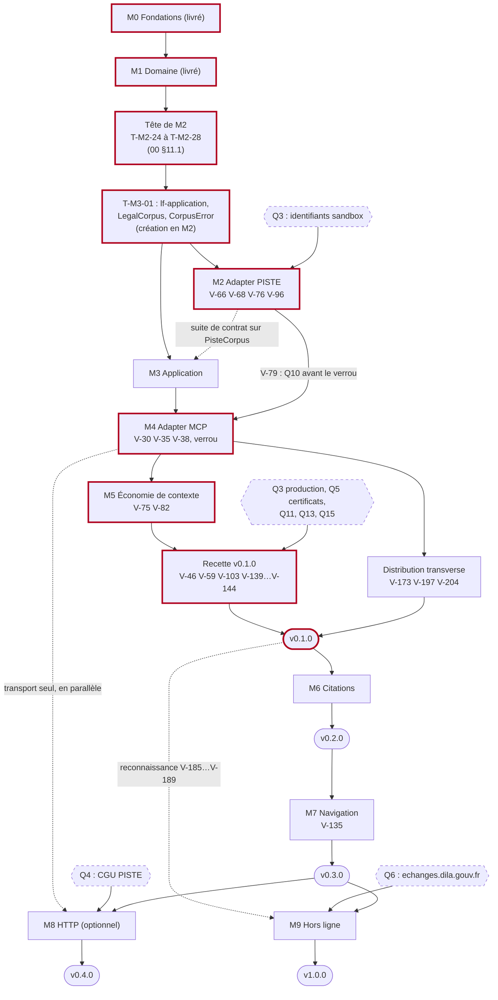

# 07 — Feuille de route : jalons, tâches et critères d'acceptation

> Plan de réécriture en Rust, en architecture hexagonale, du serveur MCP Légifrance (`mcp-legifrance`), cible MCP 2026-07-28 (« MCP v2 ») servie en dual-era par `rmcp =3.9.0` (`=3.5.1` jusqu'au 2026-11-11, ADR-0026). Ce document ordonne le travail : jalons M0 à M9 et Distribution transverse, tâches `T-Mx-yy` à cocher, critères d'acceptation (définition de terminé de chaque jalon), risques `R-xx` et vérifications `V-xx` à lever pendant chaque jalon.
>
> [00-decisions.md](00-decisions.md) est normatif (révision 2 du 2026-10-15, réconciliée le 2026-10-16 avec le livré et les décisions C1 à C7 du propriétaire) ; ce document l'applique et ne le modifie pas. Il ne détaille aucun sujet technique : chaque tâche renvoie à la section du document propriétaire qui la spécifie (00 §0). Il crée les identifiants de tâches `T-Mx-yy` annoncés par 00 §0 (`T-MD-yy` pour la Distribution transverse, §0.2), et aucun autre : risques, vérifications et questions sont ceux de [09-risques-et-questions.md](09-risques-et-questions.md), qui fait foi en cas d'écart (09 §0.1).
>
> Rédigé le 2026-10-16, sur le plan dans sa révision 2 du 2026-10-15 ; réconcilié le 2026-10-16 avec le livré (M0 et M1) et les décisions C1 à C7. « La référence Python » désigne `matematicsolutions/fr-eli-mcp@d3b5b13` (v0.5.3).
>
> **État.** M0 et M1 sont **livrés** (plan 1, `2026-10-15-m0-m1-fondations-domaine.md`, plan retiré : voir [README du plan §3.5](README.md#35-plans-dimplémentation-retirés), PR #2) : leurs tâches `T-M0-xx` et `T-M1-xx` gardent leur identifiant et portent un statut (livrée, livrée en partie, remplacée, reportée). **M2 commence par sa tâche 0** (00 §11.1 : T-M2-24 à T-M2-28). La tête de M2 est livrée par le plan 2a (`2026-10-16-m2a-tete.md`) puis par le plan 2b (`2026-10-21-m2b-application.md` : `SearchQuery` et ses types, `lf-application`, extensions de `check-arch`), puis par le plan 2c (`2026-10-21-m2c-adapter-piste.md` : T-M2-02 et T-M2-28 livrées ; T-M2-01, -03, -04 et -27 en partie), puis par le plan 2d (`2026-10-22-m2d-requetes-dto-erreurs.md` : requêtes `/search` et `PaginationMemo` (T-M2-05, hors branchement), DTO (T-M2-06), classification « introuvable » (T-M2-08) ; T-M2-01 en partie : champs privés et `with_tuning`) ; puis par le plan 2e (`2026-10-23-m2e-domaine-texte-entites.md`, **domaine seul** : `LegalStatus`, `Nor`, `Idcc`, `DocumentId`, `LongText`, lexer HTML partagé, `Snippet`, `OfficialSummary`, entités complètes, 16 fixtures installées) ; puis par le plan 2f (`2026-10-23-m2f-budget-et-mapping.md` : budget de décodage R11, R13, D-24, **mapping pur** `map/` avec ses diagnostics, contrats sur les 16 fixtures) ; puis par le plan 2g (`2026-10-24-m2g-impl-legalcorpus.md` : `impl LegalCorpus`, branchement du décodage et du mapping sous le permis de concurrence, DTO réduits aux champs lus, golden de niveau 1, snapshots, intégrité des fixtures, job `surface`) ; puis par le plan 2h, PR 1 (`2026-10-28-m2h-outils-et-sondes.md` : `record-fixture` (T-M2-11), tests live et `live.yml` (T-M2-12), I-5, intégrité des fixtures enregistrées) ; reste : matrice TLS (propriétaire), réglages de `lf-app` et les sondes T-M2-14 à T-M2-22 (plan 2h, PR 2) ; T-M2-13 passe en M4 (`lf-app` naît en M4). **M3 commence** par le plan 3a (`2026-10-28-m3a-socle-application.md`, socle de l'application : ports d'audit et d'horloge, `ToolCall`, `ToolName`, `AppError`, module `messages`, doublures `test-support`, décorateur `Audited` ; `CorpusError` typé, dont `TooLarge` ; T-M3-01 à T-M3-03 livrées en partie) ; les cas d'usage et la façade suivent au plan 3b, l'audit JSONL, le cache et l'horloge système au plan 3c. Les plans d'implémentation exécutables (retirés) déclinaient ce document jalon par jalon (plan 2 = M2…). Priorité en cas d'incompatibilité (en-tête de 00) : l'exigence de qualité de 00 §10 ; puis le code livré et les décisions C1 à C7 ; puis ce document.
>
> **Fin du projet (2026-10-29).** Les jalons M3 à M9 et la Distribution ont été écrits sur une seule branche, `feat/fin-du-projet`, par la PR unique #27 (`2026-10-29-fin-du-projet-parallele.md`, vagues V0 à V4 puis fin F1 à F6), à la version **0.3.0** sans release ni étiquette (D14). État par jalon au §4.3 ; une case n'est cochée que si le livrable existe et que le test nommé (ou son équivalent relu) existe et passe sur les trois OS à la tête `4d97b69` ; les portes de couverture à 100 % et de mutation, rouges à cette tête, ne sont pas comptées (§4.3). Amendements : 00 §14 (AM-50 à AM-66), statuts des vérifications : 09 §2.20.
>
> **Jalon MB, BOFiP (2026-11-15).** Ajouté par ADR-0028 et ADR-0029 (AM-92, AM-93) : tâches `T-MB-yy` au §2.11 ; code écrit sur la branche `feat/bofip` le 2026-11-15 (état au §2.11) ; PR de code unique fusionnée le 2026-11-15 (PR #85, T-MB-45), puis PR de version 1.3.0 (PR #86, fusionnée le même jour) ; rejeu des 13 questions fait le même jour (T-MB-44, résultat au §2.11). Suite après la 1.3.0 : le texte des publications lu dans le champ HTML du jeu (ADR-0030, AM-97 ; tâches T-MB-50 à T-MB-57 au §2.11 ; PR #87 et #88), livré par la 1.3.1 (numéro décidé par le propriétaire le 2026-11-15). Suite après la 1.3.1 : la recherche demande les mots exacts (ADR-0031, AM-98, choix du propriétaire du 2026-11-16 ; tâches T-MB-58 à T-MB-66 au §2.11 ; PR #90 et #91), livrée par la 1.3.2 (numéro décidé par le propriétaire le 2026-11-16). Suite après la 1.3.2 : la lecture liste les articles de code que cite une publication (ADR-0032, AM-99, Q37 = 1, choix du propriétaire du 2026-11-16 ; tâches T-MB-67 à T-MB-73 au §2.11 ; PR #94 et #95), livrée par la 1.4.0 (numéro décidé par le propriétaire le 2026-11-17).
>
> **Jalon MS, Service-Public (2026-11-23).** Ajouté par ADR-0033 (AM-100) : tâches `T-MS-yy` au §2.12 ; Q38 à Q40 décidées par le propriétaire le 2026-11-23 (A pour chacune) ; Q38 révisée en B le 2026-11-24, après la mesure de T-MS-03 (archive du jour en mémoire, recherche sur les titres et résumés) ; aucun code avant la fusion de la PR de documents (T-MS-01).

Documents liés : [00-decisions.md](00-decisions.md) (normatif : §11 jalons, §13 questions), [01-existant.md](01-existant.md) (§4.16 : clôture des défauts par jalon), [02-architecture.md](02-architecture.md) (crates, dépendances, ports), [03-domaine.md](03-domaine.md) (§11), [04-adapter-piste.md](04-adapter-piste.md) (§13, §15), [05-outils-mcp.md](05-outils-mcp.md) (§9, §11), [06-qualite.md](06-qualite.md) (§7 CI, §13.4 définition de « terminé », §14), [08-distribution.md](08-distribution.md) (§7, §10), [09-risques-et-questions.md](09-risques-et-questions.md) (§2.18 synthèse par jalon, §3 questions, §5 critères), annexes [A](annexes/A-parite.md), [B](annexes/B-citations.md), [C](annexes/C-api-legifrance.md), [D](annexes/D-mcp-2026-07-28.md), [index des ADR](../adr/README.md).

## Sommaire

0. [Mode d'emploi](#0-mode-demploi)
1. [Vue d'ensemble](#1-vue-densemble)
2. [Jalons](#2-jalons) : [M0](#20-m0--fondations-livré-plan-1), [M1](#21-m1--domaine-livré-plan-1), [M2](#22-m2--adapter-piste), [M3](#23-m3--application), [M4](#24-m4--adapter-mcp), [M5 et v0.1.0](#25-m5--économie-de-contexte-et-v010), [M6](#26-m6--citations-v020), [M7](#27-m7--navigation-v030), [M8](#28-m8--http-optionnel-v040), [M9](#29-m9--hors-ligne-v100), [Distribution](#210-distribution-transverse), [MB (BOFiP)](#211-mb--bofip-doctrine-fiscale), [MS (Service-Public)](#212-ms--service-public-fiches-pratiques)
3. [Ordre conseillé et parallélisation](#3-ordre-conseillé-et-parallélisation)
4. [Suivi](#4-suivi)
5. [Sources](#sources)

---

## 0. Mode d'emploi

### 0.1 Ce que fixe ce document

- **Il fixe** l'ordre des jalons et des tâches, leurs dépendances, le prérequis externe de chacune (réseau, identifiants, question à trancher) et les critères mesurables de clôture de chaque jalon.
- **Il ne fixe pas** le contenu technique : chaque tâche renvoie au document propriétaire (00 §0) ; les noms et chemins de tests sont ceux de 06 §1.4 et §2 ; l'énoncé, le statut et le caractère bloquant des vérifications sont ceux de 09 §2 ; la clôture des défauts `D-xx` suit 06 §3.1 et sa projection 01 §4.16.
- **Synthèse par jalon.** Les tableaux « Risques et vérifications » de chaque jalon reprennent la synthèse de 09 §2.18 (vérifications) et la colonne « Jalons » de 09 §1.1 (risques). En cas d'écart, 09 l'emporte et ce document est corrigé.

### 0.2 Forme d'une tâche

```markdown
- [ ] T-Mx-yy — **Titre court.** Action à réaliser, en une ou deux phrases.\
  Où : crate ou fichiers · Livrable : … · Vérification : test nommé ou critère observable · Spéc. : document §x · Taille : S, M ou L · Après : T-…
```

- **Identifiant.** `T-Mx-yy` : `x` est le numéro du jalon (0 à 9), `yy` un rang à deux chiffres dans le jalon. Les tâches de la Distribution transverse portent `T-MD-yy` (`x` = D), celles du jalon BOFiP `T-MB-yy` (`x` = B, §2.11), celles du jalon Service-Public `T-MS-yy` (`x` = S, §2.12). Le rang n'impose pas l'ordre : la mention « Après » donne les dépendances. Un identifiant n'est jamais réutilisé ni renuméroté (§4.5).
- **Taille** (estimation pour une personne ou un agent, hors relecture et hors délais externes : comptes, certificats, réponses aux questions) : **S** ≤ 1 jour ; **M** 2 à 5 jours ; **L** 1 à 2 semaines (au-delà, découper). Les tailles sont recalibrées à la clôture de M0.
- **Terminé.** Une tâche est terminée quand sa vérification est obtenue **et** que la définition de « terminé » de 00 §10 et de 06 §13.4 est satisfaite : `make ci` vert (fmt, lint, test, doc, arch, deny, machete, cov), `make cov` à 100 % (lignes, régions, fonctions, `--lib`), `make mutants FILE=…` à 0 `MISSED` et 0 `TIMEOUT` sur les fichiers touchés (diff de PR muté en CI ; sur la machine WSL, mutation uniquement par ce `Makefile`), tests sous Linux, macOS et Windows (matrice à partir de M2), rustdoc, sécurité, CHANGELOG, report des points **NON VÉRIFIÉ** dans 09, revue humaine.
- **Fichiers de test.** Sauf `tests/live.rs` (`#[ignore]`), les tests e2e du binaire et les compléments, les tests nommés ci-dessous vivent dans un `#[cfg(test)] mod tests` du fichier testé (00 §10) : les chemins `tests/*.rs` des champs « Où » sont des emplacements logiques.
- **Prérequis.** Codes de 09 §2.1 : `N` réseau de construction (Q6), `R` runners de CI, `S` identifiants PISTE sandbox, `P` production, `C` console PISTE, `K` clients MCP installés, `L` navigateur vers legifrance.gouv.fr, `W`/`M` postes Windows 11/macOS réels, `J` relecture juridique, `G` accès Web et GitHub, `A` certificats de signature, `T` clé d'API Anthropic, `D` accès aux dumps DILA.
- **Vérifications.** Un `V-xx` en **gras** est bloquant pour le jalon où il figure (09 §2.18). Une vérification « levée » donne une ligne au journal de 09 §2.20, avec sa preuve.

### 0.3 Décisions adoptées par défaut

Les questions Q1 à Q15 de 00 §13 portent chacune une proposition adoptée par défaut ; Q16 (typographie des citations) est décidée (plan 1, 2026-10-15) et Q17 (`/codes/article_lc/` pour une loi non codifiée) est à vérifier en M2. Q1 (nom et dépôt `mcp-legifrance`) et Q2 (Apache-2.0, titulaire « Loïc Wernert ») sont **décidées le 2026-10-16** (C6). Les tâches appliquent la proposition par défaut des questions encore ouvertes. Une tâche « Trancher… » obtient la réponse de l'utilisateur et la consigne dans 09 §3, puis dans 00 §13 et §14 et dans l'ADR concerné (cycle de vie : [ADR README](../adr/README.md) §2). Une réponse contraire à la proposition modifie les tâches qui en dépendent (§4.5).

---

## 1. Vue d'ensemble

### 1.1 Jalons et versions

| Jalon | Objectif | Version | Prérequis externes | Questions à trancher | Vérifications bloquantes (09 §2.18) | Tâches |
|---|---|---|---|---|---|---|
| M0 Fondations | **livré** (plan 1) : dépôt compilé et contrôlé en CI, conventions ; spikes et hygiène reportés (§2.0) | — | — | Q1, Q2 décidées (C6) | **V-01** (partielle), **V-02** (partielle), **V-25** (levée au plan 2c), **V-28**, **V-29** (reportées) | 20 |
| M1 Domaine | **livré** (plan 1) : `lf-domain` pur et testé ; reliquats en tête de M2 (00 §11.1) | — | — | Q16 décidée | — | 12 |
| M2 Adapter PISTE | tâche 0 (00 §11.1), `PisteCorpus` v0.1 et sondes live prioritaires | — | S, C | Q3 (sandbox) ; base de Q10 ; Q12 avant T-M2-10 ; Q17 | **V-66**, **V-68**, **V-76**, **V-96** | 28 |
| M3 Application | ports, cas d'usage, `Audited`, `Deadline`, audit, cache, horloge | — | R, W | Q9 | — | 10 |
| M4 Adapter MCP | serveur dual-era, 8 outils, binaire, verrou des descripteurs | — | K, G | Q7, Q8, Q10, Q14 | **V-30**, **V-35**, **V-38** | 15 |
| M5 Économie de contexte | lecture progressive, pagination, plafond dur, budgets mesurés ; recette et release | **v0.1.0** (M0→M5) | S, P, K, L, T, J + Distribution | Q3 (production), Q5, Q11, Q13, Q15 | **V-75**, **V-82** ; recette : **V-46**, **V-59**, **V-103**, **V-139**, **V-140**, **V-142**, **V-143**, **V-144** | 14 |
| M6 Citations | parseur, `fr_verify_citations`, `fr_resolve`, `list_codes()` | **v0.2.0** | S, J | Q12 (réexamen) | **V-119**, **V-120**, **V-122**, **V-163** | 9 |
| M7 Navigation | `fr_get_related`, `fr_diff_article`, `fr_search_all`, resources, prompts, completions | **v0.3.0** | S, K | Q8 (resources) | **V-135** | 8 |
| M8 HTTP (optionnel) | Streamable HTTP local, puis distant | v0.4.0 | G, K, J | Q4 | **V-42** ; profil partagé : **V-62**, **V-175**, **V-176** | 7 |
| M9 Hors ligne | `lf-adapter-dila`, sélection d'adapter | **v1.0.0** | D, G | Q6 (DILA), Q13 (réexamen) | **V-180**, **V-185**, **V-186**, **V-187** | 6 |
| Distribution (transverse) | binaires, signature, MCPB, OCI, registre MCP, `cargo install --git` | dès v0.1.0 | A, W, M, K, R, G | Q1 (avant publication immuable), Q5, Q13 | **V-173** (si certificat, Q5), **V-197**, **V-204** | 15 |
| MB BOFiP | doctrine fiscale : port `TaxDoctrine`, `lf-adapter-bofip`, `fr_search_bofip`, `fr_get_bofip` (ADR-0028, ADR-0029) ; texte lu dans le champ HTML (ADR-0030) ; recherche en mots exacts (ADR-0031) ; articles cités par une publication lue (ADR-0032) | 1.3.0, puis 1.3.1, puis 1.3.2, puis 1.4.0 | G (portail ouvert, sans compte) ; P pour le rejeu de T-MB-44 | Q28 à Q37 décidées | **V-222** et **V-225** (levées), **V-223** et **V-228** (levées avec réserve) | 45 |
| MS Service-Public | fiches pratiques de Service-Public.gouv.fr (DILA) : port `PublicGuidance`, `lf-adapter-service-public`, `fr_search_service_public`, `fr_get_service_public` (ADR-0033) | 1.5.0 (proposée) | G (serveur ouvert de la DILA, sans compte) ; P pour un rejeu éventuel (T-MS-44) | Q38 à Q40 décidées (Q38 révisée le 2026-11-24) | **V-229**, **V-230**, **V-232** | 32 |

Versions : SemVer de la surface d'outils de 05 §9.5 (avant 1.0, une rupture ou un ajout fait passer de `0.x` à `0.(x+1).0`). M8 étant optionnel, M9 peut suivre directement v0.3.0. Hors de cette feuille de route : Judilibre (après v0.3.0, V-181 à V-183), fonds JUFI (après v1.0, V-184), canaux supplémentaires (MSI, Homebrew, winget… après v0.1.0, 09 §3.16.3).

### 1.2 Dépendances entre jalons



Légende : les hexagones sont des prérequis externes (questions, accès) ; les nœuds à bord épais forment le chemin critique de la v0.1.0 (§1.3) ; un trait pointillé indique un travail qui peut commencer avant la fin du jalon source, sans en lever la dépendance d'acceptation.

Points à retenir :

- **Ports avant l'adapter.** `PisteCorpus` implémente `LegalCorpus` : `lf-application` est créé en M2 avec le port `LegalCorpus` et `CorpusError` (00 §11 ; partie « port de corpus » de T-M3-01), avant T-M2-09, une fois la tête de M2 faite (T-M2-24). `AuditLog`, `Clock` et les doublures arrivent en M3, qui avance en parallèle de M2 sur `FakeCorpus` ; seule la suite de contrat sur `PisteCorpus` (T-M3-05) attend M2.
- **M4 dépend de M2 par une décision**, pas seulement par du code : V-79 (sondée en M2) fonde Q10, tranchée avant le premier verrou des descripteurs (00 §13).
- **M7 suit M6** : `fr_get_related` analyse les liens avec le parseur, et les completions de `code` lisent `list_codes()` (00 §3, §7).
- **M9 implémente toutes les méthodes du port**, dont celles de M6 et M7 (02 §3.9) : il suit v0.3.0, mais la reconnaissance des dumps peut commencer dès v0.1.0 si l'hôte DILA est ouvert.

### 1.3 Chemin critique

Le chemin critique de la v0.1.0 est dicté par des prérequis externes plus que par le volume de code :

1. **Tête de M2** (T-M2-24 à T-M2-28) : contrat de citation v2, TOC en arbre, suffixe de version, sentinelles, toolchain épinglée, hygiène du dépôt, spikes TLS, proxy, `backon` et `governor` (V-02) : faits au plan 2c, sauf la matrice TLS. Rien de ce que M2 mappe ou configure ne se fige avant.
2. **`lf-application` et ses ports** (partie « port de corpus » de T-M3-01) : prérequis de l'adapter PISTE.
3. **Q3 sandbox puis sondes bloquantes de M2** (T-M2-14 à T-M2-16 : V-66, V-68, V-76, V-96). Une journée en sandbox suffit à la plupart des campagnes (09 §2.18) ; le délai réel est celui de l'obtention des identifiants.
4. **Spike rmcp** (T-M0-13, T-M0-14), reporté avant la conception de `ToolCall` et des cas d'usage de M3 : V-28 et V-29 figent les signatures de 02 et 05. Un échec (repli `Parameters<T>`) se répercute sur M3 et M4.
5. **M4** : décisions Q7, Q8, Q10, Q14 avant le verrou (T-M4-10), puis transcriptions sur le binaire (T-M4-08 : V-30, V-35).
6. **M5 puis recette v0.1.0** : V-75 et V-82 en sandbox ; V-59 en production (application PISTE de production, Q3) ; V-139 à V-144 dans un navigateur ; V-46 dans Claude Code ; certificats de signature (Q5, V-173) et MCPB dans Claude Desktop (V-197).

Les deux délais externes les plus longs, l'application PISTE de production et les certificats (Azure Artifact Signing ou SSL.com, compte Apple Developer), se demandent dès maintenant (T-M0-01) pour ne pas retarder la release. M3 est quasi critique : il s'exécute en parallèle de M2 mais M4 a besoin de `LegalService`.

### 1.4 Ce qui peut être fait tout de suite

**État au 2026-10-16.** M0 et M1 sont livrés et `make ci` est vert sur la machine de développement (compilation, couverture, mutation par `make mutants FILE=…`). Les restrictions d'accès constatées par le conteneur de rédaction du plan (archives de crates refusées, toolchain 1.99.0 non installable, PISTE injoignable) ne s'appliquent pas au développement du livré : le réseau de construction n'est plus un blocage (R-13 réduit, 09 §0.3). Reste ouvert l'accès live à PISTE : aucune sonde depuis la machine de développement tant que Q3 (identifiants sandbox) n'est pas réglée, et jamais d'identifiants dans un argument, un journal ou un enregistrement.

| Conditions | Tâches |
|---|---|
| Maintenant, sans identifiants PISTE | T-M2-24 à T-M2-28 (tête de M2) ; T-M0-01 (démarches à délai : Q3, Q5, V-214, V-215) ; T-M0-20 ; T-M1-11 (liste des URL) ; ensuite le code et les tests hors ligne de M2 (T-M2-01 à T-M2-12, sur wiremock et fixtures de la référence), tout M3, M4 sauf T-M4-13, M5 sauf T-M5-06 et la partie live de T-M5-10, T-MD-01 à T-MD-04 |
| Identifiants sandbox (Q3), depuis `live.yml` ou un poste du mainteneur | T-M2-14 à T-M2-22, T-M4-13, T-M5-06 ; avant que l'outillage Rust existe, la recette shell provisoire de 09 §2.2 (non exécutée, à valider en M2) |
| Production, clients, navigateur, relecture juridique, certificats | T-M5-10, T-M5-11, T-MD-08 à T-MD-10 |

Sans identifiants PISTE, M2 ne peut pas être **accepté** (V-66, V-68, V-76 et V-96 bloquantes), mais M3, M4 et l'essentiel de M5 avancent sur `FakeCorpus` et sur les fixtures de la référence.

---

## 2. Jalons

### 2.0 M0 — Fondations (livré, plan 1)

**Statut.** Livré par le plan 1 (`2026-10-15-m0-m1-fondations-domaine.md`, tâches 0 à 3 et 16, PR #2, fusionnée le 2026-10-16), dans la forme décidée par C1 à C7 : workspace `crates/lf-domain` + `xtask` ; `rust-version = "1.88"` ; toolchain `stable` avec `clippy`, `rustfmt` et `llvm-tools-preview` (épinglée en 1.99.0 en tête de M2, C5) ; lints (`unsafe_code = "forbid"`, `missing_docs`, `unreachable_pub`, `clippy::pedantic`, `unwrap_used`, `expect_used`, `dbg_macro`, `todo`) ; `rustfmt.toml`, `clippy.toml`, `.cargo/config.toml` (alias `xtask`), `.cargo/mutants.toml` ; `Makefile` (`make ci`, `make cov`, `make mutants FILE=…`, `make arch`) ; `deny.toml` ; `.github/workflows/ci.yml` (jobs `check` : fmt, clippy, doc, arch, machete ; `test` ; `coverage` à 100 % ; `deny` ; `msrv` 1.88 ; `mutants` sur le diff de PR) et `weekly.yml` (mutation complète en 4 shards, fuzz) ; `fuzz/` ; `cargo xtask check-arch` ; ADR-0001 et ADR-0002 ; `LICENSE`, `NOTICE`, `CONTRIBUTING.md`. Le code livré et le plan 1 font foi (clause de priorité de 00) ; les écarts avec ce document sont dans 00 §11.1.

Les tâches ci-dessous gardent leur identifiant et reçoivent un statut : **livrée**, **livrée en partie** (le reste est reporté, avec son jalon d'accueil), **remplacée** ou **reportée**. Bilan : 4 livrées (T-M0-02, -10, -11, -12), 4 en partie (T-M0-01, -03, -06, -08), 4 remplacées (T-M0-04, -05, -07, -19), 8 reportées (T-M0-09, -13 à -18, -20). La règle d'âge de 14 jours (00 §2, 06 §9.4) s'applique à toute dépendance ajoutée ou montée à partir de M2, contrôlée par `check-min-age.sh` derrière une cible `make` (00 §2, §11.1) ; le tableau des versions éligibles au 2026-10-19 établi pour le verrou initial est abandonné avec T-M0-05.

**Tâches.**

- [ ] T-M0-01 — **Trancher ou confirmer Q1, Q2 et Q6 ; ouvrir les démarches à délai.** *Livrée en partie.* Q1 (renommer en `mcp-legifrance`) et Q2 (Apache-2.0, titulaire « Loïc Wernert ») sont décidées le 2026-10-16 (C6) ; Q6 n'a plus d'objet pour le développement : la compilation, `make ci` et la CI fonctionnent (R-13 réduit, 09 §0.3). Restent les démarches à délai : application PISTE sandbox (Q3) avant M2, application de production avant v0.1.0, éligibilité à Azure Artifact Signing ou certificat SSL.com et compte Apple Developer (Q5), V-214 (titulaire des droits de la référence, pour `NOTICE`) et V-215 (marque « Légifrance »).\
  Où : 09 §3.1, §3.2, §3.3, §3.5, §3.6 ; 00 §13, §14 · Livrable : démarches ouvertes, réponses consignées (09 §3) · Vérification : première case de 09 §5 M0 · Spéc. : 00 §13 ; 08 §9.1, §9.6 · Taille : S


- [x] T-M0-02 — **Finaliser le renommage du dépôt.** *Livrée (2026-10-16, C6).* Le dépôt est `muchiny/mcp-legifrance` ; `repository` de `[workspace.package]`, `README.md` et les URL du plan sont à jour. Le remote local `origin` est à jour (2026-10-16). Reste au propriétaire : `git remote set-url origin https://github.com/muchiny/mcp-legifrance.git` sur les éventuels autres clones et vérification de la redirection de l'ancienne URL.\
  Où : GitHub, clones locaux, `README.md`, `Cargo.toml` · Vérification : plus aucune occurrence de l'ancien nom hors mentions historiques · Spéc. : 00 §1, §8, §12 ; 02 §2 · Taille : S


- [ ] T-M0-03 — **Racine du workspace.** *Livrée en partie (plan 1, tâche 1).* Livré : `Cargo.toml` virtuel (`resolver = "3"`, `[workspace.package]` avec `rust-version = "1.88"`, `version = "0.0.0"`, `publish = false`, `[workspace.dependencies]`, `[workspace.lints]`, profil `mutants`), `rust-toolchain.toml` (`stable`, `clippy`, `rustfmt`, `llvm-tools-preview`), `rustfmt.toml` (`max_width = 100`, `use_small_heuristics = "Max"`), `clippy.toml`, `.cargo/config.toml`, `.gitignore`. Livrés en tête de M2 (plan 2a, tâches 1 et 10) : toolchain 1.99.0, trois lints, `.config/nextest.toml`, `.gitattributes`. Reporté : chaque entrée de `disallowed-methods` au jalon qui introduit sa dépendance (reqwest en M2, horloge et variables d'environnement en M3-M4) ; `[profile.release]` avec le binaire (M4). V-14 (clippy sans avertissement de clé inconnue) : tenue par le `clippy.toml` livré, à revérifier avec la toolchain épinglée en T-M2-25.\
  Où : racine du dépôt · Vérification : `make ci` vert · Spéc. : 00 §2 ; 02 §2.2, §3.0.2, §3.0.3 ; 06 §7.3, §8.1 à §8.3 · Taille : M


- ~~T-M0-04 — **Squelettes des sept crates et de `xtask`.**~~ *Remplacée.* Seuls `lf-domain` et `xtask` existent (plan 1, tâches 1 et 2). Chaque autre crate naît au jalon qui l'emploie, sans squelette vide ni dépendance déclarée d'avance (`cargo machete` vert) : `lf-application` et `lf-adapter-piste` en M2, `lf-adapter-audit` et `lf-adapter-cache` en M3, `lf-adapter-mcp` et `lf-app` en M4 (le paquet de `lf-app` y devient `mcp-legifrance`, répertoire et binaire inchangés), `lf-adapter-dila` en M9. Le statut de V-01 est tenu par 09 §2.20.


- ~~T-M0-05 — **Verrou initial de `Cargo.lock` (règle d'âge).**~~ *Remplacée.* Le `Cargo.lock` livré (plan 1) est versionné ; il n'est pas passé par la procédure scriptée de la règle d'âge, et `proptest` 1.12.0 (publié le 2026-10-10) y déroge : écart accepté, dépendance de test seulement (R-22, 09 §0.3). Le script `.github/scripts/check-min-age.sh` et l'étape `min-age` du job `deny` sont reportés en M2 (00 §11.1) : script `check-min-age.sh` et sa cible `Makefile` (AM-26, T-M2-26). Script livré (plan 2a, tâche 8).


- [ ] T-M0-06 — **cargo-deny et licences.** *Livrée en partie (plan 2c, tâche 13)* : licences exactes, `fuzz/Cargo.lock` sous cargo-deny et cargo-audit (`NCSA` par exception), wrappers ; **reste** `about.toml`, `THIRD_PARTY_LICENSES.md` (T-MD) ; V-25 levée. *Historique du plan 1 (supplanté par l'état de tête ci-dessus, plan 2c) : livrée en partie.* Livré : `deny.toml` (avis, licences, bans, sources) et le job `deny` (`make deny`). Reporté en tête de M2 (00 §11.1) : licences élargies d'après `cargo deny list` (ISC, BSD ; OpenSSL infirmée, M1-D17), `fuzz/Cargo.lock` sous cargo-deny et cargo-audit (M1-D16, exception NCSA de `libfuzzer-sys`), `yanked = "deny"`, bans `openssl`, `openssl-sys`, `native-tls` et `backoff`, passage planifié ; `unmaintained` reste à sa valeur par défaut (06 §9.1) ; inventaire des licences (`about.toml`, `THIRD_PARTY_LICENSES.md`) et **V-25** (dont `aws-lc-sys`, `ring`) avec le choix TLS. `multiple-versions = "deny"` en M5 (T-M5-09).\
  Où : `deny.toml`, `about.*`, `THIRD_PARTY_LICENSES.md`, 06 §9.2 · Vérification : **V-25** levée ; `cargo deny --all-features check` vert · Spéc. : 02 §4.3 ; 06 §9.1 à §9.3 ; 08 §9.3 · Taille : M · Après : T-M0-16 (licences du fournisseur TLS retenu)


- ~~T-M0-07 — **`cargo xtask check-deps`.**~~ *Remplacée par `cargo xtask check-arch`* (`make arch`, `xtask/src/arch.rs`, plan 1 tâche 2) : liste blanche qui échoue fermé (ADR-0001, repris par ADR-0016) ; `lf-domain` n'a que `thiserror` en dépendance normale, élargie par ADR au jalon qui en a besoin (C3). Extensions de `check-arch`, au jalon où elles servent : membre inconnu = violation (tête de M2, T-M2-24) ; règle R2, fermeture transitive (`cargo metadata --format-version 1 --all-features --locked`) et R9 (doublons) à la création de `lf-application` en M2 (M1-D10, T-M2-28) ; features de `tokio` bornées en M3 ; épinglage de `rmcp` en M4. Un test par règle sur des métadonnées synthétiques, dans `arch.rs`.


- [ ] T-M0-08 — **CI `ci.yml` et protection de branche.** *Livrée en partie (plan 1, tâche 3).* Livré : `ci.yml` (jobs `check`, `test`, `coverage`, `deny`, `msrv` 1.88, `mutants` sur le diff de PR) et `weekly.yml` (mutation en 4 shards, fuzz), tous deux appelant les cibles `make`. Livré en tête de M2 (plan 2a, tâches 6 et 10) : matrice Linux, macOS et Windows sur `test` (T-M2-28) ; toolchain épinglée dans les étapes (T-M2-25) ; `--locked` partout, `cancel-in-progress` limité aux PR, `workflow-lint` (T-M2-26). Reporté : protection de `main` : réglage hors dépôt, à confirmer par le propriétaire (la protection « historique linéaire » n'est pas disponible sur un dépôt privé sans offre payante, C7).\
  Où : `.github/workflows/ci.yml`, `weekly.yml`, réglages du dépôt · Vérification : `make ci` rejoué par la CI · Spéc. : 00 §10 ; 06 §7.1, §7.2, §7.4, §7.6 · Taille : L


- [ ] T-M0-09 — **Outils de test en CI.** *Reportée en M2 (00 §11.1) : `.config/nextest.toml` avec `--profile ci` livré (plan 2a, tâche 10) ; `insta` à l'arrivée des premiers snapshots (M4-M5) ; V-22 (insta) et V-23 (isolation réseau) ne sont pas couvertes par la tâche 10 (09 §2.18).* Profils nextest `default`, `ci` et `live` (V-21 : `default-filter`, `junit`, `test-groups`, `--run-ignored only`, doc-tests non exécutés par nextest) ; comportement d'insta en CI (V-22 : aucun `.snap.new` écrit, `--unreferenced=reject`) ; isolation réseau `unshare -rn` sur `ubuntu-24.04` (V-23, repli `--offline` seul).\
  Où : `.config/nextest.toml`, `ci.yml` · Livrable : configuration éprouvée · Vérification : V-21, V-22 et V-23 levées ou contournées (journal 09 §2.20) · Spéc. : 06 §1.3, §5.1, §7.3, §7.4 · Taille : S · Après : T-M0-08

- [x] T-M0-10 — **Chaîne d'approvisionnement de la CI.** *Livrée en tête de M2 (plan 2a, tâches 2 et 6).* Épingler chaque `uses:` par SHA complet, version en commentaire (V-26, `git ls-remote --tags`) ; job `workflow-lint` (zizmor et actionlint épinglés, V-27) ; `.github/dependabot.yml` (`cargo` et `github-actions`, `rmcp` et `rmcp-macros` ignorés) ; modèle de PR de 06 §13.1.\
  Où : `.github/` · Livrable : workflows épinglés, `dependabot.yml`, `pull_request_template.md` · Vérification : `workflow-lint` vert, et rouge sur une action non épinglée (partie CI de D-44) · Spéc. : 02 §2.2 ; 06 §7.1, §9.4, §13.1 · Taille : S · Après : T-M0-08

- [x] T-M0-11 — **Documents du dépôt.** *Livrée (plan 1 ; reste livré en plan 2a, tâche 2 ; `PRIVACY.md` complété par T-MD-13).* Livré : `LICENSE` (Apache-2.0), `NOTICE` (titulaire « Loïc Wernert », Q2), `CONTRIBUTING.md` (en français, boucle TDD, portes de qualité) et un `README.md` minimal. Livrés ensuite (plan 2a, tâche 2) : `SECURITY.md`, `CHANGELOG.md` avec `[Unreleased]`, règle AGPL et licence entrante = licence sortante dans `CONTRIBUTING.md`, mention de non-affiliation du `README.md`, `PRIVACY.md`, complété par T-MD-13 (`privacy_policies`). Rustdoc et commentaires en français (C7).\
  Où : racine du dépôt · Vérification : relecture humaine ; cases de 06 §14 M0 et 08 §10 M0 · Spéc. : 00 §11, §12 ; 06 §10.3, §13.3 ; 08 §9.1, §9.2, §9.6, §9.8 · Taille : S


- [x] T-M0-12 — **ADR et alignements du plan.** *Livrée.* L'index des ADR liste ADR-0001 à ADR-0016 : ADR-0001 (livré, « Remplacé par ADR-0016 ») et ADR-0002 (portes qualité, livré) ; ADR-0003 à ADR-0014 du plan ; ADR-0015 et ADR-0016 = ex-ADR-0001 et ex-ADR-0002 du plan ; prochain numéro libre : 0017 à l'époque (0018 depuis l'ADR-0017, plan 2c). Aucun ADR accepté n'est révisé en place ([ADR README](../adr/README.md) §2). Le remplacement des étiquettes `[v:…]` par les `V-xx` de l'index de 09 §2.19 et les alignements « M0 » de 09 §3.16.2 restent suivis par 09 §0.1.\
  Où : `docs/adr/`, `docs/plan/` · Spéc. : 09 §0.1, §2.19, §3.16.2 · Taille : S


- [ ] T-M0-13 — **Spike rmcp 3.5.1 stdio dual-era.** *Reportée : spike rmcp avant la conception de `ToolCall` et des cas d'usage de M3 (00 §11.1) ; V-29 reste bloquante (09 §2.18) et se lève avant M3.* Compiler le squelette de 05 §3.2 avec `rmcp =3.5.1` (features par défaut + `transport-io`) : `supported_protocol_versions()` explicite, surcharge de `discover`, `accepted_subscription_filter`, `PreLifecycleFilter` autour d'`AsyncRwTransport::new_server`, `call_tool` écrit à la main (moyen de V-32), outil `fr_coverage` factice ; rejouer en processus, sur `duplex`, les transcriptions `modern_discover`, `legacy_2025_11_25`, `premature_notification` et `mrtr_fields_tolerated` ; mesurer le bruit de `clippy::pedantic` et la compatibilité des macros avec `unsafe_code = "forbid"` (V-15). *État (fin du projet, PR #27, 2026-10-29) : spike fait par 0A ; V-29 levée (`notification_before_initialize_is_ignored`, `eof_exits_zero`) et `PreLifecycleFilter` accepté par `serve_with_ct` ; case laissée ouverte, car V-31 et V-32 n'ont pas reçu leur ligne en 09 §2.20 dans ce lot, bien que les transcriptions `mrtr_fields_tolerated` et `modern_tools_call` soient rejouées (V2-06).*\
  Où : `crates/lf-adapter-mcp` (`server.rs`, `stdio.rs`, `tests/protocol_raw.rs`), `tests/jsonrpc/*.jsonl` · Livrable : squelette, exécuteur de transcriptions, quatre transcriptions versionnées · Vérification : **V-29** et V-31 levées, V-30 partielle (en processus), moyen de V-32 confirmé ou écart noté, V-15 tranchée (repli : `deny` dans `lf-adapter-mcp`) · Spéc. : 00 §6 ; 05 §3.2, §3.6 ; annexe D §3.2, §4.3, §5.3, §8.4 ; 06 §6.1 · Taille : L · Après : T-M2-25

- [x] T-M0-14 — **Spike `JsonObject` contre `Parameters<T>`.** *Reportée : avec T-M0-13, avant les cas d'usage de M3 ; V-28 conditionne `ToolCall`.* Sur `fr_search` : arguments reçus en `JsonObject`, `input_schema` explicite (`schema_for_input::<P>()`), retour `Json<T>` dans un `Result`, décodage par `serde_path_to_error` sous un décorateur d'audit minimal (`MemoryAuditLog`). En cas d'échec, repli `Parameters<T>` acté par un nouvel ADR qui remplace la partie concernée d'ADR-0008, accepté avant la fusion du repli (00 §5). *Livrée (fin du projet, PR #27, 2026-10-29, unité 0A) : le spike `spikes/rmcp-stdio` éprouve `JsonObject`, `input_schema` et `output_schema` explicites et retour `Json<T>` ; V-28 levée (09 §2.20), sans repli ; `jsonobject_tool_receives_raw_arguments`, `invalid_arguments_reach_the_tool`, `tools_list_has_explicit_input_and_output_schema`.*\
  Où : `crates/lf-adapter-mcp` (`params.rs`, `decode.rs`) · Livrable : outil d'essai et test · Vérification : **V-28** levée : `tools/list` contient l'`inputSchema` écrit et l'`outputSchema` dérivé ; `tools/call` avec `{"page_size":"x"}` rend `[invalid_arg] page_size: …` (`isError: true`) et une ligne d'audit · Spéc. : 00 §5 ; 02 §3.6 ; 05 §3.3 ; ADR-0008 · Taille : M · Après : T-M0-13

- [ ] T-M0-15 — **Spike `Deadline` en variable locale de tâche.** *Reportée : faite à la création de `lf-application` en M2, avant T-M2-04. Côté application livré (plan 2b, tâche 4) ; *lecture par l'adapter livrée (plan 2c, tâche 5).* `tokio::task_local!` dans `lf_application::deadline`, avec `time`, `macros` et `rt` pour seules features de tokio ; lecture depuis `lf-adapter-piste` (`Deadline::current_or(défaut)`, convertie en durée restante dans l'horloge de l'adapter).\
  Où : `crates/lf-application/src/deadline.rs`, `crates/lf-adapter-piste/src/deadline.rs` · Livrable : module et test · Vérification : test `start_paused` qui publie une échéance et la lit depuis l'adapter ; `check-arch` rouge si `lf-application` active une autre feature de tokio (règle d'extension de `check-arch`, livrée au plan 2b, 00 §11.1) · Spéc. : 00 §3, §11 ; 02 §3.2, §10 ; 04 §5.3, §15 M0 ; ADR-0012 · Taille : S · Après : T-M2-25

- [ ] T-M0-16 — **Spike TLS : aws-lc (option A) contre ring (option B) en compilation croisée.** *Livrée en partie (plan 2c, tâche 12)* : banc `spikes/tls-provider` et workflow `tls-spike.yml`, mesures x86_64 gnu ; **reste** : déclenchement (propriétaire), choix A/B (ADR-0013 §7), V-02, V-18 partielle. *Reportée en tête de M2 (T-M2-27), avant T-M2-03. Sans `dist` avant T-MD-01 (M4) : construction par `cargo build --target` en CI, la matrice de `dist` complète ensuite.* Construire les deux options par `cargo build --target` (le workflow) pour les 7 cibles de 00 §12 ; requête `GET https://sandbox-api.piste.gouv.fr/` sans jeton (attendu : un statut HTTP, aucune erreur TLS) ; pour B, test « fournisseur installé avant le premier client » (`install_default()`) ; relever la taille des artefacts ; consigner le choix dans ADR-0013 (qui reste « Proposé » jusqu'à Q5, Q13 et au spike TLS ; Q1 est décidée, C6) et dans 09.\
  Où : `crates/lf-adapter-piste` (features de reqwest), `dist-workspace.toml`, ADR-0013 · Livrable : matrice cibles × options, choix A ou B · Vérification : **V-02** levée ; V-18 mesurée (taille des binaires) ; licences du fournisseur retenu ajoutées à V-25 · Spéc. : 00 §8, §12 ; 04 §1.4, §4.1, §15 M0 ; 08 §2.4, §10 M0 · Taille : L · Après : T-M2-25, T-MD-01 (ou construction par `cargo build --target`)

- [ ] T-M0-17 — **Spikes d'API des dépendances.** *Livrée en partie (plan 2c)* : V-03 (tâche 7), V-06 (tâche 9, `backon` écarté, ADR-0017), V-07 (tâche 8) ; V-05 et V-13 restent. *Reportée en tête de M2 (T-M2-27) pour proxy (V-03), `backon` (V-06) et `governor` (V-07) ; V-05 (`sha2`) avec l'audit en M3 ; V-13 avec l'entrée `disallowed-methods` de l'horloge (M3).* Compiler et tester : `HTTPS_PROXY`/`NO_PROXY` avec les features retenues de reqwest (V-03) ; les deux vecteurs d'empreinte de 06 §2.8 avec `sha2` 0.11 (V-05) ; l'esquisse de réessai de 04 §5.2 avec backon 1.6 (V-06 : essayée, écartée) ; `RateLimiter::direct_with_clock` avec `FakeRelativeClock` (V-07) ; refus de `chrono::Utc::now()` par `disallowed-methods` (V-13).\
  Où : tests unitaires des crates concernés · Livrable : tests conservés · Vérification : V-03, V-05, V-06, V-07 et V-13 levées ou contournées (journal 09 §2.20) · Spéc. : 02 §2.2, §3.0.1 ; 04 §5.2, §5.4 ; 06 §2.8 · Taille : M · Après : T-M2-25

- [ ] T-M0-18 — **Mesure préliminaire des descripteurs.** *Reportée : après T-M0-14 ; la mesure complète reste en M4 (T-M4-11).* Sur les outils du spike (`fr_search`, `fr_coverage`), mesurer en octets le `tools/list` produit par schemars : `inputSchema` écrit, `outputSchema` dérivé, présence de `$defs`, absence de `$schema` ; comparer à l'estimation de 05 §6.6. Mesure non bloquante : la mesure complète et le recalibrage de `descriptor_size_budget` ont lieu en M4 (T-M4-11).\
  Où : `crates/lf-adapter-mcp/tests/descriptors.rs` (test provisoire) · Livrable : mesure notée dans la PR et dans 05 §6.6 · Vérification : écart chiffré à l'estimation ; leviers de 05 §6.6 planifiés si un dépassement s'annonce · Spéc. : 05 §2.5, §6.6 ; 06 §12.2 · Taille : S · Après : T-M0-14

- ~~T-M0-19 — **Toolchain épinglée.**~~ *Remplacée par C5.* MSRV 1.88 (plancher imposé par `rmcp` 3.5.1 et `proptest` 1.12 ; job `msrv` livré) ; toolchain 1.99.0 épinglée avec `llvm-tools-preview` et étapes CI alignées en tête de M2 (T-M2-25) ; une PR dédiée à chaque montée. Plus de `RUSTUP_TOOLCHAIN=1.97.0`. V-16 partielle (toolchain installée ; date de sortie non relevée, 09 §2.20).


- [ ] T-M0-20 — **Données du plan reproductibles.** *Non faite ; indépendante du livré, peut se faire à tout moment.* Vérifier les empreintes SHA-256 de `golden.py`, `check_golden.py` et `dto_repair_check.py` (00 §10) ; régénérer le golden depuis les fixtures de la référence (`python3 -I golden.py <fixtures> <sortie>`), le comparer au fichier versionné, puis exécuter `check_golden.py` et `dto_repair_check.py`. Essai concluant du 2026-10-16 (golden régénéré à l'identique, 00 §10).\
  Où : [annexes/donnees/scripts/](annexes/donnees/scripts/) · Livrable : compte rendu dans la PR · Vérification : empreintes égales à 00 §10 ; `cmp` sans différence ; `check_golden.py` sans erreur · Spéc. : 00 §10 ; annexe A §5 ; 06 §3.2 · Taille : S

**Critères d'acceptation (M0, livré).**

- [x] `make ci` vert (fmt, lint `-D warnings` avec `clippy::pedantic`, tests, doc, arch, deny, machete, cov à 100 % en `--lib`) ; la CI le rejoue sur chaque PR et mute le diff (00 §10, ADR-0002).
- [x] `cargo xtask check-arch` vert : liste blanche des dépendances normales, échec fermé si `cargo metadata` est incomplet.
- [x] `LICENSE`, `NOTICE`, `CONTRIBUTING.md` versionnés ; Q1 et Q2 décidées (C6) ; ADR-0001 à ADR-0016 indexés.
- [ ] Reliquats reportés avec leur jalon : toolchain épinglée, lints anti-panique, hygiène du dépôt, matrice des trois OS : livrés (plan 2a) ; licences de `cargo deny`, spikes TLS, proxy, `backon` et `governor` (T-M2-27 : fait au plan 2c sauf la matrice TLS) ; spike rmcp (avant M3) ; `dist init` (M4).
- [ ] V-01, V-02, V-28 et V-29 restent bloquantes dans 09 §2.18 (V-01 et V-02 partielles ; V-25 levée au plan 2c) : leur jalon de levée est celui de la tâche reportée (§4.4).

**Risques et vérifications.**

| Risque (score) | État après M0 |
|---|---|
| R-13 Accès réseau | réduit : la compilation fonctionne en local et en CI, seul l'accès live à PISTE reste ouvert (Q3) |
| R-01 Instabilité de l'API rmcp (6), R-02 Bugs de rmcp 3.5.1 (6) | `=3.5.1` et spike reportés (T-M0-13, T-M0-14), avant M3 |
| R-09 TLS en compilation croisée (4) | spike reporté en tête de M2 (T-M0-16) |
| R-22 Chaîne d'approvisionnement (4) | `cargo deny` livré, SHA d'actions, `yanked = "deny"`, bans et règle d'âge livrés (plan 2a, tâches 6 et 8) ; élargissement des licences en T-M2-27 ; `proptest` 1.12.0 accepté |
| R-25 Mainteneur unique et agents (4, tous jalons) | modèle de PR livré (plan 2a, tâche 2) ; relecture humaine de toute PR d'agent |
| R-26 Contamination de licence (3) | `NOTICE` livré ; règle AGPL dans `CONTRIBUTING.md` livrée (plan 2a, tâche 2) |
| R-30 Nom du produit (4) | Q1 décidée (C6) ; V-215 avant toute publication immuable (T-M0-01) |

| Tâche reportée | Vérifications concernées (09 §2.18 ; bloquantes en gras) |
|---|---|
| T-M0-01, T-M0-11 | V-214, V-215 |
| T-M0-06 | V-24, **V-25** |
| T-M0-09 | V-21, V-22, V-23 |
| T-M0-10 | V-26, V-27 |
| T-M0-13 | V-15, **V-29**, V-30 (partielle ; bloquante en M4), V-31, V-32 |
| T-M0-14 | **V-28** |
| T-M0-16 | **V-02**, V-18 (taille ; mémoire en M5) |
| T-M0-17 | V-03, V-05, V-06, V-07, V-13 |
| T-MD-01 | V-169, V-170 |


### 2.1 M1 — Domaine (livré, plan 1)

**Statut.** Livré par le plan 1 (tâches 4 à 15 et 17, PR #2) : `lf-domain`, pur (ni E/S, ni async, ni serde), `thiserror` pour seule dépendance normale (C3), sans panique : `id` (`Id<K>(String)`, `IdKind`, `AnyId`, `ArticleId`, `DecisionId`), `fond`, `date` (`CivilDate`), `ecli`, `url`, `citation` (contrat v1), `entity/` (`Act`, `Convention`, `TextBody`, `TocEntry` renommé `TocArticle` en tête de M2, `ArticleText`, `Decision`, `Deliberation`, `CompanyAgreement`, `SearchHit`, `SearchPage`, `CodeArticleRef`), `coverage`, `text/` (`clean`, `fold`, `rank`, `window`, `passages`), `error`. Chiffres de clôture (ADR-0002, 00 §10) : 137 tests, 369 mutants, 0 survivant ; couverture de 100 % en lignes, régions et fonctions. Les tests vivent dans un `#[cfg(test)] mod tests` du fichier testé.

Les tâches gardent leur identifiant et reçoivent un statut. Bilan : 1 livrée (T-M1-10), 8 en partie (T-M1-01, -02, -03, -05, -06, -07, -08, -09), 2 reportées (T-M1-04, -11), 1 remplacée (T-M1-12). Les reliquats sont ceux de 00 §11.1 ; tête de M2 : T-M2-24.

**Tâches.**

- [ ] T-M1-01 — **Identifiants.** *Livrée en partie (plan 1, tâche 4).* Livré : `Id<K>(String)` et `IdKind` (sans macro `lf_id!`, sans `u64` ni `Copy`), `AnyId`, `ArticleId`, `DecisionId` ; `Id::parse` et `FromStr` tolérants (espaces, casse), recopie de l'entrée tronquée à 64 caractères dans les erreurs ; propriété testée : `parse` ∘ `Display` = identité ; `parse_param` abandonné. Reportés : `parse_versioned` (suffixe `_JJ-MM-AAAA` conservé, suffixe malformé refusé, C4) et `Hash` manuel (hache la chaîne) en tête de M2 ; `Display` et `FromStr` manquants (M1-D11) en M2, `Ord` en M3 ; `IdKind` scellé et `DomainError` non exhaustif (M1-D12, M1-D13) avant tout crate aval ; `DocumentId`, `IdPrefix` et `SectionId` en M2 avec les hits et la TOC : `Display`, `FromStr`, `IdKind` scellé, `DocumentId` et `SectionId` livrés (plans 2a et 2e) ; `IdPrefix` abandonné (`Fond::hit_prefix()` renvoie un `&'static str`, plan 2e). Les phrases `invalid_arg` de parité sont rédigées par `lf-adapter-mcp` (`render.rs`, M4).\
  Où : `crates/lf-domain/src/id.rs`, `error.rs` · Vérification : proptests de `id.rs` ; `parse_versioned` en T-M2-24 · Spéc. : 00 §4 ; 03 §2 · Taille : M


- [ ] T-M1-02 — **Fonds et statuts.** *Livrée en partie (plan 1, tâche 5).* Livré : `Fond` (8 variantes ; `name()`, `api_name()`, `parse`, `ALL`) ; `PaginationMode` (`fond.rs`, plan 2d). `LegalStatus` avec `status_of`, `hit_prefix` (`&'static str`) livrés au plan 2e ; `Hash`, `needs_version_date`, `has_date_filter` livrés (plans 2a et 2b). `Jorf` réservé à M7.\
  Où : `fond.rs` · Spéc. : 03 §3 · Taille : S


- [ ] T-M1-03 — **Dates.** *Livrée en partie (plan 1, tâche 6).* Livré : `CivilDate` (validation calendaire, `from_unix_millis` à epochs négatifs par `div_euclid`, `to_french` avec mois accentués et « 1er »), 100 % de couverture et oracle proptest ; ADR-0011 amendé (C3) : `chrono` n'entre pas dans `lf-domain`. Reportés en tête de M2 : `open_ended` et `SENTINEL_FLOOR` (2999-01-01 et 2222-02-22 → `None`), `VersionDate` borné à 1500-01-01..=2221-12-31 (bornes NON VÉRIFIÉ), `DateRange` avec `InvertedDateRange`, test du vecteur 1804-03-21 (-5231606400000). V-20 et V-191 (dates avant 1970 sous Windows) avec la matrice des trois OS (M2).\
  Où : `date.rs` · Spéc. : 00 §4 ; 03 §6 ; ADR-0011 · Taille : M


- [ ] T-M1-04 — **Requête de recherche.** *Reportée en M2 (00 §11.1) : chaque objet de valeur entre au jalon qui le consomme (`SearchQuery`, `QueryText`, `PageSize`, `MatchMode`, `PaginationMode`). Livrée (plan 2b, tâches 1 et 2) ; `PaginationMode` (tâche 1 du plan 2d, `fond.rs`, champ `SearchPage.pagination`) et le `PaginationMemo` (tâche 9, `memo.rs`) livrés ; branchement dans `PisteCorpus::search` : livré (plan 2g, `corpus/port.rs`).* `SearchQuery::new` et ses rejets sans réseau (`version_date` hors LODA/CODE, dates sur CODE, `date_from` > `date_to`, `page × page_size` > 10 000), `QueryText` (≤ 500 caractères, nettoyage, D-32), `MatchMode` (défaut `any`, Q10), `PageSize`, `REACHABLE_RESULTS`, `has_more` borné.\
  Où : `search.rs` · Livrable : types bornés · Vérification : tests de 06 §2.1 ; partie domaine de D-32 · Spéc. : 00 §7 ; 03 §4.1 ; ADR-0014 · Taille : M · Après : T-M1-02, T-M1-03


- [ ] T-M1-05 — **Entités.** *Livrée en partie (plan 1, tâches 11 à 13).* Livré : `Act`, `Convention`, `TextBody`, `TocEntry` (renommé `TocArticle`), `ArticleText`, `Decision`, `Deliberation`, `CompanyAgreement`, `SearchHit`, `SearchPage`, `CodeArticleRef`, `Coverage` (au moins une lacune, constructeur faillible). Reportés : `TocNode`, `Toc::build` (tri par `intOrdre` si tous les frères l'ont, dédoublonnage, profondeur ≤ 64) et `Toc::page` (C4) en tête de M2 ; `SearchHit.idcc`, `SearchPage.total_articles` (AM-37) et `SearchHit::new` (`DocumentId`, contrôle du préfixe, compteur `dropped`, `Snippet`, `version_start`), `Act` et `Convention` (`LegalStatus`, `Nor`, `Idcc`, conteneur, bulletin, `jo_reference`), `Article` (parent, path, nota) : **livrés au plan 2e** ; `Decision` (`LongText`, `OfficialSummary`), `Deliberation` et `CompanyAgreement` complets : plan 2e (`cited_case_law`, `applied_texts`, `previous_version`, `SearchHit.solution` restent en M7) ; `LodaArticle` après V-140 et V-142 : M2 ; forme et emplacement de `Coverage` (03 §4.8, M1-D20) : M3, ses tests en M4 avec `fr_coverage` ; `page`, `has_more` : M5.\
  Où : `entity/`, `coverage.rs` · Spéc. : 00 §4 ; 03 §4 · Taille : L


- [ ] T-M1-06 — **Trancher ou confirmer Q12** (formes de citation complémentaires). *Reportée en M2, avant T-M2-10 (00 §11.1) ; tranchée en partie par C2 (2026-10-16)* : le contrat v2 cite le Conseil constitutionnel sans « - objet » (l'objet reste dans `title`). La typographie française des citations (`décision`, `délibération`, mois accentués, `1er`) est décidée depuis le plan 1 (2026-10-15) : c'est Q16 (00 §13). Le titre sans appel de note final est **appliqué par défaut dans le code au plan 2e** (`article_citation_for`) ; la réponse du propriétaire est toujours attendue. Restent à confirmer dans Q12 : titre sans appel de note, KALI sans IDCC, hits CONSTIT et CNIL = titre officiel (réexamen en M6, T-M6-08) ; variante CNIL « décision » : V-115.\
  Où : 09 §3.12 ; 00 §13, §14 ; ADR-0009 · Vérification : case de 09 §5 M1 · Spéc. : 00 §4 ; 03 §11 · Taille : S


- [ ] T-M1-07 — **Contrat de citation et URL.** *Livrée en partie (plan 1, tâches 7 à 9).* Livré : `url` (`ResourceKind`, `legifrance_url` ; `/codes/article_lc/` pour tout `LEGIARTI`, comme la référence), `ecli::Ecli` (racine du crate, jamais fabriqué), `citation` (contrat v1 : `eli_uri`, `human_readable_citation`, règles par famille, typographie de Q16). Reportés en tête de M2 : contrat v2 (C2) — champ `citation` jamais vide (repli « Légifrance {ID} », une ligne, 1 000 caractères au plus), `source_url`, `ecli` et `eli` seulement s'ils sont fournis, `eli_uri` supprimé, citation du Conseil constitutionnel sans « - objet », module renommé `contract` (`Citable::contract()`), newtypes `CitationText`, `SourceUrl`, `Eli` ; `Nor` et `Idcc` en M2 ; `/loda/article_lc/` (E-19) seulement après V-140 et V-142 (Q17).\
  Où : `citation.rs` (puis `contract/`), `url.rs`, `ecli.rs` · Spéc. : 00 §4 ; 03 §5 ; ADR-0009 ; annexe A §4.2 · Taille : L


- [ ] T-M1-08 — **Texte (1/2) : HTML, nettoyage, mojibake.** *Livrée en partie (plan 1, tâche 10).* Livré : `text::clean` = HTML vers texte (balises retirées sans séparateur, entités décodées, `<` et `&` littéraux conservés). Livrés après M1 : `text::encoding` (`repair_latin1_mojibake`, `has_latin1_mojibake`) en tête de M2 (plan 2a) ; `LongText::from_html` (structure en paragraphes seule), `LongText`, `best_of`, `OfficialSummary` et le durcissement de `clean` (contenu `RECH_*`, commentaires, caractères invisibles et bidi, tags U+E0000, séparateur des balises de bloc ; M1-D6, M1-D7), via le lexer partagé `text/html.rs` (plan 2e). `clean` n'est pas idempotent (`<<b>b>`, `&amp;lt;`) : la propriété est retirée ou limitée aux entrées sans `<` ni `&` (M1-D8).\
  Où : `text/clean.rs`, `text/encoding.rs` · Spéc. : 00 §4, §8 ; 03 §7.1 à §7.5 ; 04 §10.2 · Taille : M


- [ ] T-M1-09 — **Texte (2/2) : fenêtre, passages, BM25.** *Livrée en partie (plan 1, tâches 14 et 15).* Livré : `text::window` (`window(&str, usize, usize) -> Window { text, next_offset }`, fonction totale, offsets en `usize`), `text::passages`, `text::fold`, `text::rank` (BM25, `Scored { index, score }`). Reportés en M5 : `summary` et mots vides, repli NFD et marques combinantes, tokenisation des numéros juridiques (M1-D4, M1-D5), découpe en paragraphes, niveaux de `window` (paragraphe > phrase > proposition > mot, moitié comptée en caractères), `OffsetPastEnd` vérifié dans le cas d'usage, `Focus`, `MaxChars`, `PassageCount`, `TocLimit` ; `passages` en O(n²/max) (M1-D1). `unicode-normalization` n'entre dans `lf-domain` qu'en M6, par ADR (C3).\
  Où : `text/` · Spéc. : 00 §4, §7 ; 03 §7.6 à §7.9 · Taille : L


- [x] T-M1-10 — **Fuzzing du domaine.** *Livrée (plan 1, tâche 16).* Cibles `ids` et `text` dans `fuzz/` (hors workspace) ; `weekly.yml` les lance (300 s par cible). Reportés en M5 (M1-D2) : `-timeout`, `-max_len`, `-rss_limit_mb`, corpus persistant ; la cible `citation_parse` avec son module ; `from_html` et `version_date` sont livrées et lancées par `weekly.yml` (plans 2a et 2e).\
  Où : `fuzz/fuzz_targets/` · Spéc. : 06 §1.4, §7.1 · Taille : S


- [ ] T-M1-11 — **Préparer la recette des URL.** *Reportée vers la recette v0.1.0 (T-M5-10) ; les motifs viennent de `url.rs` (livré), pas de 03 §5.5.* Pour chaque motif de 03 §5.5, produire la liste des URL générées sur les identifiants des fixtures, à ouvrir dans un navigateur pendant la recette v0.1.0 (V-139, avec V-140, V-141, V-143 et V-144).\
  Où : liste jointe à la PR et référencée dans 09 · Livrable : liste par motif (12 kinds) · Vérification : chaque kind couvert par au moins une URL · Spéc. : 03 §5.5 ; 09 §2.10 · Taille : S · Après : T-M1-07 (une première liste peut être tirée de 03 §5.5 dès maintenant)


- ~~T-M1-12 — **(Facultatif) Avance sans dépendance.**~~ *Remplacée* : sans objet, `lf-domain` est livré avec `thiserror` pour seule dépendance normale.


**Critères d'acceptation (M1, livré).**

- [x] `make ci` vert, dont `make cov` à 100 % (lignes, régions, fonctions, `--lib`) et `check-arch` (`lf-domain` : `thiserror` seul) ; mutation : 0 `MISSED` (369 mutants, ADR-0002) ; 137 tests.
- [x] Cibles de fuzz `ids` et `text` dans `weekly.yml`.
- [x] Reliquats du domaine livrés en tête de M2 (plan 2a, T-M2-24, 00 §11.1) : contrat de citation v2, TOC en arbre, `parse_versioned`, sentinelles, `VersionDate`, `DateRange`, `Hash`, `text::encoding`, test du vecteur 1804-03-21.
- [ ] Reports de M1 vers M2 (T-M1-04, -05, -08), M3 (`Ord`, `Coverage`) et M5 (T-M1-09, T-M5-14), registre `M1-D1…M1-D24` (09 §3.19).
- [ ] Q12 : formes de citation complémentaires, reportée en M2 (avant T-M2-10 ; 09 §3.12) ; appliquée par défaut dans le code au plan 2e, réponse du propriétaire toujours attendue ; Q16 décidée (typographie) ; Q17 à vérifier en M2 (V-141, avec V-140 et V-142).
- [ ] La clôture des défauts `D-xx` (parties domaine) suit 06 §3.1 et 01 §4.16, jalon par jalon.

**Risques et vérifications.**

| Risque (score) | État après M1 |
|---|---|
| R-18 URL et contrat de citation (6) | règles d'URL livrées et testées (`url.rs`) ; contrat v2 en tête de M2 ; liste de recette reportée (T-M1-11) ; levée en recette v0.1.0 |
| R-28 Format des identifiants (3) | forme stricte (8 lettres + 12 chiffres), casse et espaces tolérés, proptest livré ; confirmé par V-103 et V-104 en M2 |

| Tâche | Vérifications de M1 (aucune bloquante) |
|---|---|
| T-M1-03 | V-20, V-191 (avec la matrice des trois OS, M2) |
| T-M1-11 | V-139 (préparation ; levée en recette v0.1.0) |


### 2.2 M2 — Adapter PISTE

**Objectif.** `PisteCorpus: LegalCorpus` pour les sept méthodes v0.1 : configuration, OAuth, client unique, résilience, délai global, requêtes `/search`, DTO, mapping, réparation du mojibake ; tests wiremock et fixtures de la référence sans réseau ; outillage d'enregistrement ; et levée, en sandbox, des vérifications live prioritaires qui fixent la classification « introuvable », la règle `singleDate`, le traitement des codes, la politique de réessai, les quotas et l'origine du mojibake.

**Prérequis.**

- Code : la tête de M2 (T-M2-24 à T-M2-28) ; les reliquats de M1 qui servent le mapping (T-M1-04, T-M1-05, T-M1-08 : `SearchQuery` et ses types, `SearchHit::new`, `Act` et `Convention` complets, `from_html`, `LongText`, `text::encoding`) ; `lf-application` avec `LegalCorpus` et `CorpusError` (partie « port de corpus » de T-M3-01) ; choix TLS (T-M0-16, via T-M2-27) ; `Deadline` (T-M0-15, à la création de `lf-application`).
- Réseau : pour les sondes, accès à `sandbox-oauth.piste.gouv.fr` et `sandbox-api.piste.gouv.fr` depuis la CI (`live.yml`, environnement `piste-sandbox`) ou depuis un poste du mainteneur (§1.4).
- Identifiants : application PISTE sandbox (Q3, prérequis S) ; console PISTE (C) pour V-62, V-65 et V-74 ; une seconde application sandbox non abonnée à l'API Légifrance pour V-65.
- Questions : Q3 (sandbox, avant le début de M2) ; V-79 fournit la base de Q10, tranchée en M4 ; Q17 (V-141, avec V-140 et V-142) à vérifier en M2, avant la recette v0.1.0.
- Sans identifiants, T-M2-24 à T-M2-28 puis T-M2-01 à T-M2-12 avancent entièrement (T-M2-13 passe en M4) ; seule l'acceptation du jalon attend les sondes.

**Tâches de tête (tâche 0 du plan 2, 00 §11.1).** Elles précèdent les mappers et gardent la méthode du livré : TDD, tests dans le fichier, `make cov` à 100 %, `make mutants FILE=…` à 0 `MISSED` sur chaque fichier touché.

- [x] T-M2-24 — **Reliquats du domaine (décisions C2, C3, C4 et reliquat de M1).** *Livrée (plan 2a, tâches 3, 4, 5, 7, 9, 11 à 16).* Dans `lf-domain`, dans cet ordre : (0) trancher `#[non_exhaustive]` pour `DomainError` (M1-D13) avant les variantes `BadSuffix`, `TocTooDeep` et `InvertedDateRange` (tâche 3) ; (1) contrat de citation v2 (C2, T-M1-07) (tâches 5, 7, 9, 16) ; (2) `TocEntry` renommé `TocArticle` (`act.rs`, `entity/mod.rs`), puis `TocNode`, `Toc::build`, `Toc::page`, `SectionId`, `DomainError::TocTooDeep` (C4) (tâche 11) ; (3) `parse_versioned` : suffixe `_JJ-MM-AAAA` conservé et vérifié comme vraie date, suffixe malformé (`_foo`, `_` seul, `_31-02-2023`) refusé, suffixe bien formé hors `LEGITEXT` toléré puis retiré, champ `SearchHit.version_start` ; proptest `valid_shape_roundtrips` et test `strips_version_suffix` corrigés (C4) (tâche 12) ; (4) `open_ended` et `SENTINEL_FLOOR`, `VersionDate` borné, `DateRange` (T-M1-03), doc de `act.rs` et des autres champs de date corrigée (tâche 13) ; (5) `Hash` manuel (hache la chaîne) sur `Id<K>`, `AnyId`, `ArticleId`, `DecisionId`, `Ecli`, `Fond`, `CivilDate` (M1-D11 avancé) (tâche 14 : dérivé sauf sur `Id<K>`) ; (6) `lf_domain::text::encoding` : `repair_latin1_mojibake` et `has_latin1_mojibake`, avant l'encodage de l'adapter (trancher alors le nom du module de l'adapter : `encoding.rs` en 04, `mojibake.rs` en 02) (tâche 15) ; (7) test du vecteur 1804-03-21 (`-5231606400000`) pour `CivilDate::from_unix_millis` (C3) (tâche 13) ; (8) `check-arch` : un membre inconnu devient une violation (tâche 4).\
  Où : `crates/lf-domain/`, `xtask/src/arch.rs` · Livrable : domaine aligné sur 00 §4 · Vérification : `make ci` vert ; `make mutants FILE=…` à 0 `MISSED` sur `citation.rs`/`contract/`, `entity/*`, `id.rs`, `date.rs`, `text/encoding.rs` · Spéc. : 00 §4, §11.1 ; 03 §2, §4, §5, §6 ; ADR-0009 ; ADR-0011 · Taille : L · Après : (aucune)

- [x] T-M2-25 — **Toolchain épinglée et lints (C5, C7).** *Livrée (plan 2a, tâche 1 ; étapes CI alignées en tâche 6).* `rust-toolchain.toml` : `channel = "1.99.0"`, composants `clippy`, `rustfmt` et `llvm-tools-preview` (nécessaire à `make cov`), `profile = "minimal"` ; alignement des 5 étapes `dtolnay/rust-toolchain@stable` de `ci.yml` et `weekly.yml` ; le job `msrv` (1.88) ne change pas ; trois lints `clippy::panic`, `unreachable` et `unimplemented` en `warn` dans `[workspace.lints.clippy]` (bloquants par `-D warnings`). Une PR dédiée à chaque montée de toolchain (la prochaine stable est attendue vers la mi-novembre 2026).\
  Où : `rust-toolchain.toml`, `.github/workflows/`, `Cargo.toml` · Livrable : épinglage et lints · Vérification : `make ci` vert avec la toolchain épinglée ; V-16 levée (date relevée dans `channel-rust-1.99.0.toml` en tâche 1, Step 2 : 2026-10-01) · Spéc. : 00 §2 ; 06 §8.1 ; 03 §1.3 · Taille : S

- [x] T-M2-26 — **Hygiène du dépôt (00 §11.1, « tout de suite »).** *Livrée (plan 2a, tâches 2, 6 et 8).* `.gitignore` (`.env`, `.env.*`, `*.snap.new`) ; `SECURITY.md` (adapté) ; `CHANGELOG.md` avec `[Unreleased]` (D-43) ; `.github/dependabot.yml` (`cargo` et `github-actions`) ; actions épinglées par SHA complet (V-26, M1-D15) ; `--locked` partout ; `cargo deny` planifié, `yanked = "deny"`, bans `openssl`, `openssl-sys`, `native-tls` et `backoff` ; job `workflow-lint` (V-27) ; `cancel-in-progress` seulement sur les PR ; `CONTRIBUTING.md` : règle AGPL « idées seulement » et licence entrante = licence sortante (R-26) ; implémenter `.github/scripts/check-min-age.sh`, sa cible `Makefile` et l'étape `min-age` du job `deny` (00 §2, §11.1 ; AM-26, T-M0-05) ; `PRIVACY.md`.\
  Où : racine, `.github/`, `deny.toml` · Livrable : fichiers et workflows · Vérification : `workflow-lint` vert, et rouge sur une action non épinglée ; `make ci` vert · Spéc. : 00 §11.1 ; 06 §7.1, §9.1 à §9.4, §13.1, §13.3 ; 08 §9.1, §9.4 · Taille : M

- [ ] T-M2-27 — **Spikes et licences de la première dépendance réseau.** *Livrée en partie (plan 2c, tâches 7, 8, 9, 12, 13)* : V-03, V-06 (écarté), V-07, licences et `fuzz/` (M1-D16, M1-D17, V-24 partiel, V-25) ; TLS : A **provisoire** ; **reste** : `tls-spike.yml` (propriétaire), ADR-0013 (V-02 partielle). Mener les spikes reportés de T-M0-16 (TLS aws-lc ou ring, V-02) et T-M0-17 (proxy, V-03 ; `backon`, V-06 ; `governor`, V-07) avant T-M2-03 et T-M2-04 ; élargir les licences de `deny.toml` d'après `cargo deny list` (ISC, BSD ; OpenSSL infirmée, M1-D17) et couvrir `fuzz/Cargo.lock` (M1-D16, exception NCSA de `libfuzzer-sys`) ; inventaire des licences et V-25 ; consigner le choix TLS dans ADR-0013.\
  Où : `crates/lf-adapter-piste`, `deny.toml`, ADR-0013 · Livrable : choix consignés, tests conservés · Vérification : V-02 partielle ; V-03, V-06, V-07, V-25 levées · Spéc. : 00 §8, §12 ; 04 §1.4, §4.1, §5 ; 08 §2.4 · Taille : L · Après : T-M2-25, T-M2-26

- [x] T-M2-28 — **Outillage reporté vers M2.** *Livrée (plans 2a, 2b, 2c), sous réserve du premier run de la CI sur les trois OS (aws-lc sous msvc jamais mesuré ; la matrice n'a pas encore tourné avec l'adapter). Plan 2a : matrice des trois OS, `.gitattributes`, `.config/nextest.toml` (tâche 10) ; modèle de PR (tâche 2) ; `check-arch` de tête : membre inconnu, R3, R4, R5, R7, étape 5 sauf 5e (tâche 4). Livrés à la création de `lf-application` (plan 2b, tâches 5 et 6) : `check-arch` R2 fermée (avec bornes de features), fermeture transitive, R9 et 5e. Plan 2c (tâche 3) : `check-arch` R6 (crates confinés) et R8 (dev-dependencies) ; `--ignore-filename-regex` : aucune exclusion nécessaire (100 % sans, glue HTTP incluse).* Matrice Linux, macOS et Windows sur le job `test` ; `.gitattributes` ; `.config/nextest.toml` avec `--profile ci` ; modèle de PR (06 §13.1) ; `--ignore-filename-regex` dans `COV_FLAGS` du `Makefile` pour la glue HTTP irréductible, avec des `exclude_globs` justifiés (aucune exclusion nécessaire, plan 2c) ; à la création de `lf-application`, `check-arch` : règle R2, fermeture transitive (`cargo metadata --format-version 1 --all-features --locked`) et R9 (M1-D10) ; en tête de M2, `check-arch` : membre inconnu = violation, R4, R5 et contrôles de manifeste de l'étape 5 de 02 §4.2 (égalité des versions internes).\
  Où : `.github/`, `Makefile`, `.config/`, `xtask/src/arch.rs` · Livrable : outillage · Vérification : `make ci` vert sur les trois OS ; un test par règle de `check-arch` sur métadonnées synthétiques · Spéc. : 00 §10, §11.1 ; 02 §4.1, §4.2 ; 06 §7.1, §7.3 · Taille : M · Après : T-M2-24

**Tâches : code et tests hors ligne.**

- [ ] T-M2-01 — **Configuration de l'adapter.** *Livrée en partie (plan 2c, tâches 4 et 11)* : `PisteConfig`, validation des URL, `EnvMismatch`, chemin exact, mode dégradé, `has_credentials()` ; **reste** : réglages avancés bornés et leur `warn!` (`lf-app`, M4) ; champs de `PisteConfig` privés, `PisteTuning`, `TuningError` et `PisteConfig::with_tuning` (plan 2d, tâche 2). `PisteConfig` et sa validation : environnements, surcharges d'URL (`https` obligatoire, `http` vers la boucle locale seulement, ni userinfo, ni requête, ni fragment), `CustomHost`, `EnvMismatch` sans déduction, chemin officiel exact ; réglages avancés bornés (`LF_PISTE_RPS`, `LF_PISTE_BURST`, `LF_PISTE_CONCURRENCY`, `LF_PISTE_MOJIBAKE_REPAIR` ; valeur invalide → défaut + `warn!`) ; mode dégradé (identifiants absents ou configuration invalide ⇒ `Config`, sans E/S).\
  Où : `crates/lf-adapter-piste/src/config.rs`, `tests/config.rs` · Livrable : configuration validée · Vérification : tests de 04 §2.3 ; D-18 (partie adapter) · Spéc. : 00 §1 ; 04 §2.1 à §2.4 · Taille : M

- [x] T-M2-02 — **OAuth2 `client_credentials`.** *Livrée (plan 2c, tâches 10 et 11).* `TokenManager` mono-vol, jeton en `SecretString`, renouvellement 60 s avant expiration, un 401 de l'API → un seul renouvellement puis `Auth` ; erreurs de l'endpoint token classées `config_error`, jamais `not_found`.\
  Où : `auth.rs`, `tests/oauth.rs` · Livrable : gestionnaire de jeton · Vérification : scénarios OAuth de 04 §13.2 ; D-12 ; parties adapter de D-10 et D-40 · Spéc. : 00 §5, §8 ; 04 §3 · Taille : M · Après : T-M2-01

- [ ] T-M2-03 — **Client HTTP.** *Livrée en partie (plans 2c et 2d, tâches 4, 5)* : client unique, 16 Mio après décompression, UTF-8 strict, mojibake (`mojibake_repairs`, `mojibake_unrepaired`), V-04 **partielle** (~38 ms en profil dev sous Linux), `decode` avec chemin, scénarios « Corps » de 04 §13.2 et décodage des corps d'erreur livrés (plan 2d) ; **reste** : V-04 (10 exécutions par OS en CI). Un seul `reqwest::Client`, construit paresseusement (features de 04 §1.4, TLS de T-M0-16 via T-M2-27), timeouts, User-Agent, corps lu en flux et borné à 16 Mio après décompression, décodage UTF-8 strict puis réparation du mojibake au niveau du corps (`lf_domain::text::encoding`) (compteur, `warn`, interrupteur) ; mesure du coût de construction (V-04).\
  Où : `http.rs`, `encoding.rs`, `tests/bodies.rs` · Livrable : client · Vérification : `piste_client_is_built_once`, scénarios « corps » de 04 §13.2 ; D-41 · Spéc. : 00 §8 ; 04 §4, §10 · Taille : M · Après : T-M2-27

- [ ] T-M2-04 — **Résilience.** *Livrée en partie (plan 2c, tâches 5, 8, 9 et 11)* ; **reste** : `search_all_respects_concurrency_cap` (M7) ; les trois `the_404_…` et le `detail` nettoyé du 400 sont livrés (plan 2d). Réessais (boucle maison ; `backon` écarté, ADR-0017 ; 3 tentatives sur 429, 502, 503, 504 et erreurs réseau ; 2 sur 500 puis `retryable: false`), gigue, `Retry-After` (secondes ou date HTTP ; > 30 s : échec immédiat), échéance `Deadline` convertie dans l'horloge de l'adapter, `governor` consulté par `check()` (jamais `until_ready`), sémaphore de concurrence ; horloge manuelle dans les tests (V-19).\
  Où : `retry.rs`, `limit.rs`, `time.rs`, `deadline.rs`, `tests/resilience.rs` · Livrable : politique de résilience · Vérification : scénarios de résilience de 04 §13.2 sans attente réelle, dont `deadline_from_task_local_is_used`, `tool_deadline_caps_retries` ; D-12, parties adapter de D-13 et D-14 · Spéc. : 00 §3, §8 ; 04 §5 · Taille : L · Après : T-M0-15, T-M2-03

*Plan 2d (livré) : T-M2-05 (en partie), T-M2-06 (en partie), T-M2-08 (en partie). Plan 2e (livré, domaine seul) : types et entités de `lf-domain`, fixtures installées (T-M2-10, en partie). Découpage des plans suivants : **2f** (**livré**) = budget de décodage R11, R13 et D-24 (tâches 1 à 9 : `dto/budget.rs`, `typePagination` tolérant, `num` en chaîne ou en nombre, cible `dto_decode`), `map/` (T-M2-07, tâches 10 à 32), diagnostics et compteurs, contrats `dto_parses_every_fixture`, `every_normalized_fixture_has_contract` et `no_mojibake_after_mapping` ; **2g** (**livré**) = `request/consult.rs`, `impl LegalCorpus` (T-M2-09) et permis tenu pendant le décodage et le mapping, retrait de l'`expect(dead_code)` et des champs de DTO non lus, contrats sur fixtures, golden de niveau 1, `insta`, sidecars, mutations des fixtures et job `surface` (T-M2-10) ; **2h** = `record-fixture` (T-M2-11), tests live (T-M2-12), I-5 et intégrité des fixtures enregistrées (PR 1, **livrée**), puis sondes T-M2-14 à T-M2-22 (PR 2, compte PISTE). **T-M2-13 passe en M4**, où naît `lf-app`.*

- [ ] T-M2-05 — **Requêtes `/search`.** *Livrée en partie (plan 2d, tâches 8 et 9)* : payload de 04 §6.1 (`search_body`), `DATE_VERSION` à midi Europe/Paris (`paris_noon_ms`, `chrono-tz` 0.10.4, V-17 **levée**), `typeRecherche`, facettes de date, gardes défensives (dont `version_date` manquante), `PaginationMemo` (`memo.rs`) ; *Livré au plan 2g* : branchement dans `PisteCorpus::search` (`mode_for` avant l'envoi, `remember` après le mapping, rien de retenu sans mode connu : `a_code_page_without_a_known_type_pagination_leaves_no_memo`) ; la garde CODE + plage est inatteignable depuis `SearchQuery::new`, la garde `version_date` absente est testée sans réseau ; **reste** : V-76 et V-82 (live). Payload de 04 §6.1 ; `DATE_VERSION.singleDate` à midi Europe/Paris (`chrono-tz` dans l'adapter, jamais dans le domaine ; vecteurs de 00 §8 : 2026-10-15 → 1792058400000, 2026-01-15 → 1768474800000, 2026-03-29 → 1774778400000, 2026-10-25 → 1792926000000 ; V-17) ; `match` → `typeRecherche` ; facettes de date par fond ; `PaginationMemo` (TTL 1 h, 1 024 entrées, repli `ARTICLE` pour CODE en page > 1, `DEFAUT` sinon) ; assainissement ; gardes défensives `InvalidRequest`.\
  Où : `request/`, `memo.rs` · Livrable : construction des requêtes · Vérification : tests de sérialisation de 04 §6.10 (noms livrés : `search_request_with_date_range_uses_the_fond_facet`, `search_body_reads_every_field_of_the_query`, `query_text_is_sent_verbatim`, `pagination_mode_is_sent_as_given`, `version_date_is_required_for_loda_and_code_only`, `deep_pagination_is_defensive_invalid_request_without_network`, `encode_failure_is_reported_without_serde_detail`, `a_refused_request_is_logged_as_a_probable_bug_without_the_query_text`, `paris_noon_covers_calendar_edges_and_historic_offsets`, `iana_database_version_is_pinned`) ; D-32 ; parties adapter de D-01 et D-09 · Spéc. : 00 §7, §8 ; 04 §6 ; ADR-0014 · Taille : M

- [ ] T-M2-06 — **DTO v0.1.** *Livrée en partie (plan 2d, tâches 4, 6 et 7)* : helpers de `dto/de.rs`, `decode` (chemin JSON, expurgation, `end()`), DTO `search`, `consult_text` (lawDecree et kaliText), `article`, `juri` (juri et cnil), `acco` ; V-10 **levée** (127 imbrications passent, plafond effectif de 62 ou 63 niveaux de sections, 04 §8.5) ; `fixture_mutations_never_panic` livré au plan 2g (`src/map/mutations.rs`, 10 763 documents mutés) et DTO réduits aux champs que le mapping lit ; **reste** : DTO M6 et M7. *Livré au plan 2f* : la cible de fuzz `dto_decode` (les DTO étant `pub(crate)`, la cible inclut leurs fichiers par `#[path]`, sans feature ni point d'entrée ajouté à l'adapter ; 06 §1.4), le budget de 200 000 éléments par document (R11, 04 §8.5), `typePagination` tolérant (R13) et `num`/`numParution` lus en chaîne ou en nombre (D-24). Structs minimales `#[serde(default)]`, helpers `null_default`, `opt_nonempty`, `opt_raw_date`, `opt_string_or_number`, renommages explicites (`titresTM`), `serde_path_to_error` → `Decode` ; profondeur JSON limite (V-10).\
  Où : `dto/` · Livrable : DTO des 7 endpoints v0.1 · Vérification : tests de 04 §8, `fixture_mutations_never_panic` · Spéc. : 04 §8 ; annexe C §5 · Taille : M

- [ ] T-M2-07 — **Mapping DTO → domaine.** *Domaine livré au plan 2e (types, `LongText`, `OfficialSummary`, `LegalStatus`, `Nor`, `Idcc`, `DocumentId`, `Toc::build`, entités complètes) ; mapping pur livré au plan 2f, branché au plan 2g (`PisteCorpus::fetch`) : `map/{mod,dates,rules,search,body,toc,act,convention,article,decision,deliberation,agreement}.rs`, neuf compteurs de `Diagnostics` versés par `Stats::record_mapping`, `TextBody.cid` en `DocumentId` et `DecisionId::fond()` côté domaine (00 §11.1, « Faits au plan 2f »). `record_mapping` est appelé par `PisteCorpus::fetch` (plan 2g), sur `Ok` et sur `Err`.* *Reçoit du plan 2d* : `RawDate` brut à convertir en `CivilDate` (sentinelles, `Millis(20240315)` d'une chaîne AAAAMMJJ, `Text` non convertible ⇒ `Decode`), enveloppes `null` (`{"text":null}`, `{"article":null}`, `{}`) ⇒ `NotFound`, `decisionAttaquee` et `context` par défaut à tester sur leurs champs. Règles communes et par entité, dates multi-formats et sentinelles, sommaire officiel par fond, TOC en arbre (`Toc::build`, tête de M2), dates `CivilDate` (conversion vers `chrono` seulement dans l'adapter), diagnostics comptés.\
  Où : `map/` · Livrable : mapping · Vérification : `sentinel_occurrences_in_fixtures_become_none`, `toc_article_projection_matches_reference_order`, `consult_acco_fixture_maps`, `every_normalized_fixture_has_contract`, `no_mojibake_after_mapping`, `dto_parses_every_fixture` ; D-20, D-21, D-25, D-26, D-28, D-29 · Spéc. : 00 §4 ; 04 §9 ; 03 §4 · Taille : L · Après : T-M1-05, T-M2-06

- [ ] T-M2-08 — **Classification des erreurs et « introuvable ».** *Livrée en partie (plan 2d, tâche 5)* : table statut ⇒ erreur de 04 §5.1, 400 avec marqueur ⇒ `NotFound` (consultation seulement, quel que soit l'hôte, R7), 400 sinon ⇒ `InvalidRequest` avec le message PISTE nettoyé pour une consultation (≤ 200 caractères, secrets retirés, corps ≤ 64 Kio) et un détail générique pour `/search`, 404 de consultation officielle à corps non HTML ⇒ `NotFound` sinon `Config`, 2xx vide ⇒ `NotFound` (consultation, quel que soit l'hôte, R7) ou `Decode` (`/search`) ; enveloppes 2xx `null` livrées (plan 2g, `consult_empty_envelope_maps_to_not_found` par le port) ; **reste** : règle 404 et marqueur **hypothèses** jusqu'à V-66, V-67, V-68. Table statut → action → erreur ; classification provisoire de 04 §11.2 (400 « L'expression à valider est fausse. » ⇒ `NotFound` ; 404 d'une consultation officielle à corps non HTML ⇒ `NotFound`, sinon `Config` ; jamais `NotFound` sur `/search` ni sur l'endpoint token ; 403 ⇒ `Auth`) ; corps d'erreur PISTE tronqué à 200 caractères.\
  Où : `classify.rs` · Livrable : classification · Vérification : scénarios d'erreur de 04 §13.2 ; parties adapter de D-10 et D-11 · Spéc. : 00 §5 ; 04 §5.1, §11 · Taille : M

- [ ] T-M2-09 — **`impl LegalCorpus for PisteCorpus` (v0.1).** `search`, `get_act`, `get_article`, `get_decision`, `get_deliberation`, `get_convention`, `get_company_agreement` sur les 7 endpoints v0.1 ; identifiants dans le corps, jamais dans le chemin ; aucune URL de réponse suivie. *Livrée au plan 2g* (`corpus/port.rs`, `request/consult.rs`) : retrait de l'`expect(dead_code)` unique de `lib.rs` (consomme `post_json`, `search_body`, `PaginationMemo`, `decode`, les DTO, `map::*`) et des 61 champs de DTO non lus. **Critères d'acceptation explicites** : (1) *avant le branchement du décodage des DTO* (R11, audit de sécurité de la PR 2, M1, Medium) : **livré par le plan 2f (tâches 1 à 6)** : budget global de 200 000 éléments par document, compteur armé par `decode` et erreur `Decode` à texte fixe ; `results` ≤ 100 puis ≤ `page_size` au mapping ; tests `{"results":[{}×101]}` et 200 001 `{}` ⇒ `Decode` avec chemin (04 §8.5, limite 1) ; plafond de corps par endpoint : écarté en M2 (D4), à revoir après V-75 et V-96 ; (2) `remember(query, received_mode(..))` : rien n'est mémorisé si `typePagination` est absent ou inconnu (R12, 04 §6.6) ; `typePagination` non chaîne : **R13 décidé** (plan 2f) : `opt_string_or_number`, un nombre est une valeur inconnue sans mémo, tout autre type est `None` ; (3) un `InvalidRequest { status: None }` (garde locale, aucune requête partie) ne s'affiche pas « Legifrance rejected the request (HTTP 400) » : gabarit distinct dans `lf-application::messages` (M3 ; livré au plan 3a : `the request was not sent to Legifrance ({détail}); report it.`) ; la garde `version_date` absente sur LODA/CODE est atteignable tant que l'application ne remplit pas `today_paris()` (00 §7) ; (4) **permis de concurrence tenu jusqu'à la fin de `decode` puis de `map::*`** (exigence de la clôture du plan 2f, Ruling 6, 00 §11.1) : livré au plan 2g, `post_json` exécute le lecteur synchrone sous le permis de la tentative réussie (`the_concurrency_permit_is_held_while_the_body_is_read`, `a_call_waits_while_another_reads_its_body`) ; la borne « `max_concurrency` × pic décodé » de 04 §8.5 tient.
  Où : `corpus.rs`, `corpus/port.rs` (scénarios wiremock dans le crate, `make cov` mesurant `--lib`), `request/consult.rs` · Livrable : adapter complet pour la v0.1 · Vérification : `ids_go_in_body_never_in_path`, `urls_in_responses_are_never_fetched`, `kali_inline_content_is_available_without_extra_call`, scénarios de 04 §13.2 (un test par fixture, erreurs par le port), tests du permis · Spéc. : 00 §3, §8 ; 04 §1.3, §7.1 · Taille : M · Après : T-M3-01, T-M2-02 à T-M2-08

- [ ] T-M2-10 — **Fixtures et golden.** *Données installées au plan 2e (16 fixtures, sidecars `.meta.toml`, `parite-golden.json`, `NOTICE`) ; tests de contrat au plan 2f (`dto_parses_every_fixture`, `every_normalized_fixture_has_contract`, `no_mojibake_after_mapping`, dans `src/map/fixtures.rs` et `src/view.rs`) et au plan 2g (`fixture_mutations_never_panic`, `mapping_snapshots`, `mapping_matches_golden` et la cohérence du harnais (`src/golden.rs`), sidecars (`src/integrity.rs`), job `surface` : livrés).* Installer les 16 fixtures de la référence avec leurs sidecars `.meta.toml` (dont les 6 en mojibake, conservées pour tester la réparation) et la copie de `parite-golden.json` ; reçoit `fixture_mutations_never_panic` (T-M2-06) ; tests de contrat sur fixtures et de parité ; job `surface` : reproduction du golden par `golden.py`, `cmp`, puis `check_golden.py`.\
  Où : `crates/lf-adapter-piste/tests/fixtures/reference/`, `crates/lf-adapter-piste/src/{map/fixtures,map/mutations,view,golden,integrity}.rs` et `src/snapshots/` (sous `cfg(test)`, au lieu de `tests/fixtures_contract.rs` et `tests/parity_golden.rs` : `make cov` mesure `--lib`, D32 du plan 2f), `ci.yml` · Livrable : fixtures et job · Vérification : `golden_copy_matches_plan_data` ; job `surface` vert ; D-35 · Spéc. : 04 §13.3 ; 06 §3.2, §4 ; annexe A §5.3 · Taille : M

- [x] T-M2-11 — **`cargo xtask record-fixture`.** *Livrée au plan 2h (PR 1).* Exemple `record_fixture` (feature `record`, jamais activée dans le binaire) qui réutilise le vrai client par `PisteCorpus::exchange` ; sidecar complet (empreintes, `mojibake_detected`, plus `elapsed_ms`) ; caviardage par défaut d'`acco.data` ; refus d'écraser sans `--force` ; lot `--plan` (≤ 1 requête/s, `--only <préfixe>` pour une famille) avec le plan par défaut de 04 §13.4 (`plan.toml`, une centaine de sondes, dont la page 2 d'une recherche CODE et `lawDecree` sur deux codes). La logique vit dans la bibliothèque (`src/record.rs`, mesurée par `make cov --all-features` et mutée) ; l'exemple est de la colle d'E/S ; code de sortie 0, 1 (sonde non écrite) ou 2 (usage, identifiants absents), propagé par `cargo xtask`. L'exécution du lot en sandbox appartient à la PR 2 du plan 2h.\
  Où : `crates/lf-adapter-piste/src/{record,corpus/raw,sha256}.rs`, `crates/lf-adapter-piste/examples/record_fixture.rs`, `xtask/src/record.rs` (colle dans `xtask/src/main.rs`), `crates/lf-adapter-piste/tests/fixtures/plan.toml`, `src/integrity.rs` (contrôle des fixtures enregistrées) · Livrable : outil d'enregistrement · Vérification : `record_fixture_forwards_to_example` ; écrivain, arguments et API brute testés en unitaire (`record::tests`, `corpus/raw.rs`, wiremock) · Spéc. : 00 §2 ; 02 §3.8 ; 04 §13.4 · Taille : M · Après : T-M2-03

- [x] T-M2-12 — **Tests live et workflow `live.yml`.** *Livrée au plan 2h (PR 1).* `crates/lf-adapter-piste/tests/live.rs` (enveloppé dans `#[cfg(test)] mod live`, neuf tests `live_*` `#[ignore]`, arrêt immédiat avec un message sans identifiants ou hors sandbox) avec les tests de 04 §13.5 pour la v0.1 ; `.github/workflows/live.yml` (manuel et hebdomadaire, environnement `piste-sandbox`, sandbox seulement), profil nextest `live` (filtre `test(/(^|::)live_/)`). Non écrits : `live_token_reuse_and_expires_in` (V-60 vient de la recette manuelle : `expires_in` ne sort pas du port) et `live_gzip_negotiated` (`reqwest` retire `Content-Encoding` : V-70 se consigne à la main). `live_lawdecree_on_code_size` (C2) et `live_unknown_ids_classification` sur ACCOTEXT (C1) étaient rouges contre la vraie sandbox avant les tâches conditionnelles C1 et C2 ; les neuf tests sont verts depuis la PR 2 (première exécution en sandbox le 2026-10-28).\
  Où : `tests/live.rs`, `.github/workflows/live.yml`, `.config/nextest.toml` · Livrable : suite live · Vérification : exécution sans identifiants : message et aucun échec · Spéc. : 04 §13.5 ; 06 §5, §7.5 · Taille : S · Après : T-M2-09

- [x] T-M2-13 — **`check-config --online`.** *Passe en M4 (décision du plan 2e) : `crates/lf-app` naît en M4 (T-M4-07), le fichier `check.rs` n'existe pas avant ; la tâche garde son identifiant et son critère, et s'exécute avec T-M4-07.* Option explicite de la sous-commande `check-config` : une seule requête token, aucun appel à l'API, résultat lisible sans secret. *Livrée (fin du projet, PR #27, 2026-10-29, unité V1-11) : option `--online` de `check-config` ; `check_config_online_makes_one_token_request`, `check_config_online_reports_refused_credentials`, `check_config_online_reports_a_network_error`.*\
  Où : `crates/lf-app/src/check.rs` · Livrable : option · Vérification : test sur wiremock (exactement une requête token) · Spéc. : 02 §8.1 ; 04 §2.4 ; 09 §3.16.3 · Taille : S · Après : T-M2-02

**Tâches : sondes live en sandbox, par ordre de priorité.** Elles passent par `cargo xtask record-fixture --plan` et `tests/live.rs` ; avant que l'outillage existe, par la recette shell provisoire de 09 §2.2 sur un poste du mainteneur. Chaque exécution donne une ligne dans 06 §5.4 et chaque levée une ligne dans 09 §2.20 ; les enregistrements sont relus avant commit (V-178). Au plus un appel toutes les 200 ms, aucun 429 provoqué.

- [x] T-M2-14 — **« Introuvable » (bloquant).** *Livrée au plan 2h (PR 2, 2026-10-28) : V-66, V-67 levées, V-68 levée pour les endpoints de la v0.1 ; C1 (ACCO) corrigée.* `live_unknown_ids_classification` sur chaque consultation v0.1, avec `…000000000000` puis `…999999999999` ; formes d'un 404 de routage et d'un 404 de ressource ; synthèse des corps d'erreur.\
  Où : `tests/live.rs`, `tests/fixtures/recorded/` · Livrable : enregistrements · Vérification : **V-66** et **V-68** levées, V-67 traitée ; table de 04 §11 définitive et tests wiremock alignés sur les réponses enregistrées · Spéc. : 04 §11 ; 09 §2.6 · Taille : S · Après : T-M2-11 (ou recette shell)

- [x] T-M2-15 — **`singleDate` à midi Europe/Paris et formats de date (bloquant).** *Livrée au plan 2h (PR 2, 2026-10-28) : V-76 levée, règle de 00 §8 confirmée.* `live_singledate_noon_paris_semantics` (midi Paris comparé à minuit UTC, à minuit Paris et à la veille) ; formats acceptés par `singleDate` et `dates {start, end}` (V-77) ; horodatages à minuit UTC (`live_dates_are_midnight_utc`, V-100) ; dates de version extrêmes (V-89) ; sentinelle `2222-02-22` et `VIGUEUR_DIFF` (V-101) ; facettes de date (`live_date_facets_reduce_total`, V-78).\
  Livrable : enregistrements et conclusions · Vérification : **V-76** levée (règle de 00 §8 confirmée, sinon amendement de 00 §8 avec ADR) ; V-77, V-78, V-89, V-100 et V-101 consignées · Spéc. : 00 §8 ; 03 §6 ; 04 §6.3, §6.5 · Taille : M · Après : T-M2-11

- [x] T-M2-16 — **`lawDecree` sur un code (bloquant).** `live_lawdecree_on_code_size` sur le Code civil et le Code du travail (seuils 4 Mio et 10 s) ; présence d'`intOrdre`, ordre et doublons réels de la TOC (V-97, V-98, V-99). Si un seuil est dépassé : `/consult/legi/tableMatieres` dès la v0.1 et décision sur le moyen de reconnaître un code avant l'appel (04 §16 question 13 ; avancer `/list/code` de M6 amenderait 00 §8), avec une tâche d'implémentation ajoutée à M2. *Tranchée le 2026-10-28 : seuils dépassés, option (b), `get_act` refuse un texte trop gros avec une erreur claire (plan 2h, PR 2, Task 15 ; 00 §8 amendé).*\
  Livrable : mesure et décision · Vérification : **V-96** levée ; décision consignée dans 04 §7.3 (et 00 §8 si amendé) · Spéc. : 00 §8 ; 04 §7.3 ; D-47 · Taille : S (+ M si `tableMatieres`)

- [x] T-M2-17 — **Origine du mojibake.** *Livrée au plan 2h (PR 2, 2026-10-28) : V-71, V-72 et V-73 levées ; l'origine est la capture de la référence.* `live_no_mojibake_on_reference_ids` sur les identifiants des 6 fixtures en mojibake ; échappements `\uXXXX` (V-71) ; forme CP1252 (V-73) ; `Content-Type` et charset.\
  Livrable : enregistrements · Vérification : V-72 et V-71 levées, V-73 traitée ; hypothèse 5 de 09 §4 confirmée, ou réparation par champ (révision de 00 §8) ; R-05 réévalué · Spéc. : 00 §8 ; 04 §10.7 · Taille : S

- [x] T-M2-18 — **HTTP 500 déterministes.** *Livrée au plan 2h (PR 2, 2026-10-28) : V-69 levée, 2 tentatives sur 500 confirmées.* Sondes de V-69, deux fois chacune : facette inconnue, champ racine inconnu, `fond=ALL` avec filtres.\
  Livrable : enregistrements · Vérification : V-69 consignée ; 2 tentatives sur 500 confirmées, ou retour à 3 par amendement de 00 §8 (hypothèse 7 de 09 §4) · Spéc. : 00 §8 ; 04 §5.2 · Taille : S

- [ ] T-M2-19 — **Quotas, OAuth et erreurs d'accès.** *Livrée en partie au plan 2h (PR 2, 2026-10-28) : V-70 levée (gzip non négocié en sandbox), V-60 et V-65 partielles, V-63 et V-64 en observation continue ; restent V-62 (console PISTE, propriétaire) et V-74 (version du Swagger servi), qui ferment la tâche.* Quotas réels relevés dans la console PISTE (V-62) ; journalisation passive de `Retry-After` et des 401 sous charge (V-63, V-64) ; 403 d'une application non abonnée (V-65) ; erreurs de l'endpoint token et `expires_in` (`live_token_reuse_and_expires_in`, V-60) ; gzip (`live_gzip_negotiated`, V-70) ; version du Swagger servie (V-74).\
  Livrable : relevés · Vérification : V-60, V-62, V-65, V-70 et V-74 consignées ; défauts du limiteur confirmés ou abaissés (hypothèse 4 de 09 §4) ; V-63 et V-64 passent en observation continue · Spéc. : 00 §1, §8 ; 04 §3.5, §5.4 ; annexe C §1.4 · Taille : M

- [x] T-M2-20 — **Modes de recherche (base de Q10).** *Livrée au plan 2h (PR 2, 2026-10-28) : V-79 et V-88 partielles, V-80, V-81 (limite de 450 caractères, C3) et V-87 levées.* `live_match_modes_totals` (`any` ≥ `all` ≥ `exact` ; sémantique de `all` ; rappel en `all` sur les 9 scénarios de la référence) ; syntaxe de `valeur` (V-80) ; longueur maximale (V-81) ; sens de `date` dans les hits (V-87) ; `num` des extraits KALI (V-88).\
  Livrable : enregistrements · Vérification : V-79 consignée et transmise à T-M4-10 ; V-80, V-81, V-87 et V-88 consignées · Spéc. : 00 §7, §13 ; 04 §6.4, §6.8 ; ADR-0014 · Taille : S

- [x] T-M2-21 — **`typePagination` en page 2 et fenêtre profonde (sondes anticipées).** *Livrée au plan 2h (PR 2, 2026-10-28) : V-82 et V-83 partielles ; C5 (repli `DEFAUT` en page 2 de CODE).* `live_type_pagination_page2_code` (`DEFAUT` contre `ARTICLE` en page 2 de CODE) et `live_deep_pagination_limit`, enregistrés dans le lot de M2 ; la levée formelle a lieu en M5 (T-M5-06), où V-82 est bloquante.\
  Livrable : enregistrements versionnés · Vérification : V-82 et V-83 passent au statut `partiel` · Spéc. : 00 §7 ; 04 §6.6, §6.7 · Taille : S

- [ ] T-M2-22 — **Contenu des consultations.** *Livrée en partie au plan 2h (PR 2, 2026-10-28) : V-90 à V-95, V-97, V-99, V-102 à V-107, V-142 et V-178 levées, V-92, V-93, V-98, V-108 à V-113 et V-115 partielles ; restent V-140 et V-141 (ouverture des URL dans un navigateur, par le mainteneur), V-179 et la revue manuelle de 20 textes par fond.* `live_texte_html_presence` et sondes de V-90 à V-95 (HTML, `texte` aplati, seuil `best_of`, balises, entités, `content` de `lawDecree`) ; `live_eli_fields_are_null` (V-102) ; V-141 (Q17 : `/codes/article_lc/` pour une loi non codifiée) avec V-140 ; collecte d'identifiants pour V-103 (format 8 + 12, bloquant pour v0.1.0) ; V-104 à V-109 (suffixes, types hétérogènes, `acco.data`, champs de `getArticle`, date de mise à jour, sommaire par fond) ; V-110 et V-111 (dispositifs ; V-111 partiellement levée en 1.1.1 par U13 : ordonnances de référé du CE et des CAA, sept textes lus) ; V-112, V-113, V-115 ; V-142 (`textTitles[].nature` d'un article de loi, bloquant pour v0.1.0) ; V-178 (noms résiduels) et V-179.\
  Livrable : enregistrements, DTO et mapping corrigés au besoin · Vérification : chaque vérification consignée dans 09 §2.20 · Spéc. : 03 §7.4, §7.9 ; 04 §8.3, §9 ; annexe C §4 · Taille : M

- [ ] T-M2-23 — **Consolidation de M2.** Remplir 06 §5.4 et 09 §2.20 ; retirer les marqueurs **NON VÉRIFIÉ** levés dans 01, 03, 04 et les annexes ; préciser l'unité du décompte du mojibake (252 séquences) dans 01 et 06 (09 §3.16.2) ; réévaluer R-03, R-04, R-05, R-06, R-14, R-17 et R-29.\
  Livrable : PR documentaire de clôture · Vérification : cases de 09 §5 M2 cochées · Spéc. : 09 §0.1, §5 · Taille : S · Après : T-M2-14 à T-M2-22

**Critères d'acceptation (M2).**

- [ ] La tête de M2 (T-M2-24 à T-M2-28) est faite : domaine aligné (contrat v2, TOC, suffixe, sentinelles, `text::encoding`), toolchain 1.99.0 épinglée, hygiène du dépôt, spikes TLS, proxy, `backon` et `governor`, matrice des trois OS. Fait (plans 2a et 2c) sauf la matrice TLS ; plan 2d : requêtes, DTO, classification (hors branchement) ; plan 2e : le domaine de M2 (statut, NOR, IDCC, `DocumentId`, `LongText`, `Snippet`, `OfficialSummary`, entités complètes).
- [ ] Toutes les cases de 04 §15 M2 sont cochées.
- [ ] Les tests de 04 §13.2 et §13.3 (06 §2.3) sont verts sous Linux, macOS et Windows, sans réseau (`--offline`, proxys en échec) ; `make cov` à 100 % et `make mutants` à 0 `MISSED` sur les fichiers touchés (00 §10).
- [ ] V-66, V-68, V-76 et V-96 sont levées ; la table « introuvable » de 04 §11 est définitive, la règle `singleDate` (midi Europe/Paris) confirmée, le choix `lawDecree` ou `tableMatieres` pour les codes arrêté.
- [ ] V-17 est traitée ; V-69 et V-79 ont tourné ; les campagnes de M2 de 09 §2.18 ont tourné au moins une fois en sandbox ; le registre de 06 §5.4 contient au moins un passage du workflow `live`.
- [ ] `golden.py` reproduit le golden dans le job `surface` ; `cargo xtask record-fixture` est opérationnel et son lot a été exécuté en sandbox.
- [ ] D-06, D-12, D-20, D-21, D-23, D-24, D-25, D-26, D-28, D-29, D-32, D-35 et D-41 sont clos (01 §4.16).
- [ ] R-03, R-04, R-05, R-06, R-14, R-17 et R-29 sont réévalués (09 §5 M2).

**Risques et vérifications.**

| Risque (score) | Ce que fait M2 |
|---|---|
| R-06 « Introuvable » (9) | à traiter en tête du jalon : classification provisoire (T-M2-08), puis première sonde de la session sandbox (T-M2-14) |
| R-13 Accès réseau | sondes depuis `live.yml` ou un poste du mainteneur |
| R-03 Quotas (6) | console PISTE, observation passive, limiteur réglable (T-M2-19) |
| R-04 Sandbox et production (6) | fixtures marquées par environnement ; V-61 en recette v0.1.0 |
| R-14 Compte PISTE personnel (6) | identifiants dans l'environnement `piste-sandbox` seulement (T-M2-12) |
| R-15 Données personnelles (6) | enregistrements relus avant commit (V-178, V-179 ; T-M2-22) |
| R-12 Swagger (4) | version servie comparée à 2.4.2 (V-74, T-M2-19) |
| R-21 Délais des clients (4) | délai global respecté par les réessais (T-M2-04) |
| R-23 Fuite de secrets (4) | ni en-tête ni jeton dans un enregistrement (T-M2-11) |
| R-29 Réponses volumineuses (4) | corps borné à 16 Mio, V-96 (T-M2-03, T-M2-16) |
| R-05 Mojibake (2), R-17 `singleDate` (3), R-28 Identifiants (3) | T-M2-17, T-M2-15, T-M2-22 |

| Tâche | Vérifications de M2 (09 §2.18 ; bloquantes en gras) |
|---|---|
| T-M2-03 | V-04 |
| T-M2-04 | V-19 |
| T-M2-05 | V-17 (levée pour l'adapter ; `SystemClock`, M3) |
| T-M2-06 | V-10 (levée, plan 2d) |
| T-M2-14 | **V-66**, V-67, **V-68** |
| T-M2-15 | **V-76**, V-77, V-78, V-89, V-100, V-101 |
| T-M2-16 | **V-96**, V-97, V-98, V-99 |
| T-M2-17 | V-71, V-72, V-73 |
| T-M2-18 | V-69 |
| T-M2-19 | V-60, V-62, V-63, V-64, V-65, V-70, V-74 |
| T-M2-20 | V-79, V-80, V-81, V-87, V-88 |
| T-M2-22 | V-90 à V-95, V-102 à V-113, V-115, V-142, V-178, V-179 |
| T-M2-21 (anticipation) | V-82, V-83 (jalon M5) |

### 2.3 M3 — Application

**Objectif.** Le cœur applicatif : ports, cas d'usage v0.1, façade `LegalService`, décorateur `Audited` autour de chaque exécution, échéance `Deadline`, erreurs et messages destinés au modèle, adapters d'audit (JSONL, strict par défaut) et de cache (moka), horloge système.

**Prérequis.** M1 ; `lf-application` (créé en M2) ; spike rmcp (T-M0-13, T-M0-14) avant la conception de `ToolCall` et des cas d'usage ; `Deadline` (T-M0-15). Runners R et poste Windows 11 réel (W) pour V-164 et V-165. Aucun identifiant PISTE : tout se teste sur `FakeCorpus` ; seule la suite de contrat sur `PisteCorpus` attend T-M2-09. Q9 tranchée avant M3.

**Tâches.**

- [x] T-M3-01 — **Ports** (la partie `LegalCorpus` et `CorpusError` est faite en M2, à la création de `lf-application`, avant T-M2-09 : livrée (plan 2b, tâche 3) ; le reste en M3). `LegalCorpus` (7 méthodes v0.1, async natif façon RPITIT, `+ Send`), `CorpusError`, `AuditLog`, `AuditRecord`, `AuditError`, `Clock` (`today_paris() -> CivilDate`) ; feature `test-support` : `FakeCorpus`, `FixedClock`, `MemoryAuditLog`, `FailingAuditLog`. *Livrée en partie (plan 3a, tâches 1, 3 et 5)* : `AuditLog`, `AuditRecord`, `AuditStatus`, `AuditError` et `AuditErrorKind`, `Clock`, ré-export de `PisteEnvironment` ; `ToolCall`, `CanonicalInput`, `InputError`, `ToolName` ; `CorpusError` typé (`Auth { origin, status }`, `Config { kind }`, `TooLarge`, avec `AuthOrigin` et `ConfigKind`), répercuté dans l'adapter PISTE ; doublures `FakeCorpus`, `FixedClock`, `MemoryAuditLog`, `FailingAuditLog` et `NO_DEADLINE` ; `check-arch` borne `tracing` à `std` (R2) et réserve `test-support` aux dépendances de développement (02 §4.1) ; **reste** : `FakeCorpus` passé à la suite de contrat (T-M3-05, plan 3b) ; la forme de `ToolCall` est livrée avant le spike rmcp (T-M0-13, T-M0-14, V-28), qui doit la confirmer avant les cas d'usage (plan 3b). *Livrée (fin du projet, PR #27, 2026-10-29) : le port `LegalCorpus` compte douze méthodes (00 §14, AM-50) ; la suite de contrat `corpus_contract` passe sur `FakeCorpus`, `CachedCorpus` et `PisteCorpus` (T-M3-05).*\
  Où : `crates/lf-application/src/ports/`, `testing.rs` · Livrable : traits et doublures · Vérification : implémentations de test compilées ; `check-arch` vert (liste fermée de R2) · Spéc. : 00 §3 ; 02 §5.1 à §5.4 ; ADR-0012 · Taille : M · Après : T-M2-24

- [ ] T-M3-02 — **`Deadline` et `Audited`.** Garde dure `tokio::time::timeout(LF_TOOL_DEADLINE_S)`, échéance publiée en variable locale de tâche, durée réelle (`tokio::time::Instant`), audit de chaque issue (succès, `invalid_arg` y compris décodage, `not_found`, erreurs amont, annulation `cancelled by client`, échec d'audit), modes `strict` et `best-effort` (Q9). *Livrée en partie (plan 3a, tâches 5 et 6 ; `Deadline` livrée au plan 2b)* : `Audited`, `AuditMode`, `AuditPolicy`, `CallMeta`, `AuditMetric` ; garde dure, échéance publiée, durée réelle, ligne d'audit acquittée avant le retour (D-16), modes `Strict` (résultat retenu, `error!`) et `BestEffort` (`warn!`, compteur `write_failures()`), annulation (`info`, et `warn!` si l'écriture échoue, dans les deux modes), span `tool_call` (02 §11.1) ; table `audit_written_for_every_outcome` à 19 entrées, appelée sur `Audited::run` directement ; tests dans `audited.rs` (`mod tests`, 06 §1.4) ; **reste** : plan 3b, la table rejouée par `LegalService`, `audit_metric_per_tool`, `duration_includes_normalization`, `input_hash_of_invalid_arguments_is_computed` ; plan 3c, le défaut `Strict` posé par `lf-app`, un `JsonlAuditLog` qui rend `WriterGone` plutôt que de se figer (`Audited` ne borne pas l'écriture), `status_name` à remplacer par un `AuditStatus::as_str`, et le sort d'une panique dans un cas d'usage (09 §3.16.3) ; M6 et M7, `multi_call_use_case_stops_at_80_percent`. *État (fin du projet, PR #27, 2026-10-29) : `Audited` et `Deadline` livrés avec leurs tests ; les noms du plan sont devenus `audit_metric_is_*` et `the_audit_metric_*` (un par sortie, `output/*.rs`) et `stops_at_80_percent_of_deadline_with_note` (`citation/verify.rs`). **Reste** : `input_hash_of_invalid_arguments_is_computed`, introuvable sous ce nom et sans équivalent relu ; case laissée ouverte.*\
  Où : `crates/lf-application/src/audited.rs` et `deadline.rs`, tests internes (`mod tests`, 06 §1.4) · Livrable : décorateur · Vérification : les 15 issues de 06 §2.2, dont `error_duration_is_nonzero`, `deadline_maps_to_upstream_error_before_deadline_plus_epsilon`, `deadline_is_published_to_the_port`, `multi_call_use_case_stops_at_80_percent`, `cancelled_call_is_audited`, `audit_failure_returns_audit_error`, `audit_write_is_acknowledged_before_tool_returns`, `audit_metric_per_tool`, `input_hash_of_invalid_arguments_is_computed` ; D-03, D-14 · Spéc. : 00 §3, §7 ; 02 §7.1 ; ADR-0008 · Taille : L · Après : T-M3-01

- [x] T-M3-03 — **Erreurs et messages.** `AppError`, `ErrorCode` (six codes), `UpstreamCause`, table `CorpusError` → `AppError`, module `messages` (textes de 05 §7, scénarios S1 à S17, `not_found` de `fr_get_decision` selon le préfixe, E-15). *Livrée en partie (plan 3a, tâches 1, 2 et 4 ; `CorpusError` typé en tâche 3)* : `ErrorCode` (`ALL`, `as_str`), `UpstreamCause`, `AppError` (message final, `code()` absent pour la seule annulation) ; `messages` (`corpus_error`, `deadline`, `cancelled`, `audit`, `invalid_argument`, `clip`), sans lecture du `detail` hors `InvalidRequest` et `Config { kind: Settings }` ; tests `corpus_error_maps_to_app_error_table`, `not_found_messages_match_reference`, `error_matrix_s1_to_s17` (S6 à S15 et S17), `invalid_arg_is_not_logged_as_error` (sur `Audited`) ; **reste** : plan 3b, S1 à S5 (validation des cas d'usage) et S16 par la façade ; plan 3b ou 3c, un texte fixe pour un client HTTP non constructible (`ConfigKind::Settings`, 09 §3.16.3). *Livrée (fin du projet, PR #27, 2026-10-29) : `corpus_error_maps_to_app_error_table`, `error_matrix_s1_to_s17`, `not_found_messages_match_reference` et `invalid_arg_is_not_logged_as_error` existent.*\
  Où : `crates/lf-application/src/error.rs` et `messages.rs`, tests internes (`mod tests`, 06 §1.4) · Livrable : modèle d'erreurs · Vérification : `corpus_error_maps_to_app_error_table`, `error_matrix_s1_to_s17`, `not_found_messages_match_reference`, `invalid_arg_is_not_logged_as_error` ; D-10, D-11 · Spéc. : 00 §5 ; 02 §9 ; 05 §7.2 à §7.4 ; ADR-0010 · Taille : M · Après : T-M3-01

- [x] T-M3-04 — **Cas d'usage v0.1.** `SearchUseCase` (ordre de validation de la référence, rejets locaux), `GetActUseCase` (date du suffixe conservé par `parse_versioned`, sinon aujourd'hui Paris), `GetTextUseCase`, `GetDecisionUseCase`, `GetDeliberationUseCase`, `GetConventionUseCase`, `GetCompanyAgreementUseCase`, `CoverageUseCase` (lacunes calculées, environnement, configuration, note ELI, attribution et date de consultation, Q15) ; `ToolName` est livré avec T-M3-01 (plan 3a). *Livrée (fin du projet, PR #27, 2026-10-29) : les huit cas d'usage de v0.1, plus ceux de M6 et M7 (`usecase/`), avec leurs tests ; `ServiceSettings` et `CompleteGate` (00 §14, AM-51).*\
  Où : `usecase/`, `coverage.rs`, `tests/usecases.rs`, `tests/coverage.rs` · Livrable : huit cas d'usage · Vérification : `search_validation_order_matches_reference`, `page_beyond_reachable_window_is_invalid_arg_without_network`, `invalid_date_is_rejected_locally`, `get_act_default_date_is_today_paris`, `get_act_suffix_date_is_default_date`, `cache_key_changes_when_paris_day_changes`, `coverage_invariants_ported` ; D-15, D-17, D-22 · Spéc. : 00 §7 ; 02 §6.1, §6.2 · Taille : L · Après : T-M3-02, T-M3-03

- [x] T-M3-05 — **Façade et suite de contrat.** `LegalService<C, A, K>`, `ServiceSettings` ; suite `contract::corpus_contract` commune aux corpus, exécutée sur `FakeCorpus` et sur `PisteCorpus` (wiremock et fixtures). *Livrée (fin du projet, PR #27, 2026-10-29) : `LegalService` et `ServiceSettings` (`service/mod.rs`) ; la suite `corpus_contract` (`contract.rs`) passe sur `FakeCorpus`, `CachedCorpus` (`lf-adapter-cache/tests/contract.rs`) et `PisteCorpus` (`lf-adapter-piste/tests/contract.rs`) ; sur `DilaCorpus`, seul le sous-ensemble `corpus_contract_m5` est joué.*\
  Où : `service.rs`, `testing.rs` · Livrable : façade · Vérification : suite verte sur les deux corpus · Spéc. : 02 §6.3 ; 06 §1.4, §14 M3 · Taille : M · Après : T-M3-04, T-M2-09

- [x] T-M3-06 — **`lf-adapter-audit`.** `JsonlAuditLog` : ligne ordonnée, `input_hash` SHA-256 du JSON canonique (vecteurs P-041) ; pour chaque ligne, verrou `fs4` sur `.mcp-legifrance.lock`, ouverture en ajout, `write_all`, `sync_data`, fermeture ; rotation (16 Mio ou changement de date UTC) sous le même verrou ; fil d'écriture avec accusé ; permissions ; aucune E/S avant le premier `record()`. *Livrée (fin du projet, PR #27, 2026-10-29) : `JsonlAuditLog` (`lf-adapter-audit/src/{file,hash,line,rotation}.rs`, tests en `mod tests`) ; `input_hash_matches_p041_vectors` ; `two_processes_share_audit_file` sur le binaire (`lf-app/tests/cli.rs`). V-165 reste ouverte (`windows_acl_report` ignoré, ACL héritées, D22) et V-166 n'a pas de mesure consignée (`sync_data_cost_report` ignoré) : 09 §2.20.*\
  Où : `crates/lf-adapter-audit/` · Livrable : adapter · Vérification : tests `format.rs`, `hash_vectors.rs`, `rotation.rs`, `concurrency.rs`, `permissions.rs` ; V-09, V-164 (deux processus, trois OS), V-165 (ACL Windows), V-166 (coût de `sync_data`), V-167 (`dirs::data_dir()`) traitées · Spéc. : 00 §2, §7 ; 02 §3.5 ; 06 §11 · Taille : L · Après : T-M3-01

- [x] T-M3-07 — **`lf-adapter-cache`.** `CachedCorpus<C>` : moka (`future`), clé (environnement, opération, paramètres normalisés), TTL par opération (recherche 1 h, consultations 24 h, listes 7 j), coalescence, poids en octets, ni erreurs ni réponses vides en cache ; horloge de test (V-08). *Livrée (fin du projet, PR #27, 2026-10-29) : `CachedCorpus` (`lf-adapter-cache`) sur les douze opérations du port ; les huit tests nommés existent.*\
  Où : `crates/lf-adapter-cache/` · Livrable : adapter · Vérification : `second_identical_search_calls_inner_once`, `cache_key_is_stable_across_calls_same_day`, `cache_namespaced_by_env`, `concurrent_identical_calls_coalesce`, `errors_and_empty_results_are_not_cached`, `ttl_policy_per_operation`, `capacity_is_bounded_by_weight`, `cancelled_initializer_lets_next_caller_retry` · Spéc. : 00 §9 ; 02 §3.4, §7.2 ; ADR-0007 · Taille : M · Après : T-M3-01

- [x] T-M3-08 — **Horloge système.** `SystemClock` dans `lf-app` (`clock.rs`) : `now_utc()`, `today_paris()` par `chrono-tz`, converti en `CivilDate` (le domaine n'a pas `chrono`, C3). *Livrée (fin du projet, PR #27, 2026-10-29) : `SystemClock` (`lf-app/src/clock.rs`) ; `today_is_paris_date_at_2230_utc_in_summer` et `tz_env_does_not_change_today`.*\
  Où : `crates/lf-app/src/clock.rs` · Livrable : horloge · Vérification : `today_is_paris_date_at_2230_utc_in_summer`, `tz_env_does_not_change_today` ; V-17 (partie M3) · Spéc. : 00 §2, §3 ; 02 §5.3 ; 06 §2.7 · Taille : S · Après : T-M3-01

- [x] T-M3-10 — **Reports du domaine vers M3 (00 §11.1).** `Ord` sur les identifiants (M1-D11) ; forme et emplacement de `Coverage` tranchés selon 03 §4.8 (M1-D20 ; invariant « au moins une lacune » et constructeur faillible livrés gardés, tests complétés en M4 avec `fr_coverage`) ; features de `tokio` bornées dans `check-arch` ; entrées `disallowed-methods` de l'horloge et des variables d'environnement. *Livrée (fin du projet, PR #27, 2026-10-29) : `Ord` sur les identifiants, `coverage(env, &ConfigFacts, served)` (00 §14, AM-55), `disallowed-methods` de l'horloge et de l'environnement dans `clippy.toml`.*\
  Où : `crates/lf-domain/`, `xtask/src/arch.rs`, `clippy.toml` · Livrable : types et règles · Vérification : `make ci` vert ; mutation des fichiers touchés à 0 `MISSED` · Spéc. : 00 §11.1 ; 03 §4.8 ; 02 §4.2 · Taille : S · Après : T-M3-01

- [ ] T-M3-09 — **Décisions et alignements de M3.** Consigner Q9 (09 §3.9) ; vérifier et fermer la ligne « M3 » de 09 §3.16.2 (`Deadline` dans 02, ADR-0012 §6 et 04 §5.3) ; confirmer les propositions de 09 §3.16.3 à échéance M3 (rotation selon le schéma de 02 §3.5, lien symbolique à la place du fichier journal refusé, test qui lit `docs/` accepté). *État (fin du projet, PR #27, 2026-10-29) : le défaut de Q9 (`strict`) est appliqué et daté en 00 §13 ; la case Q9 de 09 §5 n'est pas cochée dans ce lot (cochée par le propriétaire).*\
  Où : 09 §3.9, §3.16.2, §3.16.3 · Livrable : PR documentaire · Vérification : case Q9 de 09 §5 M3 cochée · Spéc. : 00 §13 ; 09 §3 · Taille : S

**Critères d'acceptation (M3).**

- [ ] Les tests de 06 §2.2, §2.4 et §2.5 sont verts, dont les 15 issues d'`Audited`, les rejets locaux de `fr_search` et la publication de `Deadline` ; la spécification du journal de 06 §11 est implémentée.
- [ ] La suite de contrat du port passe sur `FakeCorpus` et sur `PisteCorpus`.
- [ ] `check-arch` vérifie la liste fermée de `lf-application` (R2), features de tokio comprises.
- [ ] D-03, D-10, D-11, D-14, D-15, D-17 et D-22 sont clos (01 §4.16).
- [ ] Q9 a une réponse ; V-08, V-09, V-17 (`SystemClock`) et V-164 à V-167 sont traitées ; R-20 et R-21 sont revus (09 §5 M3).

**Risques et vérifications.**

| Risque (score) | Ce que fait M3 |
|---|---|
| R-20 Audit strict (2) | mode `strict` par défaut, `best-effort` sur option (Q9) ; écritures concurrentes testées (T-M3-02, T-M3-06) |
| R-21 Délais des clients (4) | garde dure et arrêt à 80 % du délai dans les cas d'usage à appels multiples (T-M3-02) |

| Tâche | Vérifications de M3 (aucune bloquante) |
|---|---|
| T-M3-06 | V-09, V-164, V-165, V-166 (complétée en M5), V-167 |
| T-M3-07 | V-08 |
| T-M3-08 | V-17 |

### 2.4 M4 — Adapter MCP

**Objectif.** Le serveur `rmcp` dual-era (2026-07-28 par `server/discover`, 2025-11-25 et 2025-06-18 par `initialize`) avec les 8 outils v0.1, les instructions, le rendu compact, les erreurs in-band, `subscriptions/listen` minimal, le binaire `mcp-legifrance` et le verrou des descripteurs. Les descripteurs déclarent dès M4 tous les paramètres v0.1 de 05 §5 ; M5 en complète le comportement et les mesures.

**Prérequis.** M3 (`LegalService`), M2 (`PisteCorpus` pour le câblage et le scénario de bout en bout). Clients MCP installés (K) pour V-46, V-49 et V-55 ; GitHub (G) pour V-38 ; sandbox (S) pour T-M4-13 seulement. Questions Q7, Q8 (listes), Q10 et Q14 tranchées **avant** le premier verrou.

**Tâches.**

- [x] T-M4-01 — **Serveur et cycle de vie.** Généraliser le spike : `LegifranceServer<C, A, K>` ; `get_info` (`Implementation::new("mcp-legifrance", env!("CARGO_PKG_VERSION"))`, capacités `{tools: {}}`, instructions) ; `supported_protocol_versions()` ; repli d'`initialize` en 2025-11-25 (`with_protocol_version`) ; `server/discover` statique avec `ttlMs`/`cacheScope` pour les pairs modernes (Q8) ; `subscriptions/listen` minimal (`-32601` en legacy) ; `PreLifecycleFilter` définitif ; `serverInfo` en `_meta` si V-32 le permet. *Livrée (fin du projet, PR #27, 2026-10-29) : `LegifranceServer` (`server.rs`), trois versions de protocole ; `server_info_is_mcp_legifrance_with_crate_version`, `supported_versions_are_explicit`, `capabilities_same_in_both_eras`.*\
  Où : `crates/lf-adapter-mcp/src/server.rs`, `versions.rs`, `stdio.rs` · Livrable : serveur · Vérification : `server_info_is_mcp_legifrance_with_crate_version`, `supported_versions_are_explicit`, `capabilities_same_in_both_eras` · Spéc. : 00 §6 ; 05 §2.1 à §2.3, §3.2 ; annexe D §3 à §5.3 ; ADR-0003 · Taille : M · Après : T-M0-13, T-M3-05

- [x] T-M4-02 — **Décodage audité des arguments.** `params.rs` (types `Deserialize + JsonSchema`, `deny_unknown_fields`), `input_schema::<P>()`, `decode.rs` (`JsonObject` → `ToolCall<I>`, `[invalid_arg] chemin: motif`), `canonical.rs` (JSON canonique de l'empreinte d'audit). *Livrée (fin du projet, PR #27, 2026-10-29) : `canonical_input_matches_python_vectors` et `schema_has_enum_for_fond_and_bounds_for_page_size` existent ; `invalid_input_audited` et `invalid_id_message_starts_with_reference_sentence` sont devenus `a_decoding_failure_is_audited_as_invalid_arg_*` et `id_errors_follow_the_table_of_03_section_2_7` ; V-11 non relevée en 09 dans ce lot.*\
  Où : `params.rs`, `decode.rs`, `canonical.rs` · Livrable : décodage · Vérification : `invalid_input_audited`, `invalid_id_message_starts_with_reference_sentence`, `canonical_input_matches_python_vectors`, `schema_has_enum_for_fond_and_bounds_for_page_size` ; V-11 · Spéc. : 00 §5 ; 05 §3.3, §7.3 · Taille : M · Après : T-M0-14

- [ ] T-M4-03 — **Vues de sortie des 8 outils.** `views.rs` : racine objet, champs `None` omis, pas de doublons, `outputSchema` dérivé sans `$schema` ni combinateur racine ; `TextContent` = sérialisation JSON du même objet ; mesure exacte de la taille sérialisée. *État (fin du projet, PR #27, 2026-10-29) : vues et `outputSchema` livrés (`every_tool_has_object_output_schema`, `structured_content_identical_across_eras`, `legacy_tools_call_structured_content_is_object`, `structured_content_validates_against_the_output_schema`). **Reste** : `text_content_is_json_of_structured_content` et `no_view_has_eli_uri`, introuvables sous ces noms et sans équivalent relu ; case laissée ouverte.*\
  Où : `views.rs`, `tests/rendering.rs` · Livrable : vues · Vérification : `every_tool_has_object_output_schema`, `text_content_is_json_of_structured_content`, `structured_content_identical_across_eras`, `legacy_tools_call_structured_content_is_object`, `no_view_has_eli_uri`, validation `jsonschema` ; V-12 · Spéc. : 00 §6 ; 05 §2.5, §3.4, §5.0.3, §5.1 à §5.8 ; ADR-0006 · Taille : L

- [ ] T-M4-04 — **Routeur des 8 outils.** `#[tool_router]` : noms, `title` et descriptions en anglais (3 à 6 phrases, Q14), annotations (`read_only_hint`, `destructive_hint`, `idempotent_hint`, `open_world_hint = true`, Q11), appel de `LegalService` sous `Audited` ; `call_tool` écrit à la main (V-32). *Livrée (fin du projet, PR #27, 2026-10-29) : routeur de 13 outils (`ToolName::ALL`, 00 §14, AM-60) ; `annotations_are_read_only_on_all_tools`, `reference_parameters_preserved`, `descriptions_cite_only_registered_tools`, `descriptions_have_no_cross_server_directives`, `get_act_on_code_adds_note`. **Reste** : `tools_list_matches_v01_surface` et `every_tool_goes_through_audited`, introuvables sous ces noms (la surface est contrôlée par le verrou et `tests/descriptors.rs`, sans test d'audit par outil relu) ; case laissée ouverte.*\
  Où : `tools.rs`, `text.rs`, `tests/descriptors.rs` · Livrable : 8 outils · Vérification : `tool_router_builds_and_roots_are_objects`, `tools_list_matches_v01_surface`, `annotations_are_read_only_on_all_tools`, `reference_parameters_preserved`, `every_tool_goes_through_audited`, `descriptions_cite_only_registered_tools`, `descriptions_have_no_cross_server_directives`, `get_act_on_code_adds_note` · Spéc. : 00 §6, §7 ; 05 §5.0 à §5.8 · Taille : M · Après : T-M4-02, T-M4-03

- [ ] T-M4-05 — **Erreurs MCP.** `failure.rs` : `isError: true`, un seul bloc texte `[code] message`, aucun `structuredContent` ; matrice code × outil de 05 §5.0.1 ; erreurs JSON-RPC de 05 §7.5 ; test documentaire de rmcp #1347 ; panique d'un outil (V-36, `catch_unwind` si rmcp se tait). *État (fin du projet, PR #27, 2026-10-29) : `error_results_are_text_with_code_prefix`, `error_text_snapshot_per_code` et `unknown_tool_is_jsonrpc_32602_without_audit` existent ; panique d'un outil rattrapée à la frontière (`CatchUnwind`, `-32603`). **Reste** : `rendered_error_equals_audited_error`, introuvable sous ce nom ; case laissée ouverte.*\
  Où : `failure.rs`, `tests/inprocess.rs` · Livrable : rendu des erreurs · Vérification : `error_results_are_text_with_code_prefix`, `error_text_snapshot_per_code`, `rendered_error_equals_audited_error`, `unknown_tool_is_jsonrpc_32602_without_audit` · Spéc. : 00 §5 ; 05 §7 ; annexe D §3.5, §9.1 ; ADR-0010 · Taille : M

- [x] T-M4-06 — **Instructions v0.1.** Texte de 05 §4 (2 879 caractères attendus, attribution comprise) ; `cargo xtask instructions-size`. *Livrée (fin du projet, PR #27, 2026-10-29) : instructions de 3 278 caractères au verrou v0.3 (≤ 3 500) ; `instructions_fit_budget`, `instructions_carry_attribution`, `notes_are_static_templates` ; `instructions_drift` est tenu par le contrôle du verrou (`check_reports_the_drift_of_the_lock_with_json_paths`).*\
  Où : `text.rs`, `xtask/src/instructions_size.rs` · Livrable : instructions · Vérification : `instructions_fit_budget` (≤ 3 500), `instructions_drift`, `instructions_carry_attribution`, `notes_are_static_templates` · Spéc. : 00 §6 ; 05 §4.1 à §4.3 · Taille : S

- [x] T-M4-07 — **Binaire `mcp-legifrance`.** `clap` (`serve` par défaut, `check-config`, dont l'option `--online` de T-M2-13), configuration (variables de 00 §1, `FR_ELI_*` lues avec avertissement, variables héritées signalées « ignored »), câblage (`PisteCorpus` derrière `CachedCorpus`, `JsonlAuditLog`, `SystemClock`), `tracing-subscriber` sur stderr (jamais `print_stdout`) avec un filtre par défaut qui plafonne rmcp, arrêt propre (EOF, signaux) et codes de sortie. *Livrée (fin du projet, PR #27, 2026-10-29) : binaire `mcp-legifrance` (`serve`, `check-config`, `serve-http`) ; les dix-sept tests nommés existent (`stdout_contains_only_jsonrpc`, `e2e_discover_without_network`, `default_log_filter_caps_rmcp`, `user_agent_contains_crate_version`…).*\
  Où : `crates/lf-app/src/`, `tests/` · Livrable : binaire · Vérification : `stdout_contains_only_jsonrpc`, `e2e_discover_without_network`, `e2e_eof_after_discover_exits_zero`, `e2e_sigterm_exits_quickly`, `e2e_missing_credentials_config_error_audited`, `e2e_invalid_config_starts_degraded`, `fr_eli_variables_are_read_with_deprecation_warning`, `legacy_unread_variables_warn_ignored`, `fr_eli_runtime_url_is_ignored`, `invalid_advanced_setting_falls_back_to_default_with_warn`, `second_identical_loda_search_hits_cache`, `audit_unwritable_dir_fails_call`, `two_processes_share_audit_file`, `error_messages_never_contain_secret_or_userinfo`, `logs_never_contain_query_text`, `default_log_filter_caps_rmcp`, `user_agent_contains_crate_version` · Spéc. : 00 §1, §2 ; 02 §8 ; 06 §2.7 · Taille : L · Après : T-M4-01, T-M2-09, T-M3-06, T-M3-07, T-M3-08

- [ ] T-M4-08 — **Transcriptions JSON-RPC, deux ères.** Les 22 transcriptions de la liste minimale de 06 §6.1 : 21 rejouées en processus (`protocol_raw.rs`) et sur le binaire (`e2e_stdio.rs`), `eof_with_open_listen` sur le binaire seulement (06 §6.1) ; tranche V-34 (repli de 00 §6 appliqué, ou écart consigné dans l'annexe D) ; arrêt sous Windows (V-168). *État (fin du projet, PR #27, 2026-10-29) : les 22 transcriptions de `tests/jsonrpc/` sont rejouées en processus et sur le binaire (`e2e_stdio.rs`) ; **reste** : V-30, V-33, V-34, V-35, V-36 (consignée au spike 0A), V-37 et V-168 n'ont pas reçu leur ligne en 09 §2.20 dans ce lot ; case laissée ouverte.*\
  Où : `tests/jsonrpc/`, `crates/lf-app/tests/e2e_stdio.rs` · Livrable : transcriptions versionnées · Vérification : **V-30** levée (binaire) ; **V-35** levée (EOF avec un `listen` ouvert : code 0 en moins d'une seconde) ; V-33, V-34, V-36, V-37 et V-168 consignées ; C-01 à C-30, C-33 et C-34 verts ou écart acté · Spéc. : 00 §6 ; 05 §11 M4, scénarios (a) à (k) ; 06 §6.1 ; annexe D §4, §8.1, §8.4 · Taille : L · Après : T-M4-07

- [ ] T-M4-09 — **Statut des bugs de rmcp.** `gh issue view` pour #1337, #1347, #1348, #1325, #1321, #1362, #1108 et le correctif #1283 ; mise à jour de l'annexe D §9.1 et des parades. *État (fin du projet, PR #27, 2026-10-29) : non fait dans ce lot (annexe D §9.1, statut des issues rmcp lu par le MCP `github`) ; V-38 reste ouverte.*\
  Où : annexe D §9.1 · Livrable : statut daté · Vérification : **V-38** levée · Spéc. : annexe D §9.1, §9.4 · Taille : S

- [ ] T-M4-10 — **Décisions avant le verrou.** Trancher Q10 au vu de V-79 (T-M2-20) ; confirmer ou remplacer Q7, Q8 (listes) et Q14 ; mettre à jour ADR-0014, qui reste « Proposé » jusqu'aux mesures de M5 ; répercuter dans 00 §13, §14 et 09 §3. *État (fin du projet, PR #27, 2026-10-29) : les défauts de Q7, Q8, Q10 et Q14 sont appliqués et datés en 00 §13 ; ADR-0014 et les cases Q de 09 §5 M4 ne sont pas touchés dans ce lot.*\
  Où : 09 §3.7, §3.8, §3.10, §3.14 · Livrable : réponses datées · Vérification : cases Q de 09 §5 M4 cochées · Spéc. : 00 §13 · Taille : S · Après : T-M2-20

- [x] T-M4-11 — **Verrou des descripteurs.** `cargo xtask lock-descriptors` (`--check` par défaut, `--update`, `--compare <ref-git>`) : trois sessions (discover moderne, `initialize` 2025-11-25 et 2025-06-18), descripteurs identiques dans les deux ères, validité 2020-12 des schémas ; génération et contrôle de la section `tools` du manifeste MCPB et de la version de `server.json` (avec T-MD-04) ; `tests/tools.lock.json` v0.1 versionné ; job `surface` ; `descriptor_size_budget` recalibré sur la mesure réelle + 10 %. *Livrée (fin du projet, PR #27, 2026-10-29) : `cargo xtask lock-descriptors` (`--check`, `--update`, `--compare`) ; `tests/tools.lock.json` v0.3 (13 outils, 3 prompts, 1 resource, 4 gabarits, `tools/list` de 31 853 octets) ; `descriptor_size_budget` recalibré à 32 900 (00 §14, AM-63) ; `lock_diff_classification`, `descriptor_lock_rejects_empty_baseline`, `lock_controls_reject_forbidden_shapes`, `lock_generates_mcpb_manifest_and_server_json_version`.*\
  Où : `xtask/src/lock_descriptors.rs`, `tests/tools.lock.json`, `ci.yml` · Livrable : verrou v0.1 · Vérification : `lock_diff_classification`, `descriptor_lock_rejects_empty_baseline`, `lock_controls_reject_forbidden_shapes`, `lock_generates_mcpb_manifest_and_server_json_version` ; `--check` vert ; V-11 et V-12 consignées · Spéc. : 00 §2, §10 ; 02 §3.8 ; 05 §6.6, §9 · Taille : M · Après : T-M4-04, T-M4-06, T-M4-10

- [ ] T-M4-12 — **Premiers essais dans les clients.** Protocole de l'annexe D §10.3 dans Claude Code : `structuredContent` sur succès et texte sur erreur, avec un build de test dont le `TextContent` diffère volontairement (V-46) ; sonde `server/discover` (V-49) ; délais des clients contre `LF_TOOL_DEADLINE_S` avec un bouchon local (V-55) ; versions de protocole de la référence (V-190). *État (fin du projet, PR #27, 2026-10-29) : non fait, essais dans les clients réservés au propriétaire (prérequis K).*\
  Où : notes dans la PR, 09 §2.20 · Livrable : constats · Vérification : résultats consignés ; ADR-0006 confirmé ou revu (hypothèse 14 de 09 §4) ; `LF_TOOL_DEADLINE_S` confirmé ou abaissé (hypothèse 15) · Spéc. : 05 §1.2, §10.2 ; 06 §6.3 ; annexe D §10 · Taille : M · Après : T-M4-07

- [x] T-M4-13 — **Scénarios de la référence sur le binaire.** `live_e2e_reference_scenarios` (P-060) en sandbox, avec les assertions transposées de l'annexe A §2.3 (scénario 3 : `/loda/article_lc/` ; scénario 5 : « Cons. const., décision »). *Livrée (2026-10-29, F2) : `live_e2e_reference_scenarios` joué en sandbox et vert ; le scénario 3 n'exige plus `/loda/article_lc/` mais l'URL de l'article demandé sous `/article_lc/` (le livré rend `/codes/article_lc/`, Q17 ouverte, 09 §3.18). `live.yml` ne joue pas ce test (09 §3.16.6).*\
  Où : `crates/lf-app/tests/` · Livrable : exécution consignée en 06 §5.4 · Vérification : 9 scénarios verts en sandbox · Spéc. : annexe A §2.3 ; 06 §5.3 · Taille : S · Après : T-M4-07 · Prérequis : S

- [ ] T-M4-15 — **Reports vers M4 (00 §11.1).** Paquet de `lf-app` renommé `mcp-legifrance` (répertoire et binaire inchangés) ; `rmcp`/`rmcp-macros` `=3.5.1` avec contrôle d'épinglage dans `check-arch` ; lints `print_stdout`, `print_stderr` et `exit` (avec `#[expect(..., reason)]` dans `xtask/src/main.rs`) ; messages d'erreur de parité rédigés dans `render.rs` à partir des champs typés (input tronqué à 64 caractères, `expected`, famille retrouvée par `AnyId::parse` ; tests `fond_error_message_matches_reference` et `id_error_messages_table`) ; invariant de sortie sur les caractères invisibles et bidi (M1-D7) ; fonction publique `source_url` typée (au plus tard en M6) ; `dist init` (T-MD-01) ; réévaluation de la MSRV 1.88 par un ADR seulement si le job `msrv` casse à l'arrivée de `rmcp`. *État (fin du projet, PR #27, 2026-10-29) : paquet `mcp-legifrance`, épinglage de `rmcp` contrôlé par `check-arch` (`rmcp_must_be_pinned_exactly`), lints `print_stdout`, `print_stderr` et `exit`, `dist init` livrés ; **reste** : `source_url` typée (`legifrance_url(kind, &str)` est publique mais prend une chaîne) et les tests `fond_error_message_matches_reference` et `id_error_messages_table`, remplacés par `id_errors_follow_the_table_of_03_section_2_7` ; case laissée ouverte.*\
  Où : `Cargo.toml`, `xtask/`, `crates/lf-adapter-mcp/`, `crates/lf-app/` · Livrable : alignements · Vérification : `make ci` vert ; `check-arch` rouge si `rmcp` n'est pas épinglé · Spéc. : 00 §2, §11.1 ; 02 §3.0.3 ; 03 §2.7 · Taille : M · Après : T-M4-01

- [ ] T-M4-14 — **Alignements de M4.** Aligner 05 §3.2 (`DiscoverResult::from_server_info` à deux arguments, `with_protocol_version` du repli) et 05 §7.5 (exceptions stdio, `-32700` en HTTP seulement) sur l'annexe D ; corriger dans 05 §9.4 la mention d'une liste d'outils dans `server.json`, que le schéma ne permet pas (09 §3.16.2). *État (fin du projet, PR #27, 2026-10-29) : alignements de 05 §3.2, §7.5 et §9.4 hors de ce lot (passe documentaire des autres documents).*\
  Où : 05 §3.2, §7.5, §9.4 · Livrable : PR documentaire · Vérification : lignes « M4 » de 09 §3.16.2 fermées · Spéc. : 09 §3.16.2 · Taille : S

**Critères d'acceptation (M4).**

- [ ] Toutes les cases de 05 §11 M4 sont cochées, dont les scénarios JSON-RPC (a) à (k).
- [ ] Les 22 transcriptions de 06 §6.1 passent sous les trois OS : 21 dans les deux exécuteurs, `eof_with_open_listen` sur le binaire seulement ; un EOF avec un `listen` ouvert termine le processus (code 0) en moins d'une seconde.
- [ ] V-30, V-35 et V-38 sont levées ; V-34 a tourné et le repli de 00 §6 est appliqué ou écarté ; V-46 a eu un premier essai dans Claude Code ; R-01, R-02 et R-10 sont revus.
- [ ] Q7, Q8, Q10 et Q14 ont une réponse avant la première génération du verrou ; `tests/tools.lock.json` est versionné, `--check` est vert et les descripteurs sont identiques dans les deux ères.
- [ ] Le binaire démarre et répond à `server/discover` sans réseau ; stdout ne contient que du JSON-RPC ; aucun secret dans stderr, les messages ou l'audit.
- [ ] Les instructions font au plus 3 500 caractères et les tests de dérive sont verts.
- [ ] D-01, D-02, D-04, D-05, D-07, D-08, D-16, D-18, D-19, D-30, D-31, D-34, D-37, D-38, D-39, D-40, D-42, D-45 et D-46 sont clos (01 §4.16) ; le modèle de menaces MEN-01 à MEN-22 est couvert (06 §14 M4).
- [ ] Le test fumée `initialize` passe sur les 7 cibles dans une construction de PR (T-MD-04, 08 §10 M4).

**Risques et vérifications.**

| Risque (score) | Ce que fait M4 |
|---|---|
| R-01 Instabilité de l'API rmcp (6), R-02 Bugs de rmcp (6) | transcriptions qui figent les comportements, V-38, procédure de montée de l'annexe D §9.4 (T-M4-08, T-M4-09) |
| R-10 Support réel de 2026-07-28 (6) | dual-era, premiers essais dans Claude Code (T-M4-08, T-M4-12) |
| R-15 Données personnelles (6) | lacune de pseudonymisation dans `fr_coverage`, journaux sans contenu (T-M3-04, T-M4-07) |
| R-11 Coût de contexte (4) | instructions et descripteurs mesurés, budgets recalibrés (T-M4-06, T-M4-11) |
| R-21 Délais des clients (4) | V-55 (T-M4-12) |
| R-23 Fuite de secrets (4) | tests de fuite du binaire (T-M4-07) |

| Tâche | Vérifications de M4 (09 §2.18 ; bloquantes en gras) |
|---|---|
| T-M4-01 | V-32 |
| T-M4-02 | V-11 |
| T-M4-03 | V-12 |
| T-M4-05 | V-36 |
| T-M4-08 | **V-30**, V-33, V-34, **V-35**, V-37, V-168 |
| T-M4-09 | **V-38** |
| T-M4-12 | V-46 (premier essai ; bloquante pour v0.1.0), V-49, V-55, V-190 |

### 2.5 M5 — Économie de contexte et v0.1.0

**Objectif.** La lecture progressive (`detail`, fenêtre `offset`/`max_chars`, `focus` BM25), la pagination de la recherche et des TOC, le plafond dur de 45 000 caractères et des budgets mesurés ; puis la recette et la publication de la **v0.1.0** (M0 à M5) avec la partie Distribution nécessaire (§2.10).

**Prérequis.** M4. Sandbox (S) pour V-75, V-82 et V-83 ; production (P) pour V-59, sondes manuelles du mainteneur seulement ; clients (K), navigateur (L), relecture juridique (J) et clé d'API Anthropic (T) pour la recette et V-58 ; certificats (A) et postes W et M pour la Distribution. Questions : Q3 (production), Q5, Q11, Q13 et Q15 avant v0.1.0.

**Tâches.**

- [x] T-M5-01 — **Politique de lecture et de budget.** `ReadingRequest` (`detail` vaut `full` quand `offset > 0` est fourni sans `detail` ; `detail = "summary"` avec `offset > 0` → `invalid_arg`), `ResponseBudget` (estimation conservatrice : somme des longueurs + 64 par champ ou élément, cible 42 000), ordre de dégradation (TOC, puis `snippet` des derniers hits avec `note`, puis listes tronquées). *Livrée (fin du projet, PR #27, 2026-10-29) : `ReadingRequest`, `ResponseBudget`, ordre de dégradation (`budget/`) ; `reading_request_modes`, `snippets_removed_from_last_hits_when_over_cap`.*\
  Où : `crates/lf-application/src/budget.rs`, `tests/budget.rs` · Livrable : politique · Vérification : `reading_request_modes`, `snippets_removed_from_last_hits_when_over_cap` · Spéc. : 00 §7 ; 02 §3.2 ; 05 §6.1 à §6.4 · Taille : M

- [x] T-M5-02 — **Lectures longues.** `fr_get_text`, `fr_get_decision`, `fr_get_deliberation` : `summary` avec `summary_source`, `full` (fenêtre, `text_length`, `next_offset` absent en fin), `focus` (passages BM25, `passages` ≤ 10) ; un texte de longueur ≤ min(`max_chars`, 1 200) est rendu entier. *Livrée (fin du projet, PR #27, 2026-10-29) : `fr_get_text`, `fr_get_decision`, `fr_get_deliberation` en trois modes ; reconstruction exacte par pages (`paged_reading_end_to_end`, `paged_reading_reconstructs_full_text`).*\
  Où : cas d'usage et vues des trois outils · Livrable : trois modes · Vérification : reconstruction exacte du texte par pages de bout en bout ; snapshots par mode · Spéc. : 00 §7 ; 03 §7.6 à §7.9 ; 05 §5.0.2, §5.3 à §5.5, §6.1 à §6.3 · Taille : M · Après : T-M5-01

- [x] T-M5-03 — **Pagination.** `fr_search` (`page`, `has_more` faux en fin de fenêtre atteignable, avec `note`) ; TOC de `fr_get_act` et `fr_get_convention` (`toc_offset`, `toc_limit` ≤ 500, `next_toc_offset`). *Livrée (fin du projet, PR #27, 2026-10-29) : pagination de `fr_search` et des TOC ; `toc_page_bounds`, `toc_pages_partition_the_toc`.*\
  Où : cas d'usage et vues · Livrable : pagination · Vérification : `toc_page_bounds`, tests de 05 §11 M5 ; D-09, D-47 (v0.1) · Spéc. : 00 §7 ; 05 §5.1, §5.2, §5.6 · Taille : M

- [x] T-M5-04 — **Plafond dur mesuré.** Mesure exacte dans `lf-adapter-mcp` ; combinaisons extrêmes synthétiques (100 hits avec extraits, 100 hits à citations de 1 000 caractères, 500 entrées de TOC, fenêtre de 40 000 caractères riche en échappements JSON). *Livrée (fin du projet, PR #27, 2026-10-29) : `every_tool_response_under_hard_cap` (`lf-adapter-mcp/tests/budgets.rs` et `budgets_m6.rs`).*\
  Où : `crates/lf-adapter-mcp/tests/budgets.rs` · Livrable : garde de taille · Vérification : `every_tool_response_under_hard_cap` (≤ 45 000 caractères) · Spéc. : 00 §7 ; 05 §6.4 ; 06 §12.2 · Taille : M · Après : T-M5-01

- [x] T-M5-05 — **Budgets des sorties par défaut.** Snapshots `insta` sur les 16 fixtures ; budgets rendus bloquants. *Livrée (fin du projet, PR #27, 2026-10-29) : `default_outputs_within_target`, `default_decision_response_under_budget`, `tool_output_matches_golden`, `regression_catalog_is_implemented` ; les dix noms de `SECURITY_PENDING` s'écrivent en F3, hors de ce lot.*\
  Où : `tests/snapshots/`, `tests/budgets.rs`, `crates/lf-app/tests/parity_tool_output.rs` · Livrable : snapshots et budgets · Vérification : `default_outputs_within_target` (colonne « Cible » de 05 §6.5 + 10 %), `default_decision_response_under_budget` (≤ 2 000 caractères), `tool_output_matches_golden`, `regression_catalog_is_implemented` · Spéc. : 05 §6.5 ; 06 §3.1, §12.2 · Taille : M · Après : T-M5-02, T-M5-03

- [x] T-M5-06 — **Sondes live de M5 (bloquantes).** V-82 (`live_type_pagination_page2_code` : le mémo suffit, ou paramètre opaque `pagination` en classe « ajout »), V-83 (`live_deep_pagination_limit` : `REACHABLE_RESULTS` confirmé ou ajusté), V-75 (tailles maximales sur textes recapturés : borne de 16 Mio confirmée, ou amendement de 00 §8). *Livrée (2026-10-29, F2) : V-75, V-82 et V-83 levées en sandbox (09 §2.20) ; `live_response_sizes`, `live_type_pagination_page2_code`, `live_deep_pagination_limit` verts ; le comportement de `ARTICLE` en page 2 reste une divergence ouverte, V-217.*\
  Où : `tests/live.rs`, enregistrements · Livrable : conclusions consignées · Vérification : **V-75** et **V-82** levées, V-83 consignée · Spéc. : 04 §6.6, §6.7, §15 M5 ; 06 §5.3 · Taille : M · Après : T-M2-21 · Prérequis : S

- [ ] T-M5-07 — **Mesures de coût et de performance.** V-47 (`outputSchema` transmis au modèle par Claude Code ?), V-48 (seuil de la recherche d'outils), V-58 (ratio caractères/token par `count_tokens`), V-18 (mémoire résidente : `perf_rss_idle`, `perf_rss_under_load`), V-166 (coût de `sync_data`), V-110 et V-111 (marqueurs de dispositif sur textes recapturés) ; recalibrer 05 §6.5, §6.6 et 06 §12.1 ; trancher la racinisation BM25 (03 §11 question 4) et confirmer le plafond du résumé (05 §13.2 question 6). *État (fin du projet, PR #27, 2026-10-29) : non fait (prérequis K et T, clé d'API Anthropic) ; `perf_rss_idle` est ignoré hors sonde live, `perf_rss_under_load`, `count_tokens` et V-47, V-48, V-58 n'existent pas.*\
  Où : `crates/lf-app/tests/perf.rs`, 05 §6, 06 §12 · Livrable : mesures et tableaux mis à jour dans la même PR · Vérification : mesures consignées dans 09 §2.20 · Spéc. : 05 §6.5, §6.6 ; 06 §12 · Taille : M · Prérequis : K, T

- [ ] T-M5-08 — **ADR-0014 accepté.** Défaut de `match` (Q10) et mesures de pagination (V-82, V-83) intégrés ; passage à « Accepté ». *État (fin du projet, PR #27, 2026-10-29) : ADR-0014 non touché dans ce lot ; V-82 et V-83 sont levées, V-217 reste ouverte.*\
  Où : [ADR-0014](../adr/0014-recherche-mode-pagination.md) · Livrable : ADR accepté · Vérification : index des ADR à jour · Spéc. : ADR README §2 · Taille : S · Après : T-M4-10, T-M5-06

- [x] T-M5-09 — **Durcissement de cargo-deny.** `multiple-versions = "deny"` dans `deny.toml`. *Livrée (fin du projet, PR #27, 2026-10-29, F1) : `multiple-versions = "deny"` avec huit `skip` exacts justifiés (00 §14, AM-54) ; `cargo deny` vert en CI.*\
  Où : `deny.toml` · Livrable : règle active · Vérification : `cargo deny check bans` vert · Spéc. : 06 §9.1, §9.3, §14 M5 · Taille : S

- [ ] T-M5-10 — **Recette v0.1.0.** URL dans un navigateur (V-139 à V-144, avec la liste de T-M1-11) ; format des identifiants (V-103) ; `textTitles[].nature` (V-142) ; Claude Code (V-46, essai final), Claude Desktop (V-51), Cursor (V-52), VS Code et `openWorldHint` (V-53, pour Q11) ; écarts sandbox/production (V-61) ; `eli` nul en production (V-102) ; production : `live_oauth_production_endpoints` et les 9 scénarios, lancés à la main par le mainteneur, au plus 1 requête/s (V-59) ; attribution Licence Ouverte (V-177) ; protocole manuel de 06 §6.3. *État (fin du projet, PR #27, 2026-10-29) : recette non faite. V-103 et V-142 levées en sandbox ; V-139, V-140, V-141, V-143 et V-144 ouvertes (Cloudflare bloque les robots, URL à ouvrir à la main) ; `live_oauth_production_endpoints` n'existe pas (production non essayée).*\
  Où : PR de release, 09 §2.20, 06 §5.4 · Livrable : recette consignée · Vérification : **V-46**, **V-59**, **V-103**, **V-139**, **V-140**, **V-142**, **V-143** et **V-144** levées ; V-51, V-52, V-53, V-61, V-102, V-141 et V-177 consignées · Spéc. : 09 §2.18 ; 06 §5.2, §6.3 ; annexe D §10.3 · Taille : M · Prérequis : P, K, L, J

- [ ] T-M5-11 — **Questions avant v0.1.0.** Q3 (production), Q5, Q11, Q13 et Q15 ont une réponse datée (09 §3), répercutée dans 00 §13, §14 et les ADR ; ADR-0013 accepté si Q5, Q13 et le choix TLS (spike) sont réglés (Q1 est décidée, C6). *État (fin du projet, PR #27, 2026-10-29) : les défauts de Q3, Q5, Q11, Q13 et Q15 sont appliqués et datés en 00 §13 ; les cases Q de 09 §5 M5 ne sont pas cochées.*\
  Où : 09 §3.3, §3.5, §3.11, §3.13, §3.15 · Livrable : réponses consignées · Vérification : cases Q de 09 §5 M5 cochées · Spéc. : 00 §13 · Taille : S

- [ ] T-M5-12 — **Documentation de la v0.1.0.** README (installation par canal, configuration des clients, variables dont les réglages avancés et les avertissements « ignored », hôtes contactés, attribution et date de consultation, non-affiliation) ; note de migration depuis la référence ; CHANGELOG 0.1.0 avec les rubriques `Tool surface`, `Parity` et `Protocol`. *État (fin du projet, PR #27, 2026-10-29) : README livré (V3-10, installation par canal, version 0.3.0) ; `readme_mentions_only_supported_env_vars` et `changelog_has_entry_for_version` n'existent pas sous ces noms ; CHANGELOG hors de ce lot.*\
  Où : `README.md`, `CHANGELOG.md` · Livrable : documentation · Vérification : `readme_mentions_only_supported_env_vars`, `changelog_has_entry_for_version` · Spéc. : 06 §13.3 ; 08 §8, §10 v0.1.0 ; annexe A §6 · Taille : M

- [x] T-M5-14 — **Reports du domaine vers M5 (00 §11.1).** `summary` (sommaire officiel, dispositif, `lead` d'au moins 600 caractères) et mots vides ; repli NFD et marques combinantes (`unicode-normalization` seulement si un retrait maison ne suffit pas, par ADR) ; tokenisation des numéros juridiques ; découpe en paragraphes ; `FocusWithoutTerms` ; `window` à niveaux (paragraphe > phrase > proposition > mot, moitié comptée en caractères) ; `OffsetPastEnd` vérifié dans le cas d'usage ; `page`, `page_size`, `has_more`, pagination ; `Focus`, `MaxChars`, `PassageCount`, `TocLimit` ; M1-D1 à M1-D5, M1-D9 ; décision sur la publication crates.io (C6 : version `0.0.0` et `publish = false` jusqu'ici ; Q13) ; passage à `0.1.0`. *Livrée (fin du projet, PR #27, 2026-10-29) avec les allègements de D12 (00 §14, AM-56) : `paged_reading_reconstructs_full_text` et `rank_is_deterministic_and_within_budget` existent ; `window_guarantees_g1_to_g7` n'existe pas sous ce nom (fenêtre à niveaux reportée) ; version portée à 0.3.0.*\
  Où : `crates/lf-domain/src/text/`, `entity/`, `lf-application` · Livrable : types et fonctions · Vérification : `make cov` à 100 %, mutation à 0 `MISSED` sur les fichiers touchés ; `window_guarantees_g1_to_g7`, `paged_reading_reconstructs_full_text`, `rank_is_deterministic_and_within_budget` · Spéc. : 00 §4, §7, §11.1 ; 03 §7.6 à §7.9 · Taille : L · Avant : T-M5-02

- [ ] T-M5-13 — **Release v0.1.0.** PR « release: v0.1.0 » (08 §7.3), sondes de production sur son commit, tag annoté `v0.1.0`, chaîne de 08 §7.4 jusqu'au registre MCP, contrôles de 08 §10 v0.1.0 après publication. *État (fin du projet, PR #27, 2026-10-29) : aucune release (D14) ; version de la PR : 0.3.0.*\
  Où : GitHub Releases, GHCR, registre MCP · Livrable : v0.1.0 publiée · Vérification : release complète, `gh attestation verify`, MCPB et image utilisables, serveur visible au registre sous son nom · Spéc. : 08 §7.3 à §7.6, §10 · Taille : M · Après : T-M5-01 à T-M5-12, T-M5-14 et les tâches T-MD à échéance v0.1.0

**Critères d'acceptation (M5 et v0.1.0).**

- [ ] Les cases de 03 §11 M5, 04 §15 M5, 05 §11 M5 et 06 §14 M5 sont cochées.
- [ ] V-75 et V-82 sont levées ; V-47, V-48 et V-58 sont mesurées ; R-11 et R-29 sont revus.
- [ ] `every_tool_response_under_hard_cap`, `default_outputs_within_target`, `default_decision_response_under_budget`, `tool_output_matches_golden` et `regression_catalog_is_implemented` sont verts et bloquants ; `multiple-versions = "deny"` est actif.
- [ ] Recette : V-46, V-59, V-103, V-139, V-140, V-142, V-143 et V-144 sont levées, ainsi que V-197 (canal MCPB) et V-204 (canal OCI) ; V-173 l'est si un certificat a été obtenu (Q5) ; les vérifications de distribution de 09 §2.13 ont un statut.
- [ ] Q3 (production), Q5, Q11, Q13 et Q15 ont une réponse ; aucun risque de score ≥ 9 (R-06, R-08, R-16 ; R-13 est réduit) n'est sans mesure en place.
- [ ] D-09, D-33, D-43 et D-47 sont clos ; D-44 l'est à la première release signée (01 §4.16).
- [ ] La release v0.1.0 satisfait 08 §10 v0.1.0 et 09 §5 M5.

**Risques et vérifications.**

| Risque (score) | Ce que fait M5 |
|---|---|
| R-11 Coût de contexte (4) | budgets mesurés et bloquants (T-M5-05, T-M5-07) |
| R-29 Réponses volumineuses (4) | V-75, mémoire résidente (T-M5-06, T-M5-07) |
| R-04 Sandbox et production (6, v0.1.0) | V-59, V-61 (T-M5-10) |
| R-10 Support de 2026-07-28 (6, v0.1.0) | V-46, V-51, V-52 (T-M5-10) |
| R-18 URL et citation (6, v0.1.0) | V-139 à V-144 (T-M5-10) |
| R-08, R-09, R-22, R-30 | Distribution (§2.10) |

| Tâche | Vérifications de M5 et de la recette v0.1.0 (bloquantes en gras) |
|---|---|
| T-M5-06 | **V-75**, **V-82**, V-83 |
| T-M5-07 | V-18 (mémoire), V-47, V-48, V-58, V-110, V-111, V-166 |
| T-M5-10 | **V-46**, V-51, V-52, V-53, **V-59**, V-61, V-102, **V-103**, **V-139**, **V-140**, V-141, **V-142**, **V-143**, **V-144**, V-177 |
| T-MD (§2.10) | V-171, **V-173** (si certificat), V-174, V-192 à V-196, **V-197**, V-198 à V-203, **V-204**, V-205, V-206, V-210 à V-213 |

### 2.6 M6 — Citations (v0.2.0)

**Objectif.** Le parseur de citations françaises (annexe B), `list_codes()`, la recherche par numéro et par ECLI, les ELI cités, et les outils `fr_verify_citations` et `fr_resolve`, publiés en v0.2.0.

**Prérequis.** v0.1.0. Sandbox (S) pour les sondes de M6 ; relecture juridique (J) pour V-146 à V-159 et V-163. Forme des requêtes par ECLI et par ELI fixée avant le code (04 §16 question 11). Q12 réexaminée pour les hits CONSTIT et CNIL.

**Tâches.**

- [ ] T-M6-01 — **Forme des requêtes par numéro.** Fixer `NumberQuery` et `NumberKind` pour l'ECLI et l'ELI cités (proposition de l'annexe B §10.1 : `NumberKind::Ecli`), avant le code de M6. *État (fin du projet, PR #27, 2026-10-29) : `NumberQuery` et `NumberKind` livrés (0C) ; la fermeture de la question 11 de 04 §16 est documentaire, hors de ce lot.*\
  Où : annexe B §6.6, 03 §4.11 · Livrable : décision documentée · Vérification : question 11 de 04 §16 fermée · Spéc. : 04 §7.2, §16 · Taille : S

- [x] T-M6-02 — **Parseur de citations.** Module `citation` de `lf-domain` : normalisation avec table d'offsets et vue clé repliée 1:1, ancres aho-corasick, grammaires winnow 1.0 par famille (`winnow`, `aho-corasick`, `regex` et `unicode-normalization` pour NFC entrent dans la liste blanche de `lf-domain` par ADR, C3 ; `fold_char` 1:1 distinct de `text::fold` ; ECLI cité mis en majuscules avant `Ecli::parse`), désambiguïsation, `Spanned`, `Span::to_chars`, `ParseOptions`, `ForeignEcli` ; dictionnaires des codes et des juridictions ; `regex` compilées une fois. *Livrée (fin du projet, PR #27, 2026-10-29) : module `citation` de `lf-domain` ; **`winnow` n'est pas employé**, les grammaires sont écrites à la main (ADR-0018 décision 3, 00 §14, AM-54) ; V-161 levée par `fold_char_table_agrees_with_canonical_decomposition` et `only_the_table_range_has_multi_char_lowercase` (09 §2.20).*\
  Où : `crates/lf-domain/src/citation/` · Livrable : parseur · Vérification : V-161 traitée ; contrôles syntaxiques et `resolvability()` documentés par drapeau · Spéc. : 00 §4 ; 03 §8 ; annexe B §3 à §6 · Taille : L · Après : T-M6-01

- [x] T-M6-03 — **Corpus et robustesse du parseur.** Copies des corpus JSONL et de `codes-table.md` dans `crates/lf-domain/tests/data/citations/` (`cmp` en CI, annexe B §8.1), harnais table-driven, cible de fuzzing `citation_parse`, `perf_parse_20k`. *Livrée (fin du projet, PR #27, 2026-10-29) : corpus JSONL et `codes-table.md` sous `crates/lf-domain/tests/data/citations/`, harnais `citations_corpus.rs`, cible de fuzz `citation_parse` (matrice de `weekly.yml`), `perf_parse_20k` (cible 50 ms en release).*\
  Où : `crates/lf-domain/tests/citations_corpus.rs`, `tests/data/citations/`, `fuzz/` · Livrable : tests · Vérification : corpus de l'annexe B entièrement vert, sans surcharge dans le harnais ; fuzzing sans panique ; `perf_parse_20k` mesuré (cible ≤ 50 ms, 06 §12.1) · Spéc. : annexe B §8.1 à §8.5, §8.8 · Taille : M · Après : T-M6-02

- [x] T-M6-04 — **Port et adapter M6.** `find_article`, `find_by_number`, `list_codes()` (codes abrogés compris, table unique de TTL 7 j, chargée paresseusement) ; endpoints M6 de 04 §7.1 selon les stratégies de 04 §7.2 (`getArticleWithIdAndNum`, `/search` `EXACTE` sur les numéros, facette `ECLI`, `getJoWithNor`, `kaliContIdcc`, `/list/code`, endpoints ELI) ; DTO M6, scénarios wiremock, cache. *Livrée (fin du projet, PR #27, 2026-10-29) : `find_article`, `find_by_number`, `list_codes()` et endpoints M6 de `lf-adapter-piste` (fixtures I-R de `dfaeb41`) ; `list_codes` rend l'union d'au plus 3 parcours (00 §14, AM-66) ; les endpoints ELI n'ont aucune sonde live (V-133 ouverte).*\
  Où : `crates/lf-application/src/ports/`, `crates/lf-adapter-piste/` · Livrable : port étendu · Vérification : scénarios wiremock de chaque endpoint (04 §15 M6) · Spéc. : 00 §3, §8 ; 03 §4.11 ; 04 §7.1, §7.2, §12.3 · Taille : L · Après : T-M6-01

- [x] T-M6-05 — **Cas d'usage `VerifyCitationsUseCase` et `ResolveUseCase`.** Résolutions concurrentes (`buffer_unordered(4)` sous le limiteur), arrêt à 80 % du délai (`unresolvable` + `note`), `quote` automatique (seuil V-162), introuvable en sandbox → `unresolvable` avec la note « sandbox data differ from production », `fr_resolve` ≤ 5 candidats avec `confidence`. *Livrée (fin du projet, PR #27, 2026-10-29) : `fr_verify_citations` et `fr_resolve` (`citation/`, `usecase/`) ; arrêt à 80 % du délai (`stops_at_80_percent_of_deadline_with_note`) ; seuil de l'extrait cité codé (9 bigrammes sur 10), V-162 partielle.*\
  Où : `crates/lf-application/src/usecase/`, `tests/verify_citations.rs` · Livrable : deux cas d'usage · Vérification : tests de l'annexe B §8.6 ; statuts et spans en points de code · Spéc. : 00 §7 ; 02 §6.2 ; annexe B §7 · Taille : L · Après : T-M6-02, T-M6-04

- [x] T-M6-06 — **Surface v0.2.** Outils `fr_verify_citations` et `fr_resolve` ; `idcc?` (hits KALI et ACCO) et `total_articles?` (CODE) dans `fr_search` ; instructions v0.2 (3 080 caractères) ; verrou mis à jour. *Livrée (fin du projet, PR #27, 2026-10-29) : les deux outils au verrou, `idcc` et `total_articles` dans `fr_search` ; `--compare v0.1.0` n'a pas été rejoué dans ce lot.*\
  Où : `crates/lf-adapter-mcp/`, `tests/tools.lock.json` · Livrable : surface v0.2 · Vérification : cases de 05 §11 M6 ; `--compare v0.1.0` classe le changement en « ajout » · Spéc. : 05 §4.2, §5.1, §5.9, §5.10, §9.5 · Taille : M · Après : T-M6-05

- [ ] T-M6-07 — **Sondes live de M6.** `live_find_article_today_and_past`, `live_exact_number_searches`, `live_ecli_facet_and_eli_redirects`, les 26 `resolve_hint` de l'annexe B §8.7 ; V-118 à V-133 ; V-86, V-112, V-114, V-116 ; V-62 (quotas face au fan-out) ; V-68 et V-73 sur les endpoints M6 ; V-134 (couverture réelle) pour décider, avec le propriétaire, la politique `not_found` par famille. *État (fin du projet, PR #27, 2026-10-29, F2) : jouée en partie. V-68 (M6) et V-122 à V-125 levées ou partielles en sandbox ; V-133 (ELI) ouverte ; les sondes du plan existent sous d'autres noms (`live_find_article_today_reads_the_current_version`, `live_find_by_number_*`) ; V-119, V-120 et la politique de V-134 non relevées dans ce lot.*\
  Où : `tests/live.rs`, 09 §2.20 · Livrable : enregistrements et décisions · Vérification : **V-119**, **V-120** et **V-122** levées ; politique de V-134 décidée · Spéc. : 04 §13.5 ; annexe B §7.2, §8.7 ; 09 §2.9 · Taille : L · Prérequis : S, J

- [ ] T-M6-08 — **Relecture juridique.** V-146 à V-159 ; V-163 (cas du corpus construits de mémoire, bloquante pour leur usage en test live) ; réexamen de Q12 pour les hits CONSTIT et CNIL ; R-19 revu. *État (fin du projet, PR #27, 2026-10-29) : non faite (relecture juridique par un tiers).*\
  Où : annexe B §8.9, 09 §3.12 · Livrable : corpus validé · Vérification : **V-163** levée · Spéc. : annexe B §8.9, §8.10 ; 09 §2.11 · Taille : M · Prérequis : J, L

- [ ] T-M6-09 — **Release v0.2.0.** Préparation de 08 §7.3, manifeste MCPB (outils v0.2, T-MD-14), CHANGELOG (`Tool surface`). *État (fin du projet, PR #27, 2026-10-29) : aucune release (D14).*\
  Livrable : v0.2.0 publiée · Vérification : 08 §10 v0.2.0 · Spéc. : 08 §7.3, §10 · Taille : S · Après : T-M6-01 à T-M6-08

**Critères d'acceptation (M6).**

- [ ] Les cases de 03 §11 M6, 04 §15 M6, 05 §11 M6, 06 §14 M6 et de l'annexe B §9 sont cochées.
- [ ] V-119, V-120, V-122 et V-163 sont levées ; la politique `not_found` par famille (V-134) est décidée ; Q12 est réexaminée ; R-19 est revu (09 §5 M6).
- [ ] En sandbox, `fr_verify_citations` ne rend jamais `not_found` ; corpus de l'annexe B vert pour la partie hors ligne.

**Risques et vérifications.**

| Risque (score) | Ce que fait M6 |
|---|---|
| R-06 « Introuvable » (9) | mêmes sondes sur les endpoints M6 (V-68) ; `unresolvable` tant que la couverture n'est pas prouvée (V-134) |
| R-03 Quotas (6) | fan-out sous le limiteur ; V-62 |
| R-19 Fiabilité du vérificateur (6) | corpus, relecture juridique, politique par famille (T-M6-03, T-M6-07, T-M6-08) |
| R-11 Coût de contexte (4) | instructions v0.2 et budget du verrou |
| R-26 Contamination de licence (3) | dictionnaires écrits sans code AGPL (idées seulement, 08 §9.4) |

| Tâche | Vérifications de M6 (09 §2.18 ; bloquantes en gras) |
|---|---|
| T-M6-02 | V-161 |
| T-M6-05 | V-162 |
| T-M6-07 | V-62, V-68, V-73, V-86, V-112, V-114, V-116, V-118, **V-119**, **V-120**, V-121, **V-122**, V-123 à V-134 |
| T-M6-08 | V-146 à V-159, **V-163** |

### 2.7 M7 — Navigation (v0.3.0)

**Objectif.** `fr_get_related`, `fr_diff_article`, `fr_search_all`, les resources et leurs gabarits, les prompts et la completion de `code`, publiés en v0.3.0 ; la surface JORF tranchée à l'ouverture.

**Prérequis.** v0.2.0 (parseur, `list_codes()`). Sandbox (S) ; clients (K) pour V-50 et V-54. Décision d'ouverture sur la surface JORF (00 §4, §8 ; V-135). Q8 pour `resources/read` et `prompts/list`.

**Tâches.**

- [x] T-M7-01 — **Décisions d'ouverture.** Surface JORF (`/consult/jorf` avec bascule vers LODA si `hasLoda`, ou hits limités à `citation` + `source_url` ; valeur `JORF` des enums ; ligne des instructions) au vu de V-135 et V-138 ; type `CodeId` et outil de navigation de code (01 §8 question 6, résultat de V-96) ; `resource_link` dans les sorties (05 §13.2 question 3, après V-54). Toute décision qui touche 00 passe par un amendement et un ADR. *Livrée par défaut (fin du projet, PR #27, 2026-10-29, plan §1) : ni surface JORF, ni `CodeId`, ni outil de navigation de code, ni `resource_link` ; `fond` garde ses huit valeurs (00 §14, AM-65).*\
  Où : 00 §4, §8 (amendement éventuel), 09 · Livrable : décisions consignées · Vérification : surface JORF tranchée avant tout code de M7 · Spéc. : 04 §16 question 12 ; 05 §11 M7 · Taille : S

- [ ] T-M7-02 — **Port et adapter M7.** `article_versions`, `related_links` ; `getArticleByCid`, `canonicalArticleVersion`, `relatedLinksArticle` (et `/consult/jorf` si retenu) ; `live_versions_links_toc`. *État (fin du projet, PR #27, 2026-10-29, F2) : `article_versions` et `related_links` livrés ; V-135 et V-136 levées pour les endpoints retenus ; `tableMatieres` et `/consult/jorf` non retenus ; V-107, V-117, V-137, V-138 et V-160 n'ont pas reçu leur ligne en 09 dans ce lot ; case laissée ouverte.*\
  Où : ports, `crates/lf-adapter-piste/` · Livrable : port étendu · Vérification : **V-135** levée ; V-107, V-117, V-136, V-137, V-138 et V-160 consignées · Spéc. : 03 §4.11 ; 04 §7.1, §7.3, §15 M7 · Taille : L · Après : T-M7-01

- [x] T-M7-03 — **Outils de navigation.** `GetRelatedUseCase` (≤ 100 liens, `truncated`), `DiffArticleUseCase` (`similar`), `SearchAllUseCase` (`join_all` sous le limiteur, erreur par groupe) et leurs outils. *Livrée (fin du projet, PR #27, 2026-10-29) : `fr_get_related` (liens d'une décision, champ `note`, 00 §14, AM-61), `fr_diff_article`, `fr_search_all` ; `search_all_respects_concurrency_cap` ; transcription `cancel_then_silence`.*\
  Où : `lf-application`, `lf-adapter-mcp` · Livrable : trois outils · Vérification : `search_all_respects_concurrency_cap` ; aucune `notifications/progress` après une annulation ; D-13 clos · Spéc. : 02 §6.2 ; 05 §5.11 à §5.13 ; annexe B §7.11 · Taille : L · Après : T-M7-02

- [x] T-M7-04 — **Resources.** Gabarits `legifrance://article/{article_id}`, `legifrance://decision/{decision_id}`, `legifrance://act/{text_id}`, `legifrance://code/{code}/article/{num}` ; ressource `legifrance://coverage` ; `resource_not_found` (`-32002` en legacy, `-32602` en moderne), `-32602` pour un identifiant invalide ; lectures auditées (`resource:<nom du gabarit>`) ; `ttlMs`/`cacheScope` (Q8). *Livrée (fin du projet, PR #27, 2026-10-29) : quatre gabarits et `legifrance://coverage` (`resources.rs`) ; `resource_not_found_by_era` est devenu `resource_not_found_codes_by_era`, `not_found_is_resource_not_found_with_the_uri` ; `modern_resources_and_prompts_lists` n'existe pas sous ce nom (listes contrôlées par `resources.rs`, `prompts.rs` et le verrou) ; lectures auditées sous `resource:<gabarit>` (AM-60).*\
  Où : `resources.rs` · Livrable : resources · Vérification : C-31 ; transcriptions `resource_not_found_by_era`, `malformed_resource_uri`, `modern_resources_and_prompts_lists` · Spéc. : 00 §6, §7 ; 05 §8.1 à §8.3 · Taille : M

- [x] T-M7-05 — **Prompts et completions.** `analyser_decision(decision_id)`, `verifier_citations` et `etat_du_droit` sans argument (français, Q14) ; completion de la seule variable `code` (≤ 100 valeurs, 10 par seconde, liste vide en erreur, non auditée) ; V-50 et V-54. *Livrée (fin du projet, PR #27, 2026-10-29) : trois prompts (`analyser_decision`, `verifier_citations`, `etat_du_droit`) et la completion de `code` ; `completion_only_for_code_variable`, `completions_are_rate_limited`, `prompts_without_free_text_arguments`.*\
  Où : `prompts.rs`, `completions.rs` · Livrable : prompts et completion · Vérification : `completion_only_for_code_variable`, `completions_are_rate_limited`, `prompts_without_free_text_arguments` (C-32) · Spéc. : 00 §7 ; 05 §8.4, §8.5 · Taille : M

- [x] T-M7-06 — **Surface v0.3.** Instructions v0.3 (3 278 caractères), prompts et gabarits dans le verrou, transcription `cancel_search_all_with_progress_then_silence`, manifeste MCPB `prompts_generated: true` (T-MD-14). *Livrée (fin du projet, PR #27, 2026-10-29) : verrou v0.3 (13 outils, 3 prompts, 1 resource, 4 gabarits, instructions de 3 278 caractères) ; `--compare v0.2.0` n'a pas été rejoué dans ce lot.*\
  Livrable : verrou v0.3 · Vérification : cases de 05 §11 M7 ; `--compare v0.2.0` classe le changement en « ajout » · Spéc. : 05 §4.2, §9 ; 06 §6.1 · Taille : S · Après : T-M7-03 à T-M7-05

- [ ] T-M7-07 — **Autres vérifications de M7.** V-84 (`fond=ALL`), V-85 (tris par fond), V-145 (URL datées), V-68 (endpoints M7). *État (fin du projet, PR #27, 2026-10-29) : V-68 (endpoints M7) levée ; V-84, V-85 et V-145 non essayées.*\
  Livrable : consignées dans 09 §2.20 · Vérification : statut explicite pour chacune · Spéc. : 09 §2.7, §2.9, §2.10 · Taille : S · Prérequis : S, L

- [ ] T-M7-08 — **Release v0.3.0.** Préparation de 08 §7.3, manifeste MCPB (`prompts_generated: true`, T-MD-14), CHANGELOG (`Tool surface`). *État (fin du projet, PR #27, 2026-10-29) : aucune release (D14).*\
  Livrable : v0.3.0 publiée · Vérification : 08 §10 v0.3.0 · Spéc. : 08 §7.3, §10 · Taille : S · Après : T-M7-01 à T-M7-07

**Critères d'acceptation (M7).**

- [ ] Les cases de 03 §11 M7, 04 §15 M7, 05 §11 M7 et 06 §14 M7 sont cochées ; C-15 étendu, C-31 et C-32 verts (annexe D §8.4).
- [ ] V-135 est levée ; la surface JORF est tranchée et appliquée (lecture d'un `JORFTEXT`, ou lacune FR-007 maintenue et `fond` à 8 valeurs).
- [ ] D-13 est clos (01 §4.16) ; tests live de M7 exécutés.

**Risques et vérifications.**

| Risque (score) | Ce que fait M7 |
|---|---|
| R-03 Quotas (6) | `fr_search_all` borné par le limiteur |
| R-11 Coût de contexte (4) | 13 outils : V-48 réexaminée, budget de 29 000 octets |
| R-29 Réponses volumineuses (4) | listes tronquées sous le plafond dur |

| Tâche | Vérifications de M7 (bloquante en gras) |
|---|---|
| T-M7-01, T-M7-02 | V-107, V-117, **V-135**, V-136, V-137, V-138, V-160 |
| T-M7-05 | V-50, V-54 |
| T-M7-07 | V-68, V-84, V-85, V-145 |

### 2.8 M8 — HTTP, optionnel (v0.4.0)

**Objectif.** Le transport Streamable HTTP sans session, d'abord en profil local (jeton statique, `127.0.0.1`), puis, seulement si Q4 l'autorise, un profil distant en resource server OAuth.

**Prérequis.** v0.3.0 pour la publication (le développement du transport peut commencer dès M4). Q4 tranchée ; tout profil partagé exige V-175, V-176 et un ADR. GitHub (G) pour V-43 et V-44 ; clients (K) pour V-56 et V-57 ; relecture juridique (J) pour V-176.

**Tâches.**

- [ ] T-M8-01 — **Q4 et ADR du mode HTTP.** Réponse à Q4 ; profil local seul par défaut ; pour un profil partagé, V-175, V-176 et un ADR de posture de sécurité (06 §13.2). *État (fin du projet, PR #27, 2026-10-29) : le défaut de Q4 (profil local seul) est appliqué et daté en 00 §13 ; la case Q4 de 09 §5 M8 n'est pas cochée.*\
  Où : 09 §3.4, `docs/adr/` · Livrable : décision · Vérification : case Q4 de 09 §5 M8 · Spéc. : 00 §6, §13 ; annexe C §1.7.3 · Taille : S

- [x] T-M8-02 — **Transport Streamable HTTP sans session.** Feature `http` de `lf-adapter-mcp` : POST seul, GET et DELETE → 405 (V-40), écoute sur `127.0.0.1`, `allowed_hosts`, `with_allowed_origins` + `enforce_origin_validation()` (403), couche axum `MCP-Protocol-Version` (400 + `-32020`, V-39), corps ≤ 256 Kio, prototype `LegifranceServer` cloné, limiteur d'invocations (C-34) ; sous-commande `serve-http` ; jeton `LF_MCP_HTTP_TOKEN`, refus de démarrer sans jeton. *Livrée (fin du projet, PR #27, 2026-10-29) : transport Streamable HTTP sans session (`http.rs`), sous-commande `serve-http`, jeton `LF_MCP_HTTP_TOKEN` exigé par `lf-app` ; réserves de la revue (09 §3.16.6) : les POST en vol reçoivent un 500 à l'arrêt et l'API publique accepte l'absence de jeton.*\
  Où : `http.rs`, `crates/lf-app/src/cli.rs` · Livrable : transport · Vérification : tests de T-M8-03 · Spéc. : 00 §1, §6 ; 05 §10.1 ; annexe D §5.2, §6.2 · Taille : L · Après : T-M8-01

- [x] T-M8-03 — **Tests HTTP maison.** C-40 à C-60 par `tower::ServiceExt::oneshot` et par un client HTTP/1.1 minimal sur `std::net::TcpStream` (aucun `reqwest`) ; annulation à la fermeture de la connexion (V-41). *Livrée (fin du projet, PR #27, 2026-10-29) : `lf-adapter-mcp/tests/http.rs` ; les cinq tests nommés existent.*\
  Où : `crates/lf-adapter-mcp/tests/http.rs` · Livrable : tests · Vérification : `http_missing_version_header_rejected`, `http_unsupported_known_version_header_rejected`, `http_origin_forbidden`, `http_body_too_large_413`, `http_local_token_required` · Spéc. : 00 §0 ; 06 §6.2 ; annexe D §8.2 · Taille : M · Après : T-M8-02

- [ ] T-M8-04 — **Suite de conformité officielle.** Job `conformance-http` (version épinglée, V-43), `examples/conformance_server.rs` (jamais distribué), `tests/conformance-baseline.yml` dont chaque entrée est justifiée. *État (fin du projet, PR #27, 2026-10-29) : job `conformance-http`, `examples/conformance_server.rs` et base de 22 entrées livrés ; à la tête `4d97b69`, un scénario (`dns-rebinding-protection`, `localhost-host-valid-accepted`) échoue encore, correctif prévu dans l'exemple seulement (09 §3.16.6) ; V-42 non levée.*\
  Où : `ci.yml`, `examples/`, `tests/` · Livrable : job requis · Vérification : **V-42** levée · Spéc. : 06 §6.2 ; annexe D §8.3 · Taille : M · Après : T-M8-02

- [ ] T-M8-05 — **Clients HTTP.** En-tête `Authorization` statique (V-56) ; en-têtes `Origin` réels (V-57), liste `allowed_origins` ajustée. *État (fin du projet, PR #27, 2026-10-29) : non fait (prérequis K).*\
  Livrable : constats · Vérification : V-56 et V-57 consignées · Spéc. : annexe D §5.2, §6.2 · Taille : S · Prérequis : K

- [ ] T-M8-06 — **Profil distant** (seulement si Q4 l'autorise). PRM RFC 9728 (V-44), crate de validation de jetons choisi par ADR (V-45), audience RFC 8707, 401/403 `insufficient_scope`, aucun passthrough de jeton vers PISTE, quotas partagés (V-62), contenus `dereferenced`/`inap` (V-180). *Non faite (défaut de Q4, 2026-10-29) : aucun profil distant.*\
  Où : `http.rs` · Livrable : profil distant · Vérification : `http_prm_document`, `http_401_challenge`, `http_token_wrong_audience_401`, `http_insufficient_scope_403`, `http_inbound_token_never_reaches_piste` ; **V-62**, **V-175** et **V-176** levées · Spéc. : 00 §6 ; annexe D §6.3 · Taille : L · Après : T-M8-01, T-M8-03

- [ ] T-M8-07 — **Sécurité et release v0.4.0.** `SECURITY.md` complété pour HTTP ; MEN-23 couverte ; feature `http` dans `[dist]` seulement si Q4 le permet (T-MD-15). *État (fin du projet, PR #27, 2026-10-29) : `SECURITY.md` et `PRIVACY.md` livrés (V3-09) ; aucune release.*\
  Livrable : v0.4.0 publiée · Vérification : 06 §14 M8 et 08 §10 v0.4.0 · Spéc. : 06 §10.3 ; 08 §10 · Taille : S

**Critères d'acceptation (M8).**

- [ ] Q4 a une réponse ; V-42 est levée ; pour un profil partagé, V-62, V-175 et V-176 le sont aussi ; R-07 et R-24 sont revus (09 §5 M8).
- [ ] Le job `conformance-http` est requis, avec un fichier d'échecs attendus revu ; C-40 à C-60 sont verts ; les descripteurs HTTP et stdio sont égaux (05 §11 M8).

**Risques et vérifications.**

| Risque (score) | Ce que fait M8 |
|---|---|
| R-07 CGU PISTE et mode partagé (8) | profil local seul tant que Q4, V-175 et V-176 ne l'autorisent pas (T-M8-01) |
| R-24 Sécurité du transport HTTP (6) | `Origin`, version, taille, jeton ; suite officielle (T-M8-02 à T-M8-04) |
| R-01, R-02 rmcp (6) | transport HTTP de rmcp confronté à la suite officielle |
| R-03 Quotas (6) | V-62 pour un profil partagé |
| R-15 Données personnelles (6) | V-180 avant toute réponse distante |

| Tâche | Vérifications de M8 (bloquantes en gras) |
|---|---|
| T-M8-01, T-M8-06 | V-44, V-45, **V-62**, **V-175**, **V-176**, V-180 |
| T-M8-02, T-M8-03 | V-39, V-40, V-41 |
| T-M8-04 | **V-42**, V-43 |
| T-M8-05 | V-56, V-57 |

### 2.9 M9 — Hors ligne (v1.0.0)

**Objectif.** `lf-adapter-dila` : un `DilaCorpus` hors ligne bâti sur les dumps DILA (LEGI d'abord), avec un index tantivy, sélectionné à l'exécution par `AnyCorpus` ; publication de la v1.0.0.

**Prérequis.** v0.3.0 (toutes les méthodes du port existent). Accès à `echanges.dila.gouv.fr` et espace disque (D, Q6) ; V-185, V-186 et V-187 bloquantes. Q13 réexaminée.

**Tâches.**

- [x] T-M9-01 — **Reconnaissance des dumps.** Volumétrie, rythme des globaux, arborescence et balises, fichiers de suppression, encodage et DTD, licences par fonds ; périmètre LEGI d'abord. *Livrée (fin du projet, PR #27, 2026-10-29, unité V1-16) : `docs/recherche/10-dumps-dila.md` ; V-185, V-186 et V-187 levées, V-188 et V-189 consignées (09 §2.20) ; global de 473 jours, un index local peut être périmé.*\
  Où : annexe C §7, 09 §2.15 · Livrable : relevés · Vérification : **V-185**, **V-186** et **V-187** levées ; V-188 et V-189 consignées · Spéc. : annexe C §7.1 à §7.9 · Taille : M · Prérequis : D

- [x] T-M9-02 — **Ingestion.** Flux `flate2` → `tar` → `quick-xml` sans extraction sur disque, ordre d'application et suppressions, registre des archives appliquées, reconstruction sur un nouveau global. *Livrée (fin du projet, PR #27, 2026-10-29) : ingestion en flux (`lf-adapter-dila/src/{archive,ingest,registry,suppression,sync}.rs`) sur des extraits réels (`tests/fixtures/`).*\
  Où : `crates/lf-adapter-dila/` · Livrable : ingestion · Vérification : tests sur des extraits réels · Spéc. : 02 §3.9 ; annexe C §7.4, §7.11 · Taille : L · Après : T-M9-01

- [x] T-M9-03 — **Index et port.** Index tantivy (analyseur français, `spawn_blocking`), implémentation de toutes les méthodes du port, rendu des opérations non couvertes par les dumps (décision de M9, 00 §5) ; suite de contrat sur `DilaCorpus`. *Livrée (fin du projet, PR #27, 2026-10-29) : index tantivy et `DilaCorpus`, huit opérations servies hors ligne, les autres refusées ; contrat joué sur `corpus_contract_m5` seulement.*\
  Où : `crates/lf-adapter-dila/` · Livrable : `DilaCorpus` · Vérification : suite de contrat verte (06 §14 M9) · Spéc. : 00 §3, §5 ; 02 §3.9, §12.2 · Taille : L · Après : T-M9-02

- [x] T-M9-04 — **Sélection et configuration.** `AnyCorpus` dans `lf-app` (toute nouvelle variable amende 00 §1) ; feature `dila` ; ligne de `check-arch` pour `lf-adapter-dila`, `deny.toml` (licences de tantivy, ban confiné) ; mode de téléchargement des dumps (par défaut, script hors binaire) ; exclusion des contenus `dereferenced`/`inap` d'un index public (V-180). *Livrée (fin du projet, PR #27, 2026-10-29) : sélection par `LF_DILA_DIR` et feature `dila` (absente des binaires publiés) ; instantané local signalé (00 §14, AM-62) ; `dereferenced_and_inap_excluded` ; V-180 consignée, obligations juridiques non lues ; `check-arch` et `cargo deny` verts.*\
  Où : `crates/lf-app/src/wiring.rs`, `xtask/src/arch.rs`, `deny.toml` · Livrable : sélection d'adapter · Vérification : **V-180** levée ; `check-arch` et `cargo deny` verts · Spéc. : 00 §1, §3 ; 02 §3.9, §8.5 ; annexe C §10 · Taille : M · Après : T-M9-03

- [ ] T-M9-05 — **Réexamens de v1.0.0.** Q13 (publication crates.io : V-172, V-207, V-208, V-209) ; cache disque (00 §9) ; rétention du journal d'audit (09 §3.16.3). *État (fin du projet, PR #27, 2026-10-29) : les défauts de T-M9-05 (pas de crates.io, pas de cache disque) sont appliqués ; les cases de 09 §5 M9 ne sont pas cochées.*\
  Où : 09 §3.13, §3.16.3 · Livrable : décisions consignées · Vérification : cases de 09 §5 M9 · Spéc. : 00 §9, §12, §13 · Taille : S

- [ ] T-M9-06 — **Release v1.0.0.** Feature `dila` dans les binaires publiés, taille remesurée, attribution des dumps, volume d'index documenté (T-MD-15). *État (fin du projet, PR #27, 2026-10-29) : aucune release (D14) ; la feature `dila` n'est pas dans les binaires publiés.*\
  Livrable : v1.0.0 publiée · Vérification : 08 §10 v1.0.0 · Spéc. : 08 §1.4, §10 · Taille : M · Après : T-M9-01 à T-M9-05

**Critères d'acceptation (M9).**

- [ ] V-180, V-185, V-186 et V-187 sont levées ; R-16 est revu ; Q6 (DILA) a une réponse ; Q13 est réexaminée (09 §5 M9).
- [ ] La suite de contrat passe sur `DilaCorpus` ; licences de tantivy et de ses dépendances admises par `deny.toml` (06 §14 M9).

**Risques et vérifications.**

| Risque (score) | Ce que fait M9 |
|---|---|
| R-16 Dumps DILA (9) | traité avant le jalon : reconnaissance (T-M9-01), LEGI d'abord, ingestion en flux |
| R-13 Accès réseau | Q6 pour `echanges.dila.gouv.fr` |
| R-15 Données personnelles (6) | V-180 avant tout index public |

| Tâche | Vérifications de M9 (bloquantes en gras) |
|---|---|
| T-M9-01 | **V-185**, **V-186**, **V-187**, V-188, V-189 |
| T-M9-04 | **V-180** |
| T-M9-05 | V-172, V-207, V-208, V-209 |

### 2.10 Distribution (transverse)

**Objectif.** Quatre canaux dès v0.1.0 (archives et installeurs, MCPB, image OCI, `cargo install --git`) et le registre MCP, avec signature quand les certificats existent, attestations de provenance et vérifications bloquantes avant toute publication immuable (08 §0).

**Prérequis.** Q1 décidée (C6) ; V-215 avant toute publication immuable ; Q5 (certificats, A) et Q13 avant v0.1.0 ; runners (R), postes Windows 11 (W) et macOS (M), clients (K), GitHub (G). Les démarches de certificats et de compte Apple Developer commencent dès maintenant (T-M0-01).

**Tâches** (échéance entre crochets).

- [x] T-MD-01 — **`dist init`** [M4, reportée de M0 : 00 §11.1]. `dist-workspace.toml` (V-169), `[profile.dist]`, aucune ligne de signature active (Q5), job `release-plan` en `pr-run-mode = "plan"` (V-170). *Livrée (fin du projet, PR #27, 2026-10-29) : `dist-workspace.toml` et workflow `Release` présents ; leur état en CI n'a pas été relevé dans ce lot (à confirmer sur la PR #27).*\
  Où : `dist-workspace.toml`, `.github/workflows/release.yml` (généré) · Livrable : configuration de dist · Vérification : `dist plan` vert en PR · Spéc. : 08 §2.1, §2.2, §10 M0 · Taille : S · Après : T-M2-25

- [ ] T-MD-02 — **Métadonnées Cargo et noms** [M4, avec T-MD-01 ; version `0.0.0` et `publish = false` jusque-là, C6]. Métadonnées de 08 §2.3 ; disponibilité des noms revérifiée (Q1, Q13). *État (fin du projet, PR #27, 2026-10-29) : métadonnées en place, version 0.3.0 et `publish = false` ; disponibilité des noms non revérifiée dans ce lot.*\
  Où : `Cargo.toml` · Livrable : métadonnées · Vérification : 08 §10 M0 · Spéc. : 08 §2.3 · Taille : S

- [x] T-MD-03 — **Outils de publication épinglés** [M4, avec T-MD-01]. Version et somme de `mcp-publisher` (V-206) ; SHA des actions des workflows de release. *Livrée (fin du projet, PR #27, 2026-10-29) : `install-mcp-publisher.sh` avec sommes épinglées, actions épinglées par SHA, workflow `Workflow lint` présent.*\
  Où : `.github/scripts/install-mcp-publisher.sh`, workflows · Livrable : épinglages · Vérification : 08 §10 M0 · Spéc. : 08 §3.7, §7.5 · Taille : S

- [x] T-MD-04 — **Bundle MCPB** [M4]. `packaging/mcpb/` (manifeste, lanceur POSIX, override `win32`, icône) ; section `tools` et version générées par `lock-descriptors` (avec T-M4-11) ; job `build-mcpb` ; test fumée `initialize` sur les 7 cibles en PR. *Livrée (fin du projet, PR #27, 2026-10-29) : `packaging/mcpb/` (lanceur POSIX, manifeste), workflows `Build MCPB` et `Smoke targets` présents ; leur état en CI n'a pas été relevé dans ce lot (à confirmer sur la PR #27).*\
  Où : `packaging/mcpb/`, `.github/workflows/build-mcpb.yml` · Livrable : MCPB construit en PR · Vérification : 08 §10 M4 · Spéc. : 08 §4 · Taille : M · Après : T-M4-07

- [ ] T-MD-05 — **Image OCI** [v0.1.0]. Dockerfile distroless non root (images épinglées par digest, V-203), label du registre, job `publish-oci` multi-architecture, fumée en conteneur avec une vraie poignée de main TLS (V-204), visibilité GHCR (V-205). *État (fin du projet, PR #27, 2026-10-29) : `packaging/oci/Dockerfile` et workflow `Publish OCI` présents ; V-204 non levée (aucune release).*\
  Où : `packaging/oci/Dockerfile`, `.github/workflows/publish-oci.yml` · Livrable : image · Vérification : **V-204** levée (canal OCI) · Spéc. : 08 §5 · Taille : M

- [ ] T-MD-06 — **Registre MCP** [v0.1.0]. `server.json` (paquets `mcpb` et `oci`, identifiants secrets, ni réglages avancés ni paquet `cargo`) ; job `publish-mcp-registry` (OIDC, après publication du MCPB et de l'image) ; aucune préversion au registre. *État (fin du projet, PR #27, 2026-10-29) : `server.json` aligné sur 0.3.0 (`packaging/check-server-json.sh`) et workflow `publish-mcp-registry.yml` présents ; aucune publication.*\
  Où : `server.json`, `.github/workflows/publish-mcp-registry.yml` · Livrable : publication au registre · Vérification : `mcp-publisher` sans erreur · Spéc. : 00 §12 ; 08 §6 · Taille : S

- [ ] T-MD-07 — **Vérifications avant publication** [v0.1.0]. `release-gates.yml` : verrou `--compare`, versions alignées (`versions_are_consistent`), `changelog_has_entry_for_version` (format de section reconnu par dist, V-210), licences ; effet des releases immuables (V-211). *État (fin du projet, PR #27, 2026-10-29) : `release-gates.yml` présent ; l'essai par une release `-rc` n'est pas fait.*\
  Où : `.github/workflows/release-gates.yml` · Livrable : portes bloquantes · Vérification : une release d'essai (`-rc`) échoue sur chaque porte violée · Spéc. : 08 §7.5, §7.6 · Taille : M

- [x] T-MD-16 — **Protections GitHub avant la première étiquette** [v0.1.0, bloquante ; ajoutée par la fin du projet, constat SUP-03, 2026-10-30]. Le dépôt est public : environnements, rulesets et protection de branche y sont disponibles. Relevé du 2026-10-30 : `GET repos/muchiny/mcp-legifrance/environments` → aucun ; `branches/main/protection` → 404 ; `rulesets` → `[]` ; `actions/permissions` → `sha_pinning_required: false`. Les commentaires de `publish-oci.yml` et `publish-mcp-registry.yml` et 08 §3.7 supposaient ces protections acquises : à créer, hors dépôt, par le propriétaire. (1) Environnement `release` : branches et étiquettes de déploiement limitées à `v*`, relecteur requis, auto-approbation interdite. (2) Ruleset d'étiquettes `refs/tags/v*` : création, mise à jour et suppression réservées à l'administrateur, aucun contournement. (3) Ruleset sur `main` : PR obligatoire, pas de push direct ni de force-push, contrôles requis de 06 §7.6 dont `mutants (diff de la PR)`, aucun contournement (lève le « Reporté » de T-M0-08). (4) `sha_pinning_required` activé dans `actions/permissions`. (5) Environnement `piste-sandbox` avec `LF_PISTE_CLIENT_ID` et `LF_PISTE_CLIENT_SECRET` en secrets d'environnement, limité aux branches protégées (`live.yml`). (6) Releases immuables activées (bloque le `--clobber` sur les assets des releases publiées, V-211). Lié à la clôture de D-44. *État (2026-10-30, soir) : faite par l'assistant sur l'autorisation du propriétaire, sauf (5). (1) Environnement `release` : relecteur `muchiny`, étiquettes de déploiement limitées à `v*` ; **`prevent_self_review` laissé à `false`** : avec un seul mainteneur, l'interdire empêcherait toute publication (le relecteur est celui qui lance la release) ; `can_admins_bypass` reste à `true`. (2) Ruleset `etiquettes-v` (id 26239485) : création, mise à jour et suppression de `refs/tags/v*` réservées au rôle administrateur. (3) Ruleset `main-protege` (id 26239486) : suppression et force-push interdits, PR obligatoire (0 approbation : un seul mainteneur), aucun contournement ; contrôles requis : `fmt, clippy, doc, arch, purity, machete`, `tests (ubuntu-24.04)`, `tests (macos-15)`, `tests (windows-2022)`, `couverture 100 %`, `mutants (diff de la PR)`, `MSRV 1.88`, `cargo-deny`, `conformance-http` ; `golden de parité`, `SonarQube Cloud` et `licences tierces à jour` ne sont pas requis. (4) `sha_pinning_required` activé (toutes les actions étaient déjà épinglées). (6) Releases immuables activées. **(5) non faite** : l'environnement `piste-sandbox` demande les identifiants PISTE en secrets ; le propriétaire les saisit lui-même. Relevé par `gh api` le 2026-10-30.*\
  Où : réglages du dépôt (hors versionnement), 08 §3.7 et §7.7 · Livrable : les quatre lectures `gh api` ci-dessus renvoient la configuration attendue · Vérification : une release d'essai (`-rc`) lancée depuis une branche ou par un non-admin voit le job `publish` refusé par la politique de l'environnement, constaté dans le runbook de recette (08 §7.5, §7.6) · Spéc. : 08 §3.7, §7.7 ; 06 §7.6 · Taille : S · Avant : T-MD-05, T-MD-06, la première étiquette

- [ ] T-MD-08 — **Signature Windows** [v0.1.0 ; démarches dès M0]. Selon Q5 : Azure Artifact Signing si éligible (V-193), sinon SSL.com eSigner ; essai sous Smart App Control (V-173) ; émulation ARM64 (V-192) ; sans certificat, avertissement en tête du README et des notes de release. *Non faite (défaut de Q5, 2026-10-29) : binaires non signés, avertissement documenté.*\
  Où : `dist-workspace.toml`, secrets d'environnement · Livrable : binaires signés ou avertissement · Vérification : `Get-AuthenticodeSignature` = `Valid` ; **V-173** levée si un certificat est obtenu · Spéc. : 00 §12 ; 08 §3.2, §3.8 · Taille : M · Prérequis : A, W

- [ ] T-MD-09 — **Signature et notarisation macOS** [v0.1.0]. `macos-sign` de dist (V-194), job `notarytool` (V-195), quarantaine et Gatekeeper sur un MCPB (V-174), binaire universel `lipo` (V-198), runner Rosetta pour le test fumée (V-196). *Non faite (défaut de Q5, 2026-10-29) : binaires non signés ni notarisés.*\
  Où : workflows de release · Livrable : binaires notarisés ou avertissement · Vérification : notarisation `Accepted` · Spéc. : 08 §3.3, §3.8 · Taille : M · Prérequis : A, M

- [ ] T-MD-10 — **MCPB dans les clients** [v0.1.0]. Bundle unique accepté et lancé par Claude Desktop sous macOS et Windows (V-197) ; `manifest_version` 0.3 (V-199) ; `user_config` facultatif non renseigné (V-200) ; bundle non signé par `mcpb sign` (V-201) ; Claude Desktop sous Linux (V-202). *État (fin du projet, PR #27, 2026-10-29) : non fait (prérequis K, M, W).*\
  Livrable : constats · Vérification : **V-197** levée (canal MCPB) · Spéc. : 08 §4.1, §4.6, §4.7 · Taille : M · Prérequis : K, M, W

- [ ] T-MD-11 — **Provenance et SBOM** [v0.1.0]. `cargo-auditable`, `cargo-cyclonedx`, `github-attestations` ; niveau SLSA (V-171). *État (fin du projet, PR #27, 2026-10-29) : `cargo-auditable`, `cargo-cyclonedx` et `github-attestations` sont activés dans `dist-workspace.toml` ; `gh attestation verify` n'est pas joué (aucune release).*\
  Livrable : attestations et SBOM · Vérification : `gh attestation verify` sur chaque fichier de la release · Spéc. : 08 §3.5, §3.6 · Taille : S

- [ ] T-MD-12 — **`cargo install --git`** [v0.1.0]. Commande `cargo install --git … --tag v0.1.0 --locked mcp-legifrance` documentée et testée sous les trois OS, sans crates.io ni entrée `cargo` dans `server.json` (Q13). *État (fin du projet, PR #27, 2026-10-29) : commande documentée dans le README (`--tag v0.3.0`) ; installation sous les trois OS non essayée.*\
  Livrable : canal documenté · Vérification : installation réussie sous Linux, macOS et Windows · Spéc. : 00 §12 ; 08 §6.4 · Taille : S

- [ ] T-MD-13 — **Configuration des clients et confidentialité** [v0.1.0]. Configuration de Claude Code, Claude Desktop, VS Code, Cursor, variante Docker et cas Windows (syntaxes, V-212) ; `PRIVACY.md` et `privacy_policies` du manifeste (V-213). *État (fin du projet, PR #27, 2026-10-29) : README et `PRIVACY.md` livrés ; essais dans les clients non faits ; V-213 ouverte.*\
  Où : `README.md`, `PRIVACY.md`, `packaging/mcpb/manifest.json` · Livrable : documentation testée au moins dans Claude Code et VS Code · Vérification : 08 §10 v0.1.0 (README) · Spéc. : 08 §8, §9.8 · Taille : M

- [ ] T-MD-14 — **Versions v0.2.0 et v0.3.0** [v0.2.0, v0.3.0]. Manifeste MCPB (outils v0.2, puis `prompts_generated: true`) ; `--compare` en classe « ajout » ; rubrique `Tool surface`. *État (fin du projet, PR #27, 2026-10-29) : manifeste MCPB régénéré (`prompts_generated: true`, version 0.3.0) ; `--compare` et releases non faits.*\
  Livrable : releases · Vérification : 08 §10 v0.2.0, v0.3.0 · Spéc. : 08 §10 · Taille : S

- [ ] T-MD-15 — **Versions v0.4.0 et v1.0.0** [v0.4.0, v1.0.0]. Feature `http` dans `[dist]` seulement si Q4 ; pour v1.0.0, feature `dila`, taille remesurée et réexamen du canal Cargo (job `publish-crates` et jeton `mcp-name:` seulement si la publication crates.io est retenue). *État (fin du projet, PR #27, 2026-10-29) : aucune release (D14).*\
  Livrable : releases · Vérification : 08 §10 v0.4.0, v1.0.0 · Spéc. : 08 §6.4, §10 · Taille : M

**Critères d'acceptation (Distribution).** Ceux de 08 §10, version par version :

- [ ] M4 (reportée de M0) : `dist plan` vert en PR, sans signature active ; spike TLS construit par dist ; documents de licence (`LICENSE` et `NOTICE` livrés) ; outils de publication épinglés.
- [ ] M4 : test fumée `initialize` sur les 7 cibles ; `lock-descriptors` gère le manifeste MCPB et la version de `server.json`.
- [ ] v0.1.0 : release GitHub complète (7 archives, `sha256.sum`, installeurs, archive source, `dist-manifest.json`, MCPB, `server.json`) avec attestations vérifiables ; signatures selon Q5, sinon avertissement ; MCPB utilisé dans Claude Desktop sous macOS et Windows ; image `ghcr.io/muchiny/mcp-legifrance:0.1.0` multi-architecture, publique et non root ; `cargo install --git` sous les trois OS ; serveur visible au registre ; V-197 et V-204 levées, V-173 si un certificat a été obtenu.
- [ ] v0.2.0 à v1.0.0 : cases de 08 §10 correspondantes.

**Risques et vérifications.**

| Risque (score) | Ce que fait la Distribution |
|---|---|
| R-08 Smart App Control et Gatekeeper (9) | traité avant v0.1.0 : Q5, signature et notarisation (T-MD-08, T-MD-09), sinon avertissement et replis OCI et WSL |
| R-09 TLS en compilation croisée (4) | choix du spike réutilisé par dist et l'image (T-M0-16, T-MD-05) |
| R-22 Chaîne d'approvisionnement (4) | attestations, SBOM, SHA épinglés (T-MD-03, T-MD-11) |
| R-30 Nom du produit (4) | Q1 décidée (C6) ; V-215 avant toute publication immuable (T-M0-01, T-MD-02) |

| Tâche | Vérifications de la Distribution (bloquantes en gras) |
|---|---|
| T-MD-01 | V-169, V-170 (M4, reportées de M0) |
| T-MD-03 | V-206 |
| T-MD-05 | V-203, **V-204**, V-205 |
| T-MD-07 | V-210, V-211 |
| T-MD-08 | V-192, V-193, **V-173** (si certificat) |
| T-MD-09 | V-174, V-194, V-195, V-196, V-198 |
| T-MD-10 | **V-197**, V-199, V-200, V-201, V-202 |
| T-MD-11 | V-171 |
| T-MD-13 | V-212, V-213 |
| T-MD-15 | V-172, V-207, V-208, V-209 (avec T-M9-05) |

### 2.11 MB — BOFiP (doctrine fiscale)

**Objectif.** Rendre lisible et citable la doctrine fiscale en vigueur (BOFiP) par deux outils, `fr_search_bofip` et `fr_get_bofip`, derrière un port distinct (`TaxDoctrine`), sans rien changer à Légifrance : ni `LegalCorpus`, ni les treize outils en place, ni le format du journal d'audit ([ADR-0028](../adr/0028-bofip-doctrine-fiscale.md), [ADR-0029](../adr/0029-bofip-precisions-apres-mesure.md) ; 00 §1, §2, §3, §6, §7 ; AM-92, AM-93). Version : la mineure qui suit la 1.2.0, numéro à décider par le propriétaire.

**Prérequis.** ADR-0028 accepté (PR #83) et ADR-0029 accepté (T-MB-01) ; Q28 à Q34 décidées (A pour chacune) ; portail ouvert `data.economie.gouv.fr`, sans compte (G). Aucun appel à PISTE, sauf le rejeu de T-MB-44 (P), sur accord du propriétaire donné à ce moment-là et aux règles d'AM-88.

**Garanties de non-régression** (chacune a sa preuve ; une garantie rompue arrête le travail) :

- **G0** : `make ci` vert sur `main` avant de commencer (T-MB-05).
- **G1** : les 13 descripteurs existants ne changent pas : même `sha256` dans `tests/tools.lock.json` avant et après.
- **G1 bis** : les réponses de 12 outils ne changent pas (parité et snapshots) ; celle de `fr_coverage` change de façon bornée : famille `BOFIP`, FR-009, FR-102, FR-104, FR-106, FR-107, rien d'autre (05 §5.8).
- **G2** : aucun fichier de `lf-adapter-piste`, `lf-adapter-dila` ni `lf-adapter-cache` n'est modifié.
- **G3** : les instructions v0.1 et v0.2 sont identiques à l'octet ; la v0.3 gagne une ligne (05 §4.2).
- **G4 et G5** : mode hors ligne, `LF_BOFIP=off` ou valeur invalide : aucune requête, prouvé par un proxy témoin avec un contraste (source active : exactement une connexion vers `data.economie.gouv.fr:443`).
- **G6 et G7** : une ligne d'audit par appel des quinze outils ; format du journal inchangé.
- **G8** : `make ci` vert à la fin de chaque vague ; couverture 100 % ; 0 mutant survivant sur les fichiers nouveaux.
- **G9** : la sortie de `check-config` ne change pas tant que `LF_BOFIP` n'est pas définie et que la source n'est pas coupée d'office.
- **G10** : rejeu des 13 questions patrimoniales avant et après (base : 33/40), sur accord (T-MB-44).

**Tâches.** Cinq vagues sur une seule branche (`feat/bofip`) ; une PR de documentation (T-MB-01), puis une PR de code unique (T-MB-45).

**État au 2026-11-15.** Les cases ci-dessous restent à cocher par le propriétaire, à la fusion de la PR de code.

- Vague 0 : faite (PR #84 pour T-MB-01 ; sondes, fixtures et mesures pour T-MB-02, T-MB-03 et T-MB-05 ; article L. 80 A relu pour T-MB-04, V-225 levée).
- Vague 1 (T-MB-10 à T-MB-15) : commit `b37e3b9`. Vague 2 (T-MB-20 à T-MB-24) : commit `5d1ee91`. Vagues 3 (T-MB-30 à T-MB-35) et 4 (T-MB-40 à T-MB-43) : commits suivants de la branche.
- Revues (T-MB-41) : une revue de code et un audit de sécurité sur toute la branche, sans constat bloquant ni élevé. Repris dans la vague de corrections : décodage de `results` arrêté au 101ᵉ enregistrement (motif d'amplification déjà traité pour PISTE), repos relu après l'attente du tour de départ, `Retry-After` de zéro seconde lu comme un en-tête absent, refus de deux publications de même numéro, message de la source coupée rendu neutre, liste exacte des en-têtes envoyés contrôlée par un test, textes de `PRIVACY.md` et de `SECURITY.md` corrigés. Laissés tels quels, par choix : une variable `LF_BOFIP` vide compte comme absente (règle commune à toutes les variables du serveur, désormais écrite dans les trois documents) ; un enregistrement mal formé fait échouer la page entière (échec fermé, ADR-0029 décision 6) ; pas de tri explicite de la recherche (l'ordre du portail est celui de la pertinence, un tri par champ le remplacerait ; mesuré le 2026-11-15 sur une recherche de 350 résultats : deux pages de 10 rendent la même suite qu'une page de 20, et un même appel répété rend le même ordre).
- Rejeu des 13 questions (T-MB-44) : fait le 2026-11-15 en production, sur accord du propriétaire, aux règles d'AM-88 (une requête par seconde, un serveur à la fois, lanceur `legifrance-run`), avec le binaire de la branche au commit `90e9b9f`. Deux passes de 13 réponses, 16 appels d'outil au plus par réponse : source coupée, puis source active (8 appels au plus vers les deux outils du BOFiP). Le lanceur ne transmet pas `LF_BOFIP` : la passe « source coupée » est émulée par le relais du rejeu, qui masque les deux outils et rend le message de la source coupée. Un juge par question note les deux réponses sur quatre critères de 0 à 10, sans savoir de quelle passe vient chacune.
  - **Résultat : 30,9 / 40 source coupée, 31,2 / 40 source active.** Écart moyen de +0,3 point, erreur type de 0,75 : aucune différence mesurable. Le juge préfère la réponse de la source active pour 8 questions, l'autre pour 5. Aucune erreur grave dans les 26 réponses.
  - Par critère (source coupée, puis active) : exactitude 8,1 et 7,6 ; fraîcheur 7,2 et 7,4 ; sources 8,4 et 8,4 ; complétude 7,2 et 7,8.
  - La doctrine a été lue pour 11 questions sur 13. Les juges y relèvent 59 faits précis absents de la loi (cumul d'exonérations, exemples chiffrés, délais, tolérances) et 6 confusions sans chiffre faux, sur 4 questions.
  - **La vérification de T-MB-44, « aucune question ne perd de points », n'est pas tenue telle qu'elle est écrite** : cinq questions perdent de 1 à 4 points. La mesure ne permet pas de l'imputer à la source : il n'y a qu'une réponse par passe, et les deux questions sans aucun appel au BOFiP s'écartent de +2 et de −4 points.
  - La comparaison à 33 / 40 n'est pas valable : le test de novembre laissait 28 appels par réponse en médiane, ce rejeu 16.
  - Usage : 386 appels d'outil vers Légifrance sur les trois passes (environ 820 requêtes, à 2,13 requêtes par appel en moyenne), 70 requêtes au portail (environ 137 sur les 200 du jalon), trois processus du serveur, aucun refus de débit.
  - Défauts relevés par le rejeu : 09 §2.20, journal du 2026-11-15. Le premier est corrigé dans la PR de code (ci-dessous) ; les trois autres ne le sont pas.
- Correction après le rejeu (AM-95, choix du propriétaire du 2026-11-15) : les sauts de ligne placés au milieu des phrases sont recollés dans le texte des publications (`crates/lf-domain/src/doctrine/text.rs`). 200 649 sauts dans 5 543 publications de 2012 à 2020 ; le code et une simulation indépendante donnent le même nombre de paragraphes pour chacune des 9 173 publications du jeu. Une revue de code et un audit de sécurité du changement, sans constat bloquant ni moyen ; trois corrections en sont sorties (décision prise sans les caractères invisibles, repère de liste « a° », une copie du texte libérée plus tôt). Deux requêtes de plus au portail (environ 139 sur les 200 du jalon), aucun appel à Légifrance.
- PR de code #85 fusionnée par le propriétaire le 2026-11-15. Version : 1.3.0, numéro décidé par le propriétaire le même jour (PR de version). La 1.2.0 n'a pas été publiée : la 1.3.0 la reprend (AM-96). Restent : l'étiquette `v1.3.0`, posée par le propriétaire ; les défauts 2 à 4 relevés par le rejeu, reportés après la 1.3.0 (choix du propriétaire du 2026-11-15) : une PR à part, un défaut à la fois, en commençant par les publications depuis 2024.
- Publications depuis 2024 (2026-11-15) : PR de version #86 fusionnée ; sonde du jeu entier (quatre requêtes au portail, 143 sur les 200 du jalon) ; le propriétaire choisit de lire le champ HTML pour toutes les publications, le texte brut restant en secours (Q35 = A, ADR-0030, AM-97). Tâches T-MB-50 à T-MB-57, à la fin de cette section.
- Texte lu dans le champ HTML (2026-11-15) : étiquette `v1.3.0` posée par le propriétaire, 1.3.0 publiée ; ADR-0030 et plan acceptés par le propriétaire (« ok », PR #87 fusionnée par lui le même jour), code écrit le même jour sur `fix/bofip-html`, dans une seconde PR. Domaine : `publication_text` (`crates/lf-domain/src/doctrine/text.rs`), aucun fichier de `crates/lf-domain/src/text/` touché (H1). Adapter : `contenu_html` demandé et lu, repli compté (`html_fallbacks`) ; huit réponses réelles réenregistrées ou ajoutées avec les deux champs. Précisions apportées à l'ADR en écrivant le code et après ses deux relectures : le `<` qui finit les trois champs à reste d'en-tête est écarté lui aussi, et cette réparation ne joue que si la première balise du champ est `html` ; la garde compte les lettres et les chiffres, pour qu'un tableau ne cache pas la perte d'une phrase. Revue de code et audit de sécurité du 2026-11-15 : aucun constat bloquant, critique, haut ni moyen ; leurs corrections sont dans la PR du code (garde, réparation plus étroite, tests en plus, test en direct sans redirection et à corps plafonné, phrases de `SECURITY.md`). Mesure du jeu entier avec le code de la branche (H4) : 9 173 enregistrements lus, aucun refusé, aucun repli, mêmes mots pour les 9 173. Cible de fuzz `bofip_text` (515 003 essais en 151 s avec le code final, aucun défaut) ; deux tests en direct de plus, passés une fois. Mutation des cinq fichiers touchés, un à la fois (H5) : 127 mutants, 97 attrapés, 30 non compilables, aucun survivant (`doctrine/text.rs` 57, `mapping.rs` 39, `query.rs` 13, `dto.rs` 5, `doctrine.rs` 13). `make ci` vert : 5 313 tests, couverture 100 %, les quinze descripteurs inchangés (H2), aucun paquet de plus dans les verrous (H3). Portail : 157 requêtes sur les 200 du jalon (huit pour les fixtures, cinq pour les tests en direct, une pour rejouer le test des guillemets après sa correction).
- Version du correctif (2026-11-15) : 1.3.1, numéro décidé par le propriétaire (réponse « A »), dans une PR de version à part, après la fusion de la PR #88. Aucun descripteur ne change : `lock-descriptors --compare v1.3.0` répond « no surface change ». Restent : l'étiquette `v1.3.1`, posée par le propriétaire ; les deux autres défauts du rejeu (bruit de la recherche, puis fraîcheur), chacun dans sa PR.
- Bruit de la recherche (2026-11-16) : PR de version 1.3.1 (#89) fusionnée par le propriétaire le 2026-11-15. Sonde hors dépôt : index local des 9 173 publications, 31 recherches gardées du rejeu, 28 requêtes au portail (185 sur les 200 du jalon, aucun refus 429), aucun appel à Légifrance. Cause principale : la recherche du portail retrouve aussi les mots approchants (« donation » trouve « fonction » et « location ») ; sur les 31 recherches du rejeu, 820 résultats relevés contre 169 en mots exacts. Le propriétaire choisit les mots exacts, la recherche approchée ne servant plus que si aucune publication ne les porte tous (Q36 = A, ADR-0031, AM-98). Tâches T-MB-58 à T-MB-66, à la fin de cette section. Reste ensuite le dernier défaut du rejeu (fraîcheur).
- Recherche en mots exacts, code (2026-11-16) : ADR-0031 et plan acceptés par le propriétaire (PR #90, fusionnée par lui le même jour) ; code écrit le même jour sur `fix/bofip-recherche`, dans une seconde PR. Domaine : `DoctrineMatch` porté par `DoctrineQuery` (exact pour une requête neuve, `approximate()` pour le secours). Adapter : `search(contenu, Q) and contenu like Q` en mots exacts, la clause de la 1.3.1 en mots approchants ; deux réponses réelles de plus (`search-exact.json`, `search-approximate-misspelled.json`). Cas d'usage : second appel si et seulement si le total exact est nul, deux notes. Outil : descriptions de l'outil et du paramètre `query` récrites (écart à J2, ci-dessous). Mesure avec le binaire de la branche (J4, 45 requêtes) : les 35 listes exactes sont celles prédites, secours aux 5 recherches prédites seulement, 169 résultats, 22 pages lues sur 25, 8 requêtes sur 9 avec la page attendue dans les cinq premiers. Deux tests en direct de V-227, passés une fois (4 requêtes). Adresse la plus longue (11 122 caractères, les mots étant écrits deux fois) : acceptée par le portail (deux requêtes). Portail : 243 requêtes depuis le début du jalon, sous le plafond de 300 (J6), aucun refus 429, aucun appel à PISTE. Le README (phrase « Chercher ») décrit la version publiée : il change avec la PR de version.
- Version du correctif de la recherche (2026-11-16) : PR de code #91 fusionnée par le propriétaire le 2026-11-16 ; 1.3.2, numéro décidé par lui le même jour (« ok pour la recommandation » : correctif, comme le propose la décision 6 d'ADR-0031), dans une PR de version à part. `lock-descriptors --compare v1.3.1` ne relève que deux textes reformulés. Le README décrit la 1.3.2 (phrase « Chercher », limite connue sur `like`). Restent : l'étiquette `v1.3.2`, posée par le propriétaire ; le défaut de fraîcheur, troisième du rejeu.
- Fraîcheur (2026-11-16) : étiquette `v1.3.2` posée par le propriétaire, release GitHub publiée. Sonde hors ligne sur l'export du 2026-11-15 (aucune requête) : le parseur de citations trouve au moins un article de code dans 79 % des pages de doctrine ; les actualités n'annoncent pas le changement de 2025 de l'article 1135 bis. Sonde en production sur accord du propriétaire (« 1 » : binaire 1.3.2, une requête par seconde, au plus environ 475 requêtes, aucun refus 429) : 87 % de 60 pages citent un article plus récent qu'elles ou sans version en vigueur ; sur 10 changements tirés au hasard, un touche la page, deux sont incertains, sept sont sans effet. Le propriétaire choisit que la lecture liste les articles cités et que l'appelant les vérifie (Q37 = 1, ADR-0032, AM-99). Tâches T-MB-67 à T-MB-73, à la fin de cette section ; ADR-0032 et ce plan dans une PR de documents, relue avant le code. Aucune requête au portail pour ces sondes : 244 sur les 300 du jalon.
- Articles cités (2026-11-16) : ADR-0032 et ce plan fusionnés par le propriétaire (PR #94, `20f0d05`). Code écrit sur `feat/bofip-articles-cites` (T-MB-68 à T-MB-73) : fonction `cited_articles` du domaine, liste bâtie sur le texte entier dans le cas d'usage, deux champs et la note de lecture dans la vue, description récrite, verrou mis à jour (`--compare v1.3.2` : un ajout, une version mineure). Mesure K4 : 9 173 listes identiques à la sonde, 0 écart ; cinq lectures en direct identiques, dont le témoin (article 1135 bis), 249 requêtes au portail sur 300, aucun appel à PISTE. Ajout constaté en codant : le texte lu est borné à 200 000 caractères (note datée d'ADR-0032 ; aucune publication touchée, pire cas hostile de 11,5 s ramené à 2,1 s).
- Version des articles cités (2026-11-17) : PR de code #95 fusionnée par le propriétaire le 2026-11-17 (`cab72b8` ; un test de propriété trop lent pour les runners de la CI ramené à 32 cas avant la fusion) ; 1.4.0, numéro décidé par lui le même jour (version mineure, comme le propose la décision 7 d'ADR-0032), dans une PR de version à part. `lock-descriptors --compare v1.3.2` : la description de `fr_get_bofip` reformulée et deux propriétés de sortie ajoutées, « 1.3.2 -> 1.4.0 (Minor bump) is enough ». Le même jour, le propriétaire décide de refaire la passe « source active » du rejeu des 13 questions avec la 1.4.0 publiée, en reprenant les réponses « source coupée » du 2026-11-15 (Légifrance inchangé depuis la 1.3.0), avec un critère sur la moyenne : apport si elle gagne au moins 1,5 point sur 40 sans nouvelle erreur grave.
- Rejeu de la 1.4.0 (2026-11-17) : fait en production sur accord du propriétaire (choix du même jour), aux règles d'AM-88, avec le binaire `x86_64-unknown-linux-gnu` de la release v1.4.0 (somme et attestation vérifiées). Seule la passe « source active » est refaite ; les 13 réponses « source coupée » du 2026-11-15 sont reprises, puisque seuls les outils du BOFiP ont changé depuis la 1.3.0. Nouveaux juges, qui ne savent pas de quelle passe vient chaque réponse ; 16 appels par réponse, comme le 2026-11-15. Critère fixé avant le rejeu : apport si la moyenne gagne au moins 1,5 point sur 40, sans nouvelle erreur grave.
  - **Résultat : 30,7 / 40 source coupée, 31,5 / 40 source active.** Écart moyen +0,85, erreur type 0,78, médiane +2 : **critère non atteint, pas d'effet visible sur la moyenne.** Le juge préfère la réponse de la source active pour 8 questions, l'autre pour 4, et ne les départage pas pour 1. Aucune erreur grave. Une question perd 6 points (historique de montants faux, page du BOFiP hors sujet lue) ; sans elle, l'écart moyen serait de +1,4.
  - Par critère (source coupée, puis active) : exactitude 7,8 et 7,9 ; fraîcheur 7,4 et 7,4 ; sources 8,2 et 8,5 ; complétude 7,2 et 7,7.
  - Les mêmes réponses « source coupée » reçoivent 30,7 ici et 30,9 le 2026-11-15 : l'écart entre deux jurys est de cet ordre.
  - Fraîcheur (V-228) : 12 réponses lisent le BOFiP, et 5 vérifient ensuite un article par `fr_verify_citations` (2 appels en tout) ou `fr_diff_article`. Huit réponses lisent la loi avant la doctrine, ce qui rend la vérification moins nécessaire. Une page lue citait encore l'ancienne date de fin d'un régime : l'agent l'a vu par `fr_diff_article` et a suivi la loi. Une autre réponse a tiré d'une page de 2014 une conclusion fausse, sans vérification.
  - Les juges relèvent des confusions venues de la doctrine dans 6 réponses (exemple lu à l'envers, page hors sujet ouverte, libellé pris à la lettre, passage de `focus` appliqué au mauvais régime), sans erreur grave.
  - `focus` sans passage trouvé : la lecture ciblée d'une actualité de 890 caractères rend `passages: []` et la note « No passage matches focus; read the text with detail="full". », sans le texte. C'est le comportement commun à toutes les lectures (05, champ `note`) ; rendre en entier un texte aussi court épargnerait un appel. Amélioration possible, non décidée.
  - Décision du propriétaire du 2026-11-17 (choix 1) : la source reste telle quelle. Suite : les deux défauts hauts reportés de la 1.1.1 (U02, U05), puis Service-Public.
  - Usage : 199 appels d'outil pour la passe (140 vers Légifrance, 59 vers le portail) et 69 pour les juges (56 et 13), soit environ 420 requêtes à PISTE et 72 au portail ; un serveur à la fois ; aucun refus de débit. Trois agents ont lancé une fois deux appels en même temps ; le relais les a passés l'un après l'autre.
- **U02 et U05 corrigés (2026-11-17)** : relevés de production lancés par le propriétaire (cinq requêtes), puis correctifs dans la PR de code #98, contrôlée en production avec le binaire de la branche (15 appels d'outil par `legifrance-run`, tous conformes) et fusionnée par le propriétaire le 2026-11-17 (`b1935ad`). Version **1.4.1** (correctif : `lock-descriptors --compare v1.4.0` ne relève aucun changement de surface), dans une PR de version ; le propriétaire la valide en la fusionnant, puis pose l'étiquette `v1.4.1`. U02 : la version d'origine au Journal officiel (`JORFARTI`) est écartée des listes de versions ; U05 : le numéro de RG garde sa largeur écrite (09 §2.20, V-135 et V-120). Suite : Service-Public.

Vague 0 — préparation, aucun code de produit.

- [ ] T-MB-01 — **PR de documentation.** ADR-0029 et AM-93 ; textes de 00 §1, §2, §3, §6, §7 ; schémas des deux outils et couverture dans 05 ; cette section ; journal de 09.\
  Où : `docs/adr/`, `docs/plan/00`, `05`, `07`, `09`, `CHANGELOG.md` · Livrable : PR fusionnée · Vérification : relecture du propriétaire · Spéc. : ADR-0029 · Taille : S
- [ ] T-MB-02 — **Mesure du classement.** Les 13 questions patrimoniales du test de bout en bout de la 1.1.0, texte seul puis titre et texte, cinq premiers résultats. *Faite le 2026-11-15 (26 requêtes) : 10 questions sur 13 dans chaque réglage, `search(contenu, …)` gardé ; V-221 levée (09 §2.20). Case à cocher par le propriétaire.*\
  Où : portail ouvert · Livrable : ligne V-221 de 09 §2.20 · Vérification : la page attendue dans les cinq premiers résultats pour 10 questions au moins · Spéc. : ADR-0029 « À surveiller » · Taille : S
- [ ] T-MB-03 — **Fixtures et sondes restantes.** Une douzaine de réponses réelles du portail (recherche pleine, vide, page suivante ; lecture simple, double de même date, sans texte, la plus longue, identifiant inconnu ; refus 400), avec un `README` voisin (adresse, date, licence de la DGFiP, taille). *Sondes faites le 2026-11-15 : aucun refus jusqu'à 12 000 caractères d'adresse ; une entrée Unicode décomposée trouve moins (18 contre 75) ; les 9 173 permaliens suivent la grammaire stricte. Les fixtures viennent avec le crate (T-MB-20).*\
  Où : `crates/lf-adapter-bofip/tests/fixtures/` · Livrable : fixtures et `README` · Vérification : `fixtures_are_listed_with_their_source` · Spéc. : 06 (fixtures) ; ADR-0028 « Tests qui la gardent » · Taille : S
- [ ] T-MB-04 — **Phrase d'opposabilité.** Relire l'article L. 80 A du livre des procédures fiscales dans Légifrance et figer `doctrine_note`. *Faite le 2026-11-15 : phrase rédigée d'après `BOI-SJ-RES-10-10-10`, puis confrontée à l'article relu dans Légifrance (`LEGIARTI000037312533`, en vigueur depuis le 2018-08-12 ; deux appels de lecture en production, sur accord du propriétaire) ; phrase gardée telle quelle, V-225 levée. Case à cocher par le propriétaire.*\
  Où : `crates/lf-adapter-mcp/src/views/` · Livrable : texte de `doctrine_note` · Vérification : V-225 levée dans 09 §2.20 · Spéc. : ADR-0028 décision 7 · Taille : S · Avant : T-MB-35
- [ ] T-MB-05 — **G0.** `make ci` sur `main`, RAM et disque contrôlés avant tout travail lourd. *Faite le 2026-11-15 sur `e743eeb` : code de sortie 0. Case à cocher par le propriétaire.*\
  Où : dépôt · Livrable : journal de `make ci` · Vérification : code de sortie 0 · Spéc. : 00 §10 · Taille : S

Vague 1 — domaine et application, sans réseau, surface inchangée.

- [ ] T-MB-10 — **Types d'entrée.** `BoiId` (majuscules ASCII avant le contrôle, 64 octets au plus), `PublicationId`, `Serie`, `DoctrineKind`, `KindFilter`, `DoctrineTerms` (NFC, ponctuation en espaces, vide refusé).\
  Où : `crates/lf-domain/src/doctrine/` · Livrable : types et tests de propriété · Vérification : `boi_id_rejects_non_ascii_case_folds`, `punctuation_only_query_refused_before_network`, `invisible_letters_and_nfd_normalized` ; mutation du fichier · Spéc. : ADR-0029 décisions 1 à 3 · Taille : M
- [ ] T-MB-11 — **Texte, adresse, citation.** Nettoyage du texte en une passe, `BofipUrl` (grammaire stricte, type distinct de `SourceUrl`), citation, `DoctrineDoc`, `DoctrineHit`, `DoctrinePage`, `DoctrineQuery` (refus au-delà de 10 000 résultats, hors de `new`).\
  Où : `crates/lf-domain/src/doctrine/` · Livrable : types et fonctions pures · Vérification : `entities_decoded_in_one_pass`, `permalink_grammar_rejects_hostile_forms` ; mutation du fichier · Spéc. : ADR-0029 décisions 4 et 5 ; 05 §5.15 · Taille : M · Après : T-MB-10
- [ ] T-MB-12 — **Port et erreurs.** `TaxDoctrine` (async natif, sans `dyn`), `DoctrineError`, `NoDoctrine` (source coupée), `FakeDoctrine` derrière `test-support`, messages qui nomment le BOFiP et jamais PISTE.\
  Où : `crates/lf-application/src/ports/doctrine.rs`, `messages.rs` · Livrable : port et doublures · Vérification : `doctrine_errors_map_to_the_six_codes` · Spéc. : 00 §3, §5 ; ADR-0028 décision 1 · Taille : S · Après : T-MB-11
- [ ] T-MB-13 — **Paramètre générique.** `LegalService` et `LegifranceServer` reçoivent un paramètre `D: TaxDoctrine` muni d'un défaut (`NoDoctrine`) ; `new` ne change pas, `with_doctrine` pose la source. Commence par une compilation d'essai ; si les constructions existantes devaient changer, arrêt et retour au propriétaire (G2).\
  Où : `crates/lf-application/src/service/`, `crates/lf-adapter-mcp/src/server.rs`, `crates/lf-app/src/wiring.rs` · Livrable : commit sans changement de comportement · Vérification : `make ci` vert, aucun fichier de `lf-adapter-piste` touché · Spéc. : 00 §3 · Taille : S · Après : T-MB-12
- [ ] T-MB-14 — **Cas d'usage.** `SearchBofipUseCase`, `GetBofipUseCase` (une publication, deux, aucune, sans texte, numéro qui ne correspond pas), entrées canoniques, métriques d'audit ; constantes `ToolName` créées **hors** de `ToolName::ALL`.\
  Où : `crates/lf-application/src/usecase/`, `tools.rs` · Livrable : cas d'usage testés sur `FakeDoctrine` · Vérification : `two_publications_without_selector_are_listed`, `wrong_publication_id_is_not_found`, `publication_without_text_points_to_source_url` · Spéc. : 05 §5.14, §5.15 · Taille : M · Après : T-MB-13
- [ ] T-MB-15 — **Couverture, côté domaine.** État de la source BOFiP dans les faits de configuration (un type à trois états, pas un booléen de plus), FR-009, FR-102 et FR-104 reformulées, FR-106 et FR-107 calculées, sans effet sur `status`.\
  Où : `crates/lf-domain/src/coverage.rs`, `crates/lf-application/src/usecase/coverage.rs` · Livrable : lacunes · Vérification : `bofip_gap_follows_the_source_state`, `bofip_gaps_never_change_status` ; `coverage_gaps_fr001_to_fr009` garde son nom · Spéc. : 05 §5.8 · Taille : M · Après : T-MB-12

Vague 2 — adapter BOFiP.

- [ ] T-MB-20 — **Squelette du crate.** `lf-adapter-bofip` ; sa ligne dans `RULES`, porte `reqwest` seule dans `CONFINED`, `deny.toml` (`wrappers` de `reqwest`), membre du workspace. Documentation de `reqwest` relue avant d'écrire.\
  Où : `crates/lf-adapter-bofip/`, `xtask/src/arch.rs`, `deny.toml`, `Cargo.toml` · Livrable : crate vide conforme · Vérification : `bofip_member_has_a_rule`, `make arch`, `make deny` · Spéc. : 00 §2 ; ADR-0029 décision 9 · Taille : S · Après : T-MB-12
- [ ] T-MB-21 — **Construction de la requête.** Fonction unique des littéraux sur valeurs typées, clauses `search`, type, série, identifiant ; adresse bâtie par l'analyseur d'adresses, jamais par concaténation.\
  Où : `crates/lf-adapter-bofip/src/query.rs` · Livrable : requêtes · Vérification : `where_has_exactly_n_literals_for_any_input` (test de propriété) ; mutation du fichier · Spéc. : ADR-0029 décision 3 ; 05 §5.14 · Taille : M · Après : T-MB-20
- [ ] T-MB-22 — **Client.** Adresse fixe, `https` sans exception, aucune redirection, corps borné après décompression, échéance, débit et quota (quatre règles), table des statuts, aucun réessai, erreurs sans adresse ni mots.\
  Où : `crates/lf-adapter-bofip/src/http.rs`, `pace.rs` · Livrable : client · Vérification : `transport_errors_never_contain_query_words`, `production_client_refuses_plain_http`, `redirect_not_followed`, `gzip_bomb_capped_after_decompression`, `second_call_after_429_stays_local`, `daily_budget_exhausted_is_local`, `retry_after_capped_at_one_hour`, `error_code_validated_message_dropped` · Spéc. : ADR-0029 décisions 6 et 7 · Taille : M · Après : T-MB-21
- [ ] T-MB-23 — **Décodage.** DTO tolérants aux champs inconnus, passage au domaine, contrôle des identifiants rendus et du nombre de résultats, anomalies comptées.\
  Où : `crates/lf-adapter-bofip/src/dto.rs`, `mapping.rs` · Livrable : `BofipDoctrine: TaxDoctrine` · Vérification : `returned_id_equals_requested_id`, `results_over_limit_is_decode`, tests sur les fixtures de T-MB-03 · Spéc. : ADR-0029 décision 6 · Taille : M · Après : T-MB-22, T-MB-03
- [ ] T-MB-24 — **Test en direct.** `live_bofip_*`, ignoré par défaut ; second job de `live.yml`, sans secret, non bloquant.\
  Où : `crates/lf-adapter-bofip/tests/live.rs`, `.github/workflows/live.yml` · Livrable : test et job · Vérification : `live_job_has_no_piste_secret` ; un passage manuel vert · Spéc. : ADR-0028 « Tests qui la gardent » · Taille : S · Après : T-MB-23

Vague 3 — MCP et binaire : la surface change ici, en une fois.

- [ ] T-MB-30 — **Outils.** Paramètres, vues, outils et routeurs ; `ToolName::ALL` de 13 à 15 ; ligne d'instructions de la v0.3 ; snapshots. Un seul commit : les tests de dérive lient ces éléments.\
  Où : `crates/lf-adapter-mcp/src/{params,views,tools}/`, `server.rs`, `text.rs`, `crates/lf-application/src/tools.rs` · Livrable : deux outils servis · Vérification : `instructions_cite_exactly_the_tools_of_their_surface` (nom inchangé), `every_tool_goes_through_audited` · Spéc. : 05 §4.2, §5.14, §5.15 · Taille : M · Après : T-MB-14, T-MB-23
- [ ] T-MB-31 — **Plafonds.** Instructions à 3 700 (trois constantes), plafond de `tools/list` recalculé par la règle d'AM-63 sur la mesure finale, tailles épinglées.\
  Où : `text.rs`, `xtask/src/instructions.rs`, `xtask/src/lock_descriptors/checks.rs`, `crates/lf-adapter-mcp/tests/budgets.rs` · Livrable : budgets · Vérification : `instructions_fit_budget`, `descriptor_size_budget` · Spéc. : 00 §6 ; 05 §4.2, §6.6 · Taille : S · Après : T-MB-30
- [ ] T-MB-32 — **Vue de `fr_coverage`.** Famille `BOFIP` toujours rendue, réponse de la surface v0.1 tenue sous sa cible, ressource et métrique d'audit.\
  Où : `crates/lf-adapter-mcp/src/views/coverage.rs`, `resources.rs` · Livrable : vue · Vérification : `bofip_family_is_always_rendered`, `every_registered_tool_is_in_a_family_or_general`, `the_v01_sandbox_response_stays_near_its_target` · Spéc. : 05 §5.8 · Taille : S · Après : T-MB-15, T-MB-30
- [ ] T-MB-33 — **Configuration et assemblage.** `LF_BOFIP` (échec fermé), ligne de `check-config`, source active ou coupée choisie au démarrage, profils stdio et HTTP.\
  Où : `crates/lf-app/src/config.rs`, `check.rs`, `wiring.rs` · Livrable : binaire assemblé · Vérification : `invalid_lf_bofip_turns_source_off`, `unusable_dila_dir_turns_source_off`, tests de `check-config` à 14 lignes inchangés · Spéc. : 00 §1 ; ADR-0029 décision 8 · Taille : M · Après : T-MB-30
- [ ] T-MB-34 — **Tests du binaire.** G4, G5 et G6 par le proxy témoin des tests existants ; `check-config` et `fr_coverage` n'envoient rien.\
  Où : `crates/lf-app/tests/` · Livrable : tests · Vérification : `offline_and_off_send_nothing_through_proxy_witness`, `check_config_and_coverage_send_nothing` · Spéc. : ADR-0019 décision 8 ; ADR-0029 « Tests qui la gardent » · Taille : M · Après : T-MB-33
- [ ] T-MB-35 — **Verrou.** `cargo xtask lock-descriptors --update`, diff relu (G1), `make lock`, `make instructions`.\
  Où : `tests/tools.lock.json`, `packaging/` · Livrable : verrou à quinze outils · Vérification : 13 `sha256` inchangés, 2 nouveaux · Spéc. : 05 §9 · Taille : S · Après : T-MB-31, T-MB-32, T-MB-04

Vague 4 — documentation, revues, clôture.

- [ ] T-MB-40 — **Documentation utilisateur.** README (variable, hôte contacté, attribution, mode hors ligne), `PRIVACY.md`, `SECURITY.md`, 02, 05, 06, 08, `CONTRIBUTING.md` ; CHANGELOG (« Added », « Changed » pour `fr_coverage`, « Tool surface »).\
  Où : racine, `docs/plan/` · Livrable : documents · Vérification : contrôle des variables du README (`CONTRIBUTING.md`) · Spéc. : ADR-0028 décision 9 · Taille : M · Après : T-MB-35
- [ ] T-MB-41 — **Revues.** Revue de code et audit de sécurité, une vague de corrections, une re-revue.\
  Où : branche · Livrable : constats traités · Vérification : aucun constat bloquant ouvert · Spéc. : 06 §13 · Taille : M · Après : T-MB-40
- [ ] T-MB-42 — **Mutation.** `make mutants-diff`, un fichier à la fois ; fichiers nouveaux dans `.github/mutants-scope.txt`.\
  Où : fichiers du diff · Livrable : rapport · Vérification : 0 `MISSED`, 0 `TIMEOUT` · Spéc. : 00 §10 · Taille : M · Après : T-MB-41
- [ ] T-MB-43 — **`make ci` final.** Sortie gardée comme preuve.\
  Où : branche · Livrable : journal · Vérification : code de sortie 0 · Spéc. : 00 §10 · Taille : S · Après : T-MB-42
- [ ] T-MB-44 — **Rejeu des 13 questions**, avant et après, en production, sur accord du propriétaire (AM-88).\
  Où : hors dépôt · Livrable : note de 0 à 40, comparée à 33 · Vérification : aucune question ne perd de points · Spéc. : AM-88 · Taille : M · Prérequis : P · Après : T-MB-43\
  *Fait le 2026-11-15 : 30,9 / 40 source coupée, 31,2 / 40 source active ; vérification non tenue telle qu'elle est écrite (cinq questions perdent de 1 à 4 points, dans le bruit de la mesure) ; détail dans l'état ci-dessus.*
- [ ] T-MB-45 — **PR de code unique**, puis PR de version après sa fusion ; l'étiquette est posée par le propriétaire.\
  Où : GitHub · Livrable : PR · Vérification : CI verte · Spéc. : 06 §13 · Taille : S · Après : T-MB-43

**Règles d'exécution.** Un seul `cargo` à la fois sur la machine WSL ; mutation par `make mutants FILE=…` seulement. Arrêt immédiat et compte rendu au propriétaire : premier refus 429 du portail ; `sha256` d'un des 13 descripteurs qui change ; besoin d'un paquet nouveau dans `Cargo.lock` ; fichier de `lf-adapter-piste`, `lf-adapter-dila` ou `lf-adapter-cache` à modifier. Moins de 200 requêtes sur le portail ouvert pour tout le jalon, une par seconde.

**Critères d'acceptation.**

- [ ] Les deux outils répondent sur des réponses réelles du portail gardées en fixtures, et sur le portail lui-même (test en direct).
- [ ] G0 à G9 tenues, chacune avec sa preuve ; G10 sur accord. *G10 : rejeu fait le 2026-11-15, résultat dans l'état ci-dessus.*
- [ ] V-225 levée avant le verrou ; V-219, V-221 et V-223 consignées avec leurs réserves (09 §2.20). *V-225 levée le 2026-11-15 : article L. 80 A relu dans Légifrance, phrase gardée.*
- [ ] `make ci` vert, couverture 100 %, 0 mutant survivant sur les fichiers nouveaux.
- [ ] README, `PRIVACY.md` et `SECURITY.md` nomment le nouvel hôte ; rubrique « Tool surface » du CHANGELOG.

**Vérifications rattachées.**

| Tâche | Vérifications |
|---|---|
| T-MB-02 | V-221 |
| T-MB-03 | V-222, V-224 |
| T-MB-04 | **V-225** |
| T-MB-22 | V-219 |
| T-MB-40 | **V-223** |
| T-MB-55 | V-226 |
| T-MB-64 | V-227 |

**Suite après la 1.3.0 : le texte lu dans le champ HTML** ([ADR-0030](../adr/0030-bofip-texte-lu-dans-le-html.md), AM-97, Q35 = A). C'est le premier des trois défauts relevés par le rejeu (09 §2.20) : depuis 2024, le portail sert le texte des publications sans aucun saut de ligne. Une seule branche (`fix/bofip-html`), deux PR : l'ADR et ce plan d'abord (PR #87, fusionnée par le propriétaire le 2026-11-15), puis le code, sur la même branche recréée depuis `main`. Les deux autres défauts (bruit de la recherche, fraîcheur) viennent ensuite, chacun dans sa PR.

Garanties (chacune a sa preuve ; une garantie rompue arrête le travail et le propriétaire est prévenu) :

- **H1** : aucun fichier de `crates/lf-domain/src/text/` (le lecteur HTML que Légifrance emploie), de `lf-adapter-piste`, de `lf-adapter-dila` ni de `lf-adapter-cache` n'est modifié (`git diff --stat origin/main`).
- **H2** : les quinze descripteurs gardent leur `sha256` dans `tests/tools.lock.json`.
- **H3** : aucun paquet de plus dans `Cargo.lock` ni dans `fuzz/Cargo.lock`.
- **H4** : sur le jeu entier, avec le code de la branche : aucune publication refusée, aucun repli pris, mêmes mots que la lecture de la 1.3.0 (date à la place du jeton et séparateurs de tableau mis à part), enregistrements à identifiant double compris.
- **H5** : `make ci` vert, couverture 100 %, 0 mutant survivant sur les fichiers touchés.
- **H6** : moins de 200 requêtes au portail depuis le début du jalon (143 avant le code, 157 après), une par seconde, arrêt au premier refus 429 ; aucun appel à PISTE.

- [ ] T-MB-50 — **ADR-0030, AM-97 et ce plan**, relus par le propriétaire avant le code.\
  Où : `docs/adr/`, `docs/plan/00`, `07`, `09` · Livrable : PR #87 (fusionnée le 2026-11-15) · Vérification : accord du propriétaire · Spéc. : ADR-0030 · Taille : S
- [ ] T-MB-51 — **Domaine : préparation du champ et choix de la lecture.** Réduction des guillemets doublés, restes de document écartés (reste d'en-tête et `<` final, si la première balise est `html`), lecture par `LongText::from_html`, garde à 90 % des lettres et des chiffres, repli sur la lecture du texte brut (`clean_text`, inchangée).\
  Où : `crates/lf-domain/src/doctrine/text.rs` · Livrable : fonction pure et ses tests (unitaires et de propriété) · Vérification : tests d'ADR-0030 · Spéc. : ADR-0030 décisions 2 à 5 · Taille : M · Après : T-MB-50
- [ ] T-MB-52 — **Adapter : les deux champs.** `contenu_html` dans le `select` d'une lecture et dans le DTO ; mapping ; repli compté et journalisé avec les anomalies ; fixtures de lecture réenregistrées avec les deux champs, plus une publication depuis 2024 qui porte un tableau et une date (une dizaine de requêtes au portail).\
  Où : `crates/lf-adapter-bofip/` · Livrable : code, fixtures et leur README · Vérification : tests sur réponses réelles · Spéc. : ADR-0030 décisions 1 et 4 · Taille : M · Après : T-MB-51
- [ ] T-MB-53 — **Sortie et budgets.** Tests de l'adapter MCP sur les nouvelles fixtures : numéros de paragraphe seuls dans leur paragraphe, lignes de tableau, aucune balise rendue, plafonds de 05 §6.4.\
  Où : `crates/lf-adapter-mcp/tests/` · Livrable : tests · Vérification : `cargo nextest` · Spéc. : 05 §5.15, §6.4 · Taille : S · Après : T-MB-52
- [ ] T-MB-54 — **Mesure du jeu entier avec le code de la branche** (programme jetable hors dépôt, sur les exports du 2026-11-15 : aucune requête).\
  Où : hors dépôt · Livrable : chiffres dans 09 §2.20 · Vérification : H4 · Spéc. : ADR-0030 « À surveiller » · Taille : S · Après : T-MB-52
- [ ] T-MB-55 — **Fuzz et test en direct.** Une cible de fuzz pour la lecture du texte des publications (préparation, garde, repli) ; le test en direct hebdomadaire contrôle que le portail double toujours les guillemets et qu'une publication depuis 2024 se lit en plusieurs paragraphes.\
  Où : `fuzz/`, `.github/workflows/weekly.yml`, `crates/lf-adapter-bofip/tests/live.rs` · Livrable : cible et test · Vérification : la cible compile et tourne (`weekly.yml`) ; le test en direct est lancé une fois · Spéc. : ADR-0030, V-226 · Taille : S · Après : T-MB-51
- [ ] T-MB-56 — **Documents.** 05 §5.15 ; les deux lignes de `SECURITY.md` sur le champ HTML ; CHANGELOG ; README si une phrase le demande.\
  Où : `docs/plan/05`, `SECURITY.md`, `CHANGELOG.md` · Livrable : textes · Vérification : relecture · Spéc. : ADR-0030 · Taille : S · Après : T-MB-52
- [ ] T-MB-57 — **Revues, mutation, `make ci`, PR.** Revue de code et audit de sécurité du changement ; `make mutants FILE=…` sur chaque fichier touché ; `make ci` ; CI de la PR verte ; le propriétaire fusionne.\
  Où : branche, GitHub · Livrable : PR · Vérification : H1 à H6 · Spéc. : 06 §13, 00 §10 · Taille : M · Après : T-MB-53 à T-MB-56

Pas de rejeu des 13 questions pour ce correctif : sa preuve est la mesure du jeu entier (H4). Le prochain rejeu vient avec la prochaine source, avec un critère sur la moyenne proposé avant de le lancer (choix du propriétaire du 2026-11-15).

**Suite après la 1.3.1 : la recherche en mots exacts** ([ADR-0031](../adr/0031-bofip-recherche-mots-exacts.md), AM-98, Q36 = A). C'est le deuxième des trois défauts relevés par le rejeu (09 §2.20) : la recherche rend des résultats hors sujet, parce que le portail retrouve aussi les mots approchants. Une seule branche (`fix/bofip-recherche`), deux PR : l'ADR et ce plan d'abord, puis le code, sur la même branche recréée depuis `main`. Le dernier défaut (fraîcheur) vient ensuite, dans sa PR.

Garanties (chacune a sa preuve ; une garantie rompue arrête le travail et le propriétaire est prévenu) :

- **J1** : aucun fichier de `crates/lf-domain/src/text/`, de `lf-adapter-piste`, de `lf-adapter-dila` ni de `lf-adapter-cache` n'est modifié, ni `crates/lf-domain/src/doctrine/text.rs`, ni les réponses enregistrées d'une lecture (`get-*.json`) : la lecture d'une publication ne change pas (`git diff --stat origin/main`).
- **J2** : quatorze descripteurs gardent leur `sha256` dans `tests/tools.lock.json` ; celui de `fr_search_bofip` ne change que par sa description (`lock-descriptors --compare`, contre le verrou de la 1.3.1, ne relève rien d'autre) ; les instructions du serveur ne changent pas. *Écart relevé en écrivant le code (2026-11-16), soumis au propriétaire dans la PR du code* : la description du paramètre `query` change aussi, car elle disait « le dernier en préfixe » ; `--compare` classe les deux changements en textes reformulés (`text reworded`), donc en correctif.
- **J3** : aucun paquet de plus dans `Cargo.lock` ni dans `fuzz/Cargo.lock`.
- **J4** : les 31 recherches du rejeu, relancées avec le binaire de la branche. Le total de chaque recherche exacte est celui que le modèle local a prédit, sur un export du jeu fait le jour de la mesure et avant elle ; le secours est pris pour les recherches à total exact nul, et pour elles seules ; 22 au moins des 25 publications lues pendant le rejeu sont retrouvées ; la page attendue est dans les cinq premiers résultats pour 8 au moins des 9 requêtes d'ADR-0031.
- **J5** : `make ci` vert, couverture 100 %, 0 mutant survivant sur les fichiers touchés.
- **J6** : moins de 300 requêtes au portail depuis le début du jalon (185 avant le code), une par seconde, arrêt au premier refus 429 ; aucun appel à PISTE.

- [ ] T-MB-58 — **ADR-0031, AM-98 et ce plan**, relus par le propriétaire avant le code.\
  Où : `docs/adr/`, `docs/plan/00`, `07`, `09` · Livrable : PR de documents · Vérification : accord du propriétaire · Spéc. : ADR-0031 · Taille : S
- [ ] T-MB-59 — **Domaine : le mode de correspondance.** La requête (`DoctrineQuery`) porte le mode demandé, exact ou approché ; rien d'autre ne change (mots, page, fenêtre atteignable).\
  Où : `crates/lf-domain/src/doctrine/query.rs` · Livrable : type et ses tests · Vérification : tests unitaires · Spéc. : ADR-0031 décision 3 · Taille : S · Après : T-MB-58
- [ ] T-MB-60 — **Adapter : les deux clauses.** `search(contenu, Q) and contenu like Q` en mode exact, la clause de la 1.3.1 en mode approché ; chaque littéral écrit par la fonction unique ; réponses réelles du portail enregistrées (recherche exacte avec résultats, recherche exacte vide, recherche approchée qui la suit), avec leur README.\
  Où : `crates/lf-adapter-bofip/` · Livrable : code, fixtures · Vérification : tests sur réponses réelles ; propriété sur le nombre de littéraux de chaque clause · Spéc. : ADR-0031 décisions 1 et 4 · Taille : S · Après : T-MB-59
- [ ] T-MB-61 — **Application : les deux temps et les notes.** Second appel si et seulement si le total exact est nul ; même page ; une erreur du premier ou du second appel est rendue telle quelle ; note des résultats approchés ; note « No match » mise à jour ; budget de réponse tenu avec la note.\
  Où : `crates/lf-application/src/usecase/search_bofip.rs` et le faux port des tests · Livrable : code et tests · Vérification : tests du cas d'usage · Spéc. : ADR-0031 décisions 2, 5 et 7 · Taille : M · Après : T-MB-59
- [ ] T-MB-62 — **Outil : description et verrou.** Description de `fr_search_bofip` récrite, dans les bornes de 05 (trois à six phrases) ; `cargo xtask lock-descriptors --update`, diff relu ; tests de sortie et de budgets de l'adapter MCP.\
  Où : `crates/lf-adapter-mcp/`, `tests/tools.lock.json` · Livrable : description, verrou · Vérification : J2 · Spéc. : ADR-0031 décision 6 ; 05 §5.14 · Taille : S · Après : T-MB-61
- [ ] T-MB-63 — **Mesure avec le binaire de la branche** (hors dépôt) : export du jeu du jour, prédictions du modèle local écrites avant la mesure, puis les 31 recherches du rejeu et les 9 requêtes du classement.\
  Où : hors dépôt · Livrable : chiffres dans 09 §2.20 · Vérification : J4 · Spéc. : ADR-0031 « À surveiller » · Taille : S · Après : T-MB-62
- [ ] T-MB-64 — **Test en direct.** Un mot mal écrit n'a aucun résultat exact et en a par la recherche approchée ; une recherche de deux mots rend moins de résultats en mots exacts qu'en recherche approchée. Lancé une fois, puis chaque semaine (`live.yml`).\
  Où : `crates/lf-adapter-bofip/tests/live.rs`, `.github/workflows/live.yml` · Livrable : test · Vérification : passé une fois · Spéc. : V-227 · Taille : S · Après : T-MB-60
- [ ] T-MB-65 — **Documents.** 05 §5.14 (description mot pour mot, règle, notes) ; 06 (tests) ; `PRIVACY.md` (une recherche peut envoyer deux requêtes, avec les mêmes mots) ; `SECURITY.md` et README si une phrase le demande ; CHANGELOG, avec sa rubrique « Tool surface ».\
  Où : `docs/plan/05`, `06`, `PRIVACY.md`, `CHANGELOG.md` · Livrable : textes · Vérification : relecture · Spéc. : ADR-0031 · Taille : S · Après : T-MB-62
- [ ] T-MB-66 — **Revues, mutation, `make ci`, PR.** Revue de code et audit de sécurité du changement (la clause envoyée au portail change) ; `make mutants FILE=…` sur chaque fichier touché ; `make ci` ; CI de la PR verte ; le propriétaire fusionne.\
  Où : branche, GitHub · Livrable : PR · Vérification : J1 à J6 · Spéc. : 06 §13, 00 §10 · Taille : M · Après : T-MB-63 à T-MB-65

Pas de rejeu des 13 questions pour ce correctif non plus : sa preuve est la mesure des recherches du rejeu avec le binaire de la branche (J4). Le numéro de version est décidé par le propriétaire après la fusion du code (ADR-0031, décision 6).

**Suite après la 1.3.2 : les articles cités par une publication** ([ADR-0032](../adr/0032-bofip-articles-cites.md), AM-99, Q37 = 1). C'est le dernier des trois défauts relevés par le rejeu (09 §2.20) : une publication peut être plus ancienne que la loi qu'elle commente, et rien ne le dit. La lecture liste les articles de code cités ; l'appelant les vérifie avec `fr_verify_citations` puis `fr_diff_article`. Une seule branche (`feat/bofip-articles-cites`), deux PR : l'ADR et ce plan d'abord, puis le code, sur la même branche recréée depuis `main`.

Garanties (chacune a sa preuve ; une garantie rompue arrête le travail et le propriétaire est prévenu) :

- **K1** : aucun fichier de `lf-adapter-bofip/src/`, de `lf-adapter-piste`, de `lf-adapter-dila` ni de `lf-adapter-cache` n'est modifié, ni `crates/lf-domain/src/citation/`, ni `crates/lf-domain/src/doctrine/text.rs`, ni les réponses enregistrées du portail : les requêtes, le texte et le parseur ne changent pas (`git diff --stat origin/main`).
- **K2** : quatorze descripteurs gardent leur `sha256` dans `tests/tools.lock.json` ; `lock-descriptors --compare`, contre le verrou de la 1.3.2, ne relève qu'un ajout sur `fr_get_bofip` (deux champs de sortie facultatifs, description récrite) ; les instructions du serveur ne changent pas.
- **K3** : aucun paquet de plus dans `Cargo.lock` ni dans `fuzz/Cargo.lock`.
- **K4** : la fonction du domaine, appliquée hors ligne aux 9 173 publications de l'export du 2026-11-15, rend exactement les listes de la sonde (plage en deux bornes, 50 au plus) ; puis cinq publications lues avec le binaire de la branche, dont `BOI-ENR-DMTG-10-20-30-120` : la liste rendue est celle que la fonction donne sur le texte servi, et celle du témoin porte l'article 1135 bis du CGI.
- **K5** : `make ci` vert, couverture 100 %, 0 mutant survivant sur les fichiers touchés.
- **K6** : moins de 300 requêtes au portail depuis le début du jalon (244 avant le code, 5 pour K4), une par seconde, arrêt au premier refus 429 ; aucun appel à PISTE pour le code (la sonde de l'ADR a mesuré la vérification ; tout appel de plus attend l'accord du propriétaire).

- [ ] T-MB-67 — **ADR-0032, AM-99 et ce plan**, relus par le propriétaire avant le code.\
  Où : `docs/adr/`, `docs/plan/00`, `07`, `09` · Livrable : PR de documents · Vérification : accord du propriétaire · Spéc. : ADR-0032 · Taille : S
- [ ] T-MB-68 — **Domaine : les articles cités.** Fonction pure du module `doctrine`, appuyée sur le parseur de citations inchangé : forme canonique des articles des codes du dictionnaire, sans doublon, dans l'ordre de première apparition, plage en deux bornes, 50 au plus, drapeau de troncature ; tests et propriétés (chaque élément relu à l'identique, seul et dans la liste jointe ; jamais plus de 50 ; aucun doublon).\
  Où : `crates/lf-domain/src/doctrine/` · Livrable : fonction et ses tests · Vérification : tests unitaires et propriétés · Spéc. : ADR-0032 décisions 2, 3 et 6 · Taille : M · Après : T-MB-67
- [ ] T-MB-69 — **Application : la liste sur tout le texte.** Le cas d'usage `get_bofip` bâtit la liste sur le texte entier, quelle que soit la fenêtre lue ; elle est la même quels que soient `detail`, `focus` et `offset` ; absente pour une publication sans texte et pour la liste d'un identifiant à deux publications.\
  Où : `crates/lf-application/src/usecase/get_bofip.rs`, `output/get_bofip.rs` · Livrable : code et tests · Vérification : tests du cas d'usage · Spéc. : ADR-0032 décisions 2 et 4 · Taille : S · Après : T-MB-68
- [ ] T-MB-70 — **Outil : champs, note et verrou.** `cited_articles?` et `cited_articles_truncated?` dans `BofipView` ; phrase fixe de la note de doctrine de la lecture ; description de `fr_get_bofip` récrite, dans les bornes de 05 (trois à six phrases) ; budget de réponse tenu avec cinquante citations parmi les plus longues ; `cargo xtask lock-descriptors --update`, diff relu ; manifeste MCPB.\
  Où : `crates/lf-adapter-mcp/`, `tests/tools.lock.json`, `packaging/mcpb/manifest.json` · Livrable : vue, description, verrou · Vérification : K2 · Spéc. : ADR-0032 décisions 5 et 7 ; 05 §5.15 · Taille : S · Après : T-MB-69
- [ ] T-MB-71 — **Mesure avec le code de la branche** (hors dépôt) : la fonction du domaine sur l'export du 2026-11-15, comparée aux listes de la sonde ; cinq lectures avec le binaire de la branche.\
  Où : hors dépôt · Livrable : chiffres dans 09 §2.20 · Vérification : K4 · Spéc. : ADR-0032 « À surveiller » · Taille : S · Après : T-MB-70
- [ ] T-MB-72 — **Documents.** 05 §5.15 (description mot pour mot, champs, phrase de la note) ; 03 (fonction du domaine) ; 06 (tests) ; README si une phrase le demande ; CHANGELOG, avec sa rubrique « Tool surface » ; `PRIVACY.md` relu (aucune requête de plus : rien à changer).\
  Où : `docs/plan/03`, `05`, `06`, `CHANGELOG.md` · Livrable : textes · Vérification : relecture · Spéc. : ADR-0032 · Taille : S · Après : T-MB-70
- [ ] T-MB-73 — **Revues, mutation, `make ci`, PR.** Revue de code et audit de sécurité du changement (le parseur de citations lit désormais tout le texte d'une publication du portail : coût mesuré, 65 ms au plus) ; `make mutants FILE=…` sur chaque fichier touché ; `make ci` ; CI de la PR verte ; le propriétaire fusionne.\
  Où : branche, GitHub · Livrable : PR · Vérification : K1 à K6 · Spéc. : 06 §13, 00 §10 · Taille : M · Après : T-MB-71 et T-MB-72

Pas de rejeu des 13 questions dans ce plan : il mesurerait V-228 (le modèle suit-il la consigne ?), en production, et n'a lieu que sur décision du propriétaire. Le numéro de version est décidé par le propriétaire après la fusion du code (ADR-0032, décision 7 : ajout, donc version mineure proposée).

### 2.12 MS — Service-Public (fiches pratiques)

**Objectif.** Rendre lisibles les fiches pratiques de Service-Public.gouv.fr (DILA), Particuliers et Entreprendre, par deux outils, `fr_search_service_public` et `fr_get_service_public`, derrière un port distinct (`PublicGuidance`). Les fiches sont lues dans l'archive du jour, gardée en mémoire, et cherchées sur leurs titres et résumés (Q38 = B, révisée le 2026-11-24). Chaque fiche lue donne les textes de Légifrance sur lesquels elle s'appuie. Rien ne change pour Légifrance ni pour le BOFiP : ni `LegalCorpus`, ni `TaxDoctrine`, ni les quinze outils en place, ni le format du journal d'audit ([ADR-0033](../adr/0033-service-public-fiches-pratiques.md) ; 00 §1, §2, §3, §7, §11, AM-100 ; schémas : 05 §5.16 et §5.17, couverture : 05 §5.8).

**Prérequis.** ADR-0033 accepté (T-MS-01) ; Q38 à Q40 décidées (A pour chacune le 2026-11-23, Q38 révisée en B le 2026-11-24) ; serveur ouvert de la DILA `lecomarquage.service-public.gouv.fr`, sans compte (G). Aucun appel à PISTE, sauf un rejeu éventuel (T-MS-44), sur accord du propriétaire donné à ce moment-là et aux règles d'AM-88.

**Garanties de non-régression** (chacune a sa preuve ; une garantie rompue arrête le travail) :

- **G0** : `make ci` vert sur `main` avant de commencer (T-MS-05).
- **G1** : les 15 descripteurs existants ne changent pas : même `sha256` dans `tests/tools.lock.json` avant et après.
- **G1 bis** : les réponses de 14 outils ne changent pas (parité et snapshots) ; celle de `fr_coverage` change de façon bornée à la surface v0.3 seulement : famille `SERVICE_PUBLIC`, FR-108, FR-109, rien d'autre (05 §5.8) ; ses réponses v0.1 et v0.2 sont identiques à l'octet, par un filtre de la vue que T-MS-32 écrit (le domaine calcule les lacunes sans connaître la surface).
- **G2** : aucun fichier de `lf-adapter-piste`, `lf-adapter-dila`, `lf-adapter-cache` ni `lf-adapter-bofip` n'est modifié.
- **G3** : les instructions v0.1 et v0.2 sont identiques à l'octet ; la v0.3 gagne une ligne (05 §4.2), sous le plafond de 4 000 caractères.
- **G4 et G5** : mode hors ligne, `LF_SERVICE_PUBLIC=off` ou valeur invalide : aucune requête, prouvé par le proxy témoin avec un contraste (source active, avec `LF_TOOL_DEADLINE_S=1` : une lecture ouvre une connexion vers `lecomarquage.service-public.gouv.fr:443`). Qu'une lecture n'ouvre plus rien une fois l'archive chargée est prouvé sur faux serveur (T-MS-25).
- **G6 et G7** : une ligne d'audit par appel des dix-sept outils ; format du journal inchangé.
- **G8** : `make ci` vert à la fin de chaque vague ; couverture 100 % ; 0 mutant survivant sur les fichiers nouveaux.
- **G9** : la sortie de `check-config` ne change pas tant que `LF_SERVICE_PUBLIC` n'est pas définie et que la source n'est pas coupée d'office.
- **G10** : aucune requête amont ne porte un mot d'une recherche ni un numéro de fiche : seuls les deux chemins d'archive fixes apparaissent (test sur l'adresse de chaque requête reçue par le faux serveur).
- **G11** : aucun paquet externe nouveau : `Cargo.lock` ne gagne que le membre interne `lf-adapter-service-public` ; `fuzz/Cargo.lock` ne change pas.

**Tâches.** Cinq vagues sur une seule branche (`feat/service-public`) ; une PR de documentation (T-MS-01), puis une PR de code unique (T-MS-45).

Vague 0 — décision, sondes, mesures.

- [x] T-MS-01 — **PR de documentation.** *PR #103, fusionnée par le propriétaire le 2026-11-24 (`cb5f574`).* ADR-0033 et AM-100 ; textes de 00 §1, §2, §3, §7, §11 ; schémas des deux outils et couverture dans 05 ; cette section ; registre de 09.\
  Où : `docs/adr/`, `docs/plan/00`, `05`, `07`, `09` · Livrable : PR fusionnée · Vérification : relecture du propriétaire · Spéc. : ADR-0033 · Taille : S
- [x] T-MS-02 — **Fixtures et sondes.** *Faites le 2026-11-24 : quatorze entrées réelles de l'archive (identiques aux fichiers lus un à un le 2026-11-23, sauf `menu.xml`, pris dans l'archive), deux mini-archives reconstruites sans recompression par `build_archives.py`, en-têtes des archives relevés par deux requêtes `HEAD` ; README conforme aux fichiers, aucun secret.* Une quinzaine de réponses réelles du serveur de la DILA : fiche d'information conditionnée, question-réponse, « comment faire si », recherche guidée, fiche à tableaux, fiche commune aux deux publics (une fois par public), dossier, thème, menu de chaque public ; en-têtes de l'archive (`Last-Modified`, `ETag`) ; `README` voisin qui liste chaque fichier, sa taille et sa date. Archive de test : réduite, reconstruite par un script versionné à partir de ces fichiers réels (chaque entrée identique à l'octet), au format mesuré de l'archive du jour (`deflate`, sans zip64) ; l'archive du jour n'entre pas dans le dépôt. Moins de 40 requêtes, une par seconde. *Relevées le 2026-11-23 hors dépôt (20 requêtes, aucun refus, aucun cookie). Copiées dans le dépôt au premier commit de la branche de code, avant la vague 1 : le dossier peut précéder le crate, que le workspace nomme membre par membre ; le domaine les lit par `include_str!`, comme `text/html.rs` lit les fixtures de PISTE.*\
  Où : `crates/lf-adapter-service-public/tests/fixtures/` · Livrable : fixtures, archive de test et `README` · Vérification : contrôle d'intégrité des fixtures (aucun secret, aucune adresse hors liste) · Spéc. : ADR-0033 décisions 3 à 5 · Taille : S
- [x] T-MS-03 — **Mesure de la recherche sur les titres (V-229).** *Faite le 2026-11-23 : 13 sur 20, sous le seuil ; arrêt, puis Q38 révisée en B par le propriétaire le 2026-11-24 (journal de 09 §2.20). La confirmation de la recherche retenue est T-MS-46.* Vingt questions de non-juriste à fiche connue, jamais publiées, cherchées hors ligne sur les deux catalogues ; rang de la fiche attendue dans les cinq premiers résultats, avec l'ordre proposé au 05 §5.16 puis une variante ; résultat dans 09 §2.20 sans les questions. Aucune requête au-delà des catalogues de T-MS-02.\
  Où : hors dépôt, puis `docs/plan/09` · Livrable : mesure et ordre retenu · Vérification : la fiche attendue dans les cinq premiers résultats pour 15 questions sur 20 au moins ; sinon arrêt et décision du propriétaire (menu en premier, ou Q38 = B) · Spéc. : 05 §5.16 · Taille : S · Après : T-MS-02
- [ ] T-MS-04 — **Mentions et hébergeur (V-230, V-232).** *Lus le 2026-11-23 (09 §2.23) ; textes figés à T-MS-30.* Lire la présentation du jeu (PDF de la DILA), les mentions légales et la politique de confidentialité de service-public.gouv.fr ; figer `attribution`, `guidance_note` et la forme des mentions (adresse, nom, date du fichier).\
  Où : hors dépôt, puis 05 §5.16 et §5.17 · Livrable : textes figés · Vérification : chaque mention exigée par la page du jeu est présente dans une réponse de chaque outil · Spéc. : ADR-0033 décision 9 · Taille : S
- [x] T-MS-05 — **G0.** *`make ci` vert sur `main` (`cb5f574`) le 2026-11-24 : 5 348 tests, 5 min 17 s ; 23 Gio de mémoire et 137 Go libres sur C: avant.* `make ci` sur `main`, RAM et disque contrôlés avant tout travail lourd.\
  Où : dépôt · Livrable : journal de `make ci` · Vérification : code de sortie 0 · Spéc. : 00 §10 · Taille : S

Vague 1 — domaine et application, sans réseau, surface inchangée.

- [x] T-MS-10 — **Types d'entrée.** `SheetId` (`F` ou `N`, 1 à 7 chiffres, majuscules ASCII avant le contrôle), `Audience` (`particuliers`, `entreprendre`), `AudienceFilter` (avec `all`), `GuidanceTerms` (NFC, ponctuation en espaces, vide refusé ; forme de comparaison sans casse ni accents).\
  Où : `crates/lf-domain/src/guidance/` · Livrable : types et tests de propriété · Vérification : `sheet_id_accepts_only_f_or_n_and_seven_digits`, `punctuation_only_query_refused_before_network`, `accents_and_case_fold_for_matching` ; mutation du fichier · Spéc. : ADR-0033 décision 6 · Taille : S
- [x] T-MS-11 — **Fiche, blocs et rendu.** Blocs purs (titre, paragraphe, liste, tableau, situation, cas, encadré, lien vers une fiche), rendu en texte du 05 §5.17, résumé (description puis titres des chapitres), citation, `ServicePublicUrl` (grammaire stricte, type distinct de `SourceUrl`), dossier et ses entrées.\
  Les deux hôtes exacts de l'adresse publique (`www.service-public.gouv.fr`, `entreprendre.service-public.gouv.fr`) et celui du flux (`lecomarquage.service-public.gouv.fr`) entrent ici dans la liste fermée du test D-04 (`allowlisted()` de `crates/lf-app/tests/security_regressions.rs`) et dans 06 §10 : le premier littéral d'adresse du jalon est dans ce fichier.\
  Où : `crates/lf-domain/src/guidance/`, `crates/lf-app/tests/security_regressions.rs`, `docs/plan/06-qualite.md` · Livrable : rendu · Vérification : `cases_are_announced_by_their_label`, `table_rows_render_one_per_paragraph`, `public_url_follows_the_strict_grammar`, `production_sources_contain_only_allowlisted_urls` (nom inchangé) ; proptest : le rendu ne panique sur aucun arbre de blocs · Spéc. : 05 §5.17 « Texte » · Taille : M · Après : T-MS-10, T-MS-12
- [x] T-MS-12 — **Références légales.** `LegalReference` : lecture d'une adresse Légifrance (hôte exact ; grammaire stricte des formes à un ou deux identifiants, date et ancre facultatives, requête ignorée ; `dc:source` découpé aux virgules ; 118 formes relevées), adresse reconstruite, cible = dernier identifiant, numéro rendu seulement pour les familles lues par un outil, dédoublonnage, ordre de première apparition, borne de 50.\
  Où : `crates/lf-domain/src/guidance/` · Livrable : fonction pure · Vérification : `only_legifrance_addresses_are_kept`, `a_section_reference_never_gives_the_code_id`, `ids_are_given_only_when_a_tool_reads_them`, `references_stop_at_fifty_and_say_so` ; toutes les adresses des fixtures de T-MS-02 classées · Spéc. : ADR-0033 décision 8, 05 §5.17 · Taille : S · Après : T-MS-10, T-MS-02
- [x] T-MS-13 — **Index et recherche.** Index d'un public (titres et résumés des fiches et pages de navigation, arbre du menu), classement BM25 du 05 §5.16 (titre de poids 3, correspondance par début de mot, liste fermée de mots vides, numéro croissant à score égal), dédoublonnage de `all`, pagination ; fonctions pures, arithmétique vérifiée. *Livrée (`guidance/index.rs`) : formule de la mesure de T-MS-03 reprise à l'identique (mots vides de la mesure, 18 mots ; pas la liste de 03 §7.8, qui contient « plus ») ; les 109 numéros communs aux deux archives ont le même titre et le même résumé (relevé du 2026-11-24), d'où la règle de `all` : un numéro trouvé sous Particuliers n'est pas rendu sous Entreprendre. Point ouvert : l'arbre du menu n'entre pas dans l'index ; ni le classement mesuré ni aucun champ de sortie ne s'en sert (la nature vient de l'attribut `type`) ; à trancher par le propriétaire avant T-MS-23.* *Complétée le 2026-11-24 (Q41, AM-101) : `GuidanceMenu` tire du menu le chemin de chaque page, champ `path` de `IndexedPage`, `GuidanceHit` et `GuidanceDoc`, compté au plafond (chemins des derniers résultats retirés après les titres) ; test sur le menu réel.*\
  Où : `crates/lf-domain/src/guidance/` · Livrable : recherche · Vérification : `a_word_matches_the_words_it_starts`, `title_weighs_more_than_summary`, `stop_words_are_dropped_unless_nothing_remains`, `shared_numbers_are_listed_once_under_particuliers`, `pages_follow_the_order` ; ordre d'un petit index tiré des fixtures, calculé à la main dans le test · Spéc. : 05 §5.16 · Taille : M · Après : T-MS-10, T-MS-03
- [x] T-MS-14 — **Port et erreurs.** `PublicGuidance` (async natif, sans `dyn`), `GuidanceError`, `NoGuidance` (source coupée), `FakeGuidance` derrière `test-support`, messages qui nomment Service-Public et jamais PISTE. *Livrée : `messages::guidance_error` et `failure::guidance_failure` (le numéro et l'adresse d'une page demandée ne sont jamais journalisés) ; les deux constantes `ToolName` de T-MS-16 sont créées ici, hors de `ToolName::ALL`, parce que le journal d'un échec les nomme.*\
  Où : `crates/lf-application/src/ports/`, `crates/lf-application/src/testing.rs` · Livrable : port · Vérification : `no_guidance_answers_config_error_without_io` · Spéc. : 00 §3 · Taille : S · Après : T-MS-11, T-MS-13
- [x] T-MS-15 — **Paramètre générique.** `LegalService` et `LegifranceServer` reçoivent un paramètre `G: PublicGuidance` muni d'un défaut (`NoGuidance`) ; `new` ne change pas, `with_guidance` pose la source, et `with_doctrine` garde `G` dans le type qu'il rend. Commence par une compilation d'essai, comme T-MB-13 ; si les constructions existantes devaient changer, arrêt et compte rendu. *Livrée : la compilation d'essai passe sans toucher une construction ; 5 420 tests existants passent sans modification ; l'alias `AppService` de `lf-app` garde le défaut jusqu'à T-MS-25.*\
  Où : `crates/lf-application/src/service/` (`mod.rs` et la trentaine de fichiers qui portent `D: TaxDoctrine`), `crates/lf-application/src/testing.rs`, `crates/lf-adapter-mcp/src/server.rs`, `crates/lf-adapter-mcp/src/tools/`, `crates/lf-adapter-mcp/src/testing.rs`, `crates/lf-app/src/wiring.rs` (alias `AppService`) · Livrable : paramètre · Vérification : les tests existants passent sans modification · Spéc. : 00 §3 · Taille : M · Après : T-MS-14
- [x] T-MS-16 — **Cas d'usage et couverture.** `SearchServicePublicUseCase`, `GetServicePublicUseCase` (fiche, dossier, numéro absent qui nomme l'autre public, fichier trop grand), entrées canoniques, métriques d'audit ; constantes `ToolName` créées **hors** de `ToolName::ALL` ; état de la source dans les faits de configuration, FR-108 et FR-109 (le domaine les calcule pour toute surface ; T-MS-32 les filtre). *Livrée : `GuidanceSource` et `ConfigFacts.guidance` (FR-108, FR-109, famille `SERVICE_PUBLIC`, après la lacune du BOFiP) ; façade `search_service_public` et `get_service_public`, auditées ; le port rend aussi la date de l'archive (`ArchiveFile`, en-tête `Last-Modified` en `DateTime<Utc>` ; adresse et nom tirés du public, constantes du domaine) ; plafond de réponse : titres des derniers résultats raccourcis (recherche), titres des dernières références raccourcis puis refus avec l'adresse publique (lecture, cible de 20 000 caractères de métadonnées), 05 §5.16 et §5.17 complétés ; le message d'une page trop grande ne cite plus « 2 Mio ». `lf-app` pose `guidance: NotServed` jusqu'à T-MS-25.*\
  Où : `crates/lf-application/src/usecase/`, `crates/lf-domain/src/coverage.rs` · Livrable : cas d'usage · Vérification : `a_missing_number_names_the_other_audience`, `service_public_gap_follows_the_source_state`, `service_public_gaps_never_change_status` · Spéc. : 05 §5.8, §5.16, §5.17 · Taille : M · Après : T-MS-15

Vague 2 — adapter Service-Public.

- [x] T-MS-20 — **Squelette du crate.** `lf-adapter-service-public` ; sa ligne dans `RULES` (tableau de taille fixe) et son nom dans la liste `internal` de `mcp-legifrance` ; portes `reqwest`, `quick-xml` et `flate2` dans `CONFINED` (taille fixe, et les tests qui figent la table) ; `wrappers` de `reqwest` et de `quick-xml` dans `deny.toml` (`flate2` n'en a pas) ; `tokio` avec `rt` (tâche de téléchargement, `spawn_blocking` pour l'index) ; membre du workspace et entrée de `[workspace.dependencies]`. Documentation de `reqwest`, `quick-xml` et `flate2` relue (context7) avant d'écrire. *Livrée le 2026-11-24 : membre du workspace, ligne de `RULES` (et `internal` de `mcp-legifrance`), portes de `reqwest`, `quick-xml` et `flate2` dans `CONFINED` et dans la copie des tests, test `service_public_member_has_a_rule`, `wrappers` de `deny.toml` ; API relues dans les sources verrouillées (quick-xml 0.42.0, flate2 1.1.10, reqwest 0.13.5) et dans le lecteur XML de l'adapter DILA ; chaque dépendance entre avec le module qui l'emploie (`cargo machete`), `tokio` avec T-MS-23.*\
  Où : `crates/lf-adapter-service-public/`, `xtask/src/arch.rs`, `deny.toml`, `Cargo.toml` · Livrable : crate vide conforme · Vérification : `service_public_member_has_a_rule`, `make arch`, `make deny`, `Cargo.lock` sans paquet nouveau (G11) · Spéc. : 00 §2 · Taille : S · Après : T-MS-14
- [x] T-MS-21 — **Client.** Les deux adresses d'archive fixes, choisies par le public typé ; `https` sans exception, aucune redirection, corps borné à 64 Mio ; requête conditionnelle (`If-None-Match`), `304` lu ; délai propre de 300 s ; table des statuts, aucun réessai, repos après un 429 ; erreurs sans adresse ni mots ; en-têtes `Last-Modified` et `ETag` lus. *Livrée le 2026-11-24 : `client.rs`, `ArchiveClient::fetch(audience, etag)`, qui ne reçoit ni mot ni numéro. Statuts : 200 lu ; 304 gardé s'il répond à une requête conditionnelle, refusé sinon ; 429 : `rate_limited` et repos de la source, pour les deux publics (même serveur), de la durée de `Retry-After` en secondes, 900 s sans annonce utile, 3 600 s au plus (durées du BOFiP, ADR-0029 décision 7) ; 5xx : `upstream_error` qu'un appel suivant peut lever ; tout autre statut, redirection comprise : `upstream_error`. Aucune compression demandée (l'archive l'est déjà) ; `ETag` gardé s'il est en ASCII visible et de 256 octets au plus ; `Last-Modified` lu en date de la RFC 2822, ramené à UTC. Aucun paquet nouveau (`Cargo.lock` : liens seuls). Tests : les cinq de la vérification, plus statuts, validateurs, pannes (port fermé, délai, corps coupé, TLS) ; couverture du crate 100 %.*\
  Où : `crates/lf-adapter-service-public/src/client.rs` · Livrable : client · Vérification : `no_redirect_is_followed`, `a_body_over_the_cap_is_refused`, `a_304_keeps_the_archive`, `a_429_rests_the_source_without_retry`, `no_request_carries_a_search_word` (G10) · Spéc. : ADR-0033 décisions 3, 4 et 11 · Taille : M · Après : T-MS-20
- [x] T-MS-22 — **Lecture du XML.** Lecteur de `quick-xml` sans `serde` ; `DOCTYPE` et entités refusés ; profondeur et nombre d'éléments bornés ; inconnus ignorés ; traduction en blocs du domaine ; références tirées de `Reference` et de `dc:source` ; `menu.xml` lu en éléments avec leur profondeur (`MenuEntry`), et le dossier d'une fiche lu dans son en-tête (`DossierPere`, attribut `ID` ; Q41). Pas de cible de fuzz : `fuzz/` n'a pas `quick-xml` et passe sous `deny.toml` (ADR-0033, « Tests qui la gardent »). *Livrée le 2026-11-24 : `xml.rs` (arbre borné qui garde l'ordre du texte et des éléments, 64 niveaux et 100 000 éléments au plus contre 24 et 10 101 mesurés ; `DOCTYPE`, entités inconnues et octets non UTF-8 refusés ; lecture partielle de l'en-tête coupé à 64 Kio, qui rend l'arbre lu sans lever les refus de sécurité) et `page.rs` (en-tête pour l'index, page entière, menu). « Inconnus ignorés » est lu ainsi : un élément inconnu n'est pas refusé, sa balise ne fait pas de bloc, son texte reste dans la fiche (la DILA annonce que des éléments s'ajoutent) ; une liste fermée d'éléments est omise (logique des conditions, médias, contacts, renvois, définitions). Le numéro de la page est recoupé avec celui demandé. Un encadré dont le titre répète l'intitulé perd ce titre (relevé du 2026-11-24 : 28 471 sur 28 471). `clean_line` du domaine devient publique (forme des champs courts). Tests : `doctype_unknown_entities_and_bad_bytes_are_refused`, `depth_and_element_count_are_bounded`, `every_fixture_page_is_read`, proptest `any_bytes_or_cut_are_read_or_refused_without_panic` ; attendus des fixtures relevés dans le XML par un script indépendant ; couverture du crate 100 %.*\
  Où : `crates/lf-adapter-service-public/src/xml.rs` · Livrable : lecture · Vérification : chaque fixture de T-MS-02 lue ; `a_doctype_is_refused`, `depth_and_element_count_are_bounded` ; proptest sur octets arbitraires : aucune panique, bornes tenues · Spéc. : 05 §5.17 · Taille : L · Après : T-MS-20, T-MS-11, T-MS-12, T-MS-02, T-MS-26
- [x] T-MS-23 — **Archive et index en mémoire.** Un téléchargement à la fois par public, dans sa propre tâche, partagé par les appels qui l'attendent ; un appel attend au plus l'échéance publiée (`Deadline::current_or`) moins une seconde, puis rend `upstream_error` sans arrêter le téléchargement (la garde dure d'`Audited` répondrait sinon avant l'adapter) ; revalidation au bout de 24 h ; archive refusée ou revalidation échouée : l'archive précédente reste servie, 48 h de plus au plus ; index construit au chargement par `spawn_blocking` (en-têtes des fiches lus à 64 Kio au plus), jamais partiel ; chemin de chaque page tiré du menu du public (`GuidanceMenu::path`, Q41), pour l'index comme pour une page lue. *Livrée le 2026-11-24, dans `store.rs` (`archive.rs` porte déjà le lecteur d'archive de T-MS-26) : `Store<F: Fetch>`, un état par public sous verrou, jamais gardé au-delà d'un `await` ; téléchargement dans `tokio::spawn`, signal de fin partagé (`watch`) ; attente `Deadline::current_or(LF_TOOL_DEADLINE_S)` moins 1 s. Choix précisés ici : un appel au-delà de 24 h attend la revalidation dans cette même limite, puis sert l'archive précédente si elle a moins de 72 h (24 h + 48 h de sursis), sinon l'erreur de la tentative ou `Downloading` ; après un échec, aucune nouvelle tentative avant 60 s (les appels reçoivent l'archive en sursis ou l'erreur), le repos du client après un 429 s'y ajoute ; une archive sans page lisible est refusée ; une page dont l'en-tête ne se lit pas est écartée ; menu absent ou illisible : chemins omis ; index dans l'ordre des noms (le classement n'en dépend pas). Tests : les six de la vérification, plus chargement (pages, ressources et fichiers nommés exclus, numéro écrit tel quel, entrée corrompue écartée, archive refusée), panique du travail bloquant, échec sans archive, bout en bout avec le vrai client ; temps suspendu de `tokio`, 15 passes sans échec ; couverture du crate 100 %.*\
  Où : `crates/lf-adapter-service-public/src/store.rs` · Livrable : archive et index · Vérification : `the_archive_is_fetched_once_per_day`, `concurrent_calls_share_one_download`, `a_call_stops_waiting_one_second_before_its_deadline`, `a_call_at_its_deadline_leaves_the_download_running`, `a_refused_archive_keeps_the_previous_one`, `a_stale_archive_expires_after_48_hours` · Spéc. : ADR-0033 décisions 3 et 11 · Taille : M · Après : T-MS-21, T-MS-26, T-MS-13
- [x] T-MS-24 — **Test en direct.** `live_service_public_*`, ignoré par défaut ; job de `live.yml` sans secret, non bloquant. *Livrée le 2026-11-24 : un seul test en direct, une seule source, deux requêtes par passage (une par public) : recherche, lecture d'une fiche (chemin, texte, références), numéro absent, fiche commune lue chez Entreprendre, recherche sur les deux publics ; un 429 arrête le test sans échec. Job `service-public` de `live.yml` (non bloquant, sans secret), gardé par `live_service_public_job_has_no_secret` (non ignoré). Passage manuel vert le 2026-11-24 (11 s, deux téléchargements).*\
  Où : `crates/lf-adapter-service-public/tests/live.rs`, `.github/workflows/live.yml` · Livrable : test et job · Vérification : un passage manuel vert · Spéc. : ADR-0033 « Tests qui la gardent » · Taille : S · Après : T-MS-25
- [x] T-MS-25 — **Source Service-Public.** `ServicePublicGuidance`, l'`impl PublicGuidance` : `get` (entrée lue dans l'archive, lecture du XML, fiche ou dossier, entrée absente rendue `not_found` qui nomme l'autre public, entrée trop grande), `search` (index du public, puis recherche du domaine), réglages ; source de test derrière `test-support`, comme `lf-adapter-bofip`. *Livrée le 2026-11-24 : `guidance.rs`, `ServicePublicGuidance` et `ServicePublicConfig` (agent, échéance par défaut), exportés ; `new` sans E/S ni échec (client HTTP construit au premier téléchargement, comme le BOFiP). Le BOFiP n'a pas de feature `test-support` : son `testing.rs` est compilé pour ses tests seulement ; même choix ici (`testing.rs` : faux téléchargeur, mini-archives), et `lf-app` n'en a pas besoin. Recherche : `all` lance les deux téléchargements avant d'attendre (`Store::prepare`). Lecture : entrée lue en mémoire puis traduite sur un fil bloquant ; absente, `NotFound` ; au-delà de 2 Mio, `EntryTooLarge` avec l'adresse publique ; corrompue ou page refusée, `Decode`. Tests : un par cas du 05 §5.17, plus `no_request_carries_a_search_word` et `a_read_sends_no_request_once_the_archive_is_loaded` de bout en bout sur faux serveur ; couverture du crate 100 %.*\
  Où : `crates/lf-adapter-service-public/src/{lib,guidance,testing}.rs` · Livrable : source complète · Vérification : tests sur faux serveur et archive de test, un par statut et par cas du 05 §5.17 ; `no_request_carries_a_search_word` et `a_read_sends_no_request_once_the_archive_is_loaded` de bout en bout · Spéc. : 05 §5.16, §5.17 · Taille : M · Après : T-MS-21, T-MS-22, T-MS-23
- [x] T-MS-26 — **Lecteur d'archive.** Lecture du répertoire central et des en-têtes locaux, recoupés ; sous-ensemble du format mesuré seulement (`deflate` ou aucune compression ; zip64, chiffrement, descripteurs refusés) ; 20 000 entrées au plus ; entrée au nom hors de la forme `[A-Za-z0-9]+.xml`, ou répertoire, ignorée et comptée ; décompression par `flate2`, bornée (2 Mio par entrée lue en entier, 64 Kio pour un en-tête), arrêtée au premier octet en trop ; CRC-32 vérifié ; arithmétique vérifiée, aucune indexation directe. Code qui lit une entrée venue du réseau : audit de sécurité dédié à T-MS-41. *Livrée le 2026-11-24 (`archive.rs`) : en plus du texte, le répertoire central doit finir à la fin de répertoire, les données d'une entrée tenir avant le répertoire, deux entrées retenues ne pas porter le même nom ; somme CRC-32 de `flate2::Crc` (aucun paquet de plus) ; test de propriété sur octets quelconques et sur la mini-archive réelle modifiée ; couverture 100 %.*\
  Où : `crates/lf-adapter-service-public/src/zip.rs` · Livrable : lecteur · Vérification : archive de test lue entrée par entrée ; `zip64_is_refused`, `an_encrypted_entry_is_refused`, `a_name_with_a_path_is_ignored_and_counted`, `a_local_header_that_contradicts_the_directory_is_refused`, `a_wrong_crc_is_refused`, `inflation_stops_at_the_cap` ; proptest sur octets arbitraires : aucune panique, bornes tenues ; mutation du fichier · Spéc. : ADR-0033 décision 5 · Taille : M · Après : T-MS-20, T-MS-02

Vague 3 — MCP et binaire : la surface change ici, en une fois.

- [x] T-MS-30 — **Outils.** Paramètres, vues, outils et routeurs ; `ToolName::ALL` de 15 à 17 ; ligne d'instructions de la v0.3 (05 §4.2) ; snapshots. **Un seul commit avec T-MS-31 et T-MS-32** : la ligne d'instructions dépasse 3 700 et les deux noms nouveaux n'ont pas de famille tant que les deux autres tâches ne sont pas faites (`instructions_fit_budget`, `every_registered_tool_is_in_a_family_or_general`). Tests à réécrire : `bofip_tools_are_the_last_two_of_all` (devient la place des quatre derniers), `tool_names_are_unique_and_prefixed`, `tool_name_all_matches_constants`, comptes `[8, 10, 15]`, plafond 3 700 et tailles épinglées de `text.rs` ; plafond des instructions dans `xtask` (`instructions.rs`, `checks.rs`) ; test de `messages.rs` qui classe chaque nom de `ToolName::ALL` (listes `covered` et `elsewhere`). *Livrée le 2026-11-24 : `fr_search_service_public` et `fr_get_service_public` (paramètres, vues, outils, routeurs ; 17 routeurs) ; ligne 6 des instructions de la v0.3 (source de `public_guidance!`), 3 937 caractères mesurés sur le binaire ; quatre snapshots de schéma relus ; `Fixture` porte une source de fiches factice (`SharedGuidance`). `budgets.rs` gagne cinq cas extrêmes (recherche de 50 résultats aux titres longs ; titres et chemins riches en échappements, chemins des derniers résultats retirés ; fenêtre de 40 000 caractères ; 60 références aux titres longs ; dossier de 100 entrées). La description de `legal_references` ne liste plus les préfixes par outil (169 octets de `tools/list`) : chaque outil de lecture dit déjà ses identifiants. Le test D-04 de `security_regressions.rs` saute un `tests.rs` que son parent déclare sous `#[cfg(test)]` (seul `lf-adapter-service-public` range ses tests ainsi), avec ses témoins.*\
  Où : `crates/lf-adapter-mcp/src/{params,views,tools}/`, `server.rs`, `text.rs`, `crates/lf-application/src/tools.rs` · Livrable : deux outils servis · Vérification : `instructions_cite_exactly_the_tools_of_their_surface`, `every_tool_goes_through_audited` · Spéc. : 05 §4.2, §5.16, §5.17 · Taille : M · Après : T-MS-16, T-MS-25
- [x] T-MS-31 — **Plafonds.** Instructions à 4 000 (trois constantes : `INSTRUCTIONS_BUDGET_CHARS`, `BUDGET_CHARS`, `INSTRUCTIONS_MAX_CHARS`), plafond de `tools/list` recalculé par la règle d'AM-63 sur la mesure finale (`TOOLS_LIST_BUDGETS` et son test `tools_list_budget_follows_the_milestone`, `descriptor_size_budget`), tailles épinglées. Même commit que T-MS-30. *Livrée le 2026-11-24 : instructions à 4 000 (marge 63) ; `tools/list` : 49 792 octets mesurés sur les dix-sept outils, plus 3 % (51 285,76), soit 51 300. `make lock` attend le verrou de T-MS-35.*\
  Où : `crates/lf-adapter-mcp/src/text.rs`, `xtask/src/instructions.rs`, `xtask/src/lock_descriptors/checks.rs`, `crates/lf-adapter-mcp/tests/budgets.rs` · Livrable : plafonds · Vérification : `make instructions`, `make lock` · Spéc. : ADR-0033 décision 14 · Taille : S · Après : T-MS-30
- [x] T-MS-32 — **Vue de `fr_coverage`.** Famille `SERVICE_PUBLIC` à la v0.3, placée après `BOFIP` ; `gap_family` (`views/coverage.rs`) la reconnaît, comme `BOFIP` ; filtre nouveau dans `CoverageView::new` qui écarte FR-108 et FR-109 hors de la v0.3, pour des réponses v0.1 et v0.2 identiques à l'octet (G1 bis) ; ressource et métrique d'audit. Tests à réécrire : dans `views/coverage.rs`, le nombre de familles (9), la dernière famille et la dernière lacune (FR-107), les listes de fonds et d'identifiants attendues ; dans `crates/lf-app/tests/cli.rs`, `check_config_and_coverage_send_nothing` (dernière famille, dernière lacune). Même commit que T-MS-30. *Livrée le 2026-11-24 : filtre `gap_shown` ; les tests nouveaux vérifient aussi qu'à la v0.1 la réponse est la même à l'octet, source servie ou non ; snapshot `coverage_v01_sandbox` inchangé ; métrique d'audit de `fr_coverage` à 12 (FR-108 compté) ; `check_config_and_coverage_send_nothing` lit les deux dernières familles et la lacune du BOFiP par son fonds.*\
  Où : `crates/lf-adapter-mcp/src/views/coverage.rs` · Livrable : vue · Vérification : `service_public_family_is_always_rendered_at_v03`, `service_public_gaps_only_at_v03` ; `the_v01_sandbox_response_stays_near_its_target` et le snapshot `coverage_v01_sandbox` inchangés · Spéc. : 05 §5.8 · Taille : S · Après : T-MS-30
- [ ] T-MS-33 — **Configuration et assemblage.** `LF_SERVICE_PUBLIC` (échec fermé), ligne de `check-config`, source active ou coupée choisie au démarrage (`AnyGuidance`), profils stdio et HTTP ; réglage `service_public` du manifeste MCPB.\
  Où : `crates/lf-app/src/`, `packaging/mcpb/manifest.json` · Livrable : assemblage · Vérification : `invalid_service_public_value_turns_the_source_off`, G9 · Spéc. : 00 §1 · Taille : M · Après : T-MS-30, T-MS-25
- [ ] T-MS-34 — **Tests du binaire.** G4, G5 et G6 par le proxy témoin des tests existants (il ne voit que `CONNECT hôte:443` et ne répond jamais : G10 est prouvé par T-MS-21 et T-MS-25 ; `LF_TOOL_DEADLINE_S=1` pour que l'appel ne dure pas 60 s) ; `check-config` et `fr_coverage` n'envoient rien.\
  Où : `crates/lf-app/tests/` · Livrable : tests · Vérification : contraste d'une connexion · Spéc. : ADR-0033 « Tests qui la gardent » · Taille : S · Après : T-MS-33
- [ ] T-MS-35 — **Verrou.** `cargo xtask lock-descriptors --update`, diff relu (G1), `make lock`, `make instructions`.\
  Où : `tests/tools.lock.json`, `packaging/` · Livrable : verrou à dix-sept outils · Vérification : 15 `sha256` inchangés, 2 nouveaux · Spéc. : 05 §9 · Taille : S · Après : T-MS-31, T-MS-32, T-MS-33, T-MS-04

Vague 4 — documentation, revues, clôture.

- [ ] T-MS-40 — **Documentation utilisateur.** README (variable, hôte contacté, mentions de la licence, mode hors ligne), `PRIVACY.md` (V-230), `SECURITY.md`, 02, 05 (état livré des §4.1, §4.2, §5.16, §5.17), 06 (plafond des instructions aux §2 et suivants), 08, `CONTRIBUTING.md` (plafond des instructions) ; CHANGELOG (« Added », « Changed » pour `fr_coverage`, « Tool surface »).\
  Où : racine, `docs/plan/` · Livrable : documents · Vérification : contrôle des variables du README (CONTRIBUTING) · Spéc. : ADR-0033 décisions 9 et 10 · Taille : S · Après : T-MS-35
- [ ] T-MS-41 — **Revues.** Revue de code et audit de sécurité (lecteur d'archive, lecture du XML, adresses, mots de recherche), une vague de corrections, une re-revue.\
  Où : branche · Livrable : constats traités · Vérification : aucun constat bloquant ni élevé ouvert · Spéc. : 06 §13 · Taille : S · Après : T-MS-40
- [ ] T-MS-42 — **Mutation.** `make mutants-diff`, un fichier à la fois ; fichiers nouveaux dans `.github/mutants-scope.txt`.\
  Où : branche · Livrable : 0 mutant survivant · Vérification : journaux gardés · Spéc. : 00 §10 · Taille : S · Après : T-MS-41
- [ ] T-MS-43 — **`make ci` final.** Sortie gardée comme preuve.\
  Où : branche · Livrable : journal · Vérification : code de sortie 0 · Spéc. : 00 §10 · Taille : S · Après : T-MS-42
- [ ] T-MS-44 — **Mesure d'apport (facultative).** Rejeu des 13 questions avant et après, en production, seulement si le propriétaire le demande ; critère et coût présentés avant de lancer (AM-88).\
  Où : hors dépôt · Livrable : note de 0 à 40 · Vérification : critère fixé avant le rejeu · Spéc. : AM-88 · Taille : M · Prérequis : P · Après : T-MS-43
- [ ] T-MS-45 — **PR de code unique**, puis PR de version (1.5.0 proposée) après sa fusion ; l'étiquette est posée par le propriétaire.\
  Où : GitHub · Livrable : PR · Vérification : CI verte · Spéc. : 06 §13 · Taille : S · Après : T-MS-43, T-MS-46
- [ ] T-MS-46 — **Mesure de confirmation (V-229, V-235).** Vingt questions nouvelles, écrites et jugées à l'aveugle comme à T-MS-03, jamais publiées, cherchées avec le binaire de la branche sur l'archive du jour ; durée du premier appel et mémoire résidente avant et après relevées. Résultat au journal de 09 §2.20, sans les questions.\
  Où : hors dépôt, puis `docs/plan/09` · Livrable : mesure · Vérification : la fiche attendue dans les cinq premiers résultats pour 15 questions sur 20 au moins ; sinon arrêt et décision du propriétaire · Spéc. : ADR-0033 « À surveiller » · Taille : S · Après : T-MS-35

**Critères d'acceptation.**

- [ ] Les deux outils répondent sur l'archive de test et les fixtures réelles, et sur le serveur de la DILA lui-même (test en direct).
- [ ] G0 à G11 tenues, chacune avec sa preuve.
- [ ] V-229 confirmée par T-MS-46 (15 sur 20 au moins) ; V-235 mesurée ; V-230 à V-234 consignées avec leurs réserves (09 §2.23).
- [ ] `make ci` vert, couverture 100 %, 0 mutant survivant sur les fichiers nouveaux ; audit de sécurité du lecteur d'archive fait (T-MS-41).
- [ ] README, `PRIVACY.md` et `SECURITY.md` nomment le nouvel hôte ; rubrique « Tool surface » du CHANGELOG.

**Vérifications rattachées.**

| Tâche | Vérifications |
|---|---|
| T-MS-02 | V-231 |
| T-MS-04 | V-230, V-232 |
| T-MS-24 | V-233, V-234 |
| T-MS-46 | **V-229**, V-235 |

**Règles d'exécution.** Un seul `cargo` à la fois sur la machine WSL ; mutation par `make mutants FILE=…` seulement. Arrêt immédiat et compte rendu au propriétaire :

- premier refus 429 du serveur de la DILA ;
- `sha256` d'un des 15 descripteurs qui change ;
- besoin d'un paquet nouveau dans `Cargo.lock` ;
- fichier de `lf-adapter-piste`, `lf-adapter-dila`, `lf-adapter-cache` ou `lf-adapter-bofip` à modifier ;
- mesure de T-MS-46 sous son seuil.

Moins de 300 requêtes vers le serveur de la DILA pour tout le jalon, une par seconde pour les sondes ; au plus 10 téléchargements d'archive en tout, pour les tests en direct et la mesure de T-MS-46.

---

## 3. Ordre conseillé et parallélisation

### 3.1 Vagues

Une vague regroupe des tâches qui peuvent se mener en même temps ; une vague ne commence que lorsque les prérequis de ses tâches sont réunis.

| Vague | Condition d'entrée | Tâches menées en parallèle |
|---|---|---|
| 0 | maintenant (M0 et M1 livrés) | tête de M2 : T-M2-24 (domaine), T-M2-25 (toolchain, lints), T-M2-26 (hygiène du dépôt) ; T-M0-01 (démarches à délai : Q3, Q5, V-214, V-215), T-M0-20, T-M1-06 (Q12), T-M1-11 (première liste d'URL) |
| 1 | T-M2-24 et T-M2-25 faites | T-M2-27 (spikes TLS, proxy, `backon`, `governor`, licences ; en partie, plan 2c), T-M2-28 (outillage, `check-arch` ; livrée, sous réserve du premier run de la CI sur les trois OS), T-M2-01, -03, -04 (en partie) et T-M2-02 (livrée) ; reliquats de M1 pour le mapping (T-M1-04 livrée (plan 2d), T-M1-05, T-M1-08) ; création de `lf-application` avec `LegalCorpus`, `CorpusError` et `Deadline` (T-M3-01, T-M0-15 ; livrée, plan 2b) |
| 2 | vague 1 faite | M2 hors ligne (T-M2-01 à T-M2-12) ; M3 (T-M3-02 à T-M3-04, T-M3-06 à T-M3-08, T-M3-10) ; spike rmcp (T-M0-13 → T-M0-14 → T-M0-18) avant la conception de `ToolCall` ; dès Q3 sandbox, sondes T-M2-14 à T-M2-22 (séquentielles : un seul exécutant, quota) |
| 3 | spike rmcp fait | début de M4 sur `FakeCorpus` (T-M4-01 à T-M4-06, T-M4-09, T-M4-15) ; M2 et M3 se poursuivent |
| 4 | M2 et M3 acceptés | T-M3-05 ; T-M4-07 → T-M4-08, T-M4-12, T-M4-13 ; T-M4-10 → T-M4-11 ; T-M4-14 ; T-MD-04 |
| 5 | M4 accepté | M5 (T-M5-01 → T-M5-02, T-M5-03, T-M5-04 → T-M5-05 ; T-M5-06, T-M5-07, T-M5-09) ; Distribution (T-MD-05 à T-MD-13) ; recette T-M5-10, T-M5-11, T-M5-12 ; enfin T-M5-08 et T-M5-13 |
| 6 et suivantes | v0.1.0 publiée | M6 (T-M6-01, puis T-M6-02 ‖ T-M6-04, puis T-M6-05 → T-M6-06 ; T-M6-07 et T-M6-08 au fil de l'eau) ; puis M7 ; M8 en parallèle à partir de M4 pour le transport ; M9 (reconnaissance dès v0.1.0, ingestion après v0.3.0) |

Au pic (vague 3), cinq flux indépendants peuvent travailler en même temps : adapter PISTE, application, adapters audit et cache, adapter MCP, sondes live.

### 3.2 Flux de travail

| Flux | Tâches | Prérequis propres | Fichiers dont il a la charge |
|---|---|---|---|
| A — Socle et outillage | T-M2-25, T-M2-26, T-M2-28, T-M0-06, T-M0-09, T-M0-10, T-M4-11 (xtask), T-M4-15, T-M5-09 | R, G | `Cargo.toml` racine, `Cargo.lock`, `.github/`, `xtask/`, `deny.toml` |
| B — Domaine | T-M2-24, reliquats de T-M1-*, T-M3-10, T-M5-14, T-M6-02, T-M6-03 | — | `crates/lf-domain/`, `fuzz/` |
| C — PISTE | T-M0-16, T-M0-17 (via T-M2-27), T-M2-01 à T-M2-12, T-M6-04, T-M7-02 | S et C pour les sondes | `crates/lf-adapter-piste/` |
| D — Application, audit, cache | T-M0-15, T-M3-*, T-M5-01, T-M6-05, T-M7-03 (cas d'usage) | N, R, W | `crates/lf-application/`, `crates/lf-adapter-audit/`, `crates/lf-adapter-cache/` |
| E — MCP et binaire | T-M0-13, T-M0-14, T-M0-18, T-M4-*, T-M5-02 à T-M5-05, T-M6-06, T-M7-04 à T-M7-06, T-M8-* | N, K | `crates/lf-adapter-mcp/`, `crates/lf-app/`, `tests/jsonrpc/`, `tests/tools.lock.json` |
| F — Distribution | T-MD-* | A, W, M, K, R, G | `dist-workspace.toml`, `packaging/`, workflows de release, `server.json` |
| G — Décisions, sondes et recette | T-M0-01, T-M1-06, T-M2-14 à T-M2-23, T-M3-09, T-M4-10, T-M4-12, T-M4-13, T-M5-06, T-M5-07, T-M5-10, T-M5-11, T-M6-07, T-M6-08, T-M9-01 | P, S, C, K, L, J, T, D | 09 §2.20 et §3, 00 §13 et §14, 06 §5.4, `tests/fixtures/recorded/` |

Le flux G est tenu par le propriétaire ou le mainteneur : il détient les identifiants et les comptes. Un agent peut préparer une sonde ou dépouiller un enregistrement, mais n'exécute rien en production.

### 3.3 Points de synchronisation et fichiers partagés

**Rendez-vous** (une décision qui débloque plusieurs flux) :

1. Fin du spike TLS (T-M2-27, tête de M2 : fait au plan 2c, sauf la matrice), puis du spike rmcp (`JsonObject` ou repli, `PreLifecycleFilter`, avant M3). Les signatures de 02, 04 et 05 sont figées ; les écarts sont reportés dans ces documents.
2. Tête de M2 (T-M2-24) puis création de `lf-application` et de ses ports (T-M3-01, partie `LegalCorpus`) : débloque les flux C et D.
3. Q10, Q14 et V-79 puis premier verrou (T-M4-10, T-M4-11) : ensuite, toute PR qui touche la surface passe par `lock-descriptors --update` et la rubrique `Tool surface` du CHANGELOG.
4. Recette v0.1.0 (T-M5-10, T-M5-11) puis release (T-M5-13).

**Fichiers partagés** (sérialiser les PR qui les modifient, ou les confier à un seul flux par vague) : `Cargo.toml` racine et `Cargo.lock` (flux A ; une PR de dépendances à la fois, règle d'âge vérifiée) ; `tests/tools.lock.json` (flux E ; une PR de surface à la fois) ; `deny.toml` ; `CHANGELOG.md` (ajouts dans `Unreleased`, rebase avant fusion) ; journal 09 §2.20 et registre 06 §5.4 (ajout de lignes seulement) ; `tests/jsonrpc/` (un fichier par transcription, donc peu de conflits).

### 3.4 Règles pour plusieurs développeurs ou agents

- **Une tâche, une PR.** Le titre suit Conventional Commits et cite l'identifiant (par exemple `feat(lf-adapter-piste): requêtes /search [T-M2-05]`) ; la case « Jalon et tâche concernés » du modèle de PR (06 §13.1) donne le `T-…`. Une tâche L peut donner plusieurs PR, chacune citant le même identifiant.
- **Relecture humaine** de toute PR produite par un agent (06 §13.1, R-25) ; délai de 24 h pour les changements à revue renforcée (surface MCP, `deny.toml`, workflows, `SECURITY.md`, `lf-adapter-audit`, secrets, montée de rmcp).
- **Identifiants.** Aucun agent ne détient d'identifiants de production ; les sondes sandbox passent par `live.yml` (environnement `piste-sandbox`) ou par le mainteneur ; jamais d'identifiants dans un argument, un journal ou un enregistrement (04 §13.4).
- **Réseau.** Ne jamais contourner un proxy (désactiver TLS, changer `HTTPS_PROXY`) ; si un accès réseau est refusé, compiler par la CI (R-13).
- **Frontières.** Une PR ne touche que les fichiers de son flux (§3.2), sauf les fichiers partagés ci-dessus ; une dépendance nouvelle suit la règle d'âge et passe `cargo deny` et `check-arch`.
- **Définition de terminé** de 06 §13.4 pour chaque tâche ; critères du jalon (§2) pour la PR de clôture.

---

## 4. Suivi

### 4.1 Cocher une tâche

- La case est cochée **dans la PR qui termine la tâche**, avec le numéro de PR et la date : `- [x] T-M2-05 — … (#123, 2026-11-02)`. Si la PR de code ne touche pas la documentation, une PR documentaire suit dans la journée.
- Une tâche n'est cochée que si sa vérification est obtenue et la définition de terminé de 06 §13.4 satisfaite. Une vérification `V-xx` levée par la tâche donne en même temps sa ligne au journal de 09 §2.20 (preuve : artefact de workflow, fixture enregistrée ou commit) et le retrait du marqueur **NON VÉRIFIÉ** dans les documents concernés (09 §0.1).
- Les cases des critères d'acceptation d'un jalon ne sont cochées que dans la PR de clôture du jalon (§4.2).

### 4.2 Clôturer un jalon

La PR de clôture (« close: Mx ») contient :

1. Les critères d'acceptation du jalon (§2), cochés, chacun avec sa preuve (lien vers le job de CI, le test, la ligne de journal).
2. Les cases du jalon dans les documents propriétaires : 03 §11, 04 §15, 05 §11, 06 §14, 08 §10, annexe B §9, annexe D §8.4 selon le jalon, et 09 §5.
3. La revue des risques et des vérifications du jalon (09 §0.1) : statut de chaque `R-xx` (`ouvert`, `surveillé`, `réduit`, `clos`, `matérialisé`) et de chaque `V-xx` du jalon dans 09 §2.18 ; mise à jour de 06 §5.4 pour les exécutions live.
4. Les défauts `D-xx` clos à ce jalon, cochés dans 01 §4.16 (06 §3.1 fait foi).
5. La section `Unreleased` du CHANGELOG relue ; pour un jalon qui porte une version, la PR « release: vX.Y.Z » de 08 §7.3 suit.
6. Le statut des ADR concernés (par exemple ADR-0013 après la matrice TLS, ADR-0014 en M5).
7. La mise à jour du tableau d'état du §4.3 et des tailles estimées du jalon suivant (recalibrage après M0).
8. Les points différés `M1-D1…M1-D24` du jalon (registre de 09 §3.19) et les lignes de 00 §11.1 résorbées : retirées de la table des écarts, ou renvoyées au jalon suivant.

### 4.3 Tableau d'état

À tenir à jour à chaque clôture de jalon (et, si utile, chaque semaine).

| Jalon | Statut | Tâches cochées | Vérifications bloquantes levées | PR de clôture | Date |
|---|---|---|---|---|---|
| M0 | **terminé** (plan 1, PR #2) ; reliquats reportés (§2.0) | 4 livrées, 4 en partie, 4 remplacées, 8 reportées / 20 (état de la clôture du 2026-10-16) | 1 / 5 : V-25 levée (plan 2c) ; V-01 et V-02 partielles ; V-28 et V-29 reportées (V-03, V-06 et V-07, non bloquantes, levées ; V-18 partielle) | #2 | 2026-10-16 |
| M1 | **terminé** (plan 1, PR #2) ; reliquats en tête de M2 | 1 livrée, 8 en partie, 2 reportées, 1 remplacée / 12 | — | #2 | 2026-10-16 |
| M2 | en cours (plans 2a à 2g et plan 2h, PR 1 ; reste T-M2-27 en partie, reliquats de T-M2-01 et -03 (V-04), les sondes live de T-M2-05 et -08 et les sondes (plan 2h, PR 2) ; T-M2-07, -09 et -10 livrées au plan 2g, T-M2-11 et -12 livrées au plan 2h (PR 1), cases à cocher par le propriétaire ; T-M2-13 livrée en M4, fin du projet) | 5 / 28 (T-M2-02, -24, -25, -26, -28 ; décompte de la clôture de M2, le fichier compte 15 cases cochées au 2026-10-29, dont T-M2-13) | 0 / 4 | — | — |
| M3 | **terminé au sens du code** (plan 3a puis fin du projet : cas d'usage, `LegalService`, `lf-adapter-audit`, `lf-adapter-cache`, `SystemClock`, suite de contrat) ; reste T-M3-02 (un test introuvable) et T-M3-09 (Q9, cases de 09 §5) | 8 / 10 (T-M3-01 et -03 à -08 et -10 cochées au sens de la règle du §4.1 ; T-M3-02 et T-M3-09 ouvertes) | — (V-165 ouverte, V-166 sans mesure) | #27 (PR unique, fusionnée le 2026-10-30) | — |
| M4 | **livré en code** (13 outils, 22 transcriptions, verrou v0.3, binaire) ; reste : T-M4-03, -04, -05, -08, -09, -10, -12, -14, -15 | 6 / 15 (T-M4-01, -02, -06, -07, -11, -13) | 0 / 3 : V-30, V-35 et V-38 sans ligne en 09 §2.20 | #27 | — |
| M5 et v0.1.0 | **M5 livré en code** (lecture, pagination, plafond, budgets, `multiple-versions = "deny"`) ; **v0.1.0 non publiée** (aucune release, D14 : la PR porte 0.3.0) ; recette non faite | 8 / 14 (T-M5-01 à -06, -09, -14) | 2 / 2 (M5) : V-75 et V-82 levées en sandbox ; 0 / 11 (recette) : V-103 et V-142 levées en sandbox, V-139, V-140, V-143 et V-144 ouvertes (Cloudflare), V-46 et V-59 non essayées | #27 | — |
| M6 | **livré en code** (parseur sans `winnow`, `fr_verify_citations`, `fr_resolve`, `list_codes()`) ; ni relecture juridique (T-M6-08) ni release v0.2.0 | 5 / 9 (T-M6-02 à -06) | V-122 levée (sandbox) ; V-119, V-120 non relevées ; V-163 ouverte (relecture) | #27 | — |
| M7 | **livré en code** (`fr_get_related`, `fr_diff_article`, `fr_search_all`, resources, prompts, completions ; pas de surface JORF) ; pas de release v0.3.0 | 5 / 8 (T-M7-01, -03 à -06) | V-135 levée pour les endpoints retenus (sandbox) | #27 | — |
| M8 | **profil local livré** (`serve-http`, jeton, `tests/http.rs`) ; suite de conformité HTTP : un scénario encore rouge à `4d97b69` ; profil distant non fait (Q4) | 2 / 7 (T-M8-02, -03) | 0 / 4 : V-42 non levée | #27 | — |
| M9 | **livré, LEGI seul** (`lf-adapter-dila`, `DilaCorpus`, sélection par `LF_DILA_DIR` ; feature `dila` absente des binaires publiés) ; pas de release v1.0.0 | 4 / 6 (T-M9-01 à -04) | V-185, V-186, V-187 levées ; V-188, V-189 consignées ; V-180 consignée (obligations non lues) | #27 | — |
| Distribution | **configurée, jamais exercée en release** (dist, MCPB, OCI, `server.json`, portes de release présents ; état en CI non relevé dans ce lot) ; signature non faite (Q5) | 3 / 16 (T-MD-01, -03, -04 ; T-MD-16 ajoutée par la revue de sécurité F4) | compris dans la recette v0.1.0 : V-197, V-204 non levées | #27 | — |
| MB (BOFiP) | articles cités : ADR-0032 et plan fusionnés le 2026-11-16 (PR #94), code fusionné le 2026-11-17 (PR #95, T-MB-67 à T-MB-73), PR de version 1.4.0 ensuite, étiquette à poser par le propriétaire ; recherche en mots exacts : ADR-0031 et plan fusionnés le 2026-11-16 (PR #90), code fusionné le même jour (PR #91, T-MB-59 à T-MB-66), 1.3.2 publiée le 2026-11-16 ; avant : code écrit sur `feat/bofip` le 2026-11-15 (vagues 0 à 4) ; rejeu des 13 questions fait (T-MB-44 : 30,9 puis 31,2 / 40) ; PR de code #85 fusionnée le 2026-11-15 (T-MB-45) ; PR de version 1.3.0 #86 fusionnée le même jour ; 1.3.0 publiée le 2026-11-15 (étiquette posée par le propriétaire) ; suite : texte lu dans le champ HTML (ADR-0030 et plan : PR #87 fusionnée le 2026-11-15 ; T-MB-51 à T-MB-57 : code écrit le 2026-11-15 sur `fix/bofip-html`, PR #88) ; PR de version 1.3.1 #89 fusionnée le 2026-11-15, 1.3.1 publiée le 2026-11-16 | 0 / 45 (cases à cocher par le propriétaire) | 3 / 3 : V-222 et V-225 levées, V-223 levée avec réserve | — | — |
| MS (Service-Public) | décidé (Q38 à Q40 = A le 2026-11-23 ; Q38 = B le 2026-11-24 après la mesure de T-MS-03, 13 sur 20) ; ADR-0033 et plan fusionnés (PR #103) ; code en cours sur la branche `feat/service-public` (vague 2) | 18 / 32 (T-MS-01 à 03, 05, 10 à 16, 20 à 26) | — | — | 2026-11-24 |

Statuts : `à faire`, `en cours`, `bloqué (prérequis)` avec le prérequis manquant, `terminé`. « Terminé » pour M0 et M1 vaut au sens du livré (plan 1) ; la colonne « Tâches cochées » y décompte les statuts des tâches (§2.0, §2.1) et les reliquats sont suivis par 00 §11.1. Les onze vérifications bloquantes de la recette v0.1.0 sont V-46, V-59, V-103, V-139, V-140, V-142, V-143, V-144, V-173 (si certificat), V-197 et V-204 (09 §2.18).

**Lecture de l'état de la fin du projet (2026-10-29).** Les décomptes « Tâches cochées » de M3 à la Distribution suivent la règle du §4.1 appliquée au test nommé : la case est cochée si le livrable existe et si le test nommé, ou son équivalent renommé relu dans le dépôt, existe et passe ; les tests sont verts sur les trois OS à la tête `4d97b69` (CI de la PR #27). La définition de « terminé » de 06 §13.4 va plus loin et n'est pas atteinte à cette tête : le job « couverture 100 % » est rouge (mesure CI de `bdcb496` : 99,62 % des régions, 99,53 % des fonctions, 99,68 % des lignes, avec `resolve.rs`, `cassation.rs` et `service/search.rs` en tête des manques) et les quatre tranches de mutation de la CI sont rouges ; leur traitement (F3, F5) est hors de ce document. Les noms de tests donnés par les tâches ont été en partie renommés à l'écriture ; chaque renommage relu est noté dans la tâche, et une tâche dont un test nommé reste introuvable est laissée ouverte. Les cases de critères d'acceptation des jalons ne sont pas cochées (§4.2 : seulement dans la PR de clôture). Les tâches de releases (T-M5-13, T-M6-09, T-M7-08, T-M9-06), de signature (T-MD-08, T-MD-09) et celles qui demandent un poste ou un compte du propriétaire restent ouvertes.

**Mise à jour du 2026-10-30 (tours F3, F4 et passe documentaire finale).** Depuis la tête `4d97b69` : les tours de couverture de F3 ont réduit les manques de `make cov` à 99,98 % (35 lignes, 3 régions et 15 fonctions non couvertes, sur une douzaine de fichiers de `lf-adapter-audit`, `lf-adapter-mcp`, `lf-adapter-piste` et `lf-application`, mesure de F4 à `04552de`) : la porte de couverture à 100 % reste donc rouge. 3 887 tests passent en local (`make test`), avec les garanties de sécurité du catalogue (`crates/lf-app/tests/security_regressions.rs`) et six corrections mineures. La revue de sécurité F4 a corrigé trois constats moyens de la chaîne de release (SUP-01, SUP-02 ; SUP-03 côté dépôt) et ajouté la tâche bloquante T-MD-16 (protections GitHub, à poser par le propriétaire) ; les constats bas et d'information sont consignés en 09 §3.16.7. Les mutants de la CI n'ont pas été rejugés depuis `4d97b69` (aucune mutation locale, D8). Aucun nouvel écart de contrat public : le verrou `tests/tools.lock.json` n'a pas changé.

**Mise à jour du 2026-10-31 (après la fusion de #27 et la préversion `rc.1`).**

- **PR unique fusionnée.** #27 est dans `main` depuis le 2026-10-30. Les lignes M3 à Distribution ci-dessus gardent leurs décomptes de tâches, qui n'ont pas été recomptés ; seuls la fusion et les points suivants changent.
- **Lints de durcissement.** `as_conversions` (#39), `indexing_slicing` (#41) et `arithmetic_side_effects` (#42 à #48) sont actifs sur tout le workspace. La seule dérogation durable d'arithmétique couvre les grammaires de citations, dont les positions sont bornées par `MAX_INPUT_BYTES` (1 Mio).
- **Couverture.** La porte « couverture 100 % » est verte sur `main` (`9ed5501`) : le constat « rouge à `04552de` » du 2026-10-30 est levé. Les jobs de mutation (tranches et diff de PR) n'ont pas tourné sur ce commit (sautés, pas de PR) : ils n'ont pas été rejugés depuis `4d97b69`.
- **Préversion exercée.** L'étiquette `v0.3.0-rc.1` (commit `9ed5501`, run `41206949704`) a produit une release GitHub en préversion, immuable : les sept cibles, le bundle MCPB (fumée sur quatre plateformes), les installateurs, `server.json` et la liste des composants. Le nom prévu `v0.0.0-rc.N` n'a pas servi, car la porte de release exige que l'étiquette égale `v` plus la version du paquet. Elle confirme, pour la chaîne de build, la compatibilité de `allow-dirty = ["ci"]` avec dist 0.33.0 et le build Windows (les deux points « à confirmer » de 09 §3.16.7). Elle n'a **pas** exercé la publication OCI ni l'inscription au registre MCP (sautées pour une préversion, 08 §6.5), ni la vérification de l'attestation (`gh attestation verify` n'a rien affiché).
- **T-MD-16.** Relevé du 2026-10-31 : environnement `release` (relecteur requis), rulesets `etiquettes-v` et `main-protege`, `sha_pinning_required` et releases immuables sont en place. Reste l'environnement `piste-sandbox`, absent, avec ses secrets `LF_PISTE_CLIENT_ID` et `LF_PISTE_CLIENT_SECRET` (le job `live.yml` en dépend).
- **Reste, pour la `0.3.0`.** Publication finale (section `[0.3.0]` du CHANGELOG encore « non publiée », OCI et registre jamais exercés), recette de production (V-46, V-59, V-139, V-140, V-143, V-144, V-197, V-204), relecture juridique (T-M6-08), signature (Q5), et les trois branches non fusionnées `dryrun/m2h`, `spec/fonctions-a-valeur` et `wip/durcissement-2026-10-19`.

### 4.4 Vérifications bloquantes et tâches qui les lèvent

| Jalon | Vérification bloquante | Tâche |
|---|---|---|
| M0 (reportée) | V-01 | statut tenu par 09 §2.20 (T-M0-04 remplacée) |
| M0 (reportée en tête de M2) | V-02 | T-M0-16 via T-M2-27 (partielle) |
| M0 (reportée en tête de M2) | V-25 | T-M0-06 via T-M2-27 |
| M0 (reportée avant M3) | V-28 | T-M0-14 |
| M0 (reportée avant M3) | V-29 | T-M0-13 |
| M2 | V-66, V-68 | T-M2-14 |
| M2 | V-76 | T-M2-15 |
| M2 | V-96 | T-M2-16 |
| M4 | V-30, V-35 | T-M4-08 |
| M4 | V-38 | T-M4-09 |
| M5 | V-75, V-82 | T-M5-06 |
| Recette v0.1.0 | V-46, V-59, V-103, V-139, V-140, V-142, V-143, V-144 | T-M5-10 |
| Recette v0.1.0 | V-173 (si certificat), V-197, V-204 | T-MD-08, T-MD-10, T-MD-05 |
| M6 | V-119, V-120, V-122 | T-M6-07 |
| M6 | V-163 | T-M6-08 |
| M7 | V-135 | T-M7-02 |
| M8 | V-42 | T-M8-04 |
| M8 | V-62, V-175, V-176 (profil partagé) | T-M8-01, T-M8-06 |
| M9 | V-180 | T-M9-04 |
| M9 | V-185, V-186, V-187 | T-M9-01 |

Vérifications à refaire en continu (09 §2.18) : V-38 (statut des bugs de rmcp, à chaque montée), V-46 (Claude Code, à chaque version), V-63 et V-64 (observation passive des journaux de `live.yml`), V-74 (Swagger, à chaque jalon). Après v0.3.0 : V-181 à V-183 (Judilibre) ; après v1.0 : V-184. Le risque R-27 (évolution de la spécification MCP) est revu après v0.3.0, R-12 et R-14 en continu.

### 4.5 Faire évoluer ce document

- **Nouvelle tâche** : premier rang libre après le dernier rang du jalon, jamais un rang déjà employé ; elle cite sa spécification et sa vérification comme les autres.
- **Tâche abandonnée** : son texte est barré (`~~…~~`), avec le motif et le lien vers la décision ; son identifiant n'est jamais réutilisé.
- **Tâche déplacée** : elle garde son identifiant ; une ligne « déplacée en Mx (motif) » reste à l'ancien emplacement et la tâche est recopiée dans le jalon d'arrivée.
- **Décision modifiée** : toute modification d'une décision de 00 passe par un ADR (06 §13.2) et par la mise à jour de 00 (§13, §14) dans la même PR ; les tâches touchées sont ensuite révisées ici. Une réponse à une question `Qn` est consignée dans 09 §3, puis dans 00 §13 et §14 et l'ADR concerné ; les tâches qui appliquaient la proposition par défaut sont confirmées ou réécrites.
- **Nouvelle incertitude ou nouveau risque** : 09 lui attribue d'abord l'identifiant suivant de sa série (09 §0.1, plage de 00 §0 amendée dans la même PR), puis ce document le cite ; ce document ne crée jamais de `V-xx`, de `R-xx` ni de `Qn`.
- **CHANGELOG** : chaque PR fonctionnelle complète `Unreleased` (rubriques de 06 §13.3, dont `Tool surface`, `Parity`, `Protocol`) ; ce document n'en recopie pas le contenu.
- **Date de révision** : toute révision de fond met à jour l'en-tête de ce document (« Révisé le … : motif »).

---

## Sources

**Plan et ADR** (lus pour ce document) : [00-decisions.md](00-decisions.md) en entier (révision 2 du 2026-10-15), en particulier §2 (workspace, règle d'âge), §6, §7, §8, §10, §11 (jalons) et §11.1 (écarts et reports), §13 (Q1 à Q17) et §14 ; [01-existant.md](01-existant.md) §4.16 ; [02-architecture.md](02-architecture.md) §2, §2.1, §2.2, §3.0.1, §3.8, §4.1, §4.2, §6.2, §7.1 ; [03-domaine.md](03-domaine.md) §1.1, §1.5, §11 ; [04-adapter-piste.md](04-adapter-piste.md) §13.4, §13.5, §15, §16 ; [05-outils-mcp.md](05-outils-mcp.md) §4.2, §6.6, §9.4, §11 ; [06-qualite.md](06-qualite.md) §1.4, §2 (noms de tests), §3.1, §5, §6.1, §6.2, §7.1, §12, §13, §14 ; [08-distribution.md](08-distribution.md) §0, §1.1, §7.3, §7.4, §10 ; [09-risques-et-questions.md](09-risques-et-questions.md) §0, §1.1, §1.2 (R-06, R-08, R-13, R-16), §2.1 à §2.17, §2.18, §2.20, §3.16, §4, §5 ; annexe A §5.3 ; annexe B (titres, §8, §9) ; annexe C (titres, §7) ; annexe D §8.4, §9.1 ; [index des ADR](../adr/README.md) §2 et statuts des ADR 0001 à 0016 ; code livré (`crates/lf-domain`, `xtask`, `Makefile`, `.github/workflows/`) et plan 1 (`2026-10-15-m0-m1-fondations-domaine.md`) pour l'état de M0 et M1 ; 00 §11.1 (écarts et reports).

**Vérifications faites pour ce document (2026-10-16, conteneur de rédaction du plan, avant la réconciliation avec le livré ; l'état du développement est celui du §1.4, projets jetables dans un répertoire temporaire hors du dépôt)** :

- `rustc --version`, `cargo --version`, `cargo clippy --version`, `rustfmt --version`, `python3 --version` ; contenu de `~/.cargo/registry` (index seul).
- `curl` à travers le proxy : `static.crates.io` (CONNECT 403), `static.rust-lang.org` et `sandbox-oauth.piste.gouv.fr` refusés ; index sparse joignable.
- Index sparse (`https://index.crates.io/…`, champ `pubtime`) : `rmcp` 3.5.1 (2026-10-05T18:35:06Z, dernière version), `rmcp-macros` 3.5.1 (2026-10-05T18:34:44Z), `proptest` 1.12.0 (2026-10-10), `serde_json` 1.0.154 (2026-10-11), `schemars` 1.2.3 et `sha2` 0.11.1 (2026-10-12), `tokio` 1.53.3 (2026-10-13), `rustls` 0.23.46 (2026-10-14) ; relevé complété le 2026-10-16 pour le tableau du §2.0 : `insta` 1.49.0 (2026-10-03T01:12:59Z), `jsonschema` 0.58.6 (2026-10-06T14:51:18Z) et 0.58.5 (2026-10-02T21:18:17Z), `tokio-util` 0.7.20 (2026-10-09T11:02:11Z) et 0.7.19 (2026-07-21), `tokio` 1.53.2 (2026-10-03T11:18:32Z), `serde_json` 1.0.153 (2026-10-11T14:19:32Z), 1.0.152 (2026-10-10T17:04:20Z) et 1.0.151 (2026-07-20), `schemars` 1.2.2 (2026-07-27), `sha2` 0.11.0 (2026-03-25, MSRV 1.85), `proptest` 1.11.0 (2026-03-24, MSRV 1.85), `rustls` 0.23.45 (2026-09-14), `aws-lc-rs` 1.18.2 (2026-10-12T15:05:29Z) et 1.18.1 (2026-09-01).
- `cargo generate-lockfile` et `cargo update -p thiserror --precise 2.0.20` (index seul : réussite) ; `cargo check --offline` et `cargo metadata` (échec faute d'archives) ; `cargo test -p <membre sans dépendance> --offline` dans un workspace mixte (réussite).
- `sha256sum` des trois scripts de `docs/plan/annexes/donnees/scripts/` (égaux à 00 §10) ; `python3 -I golden.py` sur `tests/fixtures` de la référence, `cmp` avec `parite-golden.json` (identique), `check_golden.py` et `dto_repair_check.py` (exécution sans erreur).
