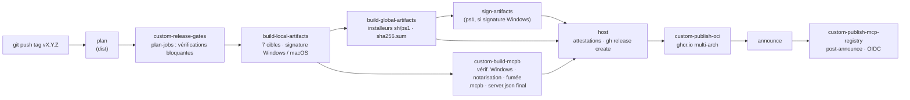

# 08 — Distribution, release et licence

> Ce document applique [00-decisions.md](00-decisions.md) (normatif), en particulier §1 (noms, variables `LF_*`), §2 (crates ; binaire `mcp-legifrance`, paquet Cargo `mcp-legifrance` dans `crates/lf-app`), §6 (protocole), §10 (tests live, Q3), §11 (ligne « Transverse Distribution », dès v0.1.0), §12 (distribution et licence) et §13 (Q1, Q2, Q3, Q4, Q5, Q11, Q13, Q15). Il détaille **comment** le binaire est construit, signé, empaqueté, publié et configuré chez l'utilisateur, ainsi que les obligations de licence et de conformité.
>
> **Révision** : alignée sur 00 révision 2 du 2026-10-15 (amendements AM-01…AM-43, journal en 00 §14 ; ici surtout AM-05, AM-14, AM-31 à AM-34, AM-39 et AM-40). Les choix adoptés par défaut sur une question de l'utilisateur sont appliqués et restent à confirmer : Q3 (tests live), Q5 (signature, MCPB), Q11 (`openWorldHint`), Q13 (canal Cargo), Q15 (attribution). Q1 (nom `mcp-legifrance`, dépôt renommé) et Q2 (Apache-2.0, titulaire « Loïc Wernert ») sont DÉCIDÉES le 2026-10-16 ; M0 et M1 sont livrés (plan 1) et leurs reports figurent en 00 §11.1 (paquet `lf-app` renommé `mcp-legifrance` en M4, `dist init` en M4, spike TLS en tâche de tête de M2, crates.io non tranché avant M5 : C6). Contrôle final du 2026-10-16 : les étiquettes alias sont remplacées par leur étiquette de référence (09 §2.1).
>
> Documents liés : [02-architecture.md](02-architecture.md) (arborescence, `lf-app`, CLI, configuration), [05-outils-mcp.md](05-outils-mcp.md) (§9 descriptor lock et SemVer de surface, §10.2 clients), [06-qualite.md](06-qualite.md) (CI, cargo-deny), [07-feuille-de-route.md](07-feuille-de-route.md) (tâches `T-Mx-yy`, M0 et M1 livrés), déclinée par des plans d'implémentation (« plan N, tâche M »), retirés : voir [README du plan §3.5](README.md#35-plans-dimplémentation-retirés), [09-risques-et-questions.md](09-risques-et-questions.md) (registre des vérifications et des risques), [annexes/A-parite.md](annexes/A-parite.md) §6 (note de migration), [annexes/C-api-legifrance.md](annexes/C-api-legifrance.md) §1.7 (CGU, Licence Ouverte), [annexes/D-mcp-2026-07-28.md](annexes/D-mcp-2026-07-28.md) (protocole), [index des ADR](../adr/README.md) (ADR-0005, ADR-0013).
>
> Conventions :
> - « La référence Python » désigne `matematicsolutions/fr-eli-mcp@d3b5b13` (v0.5.3, Apache-2.0).
> - Tous les extraits (TOML, YAML, JSON, Dockerfile, shell) sont des **esquisses non exécutées, à valider au jalon qui les implémente** ; les extraits Rust éventuels sont **non compilés, à valider au jalon qui les implémente**.
> - Un point non vérifié est marqué **NON VÉRIFIÉ** suivi d'une étiquette `[V-xx · étiquette]`, reprise au §11 puis dans le registre V-xx de [09-risques-et-questions.md](09-risques-et-questions.md).
> - Les URL du dépôt emploient son nom actuel, `muchiny/mcp-legifrance` : l'ancien `muchiny/mcp-ligitfrance` a été renommé par son propriétaire le 2026-10-16 (GitHub répond « This repository moved » au push) (00 §0, §13). La commande `cargo install --git` reprend la forme de 00 §12, `https://github.com/<dépôt>`, où `<dépôt>` est le nom du dépôt à la date de la release (dépôt renommé le 2026-10-16, Q1, C6).
> - Les vérifications faites spécialement pour ce document (lecture le 2026-10-15 des sources de `axodotdev/cargo-dist` v0.33.0, `modelcontextprotocol/registry` `11b7b0e`, `modelcontextprotocol/mcpb` `70fe3b3`, `microsoft/vscode` `3f98d21`, `anthropics/claude-code` `94506ff`, index sparse crates.io) sont listées dans la section [Sources](#sources).

---

## Sommaire

0. [Résumé](#0-résumé)
1. [Cibles et canaux](#1-cibles-et-canaux)
2. [cargo-dist : binaires et installeurs](#2-cargo-dist--binaires-et-installeurs)
3. [Signature, intégrité et provenance](#3-signature-intégrité-et-provenance)
4. [Bundle MCPB](#4-bundle-mcpb)
5. [Image OCI](#5-image-oci)
6. [Registre MCP](#6-registre-mcp)
7. [Processus de release](#7-processus-de-release)
8. [Configuration côté clients](#8-configuration-côté-clients)
9. [Licence et conformité](#9-licence-et-conformité)
10. [Jalons et critères d'acceptation](#10-jalons-et-critères-dacceptation)
11. [Points NON VÉRIFIÉS](#11-points-non-vérifiés)
12. [Divergences et questions ouvertes](#12-divergences-et-questions-ouvertes)
13. [Sources](#sources)

---

## 0. Résumé

- **Un seul binaire** `mcp-legifrance` (paquet Cargo `mcp-legifrance` dès M4, ex-`lf-app` livré ; répertoire `crates/lf-app`, 00 §1-§2 et §11.1 ; Q1 décidée le 2026-10-16), construit par **cargo-dist 0.33.0** (binaire `dist`) pour **7 cibles** : Linux x86_64/aarch64 en gnu et musl, macOS x86_64/aarch64, Windows x86_64 msvc. Il est publié en **GitHub Releases** avec archives, sommes SHA-256, installeurs shell et PowerShell, et attestations de provenance GitHub.
- **Quatre canaux** dès v0.1.0 : archives et installeurs ; **bundle MCPB** (`registryType: mcpb`, un bundle unique par version, installation en un clic) ; **image OCI** distroless non root sur `ghcr.io` (`registryType: oci`, seul type que la galerie de VS Code sait installer) ; **`cargo install --git … --tag vX.Y.Z --locked mcp-legifrance`**, documenté dans le README. Seuls le MCPB et l'image sont déclarés dans `server.json` : en v0.x, ni publication crates.io ni paquet `cargo` (00 §12, adopté par défaut, Q13 ; réexamen à v1.0.0). Décision C6 du 2026-10-16 : rien n'est tranché sur crates.io avant M5 ; le livré garde `version = "0.0.0"` et `publish = false` (`Cargo.toml:7`, `:12`).
- **Signature** (proposition adoptée par défaut, Q5) : Authenticode sous Windows (Smart App Control bloque les exécutables non signés, constat de la référence) par Azure Artifact Signing si le projet y est éligible, sinon SSL.com eSigner ; sous macOS, `codesign` par dist puis notarisation par un job `notarytool` dédié. Sans certificat : binaires non signés, avertissement explicite, et chemins de repli documentés (image OCI, WSL).
- **Registre MCP** : nom `io.github.muchiny/mcp-legifrance` (Q1), publication par `mcp-publisher` avec OIDC GitHub, **après** que le MCPB et l'image sont publics. Les versions publiées sont **immuables** : toute release est précédée de vérifications bloquantes (descriptor lock, versions alignées, tests, licences).
- **Aucune clé PISTE n'est jamais embarquée** : chaque utilisateur fournit `LF_PISTE_CLIENT_ID` et `LF_PISTE_CLIENT_SECRET` (CGU PISTE : clés « strictement réservées à votre application »). Pas de manifeste distant, pas de télémétrie, pas de mise à jour automatique (ADR-0005).
- **Licence** Apache-2.0 (Q2) avec `NOTICE` créditant la référence et ses fixtures ; aucune ligne issue des projets AGPL ; données Légifrance sous Licence Ouverte 2.0, avec la mention « Source : Légifrance / DILA — Licence Ouverte 2.0 » et la date de consultation (`fr_coverage`, instructions serveur, README ; adopté par défaut, Q15) et la mention de non-affiliation.

---

## 1. Cibles et canaux

### 1.1 Canaux de distribution

| Canal | Artefact | Public visé | Installation | Intégrité et confiance | `registryType` | Dès |
|---|---|---|---|---|---|---|
| GitHub Releases | archives `.tar.xz` (Unix) et `.zip` (Windows) par cible, `sha256.sum`, `dist-manifest.json`, archive source | tous | téléchargement manuel | SHA-256, attestation GitHub, signature OS (Q5) | — | v0.1.0 |
| Installeurs | `…-installer.sh` (Linux, macOS), `…-installer.ps1` (Windows) | développeurs, juristes à l'aise en terminal | `curl … \| sh`, `irm … \| iex` | HTTPS ; script PowerShell signé si Windows signé (§3.2) | — | v0.1.0 |
| **MCPB** | `mcp-legifrance-<version>.mcpb` (bundle unique multi-plateforme, §4) | juristes, Claude Desktop | double-clic, glisser-déposer | `fileSha256` vérifié par le client (recherche 06 §9.2) ; binaires signés à l'intérieur | `mcpb` | v0.1.0 |
| **Image OCI** | `ghcr.io/muchiny/mcp-legifrance:<version>` (linux/amd64, linux/arm64) | isolation, VS Code (galerie), Docker Desktop | `docker run -i --rm …` | digest, attestation, label du registre | `oci` | v0.1.0 |
| **Cargo (Git)** | sources du dépôt au tag `vX.Y.Z` (aucun crate publié en v0.x, Q13) | développeurs Rust | `cargo install --git https://github.com/<dépôt> --tag vX.Y.Z --locked mcp-legifrance` (§6.4) | tag protégé, `Cargo.lock` imposé par `--locked` ; **binaire non signé** compilé localement | — (non déclaré) | v0.1.0 ; le livré garde `version = "0.0.0"` et `publish = false` (`Cargo.toml:7`, `:12`) ; crates.io non tranché avant M5 (C6, 00 §12) |
| Registre MCP | `server.json` publié | clients et agrégateurs | découverte | namespace authentifié par OIDC GitHub ; preuve de propriété de chaque paquet | — | v0.1.0 |

La recherche 06 recommande le **MCPB comme paquet principal** pour un public non développeur, avec cargo et OCI en secondaires ; plusieurs entrées `packages[]` sont permises dans un même `server.json` (recherche 06 §9.3). Ici, le canal Cargo passe par `cargo install --git`, hors registre, jusqu'au réexamen de v1.0.0 (00 §12, Q13).

### 1.2 Cibles de compilation

Runners par défaut de cargo-dist 0.33.0, lus dans `cargo-dist/src/backend/ci/github.rs:666-708` ; drapeaux de compilation lus dans `cargo-dist/src/build/cargo.rs:97` et `:104`.

| Triple | Runner (défaut dist) | Mode | Drapeaux ajoutés par dist | Utilisé par |
|---|---|---|---|---|
| `x86_64-unknown-linux-gnu` | `ubuntu-22.04` | natif | — | archive, installeur sh |
| `aarch64-unknown-linux-gnu` | `ubuntu-22.04-arm` | natif (runners ARM gratuits ; CHANGELOG dist §« native arm64 runners ») | — | archive, installeur sh |
| `x86_64-unknown-linux-musl` | `ubuntu-22.04` + paquet apt `musl-tools` (`github.rs:795-801`) | natif, autre libc | `-Ctarget-feature=+crt-static -Clink-self-contained=yes` | archive, repli des installeurs si glibc trop ancienne (`cargo-dist/src/platform.rs:154-162`), **MCPB Linux**, **image OCI amd64** |
| `aarch64-unknown-linux-musl` | `ubuntu-22.04-arm` + `musl-tools` | idem | idem | archive, **MCPB Linux**, **image OCI arm64** |
| `x86_64-apple-darwin` | `macos-15-intel` | natif | — | archive, installeur sh, **MCPB macOS** |
| `aarch64-apple-darwin` | `macos-15` | natif | — | archive, installeur sh, **MCPB macOS** |
| `x86_64-pc-windows-msvc` | `windows-2022` | natif | `-Ctarget-feature=+crt-static` (dist l'ajoute toujours en msvc ; `msvc-crt-static = true` par défaut, book `reference/config.md:632-650`) | archive, installeur ps1, **MCPB Windows** |

Conséquences :
- Les binaires Linux gnu exigent la glibc du runner `ubuntu-22.04` (2.35). Les distributions plus anciennes passent par les binaires musl statiques, que les installeurs choisissent automatiquement (`platform.rs:154-162`).
- Windows ARM64 n'est pas une cible : ces machines exécutent le binaire x86_64 par émulation, **NON VÉRIFIÉ** [V-192 · windows-arm64-emulation]. Ajouter `aarch64-pc-windows-msvc` imposerait `cargo-xwin` et l'absence de signature (la signature dist ne couvre que x86_64, `reference/config.md:367`).
- Le **CRT statique Windows**, laissé en suspens par 02 §2.2, est tranché ainsi : le défaut de cargo-dist (`+crt-static`) s'applique aux binaires publiés. Aucun `rustflags` n'est ajouté dans `.cargo/config.toml`, qui sert au développement, et `cargo install --git` ignore de toute façon la configuration du dépôt (« the local configuration discovery is ignored », `cargo help install`, section « Configuration Discovery », cargo 1.97.0). Un utilisateur de `cargo install --git` sous Windows obtient donc un CRT dynamique, sans conséquence pour un développeur Rust qui a déjà l'environnement MSVC.

### 1.3 Ce qui n'est pas distribué

| Élément | Raison | Source |
|---|---|---|
| Paquet PyPI, `uvx` | le produit est un binaire Rust | 00 §12 |
| Manifeste runtime distant (`fr-runtime.json.gz` de la référence) | supprimé : risque de redirection du jeton et télémétrie d'activation | E-07, D-04, ADR-0005 ; référence `release.yml:44-69` |
| Programme de mise à jour (`install-updater`) | appel réseau supplémentaire non sollicité ; mise à jour = réinstallation explicite | ADR-0005 ; `reference/config.md:911-928` |
| MSI, Homebrew, npm, winget, paquets deb/rpm | hors périmètre v0.1 ; possibles plus tard (dist sait produire MSI, Homebrew et npm, `reference/config.md:761-788`) | question ouverte §12.2 |
| Identifiants PISTE de démonstration | interdit par les CGU | §9.7 |
| Crates `lf-*` et `mcp-legifrance` sur crates.io, paquet `cargo` dans `server.json` | en v0.x, `cargo install --git` suffit ; publier engagerait une stabilité semver publique sur des API internes ; réexamen à v1.0.0 (§6.4) | 00 §12, Q13 |
| Bundles MCPB par architecture | ni MCPB ni `server.json` n'ont de sélecteur d'architecture : un bundle unique par version (§4.1) | 00 §12, Q5 ; V-197 |
| Fonctionnalités `http` (M8) et `dila` (M9) | désactivées par défaut (02 §3.7) ; activées dans les binaires publiés seulement à leur jalon (§10) | 00 §11 |

### 1.4 Hôtes contactés

La recherche 06 §6 demande de documenter la liste exhaustive des hôtes contactés (contrôle de l'egress). Elle figure dans le README et dans `PRIVACY.md` :

| Composant | Hôtes | Quand |
|---|---|---|
| Binaire `mcp-legifrance`, `LF_PISTE_ENV=sandbox` (défaut) | `sandbox-oauth.piste.gouv.fr`, `sandbox-api.piste.gouv.fr` | au premier appel d'outil, jamais au démarrage (00 §6) |
| Binaire, `LF_PISTE_ENV=production` | `oauth.piste.gouv.fr`, `api.piste.gouv.fr` ; ces URL n'ont jamais été appelées par le projet, **NON VÉRIFIÉ** [V-59 · oauth-production-live] | idem |
| Binaire avec surcharges `LF_PISTE_OAUTH_URL` / `LF_PISTE_BASE_URL` | l'hôte fourni : `https` obligatoire (`http` admis vers 127.0.0.1, ::1 et localhost seulement) ; hors des quatre hôtes officiels, avertissement `CustomHost` au démarrage, dans `check-config` et en lacune de `fr_coverage` ; un hôte officiel de l'autre environnement est le problème `EnvMismatch` (00 §1, 02 §8.2) | idem |
| Binaire, M9 (`dila`) | aucun : le binaire lit les dumps dans un répertoire local (proposition par défaut de 02 §3.9 ; `reqwest` est confiné à `lf-adapter-piste`, règle R6 et ban `wrappers` de `deny.toml`) | — |
| Script de téléchargement des dumps (M9, hors binaire, 02 §3.9) | `echanges.dila.gouv.fr` | lancé explicitement par l'utilisateur |
| Installeurs sh/ps1 | `github.com` et l'hôte de redirection des assets de release | à l'installation |
| `cargo install --git` | `github.com` (clone du dépôt au tag), `index.crates.io`, `static.crates.io` (dépendances) | à l'installation |
| Image OCI | `ghcr.io` | au `docker pull` |

Aucune télémétrie, aucune vérification de version en ligne. Derrière un proxy d'entreprise, le binaire utilise le proxy système de reqwest (feature `system-proxy`, 00 §8) ; la prise en compte de `HTTPS_PROXY` reste **NON VÉRIFIÉE** [V-03 · reqwest-proxy-env] (04 §4.2). Les installeurs shell et PowerShell de dist respectent `HTTPS_PROXY` (CHANGELOG dist, section « PowerShell installer now supports proxies »).

### 1.5 Contenu commun des artefacts

Chaque archive, le bundle MCPB et l'image OCI contiennent :

| Fichier | Rôle | Comment |
|---|---|---|
| `LICENSE` | Apache-2.0 | inclus automatiquement par dist (`auto-includes`, `reference/config.md:418-433`) |
| `NOTICE` | attributions (§9.2) | `include = ["NOTICE", …]` (dist ne l'inclut pas d'office) |
| `THIRD_PARTY_LICENSES.md` | licences des crates liés statiquement (§9.3) | généré par `cargo about`, versionné, vérifié en CI |
| `README.md`, `CHANGELOG.md` | documentation | `auto-includes` |

Les installeurs shell et PowerShell ne copient que le binaire (« Will throw out all files except for the binary », book `installers/shell.md`, `installers/powershell.md`) : le binaire ne dépend donc d'aucun fichier annexe, et ces documents restent dans l'archive et sur la page de release.

---

## 2. cargo-dist : binaires et installeurs

### 2.1 Outil, version et fichiers

- **Version** : `cargo-dist-version = "0.33.0"`, la dernière publiée sur GitHub (2026-09-10). crates.io n'a que 0.32.0 (recherche 04 §4.1). Le workflow généré télécharge dist depuis GitHub ; aucun `cargo install cargo-dist` n'est nécessaire. Le binaire s'appelle `dist`.
- **Emplacement de la configuration** : pour un workspace Rust initialisé pour la première fois, `dist init` écrit **`dist-workspace.toml`** avec `[workspace] members = ["cargo:."]` et une section `[dist]` (`cargo-dist/src/init.rs:79-92`, `:284-333`, lus). Cela lève l'incertitude notée par 02 §2.2 ([V-169 · cargo-dist-emplacement-config]), à confirmer au premier `dist init` (M4, 00 §11.1).
- **Profil** : `dist init` ajoute `[profile.dist]` avec `inherits = "release"` (`init.rs:398-416`). Il hérite donc de `lto = "thin"`, `codegen-units = 1` et `panic = "unwind"` (02 §2.2). dist compile toujours avec `--profile=dist` (book `artifacts/archives.md`).
- **`release.yml` généré** : il ne doit jamais être édité à la main (02 §2) ; dist le considère comme une erreur s'il est modifié (book `ci/customizing.md`, « Hand-editing release.yml »). Nos ajouts passent par des **jobs personnalisés**, qui sont des workflows réutilisables (§7.4).
- **Toolchain** : dist ne fixe pas de toolchain (`rust-toolchain-version` est déprécié, `reference/config.md:694-713`). `rust-toolchain.toml` (livré : canal `stable` flottant ; épinglage sur 1.99.0 avec `llvm-tools-preview` en tâche de tête de M2, 00 §11.1) s'applique donc aux builds de release.

### 2.2 Esquisse de `dist-workspace.toml`

```toml
# dist-workspace.toml — esquisse non exécutée, à valider au jalon qui l'implémente (`dist init`, puis `dist plan` ; `dist init` en M4, 00 §11.1)
[workspace]
members = ["cargo:."]

[dist]
cargo-dist-version = "0.33.0"
packages = ["mcp-legifrance"]        # paquet du binaire (crates/lf-app, 00 §2 ; renommé depuis `lf-app` en M4, 00 §11.1) ; seul distribué (xtask est `publish = false`) ; reference/config.md:202-215
ci = ["github"]
targets = [
  "x86_64-unknown-linux-gnu",  "aarch64-unknown-linux-gnu",
  "x86_64-unknown-linux-musl", "aarch64-unknown-linux-musl",
  "x86_64-apple-darwin",       "aarch64-apple-darwin",
  "x86_64-pc-windows-msvc",
]
installers = ["shell", "powershell"]
install-path = "~/.mcp-legifrance/bin"   # proposition (§2.5) ; défaut dist : CARGO_HOME
install-updater = false                  # ADR-0005
checksum = "sha256"                      # .sha256 par archive + sha256.sum unifié (book artifacts/checksums.md)
include = ["NOTICE", "THIRD_PARTY_LICENSES.md"]
cargo-auditable = true                   # dépendances embarquées dans le binaire (cargo audit bin)
cargo-cyclonedx = true                   # SBOM CycloneDX (bom.xml) dans les archives
pr-run-mode = "plan"                     # « upload » temporairement pendant les spikes TLS (tâche 0 de M2 ; fait autrement au plan 2c : workflow `tls-spike.yml`, `cargo build --target`)
fail-fast = false

# Provenance : attestations sur TOUS les fichiers de la release, y compris le MCPB et server.json (§3.5)
github-attestations = true
github-attestations-phase = "host"
github-release = "host"                  # requis avec la phase « host » (reference/config.md:1171-1172)
github-attestations-filters = ["*.tar.xz", "*.zip", "*.sh", "*.ps1", "*.mcpb", "*.sha256", "sha256.sum", "server.json", "*.json"]

# Signature (Q5, proposition par défaut : Azure Artifact Signing si éligible, sinon SSL.com ; Apple Developer pour macOS).
# Aucune ligne de signature active tant que Q5 n'est pas tranchée et que les secrets n'existent pas (§10).
# macos-sign = true                      # expérimental, variables CODESIGN_* (§3.3)
# Windows : UN SEUL des deux fournisseurs (cargo-dist/src/sign/mod.rs : erreur si les deux)
# ssldotcom-windows-sign = "prod"
# [dist.azure-windows-sign]
# endpoint = "https://weu.codesigning.azure.net/"
# account-name = "<compte>"
# certificate-profile-name = "<profil>"

# Jobs personnalisés (§7.4) : workflows réutilisables .github/workflows/<nom>.yml
plan-jobs = ["./release-gates"]
global-artifacts-jobs = ["./build-mcpb"]
publish-jobs = ["./publish-oci"]        # « ./publish-crates » seulement si la publication crates.io est retenue à v1.0.0 (Q13)
post-announce-jobs = ["./publish-mcp-registry"]

[dist.github-custom-job-permissions]
"release-gates" = { contents = "read" }
"build-mcpb" = { contents = "read" }
"publish-oci" = { contents = "read", packages = "write", id-token = "write", attestations = "write" }
"publish-mcp-registry" = { contents = "read", id-token = "write" }

# Épinglage par SHA des actions utilisées par le workflow généré (D-44) ; SHA à relever [V-26 · actions-versions-sha] ; en retard sur la CI livrée (M1-D15, hygiène à faire tout de suite, 00 §11.1)
[dist.github-action-commits]
"actions/checkout" = "<sha de v6>"
"actions/upload-artifact" = "<sha de v7>"
"actions/download-artifact" = "<sha de v8>"
"actions/attest" = "<sha de v4>"
"swatinem/rust-cache" = "<sha de v2>"
"azure/login" = "<sha de v2>"            # seulement si Azure Artifact Signing
```

Points de configuration :
- **`packages = ["mcp-legifrance"]`** évite toute ambiguïté : seul le paquet `mcp-legifrance` (répertoire `crates/lf-app`, 00 §2, 02 §3.7) porte un `[[bin]]` en dehors de xtask (02 §4.2, étape 5).
- **Signature** : l'esquisse ne contient aucune ligne active tant que Q5 n'est pas tranchée (00 §13, échéance avant v0.1.0). La réponse active soit `[dist.azure-windows-sign]`, soit `ssldotcom-windows-sign`, et `macos-sign = true` si un compte Apple Developer existe (§3.8).
- **Actions par défaut** de dist 0.33.0 : `actions/checkout@v6`, `actions/upload-artifact@v7`, `actions/download-artifact@v8`, `actions/attest@v4`, `swatinem/rust-cache@v2`, `actions/setup-node@v6`, `azure/login@v2` (`github.rs:377-385`). `github-action-commits` les remplace par des SHA (`reference/config.md:1537-1550`), ce qui corrige D-44.
- **Permissions des jobs personnalisés** : par défaut, un job de publication personnalisé reçoit `{ id-token = "write", packages = "write" }`, et redéfinir ses permissions retire ces valeurs par défaut (`reference/config.md:1498-1516`). Les permissions sont donc déclarées explicitement et au plus juste.
- **Fonctionnalités Cargo** : aucune en v0.1 à v0.3. `features = ["http"]` à partir de v0.4.0 si Q4 le permet, `dila` à partir de v1.0.0 (§10). dist impose alors des builds précis si les paquets divergent (`reference/config.md:652-691`), ce qui est sans effet ici : un seul paquet est distribué.

### 2.3 Métadonnées Cargo nécessaires

```toml
# Cargo.toml racine — complément de 02 §3.0.2, non exécuté, à valider au jalon qui l'implémente
[workspace.package]
version = "0.1.0"       # livré : 0.0.0 avec publish = false (Cargo.toml:7, :12) ; 0.1.0 en M5
edition = "2024"
rust-version = "1.88"   # MSRV livrée (00 §2), réévaluée par ADR si le job MSRV casse à l'arrivée de rmcp en M4
license = "Apache-2.0"
repository = "https://github.com/muchiny/mcp-legifrance"   # Q1 décidée (2026-10-16), livré : Cargo.toml:11
homepage = "https://github.com/muchiny/mcp-legifrance"
readme = "README.md"                    # relatif à la racine du workspace (doc Cargo, workspaces.md)
keywords = ["mcp", "legifrance", "law", "france", "legal"]
categories = ["command-line-utilities"]

[profile.dist]
inherits = "release"
lto = "thin"
```

- Le paquet `mcp-legifrance` hérite de `readme.workspace = true`. C'est sans effet en v0.x, puisqu'aucun crate n'est publié (00 §12, Q13 ; crates.io non tranché avant M5, C6). Si la publication crates.io est retenue à v1.0.0, le README racine, qui porterait alors le jeton `mcp-name:` (§6.4), deviendrait celui du crate publié. Cargo résout `readme` hérité par rapport à la racine du workspace (doc Cargo `reference/workspaces.md`, tableau des clés héritables).
- Chaque crate bibliothèque reçoit une `description` explicite, par exemple « Composant interne de mcp-legifrance ; aucune garantie de stabilité d'API ». Elle ne coûte rien et prépare le réexamen de v1.0.0 : crates.io exige `description` et `license`, et l'API publique de ces crates n'est pas un produit (§6.4).

### 2.4 TLS : aws-lc ou ring selon les cibles

La décision (00 §8, §11.1) retient provisoirement l'option A (plan 2c) ; la matrice est à déclencher (`.github/workflows/tls-spike.yml`, manuel, par le propriétaire). 04 §4.1 décrit les options A (`reqwest/rustls`, aws-lc, retenue) et B (`rustls-no-provider` + `ring`, installé par `build_client`, dans `finish_client` : ADR-0013 §7). La distribution ajoute ses propres contraintes :

| Contexte de compilation | Option A (aws-lc) | Option B (ring) | À mesurer (mesuré en gras) |
|---|---|---|---|
| Runners dist Linux gnu (x86_64, aarch64), compilation native | `aws-lc-sys` exige une chaîne C (`cc`, parfois `cmake`, voire `bindgen`) (recherche 04 §4.1) | compilateur C pour les parties C et assembleur de ring | durée, taille, réussite. **Mesuré (plan 2c, x86_64 gnu, `gcc` 15.3.1, ni `cmake` ni NASM installés)** : A compile avec `cc` seul (`aws-lc-sys` construit avec le builder `CC`), 22,6 s et 5,4 Mio strippés ; B 13,0 s et 3,5 Mio strippés |
| Runners dist Linux **musl** (`musl-tools`, `+crt-static`, `link-self-contained`) | `aws-lc-sys` compilé avec `musl-gcc` : **non mesuré avec `musl-gcc`** (`CC_<cible>=musl-gcc`, posé par `tls-spike.yml`) ; **mesuré** : sans compilateur C musl, A et B échouent à l'identique (`failed to find tool "x86_64-linux-musl-gcc"`) | idem, plus simple selon la recherche 04 §4.2 | réussite sur les deux architectures |
| macOS (x86_64 et aarch64), natif | Xcode CLT présents sur les runners ; **non mesuré** (`tls-spike.yml`) | idem | — |
| Windows msvc `+crt-static` | besoin éventuel de NASM ou de cmake, cohérence avec le CRT statique ; **non mesuré** | idem | réussite, taille |
| Étape « source » du Dockerfile (§5.2) | paquets à ajouter à l'image de build | idem | idem |
| **`cargo install --git` chez l'utilisateur** | la chaîne C et éventuellement cmake doivent exister sur **sa** machine | dépendances natives plus légères | friction d'installation sous Windows et macOS |

Résultat **provisoire** ([V-02 · tls-fournisseur-cross] partiel, 09 §2.20) : A reste le défaut tant que le workflow ne montre ni `cmake`/NASM exigé chez l'utilisateur ni échec musl propre à aws-lc (ADR-0013 §7). Biais : `cmake` et NASM (sous Windows) sont vraisemblablement préinstallés sur les images GitHub : un succès ne prouve pas qu'un poste vierge compile. Bascule A→B : ADR-0013 §7. Si le workflow montre qu'aws-lc impose cmake ou NASM sur les postes utilisateurs, retenir ring (option B), qui rend le canal `cargo install --git` plus fiable. Le résultat final sera consigné dans ADR-0013 et dans le risque TLS de [09-risques-et-questions.md](09-risques-et-questions.md).

Racines de certificats : `rustls-platform-verifier` délègue au vérificateur du système sous macOS et Windows, et lit le magasin CA du système sous Linux (04 §4.1). Les proxys d'entreprise qui interceptent TLS fonctionnent donc si leur racine est installée dans le système. L'image OCI doit embarquer un magasin CA (§5).

La taille des binaires selon la cible et le fournisseur, ainsi que celle du bundle MCPB qui en contient cinq, est **NON VÉRIFIÉE** [V-18 · binaire-taille-memoire] : mesures locales ci-dessus (x86_64 gnu) ; reste la matrice (`tls-spike.yml`).

### 2.5 Artefacts produits et installeurs

cargo-dist nomme archives et installeurs d'après le **nom du paquet** (`app_name = package_info.name`, `cargo-dist/src/tasks.rs:1323` ; variante `{release_id}-{target}`, `:1397` ; installeurs `{release_id}-installer.sh` et `.ps1`, `:2063`, `:2313`). Le paquet `lf-app` étant renommé `mcp-legifrance` en M4 (C6, 00 §11.1), donc avant v0.1.0, une release v0.1.0 contient :

| Fichier | Contenu |
|---|---|
| `mcp-legifrance-<triple>.tar.xz` (Unix) / `mcp-legifrance-x86_64-pc-windows-msvc.zip` | binaire `mcp-legifrance` (`.exe`), LICENSE, NOTICE, THIRD_PARTY_LICENSES.md, README, CHANGELOG, `bom.xml` |
| `mcp-legifrance-<triple>.tar.xz.sha256` (etc.) et `sha256.sum` | sommes par archive et somme unifiée, vérifiable par `sha256sum -c` (book `artifacts/checksums.md`, depuis 0.24.0) |
| `mcp-legifrance-installer.sh`, `mcp-legifrance-installer.ps1` | installeurs |
| `source.tar.gz` (+ `.sha256`) | archive source (défaut `source-tarball = true`) |
| `dist-manifest.json` | manifeste machine de la release |
| `mcp-legifrance-<version>.mcpb` (+ `.sha256`), `server.json` | ajoutés par le job `build-mcpb` (§4.5) |

Paquet et binaire portent le même nom (`[[bin]] name = "mcp-legifrance"`, 02 §3.7) : archives, installeurs et binaire s'appellent tous `mcp-legifrance`, ce qui résout le point 1 du §12.1 (renommage du paquet en M4). Le MCPB (`mcp-legifrance-<version>.mcpb`) ne se confond pas avec les archives, dont le nom porte un triple de cible.

**Installeurs** (commande affichée par dist, book `installers/shell.md` et `installers/powershell.md`) :

```sh
# Linux, macOS — esquisse
curl --proto '=https' --tlsv1.2 -LsSf https://github.com/muchiny/mcp-legifrance/releases/download/v0.1.0/mcp-legifrance-installer.sh | sh
```

```powershell
# Windows — esquisse
powershell -c "irm https://github.com/muchiny/mcp-legifrance/releases/download/v0.1.0/mcp-legifrance-installer.ps1 | iex"
```

- **Répertoire d'installation proposé : `~/.mcp-legifrance/bin`** au lieu du défaut `CARGO_HOME` (`~/.cargo/bin`, `reference/config.md:865-908`). Le public juriste n'a pas de toolchain Rust, et un `~/.cargo/bin` créé pour l'occasion serait trompeur. Le chemin cascade `["$VAR/bin", "~/…"]` impliquerait une nouvelle variable d'environnement, absente de 00 §1 : on s'en abstient.
- Les installeurs ajoutent ce répertoire au `PATH` : fichier `env` sourcé sous Unix, clé `HKCU:\Environment` sous Windows (book `installers/powershell.md`, « Adding things to PATH »). Une application graphique déjà lancée (Claude Desktop, VS Code) ne voit pas le nouveau `PATH` : la documentation des clients utilise des **chemins absolus** (§8.1).
- Les installeurs ne vérifient les sommes que partiellement (book `artifacts/checksums.md`, travail « en cours »). La documentation propose donc aussi la voie « télécharger, vérifier (`sha256sum -c`, `gh attestation verify`), puis extraire » (§3.4, §3.5).

### 2.6 Vérifier localement et en PR

- `dist plan` : ce que la CI construira, sans rien compiler ; exécuté sur chaque PR (`pr-run-mode = "plan"`, `reference/config.md:1420-1437`).
- `dist build` : artefacts de la plateforme locale.
- Spikes TLS (tâche 0 de M2, 00 §11.1 ; fait autrement au plan 2c, sans `dist` : workflow manuel `tls-spike.yml` par `cargo build --target`, matrice à déclencher) : une PR dédiée passerait temporairement en `pr-run-mode = "upload"` pour construire les 7 cibles avec chacune des deux options TLS, et avec la signature en mode test si un compte existe (`ssldotcom-windows-sign = "test"` ou profil Azure « Public Trust Test », book `supplychain-security/signing/windows.md`).

---

## 3. Signature, intégrité et provenance

### 3.1 Vue d'ensemble

| Plateforme ou artefact | Mécanisme | Outil | Secrets | Condition | Sans la condition |
|---|---|---|---|---|---|
| Windows `.exe`, `.ps1` | Authenticode | dist : SSL.com eSigner ou Azure Artifact Signing (`reference/config.md:353-414`) | voir §7.7 | Q5 | non signé ; Smart App Control bloque (§3.2) |
| macOS (binaires) | `codesign` (Developer ID, runtime renforcé) | dist `macos-sign = true` (expérimental) | `CODESIGN_*` | Q5 (Apple Developer Program) | non signé ; Gatekeeper sur les fichiers en quarantaine |
| macOS (binaires) | notarisation | **job personnalisé** `xcrun notarytool` (dist ne notarise pas) | clé API App Store Connect | Q5 | — |
| Toutes les archives | SHA-256 | dist | — | toujours | — |
| Toute la release | attestation de provenance GitHub (Sigstore) | dist `github-attestations` (`actions/attest@v4`) | OIDC | dépôt public (book `attestations/github.md`) | sommes seules |
| Image OCI | digest, attestation de provenance | job `publish-oci` | OIDC | dépôt public | digest seul |
| MCPB | `fileSha256` dans `server.json` ; signature `mcpb sign` facultative | job `build-mcpb` | — | toujours (sha) | — |
| `cargo install --git` (Q13) | tag protégé du dépôt (`--tag`), `Cargo.lock` imposé (`--locked`) | Cargo, chez l'utilisateur | — | toujours | binaire **non signé**, compilé localement (§3.2) ; aucun crate publié en v0.x (§6.4) |

### 3.2 Windows : Authenticode et Smart App Control

**Constat de la référence.** Smart App Control (Windows 11) « bloque les exécutables non signés, sans demander et sans exception par programme ». Cela visait les lanceurs `fr-eli-mcp.exe`, `uvx.exe` et `pip.exe` générés localement, alors que `python.exe` passait parce qu'il est signé par la Python Software Foundation (référence `src/fr_eli_mcp/__main__.py:1-9`, docstring en polonais, signalement utilisateur du 2026-07-05 ; `README.md:22-42`). La référence déconseille de désactiver Smart App Control, qui ne peut être réactivé qu'en réinstallant Windows (`README.md:41-42`).

**Conséquences pour un binaire Rust.** Il n'existe pas d'interpréteur signé derrière lequel s'abriter : `mcp-legifrance.exe` doit être signé lui-même pour fonctionner sur un poste où Smart App Control est actif. Il faut distinguer deux mécanismes :

| Mécanisme | Déclencheur | Sans signature | Avec signature Authenticode reconnue |
|---|---|---|---|
| SmartScreen | fichier marqué « Mark of the Web » (téléchargé par un navigateur) | avertissement « Windows a protégé votre ordinateur » ; l'installeur PowerShell ne le déclenche pas (book `signing/windows.md`) | plus d'avertissement (selon la réputation du certificat) |
| Smart App Control | **tout** exécutable lancé, quelle que soit son origine (constat de la référence) | blocage | exécution autorisée si la signature est valide et de confiance : **NON VÉRIFIÉ** [V-173 · sac-signature-suffit] |

**Mise en œuvre (si Q5 = certificat disponible).** Proposition adoptée par défaut (00 §12-§13, Q5) : Azure Artifact Signing si le projet y est éligible, sinon SSL.com eSigner, seuls fournisseurs pris en charge par cargo-dist.
- cargo-dist signe les `.exe`, `.msi` et `.ps1` (`cargo-dist/src/sign/mod.rs`, fonction `sign`) au moyen de **SSL.com eSigner** (`ssldotcom-windows-sign = "prod"`) ou d'**Azure Artifact Signing** (`[dist.azure-windows-sign]`, ajouté en 0.33.0 selon le CHANGELOG ; `reference/config.md` indique « since 0.32.0 »). Les deux sont exclusifs.
- Depuis juillet 2023, les certificats de signature de code ne s'émettent plus que sur HSM, d'où le recours à des services de signature en nuage (book `signing/windows.md`). Un certificat personnel sur clé USB n'est **pas** utilisable par dist en CI.
- Azure Artifact Signing s'authentifie par OIDC (`azure/login`) et exécute les jobs de build dans l'environnement GitHub `release`, avec un sujet fédéré `repo:OWNER/REPO:environment:release` (`reference/config.md:403-413`). Les conditions d'éligibilité (pays, personne morale ou physique) et le coût sont **NON VÉRIFIÉS** [V-193 · azure-artifact-signing-eligibilite]. SSL.com exige un certificat « EV Code Signing » et un secret TOTP (book `signing/windows.md`).
- La signature ne couvre que x86_64 (`reference/config.md:367`), ce qui suffit ici (§1.2).
- Le binaire signé est celui qui finit dans l'archive `.zip`, dans le MCPB (§4) et derrière l'installeur PowerShell, lui-même signé par un job dist dédié (`release.yml.j2`, job `sign-artifacts`).

**Contrôles CI (job `build-mcpb`, partie Windows, §4.5)** : `Get-AuthenticodeSignature mcp-legifrance.exe` doit renvoyer `Valid` ; on exécute ensuite le binaire avec une requête `initialize` (§4.5, étape 3).

**Si Q5 = pas de certificat** :
- Les binaires Windows sont publiés non signés. Le README et les notes de release le disent en tête.
- Chemins de repli pour les postes où Smart App Control est actif, à documenter : **image OCI** via Docker Desktop (le client lance `docker.exe`, signé par son éditeur) et **WSL** (binaire Linux). Leur fonctionnement sous Smart App Control est inclus dans [V-173 · sac-signature-suffit].
- `cargo install --git` produit dans tous les cas un binaire **non signé** compilé localement, donc bloqué par Smart App Control. Le README le signale : ce canal vise les développeurs, qui ont rarement Smart App Control actif.
- Jamais de conseil de désactivation de Smart App Control.

### 3.3 macOS : signature et notarisation

- **Signature par dist** : `macos-sign = true`, option expérimentale, acceptée au niveau du workspace seulement (`cargo-dist/src/config/v0.rs:771`, `init.rs:1428`). Sur un hôte darwin, dist importe le certificat dans un trousseau éphémère et appelle `/usr/bin/codesign --sign "$CODESIGN_IDENTITY" [--options "$CODESIGN_OPTIONS"]` sur chaque exécutable (`cargo-dist/src/sign/macos.rs:1-21`, `:167-215`). Les variables lues sont `CODESIGN_IDENTITY`, `CODESIGN_CERTIFICATE` (PKCS#12 en base64), `CODESIGN_CERTIFICATE_PASSWORD` et `CODESIGN_OPTIONS` (CHANGELOG dist, « macOS code signing now supports the --options flag »). On pose **`CODESIGN_OPTIONS=runtime`**, car le runtime renforcé est exigé par la notarisation. La transmission de ces variables aux jobs de build par le workflow généré, et le comportement exact de cette option expérimentale, sont **NON VÉRIFIÉS** [V-194 · cargo-dist-macos-sign].
- **Notarisation** : dist ne la fait pas (« In the future, this module will also support notarization », `sign/macos.rs:21` ; book `supplychain-security/index.md:12`, « 🔜 macOS Codesigning »). Le job `build-mcpb` (§4.5) a donc une étape macOS qui :
  1. récupère les deux binaires darwin signés dans les artefacts du build ;
  2. vérifie la signature (`codesign --verify --strict --verbose=2`, `codesign -d --entitlements -`) ;
  3. les zippe et les soumet (`xcrun notarytool submit … --key … --key-id … --issuer … --wait`) ;
  4. échoue si le statut n'est pas `Accepted`.

  Un exécutable nu ne peut pas recevoir d'agrafe (`stapler` ne vise que les `.app`, `.pkg` et `.dmg`) : Gatekeeper vérifie le ticket en ligne au premier lancement d'un fichier en quarantaine. Ce comportement, hors ligne compris, est **NON VÉRIFIÉ** [V-195 · macos-notarisation-binaire-nu].
- **Quand Gatekeeper intervient** : sur un fichier portant l'attribut de quarantaine (téléchargement par navigateur). `curl` ne le pose pas, l'installeur shell n'est donc pas concerné. Pour le binaire extrait d'un MCPB par Claude Desktop, c'est **NON VÉRIFIÉ** [V-174 · mcpb-quarantaine-macos].
- **Compte Apple** : la proposition adoptée par défaut de Q5 prévoit un compte Apple Developer, pour `codesign` et la notarisation (00 §12-§13).
- **Sans compte Apple (Q5)** : binaires non signés. Le README recommande l'installeur shell ou `cargo install --git`. Il mentionne le message de Gatekeeper pour les téléchargements par navigateur, sans recommander de désactiver Gatekeeper ; seule la procédure documentée par Apple pour autoriser un logiciel précis est décrite.

### 3.4 Sommes de contrôle

- dist produit un `.sha256` par archive et un fichier unifié `sha256.sum` (book `artifacts/checksums.md`). Vérification : `sha256sum -c sha256.sum --ignore-missing`.
- Le bundle MCPB a son propre `mcp-legifrance-<version>.mcpb.sha256`, et sa somme est reportée dans `server.json` (`fileSha256`), que les clients **doivent** vérifier avant l'installation (description du champ dans `server.schema.json` ; `package-types.mdx`, « MCPB Packages »). Le registre ne la vérifie pas lui-même.
- Image OCI : le digest `sha256:…` est publié dans les notes de release.
- Ordre impératif : la somme du MCPB est calculée **après** l'éventuel `mcpb sign`, qui modifie le fichier (`mcpb/src/node/sign.ts` ajoute la signature à l'archive).

### 3.5 Attestations de provenance (SLSA / GitHub)

- `github-attestations = true` avec la phase `host` : l'étape « Attest » (`actions/attest@v4`) porte sur `artifacts/<filtre>` pour chaque filtre de `github-attestations-filters` (partiel `publish_github.yml.j2` ; `reference/config.md:1139-1191`). Tous les fichiers de la release sont couverts, y compris ceux des jobs personnalisés, à condition qu'ils soient téléversés comme artefacts de workflow nommés `artifacts-*` (§4.5).
- Conditions : dépôt public, ou dépôt privé d'une organisation GitHub Enterprise ; les attestations d'un dépôt public sont inscrites dans le journal public Rekor de Sigstore (book `supplychain-security/attestations/github.md`).
- Vérification par l'utilisateur, documentée dans le README :
  ```sh
  gh attestation verify mcp-legifrance-x86_64-unknown-linux-musl.tar.xz --repo muchiny/mcp-legifrance
  gh attestation verify mcp-legifrance-0.1.0.mcpb --repo muchiny/mcp-legifrance
  gh attestation verify oci://ghcr.io/muchiny/mcp-legifrance:0.1.0 --repo muchiny/mcp-legifrance
  ```
- Niveau SLSA atteint (prédicat de provenance SLSA v1 ; niveau de build 2 ou 3 selon l'usage de workflows réutilisables) et entrées exactes d'`actions/attest@v4` pour une image OCI : **NON VÉRIFIÉ** [V-171 · sbom-provenance-outils] (V-171 ; le choix des outils est fait, §3.5-§3.6). Le plan ne revendique aucun niveau SLSA tant que ce point n'est pas vérifié.

### 3.6 SBOM et dépendances embarquées

- `cargo-cyclonedx = true` place un `bom.xml` CycloneDX dans chaque archive (`reference/config.md:731-742`). Dernière version du crate : 0.5.9 (index crates.io, 2026-03-19).
- `cargo-auditable = true` embarque la liste des dépendances dans le binaire, que `cargo audit bin` exploite (`reference/config.md:715-729`). Dernière version : 0.7.7 (index, 2026-10-02).
- L'image OCI reprend le même binaire, donc les mêmes informations.

### 3.7 Durcissement de la chaîne CI (D-44)

La référence téléchargeait `mcp-publisher` en `latest` par `curl | tar` sans somme, épinglait ses actions par tag et publiait sur PyPI avec un jeton (D-44 ; référence `release.yml:40-42`, `:82-85`). Ici :

| Mesure | Mise en œuvre |
|---|---|
| Actions épinglées par SHA | `github-action-commits` pour le workflow généré ; SHA en dur dans nos workflows réutilisables ; mises à jour par Dependabot (`github-actions`, 02 §2) |
| Outils téléchargés à version fixe et vérifiés | `mcp-publisher` en **v1.8.1** (dernier tag au 2026-10-15, `git ls-remote`) téléchargé depuis la release du tag et vérifié contre le fichier de sommes publié par goreleaser (signé par cosign, `registry/.goreleaser.yaml`). Nom exact de ce fichier : **NON VÉRIFIÉ** [V-206 · mcp-publisher-checksums] |
| Pas de jeton longue durée | OIDC pour le registre MCP, l'attestation, GHCR (`GITHUB_TOKEN`) et Azure ; aucun jeton crates.io en v0.x, faute de publication (Q13) ; à v1.0.0, OIDC si possible (§6.4) |
| Environnement protégé | environnement GitHub `release`, limité aux tags `v*` et éventuellement soumis à un relecteur ; **à créer avant la première étiquette (T-MD-16 : relevé du 2026-10-30, aucun environnement n'existe)** (recommandation du registre : `docs/modelcontextprotocol-io/github-actions.mdx`, « Securing your registry token in CI ») |
| Pas de `pull_request_target` | aucun workflow de publication ne s'exécute sur du code de PR (même source) |
| Analyse statique des workflows | `zizmor` et `actionlint` en CI (06) |
| Tags protégés | règle de protection des tags `v*` : seuls les mainteneurs créent un tag ; **à créer avant la première étiquette (T-MD-16)** |

Attention à la tension entre épinglage et compatibilité : un `mcp-publisher` trop ancien échoue avec `invalid audience` face au registre (`github-actions.mdx`, section « Troubleshooting »). La version épinglée est donc relevée à chaque release, et l'échec est traité comme un signal de mise à jour, pas comme un incident.

### 3.8 Décision Q5 : configurations possibles

| Q5 | Windows | macOS | Communication |
|---|---|---|---|
| Certificat Windows **et** compte Apple (proposition adoptée par défaut, 00 §12-§13) | `azure-windows-sign` si éligible, sinon `ssldotcom-windows-sign` | `macos-sign = true` + notarisation | « binaires signés et notarisés » |
| Certificat Windows seul | signé | non signé | macOS : installeur shell recommandé |
| Compte Apple seul | non signé, avertissement Smart App Control, repli OCI/WSL | signé et notarisé | — |
| Aucun (repli si aucun certificat n'est obtenu) | non signé | non signé | avertissement en tête du README et des notes de release ; repli OCI/WSL documenté |

Ce choix n'affecte ni le MCPB (bundle unique dans tous les cas, §4.1), ni l'image OCI, ni le registre, qui sont publiés dans tous les cas. Q5 est tranchée avant v0.1.0 (00 §13) ; d'ici là, `dist-workspace.toml` n'active aucune signature (§2.2).

---

## 4. Bundle MCPB

### 4.1 Choix : un bundle multi-plateforme pour le registre

Faits vérifiés dans `modelcontextprotocol/mcpb@70fe3b3` :
- `server.type = "binary"` : « Pre-compiled executable with all dependencies included… Completely self-contained » (`MANIFEST.md:460-463`).
- `mcp_config.platform_overrides` ne distingue que les plateformes `darwin`, `win32` et `linux` (`MANIFEST.md:503-523` ; schéma `src/schemas/0.3.ts:27-34`, `compatibility.platforms` limité à ces trois valeurs, `:42-44`). **Aucun sélecteur d'architecture.** Le client ajoute `.exe` sous Windows (`MANIFEST.md:501`).
- `server.json` n'a pas non plus de champ plateforme ou architecture par paquet (`server.schema.json`, définition `Package`) : un client qui installe depuis le registre ne saurait pas choisir entre plusieurs bundles par architecture.

**Décision** (00 §12, adoptée par défaut, Q5) :
- **(A)** un **bundle unique multi-plateforme** par version, `mcp-legifrance-<version>.mcpb`, seul référencé par `server.json`. Il contient les cinq binaires utiles et un **lanceur POSIX** pour macOS et Linux, qui choisit le binaire selon `uname -m` (§4.3) ; Windows passe par l'override `win32` ; `fileSha256` dans `server.json` (§3.4).
- **Pas de bundle par plateforme ou par architecture**, pas même hors registre, tant que MCPB n'a pas de sélecteur d'architecture (00 §12, V-197). L'ancienne option (B) de ce document, des bundles par architecture téléchargeables à la main, est donc écartée.

L'acceptation de (A) par les clients (lanceur script pour `server.type = "binary"`, override `win32` avec `.exe` explicite) est **NON VÉRIFIÉE** [V-197 · mcpb-multi-architecture]. Il existe une alternative pour macOS, à décider avec Q5 et non retenue par défaut : un binaire universel (`lipo -create` des deux binaires signés), puis vérification et notarisation. Elle évite le lanceur sous macOS (Linux le garde), mais la conservation des signatures après `lipo` est **NON VÉRIFIÉE** [V-198 · lipo-signatures], et une nouvelle signature exigerait le certificat dans le job `build-mcpb`.

### 4.2 Arborescence

```text
mcp-legifrance-0.1.0.mcpb          # ZIP (mcpb pack), construit sous Linux
├── manifest.json                  # §4.3, généré depuis packaging/mcpb/manifest.json
├── icon.png                       # icône propre au projet, jamais le logo Légifrance ou la Marianne (§9.6)
├── LICENSE  NOTICE  THIRD_PARTY_LICENSES.md  README.md
└── server/
    ├── launcher                   # script POSIX sh, sans extension (macOS, Linux)
    ├── darwin-aarch64/mcp-legifrance    # signé + notarisé (Q5)
    ├── darwin-x86_64/mcp-legifrance     # idem
    ├── linux-aarch64/mcp-legifrance     # musl statique
    ├── linux-x86_64/mcp-legifrance      # musl statique
    └── win32-x86_64/mcp-legifrance.exe  # Authenticode (Q5)
```

- Linux utilise les binaires **musl** : aucune dépendance à la glibc de l'hôte.
- Bits d'exécution : `mcpb pack` ne conserve les permissions Unix que s'il s'exécute sous Unix ; il force `+x` uniquement sur `entry_point` (`mcpb/src/cli/pack.ts:225-248`). Le job fait donc `chmod +x` sur le lanceur et les binaires **avant** l'empaquetage, sous Linux. `mcpb validate` refuse un `entry_point` non exécutable (`src/node/validate.ts:160-166`).

### 4.3 `manifest.json` proposé et lanceur

```json
{
  "manifest_version": "0.3",
  "name": "mcp-legifrance",
  "display_name": "Légifrance (unofficial)",
  "version": "0.1.0",
  "description": "Unofficial MCP server for French law via the Légifrance API (PISTE): search, read and cite texts.",
  "long_description": "Search and read French legislation, codes and case law from Légifrance through the official PISTE API, with stable citations and source URLs. Requires your own free PISTE application credentials. Not affiliated with or endorsed by DILA.",
  "author": { "name": "<mainteneur, à compléter>", "url": "https://github.com/muchiny" },
  "repository": { "type": "git", "url": "https://github.com/muchiny/mcp-legifrance.git" },
  "homepage": "https://github.com/muchiny/mcp-legifrance",
  "support": "https://github.com/muchiny/mcp-legifrance/issues",
  "icon": "icon.png",
  "license": "Apache-2.0",
  "keywords": ["legifrance", "law", "france", "legal", "jurisprudence"],
  "privacy_policies": [
    "https://github.com/muchiny/mcp-legifrance/blob/main/PRIVACY.md",
    "<URL de la politique de données personnelles DILA/PISTE>"
  ],
  "compatibility": { "platforms": ["darwin", "win32", "linux"] },
  "server": {
    "type": "binary",
    "entry_point": "server/launcher",
    "mcp_config": {
      "command": "${__dirname}/server/launcher",
      "args": ["serve"],
      "env": {
        "LF_PISTE_CLIENT_ID": "${user_config.piste_client_id}",
        "LF_PISTE_CLIENT_SECRET": "${user_config.piste_client_secret}",
        "LF_PISTE_ENV": "${user_config.piste_env}"
      },
      "platform_overrides": {
        "win32": { "command": "${__dirname}/server/win32-x86_64/mcp-legifrance.exe" }
      }
    }
  },
  "user_config": {
    "piste_client_id": {
      "type": "string", "title": "PISTE client ID",
      "description": "Client ID of your own Légifrance application on piste.gouv.fr (never share it).",
      "required": true, "sensitive": true
    },
    "piste_client_secret": {
      "type": "string", "title": "PISTE client secret",
      "description": "Client secret of the same PISTE application.",
      "required": true, "sensitive": true
    },
    "piste_env": {
      "type": "string", "title": "PISTE environment",
      "description": "sandbox (default) or production. Credentials are specific to each environment.",
      "required": false, "default": "sandbox"
    }
  },
  "tools": [ { "name": "fr_search", "description": "<copié du descriptor lock>" } ],
  "tools_generated": false
}
```

Règles :
- **`manifest_version = "0.3"`** : la version annoncée comme courante (`MANIFEST.md:3`). La 0.4 n'ajoute que le type `uv` (`src/schemas/0.4.ts:1`), inutile ici. Son acceptation par les versions courantes de Claude Desktop et Claude Code est **NON VÉRIFIÉE** [V-199 · mcpb-version-manifeste].
- **Variables autorisées** dans `mcp_config` : `${__dirname}`, `${pathSeparator}`, `${/}`, `${user_config.*}` (`src/node/validate.ts`, motif `VALID_VARIABLE_PATTERN`).
- **Secrets** : `sensitive: true` sur les deux identifiants (« mask input and store securely », `MANIFEST.md:572`). Les variables sont transmises par `env`, recommandé pour les données sensibles (`MANIFEST.md:581`), et jamais par `args`, lisibles dans `ps`.
- **Ni les réglages avancés de 00 §1** (`LF_PISTE_RPS`, `LF_PISTE_BURST`, `LF_PISTE_CONCURRENCY`, `LF_PISTE_MOJIBAKE_REPAIR`) **dans `user_config` ou `env`** : 00 §1 et §12 les excluent du manifeste MCPB ; ils sont documentés dans le README et affichés par `check-config` (§8.1).
- **Pas de `LF_AUDIT_DIR` ni de `LF_AUDIT_MODE` dans `user_config`** : la valeur transmise pour une option facultative non renseignée (chaîne vide ou littéral `${user_config.x}`) est **NON VÉRIFIÉE** [V-200 · mcpb-user-config-vide]. Une chaîne vide est traitée comme absente (02 §8.2) ; un littéral non substitué serait en revanche pris pour un chemin invalide, et en mode `strict` ce serait `audit_error`. Les défauts de 02 §8.2 s'appliquent donc. `piste_env` a un `default` explicite pour la même raison.
- **`user_config` ne connaît pas d'`enum`** (`src/schemas/0.3.ts:65-77`) : une valeur de `piste_env` invalide produit le mode dégradé de 02 §8.2 (`[config_error]` sur les outils PISTE, diagnostic dans `fr_coverage`).
- **`tools`** : générés depuis `tests/tools.lock.json` (nom et description de chaque outil), comme le demandent 05 §9.4 et la recherche 06 §8.1. Le schéma 0.3 n'accepte que `name` et `description` (`src/schemas/0.3.ts:53-56`).
- **`prompts`** : absents jusqu'à v0.3.0, puis `prompts_generated: true` sans liste statique. Le champ `text` obligatoire d'un prompt MCPB est un gabarit côté client (`src/schemas/0.3.ts:58-63`), alors que nos prompts (00 §7) sont rendus par le serveur ; les déclarer exposerait à une validation par l'hôte contre une déclaration inexacte (`MANIFEST.md:737`).
- **`privacy_policies`** : obligatoire quand l'extension contacte un service externe qui traite des données utilisateur (`MANIFEST.md:254`), ce qui est notre cas puisque les requêtes partent vers PISTE (recherche 06 §9.2). L'URL de la politique DILA/PISTE à citer est **NON VÉRIFIÉE** [V-213 · url-politique-confidentialite-dila].
- **`_meta`** : aucun.

Lanceur `server/launcher` (aucune écriture sur stdout, conformément au transport stdio) :

```sh
#!/bin/sh
# Lanceur MCPB de mcp-legifrance — esquisse, à valider au jalon qui l'implémente.
# Choisit le binaire natif ; stdin/stdout restent ceux du client MCP (exec).
set -eu
d=$(CDPATH= cd -- "$(dirname -- "$0")" && pwd)
case "$(uname -s)-$(uname -m)" in
  Darwin-arm64)              exec "$d/darwin-aarch64/mcp-legifrance" "$@" ;;
  Darwin-x86_64)             exec "$d/darwin-x86_64/mcp-legifrance" "$@" ;;
  Linux-aarch64|Linux-arm64) exec "$d/linux-aarch64/mcp-legifrance" "$@" ;;
  Linux-x86_64)              exec "$d/linux-x86_64/mcp-legifrance" "$@" ;;
  *) echo "mcp-legifrance: unsupported platform $(uname -s)-$(uname -m)" >&2; exit 1 ;;
esac
```

### 4.4 Source et génération

- Le dépôt contient `packaging/mcpb/manifest.json` (02 §2), `packaging/mcpb/launcher` et `packaging/mcpb/icon.png`.
- `cargo xtask lock-descriptors --update` réécrit la section `tools` et le champ `version` du manifeste à partir du verrou. `--check` (mode par défaut, 05 §9.4) échoue si le manifeste diverge : version différente de celle du workspace, ou outils différents du verrou. C'est la ligne `xtask` de 00 §2 (révision 2, AM-31) : génération et contrôle du manifeste MCPB et de la version de `server.json` par `lock-descriptors`, sans nouvelle commande (§12.1, point 9).
- **Amendement du 2026-10-29 (F6-b, d'après `xtask/src/lock_descriptors.rs` et `packaging/check-server-json.sh`).** `--update` ne pose dans `server.json` que les champs `version` (celui du fichier et celui du paquet) ; les identifiants des paquets `mcpb` (URL de l'asset) et `oci` (référence de l'image) ne sont **pas** réécrits et se changent à la main à chaque version. `packaging/check-server-json.sh [--provisional] <server.json> <version> [<manifest.json>]` en contrôle la cohérence avec la version de la release, le manifeste et les noms des assets (`jq` requis) : sans `--provisional`, il exige la somme `fileSha256` réelle du MCPB ; avec, il accepte la somme provisoire de 64 zéros du fichier versionné. Un décalage échoue avant le registre, car une version publiée est immuable (§6.6).
- Un seul manifeste : il n'existe pas de bundle par architecture (§4.1).

### 4.5 Construction en CI (job `build-mcpb`)

C'est le workflow réutilisable `.github/workflows/build-mcpb.yml`, déclaré dans `global-artifacts-jobs`. Il s'exécute après `build-local-artifacts` et avant `host` (`release.yml.j2:478-498`, `:578-598`). Il comporte trois jobs :

| Job | Runner | Étapes |
|---|---|---|
| `verify-windows` | `windows-2022` | 1. télécharger l'artefact de workflow de la cible msvc (`actions/download-artifact`, motif `artifacts-*`) ; 2. extraire ; 3. `Get-AuthenticodeSignature` = `Valid` (si Q5) ; 4. test fumée JSON-RPC (ci-dessous) ; 5. téléverser le `.exe` vérifié en artefact interne |
| `notarize-macos` | `macos-15` | 1. télécharger les deux archives darwin ; 2. `codesign --verify --strict` (si Q5) ; 3. notarisation `notarytool … --wait` (si Q5) ; 4. test fumée de l'arm64 en natif et du x86_64 sous Rosetta, **NON VÉRIFIÉ** [V-196 · rosetta-runner-ci] sur le runner ; 5. téléverser |
| `assemble` | `ubuntu-22.04` | 1. télécharger les deux musl et les sorties des deux jobs précédents ; 2. test fumée du musl x86_64 ; 3. copier l'arborescence du §4.2 et poser `chmod +x` ; 4. `npx --yes @anthropic-ai/mcpb@<version épinglée> validate` puis `pack` (paquet npm `@anthropic-ai/mcpb`, 2.1.2 au commit lu) ; 5. éventuellement `mcpb sign` (§4.6) ; 6. `sha256sum` → `.mcpb.sha256` ; 7. produire le **`server.json` final** (§6.2) en remplaçant le `fileSha256` provisoire ; 8. `mcp-publisher validate server.json` ; 9. téléverser le tout comme artefact de workflow **`artifacts-mcpb`** |

Les artefacts intermédiaires échangés entre ces trois jobs ne doivent **jamais** porter le préfixe `artifacts-` : ils seraient sinon publiés dans la release (ci-dessous). On les nomme par exemple `mcpb-tmp-windows` et `mcpb-tmp-macos`.

Le job `host` de dist télécharge tous les artefacts `artifacts-*` et les publie par `gh release create "<tag>" … artifacts/*`, avec attestation préalable selon les filtres (`release.yml.j2`, job `host` ; partiel `publish_github.yml.j2` ; `cargo-dist/src/backend/ci/github.rs:495-528`). Le MCPB et le `server.json` final deviennent ainsi des assets de la release, au même titre que les archives, **sans édition du workflow généré**.

Test fumée, identique sur chaque plateforme. Il ne fait aucun appel réseau, puisque le démarrage n'en fait pas (00 §6) :

```text
stdin  : {"jsonrpc":"2.0","id":1,"method":"initialize","params":{"protocolVersion":"2025-11-25","capabilities":{},"clientInfo":{"name":"release-smoke","version":"0"}}}
attendu: stdout = une ligne JSON-RPC, result.serverInfo.name == "mcp-legifrance",
         result.serverInfo.version == <version du tag>, rien d'autre sur stdout ; sortie propre sur EOF
```

La sonde moderne `server/discover`, dont la forme exacte est donnée dans l'[annexe D](annexes/D-mcp-2026-07-28.md), est ajoutée au même test dès que les tests JSON-RPC bruts de M4 en ont fixé la trame.

### 4.6 Signature du bundle

`mcpb sign` signe le ZIP avec un certificat X.509 PEM portant l'usage « Code Signing » et sa clé privée (`mcpb/CLI.md`, « Certificate Requirements »). Ni un certificat Authenticode hébergé sur HSM (Azure, SSL.com), ni un Developer ID Apple stocké en trousseau ne fournissent une clé privée PEM exportable. Le bundle n'est donc **pas signé** par défaut : son intégrité repose sur `fileSha256` et sur l'attestation GitHub, et les binaires qu'il contient sont signés individuellement (Q5). L'effet de l'absence de signature (avertissement ?) dans Claude Desktop est **NON VÉRIFIÉ** [V-201 · mcpb-signature-client].

### 4.7 Points d'attention

- Le nom du fichier et l'URL contiennent « mcp », comme l'exige le registre (`registry/internal/validators/registries/mcpb.go:52-55`) : le fichier s'appelle `mcp-legifrance-*`, et le dépôt `mcp-legifrance` (renommé le 2026-10-16) le contient aussi.
- Taille : cinq binaires, à mesurer au spike [V-18 · binaire-taille-memoire]. Si le bundle devient trop lourd, le binaire universel macOS (§4.1, à décider avec Q5) supprime une copie ; des bundles par architecture restent exclus (00 §12).
- Claude Code accepte aussi des bundles `.mcpb` embarqués dans un plugin, configurables à l'installation (`claude plugin install --config <server>.<key>=<value>`, CHANGELOG Claude Code `:1199`, `:1246`). C'est un canal possible plus tard, non retenu en v0.1 (§12.2).
- Claude Desktop n'est pas distribué officiellement pour Linux : **NON VÉRIFIÉ** [V-202 · desktop-linux]. Le bundle garde pourtant la partie Linux, utile aux autres clients MCPB comme les plugins de Claude Code.

---

## 5. Image OCI

### 5.1 Principes

- **Base** : `gcr.io/distroless/static-debian12:nonroot`, épinglée par digest. Elle ne contient ni shell ni gestionnaire de paquets : un magasin CA, des fichiers `passwd`/`group` avec l'utilisateur `nonroot` (uid/gid 65532) et `tzdata`. Le tag courant, le digest et ce contenu sont **NON VÉRIFIÉS** [V-203 · images-oci-base]. Le binaire est **musl statique**, et `chrono-tz` embarque sa base IANA (02 §3.0.1) : aucune bibliothèque n'est requise.
- **Utilisateur non root** : `USER 65532:65532`, numérique, ce qui permet les contrôles `runAsNonRoot`. La référence s'exécutait en root (D-44 ; référence `Dockerfile:1-5`).
- **Label du registre** : `LABEL io.modelcontextprotocol.server.name="io.github.muchiny/mcp-legifrance"`. Le registre lit ce label dans la **configuration de l'image** (`configFile.Config.Labels`), en accès anonyme : l'image doit donc être **publique** (`registry/internal/validators/registries/oci.go:96`, `:128-140`).
- **Racines TLS** : `rustls-platform-verifier` lit sous Linux le magasin CA du système (04 §4.1). Qu'il le trouve dans l'image distroless avec un binaire musl statique est **NON VÉRIFIÉ** [V-204 · oci-racines-tls] ; un test d'intégration en conteneur fait une poignée de main TLS vers un serveur local de test.
- **Le binaire publié est celui de la release** : en CI, l'image copie les binaires musl déjà construits, signés au sens des sommes et attestés par dist. Une étape « source » sert aux builds locaux et aux annuaires tiers qui construisent depuis le Dockerfile, comme la référence le faisait pour Glama (`Dockerfile:1-2`).

### 5.2 Dockerfile proposé (`packaging/oci/Dockerfile`)

```dockerfile
# syntax=docker/dockerfile:1
# packaging/oci/Dockerfile — esquisse non exécutée, à valider au jalon qui l'implémente.
# Contexte de build : racine du dépôt. Images épinglées par digest [V-203 · images-oci-base].
ARG RUST_IMAGE=docker.io/library/rust:1.99.0-slim-bookworm@sha256:<digest>
ARG RUNTIME_IMAGE=gcr.io/distroless/static-debian12:nonroot@sha256:<digest>
ARG BIN_STAGE=bin-source          # CI : --build-arg BIN_STAGE=bin-prebuilt

# --- Binaire compilé depuis les sources (build local, annuaires tiers) ----------
FROM ${RUST_IMAGE} AS bin-source
RUN apt-get update \
 && apt-get install -y --no-install-recommends musl-tools \
 && rm -rf /var/lib/apt/lists/*
# option A : `gcc`/`cc` suffit sur glibc x86_64 ; musl non mesuré (plan 2c) ; paquets de plus (cmake, clang…) si la matrice l'exige [V-02 · tls-fournisseur-cross]
WORKDIR /src
COPY . .
RUN set -eu; \
    case "$(uname -m)" in x86_64) T=x86_64-unknown-linux-musl;; aarch64) T=aarch64-unknown-linux-musl;; esac; \
    rustup target add "$T"; \
    RUSTFLAGS="-C target-feature=+crt-static" cargo build --locked --profile dist --target "$T" -p mcp-legifrance; \
    cp "target/$T/dist/mcp-legifrance" /mcp-legifrance

# --- Binaire de la release (CI) ---------------------------------------------
FROM scratch AS bin-prebuilt
ARG TARGETARCH
COPY packaging/oci/prebuilt/${TARGETARCH}/mcp-legifrance /mcp-legifrance

FROM ${BIN_STAGE} AS bin

# --- Image finale ---------------------------------------------------------------
FROM ${RUNTIME_IMAGE}
ARG VERSION=0.0.0-dev
ARG REVISION=unknown
LABEL io.modelcontextprotocol.server.name="io.github.muchiny/mcp-legifrance" \
      org.opencontainers.image.title="mcp-legifrance" \
      org.opencontainers.image.description="Unofficial MCP server for French law (Légifrance API via PISTE)" \
      org.opencontainers.image.version="${VERSION}" \
      org.opencontainers.image.revision="${REVISION}" \
      org.opencontainers.image.source="https://github.com/muchiny/mcp-legifrance" \
      org.opencontainers.image.licenses="Apache-2.0"
COPY --from=bin --chmod=0755 /mcp-legifrance /usr/local/bin/mcp-legifrance
COPY LICENSE NOTICE THIRD_PARTY_LICENSES.md /usr/share/doc/mcp-legifrance/
# Répertoire d'audit inscriptible par nonroot (aucun RUN possible dans distroless)
COPY --chown=65532:65532 packaging/oci/data/ /data/
ENV LF_AUDIT_DIR=/data/audit
USER 65532:65532
ENTRYPOINT ["/usr/local/bin/mcp-legifrance"]
CMD ["serve"]
```

Notes :
- Le dépôt contient `packaging/oci/data/audit/.keep` pour que `/data/audit` existe et appartienne à `nonroot`. `LF_AUDIT_DIR` est fixé parce que le défaut `dirs::data_dir()` dépend de `HOME`, dont la valeur dans l'image n'est pas vérifiée [V-167 · chemin-donnees-plateforme].
- Aucune variable `LF_PISTE_*` dans l'image. L'environnement par défaut reste `sandbox` (00 §1), et les identifiants arrivent par `-e` à l'exécution.
- Pas de `HEALTHCHECK` (transport stdio) ni d'instruction `VOLUME` : un volume anonyme serait recréé à chaque `docker run --rm`.
- Le binaire est le PID 1. Il gère SIGTERM/SIGINT et l'EOF de stdin (02 §8.8) : `--init` n'est pas nécessaire.
- Pour déboguer, la variante `:debug-nonroot` de distroless apporte un busybox ; elle n'est jamais publiée.

### 5.3 Construction et publication (job `publish-oci`)

Le workflow réutilisable `publish-oci`, déclaré dans `publish-jobs`, s'exécute après `host` : la release est alors publique (`release.yml.j2:692-701`).

1. `gh release download "$TAG" --pattern 'mcp-legifrance-*-unknown-linux-musl.tar.xz*' --pattern sha256.sum`, puis `sha256sum -c` et `gh attestation verify` sur chaque archive.
2. Extraction vers `packaging/oci/prebuilt/{amd64,arm64}/mcp-legifrance`.
3. `docker buildx build --platform linux/amd64,linux/arm64 --build-arg BIN_STAGE=bin-prebuilt --build-arg VERSION=… --build-arg REVISION=… -f packaging/oci/Dockerfile -t ghcr.io/muchiny/mcp-legifrance:<X.Y.Z> -t …:<X.Y> --push .`. Aucune étape `RUN` dans le chemin « prebuilt » : l'émulation QEMU est inutile.
4. Contrôles après publication, par lecture anonyme du manifeste : label `io.modelcontextprotocol.server.name` présent sur **chaque** plateforme, utilisateur 65532, taille. Test fumée `docker run -i --rm` avec la requête du §4.5.
5. Attestation de provenance de l'image, avec l'attestation stockée dans le registre [V-171 · sbom-provenance-outils]. Signature cosign sans clé en option.
6. Le tag `latest` n'est posé que pour une version stable. Un tag de version n'est **jamais** republié.

**Visibilité** : un paquet GHCR nouvellement créé peut être privé par défaut. Il faut le rendre public une fois, à la main, avant la première publication au registre MCP, car la validation se fait en anonyme (`oci.go:96`, `:117-118`). Ce comportement par défaut est **NON VÉRIFIÉ** [V-205 · ghcr-visibilite].

### 5.4 Utilisation

```sh
# Esquisse — les valeurs viennent de l'environnement du processus appelant (-e NOM sans valeur)
docker run -i --rm \
  -e LF_PISTE_CLIENT_ID -e LF_PISTE_CLIENT_SECRET -e LF_PISTE_ENV \
  -v mcp-legifrance-audit:/data/audit \
  ghcr.io/muchiny/mcp-legifrance:0.1.0
```

- `-i` est obligatoire, et **jamais `-t`** : un pseudo-terminal corromprait le flux JSON-RPC sur stdout.
- `-e NOM` sans valeur transmet la variable de l'environnement appelant ; le secret ne figure ainsi ni dans la ligne de commande ni dans `ps`. C'est exactement la forme que VS Code génère pour un paquet `oci` (`vscode/src/vs/platform/mcp/common/mcpManagementService.ts:108-130`).
- Sans `-v`, le journal d'audit disparaît avec le conteneur (`--rm`). Le volume nommé le conserve.
- Durcissement facultatif : `--read-only --cap-drop ALL --security-opt no-new-privileges`, avec le volume d'audit.
- M8 (`serve-http`) : dans un conteneur, `127.0.0.1` désigne le conteneur lui-même. Le profil local exigera donc `--listen 0.0.0.0:<port>` dans le conteneur et une publication `-p 127.0.0.1:<port>:<port>` côté hôte, avec validation d'`Origin` (00 §6). À figer en M8.

---

## 6. Registre MCP

### 6.1 Nom et namespace

- **Nom** : `io.github.muchiny/mcp-legifrance` (00 §12). Q1 est décidée ; il dépend du propriétaire GitHub, pas du dépôt : l'authentification GitHub accorde `io.github.<utilisateur>/*`, quel que soit le dépôt (`registry/docs/modelcontextprotocol-io/authentication.mdx:12-18`, `:50-54`). Format : DNS inversé, un seul `/`, motif `^[a-zA-Z0-9.-]+/[a-zA-Z0-9._-]+$` (recherche 06 §9.1).
- **Renommage du dépôt (Q1, décidée le 2026-10-16)** : `mcp-ligitfrance` devient `mcp-legifrance`, **avant la première publication** (livré : `Cargo.toml:11`, `README.md:1`). Les versions publiées sont immuables et leurs URL MCPB pointeraient sinon vers l'ancien nom. GitHub redirige l'ancien nom (dépôt privé, sans tag ni release), et le validateur MCPB accepte une redirection 3xx avec `Location` au premier saut (`mcpb.go:84-91`), mais les clients ne suivent pas forcément cette redirection : mieux vaut ne pas en dépendre.
- **`repository.id`** : l'identifiant GitHub du dépôt, stable lors d'un renommage. Il sert à détecter la « résurrection » d'un dépôt supprimé puis recréé (`server.schema.json`, `Repository.id` ; `gh api repos/muchiny/mcp-legifrance --jq .id`).

### 6.2 `server.json` proposé

Le fichier est versionné à la racine (02 §2). Le `fileSha256` provisoire (64 zéros, conforme au motif `^[a-f0-9]{64}$`) est remplacé par le job `build-mcpb`. Le fichier final est publié comme asset de la release, puis envoyé au registre.

```json
{
  "$schema": "https://static.modelcontextprotocol.io/schemas/2025-12-11/server.schema.json",
  "name": "io.github.muchiny/mcp-legifrance",
  "title": "Légifrance (unofficial)",
  "description": "Unofficial MCP server for French law via the Légifrance API (PISTE): search, read and cite texts.",
  "version": "0.1.0",
  "websiteUrl": "https://github.com/muchiny/mcp-legifrance#readme",
  "repository": {
    "url": "https://github.com/muchiny/mcp-legifrance",
    "source": "github",
    "id": "<gh api repos/muchiny/mcp-legifrance --jq .id>"
  },
  "packages": [
    {
      "registryType": "mcpb",
      "identifier": "https://github.com/muchiny/mcp-legifrance/releases/download/v0.1.0/mcp-legifrance-0.1.0.mcpb",
      "version": "0.1.0",
      "fileSha256": "0000000000000000000000000000000000000000000000000000000000000000",
      "transport": { "type": "stdio" },
      "environmentVariables": [
        { "name": "LF_PISTE_CLIENT_ID", "description": "OAuth client ID of your own Légifrance application on piste.gouv.fr. Never share it.", "isRequired": true, "isSecret": true },
        { "name": "LF_PISTE_CLIENT_SECRET", "description": "OAuth client secret of the same PISTE application.", "isRequired": true, "isSecret": true },
        { "name": "LF_PISTE_ENV", "description": "PISTE environment; credentials are environment-specific.", "isRequired": false, "default": "sandbox", "choices": ["sandbox", "production"] }
      ]
    },
    {
      "registryType": "oci",
      "identifier": "ghcr.io/muchiny/mcp-legifrance:0.1.0",
      "transport": { "type": "stdio" },
      "environmentVariables": [ "… mêmes trois entrées …" ]
    }
  ]
}
```

Pas d'entrée `cargo` en v0.x (00 §12, adopté par défaut, Q13) : le canal Cargo passe par `cargo install --git`, documenté dans le README (§6.4).

Justification champ par champ :

| Champ | Valeur | Règle et source |
|---|---|---|
| `$schema` | `2025-12-11` | dernière version datée du schéma (recherche 06 §9.1), celle de la référence (`server.json:2`) |
| `description` | 97 caractères (mesuré) | 1 à 100 caractères (`server.schema.json`, `ServerDetail.description`) ; « unofficial » en tête (§9.6) |
| `title` | 23 caractères | 1 à 100 caractères |
| `version` | égale à `[workspace.package] version`, au verrou, au manifeste MCPB et à `serverInfo.version` | unique et **immuable** une fois publiée (`versioning.mdx:32`) ; égalité exigée par la recherche 06 §8.3 et 05 §9.4 ; corrige D-37 et E-09 |
| `packages[mcpb]` | URL d'asset `…/releases/download/<tag>/<fichier>`, `fileSha256`, **pas** de `registryBaseUrl` | `mcpb.go:20-55` (HTTPS, hôte `github.com`, chemin de release, « mcp » dans l'URL, asset accessible par HEAD), `:122-129` |
| `packages[oci]` | tag de version dans `identifier`, **pas** de champ `version`, ni `registryBaseUrl`, ni `fileSha256` | `oci.go:56-73` (un champ `version` est rejeté) ; VS Code ajoute `:version` à l'identifiant si `version` est présent (`mcpManagementService.ts:147-153`), cohérent avec l'interdiction |
| `packages[cargo]` | **absent en v0.x** (00 §12, Q13). S'il est ajouté au réexamen de v1.0.0 : `identifier` = nom du crate (`mcp-legifrance`), `version` obligatoire, **pas** de `fileSha256`, `registryBaseUrl` = `https://crates.io` | `cargo.go:61-87` ; pas de `runtimeHint` (`package-types.mdx`, section Cargo) ; acceptation en production : **NON VÉRIFIÉE** [V-172 · registre-mcp-cargo] |
| `environmentVariables` | les deux identifiants `isRequired` + `isSecret` ; `LF_PISTE_ENV` avec `choices` et `default` | 00 §12 ; définition `Input` de `server.schema.json` (`isSecret`, `choices`, `default`) ; absent de la référence (recherche 06 §9.2) |
| variables non déclarées | `LF_AUDIT_*`, `LF_LOG`, délais, surcharges d'URL, réglages avancés (`LF_PISTE_RPS`, `LF_PISTE_BURST`, `LF_PISTE_CONCURRENCY`, `LF_PISTE_MOJIBAKE_REPAIR`), compatibilité `FR_ELI_*` | documentées dans le README et affichées par `check-config` ; les déclarer imposerait aux clients des invites inutiles. Les quatre réglages avancés sont inscrits dans 00 §1 (révision 2, AM-05), qui les exclut expressément de `server.json` et du manifeste MCPB (00 §12) |
| `remotes` | absent | pas de service hébergé ; un mode distant dépend de Q4 (M8) |
| `_meta` | absent, ou seulement `io.modelcontextprotocol.registry/publisher-provided` (≤ 4 Ko, par exemple le commit et la version de dist) | toute autre clé est supprimée silencieusement (`official-registry-requirements.md`, section `_meta`) |

05 §9.4 évoque « la liste d'outils de `server.json` éventuelle » : le schéma n'a pas de champ pour cela. On ne détourne pas `_meta` pour y loger les outils.

### 6.3 Contrôles du registre par type de paquet

| Type | Ce que le registre vérifie au `publish` | Conséquence pour l'ordre de publication |
|---|---|---|
| `mcpb` | `fileSha256` présent ; HTTPS ; hôte `github.com` ou `gitlab.com` ; chemin `/owner/repo/releases/download/tag/fichier` ; « mcp » dans l'URL ; requête HEAD qui renvoie 200 ou 3xx avec `Location` (`mcpb.go:20-138`) | la release GitHub doit être **publique** avant la publication au registre |
| `oci` | référence analysable ; registre autorisé (`docker.io`, `ghcr.io`, `quay.io`, `mcr.microsoft.com`, `*.pkg.dev`, `*.azurecr.io`) ; image publique en accès anonyme ; label `io.modelcontextprotocol.server.name` = nom du serveur (`oci.go:28-140`) | l'image doit être poussée **et publique** |
| `cargo` (sans objet en v0.x, Q13 ; dossier du réexamen de v1.0.0) | `GET https://crates.io/api/v1/crates/<nom>/<version>/readme`, puis lecture du README rendu sur `static.crates.io` et recherche du jeton `mcp-name: <nom>` suivi d'une frontière (`cargo.go:257-340` ; `mcpname.go:25-42`) | la version doit être publiée sur crates.io **avec** le README portant le jeton |

### 6.4 Canal cargo et jeton `mcp-name`

**v0.x : `cargo install --git` (00 §12, adopté par défaut, Q13).** Le README documente :

```sh
# <dépôt> : muchiny/mcp-legifrance (renommé le 2026-10-16, 00 §0)
cargo install --git https://github.com/<dépôt> --tag vX.Y.Z --locked mcp-legifrance
```

- Ni publication crates.io, ni paquet `cargo` dans `server.json` ; le jeton `mcp-name:` du README, qui ne sert qu'au `registryType` `cargo`, n'est pas requis (00 §12 le réexamine avec la publication). La publication des crates est réexaminée à v1.0.0 ; la suite de ce paragraphe en constitue le dossier.
- Le nom du paquet est requis : le dépôt contient plusieurs paquets (`mcp-legifrance`, `xtask`, crates `lf-*`), et « if the source contains more than one package (such as crates.io or a git repository with multiple crates) the crate argument is required » (`cargo help install`, cargo 1.97.0). La formule de 00 §12, qui l'omet, est complétée ici (§12.1, point 17).
- `--locked` impose le `Cargo.lock` versionné au tag (`cargo help install`, « Dealing with the Lockfile »), donc les versions contrôlées par `cargo deny` et par la règle d'âge minimal (00 §2).
- Prérequis chez l'utilisateur : une toolchain Rust au moins égale à la MSRV 1.88 (00 §2, C5) et la chaîne C qu'exige le fournisseur TLS retenu au spike (§2.4). Le binaire obtenu n'est pas signé (§3.2, §3.3).
- Le tag `vX.Y.Z` est protégé (§3.7) et n'est jamais déplacé : une correction passe par une nouvelle version (§6.6).

**Jeton dans le README (v1.0.0, seulement si la publication crates.io est retenue).** crates.io supprime les commentaires HTML ; la forme `<!-- mcp-name: … -->` de la référence (`README.md:3`) **échouerait** (`package-types.mdx`, section Cargo, « Cargo-specific gotcha »). Le README contient donc une ligne visible, par exemple dans la section « Liens » :

```markdown
- Nom dans le registre MCP : `mcp-name: io.github.muchiny/mcp-legifrance`
```

Rendu en `<code>mcp-name: io.github.muchiny/mcp-legifrance</code>`, le jeton est suivi de `<`, une frontière valide (`mcpname.go:25-42`). Le test `readme_has_visible_mcp_name_token`, créé avec le canal crates.io, vérifierait :
- la présence du jeton exact ;
- qu'il n'est pas dans un commentaire HTML ;
- qu'il est suivi d'un accent grave, d'une espace ou d'un saut de ligne ;
- que le nom correspond à `server.json.name`.

Le test `readme_mentions_only_supported_env_vars` (D-42, 06) s'applique, lui, dès v0.1.0. Il doit tolérer les noms `FR_ELI_*` documentés comme compatibilité et les variables héritées que le README signale comme ignorées (avertissement « ignored », 00 §1).

**Publication des crates (réexamen à v1.0.0).** crates.io n'accepte pas de dépendance `path` seule, hors dev-dependencies (doc Cargo `specifying-dependencies.md`, « Multiple locations »). Un `cargo install mcp-legifrance` depuis crates.io exigerait donc de publier **les sept crates** `lf-domain`, `lf-application`, `lf-adapter-piste`, `lf-adapter-cache`, `lf-adapter-audit`, `lf-adapter-mcp` et `mcp-legifrance`. 02 §3.0.2 garde pour cela `version = "=X.Y.Z"` sur les dépendances internes, qui suit la version du workspace à chaque release (§7.3). Faits et conditions :
- Ces noms (`lf-app` compris) sont **absents** de l'index sparse crates.io au 2026-10-15 (réponse 404 pour chaque chemin, contrôle fait avec `rmcp` et `serde` qui répondent 200). Ils peuvent être pris d'ici une éventuelle publication ; leur disponibilité est revérifiée avant M5 et au réexamen (Q1, Q13).
- Ordre topologique : `cargo publish --workspace`, qui gère l'ordre des dépendances internes avec la toolchain épinglée, est **NON VÉRIFIÉ** [V-207 · cargo-publish-workspace]. À défaut, une boucle ordonnée de `cargo publish -p`.
- Limites de débit de crates.io pour la création de nouveaux crates (sept d'un coup) : **NON VÉRIFIÉ** [V-208 · crates-io-limites-publication]. Le job réessaierait avec attente, ou la première version publiée le serait à la main.
- Authentification : publication de confiance (OIDC GitHub) si crates.io la propose, sinon jeton `CARGO_REGISTRY_TOKEN` restreint à la publication et stocké dans l'environnement `release` : **NON VÉRIFIÉ** [V-209 · crates-io-trusted-publishing].
- Les crates bibliothèques ne promettraient aucune stabilité d'API (`description` explicite, §2.3). Seul le binaire et sa surface MCP suivent la politique SemVer du §7.1. C'est le coût que le réexamen doit peser : des API internes deviendraient, de fait, des engagements semver publics (00 §14, AM-33).
- L'acceptation en production d'un paquet `registryType: "cargo"` par le registre MCP, et sa lecture du jeton dans le README rendu, sont **NON VÉRIFIÉES** [V-172 · registre-mcp-cargo].
- Si la publication est retenue, elle ajoute le job `publish-crates` (§2.2, §7.4), le secret ou l'OIDC crates.io (§7.7), l'entrée `cargo` de `server.json` (§6.2) et le jeton du README ; d'ici là, le README ne documente que `cargo install --git`.
- **Décision C6 (2026-10-16)** : la publication sur crates.io n'est pas tranchée avant M5 ; d'ici là `publish = false` et version `0.0.0` (`Cargo.toml:7`, `:12`). Le seul risque à attendre est qu'un tiers prenne les noms (réservation anticipée possible, §12.2 point 3). Q13 (`cargo install --git`, sans crates.io en v0.x) reste compatible avec cette décision.

### 6.5 Publication (job `publish-mcp-registry`)

Le workflow réutilisable est déclaré dans `post-announce-jobs` : il s'exécute après `announce`, donc après le job de publication OCI, seul job de publication en v0.x (`release.yml.j2:721-776`). Ses permissions sont `id-token: write` et `contents: read`.

1. **Préversion → arrêt.** Si `plan.announcement_is_prerelease` est vrai, le job s'arrête : les jobs post-annonce n'ont pas le garde-fou automatique des jobs de publication (`release.yml.j2:701`).
2. Télécharger les assets `server.json`, `mcp-legifrance-<v>.mcpb` et `.sha256` de la release ; vérifier que `sha256(mcpb)` égale `fileSha256` ; vérifier `gh attestation verify` sur les deux fichiers.
3. Vérifier les prérequis du §6.3 sans le registre : l'URL du MCPB répond 200 ou 302 à un HEAD ; le label de l'image se lit en anonyme. (Une entrée `cargo`, à partir de v1.0.0 au plus tôt, ajouterait `GET https://crates.io/api/v1/crates/mcp-legifrance/<v>` = 200.)
4. Installer `mcp-publisher` à la version épinglée (v1.8.1 au 2026-10-15) et vérifier sa somme (§3.7).
5. `mcp-publisher validate server.json`, qui fait une validation exhaustive (schéma, sémantique, linter) (`docs/reference/cli/commands.md`, `validate`).
6. `mcp-publisher login github-oidc`, puis `mcp-publisher publish server.json` (`commands.md`, `login`, `publish`).

**Reprise** : le workflow accepte aussi `workflow_dispatch` avec le tag en entrée, comme la référence (`release.yml:10`), pour republier si l'étape 6 a échoué de façon transitoire. Si l'échec suit une publication réussie, le registre refuse la même version (unicité) et le job doit le traiter comme un succès.

### 6.6 Immuabilité et corrections

- « Once published, the version string (and other metadata) cannot be changed » (`versioning.mdx:32`). Une erreur dans `server.json` (description, variables, URL) ne se corrige que par une **nouvelle version** du serveur.
- Retirer une version défectueuse : `mcp-publisher status --status deprecated --message "…" io.github.muchiny/mcp-legifrance <version>`, ou `--status deleted` pour une faille (`commands.md`, `status`).
- Le registre est encore en « preview », avec des réinitialisations possibles (`github-actions.mdx`, note d'en-tête ; recherche 06 §9.1). La source de vérité reste donc la release GitHub et le `server.json` qui l'accompagne.
- Côté Cargo, en v0.x, un tag défectueux n'est ni supprimé ni déplacé : on publie une version corrective et le README cite le nouveau tag (si des crates sont publiés à partir de v1.0.0, `cargo yank` s'y ajoutera). Côté GHCR, on ne supprime pas, on publie une version corrective.

### 6.7 Consommation par les clients

| Client | Types de paquets installables depuis le registre | Source |
|---|---|---|
| VS Code (galerie MCP) | `npm`, `pypi`, `oci`, `nuget`, serveurs distants ; **ni `mcpb` ni `cargo`** | `vscode/src/vs/platform/mcp/common/mcpGalleryService.ts:79-95`, `mcpManagementService.ts:135-193` (lus) |
| Claude Desktop | `.mcpb` (installation en un clic) | recherche 06 §9.2 ; installation depuis le registre **NON VÉRIFIÉE** [V-51 · desktop-structured-content] |
| Autres agrégateurs | selon leur implémentation | — |

Le paquet `oci` est donc la seule voie d'installation par la galerie de VS Code. VS Code transforme chaque `environmentVariables` en invite (secrète si `isSecret`) et en argument `-e NOM` (`mcpManagementService.ts:121-131`).

---

## 7. Processus de release

### 7.1 Politique de version

Le **SemVer de la surface d'outils** (classes rupture, ajout et correctif ; règles avant et après 1.0 ; dépréciation) est défini par 05 §9.5 et vérifié par `cargo xtask lock-descriptors --compare <tag précédent>` (05 §9.4). La distribution ajoute les classes suivantes, appliquées par revue et notées au CHANGELOG :

| Changement | Classe |
|---|---|
| Retrait ou renommage d'une variable `LF_*` ; fin de la lecture de compatibilité `FR_ELI_*` ; changement d'une valeur par défaut (`LF_PISTE_ENV`, `LF_AUDIT_MODE`, délais) | rupture |
| Retrait d'une sous-commande ou changement de ses codes de sortie (02 §8.1) ; changement du nom du binaire | rupture |
| Champ du journal d'audit retiré ou renommé ; nom ou emplacement par défaut du fichier modifié | rupture |
| Retrait d'une cible de compilation ou d'un canal de distribution ; retrait d'une version de protocole servie (05 §9.5) | rupture |
| Nouvelle variable `LF_*` facultative ; nouveau champ d'audit ; nouvelle cible ; nouveau canal ; nouvelle sous-commande | ajout |
| Hausse de la MSRV | ajout (avant 1.0 : `0.(x+1).0`) |
| Mise à jour de dépendances sans effet sur le verrou ; correctif | correctif |
| Montée de rmcp (manuelle, 00 §6) | selon le verrou, au minimum correctif ; à noter explicitement |

La politique de version ne dépend pas des jalons : M5 → v0.1.0, M6 → v0.2.0, M7 → v0.3.0, M8 → v0.4.0, M9 → v1.0.0 (00 §11). Une version corrective `0.x.(y+1)` peut sortir à tout moment.

**Amendement du 2026-10-29 (D14, fin de projet).** Les jalons M5 à M7 ne sont pas publiés un à un : le workspace passe directement à `0.3.0` (verrou, manifeste MCPB et `server.json` alignés), et aucune version, étiquette ni release n'existe encore (CHANGELOG : `## [0.3.0] - non publiée`). Les versions `0.1.0` et `0.2.0` des exemples de ce document restent des exemples. Les identifiants de `server.json` pour `0.3.0` pointent vers des assets qui n'existent pas avant l'étiquette `v0.3.0` ; leur somme `fileSha256` est provisoire jusqu'au job `build-mcpb`. L'étiquette, la signature (Q5) et le canal `cargo install --git` (Q13) restent des décisions du propriétaire.

### 7.2 CHANGELOG

- Format **Keep a Changelog** 1.1.0 ; fichier `CHANGELOG.md` à la racine. La référence n'en avait pas, alors que sa CONSTITUTION l'exigeait (D-43). Les règles communes figurent dans [06-qualite.md](06-qualite.md) §13.3, que ce paragraphe complète pour la release.
- Une section `Unreleased` en tête, puis une section par version, `## [X.Y.Z] - AAAA-MM-JJ`, avec lien de comparaison et les sous-sections `Added`, `Changed`, `Deprecated`, `Removed`, `Fixed`, `Security`, plus :
  - **`Protocol`** : versions de protocole servies, comportements par ère, montée de rmcp (06 §13.3) ;
  - **`Tool surface`** : chaque changement de descripteurs, d'instructions ou de prompts, même un simple correctif, puisque les clients qui épinglent les définitions redemandent alors une approbation (05 §9.5) ;
  - **`Parity`** : divergences volontaires avec la référence ([annexes/A-parite.md](annexes/A-parite.md)) ;
  - **`Migration`**, pour v0.1.0 : la note de migration d'[annexes/A-parite.md](annexes/A-parite.md) §6 (variables `FR_ELI_*` → `LF_*`, nouveau binaire, nouveau nom de registre, plus de cache disque), également reprise dans le README.
- dist construit le titre et le corps de la release GitHub à partir du CHANGELOG (`reference/config.md:1259-1279`). Le format exact de titre de section qu'il reconnaît est **NON VÉRIFIÉ** [V-210 · cargo-dist-changelog-format] ; à confirmer au premier `dist plan` d'un tag de test.

### 7.3 Préparer une release

PR « release: vX.Y.Z », relue, CI verte :

- [ ] `[workspace.package] version` mis à jour, **ainsi que** les six exigences internes `version = "=X.Y.Z"` de `[workspace.dependencies]` (02 §3.0.2). Cargo refuse une dépendance `path` dont la version locale ne satisfait pas l'exigence : avec `=0.1.0` et des crates en 0.2.0, `cargo metadata` échoue (« failed to select a version for the requirement … candidate versions found which didn't match: 0.2.0 », essai fait avec cargo 1.97.0). `cargo xtask check-arch` contrôlera l'égalité (02 §3.0.2 ; étape 5 de 02 §4.2, programmée en tête de M2). Puis `Cargo.lock` régénéré (`cargo update --workspace`) et versionné.
- [ ] `server.json` : `version`, `packages[].version` (mcpb) et identifiants (`/download/vX.Y.Z/mcp-legifrance-X.Y.Z.mcpb`, `:X.Y.Z`) ; `fileSha256` provisoire.
- [ ] `cargo xtask lock-descriptors --update` : verrou, `server_version`, section `tools` et version de `packaging/mcpb/manifest.json`.
- [ ] `cargo xtask lock-descriptors --compare vX.Y.(Z-1)` : la classe calculée ne dépasse pas le saut de version choisi.
- [ ] CHANGELOG daté, avec `Tool surface` si le verrou a changé.
- [ ] `THIRD_PARTY_LICENSES.md` régénéré (`cargo about generate`) si `Cargo.lock` a changé.
- [ ] README : versions des exemples, dont la commande `cargo install --git … --tag vX.Y.Z --locked mcp-legifrance` (§6.4).
- [ ] Sondes de production en lecture seule, lancées à la main par le mainteneur sur le commit de la PR (≤ 1 requête/s ; jamais d'identifiants de production en CI ; 00 §10, adopté par défaut, Q3) ; résultat noté dans la PR.

Puis tag annoté sur le commit fusionné dans `main` : `git tag -a vX.Y.Z -m "mcp-legifrance X.Y.Z" && git push origin vX.Y.Z`. dist déclenche sur les tags de version (book `quickstart/rust.md`, « Cut A Release »). Les préversions utilisent `vX.Y.Z-rc.N` : dist les publie en « prerelease » GitHub et saute les jobs de publication (`release.yml.j2:701`) ; le job du registre les saute aussi (§6.5). Aucune préversion n'est publiée au registre MCP, où elle resterait à jamais.

### 7.4 Enchaînement des jobs

Dépendances lues dans `cargo-dist/templates/ci/github/release.yml.j2` (v0.33.0) : les jobs `plan-jobs` **bloquent** `build-local-artifacts` (`:173-180`) ; `host` attend les jobs personnalisés de build (`:578-598`) ; les jobs de publication attendent `host` (`:692-701`) ; `announce` attend les jobs de publication (`:721-743`) ; les jobs post-annonce attendent `announce` (`:763-776`).



En v0.x, `custom-publish-oci` est le seul job de publication : aucun job crates.io (00 §12, Q13 ; §6.4).

Fichiers du dépôt (02 §2 pour l'arborescence) :

| Fichier | Rôle | Écrit par |
|---|---|---|
| `.github/workflows/release.yml` | orchestration | `dist init` (jamais à la main) |
| `.github/workflows/release-gates.yml` | §7.5 | nous |
| `.github/workflows/build-mcpb.yml` | §4.5 | nous |
| `.github/workflows/publish-oci.yml` | §5.3 | nous |
| `.github/workflows/publish-crates.yml` | §6.4 — **absent en v0.x** ; créé seulement si le réexamen de v1.0.0 retient la publication crates.io (Q13) | nous |
| `.github/workflows/publish-mcp-registry.yml` | §6.5 (+ `workflow_dispatch`) | nous |

Chaque workflow réutilisable reçoit le plan de dist en entrée `plan` (book `ci/customizing.md`, « Custom jobs ») et hérite des secrets (`secrets: inherit`, `release.yml.j2:770-772`).

### 7.5 Vérifications avant publication (`release-gates`)

Esquisse du workflow réutilisable (SHA d'actions à compléter, cf. M1-D15) :

```yaml
# .github/workflows/release-gates.yml — esquisse non exécutée, à valider au jalon qui l'implémente
name: release-gates
on:
  workflow_call:
    inputs:
      plan: { required: true, type: string }
permissions: { contents: read }
jobs:
  gates:
    runs-on: ubuntu-22.04
    env:
      PLAN: ${{ inputs.plan }}
    steps:
      - uses: actions/checkout@<sha>            # persist-credentials: false
        with: { fetch-depth: 0, persist-credentials: false }
      - name: Tag = version du workspace
        run: |
          TAG="${GITHUB_REF_NAME}"                 # workflow appelé depuis release.yml, déclenché par le tag
          VERSION="$(cargo metadata --no-deps --format-version 1 | jq -r '.packages[] | select(.name=="mcp-legifrance") | .version')"
          test "$TAG" = "v$VERSION"
      - name: Verrou, versions alignées (verrou, crate, server.json, manifeste MCPB), surface
        run: |
          cargo xtask lock-descriptors --check
          # v0.1.0 : aucun tag précédent, comparaison sautée (05 §9.5 : aucune compatibilité revendiquée avec la référence)
          PREV="$(git describe --tags --abbrev=0 HEAD^ 2>/dev/null || true)"
          if [ -n "$PREV" ]; then cargo xtask lock-descriptors --compare "$PREV"; fi
          cargo xtask instructions-size
      - name: Qualité (même jeu que ci.yml, sur le commit tagué)
        run: |
          cargo fmt --all --check
          cargo clippy --workspace --all-targets --locked -- -D warnings
          cargo nextest run --workspace --locked --profile ci
          cargo test --doc --workspace --locked
          cargo xtask check-arch
          cargo deny check
      - name: Documentation et licences
        run: |
          # tests nommés dans 06 (§3.1, §13.3) ; readme_has_visible_mcp_name_token (§6.4) seulement avec le canal crates.io (v1.0.0, Q13)
          cargo nextest run --workspace --locked -E 'test(changelog_has_entry_for_version) | test(readme_mentions_only_supported_env_vars)'
          cargo about generate about.hbs > /tmp/tpl.md && diff -u THIRD_PARTY_LICENSES.md /tmp/tpl.md
      - name: server.json (fileSha256 provisoire)
        run: ./.github/scripts/install-mcp-publisher.sh 1.8.1 && mcp-publisher validate server.json
      - name: Canal cargo install --git (Q13) — mêmes sources et même Cargo.lock que le tag
        run: cargo install --path crates/lf-app --locked --root "$RUNNER_TEMP/cargo-install"
      # v1.0.0, si la publication crates.io est retenue : cargo publish --workspace --dry-run --locked [V-207 · cargo-publish-workspace]
```

Les extraits `cargo nextest`, `dtolnay/rust-toolchain@stable` et l'absence de couverture et de mutation sont des esquisses : le dépôt livré exécute `make ci` (`check-arch`, couverture) et la mutation du diff (job `mutants`) de 00 §10 et la toolchain sera épinglée sur 1.99.0 en tâche de tête de M2 ; la matrice et `.config/nextest.toml` (`--profile ci`) démarrent en M2 (00 §11.1), l'alignement de `release-gates` se fait à ce moment.

Ces vérifications reprennent la CI de [06-qualite.md](06-qualite.md) sur le commit tagué. Le job `release-plan` de 06 §7.1 exécute `dist plan` sur les PR qui touchent la distribution ; `release-gates` en est le pendant au moment du tag. Elles ajoutent les contrôles propres à la release : tag, versions (dont les exigences internes, par `check-arch`), `--compare`, CHANGELOG, variables du README, licences tierces, `server.json`, installation par `cargo install --locked`. `cargo install --path` lit la configuration locale du dépôt, contrairement à `--git` (`cargo help install`, « Configuration Discovery ») ; c'est sans effet ici, `.cargo/config.toml` ne posant aucun `rustflags` (§1.2).

### 7.6 Échecs et reprise

| Échec | État | Action |
|---|---|---|
| `release-gates` | rien n'est construit | corriger, supprimer et recréer le tag (rien n'est publié) |
| build ou `build-mcpb` | rien n'est publié (`host` ne s'exécute pas) | relancer les jobs échoués ; dist garantit qu'aucune release partielle n'est créée (`reference/config.md:1401-1417`) |
| `publish-oci` | release GitHub publique | relancer le job |
| `publish-mcp-registry` | release et image publiques | `workflow_dispatch` (§6.5) |
| défaut découvert après publication | tout est public et immuable | version corrective ; `status deprecated` au registre ; README mis à jour pour `cargo install --git` (nouveau tag) ; note au CHANGELOG |

L'ajout d'assets à une release déjà publiée peut être interdit si l'option de releases immuables de GitHub est activée : **NON VÉRIFIÉ** [V-211 · github-releases-immuables]. C'est pourquoi le MCPB et le `server.json` final sont produits **avant** `host` (§4.5) et jamais ajoutés après coup.

### 7.7 Secrets et environnements

| Secret ou identité | Usage | Job | Stockage |
|---|---|---|---|
| `AZURE_CLIENT_ID`, `AZURE_TENANT_ID`, `AZURE_SUBSCRIPTION_ID` (identifiants, pas des secrets) **ou** `SSLDOTCOM_USERNAME`, `SSLDOTCOM_PASSWORD`, `SSLDOTCOM_TOTP_SECRET`, `SSLDOTCOM_CREDENTIAL_ID` | signature Windows (Q5) | build Windows, `sign-artifacts` | environnement `release` (`reference/config.md:403-413` ; book `signing/windows.md`) |
| `CODESIGN_IDENTITY`, `CODESIGN_CERTIFICATE`, `CODESIGN_CERTIFICATE_PASSWORD`, `CODESIGN_OPTIONS=runtime` | signature macOS (Q5) | build macOS | environnement `release` |
| clé API App Store Connect (identifiant, émetteur, fichier `.p8`) | notarisation | `build-mcpb` / `notarize-macos` | environnement `release` |
| aucun en v0.x (pas de publication crates.io, Q13) ; à v1.0.0 si elle est retenue : `CARGO_REGISTRY_TOKEN` restreint à la publication, ou OIDC | crates.io | `publish-crates` (v1.0.0 au plus tôt) | environnement `release` |
| `GITHUB_TOKEN` (`packages: write`) | GHCR | `publish-oci` | intégré |
| OIDC GitHub | registre MCP, attestations, Azure | divers | aucun secret stocké |
| `LF_PISTE_CLIENT_ID` / `LF_PISTE_CLIENT_SECRET` d'une application **sandbox** du projet | tests live uniquement (`live.yml`, 02 §2) | **jamais** dans les workflows de release | environnement dédié, jamais exposé aux PR de forks |
| identifiants PISTE de **production** | sondes en lecture seule lancées à la main par le mainteneur avant chaque étiquette (§7.3) | **aucun** : jamais d'identifiants de production en CI (00 §10, Q3) | poste du mainteneur seulement |

L'environnement `release` doit n'accepter que les tags `v*` (à créer : T-MD-16), avec relecteur obligatoire en option, comme le recommande le registre (`github-actions.mdx`). Avec l'authentification GitHub, le namespace personnel `io.github.muchiny/*` couvre **tous** les serveurs du compte : un workflow compromis dans un autre dépôt du même compte pourrait publier sous ce nom. D'où la protection des workflows de chaque dépôt du compte.

---

## 8. Configuration côté clients

### 8.1 Principes communs

- **Nom du serveur côté client** : `legifrance`, recommandé et libre. Les outils apparaissent alors en `mcp__legifrance__fr_search`, bien sous la limite de 128 caractères de Claude Code (recherche 06 §7.2).
- **Commande** : `mcp-legifrance` (sous-commande `serve` implicite, 02 §8.1). Les exemples écrivent `serve` explicitement, pour la lisibilité et pour que les sous-commandes futures restent sans ambiguïté. **Chemin absolu** recommandé pour les applications graphiques (§2.5).
- **Variables** : `LF_PISTE_CLIENT_ID` et `LF_PISTE_CLIENT_SECRET` (obligatoires) ; `LF_PISTE_ENV=sandbox|production` (défaut `sandbox`, rappelé par `fr_coverage`, D-18). Les identifiants sandbox et production sont distincts : des identifiants sandbox envoyés en production reçoivent `invalid_client` (recherche 05 §3.2).
- **Réglages avancés** (00 §1) : `LF_PISTE_RPS` (1..=100, défaut 5), `LF_PISTE_BURST` (1..=100, défaut 10), `LF_PISTE_CONCURRENCY` (1..=16, défaut 4) et `LF_PISTE_MOJIBAKE_REPAIR` (`on`|`off`, défaut `on`). Le README les documente avec leurs bornes, et `check-config` affiche leur valeur effective ; une valeur invalide revient au défaut avec un `warn!`. Ils ne sont déclarés ni dans `server.json` ni dans le manifeste MCPB (§4.3, §6.2) : un utilisateur qui en a besoin les ajoute au bloc `env` de son client.
- **Variables héritées** : les `FR_ELI_*` de compatibilité sont lues avec un avertissement de dépréciation (`LF_*` l'emporte) ; `FR_ELI_CACHE_DIR`, `FR_ELI_RUNTIME_URL`, `FR_ELI_ENV`, `PISTE_CLIENT_ID` et `PISTE_CLIENT_SECRET` ne sont jamais lues et produisent un avertissement « ignored » au démarrage et dans `check-config` (00 §1). La note de migration du README le reprend ([annexes/A-parite.md](annexes/A-parite.md) §6).
- **Diagnostic avant configuration** : `mcp-legifrance check-config --online` vérifie la configuration et obtient un jeton sans appeler l'API (02 §8.1, codes de sortie 0, 2, 3 et 4).
- **Où mettre le secret** :

| Mécanisme | Stockage du secret | Recommandation |
|---|---|---|
| MCPB `user_config` `sensitive` | stockage sécurisé du client (`MANIFEST.md:572`) | **préféré** (Claude Desktop) |
| VS Code `inputs` `promptString` + `password: true` | demandé à l'utilisateur et conservé par VS Code (stockage exact **NON VÉRIFIÉ** [V-212 · syntaxe-config-clients]) | **préféré** (VS Code) |
| `${VAR}` dans `.mcp.json` (Claude Code) | variable d'environnement du shell, alimentée par un gestionnaire de secrets | recommandé (Claude Code) |
| bloc `env` en clair dans un fichier de configuration | **en clair sur disque** | à éviter ; sinon permissions restreintes sur le fichier, jamais versionné |
| argument de ligne de commande | visible dans `ps` | **interdit** (02 §8.1) |

La syntaxe exacte des options de ligne de commande des clients et l'emplacement de leurs fichiers, quand ils ne sont pas cités ci-dessous depuis le code ou le changelog lus, sont **NON VÉRIFIÉS** [V-212 · syntaxe-config-clients].

### 8.2 Claude Code

Fichier de projet `.mcp.json`, avec des valeurs prises dans l'environnement. Claude Code résout les espaces réservés `${VAR}` dans ses configurations MCP sans les afficher (CHANGELOG Claude Code `:2161`, `:2519`, `:4920`) :

```json
{
  "mcpServers": {
    "legifrance": {
      "type": "stdio",
      "command": "/home/alice/.mcp-legifrance/bin/mcp-legifrance",
      "args": ["serve"],
      "env": {
        "LF_PISTE_ENV": "sandbox",
        "LF_PISTE_CLIENT_ID": "${LF_PISTE_CLIENT_ID}",
        "LF_PISTE_CLIENT_SECRET": "${LF_PISTE_CLIENT_SECRET}"
      }
    }
  }
}
```

En ligne de commande, `claude mcp add <nom> -- <commande>` (forme attestée, CHANGELOG `:205`) ou `claude mcp add-json <nom> '<json>'` (CHANGELOG `:9043`) :

```sh
# Esquisse ; options --transport/--scope/--env : [V-212 · syntaxe-config-clients]
claude mcp add --transport stdio --scope user legifrance -- "$HOME/.mcp-legifrance/bin/mcp-legifrance" serve
claude mcp add-json legifrance '{"type":"stdio","command":"/home/alice/.mcp-legifrance/bin/mcp-legifrance","args":["serve"],"env":{"LF_PISTE_CLIENT_ID":"${LF_PISTE_CLIENT_ID}","LF_PISTE_CLIENT_SECRET":"${LF_PISTE_CLIENT_SECRET}"}}'
```

- Vérification : `claude mcp list`, puis `/mcp` en session.
- Claude Code sonde `server/discover` (ère 2026-07-28). En cas de problème, `MCP_PROTOCOL_NEGOTIATION=legacy` force l'ancienne ère (05 §10.2).
- Les serveurs déjà configurés dans Claude Desktop s'importent par `claude mcp add-from-claude-desktop` (CHANGELOG `:9042`).
- Le délai de démarrage (`MCP_TIMEOUT`) n'est pas un enjeu : le serveur répond sans réseau (00 §6). Pour les délais d'appel d'outil, voir 05 et [V-55 · delai-clients-mcp].

### 8.3 Claude Desktop

- **MCPB, voie recommandée** : double-cliquer sur `mcp-legifrance-<version>.mcpb` ou le glisser dans les réglages d'extensions. Claude Desktop demande les trois `user_config` (§4.3). Ce que Claude Desktop transmet au modèle reste **NON VÉRIFIÉ** [V-51 · desktop-structured-content] (05 §10.2).
- **Configuration manuelle** (`claude_desktop_config.json` ; emplacement habituel `~/Library/Application Support/Claude/` sous macOS et `%APPDATA%\Claude\` sous Windows, **NON VÉRIFIÉ** [V-212 · syntaxe-config-clients]) :

```json
{
  "mcpServers": {
    "legifrance": {
      "command": "/Users/alice/.mcp-legifrance/bin/mcp-legifrance",
      "args": ["serve"],
      "env": {
        "LF_PISTE_ENV": "sandbox",
        "LF_PISTE_CLIENT_ID": "<votre client_id>",
        "LF_PISTE_CLIENT_SECRET": "<votre client_secret>"
      }
    }
  }
}
```

Le secret est alors **en clair** dans ce fichier (§8.1).

### 8.4 VS Code

Faits lus dans le code de VS Code (`main`, 2026-10-15) : `.vscode/mcp.json` accepte `servers` et `inputs` (`src/vs/platform/mcp/common/mcpPlatformTypes.ts`, `IMcpServersConfiguration`). Une entrée stdio porte `type: "stdio"`, `command`, `args`, `env`, `envFile` et `cwd` (même fichier, `IMcpStdioServerConfiguration`). Les invites sont de type `promptString` avec `password` (`McpServerVariableType`, `IMcpServerVariable`), référencées par `${input:<id>}` (`src/vs/workbench/contrib/mcp/browser/mcpLanguageFeatures.ts:708`). Un `.mcp.json` à la racine, au format `mcpServers`, est aussi lu, mais **sans** `inputs` ni interpolation `${…}` (`src/vs/platform/mcp/common/mcpWorkspaceConfiguration.ts:21-66`) : il ne faut donc pas y mettre de secret.

```json
{
  "inputs": [
    { "type": "promptString", "id": "lf-client-id", "description": "PISTE client ID", "password": true },
    { "type": "promptString", "id": "lf-client-secret", "description": "PISTE client secret", "password": true }
  ],
  "servers": {
    "legifrance": {
      "type": "stdio",
      "command": "/home/alice/.mcp-legifrance/bin/mcp-legifrance",
      "args": ["serve"],
      "env": {
        "LF_PISTE_ENV": "sandbox",
        "LF_PISTE_CLIENT_ID": "${input:lf-client-id}",
        "LF_PISTE_CLIENT_SECRET": "${input:lf-client-secret}"
      }
    }
  }
}
```

- Alternative : `"envFile": "${workspaceFolder}/.env.legifrance"`, fichier ignoré par git. Le champ `envFile` est attesté par le code ; la variable `${workspaceFolder}` dans ce fichier est **NON VÉRIFIÉE** [V-212 · syntaxe-config-clients].
- VS Code ne parle que l'ère legacy (`initialize` 2025-11-25), ce que le serveur dual-era sert (00 §6). `readOnlyHint: true` évite la confirmation avant exécution, et `openWorldHint: true` déclenche une confirmation des résultats dont l'interface est **NON VÉRIFIÉE** [V-53 · vscode-openworld-confirm] (05 §10.2). `true` est la valeur adoptée par défaut (parité P-002, contenu externe traité comme non fiable ; 00 §6, Q11) ; elle est réexaminée avant v0.1.0 au vu de V-53, et tout changement passe par le verrou des descripteurs et le CHANGELOG (section `Tool surface`, §7.2). La section VS Code du README décrit cette étape de confirmation une fois V-53 mesurée.
- Installation depuis la galerie MCP : seul le paquet `oci` est installable (§6.7). VS Code génère alors `docker run -i --rm -e LF_PISTE_CLIENT_ID … ghcr.io/muchiny/mcp-legifrance:<version>`.

### 8.5 Cursor

Fichier `~/.cursor/mcp.json` (global) ou `.cursor/mcp.json` (projet), au format `mcpServers` avec `command`, `args` et `env`. Format et interpolation **NON VÉRIFIÉS** [V-212 · syntaxe-config-clients] ; ère et contenu transmis **NON VÉRIFIÉS** [V-52 · cursor-ere-et-contenu] (05 §10.2).

```json
{ "mcpServers": { "legifrance": { "command": "/home/alice/.mcp-legifrance/bin/mcp-legifrance", "args": ["serve"],
  "env": { "LF_PISTE_CLIENT_ID": "<…>", "LF_PISTE_CLIENT_SECRET": "<…>" } } } }
```

### 8.6 Variante Docker, pour tous les clients

```json
{
  "mcpServers": {
    "legifrance": {
      "command": "docker",
      "args": ["run", "-i", "--rm",
               "-e", "LF_PISTE_CLIENT_ID", "-e", "LF_PISTE_CLIENT_SECRET", "-e", "LF_PISTE_ENV",
               "-v", "mcp-legifrance-audit:/data/audit",
               "ghcr.io/muchiny/mcp-legifrance:0.1.0"],
      "env": { "LF_PISTE_CLIENT_ID": "${LF_PISTE_CLIENT_ID}", "LF_PISTE_CLIENT_SECRET": "${LF_PISTE_CLIENT_SECRET}", "LF_PISTE_ENV": "sandbox" }
    }
  }
}
```

Le client pose les variables sur le processus `docker`, qui les transmet par `-e NOM` (§5.4). C'est aussi la voie de repli sous Smart App Control (§3.2).

### 8.7 Windows

- Installation : `irm … | iex` (§2.5). Binaire : `%USERPROFILE%\.mcp-legifrance\bin\mcp-legifrance.exe`. En JSON, doubler les barres obliques inverses (`"C:\\Users\\alice\\.mcp-legifrance\\bin\\mcp-legifrance.exe"`). Pas de `cmd /c` : c'est un `.exe` natif.
- Après l'installeur, **redémarrer** le client (PATH mis à jour dans `HKCU:\Environment`), ou utiliser le chemin absolu.
- **Smart App Control** : sans signature, le binaire est bloqué (§3.2) ; utiliser la variante Docker ou WSL, et ne jamais désactiver Smart App Control.
- `setx LF_PISTE_CLIENT_SECRET …` écrit le secret en clair dans le registre utilisateur et dans l'historique PowerShell : préférer les invites VS Code ou le MCPB.
- Les répertoires de données par défaut sous Windows (`LF_AUDIT_DIR` = `dirs::data_dir()`, typiquement `%APPDATA%`) sont **NON VÉRIFIÉS** [V-167 · chemin-donnees-plateforme]. `check-config` affiche le chemin effectif.
- L'arrêt sous Windows (fermeture de stdin, événements console) est **NON VÉRIFIÉ** [V-168 · arret-windows] (02 §8.8).

### 8.8 Passage en production

1. Créer une application PISTE **de production** et y souscrire l'API Légifrance : les identifiants sandbox ne sont pas valables en production (recherche 05 §3.2).
2. `LF_PISTE_ENV=production` et les nouveaux identifiants.
3. `mcp-legifrance check-config --online`.
4. `fr_coverage` affiche `production`. Les URL de production restent **NON VÉRIFIÉES** [V-59 · oauth-production-live] tant qu'une sonde de production n'a pas tourné. Selon la politique adoptée par défaut (00 §10, Q3), ces sondes en lecture seule sont lancées à la main par le mainteneur avant chaque étiquette (≤ 1 requête/s, §7.3), jamais en CI.

---

## 9. Licence et conformité

> Lecture technique des textes, pas un avis juridique.

### 9.1 Licence du code (Q2)

- **Apache-2.0** (Q2 décidée le 2026-10-16 ; déjà dans `LICENSE`, `NOTICE` et `Cargo.toml:10`) : `license = "Apache-2.0"` dans `[workspace.package]`, hérité par tous les crates ; `LICENSE` à la racine (texte intégral) ; en-tête SPDX facultatif `// SPDX-License-Identifier: Apache-2.0`.
- C'est la licence de la référence (`pyproject.toml:10` ; `LICENSE`). La réécriture reste dans la même famille, ce qui simplifie la reprise de ses fixtures et de certains textes (§9.2).
- Contributions : licence entrante = licence sortante, sans accord de contributeur (Apache-2.0 §5), avec une mention dans `CONTRIBUTING.md`.

### 9.2 Fichier `NOTICE`

Le `LICENSE` de la référence ne porte aucune ligne de copyright (gabarit de l'annexe non rempli), et la référence n'a pas de `NOTICE`. Ses auteurs déclarés sont « Matematic Solutions » et « Wieslaw Mazur » (`pyproject.toml:12-15` ; auteur du commit `d3b5b13`). Le titulaire du `NOTICE` du présent projet est « Loïc Wernert » (confirmé le 2026-10-16, livré dans `NOTICE:2`). Le titulaire exact des droits de la référence reste **NON VÉRIFIÉ** [V-214 · titulaire-droits-reference] (ouverte).

```text
mcp-legifrance
Copyright 2026 Loïc Wernert

Ce produit est distribué sous la licence Apache, version 2.0 (fichier LICENSE).

Ce produit est une réécriture en Rust de « fr-eli-mcp »
(https://github.com/matematicsolutions/fr-eli-mcp, commit d3b5b13, version 0.5.3),
de Matematic Solutions et Wieslaw Mazur, distribué sous licence Apache-2.0.
Il en reprend :
  - les 16 fixtures de test (réponses de l'API Légifrance) copiées dans
    tests/fixtures/piste/reference/ ; toute modification est signalée dans le
    fichier .meta.toml correspondant ;
  - des textes adaptés (noms et descriptions d'outils, instructions serveur,
    lacunes de couverture) et des valeurs de référence dérivées de ses sorties
    (docs/plan/annexes/donnees/parite-golden.json).

Les fixtures et les contenus servis par ce logiciel proviennent de Légifrance
(www.legifrance.gouv.fr), service de la Direction de l'information légale et
administrative (DILA), via l'API Légifrance du portail PISTE. Ces données sont
réutilisées sous Licence Ouverte / Open Licence version 2.0 (Etalab).
Source : Légifrance / DILA — Licence Ouverte 2.0. La date de consultation
(date du jour, Europe/Paris) est indiquée par l'outil fr_coverage.

Ce produit n'est ni édité, ni approuvé, ni soutenu par la DILA. Seules les
éditions du Journal officiel signées électroniquement font foi.

Ce produit inclut des logiciels tiers ; leurs licences figurent dans
THIRD_PARTY_LICENSES.md.
```

Règles associées :
- Apache-2.0 §4(b) : tout fichier repris et **modifié** porte une mention de modification. Les 16 fixtures de la référence sont copiées sans modification (04 §13.3) ; si l'une devait l'être, son `.meta.toml` le signalerait. Les textes adaptés portent un commentaire « Adapté de fr-eli-mcp (Apache-2.0), modifié ». Les recaptures faites par le projet (04 §13.4, dont le caviardage d'`acco.data`) ne dérivent pas de la référence et relèvent seulement de la Licence Ouverte (données).
- `NOTICE` est inclus dans les archives, le MCPB et l'image (§1.5).
- Si une copie du Swagger PISTE est un jour versionnée (question 6 de l'annexe C ; le fichier lu vient de `pylegifrance`, sous licence MIT), ajouter sa provenance au `NOTICE`. La proposition de l'annexe C est de ne versionner que la liste des chemins.

### 9.3 Licences tierces

- `cargo deny check licenses` refuse toute licence hors liste blanche. La liste fait foi dans [06-qualite.md](06-qualite.md) §9.1-§9.2 : les 7 licences de 06 §9.1 (`MIT`, `Apache-2.0`, `Unicode-3.0`, `ISC`, `BSD-3-Clause`, `CDLA-Permissive-2.0`, `Zlib`) ; `NCSA` par exception (`libfuzzer-sys`, graphe de `fuzz/`) ; ni `OpenSSL` ni `MPL-2.0` (V-25 levée, 09 §2.20). Toute licence GPL, LGPL ou AGPL est refusée.
- **`THIRD_PARTY_LICENSES.md`** est généré par `cargo about` (dernière version 0.9.2, 2026-08-18, MSRV 1.88, index crates.io), à partir de `about.toml` (même liste blanche) et `about.hbs`. Il est versionné, et `release-gates` vérifie qu'il est à jour (§7.5). Non installé à ce jour : `about.toml` et `THIRD_PARTY_LICENSES.md` relèvent de T-MD ; relire le `LICENSE` de `ring` (il cite du code OpenSSL/BoringSSL absent de son expression SPDX) si l'option B est retenue. Les licences MIT et BSD exigent de reproduire leur notice avec les copies du logiciel ; la pratique courante l'applique aussi aux binaires liés statiquement, ce que fait ce fichier.

### 9.4 Politique AGPL : les idées seulement

Projets concernés (recherche 05 §0) : **juridix** (`Ktulu-Analog/juridix`, client Rust/Tauri, AGPL-3.0) et **mcp-legifrance** de Ktulu-Analog (MCP Python, AGPL-3.0). Règles (00 §12) :
1. Aucune copie de code, de test, de fixture, de dictionnaire ou de fichier de données de ces projets, même partielle ou traduite en Rust.
2. Les idées et les comportements documentés sont permis : par exemple « ne jamais conclure à l'introuvable sans preuve », qu'[annexes/B-citations.md](annexes/B-citations.md) cite comme idée reprise sans code.
3. Les **faits** recoupés avec ces projets (identifiants `LEGITEXT`, abréviations de codes de [annexes/donnees/codes-table.md](annexes/donnees/codes-table.md)) n'entrent dans le binaire qu'après vérification sur une source non AGPL : réponse officielle `/list/code`, Légifrance, documentation DILA. C'est déjà la règle du plan pour la correspondance code → `LEGITEXT`, jamais codée en dur (annexe B §1).
4. Le modèle de PR contient la case « aucun contenu copié d'un projet AGPL ». cargo-deny refuse les dépendances AGPL (02 §4.3).
5. Les projets sous MIT (`pylegifrance`, `droit-francais-mcp`, `justicelibre`) peuvent être repris, mais leur notice MIT doit alors être reproduite. Aucune reprise n'est prévue à ce jour.

### 9.5 Données : Licence Ouverte 2.0

- Les données de l'API sont sous **Licence Ouverte 2.0** (CGU API Légifrance l.360-365 ; Swagger `info.license` ; recherche 05 §4.2 ; [annexes/C-api-legifrance.md](annexes/C-api-legifrance.md) §1.7.4). Réutilisation, y compris commerciale, permise si l'on mentionne au minimum le **concédant** et la **date de dernière mise à jour**, sans suggérer un aval du concédant.
- Mise en œuvre (00 §12, adoptée par défaut, Q15 ; la proposition de l'annexe C, question 5, est ainsi tranchée par défaut) :
  - `fr_coverage` et les instructions serveur portent « Source : Légifrance / DILA — Licence Ouverte 2.0 » et la date de consultation (date du jour, Europe/Paris). 05 en fixe la forme : champs `attribution` et `consulted_on` de `fr_coverage` (05 §5.8) ; les instructions, texte statique verrouillé, portent la mention et renvoient à `consulted_on` (05 §4.1, §4.3 règle 5 ; interprétation signalée par 05 §13.1, point 14, à confirmer avec Q15) ;
  - le README et `NOTICE` rappellent la source, la licence et la règle de la date (§9.2) ;
  - `source_url` sur chaque entité citable (00 §4) ;
  - un champ `last_update?` par document n'est ajouté (classe « ajout ») que lorsqu'un champ fiable de l'API est identifié : `modifDate`, `dateMaj`, `lastUpdate` ou `refInjection` restent **NON VÉRIFIÉS** [V-108 · date-maj-par-document] (V-108 ; D-45). Qu'une mention globale suffise à la Licence Ouverte, sans mention dans chaque réponse, est **NON VÉRIFIÉ** [V-177 · attribution-licence-ouverte] (V-177).
- **Opposabilité** : « seul[s] les PDF signés publiés au Journal officiel de la République Française sont opposables » (CGU l.289-316, recherche 05 §4.2). La mention figure dans le README, le `NOTICE` et la description longue du MCPB. Sa place dans les instructions du serveur, limitées à 3 500 caractères, relève de 05.
- **Pseudonymisation** : les décisions judiciaires sont diffusées pseudonymisées et les délibérations CNIL occultées (D-45). Le README le signale.
- **M9 (dumps DILA)** : l'index local construit à partir des dumps n'est pas redistribué en v1.0.0. S'il l'était un jour, il serait soumis à la même attribution. La licence exacte de chaque fonds est **NON VÉRIFIÉE** [V-189 · dila-licence-par-fonds], et les obligations liées à `dereferenced` et `inap` **NON VÉRIFIÉES** [V-180 · dereferenced-inap-obligation].

### 9.6 Nom et image : « Légifrance »

- « Légifrance » désigne le service public de diffusion du droit de la DILA. Le produit s'appelle `mcp-legifrance` (00 §1). Pour respecter la Licence Ouverte (pas d'aval suggéré) et éviter toute confusion : les titres affichés portent « (unofficial) » (`server.json.title`, `display_name` du MCPB) ; la description commence par « Unofficial » ; le README affiche la mention de non-affiliation en tête ; **aucun logo** Légifrance, Marianne ou charte de l'État (l'icône est propre au projet).
- Le statut de marque éventuel de « Légifrance » et les conditions d'usage du nom sont **NON VÉRIFIÉS** [V-215 · marque-legifrance], à traiter avec Q1 (nom retenu le 2026-10-16, avant toute publication immuable : registre MCP, MCPB, crates.io, GHCR ; 00 §12-§13).
- **Homonymie** : le projet AGPL de Ktulu-Analog s'appelle déjà `mcp-legifrance` (recherche 05 §0). Les namespaces du registre (`io.github.muchiny/…`) et de GHCR évitent tout conflit technique, mais pas la confusion pour les utilisateurs : point ajouté à Q1, décidée (§12.2).

### 9.7 CGU PISTE : clés et partage

Faits : les CGU API Légifrance v1.0 du 15/12/2022, l.171-183 et l.274-285, prévoient un compte nominatif et des clés « strictement réservées à votre application », qui « ne doivent en aucun cas être rendues publiques ou divulguées à un tiers ». En cas de compromission, il faut réinitialiser les clés sur PISTE et prévenir la DILA et l'AIFE (recherche 05 §4.1).

| Règle de distribution | Mise en œuvre |
|---|---|
| Aucune clé dans un artefact | ni dans le dépôt, les binaires, le MCPB, l'image, `server.json`, les fixtures (`record-fixture` refuse d'écrire un jeton, 02 §3.8) ou les journaux CI ; détection de secrets activée sur le dépôt (secret scanning de GitHub ou `gitleaks` en CI ; job à ajouter dans 06, qui ne le prévoit pas encore) |
| Chaque utilisateur apporte **ses** identifiants | `environmentVariables` `isRequired` + `isSecret` ; `user_config` `sensitive` ; README « créer votre application PISTE » |
| Identifiants du projet (tests live) | application sandbox dédiée, secrets d'environnement, jamais en release (§7.7) ; identifiants de production jamais en CI, sondes de production lancées à la main par le mainteneur (00 §10, Q3) |
| Partage d'un serveur HTTP avec les clés de l'opérateur | **conditionné à Q4** : le profil distant de M8 n'est ni distribué ni documenté tant que Q4 n'est pas tranchée ; l'image OCI vise un usage **local** ; pas de `remotes[]` dans `server.json` |
| Quotas par application | un utilisateur = son application, donc ses quotas ; les valeurs réelles restent **NON VÉRIFIÉES** [V-62 · quota-piste-prod] |
| Compromission | procédure dans `SECURITY.md` (02 §2) : réinitialisation sur PISTE et signalement à la DILA et à l'AIFE |

Les CGU générales du portail PISTE (AIFE) n'ont pas été lues : **NON VÉRIFIÉ** [V-175 · cgu-piste-generales] (annexe C §1.7).

### 9.8 Données personnelles et `PRIVACY.md`

`PRIVACY.md`, exigé indirectement par `privacy_policies` du MCPB (§4.3), décrit :
- les données envoyées : requêtes et identifiants de documents, transmis à PISTE (DILA, AIFE) ;
- les données conservées localement : journal d'audit JSONL dans `LF_AUDIT_DIR`, avec des **empreintes** SHA-256 des entrées, jamais les requêtes en clair (00 §7) ;
- l'absence de télémétrie, de compte et de service tiers (ADR-0005) ;
- les hôtes contactés (§1.4) ;
- les contacts : mainteneurs et, pour PISTE, `rgpd@dila.gouv.fr` (CGU l.400-402, recherche 05 §4.1).

---

## 10. Jalons et critères d'acceptation

**M0 — Fondations** (livré, plan 1 ; reports en 00 §11.1)

- [ ] `dist init` : **M4** (00 §11.1) ; puis `dist-workspace.toml` (§2.2) et `[profile.dist]` versionnés, `dist plan` vert en PR.
- [ ] *Livré en partie (plan 2c)* — Spike TLS : banc et workflow `tls-spike.yml`, mesures x86_64 gnu, A provisoire ; **reste** : options A et B construites par `cargo build --target` en CI pour les 7 cibles (matrice `dist` complète au `dist init` de M4, T-MD-01 ; comme 07 T-M0-16) ; tailles mesurées ; choix consigné dans ADR-0013 ([V-02 · tls-fournisseur-cross], [V-18 · binaire-taille-memoire]) : **tâche 0 de M2**.
- [x] `LICENSE`, `NOTICE` (§9.2) livrés. [ ] `PRIVACY.md`, `SECURITY.md` (hygiène, tout de suite), `about.toml` (T-MD). [x] Liste blanche cargo-deny (§9.3 ; licences exactes, plan 2c, M1-D17).
- [x] Q1 (nom `mcp-legifrance`, dépôt renommé) et Q2 (Apache-2.0, titulaire « Loïc Wernert ») tranchées le 2026-10-16. [ ] Disponibilité des noms crates.io revérifiée avant M5 (Q13, C6).
- [ ] `dist-workspace.toml` sans aucune ligne de signature active tant que Q5 n'est pas tranchée (§2.2) ; Q5 n'est pas un critère de sortie de M0 (échéance : avant v0.1.0, 00 §13).
- [ ] SHA des actions relevés (`github-action-commits`, M1-D15, en retard) ; version et somme de `mcp-publisher` épinglées.

**M4 — le binaire existe**

- [ ] Test fumée `initialize` (§4.5) sur les 7 cibles, dans une construction de PR.
- [ ] `cargo xtask lock-descriptors` gère aussi la section `tools` et la version de `packaging/mcpb/manifest.json`, ainsi que la version de `server.json` (`--update` écrit, `--check` contrôle ; 00 §2, AM-31 ; §4.4, §6.2).

**v0.1.0 (fin de M5)**

- [x] Q1 décidée le 2026-10-16, dépôt renommé en `mcp-legifrance` avant toute publication immuable (registre MCP, MCPB, GHCR ; 00 §12-§13) ; vérifier que les URL du `server.json`, du manifeste MCPB et de GHCR emploient le nouveau nom.
- [ ] Q5 (signature, notarisation, MCPB), Q13 (canal Cargo) et Q15 (attribution) ont une réponse de l'utilisateur, qui confirme ou remplace la proposition adoptée par défaut (00 §13, échéances avant v0.1.0) ; Q3 a sa réponse pour la production ; la réponse à Q11 (`openWorldHint`, 05) est reportée dans la documentation de VS Code (§8.4).
- [ ] Release GitHub : 7 archives, `sha256.sum`, installeurs sh et ps1, archive source, `dist-manifest.json`, MCPB, `server.json` final ; attestations vérifiables par `gh attestation verify`.
- [ ] Signatures selon Q5 (§3.8) : `Get-AuthenticodeSignature` = `Valid`, notarisation `Accepted` ; sinon avertissement en tête du README et des notes.
- [ ] MCPB installé et utilisé dans Claude Desktop sous macOS et Windows ([V-197 · mcpb-multi-architecture], [V-51 · desktop-structured-content]).
- [ ] Image `ghcr.io/muchiny/mcp-legifrance:0.1.0` multi-architecture, publique, non root, label présent sur chaque plateforme, test fumée en conteneur ([V-204 · oci-racines-tls]).
- [ ] `cargo install --git https://github.com/<dépôt> --tag v0.1.0 --locked mcp-legifrance` (nom du dépôt après Q1, 00 §12) fonctionne sur les trois OS (§6.4) ; aucun crate publié sur crates.io, aucune entrée `cargo` dans `server.json` (00 §12, Q13), sauf décision contraire en M5 (C6, 00 §11.1).
- [ ] `server.json` publié au registre (paquets `mcpb` et `oci`) ; `mcp-publisher` sans erreur ; serveur visible sous son nom.
- [ ] README : installation par canal (dont `cargo install --git`), configuration des clients (§8, testée au moins dans Claude Code et VS Code), variables (dont les réglages avancés et les avertissements « ignored » de 00 §1, §8.1), hôtes contactés, note de migration ([annexes/A-parite.md](annexes/A-parite.md) §6), attribution « Source : Légifrance / DILA — Licence Ouverte 2.0 » et règle de la date de consultation (§9.5, Q15), mentions de non-affiliation (§9.6) ; CHANGELOG `0.1.0`.

**v0.2.0 (M6), v0.3.0 (M7)**

- [ ] `--compare` classe la version en « ajout » ; manifeste MCPB mis à jour (outils v0.2, puis `prompts_generated: true` en v0.3) ; section `Tool surface` au CHANGELOG.

**v0.4.0 (M8, optionnel)**

- [ ] `features = ["http"]` dans `[dist]` **seulement si Q4** le permet ; documentation du profil local (`127.0.0.1`, jeton) et de la publication de port de l'image (§5.4) ; pas de `remotes[]` sans service hébergé.

**v1.0.0 (M9)**

- [ ] Fonctionnalité `dila` dans les binaires publiés ; taille remesurée ; mode de téléchargement des dumps tel que tranché par 02 §3.9 reporté au §1.4 (par défaut, script hors binaire vers `echanges.dila.gouv.fr`, le binaire ne lisant qu'un répertoire local) ; volume d'index documenté pour l'image ; attribution Licence Ouverte des dumps ([V-189 · dila-licence-par-fonds]).
- [ ] Réexamen du canal Cargo (00 §12, Q13) : publication des crates sur crates.io ou maintien de `cargo install --git` ; si publication, job `publish-crates`, entrée `cargo` et jeton `mcp-name:` (§6.4), après [V-207 · cargo-publish-workspace], [V-208 · crates-io-limites-publication], [V-209 · crates-io-trusted-publishing] et [V-172 · registre-mcp-cargo].

---

## 11. Points NON VÉRIFIÉS

| Étiquette | Vérification à faire |
|---|---|
| [V-02 · tls-fournisseur-cross] | **Partiel** (plan 2c, 09 §2.20) : A provisoire, matrice à déclencher ; (reprise de 04) Exigences de compilation d'`aws-lc-sys` (cmake, NASM, clang) et de `ring` sur chaque runner dist, en musl, en msvc `+crt-static`, dans l'image de build Docker et chez un utilisateur de `cargo install` ; installation de `ring` avec reqwest 0.13. |
| [V-18 · binaire-taille-memoire] | (reprise de 06, V-18) Taille du binaire par cible et par fournisseur TLS ; taille du bundle MCPB à cinq binaires (spike TLS, tâche 0 de M2 : partiel au plan 2c). La mémoire résidente, mesurée en M5, relève de 06. |
| [V-192 · windows-arm64-emulation] | Le binaire x86_64 msvc fonctionne sous Windows 11 ARM64 par émulation, y compris lancé par un client MCP. |
| [V-173 · sac-signature-suffit] | Smart App Control laisse passer un `.exe` signé (Azure Artifact Signing, SSL.com) sans réputation préalable ; il bloque un binaire compilé localement ; Docker Desktop et WSL restent utilisables comme repli. |
| [V-193 · azure-artifact-signing-eligibilite] | Éligibilité (pays, personne physique ou morale), validation d'identité et coût d'Azure Artifact Signing ; coût d'un certificat EV SSL.com eSigner. |
| [V-194 · cargo-dist-macos-sign] | Fonctionnement de `macos-sign` (expérimental) dans dist 0.33.0 : transmission des variables `CODESIGN_*` aux jobs de build, prise en compte de `CODESIGN_OPTIONS=runtime`. |
| [V-195 · macos-notarisation-binaire-nu] | Notarisation d'un exécutable nu soumis en zip par `notarytool` ; impossibilité d'agrafer ; comportement de Gatekeeper en ligne et hors ligne au premier lancement. |
| [V-196 · rosetta-runner-ci] | Le runner GitHub `macos-15` (arm64) peut exécuter le binaire `x86_64-apple-darwin` sous Rosetta pour le test fumée ; sinon, test sur `macos-15-intel`. |
| [V-174 · mcpb-quarantaine-macos] | Les binaires extraits d'un MCPB par Claude Desktop portent-ils l'attribut de quarantaine (et déclenchent-ils Gatekeeper) ? |
| [V-197 · mcpb-multi-architecture] | Un bundle multi-plateforme avec lanceur POSIX (`entry_point` sans extension) et override `win32` vers un `.exe` explicite est accepté et lancé par Claude Desktop et par les plugins de Claude Code ; pas de double suffixe `.exe`. |
| [V-198 · lipo-signatures] | Un binaire universel produit par `lipo -create` à partir de deux binaires signés reste valide (`codesign --verify --strict`) et notarisable sans nouvelle signature. |
| [V-199 · mcpb-version-manifeste] | `manifest_version` 0.3 accepté par les versions courantes de Claude Desktop et de Claude Code. |
| [V-200 · mcpb-user-config-vide] | Valeur transmise dans `env` pour un `user_config` facultatif non renseigné (chaîne vide, absence, ou littéral `${user_config.x}`). |
| [V-201 · mcpb-signature-client] | Effet, dans Claude Desktop, d'un bundle non signé par `mcpb sign` (avertissement, blocage, rien). |
| [V-202 · desktop-linux] | Disponibilité de Claude Desktop sous Linux, donc utilité de la partie Linux du MCPB pour ce client. |
| [V-213 · url-politique-confidentialite-dila] | URL officielle de la politique de données personnelles DILA ou PISTE à citer dans `privacy_policies`. |
| [V-203 · images-oci-base] | Existence, tag et digest de `rust:1.99.0-slim-bookworm` et de `gcr.io/distroless/static-debian12:nonroot` ; contenu de distroless static (magasin CA, utilisateur 65532, `tzdata`, `HOME`). |
| [V-204 · oci-racines-tls] | `rustls-platform-verifier` trouve le magasin CA de l'image distroless avec un binaire musl statique (poignée de main TLS en conteneur). |
| [V-205 · ghcr-visibilite] | Visibilité par défaut d'un paquet GHCR créé par un workflow, et procédure pour le rendre public. |
| [V-171 · sbom-provenance-outils] | (reprise de 06, V-171 ; choix des outils fait aux §3.5-§3.6) Niveau SLSA et prédicat produits par `actions/attest@v4` ; entrées exactes pour attester une image OCI et stocker l'attestation dans GHCR. |
| [V-206 · mcp-publisher-checksums] | Nom du fichier de sommes (et des signatures cosign) des releases de `mcp-publisher` v1.8.1 ; politique de compatibilité d'audience OIDC. |
| [V-207 · cargo-publish-workspace] | (réexamen du canal Cargo à v1.0.0, Q13) `cargo publish --workspace` (et `--dry-run`) avec la toolchain 1.99 : ordre des dépendances internes `path` + `version`. |
| [V-208 · crates-io-limites-publication] | (réexamen à v1.0.0, Q13) Limites de débit de crates.io pour la création de sept nouveaux crates d'un coup. |
| [V-209 · crates-io-trusted-publishing] | (réexamen à v1.0.0, Q13) Publication de confiance (OIDC GitHub) sur crates.io : disponibilité, configuration, action officielle. |
| [V-172 · registre-mcp-cargo] | (reprise de 09, V-172 ; réexamen à v1.0.0, Q13) Acceptation en production d'un paquet `registryType: "cargo"` par le registre MCP et lecture du jeton `mcp-name:` dans le README rendu par crates.io. |
| [V-210 · cargo-dist-changelog-format] | Format de section du CHANGELOG reconnu par dist pour le titre et le corps de la release. |
| [V-211 · github-releases-immuables] | Effet de l'option de releases immuables de GitHub sur l'ajout d'assets après publication et sur `gh release create … artifacts/*`. |
| [V-212 · syntaxe-config-clients] | Options de `claude mcp add` (`--transport`, `--scope`, `--env`) ; emplacement de `claude_desktop_config.json` ; format de `~/.cursor/mcp.json` et interpolation ; stockage des `inputs` mot de passe dans VS Code. |
| [V-25 · licences-graphe-m0] | **Levée** (plan 2c, 09 §2.20) ; (reprise de 06) Licences réelles du graphe, dont `aws-lc-sys`, `aws-lc-rs`, `ring` et les racines de certificats, pour cargo-deny et `THIRD_PARTY_LICENSES.md`. |
| [V-26 · actions-versions-sha] | (reprise de 06) SHA des actions à épingler, y compris celles du workflow généré par dist (`actions/checkout@v6`, `actions/upload-artifact@v7`, `actions/download-artifact@v8`, `actions/attest@v4`, `swatinem/rust-cache@v2`, `azure/login@v2`). |
| [V-214 · titulaire-droits-reference] | Titulaire exact du droit d'auteur de la référence Python (le `LICENSE` ne porte pas de ligne Copyright). |
| [V-215 · marque-legifrance] | Statut de marque de « Légifrance » et conditions d'usage du nom dans un nom de produit non officiel. |
| [V-169 · cargo-dist-emplacement-config] | (reprise de 02) Vérifié par lecture de `init.rs:284-333` (nouveau workspace → `dist-workspace.toml`) ; à confirmer au premier `dist init`. |
| [V-03 · reqwest-proxy-env] | (reprise de 04) Prise en compte de `HTTPS_PROXY` et `NO_PROXY` par le binaire. |
| [V-59 · oauth-production-live] | (reprise d'A-parite) URL OAuth et API de production. |
| [V-167 · chemin-donnees-plateforme] | (reprise de 02) Chemins de `dirs::data_dir()` par OS, et dans l'image OCI. |
| [V-168 · arret-windows] | (reprise de 02) Arrêt sous Windows. |
| [V-51 · desktop-structured-content] | (reprise de 05) Ère et contenu transmis par Claude Desktop ; installation depuis le registre. |
| [V-52 · cursor-ere-et-contenu] | (reprise de 05) Cursor. |
| [V-53 · vscode-openworld-confirm] | (reprise de 05) Confirmation des résultats dans VS Code avec `openWorldHint: true` ; mesure qui conditionne le réexamen de Q11 avant v0.1.0. |
| [V-55 · delai-clients-mcp] | (reprise) Délais d'appel d'outil des clients. |
| [V-108 · date-maj-par-document] | (reprise de l'annexe C) Champ fiable de « date de dernière mise à jour » (`modifDate`, `dateMaj`, `lastUpdate`, `refInjection`) qui permettrait d'ajouter `last_update?` par document (Q15). |
| [V-177 · attribution-licence-ouverte] | (reprise de 09, V-177) Une mention globale (`fr_coverage`, instructions, README, `NOTICE`) suffit-elle à l'attribution exigée par la Licence Ouverte 2.0, ou faut-il une mention dans chaque réponse ? |
| [V-175 · cgu-piste-generales] | (reprise de l'annexe C) CGU générales du portail PISTE. |
| [V-62 · quota-piste-prod] | (reprise) Quotas PISTE réels. |
| [V-189 · dila-licence-par-fonds] | (reprise de l'annexe C) Licence de chaque fonds DILA (M9). |
| [V-180 · dereferenced-inap-obligation] | (reprise de l'annexe C) Obligations attachées à `dereferenced` et `inap`. |

---

## 12. Divergences et questions ouvertes

### 12.1 Divergences (décision 00 appliquée ; recommandation pour 09)

| # | Sources | Divergence | Appliqué ici | Recommandation |
|---|---|---|---|---|
| 1 | 00 §2, version initiale (paquet `lf-app`) ; cargo-dist (`tasks.rs:1323`, `:1397`, `:2063`, `:2313`) | dist nomme archives et installeurs d'après le **paquet** : avec `lf-app`, on aurait `lf-app-<triple>.tar.xz`, `lf-app-installer.sh` et `cargo install lf-app`, alors que le produit s'appelle `mcp-legifrance` (00 §1) | paquet `mcp-legifrance` dès M4 (répertoire `crates/lf-app` et binaire inchangés) : archives, installeurs et commande Cargo au nom du produit (§2.5) | **résolu par 00 révision 2** (§1-§2, AM-32) et **décidé le 2026-10-16 (C6), en M4** : le **paquet** `lf-app` (livré) devient `mcp-legifrance`, sans changer le répertoire ni le binaire ; Q1 décidée |
| 2 | 00 §12, version initiale (`cargo install` possible, `registryType` `cargo`) ; doc Cargo (pas de dépendance `path` seule sur crates.io) | le canal crates.io imposerait de publier les **sept** crates, avec obligations de nommage, de débit et de stabilité d'API (§6.4) | `cargo install --git … --tag vX.Y.Z --locked mcp-legifrance`, sans crates.io ni entrée `cargo` (§6.4) | **résolu par 00 révision 2** (§12, AM-33, adopté par défaut, Q13) ; réexamen à v1.0.0 ; compatible avec C6 (crates.io non tranché avant M5, livré `publish = false`) |
| 3 | 00 §12, version initiale (notarisation macOS) ; cargo-dist 0.33.0 (`sign/macos.rs:21`, book `supplychain-security/index.md:12`) | dist signe (option expérimentale) mais ne notarise pas | notarisation par un job personnalisé (§3.3) | **entériné par 00 révision 2** (§12 : `codesign` puis job `notarytool` dédié, AM-34) ; suivre les évolutions de dist |
| 4 | 00 §12, version initiale (Authenticode) ; cargo-dist (`reference/config.md:353-414`) | dist ne signe qu'avec SSL.com ou Azure Artifact Signing, sur HSM en nuage ; un autre fournisseur imposerait une signature hors de dist | Azure Artifact Signing si éligible, sinon SSL.com eSigner (§3.2) | **entériné par 00 révision 2** (§12-§13, AM-34, adopté par défaut, Q5) |
| 5 | recherche 06 §9.2 (points d'attention) et §11 point 9 (architecture dans un bundle MCPB) ; MCPB (`platform_overrides` par plateforme seulement) | aucun sélecteur d'architecture dans MCPB ni dans `server.json` | un bundle unique multi-plateforme par version, avec lanceur POSIX et override `win32` (§4.1) [V-197 · mcpb-multi-architecture] ; pas de bundle par architecture | **entériné par 00 révision 2** (§12, AM-34, adopté par défaut, Q5 ; V-197) ; binaire universel macOS en alternative (Q5). La version précédente de cette ligne attribuait à tort à 00 §12 une mention « binaire par architecture » qu'il ne contient pas : la question venait de la recherche 06, pas de 00 |
| 6 | 02 §3.0.1 (étiquette propre, devenue alias) ; 04 §4.1 ([V-02 · tls-fournisseur-cross]) | deux étiquettes pour la même vérification | [V-02 · tls-fournisseur-cross] | **résolu par 09** (§2.1 : fusion sous V-02, [V-02 · tls-fournisseur-cross] étant l'étiquette de référence ; les documents qui emploient l'alias le remplacent, T-M0-12) |
| 7 | 02 §2.2 ([V-169 · cargo-dist-emplacement-config] NON VÉRIFIÉ) | `init.rs:284-333` montre qu'un nouveau workspace Rust reçoit `dist-workspace.toml` | `dist-workspace.toml` | marquer le point « vérifié par lecture du code », à confirmer au premier `dist init` (M4) |
| 8 | 05 §9.4 (« liste d'outils de `server.json` éventuelle ») ; schéma `server.json` | aucun champ pour une liste d'outils ; `_meta` limité à `publisher-provided` | pas de liste d'outils dans `server.json` | corriger la phrase de 05 |
| 9 | 00 §2, version initiale (quatre commandes xtask) ; 05 §9.4 et recherche 06 §8.3 (manifeste MCPB généré depuis le verrou, versions égales) | où placer la génération et le contrôle des fichiers de distribution | extension de `cargo xtask lock-descriptors` (manifeste MCPB, version de `server.json`), sans nouvelle commande | **entériné par 00 révision 2** (§2, ligne `xtask`, AM-31) ; 02 §3.8 à aligner |
| 10 | recherche 06 §9.3 (MCPB principal) ; code de VS Code (galerie : ni `mcpb` ni `cargo`) | pour la galerie de VS Code, seul `oci` est installable | trois paquets déclarés, l'image OCI est indispensable | conserver le canal OCI dès v0.1.0 |
| 11 | référence (`README.md:147-150`, `CONSTITUTION.md:54-55` : distribution par le canal « PATRON / appliance », gouverné, et non en téléchargement libre) | stratégie de distribution opposée | distribution publique, rendue possible par l'absence de clé embarquée | divergence assumée vis-à-vis de la référence (pas de 00) |
| 12 | A-parite §6.2 (variables proposées par 04 §2.2 : `LF_PISTE_RPS`…) ; 00 §1, version initiale | variables absentes de la liste normative | non déclarées dans `server.json` ni dans le manifeste MCPB ; documentées dans le README et affichées par `check-config` (§8.1) | **résolu par 00 révision 2** (§1, AM-05 : quatre réglages avancés inscrits, avec bornes, défauts et avertissement « ignored » des variables héritées) |
| 13 | recherche 06 §9.2 (manifeste MCPB « 0.3 annoncée, schémas jusqu'à 0.4 ») | version de manifeste | 0.3 (la 0.4 n'ajoute que `uv`) | conserver, sous [V-199 · mcpb-version-manifeste] |
| 14 | cargo-dist (CHANGELOG : Azure Artifact Signing en 0.33.0 ; `reference/config.md` : « since 0.32.0 ») | version d'introduction | sans effet, dist 0.33.0 est épinglé | — |
| 15 | 06 §7.1 ([V-170 · cargo-dist-pr-run-mode] NON VÉRIFIÉ) | `pr-run-mode = "plan"` est documenté, et c'est la valeur par défaut, dans le livre de dist 0.33.0 (`reference/config.md:1420-1437`) | `pr-run-mode = "plan"` | marquer le point « vérifié par lecture de la documentation » |
| 16 | 06 §9.4 ([V-171 · sbom-provenance-outils] : outils à choisir dans 08) | outils retenus, tous documentés par dist 0.33.0 : `cargo-auditable`, `cargo-cyclonedx`, `github-attestations` (`reference/config.md:715-742`, `:1139-1191`) | §3.5, §3.6 | **entériné par 09** (V-171, statut `partiel` : choix des outils fait, seul le niveau SLSA reste ouvert sous [V-171 · sbom-provenance-outils] ; l'étiquette que 08 employait pour le niveau SLSA en est devenue un alias, 09 §2.1) |
| 17 | 00 §12 et Q13 (`cargo install --git https://github.com/<dépôt> --tag vX.Y.Z --locked`, sans nom de paquet) ; `cargo help install` (cargo 1.97.0) | le dépôt contient plusieurs paquets (`mcp-legifrance`, `xtask`, crates `lf-*`) : l'argument de paquet est requis | `… --locked mcp-legifrance` (§6.4) | compléter la formule de 00 §12 et de Q13 |
| 18 | version initiale du §1.4 (téléchargement des dumps par le binaire en M9) ; 02 §3.9, R6 et ban `wrappers` de `deny.toml` (02 §4.3) | le binaire ne peut pas contacter `echanges.dila.gouv.fr` : `reqwest` est confiné à `lf-adapter-piste`, et un adapter ne dépend pas d'un autre (R3) | §1.4 aligné sur la proposition par défaut de 02 §3.9 (script hors binaire, répertoire local) | décision de M9 à inscrire au registre de 09 (02 §3.9) |
| 19 | 02 §3.0.2 (exigences internes `version = "=X.Y.Z"`) ; version initiale de la liste du §7.3 | la liste ne mettait à jour que `[workspace.package] version` : dès la version suivante, la résolution échoue (essai avec cargo 1.97.0) | case ajoutée au §7.3 ; égalité que `check-arch` contrôlera (02 §3.0.2 ; étape 5 de §4.2, programmée en tête de M2) | inscrire la règle dans 06, propriétaire des règles de `check-arch` (00 §0) |
| 20 | version initiale du §10 (Q5 exigée en M0) ; 00 §13 et 09 §3.5 (Q5 avant v0.1.0) | échéance de Q5 contradictoire | Q5 retirée des critères de M0 et ajoutée à ceux de v0.1.0 ; aucune signature active dans `dist-workspace.toml` d'ici là (§2.2) | — |
| 21 | §10 M0 (spike TLS : tailles mesurées, [V-18 · binaire-taille-memoire]) ; version initiale de 09 V-18 (jalon M5) | même mesure placée à deux jalons | mesure de taille au spike TLS (tâche 0 de M2 ; partielle au plan 2c) conservée | **résolu par 09** (V-18 : jalon « M0 (taille des binaires, spike TLS), M5 (mémoire résidente) », inscrite à la ligne M0 de 09 §2.18) |

### 12.2 Questions ouvertes

Les questions 1 à 4 et 10 sont désormais des questions de 00 §13, dont la proposition adoptée par défaut est appliquée dans ce document jusqu'à la réponse de l'utilisateur ; les questions 5 à 9 restent propres à la distribution.

1. **Q1 (00 §13), DÉCIDÉE le 2026-10-16** : produit, binaire et paquet Cargo `mcp-legifrance` (répertoire `crates/lf-app`, paquet renommé depuis `lf-app` en M4, §12.1 point 1) ; dépôt renommé `mcp-legifrance` **avant** la première publication (URL MCPB immuables). Restent à traiter : l'homonymie avec le projet AGPL `Ktulu-Analog/mcp-legifrance` et le statut du nom « Légifrance » ([V-215 · marque-legifrance]).
2. **Q5 (00 §13)** : proposition adoptée par défaut : Azure Artifact Signing si éligible, sinon SSL.com eSigner ([V-193 · azure-artifact-signing-eligibilite]) ; compte Apple Developer pour `codesign` et `notarytool` ; sans certificat, binaires non signés avec avertissement et repli OCI/WSL. Échéance : avant v0.1.0.
3. **Q13 (00 §13)** : proposition adoptée par défaut : `cargo install --git … --tag vX.Y.Z --locked mcp-legifrance` en v0.x, sans crates.io ni entrée `cargo` au registre ; réexamen à v1.0.0 (publier les sept crates, réserver les noms tôt ou non). Décision C6 : rien n'est tranché sur crates.io avant M5 ; le livré garde `version = "0.0.0"` et `publish = false`.
4. **MCPB (volet de Q5)** : proposition adoptée par défaut : bundle unique avec lanceur POSIX et override `win32` ; pas de bundles par architecture (00 §12, V-197). Restent ouverts : binaire universel macOS au lieu du lanceur sous macOS ([V-198 · lipo-signatures]) ; signature du bundle par `mcpb sign`, et avec quel certificat (§4.6).
5. **Registres OCI** : `ghcr.io` seul (proposé), ou aussi Docker Hub ?
6. **Répertoire d'installation** des installeurs : `~/.mcp-legifrance/bin` (proposé) ou le défaut `~/.cargo/bin` ?
7. **Canaux supplémentaires** après v0.1 : MSI, Homebrew, winget, plugin Claude Code embarquant le MCPB (CHANGELOG Claude Code `:1199`), annuaires tiers (Glama) ?
8. **Préversions** : jamais au registre MCP (proposé) ; publier les `-rc` sur GHCR (et sur crates.io si le réexamen de v1.0.0 retient ce canal) ?
9. **Titulaire du copyright** : décidé le 2026-10-16 (Q2), « Loïc Wernert » dans `NOTICE` (livré) ; le titulaire de la référence reste à vérifier ([V-214 · titulaire-droits-reference], ouverte).
10. **Q15 (00 §13)** : proposition adoptée par défaut : « Source : Légifrance / DILA — Licence Ouverte 2.0 » et date de consultation dans `fr_coverage` et les instructions serveur, rappel dans le README ; `last_update?` par document seulement après V-108 ([V-108 · date-maj-par-document]) ; suffisance d'une mention globale : [V-177 · attribution-licence-ouverte].

---

## Sources

**Plan**
- [00-decisions.md](00-decisions.md) (normatif, révision 2) : §1, §2, §6, §8, §10, §11 (ligne « Transverse Distribution »), §12, §13 (Q1, Q2, Q3, Q4, Q5, Q11, Q13, Q15), §14 (AM-05, AM-14, AM-31 à AM-34, AM-39, AM-40).
- [02-architecture.md](02-architecture.md) : §2 (arborescence, `dist-workspace.toml`, `server.json`, `packaging/`, `NOTICE`, `SECURITY.md`), §2.2 (profils, CRT Windows renvoyé à 08), §3.0.1-§3.0.2 (versions, `version = "=0.1.0"`), §3.7 (`lf-app`, fonctionnalités `http`/`dila`), §3.8 (xtask), §4.3 (cargo-deny), §8.1-§8.3 (CLI, configuration, secrets), §8.8 (arrêt), §13.
- [05-outils-mcp.md](05-outils-mcp.md) : §9.1-§9.5 (verrou, `--compare`, SemVer de surface, génération du manifeste MCPB), §10.2 (clients), §12.
- [04-adapter-piste.md](04-adapter-piste.md) : §4.1-§4.2 (TLS, options A/B, proxy).
- [annexes/A-parite.md](annexes/A-parite.md) §6 (migration) ; [annexes/B-citations.md](annexes/B-citations.md) §1, §5 (dictionnaire des codes, idées AGPL) ; [annexes/C-api-legifrance.md](annexes/C-api-legifrance.md) §1.7 (CGU, Licence Ouverte, questions 5 et 6) ; [annexes/D-mcp-2026-07-28.md](annexes/D-mcp-2026-07-28.md).

**Rapports de recherche** (`docs/recherche/`)
- [06-mcp-spec.md](../recherche/06-mcp-spec.md) : §1 (point 11), §6 (egress, isolation, compromission d'un serveur local), §7.2 (limites de Claude Code), §8.1-§8.4 (verrou, versionnage), §9.1-§9.3 (`server.json`, types de paquets, MCPB, cargo, OCI, recommandation), §10.8 (check-list registre), §11 (point 9 : MCPB et architecture).
- [04-rmcp-rust.md](../recherche/04-rmcp-rust.md) : §4.1 (cargo-dist v0.33.0 GitHub / 0.32.0 crates.io, `aws-lc-rs`, `ring`, `rustls-platform-verifier`), §4.2 (reqwest 0.13 et TLS), §6 (points 5 et 6).
- [05-piste-dila.md](../recherche/05-piste-dila.md) : §0 (projets AGPL et MIT), §3.1-§3.3 (OAuth, sandbox et production, quotas), §4.1-§4.3 (CGU, Licence Ouverte, mode partagé), §6.1 (licence des dumps).
- [01-parite.md](../recherche/01-parite.md) : §1, §6.1, §12 (CI, release, empaquetage de la référence), §14 (E-07, E-08, E-09, E-25).
- [02-defauts.md](../recherche/02-defauts.md) : D-04, D-18, D-35, D-37, D-40, D-42, D-43, D-44, D-45.

**Référence Python** (`/home/user/matematicsolutions/fr-eli-mcp`, `d3b5b13`, lecture seule)
- `src/fr_eli_mcp/__main__.py:1-9` (Smart App Control) ; `README.md:3` (jeton `mcp-name` en commentaire HTML), `:14` (D-42), `:22-42` (Smart App Control), `:147-155` (distribution PATRON, licence) ; `CONSTITUTION.md:54-55` ; `server.json:1-22` ; `Dockerfile:1-5` ; `.github/workflows/release.yml:1-91` ; `.mcp.json.example:1-16` ; `pyproject.toml:10-15` ; `LICENSE` (annexe non remplie) ; `git log` (auteur du commit `d3b5b13`).

**Vérifications faites pour ce document (2026-10-15, clones en lecture seule)**
- `axodotdev/cargo-dist`, tag `v0.33.0` (`a1c829f`) :
  - `book/src/reference/config.md` : `packages` 202-215, `targets` 217-247, `checksum` 267-291, `ssldotcom-windows-sign` 353-375, `azure-windows-sign` 377-414, `auto-includes`/`include` 418-455, `msvc-crt-static` 632-650, `precise-builds` 652-691, `rust-toolchain-version` 694-713, `cargo-auditable` 715-729, `cargo-cyclonedx` 731-742, `installers` 761-788, `install-path` 865-908, `install-updater` 911-928, `github-attestations*` 1139-1191, `github-release` 1193-1218, `create-release` 1259-1279, `fail-fast` 1401-1417, `pr-run-mode` 1420-1437, `github-custom-job-permissions` 1498-1516, `github-action-commits` 1537-1550, jobs personnalisés 1552-1655 ;
  - `book/src/supplychain-security/{index.md, signing/windows.md, attestations/github.md}`, `book/src/artifacts/{checksums.md, archives.md}`, `book/src/installers/{shell.md, powershell.md}`, `book/src/ci/customizing.md`, `book/src/quickstart/rust.md` ;
  - `cargo-dist/src/init.rs:79-92`, `:284-333`, `:398-416`, `:1428` ; `cargo-dist/src/config/v0.rs:771` ; `cargo-dist/src/sign/mod.rs` ; `cargo-dist/src/sign/macos.rs:1-21`, `:167-215` ;
  - `cargo-dist/src/backend/ci/github.rs:377-385`, `:495-528`, `:666-708`, `:795-801` ; `cargo-dist/src/build/cargo.rs:97`, `:104` ; `cargo-dist/src/tasks.rs:1323`, `:1397`, `:2063`, `:2313` ; `cargo-dist/src/platform.rs:154-162` ;
  - `cargo-dist/templates/ci/github/release.yml.j2:173-180`, `:478-498`, `:578-655`, `:692-776` ; `templates/ci/github/partials/publish_github.yml.j2` ; `CHANGELOG.md` (0.33.0 : Azure Artifact Signing, cargo-auditable avec zigbuild ; sections « macOS code signing now supports the --options flag », « PowerShell installer now supports proxies », « native arm64 runners »).
- `modelcontextprotocol/registry` (`11b7b0e`) :
  - `internal/validators/registries/mcpb.go:20-138`, `cargo.go:61-340`, `oci.go:28-140`, `mcpname.go:25-42` ;
  - `docs/modelcontextprotocol-io/package-types.mdx` (sections Cargo, Docker/OCI, MCPB), `versioning.mdx:32`, `authentication.mdx:12-18`, `:50-59`, `github-actions.mdx` ;
  - `docs/reference/cli/commands.md` (`login github-oidc`, `validate`, `publish`, `status`) ; `docs/reference/server-json/{draft/server.schema.json, official-registry-requirements.md, generic-server-json.md}` ; `.goreleaser.yaml` (archives `mcp-publisher_<os>_<arch>`, sommes, signatures cosign) ; `git ls-remote --tags` (dernier tag v1.8.1).
- `modelcontextprotocol/mcpb` (`70fe3b3`) : `MANIFEST.md:3`, `:254`, `:460-463`, `:501-523`, `:553-590`, `:737` ; `CLI.md` (`pack`, `validate`, `sign`, exigences de certificat) ; `src/schemas/0.3.ts:10-77`, `src/schemas/0.4.ts:1` ; `src/cli/pack.ts:225-248` ; `src/node/validate.ts:160-166` et motif `VALID_VARIABLE_PATTERN` ; `src/node/sign.ts` ; `package.json` (`@anthropic-ai/mcpb` 2.1.2).
- `microsoft/vscode` (`3f98d21`) : `src/vs/platform/mcp/common/mcpPlatformTypes.ts` (`IMcpServersConfiguration`, `IMcpStdioServerConfiguration`, `McpServerVariableType`) ; `mcpWorkspaceConfiguration.ts:21-66` ; `mcpGalleryService.ts:79-95` ; `mcpManagementService.ts:70-193` ; `mcpManagement.ts:77-84` ; `src/vs/workbench/contrib/mcp/browser/mcpLanguageFeatures.ts:708`.
- `anthropics/claude-code` (`94506ff`), `CHANGELOG.md:205`, `:1199`, `:1246`, `:2161`, `:2519`, `:4920`, `:9032`, `:9042`, `:9043`.
- Index sparse crates.io (`https://index.crates.io/…`, 2026-10-15) : absence (404) de `lf-app`, `lf-domain`, `lf-application`, `lf-adapter-piste`, `lf-adapter-cache`, `lf-adapter-audit`, `lf-adapter-mcp`, `lf-adapter-dila`, `mcp-legifrance` ; contrôle positif sur `rmcp` et `serde` ; versions de `cargo-about` 0.9.2, `cargo-auditable` 0.7.7, `cargo-cyclonedx` 0.5.9, `cargo-deny` 0.20.2, `cargo-zigbuild` 0.23.4, `cargo-dist` 0.32.0.
- Documentation Cargo (`rust-lang/cargo` `01b026f`) : `doc/book/src/reference/manifest.md` (champ `readme`), `workspaces.md` (clés héritables, `readme` relatif à la racine), `specifying-dependencies.md` (« Multiple locations », dépendances `path` interdites sur crates.io).
- cargo 1.97.0 installé localement (2026-10-15) : page de manuel `cargo-install.1` (`cargo help install` : argument de paquet requis pour un dépôt Git à plusieurs crates ; « Dealing with the Lockfile » ; « Configuration Discovery ») ; essai d'un workspace dont une dépendance interne `path` exige `=0.1.0` alors que le crate est en 0.2.0 (`cargo metadata` : « failed to select a version for the requirement »).

**Web** (via les rapports cités)
- CGU API Légifrance v1.0 du 15/12/2022 (copie `pylegifrance/docs/raw/legifrance/cgu-legifrance-api.md`, recherche 05 §4) ; Licence Ouverte 2.0 : https://www.etalab.gouv.fr/wp-content/uploads/2017/04/ETALAB-Licence-Ouverte-v2.0.pdf.
- Schéma `server.json` : https://static.modelcontextprotocol.io/schemas/2025-12-11/server.schema.json (copie `draft` lue dans le dépôt du registre).
