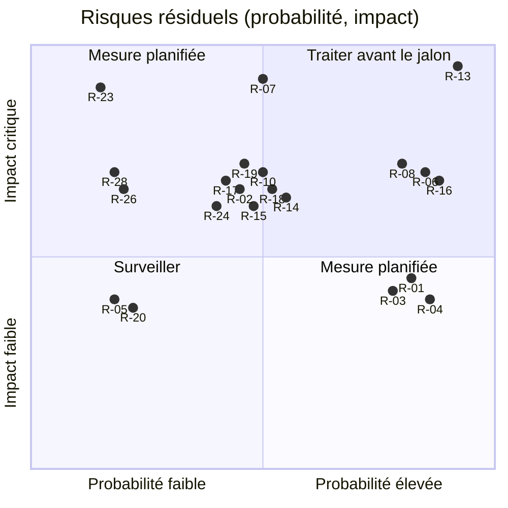

# 09 — Risques, vérifications et questions ouvertes

> Plan de réécriture en Rust, en architecture hexagonale, du serveur MCP Légifrance (`mcp-legifrance`). Ce document tient trois registres : les risques `R-xx`, les vérifications `V-xx` (tout ce que le plan et les recherches marquent **NON VÉRIFIÉ**) et les questions `Q1` à `Q10` de [00-decisions.md](00-decisions.md). Il recueille aussi les arbitrages secondaires que les autres documents renvoient ici.
>
> [00-decisions.md](00-decisions.md) est normatif et ce document ne le modifie pas. Les amendements proposés sont listés au §3.11 et attendent une décision.
>
> Rédigé le 2026-10-15. « La référence Python » désigne `matematicsolutions/fr-eli-mcp@d3b5b13` (v0.5.3). Les défauts `D-01…D-47` viennent de la [recherche 02](../recherche/02-defauts.md) ; les points de parité `P-xxx` et les écarts `E-xx`, de la [recherche 01](../recherche/01-parite.md).

## Sommaire

0. [Mode d'emploi](#0-mode-demploi)
1. [Registre des risques](#1-registre-des-risques)
2. [Registre des vérifications](#2-registre-des-vérifications)
3. [Questions ouvertes Q1 à Q10 et arbitrages secondaires](#3-questions-ouvertes-q1-à-q10-et-arbitrages-secondaires)
4. [Hypothèses de travail](#4-hypothèses-de-travail)
5. [Critères d'acceptation de ce registre par jalon](#5-critères-dacceptation-de-ce-registre-par-jalon)
6. [Sources](#sources)

---

## 0. Mode d'emploi

### 0.1 Rôle et règles de mise à jour

- **Attribution des identifiants.** 00 §0 désigne ce document comme registre des vérifications ; il attribue donc les identifiants `R-01…R-30` et `V-01…V-215`. Les autres documents gardent leurs étiquettes `[v:…]` jusqu'à leur remplacement par les identifiants. La table de correspondance complète est au §2.19. Huit paires ou triplets d'étiquettes désignent la même vérification et reçoivent le même identifiant (§2.1).
- **Citation dans ce document.** Hors de la colonne « Étiquette(s) » du registre, ce document cite directement les `V-xx` : toute mention d'un `V-xx` signale un point **NON VÉRIFIÉ** tant que le journal du §2.20 ne l'a pas levé. Un fait non vérifié qui n'a pas encore de `V-xx` est marqué **NON VÉRIFIÉ** et reçoit un identifiant à la suite.
- **Statuts d'une vérification.** `ouvert` (statut initial), `levé` (résultat consigné, avec sa preuve : artefact de workflow, fixture enregistrée, commit), `partiel`, `contourné` (une décision rend la vérification inutile), `caduc`. Toute levée donne une ligne dans le journal du §2.20 et une mise à jour des documents concernés : le marqueur **NON VÉRIFIÉ** y est retiré ou remplacé par le résultat.
- **Statuts d'un risque.** `ouvert`, `surveillé`, `réduit`, `clos`, `matérialisé` (le risque s'est produit et devient un incident, traité par une PR ou un ADR).
- **Quand mettre à jour.** Après chaque exécution live (registre de [06-qualite.md](06-qualite.md) §5.4), à la clôture de chaque jalon (revue des `R-xx` et `V-xx` du jalon, §5), à chaque montée de `rmcp`, à chaque réponse à une question `Qn`.
- **Qui.** Le mainteneur, ou l'agent qui exécute la vérification. Dans ce second cas, un humain relit la PR (06 §13.1).
- **Nouvelles incertitudes.** Elles prennent l'identifiant suivant (`V-216`, `R-31`…). Un identifiant n'est jamais réutilisé, même après une levée ou une clôture.

### 0.2 Échelles des risques

| Note | Probabilité | Impact |
|---|---|---|
| 1 | faible : peu probable avant v1.0.0 | gêne : contournement simple, aucune réponse fausse |
| 2 | moyenne | fonction dégradée, contournement documenté |
| 3 | élevée, ou déjà constatée | fonction clé indisponible, ou réponse juridiquement fausse (date, existence d'un texte, citation) |
| 4 | — | jalon bloqué, ou exposition contractuelle ou juridique (CGU, données personnelles, licence) |

Le score vaut probabilité × impact. Il est évalué **après** les mesures déjà décidées par 00 : c'est un risque résiduel. À partir de 9, le risque est traité avant le jalon concerné ; de 6 à 8, une mesure est planifiée et le risque revu à chaque jalon ; jusqu'à 4, il est seulement surveillé.

### 0.3 Environnement de rédaction : état vérifié le 2026-10-15

Ces constats ont été faits pour ce document depuis le conteneur de développement (`curl` à travers le proxy du conteneur, `git ls-remote`, `rustc --version`). Ils fondent R-13 et Q6.

| Ressource | Résultat | Conséquence |
|---|---|---|
| `https://index.crates.io` (index sparse) | 200 ; le champ `pubtime` donne la date de publication de chaque version | âge des crates vérifiable (R-22) |
| `https://static.crates.io` (archives des crates) | refusé (403 du proxy) | aucune dépendance téléchargeable : aucune compilation possible (V-01) |
| `https://static.rust-lang.org` | refusé | la toolchain 1.99.0 épinglée par 00 §2 n'est pas installable (V-16) |
| Toolchain installée | `rustc 1.97.0 (2d8144b78 2026-07-07)`, `cargo 1.97.0` | supérieure à la MSRV 1.91, inférieure à la toolchain épinglée |
| `https://docs.rs`, `https://crates.io/api` | refusés | documentation des crates consultable seulement dans les sources |
| `sandbox-oauth`, `oauth`, `sandbox-api`, `api` et `piste.gouv.fr` | refusés | aucun appel live depuis le conteneur (R-13, Q3, Q6) |
| `https://www.legifrance.gouv.fr` | refusé | recette des URL impossible depuis le conteneur (V-139) |
| `https://echanges.dila.gouv.fr` | refusé | aucun dump DILA (M9, V-185) |
| `https://www.rfc-editor.org`, `https://code.claude.com` | refusés | RFC 9728 et documentation de Claude Code non lisibles (V-44, V-48) |
| `https://pypi.org`, `https://registry.npmjs.org` | 200 | référence Python et suite de conformité consultables |
| `git ls-remote` sur GitHub | fonctionne | tags vérifiables : `rmcp-v3.5.1` (`79437f2`) est le dernier tag de rmcp ; `2026-07-28` est la dernière révision de la spécification |
| API GitHub (`gh api`) sur `modelcontextprotocol/rust-sdk` | refusée pour cette session | statut des issues rmcp non vérifiable ici (V-38) |

---

## 1. Registre des risques

### 1.1 Synthèse

| R | Risque | P | I | Score | Jalons | Liens principaux |
|---|---|---|---|---|---|---|
| [R-01](#r-01--instabilité-de-lapi-rmcp) | Instabilité de l'API rmcp | 3 | 2 | 6 | M0, M4, M8, chaque montée | V-38, ADR-0003 |
| [R-02](#r-02--bugs-ouverts-et-comportements-de-rmcp-351) | Bugs ouverts et comportements de rmcp 3.5.1 | 2 | 3 | 6 | M0, M4, M8 | V-29, V-30, V-36, V-38 |
| [R-03](#r-03--quotas-piste-inconnus) | Quotas PISTE inconnus | 3 | 2 | 6 | M2, M6, M7, M8 | V-62, V-63, V-64, Q4 |
| [R-04](#r-04--écarts-et-disponibilité-sandbox--production) | Écarts et disponibilité sandbox / production | 3 | 2 | 6 | M2, v0.1.0 | V-59, V-61, Q3 |
| [R-05](#r-05--origine-du-mojibake) | Origine du mojibake | 1 | 2 | 2 | M2 | V-71, V-72, V-73 |
| [R-06](#r-06--comportement--introuvable--de-lapi) | Comportement « introuvable » de l'API | 3 | 3 | **9** | M2, M6 | V-66, V-67, V-68, V-134 |
| [R-07](#r-07--cgu-piste-et-mode-http-partagé) | CGU PISTE et mode HTTP partagé | 2 | 4 | 8 | M8 | V-175, V-176, Q4 |
| [R-08](#r-08--smart-app-control-gatekeeper-et-signature) | Smart App Control, Gatekeeper et signature | 3 | 3 | **9** | Distribution (v0.1.0) | V-173, V-174, Q5 |
| [R-09](#r-09--tls-aws-lc-en-compilation-croisée) | TLS aws-lc en compilation croisée | 2 | 2 | 4 | M0, Distribution | V-02, V-25 |
| [R-10](#r-10--support-réel-de-2026-07-28-par-les-clients) | Support réel de 2026-07-28 par les clients | 2 | 3 | 6 | M4, v0.1.0, chaque version | V-46, V-49, V-51, V-52, Q7 |
| [R-11](#r-11--coût-de-contexte) | Coût de contexte | 2 | 2 | 4 | M4, M5, M6, M7 | V-47, V-48, V-58 |
| [R-12](#r-12--évolution-du-swagger-et-de-lapi-légifrance) | Évolution du Swagger et de l'API Légifrance | 2 | 2 | 4 | M2, en continu | V-74, V-122, V-135 |
| [R-13](#r-13--accès-réseau-de-lenvironnement-de-développement) | Accès réseau de l'environnement de développement | 3 | 4 | **12** | M0, M2, M9 | Q6, V-01, V-16 |
| [R-14](#r-14--dépendance-à-un-compte-piste-personnel) | Dépendance à un compte PISTE personnel | 2 | 3 | 6 | M2, en continu | Q3, V-60 |
| [R-15](#r-15--données-personnelles-dans-les-décisions-et-les-journaux) | Données personnelles dans les décisions et les journaux | 2 | 3 | 6 | M2, M4, M8, M9 | V-178, V-179, V-180 |
| [R-16](#r-16--dumps-dila--volumétrie-et-absence-de-global-récent) | Dumps DILA : volumétrie, absence de global récent | 3 | 3 | **9** | M9 | V-185 à V-189, Q6 |
| [R-17](#r-17--sémantique-de-singledate--version-de-la-veille) | Sémantique de `singleDate` : version de la veille | 2 | 3 | 6 | M2 | V-76, V-100 |
| [R-18](#r-18--url-légifrance-et-contrat-de-citation) | URL Légifrance et contrat de citation | 2 | 3 | 6 | M1, v0.1.0 | V-139 à V-145 |
| [R-19](#r-19--fiabilité-du-vérificateur-de-citations) | Fiabilité du vérificateur de citations | 2 | 3 | 6 | M6 | V-119, V-120, V-134, V-163 |
| [R-20](#r-20--audit-strict-et-indisponibilité) | Audit strict et indisponibilité | 1 | 2 | 2 | M3 | Q9, V-164 à V-167 |
| [R-21](#r-21--délais-des-clients-et-délai-global) | Délais des clients et délai global | 2 | 2 | 4 | M2, M4 | V-55 |
| [R-22](#r-22--chaîne-dapprovisionnement-et-versions-trop-récentes) | Chaîne d'approvisionnement et versions trop récentes | 2 | 2 | 4 | M0, Distribution | V-25, V-26, V-171 |
| [R-23](#r-23--fuite-de-secrets-ou-de-données-dans-les-journaux) | Fuite de secrets ou de données dans les journaux | 1 | 4 | 4 | M2, M4 | — |
| [R-24](#r-24--sécurité-du-transport-http) | Sécurité du transport HTTP | 2 | 3 | 6 | M8 | V-39 à V-45, V-56, V-57 |
| [R-25](#r-25--mainteneur-unique-et-contributions-dagents) | Mainteneur unique et contributions d'agents | 2 | 2 | 4 | tous | — |
| [R-26](#r-26--contamination-de-licence) | Contamination de licence | 1 | 3 | 3 | M0, M6 | Q2, V-25, V-177 |
| [R-27](#r-27--évolution-de-la-spécification-mcp) | Évolution de la spécification MCP | 2 | 2 | 4 | après v0.3.0 | Q7 |
| [R-28](#r-28--format-strict-des-identifiants) | Format strict des identifiants | 1 | 3 | 3 | M1, M2 | V-103, V-104 |
| [R-29](#r-29--réponses-volumineuses-et-mémoire) | Réponses volumineuses et mémoire | 2 | 2 | 4 | M2, M5, M7 | V-75, V-96, V-18 |
| [R-30](#r-30--nom-du-produit--marque--légifrance--et-homonymie) | Nom du produit : marque « Légifrance » et homonymie | 2 | 2 | 4 | M0, Distribution | Q1, V-215 |



Les positions reprennent les notes du tableau, légèrement décalées pour rester lisibles. Les risques notés 2 × 2 (R-09, R-11, R-12, R-21, R-22, R-25, R-27, R-29, R-30) sont omis du graphique.

### 1.2 Fiches

#### R-01 — Instabilité de l'API rmcp

- **Description.** `rmcp` a publié quatre lignes incompatibles en 2026 : 0.17.0 (2026-02-27), 1.0.0 (2026-03-03), 2.0.0 (2026-06-29), 3.0.0 (2026-07-28), d'après le champ `pubtime` de l'index sparse relevé pour ce document (recherche 04 §1.1, recherche 09 §0). `ProtocolVersion::LATEST` est passé à 2026-07-28 dans une **mineure**, la 3.5.0 (recherche 09 §0). Une montée peut donc changer en silence la version négociée, les indications de cache par défaut (`fill_missing_cache_hints`) ou la boucle avant l'ouverture d'une ère (annexe D §9.4). Un correctif de sécurité publié seulement en 3.6 ou 4.x imposerait une montée en urgence.
- **Probabilité : 3.** Le rythme de 2026 rend très probable au moins une nouvelle mineure incompatible en pratique avant v1.0.0.
- **Impact : 2.** Le SDK est confiné à `lf-adapter-mcp` (00 §2, vérifié par `cargo xtask check-deps`) : une montée ne touche qu'un crate, mais elle peut casser les deux ères.
- **Réduction.** `rmcp` et `rmcp-macros` épinglés `=3.5.1`, `Cargo.lock` versionné (00 §6) ; aucun type `rmcp::model::*` hors de l'adapter ([02-architecture.md](02-architecture.md) §1.2) ; transcriptions JSON-RPC brutes des deux ères qui figent le comportement attendu (06 §6.1) ; descriptor lock (05 §9) ; procédure de montée de l'annexe D §9.4 (CHANGELOG, `LATEST`, `KNOWN_VERSIONS`, transcriptions, verrou, issues). Les outils de mise à jour automatique des dépendances excluent `rmcp` et `rmcp-macros`.
- **Signal d'alerte.** Nouvelle version de rmcp qui touche `LATEST`, `KNOWN_VERSIONS`, `discover` ou `StreamableHttpServerConfig` ; avis RUSTSEC visant 3.5.1 ; transcription rouge après `cargo update`.
- **Jalons.** M0 (choix figé), M4, M8, puis chaque montée.
- **Liens.** V-38 ; ADR-0003 ([index des ADR](../adr/README.md)) ; [annexes/D-mcp-2026-07-28.md](annexes/D-mcp-2026-07-28.md) §9.4.

#### R-02 — Bugs ouverts et comportements de rmcp 3.5.1

- **Description.** Issues ouvertes au 2026-10-15 selon la recherche 09 §4 : #1337 (`outputSchema` ou `structuredContent` à racine non objet envoyé tel quel aux pairs legacy), #1347 (`-32601` au lieu de `-32602` pour des params non désérialisables), #1348 (cache de validation de `Mcp-Param-*` jamais invalidé, P0 sécurité), #1325 (sessions HTTP legacy non annulées). La lecture du code de 3.5.1 ajoute qu'une notification reçue avant l'ouverture d'une ère **arrête le service** (`service/server.rs:681-685`, annexe D §9.2 constat 1), ce qui toucherait la sonde de Claude Code. rmcp journalise les réponses complètes au niveau `debug` (`service.rs:1593-1615`). Le comportement sur la panique d'un outil est inconnu (V-36).
- **Probabilité : 2.** Les parades sont décidées ; elles restent à prouver par le spike M0 et les tests M4.
- **Impact : 3.** Serveur qui s'arrête à l'ouverture d'une session, ou réponses refusées par VS Code.
- **Réduction.** `PreLifecycleFilter` autour de `stdio()` (annexe D §4.3, V-29) ; sorties toujours à racine objet (00 §6) ; aucune `x-mcp-header` (00 §6) ; filtre `tracing` qui plafonne `rmcp` à `info` hors développement (00 §6) ; test documentaire de #1347 ; `catch_unwind` dans `call_tool` si V-36 le justifie ; `with_legacy_session_mode(false)` en HTTP (annexe D §9.1).
- **Signal d'alerte.** Transcriptions `premature_notification`, `garbage_and_batch` ou `legacy_2025_11_25` rouges ; issue rmcp réouverte ; rapport « server disconnected » d'un client.
- **Jalons.** M0, M4, M8.
- **Liens.** V-29, V-30, V-31, V-36, V-38 ; annexe D §9.

#### R-03 — Quotas PISTE inconnus

- **Description.** Les quotas sont « par seconde / minute / jour », sur le nombre de requêtes ou la bande passante, par application ou par méthode, modifiables par la DILA avec information par courriel (CGU API Légifrance l.212-231, recherche 05 §3.3). Leurs valeurs ne sont pas publiques. `fr_search_all` (M7) et `fr_verify_citations` (M6) multiplient les appels ; en mode HTTP partagé, le quota d'une application est commun à tous les utilisateurs.
- **Probabilité : 3.** Valeurs inconnues ; un client tiers rapporte des 401 transitoires sous limitation (V-64).
- **Impact : 2.** En stdio : `[rate_limited]` et des réponses partielles ; en M8, un utilisateur peut épuiser le quota des autres (impact 3 dans ce profil).
- **Réduction.** Limiteur `governor` global au processus (5 req/s, rafale 10 par défaut, configurable) et concurrence plafonnée à 4 (04 §5.4-§5.5) ; cache mémoire et coalescence des requêtes identiques (00 §9) ; `Retry-After` honoré jusqu'à 30 s dans le délai global (04 §5.2) ; aucun test de charge ; bornes `max_citations` et `per_fond` (00 §7) ; en M8, équité par session à concevoir (recherche 05 §4.3 point 3).
- **Signal d'alerte.** Lignes d'audit `error_code = rate_limited` ; `warn` 429 ou 503 dans `live.yml` ; courriel de la DILA sur un changement de quota ; série de `401 invalid_client` avec des jetons récents.
- **Jalons.** M2 (calibrage d'après la console), M6, M7, M8.
- **Liens.** V-62, V-63, V-64 ; Q4 ; D-13.

#### R-04 — Écarts et disponibilité sandbox / production

- **Description.** La surface d'API est identique (Swagger 2.4.2, recherche 05 §0), mais « les données ne sont pas identiques à celles de Production » et la sandbox n'a aucun engagement de service : elle peut être indisponible sans préavis (recherche 05 §3.2). Les identifiants sont propres à chaque environnement (`invalid_client` sinon, référence SOURCES.md:12). Les URL de production n'ont jamais été appelées, ni par la référence ni pendant la recherche.
- **Probabilité : 3.** L'écart est documenté par la DILA ; seule son ampleur est inconnue.
- **Impact : 2.** Fixtures et tests live peu représentatifs ; production non testée au moment de la livraison ; tests live rouges sans changement de code.
- **Réduction.** `LF_PISTE_ENV` (défaut `sandbox`) affiché dans `fr_coverage`, rappelé au démarrage et écrit dans chaque ligne d'audit (00 §1, §7) ; lacune FR-101 ; contrôle `EnvMismatch` des URL (04 §2.3) ; cache cloisonné par environnement (00 §9) ; environnement noté dans les métadonnées des fixtures (04 §13.4) ; `live_oauth_production_endpoints` avant v0.1.0 (06 §5.2) ; tests live jamais bloquants pour une PR (06 §5.1).
- **Signal d'alerte.** Test live vert en sandbox mais divergent en production ; `invalid_client` ; plusieurs exécutions de `live.yml` rouges d'affilée.
- **Jalons.** M2, recette v0.1.0.
- **Liens.** V-59, V-60, V-61 ; Q3 ; D-18.

#### R-05 — Origine du mojibake

- **Description.** 6 fixtures sur 16 contiennent de l'UTF-8 décodé à tort en ISO-8859-1 (252 séquences, recherche 03 §11.1). La cause la plus probable est l'outil de capture : le même endpoint est sain dans une campagne ultérieure (04 §10.1). Si l'API en produisait, la réparation tout-ou-rien au niveau du corps (00 §8) pourrait ne pas couvrir une forme CP1252 (V-73), ni des caractères échappés en `\uXXXX` (V-71).
- **Probabilité : 1.** Indices concordants en faveur de la capture.
- **Impact : 2.** Texte officiel restitué avec des caractères altérés ; la réparation sur des données saines est l'identité (04 §10.3).
- **Réduction.** Réparation active par défaut, comptée, journalisée en `warn` et désactivable (04 §10.5) ; proptest d'identité sur toute chaîne saine ; `live_no_mojibake_on_reference_ids` en M2 ; fixtures remplacées par des captures saines si l'API est hors de cause (D-35).
- **Signal d'alerte.** Compteur `mojibake_repaired` ou `mojibake_unrepaired` supérieur à 0 en live ; signalement de caractères altérés.
- **Jalons.** M2.
- **Liens.** V-71, V-72, V-73 ; D-35.

#### R-06 — Comportement « introuvable » de l'API

- **Description.** Pour un identifiant bien formé mais inexistant, seul `/consult/juri` (JURITEXT, CETATEXT) est connu : HTTP 400 « L'expression à valider est fausse. » (sondé par pylegifrance, 04 §11.1). Le comportement des six autres consultations, la forme d'un 404 PISTE (routage ou ressource) et le caractère déterministe des 500 sont inconnus. La référence confondait un mauvais chemin et un texte absent (D-10).
- **Probabilité : 3.** Comportement inconnu sur la plupart des endpoints.
- **Impact : 3.** Un `not_found` à tort fait conclure au modèle qu'un texte n'existe pas ; un `upstream_error` à tort masque une citation inventée. C'est le cœur de la promesse anti-hallucination (M6).
- **Réduction.** Classification provisoire de 04 §11.2 : jamais `NotFound` sur `/search` ni sur l'endpoint token ; un 404 n'est `NotFound` que sur une consultation officielle à corps non HTML ; un 500 n'est jamais `NotFound`. Sonde `live_unknown_ids_classification` en M2, puis mêmes sondes en M6 et M7. Les instructions rappellent que l'absence ici n'est pas l'absence dans le droit ; `fr_verify_citations` rend `unresolvable` tant que la couverture d'une famille n'est pas prouvée (annexe B §7.2).
- **Signal d'alerte.** `not_found` sur un identifiant issu d'un `fr_search` ; hausse des `upstream_error` en 400 ou 404.
- **Jalons.** M2 (règle définitive), M6.
- **Liens.** V-66, V-67, V-68, V-69, V-134 ; D-10.

#### R-07 — CGU PISTE et mode HTTP partagé

- **Description.** L'accès à PISTE passe par un compte nominatif ; les clés « sont strictement réservées à votre application et ne doivent en aucun cas être rendues publiques ou divulguées à un tiers » (CGU API Légifrance l.171-183). La DILA peut suspendre sans préavis en cas de manquement (l.336-345). La recherche 05 §4.3 juge qu'un serveur appelant PISTE avec les identifiants de son opérateur « ressemble » au modèle de réutilisation encouragé ; c'est une interprétation, non vérifiée juridiquement. Les CGU générales du portail PISTE n'ont pas été lues.
- **Probabilité : 2.**
- **Impact : 4.** Suspension du compte, responsabilité de l'opérateur, retrait du mode distant.
- **Réduction.** M8 reste optionnel ; profil local seulement (jeton statique, `127.0.0.1`) tant que Q4 n'est pas tranchée ; jamais de transmission de jeton vers PISTE ni de secret vers un client (00 §6) ; demande écrite à la DILA (V-176) ; lecture des CGU générales (V-175) ; variante « chaque utilisateur fournit ses identifiants » évaluée par ADR si besoin ; limiteur global et équité par session.
- **Signal d'alerte.** Réponse défavorable de la DILA ; nouvelle version des CGU ; courriel de surconsommation.
- **Jalons.** M8.
- **Liens.** V-175, V-176, V-62 ; Q4 ; [annexes/C-api-legifrance.md](annexes/C-api-legifrance.md) §1.7.

#### R-08 — Smart App Control, Gatekeeper et signature

- **Description.** Un utilisateur de la référence a constaté le 2026-07-05 que Smart App Control (Windows 11) bloque les lanceurs non signés « sans demander et sans exception par programme » ; la référence conseille donc `python -m fr_eli_mcp` (référence `src/fr_eli_mcp/__main__.py:1-9`). Un binaire Rust non signé est exposé au même blocage, et sous macOS un binaire non notarisé peut être refusé par Gatekeeper (V-174).
- **Probabilité : 3** sans certificat (Q5), **1** avec.
- **Impact : 3.** Le binaire est inutilisable sur les postes concernés, et l'utilisateur ne dispose d'aucun contournement simple.
- **Réduction.** Q5 : certificat Authenticode chez SSL.com (eSigner) ou Azure Artifact Signing, les deux seuls fournisseurs que cargo-dist sait utiliser (08 §12.1 ligne 4, V-193), et compte Apple Developer ; signature par dist, notarisation par un job dédié, car dist ne notarise pas (08 §3.3, V-194, V-195). À défaut, binaires non signés avec un avertissement explicite dans le README et la page de release, et replis documentés : image OCI sous Docker Desktop ou WSL (08 §8.6, §8.7). Essai réel sous Smart App Control (V-173) ; un binaire compilé localement par `cargo install` serait peut-être bloqué lui aussi (V-173).
- **Signal d'alerte.** Issue « blocked by Smart App Control » ou « cannot be opened because the developer cannot be verified ». Le serveur n'ayant aucune télémétrie (ADR-0005), seuls les signalements des utilisateurs alertent.
- **Jalons.** Distribution, dès v0.1.0.
- **Liens.** V-173, V-174, V-193, V-194, V-195, V-197 ; Q5 ; [08-distribution.md](08-distribution.md) §3.

#### R-09 — TLS aws-lc en compilation croisée

- **Description.** Le fournisseur par défaut de rustls est aws-lc-rs, dont `aws-lc-sys` exige selon la cible cmake, NASM ou clang (recherche 04 §6 points 5 et 6). Les 7 cibles de cargo-dist (00 §12), dont musl et aarch64, n'ont pas été essayées. Le repli `ring` demande `rustls-no-provider` et un `install_default()` au démarrage, faute de quoi reqwest panique (02 §3.0.1).
- **Probabilité : 2.**
- **Impact : 2.** Cible manquante ou bascule vers `ring` ; panique au premier appel si l'installation du fournisseur est oubliée.
- **Réduction.** Spike M0 des deux options sur les 7 cibles, avec poignée de main (V-02) ; choix consigné dans ADR-0013 ; test « fournisseur installé avant le premier client » ; inventaire des licences (V-25).
- **Signal d'alerte.** Échec de `dist build` sur une cible ; message « no process-level CryptoProvider ».
- **Jalons.** M0, Distribution.
- **Liens.** V-02, V-25 ; ADR-0013.

#### R-10 — Support réel de 2026-07-28 par les clients

- **Description.** Claude Code ≥ 2.1.292 négocie 2026-07-28 par défaut après une sonde `server/discover` ; VS Code (`main` du 2026-10-15) n'envoie qu'`initialize` 2025-11-25 ; Claude Desktop et Cursor sont inconnus (annexe D §10.1). Ce que Claude Code transmet au modèle (`structuredContent` en succès, texte en erreur) n'est vérifié que par sa documentation et son CHANGELOG, pas par un essai (V-46).
- **Probabilité : 2.** L'hétérogénéité va durer ; le mode dual-era la couvre si les tests passent.
- **Impact : 3.** Serveur invisible ou réponses illisibles dans un client majeur ; ADR-0006 à revoir si le contenu transmis n'est pas celui attendu.
- **Réduction.** Serveur dual-era `[2026-07-28, 2025-11-25, 2025-06-18]` (00 §6) ; instructions identiques dans `DiscoverResult` et `InitializeResult` ; transcriptions des deux ères ; protocole de test manuel avant chaque version (annexe D §10.3) ; critère de retrait du legacy inscrit dans ADR-0003 (support vérifié dans VS Code, Cursor et Claude Desktop).
- **Signal d'alerte.** Rapport « failed to connect » ; changement de CHANGELOG de Claude Code ou de VS Code sur la négociation ; MCP Inspector en mode `modern` en échec.
- **Jalons.** M4, recette v0.1.0, chaque version.
- **Liens.** V-46, V-49, V-51, V-52, V-53, V-34 ; Q7.

#### R-11 — Coût de contexte

- **Description.** Instructions limitées à 3 500 caractères (Claude Code coupe à 4 096) ; `tools/list` estimé à environ 18,7 Ko en v0.1 et 26,9 Ko en v0.3, dont une part d'`outputSchema` qui n'est peut-être pas transmise (05 §6.6) ; Claude Code avertit au-delà de 10 000 tokens de sortie, plafonne à 25 000 et écrit dans un fichier un résultat de plus de 50 000 caractères (annexe D §10.1). Le ratio caractères/token du français juridique est supposé égal à 4 (D-33).
- **Probabilité : 2.**
- **Impact : 2.** Réponses du modèle dégradées, coût par session ; des descriptions de 3 à 6 phrases coûtent environ 4 Ko de plus que la référence (05 §6.6).
- **Réduction.** `structuredContent` compact, champs `None` omis (ADR-0006) ; `detail = "summary"` et `max_chars = 4 000` par défaut ; plafond dur de 45 000 caractères (05 §6.4) ; tests `descriptor_size_budget` et de taille des instructions ; leviers de réduction de 05 §6.6 ; mesures en M5.
- **Signal d'alerte.** Budget de la CI dépassé ; ratio mesuré par V-58 nettement inférieur à 4 ; avertissement de Claude Code sur la taille d'une sortie.
- **Jalons.** M4, M5, puis M6 et M7 (nouveaux outils).
- **Liens.** V-47, V-48, V-58 ; D-33.

#### R-12 — Évolution du Swagger et de l'API Légifrance

- **Description.** La copie de référence du Swagger est la 2.4.2 (2025-05-28) ; la version servie aujourd'hui est inconnue (V-74). Des chemins utilisés par des tiers en sont absents (`consult/loda/version(s)`, recherche 05 §1.12). La DILA peut faire évoluer l'API ; ses correctifs arrivent d'abord en sandbox (recherche 05 §3.2).
- **Probabilité : 2.**
- **Impact : 2.** Erreurs `Decode`, endpoint disparu, champ renommé.
- **Réduction.** DTO minimaux et tolérants (`#[serde(default)]`, champs inconnus ignorés, `serde_path_to_error`, 00 §8) ; test de dérive des chemins contre `swagger-2.4.2-paths.txt` (04 §7.1) ; `live.yml` hebdomadaire (06 §7.5) ; relecture du Swagger à chaque jalon.
- **Signal d'alerte.** Hausse des erreurs `Decode` ; `live.yml` rouge ; nouvelle `info.version` dans le catalogue PISTE.
- **Jalons.** M2, puis en continu.
- **Liens.** V-74, V-122, V-135.

#### R-13 — Accès réseau de l'environnement de développement

- **Description.** Constat du 2026-10-15 (§0.3) : depuis le conteneur, `static.crates.io`, `static.rust-lang.org`, `docs.rs`, `*.piste.gouv.fr`, `legifrance.gouv.fr` et `echanges.dila.gouv.fr` sont refusés ; seul l'index sparse de crates.io répond. La toolchain installée est 1.97.0, alors que 00 §2 épingle 1.99.0. Les recherches ont été menées dans les mêmes conditions ([README des recherches](../recherche/README.md)).
- **Probabilité : 3.** Constaté.
- **Impact : 4.** Aucune compilation en M0, donc aucun spike ; aucun appel live en M2 ; aucun dump en M9.
- **Réduction.** Q6 : ouvrir `static.crates.io` (indispensable) et `static.rust-lang.org` (toolchain épinglée), puis `*.piste.gouv.fr` pour les sondes et `echanges.dila.gouv.fr` en M9. À défaut, la CI GitHub Actions sert d'environnement de compilation et de test : les agents travaillent par PR, la CI compile, `live.yml` exécute les sondes avec les secrets de l'environnement `piste-sandbox`. Les tests sont conçus pour tourner hors ligne (00 §10). Ne jamais contourner le proxy (désactiver TLS, changer `HTTPS_PROXY`).
- **Signal d'alerte.** `cargo fetch` en 403 ; `rustup` incapable d'installer la toolchain épinglée ; aucune PR de M0 compilée localement.
- **Jalons.** M0 (bloquant), M2, M9.
- **Liens.** Q6 ; V-01, V-16, V-185.

#### R-14 — Dépendance à un compte PISTE personnel

- **Description.** L'accès à PISTE passe par un compte nominatif (CGU l.171-183). Tous les tests live, l'enregistrement de fixtures et la vérification de la production dépendent des identifiants d'une personne. Une divulgation viole les CGU ; la procédure de compromission impose de réinitialiser les identifiants et de prévenir la DILA et l'AIFE (CGU l.274-285).
- **Probabilité : 2.**
- **Impact : 3.** Plus aucune vérification live ; risque de suspension en cas de fuite.
- **Réduction.** Q3 ; applications sandbox et production distinctes ; secrets dans l'environnement GitHub protégé `piste-sandbox`, jamais exposés aux PR venant d'un fork (06 §7.5) ; aucune valeur d'identifiant dans un fichier, un journal ou une fixture (04 §13.4) ; procédure de rotation et de compromission écrite dans `SECURITY.md` (06 §10.3) ; la CI ordinaire n'a besoin d'aucun identifiant.
- **Signal d'alerte.** `live.yml` en `invalid_client` ; abonnement expiré ; changement de mainteneur.
- **Jalons.** M2, puis en continu.
- **Liens.** Q3 ; V-60.

#### R-15 — Données personnelles dans les décisions et les journaux

- **Description.** Les décisions JURI sont pseudonymisées et les textes CNIL occultés par la DILA, sans que la référence le signale (D-45). Des noms résiduels sont possibles (V-178). Les champs nominatifs (présidents, rapporteurs, avocats) existent dans les réponses ; la loi interdit de réutiliser l'identité des magistrats et des membres du greffe pour évaluer ou prédire leurs pratiques (recherche 05 §5.1 ; article exact : V-179). Les requêtes de recherche peuvent révéler l'activité d'un juriste. L'empreinte SHA-256 non salée de l'audit est réversible par dictionnaire pour une entrée courte (D-17). Contenus `inap` et `dereferenced` : obligations inconnues (V-180).
- **Probabilité : 2.**
- **Impact : 3.** Exposition juridique et atteinte à la réputation ; fixtures publiques contenant un nom.
- **Réduction.** Restitution telle que publiée et lacune FR-006 (« do not try to re-identify parties », 05 §5.8) ; champs nominatifs non désérialisés (04 §14.5) ; aucune fonction d'agrégation par magistrat ; requêtes jamais journalisées en clair (04 §12.5) ; fichiers d'audit privés (06 §11.6, V-165) ; revue des fixtures enregistrées avant tout commit (06 §4.4) ; exclusion des contenus `inap` et `dereferenced` de tout index ou réponse distante tant que V-180 n'est pas levée (annexe C §10 question 8) ; aucun cache disque en v0.x (00 §9).
- **Signal d'alerte.** Nom de partie dans une fixture ; demande de fonctionnalité « statistiques par juge » ; réclamation.
- **Jalons.** M2 (fixtures), M4, M8, M9.
- **Liens.** V-178, V-179, V-180, V-165 ; D-17, D-45.

#### R-16 — Dumps DILA : volumétrie et absence de global récent

- **Description.** Le dernier global LEGI connu date du 13/07/2025 ; les incréments quotidiens courent jusqu'en octobre 2026, ce qui fait 15 mois d'archives à rejouer dans l'ordre (recherche 05 §6.2). Les globaux dépasseraient 40 Go pour l'ensemble des fonds (justicelibre, annexe C §10 question 7). L'hôte `echanges.dila.gouv.fr` est injoignable depuis le conteneur (§0.3) ; arborescence, encodage, DTD et licence par fonds ne sont pas vérifiés.
- **Probabilité : 3.**
- **Impact : 3.** M9 (v1.0.0) en retard ou réduit ; première installation longue ; index incohérent si un incrément manque.
- **Réduction.** Périmètre LEGI d'abord (annexe C §10 question 7) ; ingestion en flux (`flate2` → `tar` → `quick-xml`), sans extraction sur disque ; registre des archives appliquées et reconstruction complète sur un nouveau global (annexe C §7.11) ; tests sur des extraits réels ; budget disque documenté après V-185 ; Q6 pour l'accès réseau.
- **Signal d'alerte.** Q6 refusée pour l'hôte DILA ; durée d'ingestion mesurée hors de proportion ; nouveau global ou changement de DTD.
- **Jalons.** M9.
- **Liens.** V-185, V-186, V-187, V-188, V-189 ; Q6.

#### R-17 — Sémantique de `singleDate` : version de la veille

- **Description.** 00 §8 fixe `DATE_VERSION.singleDate` à minuit Europe/Paris du jour demandé, soit 22 h ou 23 h UTC la veille. Tous les horodatages observés sont à minuit UTC (recherche 03 §11.2). Si PISTE compare l'instant aux bornes de version ainsi stockées, la recherche du jour J retient la version de la veille (04 §6.3).
- **Probabilité : 2.**
- **Impact : 3.** Le jour d'une entrée en vigueur, la recherche rend l'ancienne version : réponse juridiquement fausse sur l'état du droit.
- **Réduction.** Sonde `live_singledate_midnight_paris_semantics` en M2 (V-76) ; alternative midi Europe/Paris, tout aussi stable sur la journée (04 §16 question 1) ; vecteurs de test de 04 §6.3.
- **Signal d'alerte.** Sonde rouge ; écart entre `fr_search` et la page Légifrance un jour de changement de version.
- **Jalons.** M2.
- **Liens.** V-76, V-100, V-77.

#### R-18 — URL Légifrance et contrat de citation

- **Description.** Chaque entité citable expose un `source_url` (ADR-0009). Les motifs d'URL (03 §5.5) n'ont pas été ouverts dans un navigateur : `/loda/article_lc/` ou `/codes/article_lc/` pour un article de loi, `/ceta/id/` ou `/juri/id/` pour un `CETATEXT`, `/conv_coll/id/` pour un `KALIARTI` (V-139 à V-144).
- **Probabilité : 2.**
- **Impact : 3.** Une citation au lien mort est invérifiable par l'utilisateur ; or la vérifiabilité est la raison d'être du contrat.
- **Réduction.** Fonctions d'URL pures dans `lf-domain`, faciles à corriger et couvertes par les tests golden ; recette navigateur avant v0.1.0 ; `textTitles[].nature` lu pour choisir entre `/loda/` et `/codes/` (V-142).
- **Signal d'alerte.** Recette rouge ; lien signalé comme mort.
- **Jalons.** M1, recette v0.1.0.
- **Liens.** V-139 à V-145 ; ADR-0009 ; D-28, D-29.

#### R-19 — Fiabilité du vérificateur de citations

- **Description.** `fr_verify_citations` et `fr_resolve` (M6) reposent sur une grammaire et un dictionnaire de codes construits sans accès à l'API : formes de `NUM_ARTICLE`, numéros de pourvoi, ECLI rares, abréviations non attestées, couverture partielle des fonds de jurisprudence, cas du corpus construits de mémoire (annexe B §10.2).
- **Probabilité : 2.**
- **Impact : 3.** Un faux `verified` valide une hallucination ; un faux `not_found` discrédite une citation juste.
- **Réduction.** Statut `unresolvable` par défaut quand la couverture d'une famille n'est pas prouvée (V-134) ; corpus positif et négatif versionné ([annexes/donnees/citations-corpus-positifs.jsonl](annexes/donnees/citations-corpus-positifs.jsonl), [négatifs](annexes/donnees/citations-corpus-negatifs.jsonl)) ; cas « de mémoire » limités aux tests de syntaxe tant que V-163 n'est pas levée ; tests live des `resolve_hint` (annexe B §8.7) ; mention de l'environnement sandbox dans la note des résultats.
- **Signal d'alerte.** Régression du corpus ; écart entre `find_article` et la page Légifrance ; signalement d'un faux `verified`.
- **Jalons.** M6.
- **Liens.** V-119, V-120, V-127, V-134, V-146 à V-163 ; [annexes/B-citations.md](annexes/B-citations.md).

#### R-20 — Audit strict et indisponibilité

- **Description.** En mode `strict` (défaut, Q9), un échec d'écriture du journal fait échouer l'outil (`[audit_error]`). Causes possibles : disque plein, droits, verrou, écritures concurrentes de plusieurs processus sous Windows (V-164).
- **Probabilité : 1.**
- **Impact : 2.** Outil indisponible ; c'est voulu par Q9, mais cela peut surprendre.
- **Réduction.** Message actionnable qui cite `LF_AUDIT_MODE=best-effort` et `LF_AUDIT_DIR` ; rotation (02 §3.5) ; verrou consultatif (V-09) ; tests sur les trois OS ; `check-config` vérifie que le répertoire est inscriptible.
- **Signal d'alerte.** Résultats `[audit_error]` ; rapport d'utilisateur.
- **Jalons.** M3.
- **Liens.** Q9 ; V-09, V-164, V-165, V-166, V-167 ; D-02, D-16.

#### R-21 — Délais des clients et délai global

- **Description.** Le délai global d'un outil vaut 60 s (`LF_TOOL_DEADLINE_S`) et une tentative HTTP 40 s (00 §1, §8). Les délais imposés par Claude Code et VS Code à un appel d'outil sont inconnus (V-55). Une sandbox lente et des réessais peuvent dépasser le délai du client.
- **Probabilité : 2.**
- **Impact : 2.** Appels abandonnés côté client pendant que le serveur continue à consommer du quota.
- **Réduction.** Réessais plafonnés par le délai global (04 §5.2-§5.3) ; annulation propagée jusqu'au port, avec une ligne d'audit (02 §7.1) ; délai configurable ; mesure V-55 puis ajustement des défauts.
- **Signal d'alerte.** `notifications/cancelled` fréquentes ; lignes d'audit au statut annulé.
- **Jalons.** M2, M4.
- **Liens.** V-55 ; D-14.

#### R-22 — Chaîne d'approvisionnement et versions trop récentes

- **Description.** Le cahier des charges des recherches exige des crates publiés depuis au moins deux semaines (02 §13.1 ligne 12 ; recherche 07 §10 point 17). Âge au 2026-10-15, d'après le `pubtime` de l'index sparse relevé pour ce document : `rmcp`/`rmcp-macros` 3.5.1, 9 jours ; `schemars` 1.2.3, 2 ; `tokio` 1.53.3, 1 ; `serde_json` 1.0.154, 3 ; `sha2` 0.11.1, 2 ; `proptest` 1.12.0, 4 ; `rustls` 0.23.46, 0 ; `aws-lc-rs` 1.18.2, 2. À l'inverse, `reqwest` 0.13.5 (36 jours), `moka` 0.12.16 (66), `governor` 0.10.4 (302), `backon` 1.6.0 (361) et `winnow` 1.0.4 (93) respectent la règle. S'y ajoutent les risques usuels : avis RUSTSEC, version retirée, typosquatting, actions GitHub non épinglées (D-44).
- **Probabilité : 2.**
- **Impact : 2.**
- **Réduction.** Revérifier l'âge à l'ouverture de M0 (`rmcp` 3.5.1 atteint 14 jours le 2026-10-19) ; à défaut, prendre le correctif précédent, sauf pour `rmcp`, imposé par 00 §6 ; `cargo deny check` (advisories, bans, sources, licences) en CI ; `Cargo.lock` versionné ; actions épinglées par SHA (V-26) ; provenance et SBOM (V-171).
- **Signal d'alerte.** Avis RUSTSEC ; version retirée de l'index ; échec de `cargo deny`.
- **Jalons.** M0, Distribution.
- **Liens.** V-25, V-26, V-27, V-171.

#### R-23 — Fuite de secrets ou de données dans les journaux

- **Description.** Les vecteurs sont connus : jeton Bearer, `client_secret`, URL portant des paramètres sensibles, corps complets journalisés par rmcp au niveau `debug`, requêtes des utilisateurs, fixtures enregistrées.
- **Probabilité : 1.** Les protections sont décidées par 00 §5 et §6.
- **Impact : 4.** Violation des CGU, suspension du compte, fuite d'informations.
- **Réduction.** `secrecy::SecretString` (00 §8) ; `Debug` caviardé ; aucune URL d'une réponse n'est appelée ni journalisée ; journaux sur stderr seulement ; `rmcp` jamais en `debug` en production ; xtask n'écrit jamais d'en-tête (04 §13.4) ; tests « aucun secret dans les journaux » (06 §10) ; secrets GitHub masqués et inaccessibles aux forks.
- **Signal d'alerte.** Test de non-fuite rouge ; motif de jeton détecté dans un artefact de CI.
- **Jalons.** M2, M4.
- **Liens.** 00 §5 et §6 ; 06 §10.2.

#### R-24 — Sécurité du transport HTTP

- **Description.** En M8 : rmcp ne valide pas `Origin` par défaut (liste vide, `tower.rs:55`, annexe D §9.2 constat 13), d'où un risque de DNS rebinding ; exposition hors de la boucle locale ; transmission de jeton vers PISTE ; confusion d'audience ; requêtes sans `MCP-Protocol-Version` traitées comme 2025-03-26 (V-39).
- **Probabilité : 2,** si M8 est activé.
- **Impact : 3.**
- **Réduction.** `enforce_origin_validation()` et listes explicites ; écoute sur `127.0.0.1` par défaut ; `allowed_hosts` ; jeton statique obligatoire en local ; profil distant conforme aux RFC 9728 et 8707, réponses `401` et `403 insufficient_scope` ; aucune transmission de jeton entrant ; suite de conformité officielle (00 §6, annexe D §5.2 et §6).
- **Signal d'alerte.** Tests C-40 à C-60 rouges ; scénario de conformité en échec.
- **Jalons.** M8.
- **Liens.** V-39 à V-45, V-56, V-57 ; Q4.

#### R-25 — Mainteneur unique et contributions d'agents

- **Description.** Un seul mainteneur ; une part du code sera produite par des agents qui n'ont pas accès aux échanges à l'origine des décisions. Risques : dérive par rapport à 00, tests affaiblis, décisions implicites.
- **Probabilité : 2.**
- **Impact : 2.**
- **Réduction.** 00 normatif et ADR ; descriptor lock, `check-deps`, CI stricte ; relecture humaine de toute PR produite par un agent (06 §13.1) ; ce registre tenu à jour ; définition de « terminé » (06 §13.4).
- **Signal d'alerte.** PR qui modifie une règle de 00 sans ADR ; test désactivé ou snapshot régénéré sans explication.
- **Jalons.** Tous.
- **Liens.** 06 §15.2 question 8.

#### R-26 — Contamination de licence

- **Description.** Les projets juridix et mcp-legifrance de Ktulu-Analog sont sous AGPL-3.0 : idées seulement, aucune ligne de code reprise (00 §12). Les fixtures de la référence sont sous Apache-2.0 et exigent une attribution. Les données relèvent de la Licence Ouverte 2.0, qui exige une mention de la source (V-177).
- **Probabilité : 1.**
- **Impact : 3.** Relicence forcée ou retrait de code.
- **Réduction.** Règle « idées seulement » rappelée dans `CONTRIBUTING` ; `NOTICE` ; licences contrôlées par cargo-deny (V-25) ; revue ; aucune copie depuis ces dépôts dans les données du plan (annexe B §11).
- **Signal d'alerte.** Code ressemblant à un projet AGPL en revue ; licence inattendue dans le graphe.
- **Jalons.** M0, M6.
- **Liens.** Q2 ; V-25, V-177.

#### R-27 — Évolution de la spécification MCP

- **Description.** Une prochaine révision est annoncée sans date (feuille de route du 2026-08-22, annexe D §1.1). Les clients finiront par retirer le legacy ; de nouvelles extensions (skills, MRTR) peuvent devenir attendues.
- **Probabilité : 2** à douze mois.
- **Impact : 2.**
- **Réduction.** Dual-era et ADR-0003 ; veille sur les tags du dépôt de la spécification (`git ls-remote --tags`) ; transcriptions qui rendent visible tout changement de comportement.
- **Signal d'alerte.** Nouveau tag `*-RC` ; annonce de fin du legacy dans un client.
- **Jalons.** Après v0.3.0.
- **Liens.** Q7 ; recherche 08 §15.3.

#### R-28 — Format strict des identifiants

- **Description.** 00 §4 impose un préfixe de 8 lettres suivi de 12 chiffres, avec `FromStr` strict, ce qui est vérifié sur toutes les fixtures. Un identifiant réel d'une autre forme serait refusé (V-103) ; un suffixe de version sur un autre préfixe que `LEGITEXT` serait mal analysé (V-104).
- **Probabilité : 1.**
- **Impact : 3.** `invalid_arg` sur un identifiant valide issu de `fr_search` : le texte devient inaccessible.
- **Réduction.** Collecte d'identifiants live sur les 8 fonds en M2 ; proptest ; message d'erreur qui cite le format attendu ; contrôle sur les dumps en M9.
- **Signal d'alerte.** `invalid_arg` sur un identifiant renvoyé par l'API.
- **Jalons.** M1, M2.
- **Liens.** V-103, V-104 ; D-31.

#### R-29 — Réponses volumineuses et mémoire

- **Description.** `/consult/lawDecree` sur un code (V-96), de grandes conventions KALI ou de longues TOC peuvent approcher la borne de 16 Mio (04 §4.3) ; le cache mémoire est borné en octets.
- **Probabilité : 2.**
- **Impact : 2.** `Decode` pour cause de taille, latence, mémoire résidente.
- **Réduction.** Lecture bornée du corps ; `tableMatieres` pour les codes en M7 ; pagination de la TOC (`toc_offset`/`toc_limit`) ; cache pondéré en octets ; mesures V-75 et V-18.
- **Signal d'alerte.** `Decode` de taille ; mémoire résidente au-delà des cibles de 06 §12.1.
- **Jalons.** M2, M5, M7.
- **Liens.** V-75, V-96, V-18 ; D-41, D-47.

#### R-30 — Nom du produit : marque « Légifrance » et homonymie

- **Description.** Le produit s'appelle `mcp-legifrance` (00 §1), comme le projet AGPL `Ktulu-Analog/mcp-legifrance` (08 §12.2 question 1), dont aucune ligne ne doit être reprise (00 §12). Le statut de marque de « Légifrance » et les conditions d'usage du nom dans un produit non officiel ne sont pas vérifiés (V-215). cargo-dist nomme les archives et le paquet `cargo install` d'après le paquet `lf-app`, et non d'après le produit (08 §12.1 ligne 1).
- **Probabilité : 2.**
- **Impact : 2.** Confusion des utilisateurs entre les deux projets, demande de changement de nom, noms d'artefacts incohérents.
- **Réduction.** Décider Q1 avant toute publication ; mention « projet non officiel, sans lien avec la DILA » dans le README et le manifeste MCPB ; vérification V-215 ; renommage du **paquet** `lf-app` en `mcp-legifrance` proposé au §3.11.1 ; README qui distingue explicitement le projet homonyme et sa licence.
- **Signal d'alerte.** Issue de confusion entre les deux projets ; demande de la DILA ou du titulaire de la marque.
- **Jalons.** M0 (avec Q1), Distribution.
- **Liens.** Q1 ; V-215 ; [08-distribution.md](08-distribution.md) §9.6, §12.

---

## 2. Registre des vérifications

Le registre recense **toutes** les étiquettes `[v:…]` des documents du plan déjà écrits ([01](01-existant.md), [02](02-architecture.md), [03](03-domaine.md), [04](04-adapter-piste.md), [05](05-outils-mcp.md), [06](06-qualite.md), [08](08-distribution.md), annexes [A](annexes/A-parite.md), [B](annexes/B-citations.md), [C](annexes/C-api-legifrance.md) et [D](annexes/D-mcp-2026-07-28.md)), soit 218 étiquettes, plus 6 nouvelles, tirées des points non vérifiés des recherches ou des risques ci-dessus. Il compte 215 vérifications. Au 2026-10-15, toutes sont `ouvert`, sauf V-169, V-170 et V-171, `partiel` après la lecture faite par 08 (journal du §2.20).

[08-distribution.md](08-distribution.md) a été publié pendant la rédaction de ce registre. Ses 28 étiquettes propres forment le §2.17 (V-192 à V-215) ou rejoignent une vérification existante (V-18, V-171, V-173, V-174), conformément à la règle du §0.1 : les identifiants suivants sont pris à la suite, sans renuméroter.

### 2.1 Conventions

**Colonnes.** « À vérifier » formule la question ; « Pourquoi » dit ce qui en dépend et ce qui change si la réponse est défavorable, avec le document à mettre à jour ; « Comment » donne l'opération exacte (appel live, compilation, test, essai dans un client, lecture) ; « Prér. » liste les prérequis ; « Jalon » indique quand la vérification doit être levée ; « Bloquant » vaut **Oui (Mx)** quand le jalon Mx ne peut pas être accepté sans elle, ou sans une décision explicite qui la contourne. Sinon le plan avance sur l'hypothèse de travail du §4.

**Prérequis.**

| Code | Prérequis |
|---|---|
| `S` | identifiants PISTE **sandbox** (Q3) et accès à `sandbox-oauth.piste.gouv.fr` et `sandbox-api.piste.gouv.fr` (depuis la CI ou un poste ouvert, Q6) |
| `P` | identifiants PISTE **production**, application distincte (Q3), et accès à `oauth.piste.gouv.fr` et `api.piste.gouv.fr` |
| `C` | accès à la console PISTE (compte nominatif) |
| `N` | réseau de construction : `static.crates.io` et `static.rust-lang.org` (Q6) |
| `R` | runners de CI Linux, macOS et Windows (GitHub Actions) |
| `W` | poste Windows 11 réel (Smart App Control, ACL, console) |
| `M` | poste macOS réel |
| `K` | clients MCP installés : Claude Code, VS Code, Claude Desktop, Cursor, MCP Inspector |
| `L` | navigateur avec accès à `www.legifrance.gouv.fr` |
| `D` | accès à `echanges.dila.gouv.fr` (Q6) et espace disque à la mesure de V-185 |
| `J` | relecture juridique ou sources documentaires officielles |
| `G` | accès Web et GitHub (issues, documentation, paquets npm) |
| `A` | certificat de signature Authenticode et compte Apple Developer (Q5) |
| `T` | clé d'API Anthropic (comptage de tokens) |
| `—` | aucun : lecture de code ou test local hors ligne |

**Étiquettes fusionnées.** Ces étiquettes désignent la même vérification et reçoivent le même identifiant (doublons signalés par l'annexe C §9 ligne 18 et 06 §15.1 ligne 3) :

| V | Étiquettes |
|---|---|
| V-02 | `[v:tls-aws-lc-cross]` (02, 08) et `[v:tls-fournisseur-cross]` (04, 06, 08) |
| V-18 | `[v:binaire-taille-memoire]` (06) et `[v:taille-binaire]` (08) |
| V-33 | `[v:rmcp-list-tools-result-api]`, `[v:rmcp-discover-ttl]` (05, D) et `[v:rmcp-ttl-legacy]` (02, 05, D), tranchées ensemble par l'annexe D §3.4 |
| V-49 | `[v:cc-sonde-delai]` et `[v:cc-sonde-processus-frere]`, mesurées par le même essai |
| V-62 | `[v:quota-piste-prod]` (02, 05, 06, A, B, C) et `[v:quotas-piste]` (04, 06) |
| V-72 | `[v:mojibake-origine]` (01, 03, 04, 06, A, B, C) et `[v:origine-mojibake]` (02, 06) |
| V-75 | `[v:taille-max-textes]` (01, 03, 04, 05, 06, C) et `[v:taille-max-reponse-piste]` (02) |
| V-171 | `[v:sbom-provenance-outils]` (06, 08) et `[v:slsa-niveau-attestations]` (08) : le choix des outils est fait par 08 §3.5-§3.6, seul le niveau SLSA reste ouvert |

**Étiquettes nouvelles** (marquées *(nouvelle)* dans le registre) : `[v:squelette-compile-m0]` (recherche 04 §6 point 1), `[v:chrono-tz-iana]` (recherche 04 §6 point 10), `[v:registre-mcp-cargo]` (recherche 01 §16 point 11), `[v:cgu-mode-partage-dila]` (recherche 05 §4.3 point 1), `[v:attribution-licence-ouverte]` (recherche 02 §7 point 15), `[v:pseudonymisation-residuelle]` (D-45, R-15). Les deux vérifications de signature tirées de R-08 (Smart App Control, Gatekeeper) portent les étiquettes de 08 : `[v:sac-signature-suffit]` (V-173) et `[v:mcpb-quarantaine-macos]` (V-174).

**Points des recherches non repris.** Ils sont sans objet pour le plan ou déjà tranchés : valeur maximale de `pageSize` (100, documentée par le Swagger, annexe C §3.8) ; réponse de `lawDecree` à une date mal formée (le domaine n'envoie que des `VersionDate` valides) ; crates écartés (`backoff`, `dynosaur`, `reqwest-middleware`, recherche 04 §6 points 8 et 9) ; guide de migration 2.x → 3.x de rmcp (la réécriture part de 3.5.1) ; texte exact des erreurs pydantic et ordre de `tools/list` de la référence (E-29 tranché, tri de rmcp `router/tool.rs:581-589`) ; âge des crates, **vérifié** pour ce document par l'index sparse (R-22).

### 2.2 Gabarits des sondes live

Les appels live du registre s'écrivent en notation abrégée. `{base}` et `{oauth}` désignent les URL de l'environnement (00 §8), `<J>` la date du jour au format `AAAA-MM-JJ`.

```text
C(<chemin>; <corps>)   ≡ POST {base}<chemin>, en-têtes Authorization: Bearer <jeton>,
                         Content-Type et Accept: application/json, corps JSON donné
S{<fond>; [<champ>;] [<type>;] "<valeur>"; [<filtres>]; [p=<page>]; [n=<taille>]; [pag=<pagination>]}
                       ≡ C(/search; {"fond":"<fond>","recherche":{
                             "champs":[{"typeChamp":"<champ>","criteres":[{"typeRecherche":"<type>",
                               "valeur":"<valeur>","operateur":"ET"}],"operateur":"ET"}],
                             "filtres":[<filtres>],"pageNumber":<page>,"pageSize":<taille>,
                             "operateur":"ET","sort":"PERTINENCE","typePagination":"<pagination>"}})
                         défauts : champ = ALL, type = UN_DES_MOTS, filtres = [], page = 1,
                         taille = 10, pagination = DEFAUT ; pour LODA_DATE et CODE_DATE,
                         DV(<J>) est ajouté s'il n'est pas écrit (04 §6.2)
DV(J)   ≡ {"facette":"DATE_VERSION","singleDate":<epoch ms de minuit Europe/Paris le jour J>}
DVu(J)  ≡ idem à minuit UTC ;  DVm(J) ≡ idem à midi Europe/Paris
PER(F; a; b) ≡ {"facette":"F","dates":{"start":"a","end":"b"}}
VAL(F; v…)   ≡ {"facette":"F","valeurs":["v", …]}
```

Le corps de `S{…}` est exactement celui de 04 §6.1. Les fonds sont écrits sous leur nom d'API (`LODA_DATE`, `CODE_DATE`, `JURI`, `CONSTIT`, `CETAT`, `CNIL`, `KALI`, `ACCO`, `ALL`, `JUFI`).

**Exécution.**

1. **À partir de M2** : `cargo xtask record-fixture --endpoint <chemin> --body '<corps>' --name <nom> [--env sandbox|production] [--allow-error]` (04 §13.4). L'outil garde les octets bruts et un fichier `.meta.toml` (environnement, statut, `Content-Type`, `Content-Encoding`, empreintes, détection du mojibake). Les sondes récurrentes sont des tests `live_*` (04 §13.5, 06 §5.3), lancés par `LF_PISTE_ENV=sandbox cargo test -p lf-adapter-piste --test live -- --ignored --test-threads=1` ou par le workflow `live.yml` (06 §7.5).
2. **Avant M2** (aucun outil Rust encore), recette shell provisoire, non exécutée et à valider en M2. Elle ne place ni le secret ni le jeton dans la ligne de commande d'un processus :

```sh
# Non exécuté, à valider en M2. Prérequis : curl, jq ; LF_PISTE_CLIENT_ID et LF_PISTE_CLIENT_SECRET exportés.
OAUTH=https://sandbox-oauth.piste.gouv.fr/api/oauth/token
BASE=https://sandbox-api.piste.gouv.fr/dila/legifrance/lf-engine-app
TOKEN=$(printf 'grant_type=client_credentials&scope=openid&client_id=%s&client_secret=%s' \
          "$LF_PISTE_CLIENT_ID" "$LF_PISTE_CLIENT_SECRET" \
        | curl -sS -X POST "$OAUTH" -H 'Content-Type: application/x-www-form-urlencoded' --data-binary @- \
        | jq -r .access_token)          # identifiants supposés sans caractère à encoder
probe() {  # probe <chemin> <corps JSON> <nom> : octets bruts dans <nom>.body, en-têtes dans <nom>.headers
  printf 'Authorization: Bearer %s\n' "$TOKEN" \
  | curl -sS -X POST "$BASE$1" -H @- -H 'Content-Type: application/json' -H 'Accept: application/json' \
         --data-binary "$2" -D "$3.headers" -o "$3.body" -w '%{http_code}\n'
  sleep 0.2                              # au moins 200 ms entre deux appels (recherche 05 §3.3)
}
probe /consult/juri '{"textId":"JURITEXT000000000000"}' juri-inconnu
```

**Règles.** Sandbox par défaut ; production seulement par le mainteneur et si Q3 l'autorise. Au plus un appel toutes les 200 ms. Aucun 429 provoqué volontairement (04 §13.5). Aucun en-tête, jeton ni secret dans un fichier enregistré. Les fichiers enregistrés sont relus avant tout commit (V-178). Chaque exécution donne une ligne dans 06 §5.4 ; chaque levée, une ligne au §2.20.

### 2.3 Outillage, compilation et dépendances (V-01 à V-27)

| V | Étiquette(s) | À vérifier | Pourquoi | Comment | Prér. | Jalon | Bloquant |
|---|---|---|---|---|---|---|---|
| **V-01** | `[v:squelette-compile-m0]` *(nouvelle)* | Les squelettes et extraits Rust du plan (workspace, `Cargo.toml` de 02 §3.0.2, squelette rmcp de la recherche 09 §8, extraits marqués « non compilé ») compilent, passent clippy et `cargo test` avec la toolchain épinglée. | Aucune ligne de Rust n'a été compilée pendant la recherche (`static.crates.io` refusé, recherche 04 §6 point 1). Un échec remet en cause des signatures de 02, 03, 04 et 05. | Spike M0 : `cargo check --workspace --all-targets`, `cargo clippy --workspace --all-targets -- -D warnings`, `cargo test --workspace` sur le squelette des 7 crates et de `xtask` ; chaque écart corrigé dans le document qui porte l'extrait. | N, R | M0 | **Oui (M0)** |
| **V-02** | `[v:tls-aws-lc-cross]`<br>`[v:tls-fournisseur-cross]` | Option A : reqwest 0.13 feature `rustls` (aws-lc-rs). Option B : `rustls-no-provider` + rustls 0.23.46 feature `ring` + `install_default()` au démarrage. Chaque option compile-t-elle pour les 7 cibles de 00 §12, et la poignée de main TLS aboutit-elle ? | aws-lc-sys exige, selon la cible, cmake, NASM ou clang (recherche 04 §6 points 5 et 6) ; sans `install_default()`, reqwest panique (02 §3.0.1). 08 §2.4 ajoute les cas msvc `+crt-static`, l'image de build Docker et `cargo install` chez l'utilisateur. Le choix est consigné dans ADR-0013 (04 §15). | Matrice `cargo build --release --target <t>` (ou `dist build`) pour `x86_64`/`aarch64-unknown-linux-gnu` et `-musl`, `x86_64`/`aarch64-apple-darwin`, `x86_64-pc-windows-msvc`, options A et B ; puis requête `GET https://sandbox-api.piste.gouv.fr/` sans jeton (attendu : un statut HTTP, aucune erreur TLS) ; test « fournisseur installé avant le premier client » pour l'option B. | N, R | M0 | **Oui (M0)** |
| **V-03** | `[v:reqwest-proxy-env]` | reqwest 0.13, avec `default-features = false` et les features retenues, applique-t-il `HTTPS_PROXY`, `HTTP_PROXY` et `NO_PROXY` ? | Postes d'entreprise derrière un proxy ; 04 §1.4 retient la feature `system-proxy`, que la liste de 02 §3.0.1 ne cite pas ; 06 §2.3 compte sur un proxy factice pour faire échouer toute sortie non locale dans les tests. | Test local : `HTTPS_PROXY=http://127.0.0.1:9` puis requête vers `https://example.invalid` (attendu : erreur de connexion au proxy) ; puis `NO_PROXY=example.invalid` (attendu : erreur DNS) ; lecture de `src/async_impl/client.rs` (proxy système). | N | M0 | Non |
| **V-04** | `[v:cout-init-reqwest]` | Durée de construction du `reqwest::Client` (racines TLS via `rustls-platform-verifier`) sur Linux, macOS et Windows. | Le client est construit paresseusement au premier appel (02 §3.3) : ce coût s'ajoute à la latence du premier outil de chaque session. | Micro-mesure (`Instant`) dans un exemple du crate, 10 exécutions par OS sur les runners de CI. | N, R | M2 | Non |
| **V-05** | `[v:api-sha2-0-11]` | API `digest 0.11` de sha2 0.11.1 (`Sha256::digest`, `finalize`, encodage hex) ; repli 0.11.0. | Empreinte `input_hash` de l'audit (P-041, vecteurs de 06 §2.8). | Compiler le calcul des deux vecteurs de 06 §2.8 (`ba3d6463…`, `662718e1…`) et les comparer. | N | M0 | Non |
| **V-06** | `[v:backon-api]` | Noms et sémantique de l'API backon 1.6.0 (`when`, `adjust`, `sleep`, `notify`, gigue). | Politique de réessai de 04 §5.2, plafonnée par le délai global et respectant `Retry-After`. | Compiler l'esquisse de 04 §5.2 ; test wiremock : 3 tentatives sur 503, attente égale à `Retry-After` (horloge manuelle). | N | M0 | Non |
| **V-07** | `[v:governor-api]` | Constructeurs de `Quota` et `RateLimiter::direct_with_clock` avec une horloge factice (`FakeRelativeClock`). | Tests déterministes du limiteur partagé (04 §5.4, 06 §2.3). | Compiler `RateLimiter::direct_with_clock(Quota::per_second(…).allow_burst(…), FakeRelativeClock::default())` et avancer l'horloge dans un test. | N | M0 | Non |
| **V-08** | `[v:moka-horloge-tests]` | Peut-on tester les TTL de moka 0.12.16 sans attente réelle ? | moka n'utilise pas l'horloge tokio (02 §3.4) ; des tests à attente réelle seraient lents et instables. | Chercher une horloge de test dans moka 0.12.16 ; à défaut, tester directement la fonction `Expiry::expire_after_create` (repli de 02 §3.4). | N | M3 | Non |
| **V-09** | `[v:fs4-verrou-api]` | API de verrou exclusif de fs4 1.1.0 (noms, variantes bloquante et non bloquante) et comportement sous Windows. | Écriture du journal d'audit par plusieurs processus (06 §11.5). | Compiler `lock_exclusive`/`try_lock_exclusive` ; test à deux processus sur les trois OS de la CI. | N, R | M3 | Non |
| **V-10** | `[v:serde-json-recursion]` | Limite de récursion par défaut de serde_json 1.0.154 (valeur exacte). | Profondeur JSON d'une réponse hostile ou corrompue (04 §14.4). | Lire `src/de.rs` du tag 1.0.154 (compteur de profondeur restante) ; test avec un JSON de profondeur limite + 1 (attendu : erreur `Decode`). | N | M2 | Non |
| **V-11** | `[v:schemars-enum-chaine]` | Attributs schemars 1.2.3 (`with`, `extend`, `required`, `range`) qui produisent les schémas d'entrée voulus pour des `Option<String>` « requis mais tolérants » et des chaînes à `enum`. | Messages de parité P-010 et P-012 (02 §3.6 point 9) ; schémas figés par le descriptor lock. | Snapshot `insta` de l'`inputSchema` de `fr_search` comparé au schéma de 05 §5 ; repli : schéma écrit à la main passé en `input_schema` explicite. | N | M4 | Non (repli) |
| **V-12** | `[v:schemars-sortie-defs]` | Forme des `$defs` produits pour les `outputSchema`, et acceptation par les clients. | 00 §6 interdit combinateur racine et `$ref` externe ; bug rmcp #1337 ; coût de contexte (05 §6.6, levier 2). | Snapshot des `outputSchema` ; appel réel dans VS Code et Claude Code (avec V-46) ; `#[schemars(inline)]` si un client refuse. | N, K | M4 | Non |
| **V-13** | `[v:clippy-disallowed-chrono]` | `disallowed-methods` reconnaît-il `chrono::Utc::now` quand le chemin réel est `chrono::offset::Utc::now` ? | La règle « l'heure passe par le port `Clock` » (D-19) n'est tenue que si le lint mord. | Crate d'essai qui appelle `chrono::Utc::now()` : `cargo clippy` doit échouer ; sinon déclarer le chemin canonique dans `clippy.toml`. | N | M0 | Non |
| **V-14** | `[v:clippy-config-cles]` | Clés de `clippy.toml` disponibles avec la toolchain épinglée (par exemple l'autorisation des impressions dans les tests). | Une clé inconnue est ignorée ou signalée : la politique de 06 §8.3 ne serait pas appliquée. | `cargo clippy` avec le `clippy.toml` de 02 §2.2 et 06 §8.3 : aucun avertissement de clé inconnue. | N | M0 | Non |
| **V-15** | `[v:rmcp-macros-unsafe-forbid]` | Le code généré par `#[tool_router]` et `#[tool]` est-il compatible avec `unsafe_code = "forbid"` ? Quel bruit produit `clippy::pedantic` ? | Lints de workspace de 00 §2 ; un `#[allow(unsafe_code)]` émis par une macro est une erreur dure sous `forbid` (02 §3.0.3). | Premier `cargo clippy -- -D warnings` du spike ; en cas d'erreur dure, `deny` dans `lf-adapter-mcp` seul ; `#[allow]` ciblés pour pedantic. | N | M0 | Non (repli) |
| **V-16** | `[v:date-rust-1-99]` | Date de sortie officielle de Rust 1.99.0 et respect de la règle d'âge minimal. | Toolchain épinglée (00 §2) ; piège de l'héritage de `default-features`, corrigé à partir de 1.99. Constat du 2026-10-15 : le conteneur n'a que `rustc 1.97.0 (2026-07-07)` et `static.rust-lang.org` y est refusé (§0.3). | `rustup toolchain install 1.99.0` puis champ `date` du manifeste `channel-rust-1.99.0.toml`, ou annonce sur blog.rust-lang.org ; à défaut, épingler la dernière stable installable et le noter dans 02 §2.2. | N | M0 | Non |
| **V-17** | `[v:chrono-tz-iana]` *(nouvelle)* | Version de la base IANA embarquée par chrono-tz 0.10.4 (publiée le 2025-07-11). | `today_paris()` et minuit Europe/Paris (04 §6.3). Les règles de Paris sont stables, l'impact attendu est faible (recherche 04 §6 point 10). | Lire la version tzdata du crate ; test des vecteurs de 04 §6.3 (dont 1804-03-21, temps moyen de Paris). | N | M1 | Non |
| **V-18** | `[v:binaire-taille-memoire]`<br>`[v:taille-binaire]` | Taille réelle du binaire par cible et par fournisseur TLS, taille du bundle MCPB à cinq binaires ; mémoire résidente au repos et en charge. | Cibles de performance de 06 §12.1 ; dimensionnement du cache moka (capacité en octets) ; taille des téléchargements (08 §4). | Taille des artefacts `dist` ; mémoire résidente mesurée (`/usr/bin/time -v`, Process Explorer) après 100 appels rejoués sur `FakeCorpus`. | R | M5 | Non |
| **V-19** | `[v:wiremock-temps-pause]` | Interaction d'une horloge tokio gelée (`start_paused`) avec les E/S réelles de wiremock 0.6.5. | Justifie l'horloge manuelle des tests de l'adapter (04 §13.1). | Test minimal `#[tokio::test(start_paused = true)]` + wiremock + reqwest : blocage, ou avance automatique du temps ? | N | M2 | Non |
| **V-20** | `[v:proptest-graine-env]` | Moyen de fixer la graine de proptest 1.12 (variable d'environnement, fichier ou `ProptestConfig`). | Reproductibilité d'un échec en CI (06 §1.3). | Lancer deux fois le même test avec la même graine et comparer les cas générés. | N | M1 | Non |
| **V-21** | `[v:nextest-config-cles]` | Clés de `.config/nextest.toml` (`default-filter`, `junit`, `test-groups`), option `--run-ignored only`, absence d'exécution des doc-tests par nextest 0.9.148. | Profils `default` et `live` de 06 §7.3 et §5.1. | `cargo nextest show-config test-groups` ; `cargo nextest run --profile live --run-ignored only --no-run` ; vérifier qu'un doc-test n'est pas listé. | N | M0 | Non |
| **V-22** | `[v:insta-options-ci]` | Comportement d'insta 1.49 en CI (aucune écriture de snapshot, échec sur écart) ; option `--unreferenced=reject` de cargo-insta. | Les snapshots figent les descripteurs et les sorties (06 §1.3). | PR d'essai qui modifie une sortie : la CI échoue sans créer de `.snap.new` versionné ; snapshot orphelin rejeté. | N, R | M0 | Non |
| **V-23** | `[v:ci-unshare-reseau]` | `unshare -rn` (avec réactivation de la boucle locale) fonctionne-t-il sur les runners `ubuntu-24.04` de GitHub ? | Preuve que les tests n'ont besoin d'aucun réseau (00 §10, 06 §7). | Job d'essai : `unshare -rn sh -c 'ip link set lo up && cargo nextest run --offline'`. | R | M0 | Non (repli : `--offline` seul) |
| **V-24** | `[v:cargo-deny-schema-0-20]` | Schéma exact de `deny.toml` en cargo-deny 0.20.2 (`unmaintained`, `yanked`, forme d'`ignore`). | Configuration de 06 §9.1 ; une clé refusée casse la CI. | `cargo deny check` sur le `deny.toml` de 06 §9.1 : aucune clé rejetée. | N | M0 | Non |
| **V-25** | `[v:licences-graphe-m0]` | Licences réelles du graphe de dépendances (`option-ext`, `aws-lc-sys`, `ring`, racines de certificats, données Unicode). | Compatibilité avec Apache-2.0 (Q2) ; liste `allow` de cargo-deny ; contenu de `NOTICE`. | `cargo deny list -l crate` après le spike ; inventaire versionné dans 06 §9.2. | N | M0 | **Oui (M0)** |
| **V-26** | `[v:actions-versions-sha]` | Versions et SHA des actions à épingler (`actions/checkout`, `Swatinem/rust-cache`, `taiki-e/install-action`, `EmbarkStudios/cargo-deny-action`, `actions/upload-artifact`). | Épinglage par SHA (D-44) ; workflows de 06 §7. | `git ls-remote --tags` de chaque dépôt ; SHA du commit visé par le tag ; écriture `@<sha> # vX.Y.Z`. | G | M0 | Non |
| **V-27** | `[v:outils-lint-workflows]` | Versions de zizmor et d'actionlint ; règles qui exigent l'épinglage par SHA. | Contrôle des workflows (06 §9.4). | Installer les deux outils, les exécuter sur `.github/workflows/` ; lire la documentation de l'audit d'épinglage de zizmor. | G, N | M0 | Non |

### 2.4 SDK rmcp et protocole MCP (V-28 à V-45)

| V | Étiquette(s) | À vérifier | Pourquoi | Comment | Prér. | Jalon | Bloquant |
|---|---|---|---|---|---|---|---|
| **V-28** | `[v:rmcp-jsonobject-input-schema]` | Arguments reçus en `JsonObject` + `input_schema` explicite + retour `Json<T>` (dans un `Result`) compilent-ils ensemble avec rmcp 3.5.1, et l'`outputSchema` est-il bien détecté ? | Décodage audité des arguments (E-29, D-02, 02 §3.6) : avec `Parameters<T>`, l'erreur de désérialisation est produite par le routeur (`router/tool.rs:144-156`), sans audit ni préfixe `[invalid_arg]`. | Spike sur `fr_search` : `tools/list` doit contenir l'`inputSchema` écrit et l'`outputSchema` dérivé ; `tools/call` avec `{"page_size":"x"}` doit rendre `[invalid_arg]` et écrire une ligne d'audit. | N | M0 | **Oui (M0)** |
| **V-29** | `[v:rmcp-transport-enveloppe]` | Une enveloppe `Transport<RoleServer>` autour de `stdio()` (`PreLifecycleFilter`) compile-t-elle et est-elle acceptée par `serve_with_ct` ? | rmcp 3.5.1 arrête le service sur une notification reçue avant l'ouverture d'une ère (`service/server.rs:681-685`, annexe D §9.2). | Transcriptions `premature_notification`, `modern_discover` et `legacy_2025_11_25` rejouées en processus sur `duplex` (06 §6.1). | N | M0 | **Oui (M0)** |
| **V-30** | `[v:rmcp-methode-inattendue]` | Aucun message inattendu (méthode inconnue, requête prématurée, notification prématurée une fois le filtre en place, ligne non JSON) ne fait quitter le processus. | Règle de 00 §6 ; une note du SDK TypeScript affirme le contraire (recherche 08 §5.1) ; la lecture du code (annexe D §4.2) le prévoit. | Transcriptions `garbage_and_batch`, `premature_notification`, `modern_removed_methods` suivies d'`expect_alive`, en processus puis sur le binaire (`e2e_stdio.rs`). | N | M0, M4 | **Oui (M4)** |
| **V-31** | `[v:rmcp-mrtr-champs-toleres]` | Sans la feature `request-state`, rmcp 3.5.1 accepte-t-il `inputResponses` et `requestState` dans les params de `tools/call`, `resources/read` et `prompts/get` ? | Un client moderne peut envoyer ces champs (MRTR) ; un rejet rendrait le serveur inutilisable pour lui. | Transcription `mrtr_fields_tolerated` : `tools/call` sur `fr_coverage` avec `"inputResponses":{}` et `"requestState":"x"` dans `params` et une enveloppe `_meta` moderne ; attendu : résultat normal. | N | M0 | Non |
| **V-32** | `[v:rmcp-meta-serverinfo-resultats]` | Moyen d'ajouter `serverInfo` en `_meta` à tous les résultats modernes, dont `tools/call` (SHOULD de la révision 2026-07-28). | Conformité (annexe D §12.2 question 3) ; rmcp ne le pose que sur `discover` et la clôture de `listen` (annexe D §9.2 constat 9). | `call_tool` écrit à la main renvoyant un `CallToolResponse` avec `_meta` ; assertion dans la transcription `modern_tools_call`. | N | M0, M4 | Non (écart acceptable) |
| **V-33** | `[v:rmcp-list-tools-result-api]`<br>`[v:rmcp-discover-ttl]`<br>`[v:rmcp-ttl-legacy]` | `ListToolsResult::with_all_items`, `with_ttl_ms` et `with_cache_scope` existent en 3.5.1 ; la surcharge de `discover` pose `ttlMs`/`cacheScope` sur `DiscoverResult` ; rmcp ne retire pas ces champs pour un pair legacy (il ne retire que `resultType`, `model.rs:4788-4801`). | Q8 ; une fuite de `ttlMs` vers un pair 2025-11-25 viole son schéma. Tranché par lecture du code (annexe D §3.4), à confirmer par test. | Transcriptions `modern_tools_list` (attendu : `ttlMs = 3600000`, `cacheScope = "public"`) et `legacy_2025_11_25` (`absent` : `/result/ttlMs`, `/result/cacheScope`, `/result/resultType`). | N | M4 | Non |
| **V-34** | `[v:rmcp-enveloppe-version-legacy]` | Réponse de rmcp à une requête à enveloppe moderne portant `protocolVersion` 2025-11-25 ou 2025-06-18 ; version que choisissent les clients dans `supportedVersions`. | Contenu de `supportedVersions` dans `server/discover` (trois versions, ou `["2026-07-28"]` seul : annexe D §12.1 écart 2). | Envoyer `{"jsonrpc":"2.0","id":1,"method":"tools/list","params":{"_meta":{"io.modelcontextprotocol/protocolVersion":"2025-11-25","io.modelcontextprotocol/clientCapabilities":{}}}}` sans `initialize` ; noter la réponse (résultat ou `-32022`) ; MCP Inspector en modes `auto` et `modern`. | N, K | M4 | Non |
| **V-35** | `[v:rmcp-listen-cloture]` | Messages émis par rmcp sur stdio à l'arrêt quand un `subscriptions/listen` est ouvert (réponse de clôture, `notifications/cancelled`, rien) ; conformité à la spécification. | Accusé minimal de `subscriptions/listen` (annexe D §5.3) ; incohérence de la spécification (recherche 08 §17 question 3). | Transcription `modern_listen` suivie de `close_stdin` : capturer toutes les lignes émises avant la sortie. | N | M4 | Non |
| **V-36** | `[v:rmcp-panique-outil]` | Comportement de rmcp 3.5.1 quand la tâche d'un outil panique (réponse d'erreur, silence, arrêt du service). | Une panique ne doit ni tuer le serveur, ni laisser une requête sans réponse, ni échapper à l'audit (D-02). | Outil de test dont le `FakeCorpus` panique ; observer la réponse JSON-RPC, la survie (`expect_alive`) et la ligne d'audit ; si silence, `catch_unwind` dans `call_tool`. | N | M4 | Non |
| **V-37** | `[v:rmcp-client-ere-tests]` | Ère utilisée par défaut par le client rmcp 3.5.1 dans les tests en processus. | Les snapshots `insta` dépendent de l'ère (`resultType`, `ttlMs`). | Lire `service/client.rs` ; assertion sur `protocol_version()` dans un test ; ère forcée explicitement dans chaque test. | N | M4 | Non |
| **V-38** | `[v:rmcp-bugs-statut]` | Statut des issues rmcp #1337, #1347, #1348, #1325, #1321, #1362, #1108 (et du correctif non publié #1283). | Parades de l'annexe D §9.1 ; test documentaire de #1347 à inverser à la correction (06 §6.1). | `gh issue view <n> -R modelcontextprotocol/rust-sdk` avant M4 et à chaque montée ; mise à jour de l'annexe D §9.1. Non réalisable depuis le conteneur le 2026-10-15 (API GitHub non autorisée pour ce dépôt). | G | M4, chaque montée | **Oui (M4)** |
| **V-39** | `[v:rmcp-http-entete-absent]` | Un POST non-`initialize` sans `MCP-Protocol-Version` est-il rejeté quand 2025-03-26 n'est pas dans `supported_protocol_versions()` ? (rmcp suppose 2025-03-26, `tower.rs:2417-2436`.) | Exigence C-48 (annexe D §8.2) ; Q7. | Test `oneshot` : `POST /mcp` `tools/list` sans l'en-tête ; attendu 400 ; sinon couche axum. | N | M8 | Non |
| **V-40** | `[v:rmcp-http-get-405]` | Avec un gestionnaire de sessions sans event store (`LocalSessionManager::default()` ou `NeverSessionManager`), GET et DELETE donnent-ils 405 avec `Allow: POST` ? | Streamable HTTP sans session (00 §6). | Tests `oneshot` GET et DELETE sur `/mcp`. | N | M8 | Non |
| **V-41** | `[v:rmcp-http-annulation]` | La fermeture de la connexion annule-t-elle le handler pour une réponse `application/json` comme pour un flux SSE ? | Appels amont inutiles et quota consommé après abandon du client (C-51). | `FakeCorpus` lent (5 s), client HTTP qui coupe après 100 ms ; vérifier l'annulation (statut d'audit, aucun appel amont restant). | N | M8 | Non |
| **V-42** | `[v:rmcp-conformance-http]` | rmcp 3.5.1 passe-t-il la suite officielle dans notre configuration ? Quels scénarios exigent des outils de test dédiés ? | Critère d'acceptation de M8 (06 §6.2). | `npx @modelcontextprotocol/conformance@<version épinglée>` contre `examples/conformance_server.rs` (06 §6.2) ; baseline des échecs attendus versionnée. | N, G | M8 | **Oui (M8)** |
| **V-43** | `[v:conformance-suite-cli]` | Version de `@modelcontextprotocol/conformance` à épingler, options de la CLI (`--url`, `--spec-version` ou `--requirements`, `--expected-failures`), prise en charge d'un en-tête d'authentification. | Job `conformance-http` (06 §6.2). | `npx @modelcontextprotocol/conformance@<v> --help` ; lecture de `src/index.ts` au tag retenu. | G | M8 | Non |
| **V-44** | `[v:rfc9728-champs]` | Noms et sémantique exacts des champs de la RFC 9728 (`resource`, `authorization_servers`, `bearer_methods_supported`, `resource_name`, `scopes_supported`…). | Document PRM du profil distant (annexe D §6.3) ; le site de l'IETF était injoignable. | Lecture de https://www.rfc-editor.org/rfc/rfc9728 ; test `http_prm_document`. | G | M8 | Non |
| **V-45** | `[v:crate-validation-jwt]` | Crate de validation de jetons (JWT, JWKS, introspection RFC 7662) : choix, API, licence compatible avec `cargo deny`. | Profil distant de M8 (annexe D §6.3). | Comparer deux ou trois candidats (index crates.io, licence, MSRV, maintenance) ; spike de validation d'un JWT de test avec audience RFC 8707. | N | M8 | Non |

### 2.5 Clients MCP (V-46 à V-58)

| V | Étiquette(s) | À vérifier | Pourquoi | Comment | Prér. | Jalon | Bloquant |
|---|---|---|---|---|---|---|---|
| **V-46** | `[v:cc-structured-content-succes]` | Claude Code, dans sa version courante, transmet-il au modèle le `structuredContent` sur un succès et le texte seul sur une erreur `isError` ? | Fondement d'ADR-0006 et d'ADR-0010 : la réponse compacte EST le `structuredContent` (00 §6). | Protocole de l'annexe D §10.3 : `fr_search`, `fr_get_text`, puis `fr_get_text` sur un `LEGITEXT` (erreur volontaire). Build de test dont le `TextContent` de repli diffère volontairement du `structuredContent` : demander au modèle de restituer ce qu'il a reçu. | K | M4 (avant v0.1.0), puis chaque version de Claude Code | **Oui (v0.1.0)** |
| **V-47** | `[v:cc-output-schema-contexte]` | Claude Code transmet-il l'`outputSchema` au modèle ? | Coût fixe de session : environ 11,3 Ko sans `outputSchema`, environ 18,7 Ko avec (05 §6.6). | Build de test dont une description de champ de sortie contient un mot témoin ; demander au modèle, sans appel d'outil, de restituer ce mot ; contrôle de la consommation de contexte avec `/context`. | K | M5 | Non |
| **V-48** | `[v:cc-tool-search-seuil]` | Seuil à partir duquel Claude Code diffère le chargement des descriptions d'outils (tool search) ; effet de la clé `_meta` `anthropic/alwaysLoad`. | Coût fixe (05 §6.6) et visibilité de `fr_search` (05 §13.2 question 4). | Documentation https://code.claude.com/docs/en/mcp et CHANGELOG ; observation avec `/context` en v0.1 (8 outils) puis v0.3 (13 outils). | K, G | M5 | Non |
| **V-49** | `[v:cc-sonde-delai]`<br>`[v:cc-sonde-processus-frere]` | Délai de la sonde `server/discover` de Claude Code (« 3 s » selon un tiers) ; sonde lancée dans un processus frère éphémère ou dans le processus de session. | Démarrage minimal et sans réseau (00 §6, annexe D §4.5) ; double démarrage à chaque session. | Lancer le serveur via un script enveloppe qui horodate dans un fichier chaque démarrage, la première ligne reçue sur stdin et la fin du processus ; compter les processus par session et la durée de vie du premier. | K | M4 | Non |
| **V-50** | `[v:cc-prompt-args-espaces]` | Effet du découpage des arguments de prompt sur les blancs dans Claude Code (arguments perdus, concaténés ?). | Prompts `verifier_citations(texte)` et `etat_du_droit(question)` (05 §13.1 ligne 3). | Invoquer le prompt `verifier_citations` avec un texte de plusieurs mots ; journaliser sur stderr (niveau debug du crate) les `arguments` reçus par `prompts/get`. | K | M7 | Non |
| **V-51** | `[v:desktop-structured-content]` | Ère utilisée et forme transmise au modèle par Claude Desktop (bundle MCPB) et par claude.ai (connecteurs distants, M8). | Support réel de 2026-07-28 (R-10) ; validité d'ADR-0006 pour ces clients. | Installer le MCPB ; journal stderr de notre serveur (méthode d'ouverture `initialize` ou `server/discover`, version négociée) ; même protocole que V-46. | K | v0.1.0 | Non |
| **V-52** | `[v:cursor-ere-et-contenu]` | Cursor n'envoie-t-il qu'`initialize` ? Quelle forme transmet-il au modèle ? | Support réel de 2026-07-28 (R-10) ; un seul rapport de forum, non lu. | Même protocole que V-51 avec la version stable de Cursor. | K | v0.1.0 | Non |
| **V-53** | `[v:vscode-openworld-confirm]` | Interface de VS Code pour `openWorldHint: true` (confirmation des résultats). | Coût d'une approbation à chaque appel (05 §13.1 ligne 4) ; parité P-002. | Appel de `fr_search` dans VS Code stable ; capture de l'interface ; build de test avec `openWorldHint: false` pour comparer. | K | v0.1.0 | Non |
| **V-54** | `[v:clients-templates-completions]` | Prise en charge des resource templates et des completions par Claude Code et VS Code. | Utilité des resources et completions de v0.3 (00 §7). | En M7, journaliser les requêtes `resources/templates/list` et `completion/complete` reçues ; essai manuel des mentions de ressources dans chaque client. | K | M7 | Non |
| **V-55** | `[v:delai-clients-mcp]` | Délais imposés par Claude Code et VS Code à un appel d'outil, comparés aux 60 s de `LF_TOOL_DEADLINE_S`. | Un client qui abandonne avant notre délai consomme du quota pour rien (R-21). | `LF_PISTE_OAUTH_URL`/`LF_PISTE_BASE_URL` vers un bouchon local `http://127.0.0.1:<port>` (boucle locale admise, 04 §2.3) qui répond après 30, 60, 90 puis 120 s ; noter l'instant de `notifications/cancelled` ou du message d'expiration du client. | K | M4 | Non |
| **V-56** | `[v:clients-entete-statique]` | Claude Code et VS Code savent-ils envoyer un en-tête `Authorization` statique à un serveur MCP HTTP ? | Profil HTTP local à jeton statique (annexe D §6.2). | Configuration HTTP de chaque client avec un en-tête ; journal des en-têtes reçus (valeur masquée). | K | M8 | Non |
| **V-57** | `[v:clients-origin-http]` | En-tête `Origin` envoyé par les clients HTTP réels (Electron, navigateur, Node) : la validation stricte en rejette-t-elle un ? | Validation `Origin` (403) du mode HTTP (00 §6, annexe D §5.2). | Journaliser `Origin` et `Host` reçus de chaque client ; ajuster `allowed_origins`. | K | M8 | Non |
| **V-58** | `[v:tokens-par-caractere]` | Ratio caractères/token réel sur du français juridique (D-33 suppose 4). | `max_chars = 4 000`, plafond de 45 000 caractères, budgets de M5 (05 §6). | `POST https://api.anthropic.com/v1/messages/count_tokens` sur 20 extraits recapturés (articles, décisions, délibérations) et 5 `structuredContent` typiques ; ratio médian consigné dans 05 §6.5. | T | M5 | Non |

### 2.6 PISTE : accès, environnements, quotas, erreurs (V-59 à V-75)

| V | Étiquette(s) | À vérifier | Pourquoi | Comment | Prér. | Jalon | Bloquant |
|---|---|---|---|---|---|---|---|
| **V-59** | `[v:oauth-production-live]` | L'endpoint token `https://oauth.piste.gouv.fr/api/oauth/token` et la base `https://api.piste.gouv.fr/dila/legifrance/lf-engine-app` répondent-ils comme documenté avec une application de production ? | `LF_PISTE_ENV=production` n'a jamais été appelé (la référence n'avait qu'une application sandbox) ; 00 §8 serait à corriger. | `live_oauth_production_endpoints` : jeton (formulaire de 00 §8) puis `C(/consult/juri; {"textId":"JURITEXT000051743650"})` et les 9 scénarios de la référence, en lecture seule. | P | avant v0.1.0 | **Oui (v0.1.0) si Q3 prévoit la production** |
| **V-60** | `[v:oauth-reponses]` | Statuts et corps réels des erreurs de l'endpoint token ; valeurs réelles de `expires_in`, `token_type` et `scope`. | Classification `Auth`/`Config` (04 §3.5) ; renouvellement 60 s avant expiration (00 §8). | `live_token_reuse_and_expires_in` ; sondes : secret faux ; `client_id` inconnu ; identifiants sandbox présentés à l'endpoint de production (attendu `invalid_client`, référence SOURCES.md:12) ; `scope` absent ; `grant_type=password`. Noter statut, `error`, `error_description`. | S (+P) | M2 | Non |
| **V-61** | `[v:sandbox-prod-donnees]` | Ampleur des écarts de données entre sandbox et production. | Formulation de la lacune FR-101 ; représentativité des fixtures et des tests live de sandbox (R-04). | Les 8 recherches des smoke tests de la référence (tests/test_smoke.py:32-139 : « republique numerique » LODA, « vie privee » CODE, « responsabilite » JURI, « liberte » CONSTIT, « urbanisme » CETAT, « sanction » CNIL, « convention collective » KALI, « teletravail » ACCO), le même jour dans les deux environnements : comparer `totalResultNumber`, les 10 premiers identifiants et `modifDate`/`dateMaj` d'un même texte. | S, P | avant v0.1.0 | Non |
| **V-62** | `[v:quota-piste-prod]`<br>`[v:quotas-piste]` | Valeurs et granularité réelles des quotas PISTE (par seconde, minute, jour ; par application ou par méthode ; en requêtes ou en bande passante), en sandbox et en production. | Défauts du limiteur (5 req/s, rafale 10), concurrence de 4, fan-out de `fr_search_all` et `fr_verify_citations`, mode HTTP partagé (R-03). | Console PISTE : « Applications » → application → « Actions » → « Consulter les quotas » (CGU API Légifrance l.212-231), pour chaque application. Aucun test de charge (04 §13.5). | C | M2 (v0.1), puis M6, M8 | **Non en v0.1 ; Oui (M8)** |
| **V-63** | `[v:retry-after-piste]` | Présence et format (secondes ou date HTTP) de `Retry-After` sur les 429 et 503 de PISTE. | Message `[rate_limited] … retry in N s` et attente des réessais (04 §5.2). | Observation passive : l'adapter journalise en `warn` le statut et la présence et la forme de `Retry-After` ; revue des journaux de `live.yml` sur plusieurs semaines. Aucun 429 provoqué. | S | M2, puis en continu | Non |
| **V-64** | `[v:401-sous-throttling]` | PISTE renvoie-t-il `401 invalid_client` pendant une limitation de débit, avec un jeton valide (rapport de pylegifrance) ? | Un 401 transitoire serait classé `config_error` à tort ; un seul renouvellement est prévu (00 §8). | Observation passive (`live_401_under_load_is_not_misclassified`) : compter dans les journaux les 401 reçus avec un jeton obtenu depuis moins de 60 s. | S | M2, puis en continu | Non |
| **V-65** | `[v:forme-403-piste]` | Sens et corps d'un 403 de l'API Légifrance (application non abonnée, ou autre cause). | Classé `Auth` puis `config_error` (02 §9.2 ligne 12), alors que la parité (S10) donnait `upstream_error`. | Seconde application sandbox **non abonnée** à l'API Légifrance : jeton puis `S{LODA_DATE; "test"; [DV(J)]}`. En complément, forme d'un 403 de passerelle : `GET https://sandbox-api.piste.gouv.fr/cassation/judilibre/v1.0/healthcheck` avec un jeton Légifrance seul (403 connu, référence DISCOVERY.md:89-93). | S, C | M2 | Non |
| **V-66** | `[v:forme-404-piste]` | Forme d'un 404 PISTE de routage et, s'il existe, d'un 404 de ressource. | Règle 4 de 04 §11.2 (404 sur une consultation officielle, corps non HTML ⇒ `NotFound`, sinon `Config`), provisoire ; D-10. | `C(/consult/inexistant; {})` ; `GET {base}/search` ; `POST https://sandbox-api.piste.gouv.fr/dila/legifrance/lf-engine-appX/search` ; enregistrer statut, `Content-Type` et corps (`--allow-error`). | S | M2 | **Oui (M2)** |
| **V-67** | `[v:corps-erreur-piste]` | Forme générale des corps d'erreur de l'API (`error`, `status`, `message`, `errorCode`). | Extraction du message amont, tronqué à 200 caractères (04 §11.3) ; marqueur « valider est fausse ». | Synthèse des enregistrements de V-65, V-66, V-68 et V-69 ; mise à jour de `PisteErrorDto`. | S | M2 | Non |
| **V-68** | `[v:introuvable-par-endpoint]` | Réponse de chaque consultation à un identifiant bien formé mais inexistant : 200 vide, 400 « L'expression à valider est fausse. », 404 ou 500. | Un `not_found` à tort ou manqué trompe le modèle sur l'existence d'un texte (D-10, R-06) ; classification de 04 §11.2. | `live_unknown_ids_classification`, avec `…000000000000` puis `…999999999999` : `C(/consult/juri; {"textId":"JURITEXT…"})`, puis `CONSTEXT…` et `CETATEXT…` ; `C(/consult/lawDecree; {"textId":"LEGITEXT…","date":"<J>"})` ; `C(/consult/getArticle; {"id":"LEGIARTI…"})` et `{"id":"KALIARTI…"}` ; `C(/consult/cnil; {"textId":"CNILTEXT…"})` ; `C(/consult/kaliText; {"id":"KALITEXT…"})` ; `C(/consult/acco; {"id":"ACCOTEXT…"})`. En M6 et M7, mêmes sondes sur les endpoints de 04 §7.1. | S | M2 (M6, M7) | **Oui (M2)** |
| **V-69** | `[v:500-requete-invalide]` | Une facette ou un champ inconnu, ou `fond=ALL` avec filtres, provoquent-ils un 500 déterministe plutôt qu'un 400 ? | Les 3 tentatives sur 500 de 00 §8 seraient inutiles (04 §16 question 3, annexe C §9 écart 2). | Deux fois chacune : `S{JURI; "contrat"; [VAL(FACETTE_INEXISTANTE; x)]}` ; `S{JURI; "contrat"}` avec un champ racine `"champInconnu":1` ; `S{ALL; "contrat"; [VAL(NATURE; ARRET)]}`. Noter statut et corps. | S | M2 | Non |
| **V-70** | `[v:piste-gzip]` | PISTE compresse-t-il les réponses (`Content-Encoding: gzip`) quand le client le demande ? | 04 §4.2 active la feature `gzip` de reqwest (absente de la liste de 02 §3.0.1) et borne la taille après décompression ; intérêt réel et bande passante des gros textes. | `live_gzip_negotiated` : `C(/consult/lawDecree; {"textId":"LEGITEXT000033205014","date":"<J>"})` avec et sans `Accept-Encoding: gzip` ; noter `Content-Encoding` et les tailles. | S | M2 | Non |
| **V-71** | `[v:json-echappements-unicode]` | PISTE sert-il les caractères non ASCII bruts ou échappés en `\uXXXX` ? | Angle mort de la réparation du mojibake au niveau du corps (04 §10.3) ; révision de 00 §8 si les caractères sont échappés. | Sur les octets bruts enregistrés : compter les séquences `\u00XX` et les `é` encodés `C3 A9`. | S | M2 | Non |
| **V-72** | `[v:mojibake-origine]`<br>`[v:origine-mojibake]` | Le mojibake des 6 fixtures vient-il de l'outil de capture ou de l'API ? Existe-t-il en production ? | Politique des fixtures (D-35) ; activation de la réparation sur le texte utilisateur (annexe B §10.1 question 4). | `live_no_mojibake_on_reference_ids` : `C(/consult/juri; {"textId":"JURITEXT000051743650"})`, `C(/consult/getArticle; {"id":"LEGIARTI000006419288"})`, `C(/consult/lawDecree; {"textId":"LEGITEXT000033205014","date":"<J>"})`, `S{LODA_DATE; "republique numerique"; [DV(J)]; n=5}`, `S{CODE_DATE; "vie privee"; [DV(J)]; n=5}`, `S{JURI; "responsabilite"; n=3}`. Attendu : aucun motif, `é` = `C3 A9` ; noter le `Content-Type` (charset). | S (+P) | M2 | Non |
| **V-73** | `[v:mojibake-cp1252]` | Existe-t-il du mojibake de forme CP1252 (`’`) dans des réponses réelles, et la règle de 00 §8 (ISO-8859-1) le répare-t-elle ? | La règle refuse toute réparation si un caractère dépasse U+00FF : un mojibake CP1252 resterait en l'état. | Rechercher `â€` et les caractères > U+00FF voisins de `Ã` ou `â` dans tout le corpus enregistré ; si présent, cas de test et décision. | S | M2, M6 | Non |
| **V-74** | `[v:swagger-version-servie]` | Version du Swagger servie aujourd'hui par PISTE, comparée à la copie 2.4.2 ; existence de `consult/loda/version(s)` et `consult/juri/*`. | Liste fermée des chemins (00 §8) et test de dérive (04 §7.1) ; R-12. | Télécharger le Swagger depuis le catalogue PISTE ; comparer `info.version`, `paths` et `definitions` à `swagger-2.4.2-paths.txt`. | C | M2, puis à chaque jalon | Non |
| **V-75** | `[v:taille-max-textes]`<br>`[v:taille-max-reponse-piste]` | Tailles maximales réelles des réponses (gros textes, codes, TOC, conventions) face à la borne de corps de 16 Mio (04 §4.3) et aux budgets de M5. | Borne de lecture (D-41), budgets de réponse (D-33), capacité du cache. | Enregistrer `lawDecree` de `LEGITEXT000006070721` (Code civil) et d'une loi longue, `kaliText` d'une grande convention, `juri` d'un arrêt long ; tailles brutes et décompressées. | S | M5 | **Oui (M5)** |

### 2.7 PISTE : recherche `/search` (V-76 à V-89)

| V | Étiquette(s) | À vérifier | Pourquoi | Comment | Prér. | Jalon | Bloquant |
|---|---|---|---|---|---|---|---|
| **V-76** | `[v:singledate-minuit-paris]` | Avec `singleDate` = minuit Europe/Paris du jour J (22 h ou 23 h UTC la veille), un texte dont une version commence le jour J est-il retenu le jour J ? | Sinon la version de la veille est retenue (04 §6.3) : réponse fausse le jour d'une entrée en vigueur ; alternative midi Paris (04 §16 question 1) ; R-17. | `live_singledate_midnight_paris_semantics` : (1) repérer un texte dont une version commence à une date D connue (suffixe `_JJ-MM-AAAA` de `titles[0].id`, 03 §2.4) ; (2) `S{LODA_DATE; "<titre exact>"; EXACTE; [DV(D)]}`, puis avec `DVu(D)`, `DVm(D)` et `DV(D-1)` ; (3) comparer le suffixe de version retenu. | S | M2 | **Oui (M2)** |
| **V-77** | `[v:formats-dates-entree]` | `singleDate` en chaîne (`"2025-04-15"`, exemple officiel) ; fuseau attendu pour l'entier en ms ; formats acceptés pour `dates {start, end}`. | Robustesse de la construction des requêtes (04 §6.2, §6.5). | Même recherche avec `{"facette":"DATE_VERSION","singleDate":"<J>"}` puis en ms ; `PER(DATE_SIGNATURE; …)` en `AAAA-MM-JJ` puis en ms ; comparer les totaux. | S | M2 | Non |
| **V-78** | `[v:filtres-dates-effet]` | Effet réel des facettes de date de `date_from`/`date_to` : le total diminue-t-il ? bornes incluses ? borne lointaine ? combinaison avec `DATE_VERSION` ? | Paramètres `date_from`/`date_to` de `fr_search` (00 §7, 04 §6.5). | `live_date_facets_reduce_total` : pour chaque fond de 04 §6.5, même requête sans puis avec `PER(<F>; 2020-01-01; 2020-12-31)` ; inclusion : `PER(DATE_DECISION; D; D)` avec D la date de la décision de consult_juri.json ; borne lointaine `PER(<F>; 1500-01-01; 2221-12-31)`. | S | M2 | Non |
| **V-79** | `[v:mode-all-semantique]` | Sens de `TOUS_LES_MOTS_DANS_UN_CHAMP` avec `typeChamp = ALL` (tous les mots dans un même champ, ou n'importe où ?) ; confirmation que `UN_DES_MOTS` est un OU. | Utilité de `match="all"` et choix de Q10. | `live_match_modes_totals` : `S{LODA_DATE; "republique numerique"; [DV(J)]}` en `UN_DES_MOTS`, `TOUS_LES_MOTS_DANS_UN_CHAMP` et `EXACTE` (attendu : any ≥ all ≥ exact) ; puis deux mots dont l'un n'est que dans le titre et l'autre que dans un article de `LEGITEXT000033205014` : ce texte est-il renvoyé en `all` ? | S | M2 | Non (alimente Q10) |
| **V-80** | `[v:syntaxe-moteur-valeur]` | Syntaxe interprétée dans `valeur` (guillemets, jokers, `*`, opérateurs). | Assainissement de 04 §6.8 ; description de `query`. | Totaux de `S{JURI; v}` pour v ∈ {`responsabilite`, `"responsabilite civile"` entre guillemets, `responsab*`, `*`, `responsabilite AND civile`, `responsabilite -civile`} ; comparer aux modes de V-79. | S | M2 | Non |
| **V-81** | `[v:longueur-max-query]` | Longueur maximale de `valeur` acceptée par `/search`. | Borne de 500 caractères de `QueryText` (03 §4.1, D-32). | `S{LODA_DATE; <mots répétés jusqu'à 500, 1 000, 2 000 puis 4 000 caractères>; [DV(J)]}` ; noter les statuts. | S | M2 | Non |
| **V-82** | `[v:typepagination-page2]` | Effet de `DEFAUT` contre `ARTICLE` en page 2 (CODE) ; cohérence de `has_more` (calculé sur `totalResultNumber`). | `PaginationMemo` de 04 §6.6 ; paramètre opaque à ajouter sinon (05 §13.1 ligne 7). | `live_type_pagination_page2_code` : `S{CODE_DATE; "contrat de travail"; [DV(J)]; p=1}` → `typePagination` reçu ; puis `p=2` avec `pag=DEFAUT` et avec `pag=ARTICLE` ; comparer hits, `totalResultNumber`, `totalArticleResultNumber`. | S | M5 | **Oui (M5)** |
| **V-83** | `[v:pagination-profonde]` | Fenêtre maximale de résultats accessibles par `/search` (10 000 ?) et réponse au-delà. | Plafond proposé `page × page_size ≤ 10 000` (04 §6.7) ; lacune FR-008. | `live_deep_pagination_limit` : `S{JURI; "responsabilite"; n=100; p=100}` (positions 9 901 à 10 000), puis `p=101` ; statut et corps. | S | M5 | Non |
| **V-84** | `[v:fond-all-comportement]` | Comportement de `fond=ALL` (pertinence, mélange des fonds, facettes, filtres de date, tri). | Alternative au fan-out de `fr_search_all`, écartée par 00 §7 (annexe C §9 écart 5). | `S{ALL; "republique numerique"}` sans puis avec `DV(J)` et `PER(DATE_SIGNATURE; 2016-01-01; 2016-12-31)`. | S | M7 | Non |
| **V-85** | `[v:tris-par-fond]` | Tris valides par fond (CODE notamment) et valeurs de `secondSort`. | Seul `PERTINENCE` est envoyé (00 §8) ; un tri par date serait utile à `fr_search_all` et aux décisions. | Matrice `sort` (valeurs de l'enum du Swagger) × 8 fonds ; noter 200, 400 ou 500. | S | M7 | Non |
| **V-86** | `[v:facette-casse-valeurs]` | Filtre `valeur` (singulier, exemples officiels) contre `valeurs` ; sensibilité à la casse des valeurs (`ARRET` contre `arret`). | Filtres de M6 (résolution) et completions. | `S{JURI; "contrat"; [VAL(NATURE; ARRET)]}`, puis `[VAL(NATURE; arret)]`, puis `[{"facette":"NATURE","valeur":"ARRET"}]` ; comparer les totaux. | S | M6 | Non |
| **V-87** | `[v:date-hit-semantique]` | Sens du champ `date` des hits selon le fond (signature, publication, décision, version). | Champ `date?` des hits de `fr_search` (00 §7) et sa description. | Pour 3 hits par fond, comparer la `date` du hit aux dates de la consultation correspondante. | S | M2 | Non |
| **V-88** | `[v:kali-extraits-num]` | Fiabilité du `num` des extraits KALI en recherche (E-26). | `articles[].num` des hits KALI. | `S{KALI; "convention collective"; n=10}` ; pour chaque extrait, `C(/consult/getArticle; {"id":"KALIARTI…"})` et comparaison des `num`. | S | M2 | Non |
| **V-89** | `[v:version-date-bornes]` | Réponse de l'API à des dates de version extrêmes (avant 1789, très lointaines). | Bornes de `VersionDate` (1500-01-01 à 2221-12-31, 03 §6.1). | `C(/consult/lawDecree; {"textId":"LEGITEXT000006070721","date":d})` pour d ∈ {`1500-01-01`, `1789-07-14`, `1804-03-21`, `2221-12-31`, `2999-01-01`} ; même série en `DV(d)` sur `CODE_DATE`. | S | M2 | Non |

### 2.8 PISTE : contenu des consultations (V-90 à V-117)

| V | Étiquette(s) | À vérifier | Pourquoi | Comment | Prér. | Jalon | Bloquant |
|---|---|---|---|---|---|---|---|
| **V-90** | `[v:texte-html-getarticle-juri]` | Présence de `texteHtml` sur `/consult/getArticle` et sur `/consult/juri` pour JURI. | Reconstruction des paragraphes (`text::from_html`, 00 §4) ; sinon articles et arrêts en un seul paragraphe. | `live_texte_html_presence` : `C(/consult/getArticle; {"id":"LEGIARTI000006419288"})` → `article.texteHtml` ; `C(/consult/juri; {"textId":"JURITEXT000051743650"})` → `text.texteHtml`. | S | M2 | Non |
| **V-91** | `[v:texte-plat-source]` | Le champ `texte` est-il aplati (sans saut de ligne) par l'API elle-même, et non par l'outil de capture ? | Structure en alinéas perdue sans `texteHtml` (D-26). | Octets bruts des enregistrements de V-90 : présence de `\n` dans `texte`. | S | M2 | Non |
| **V-92** | `[v:texthtml-vs-texte-complet]` | Pertinence du seuil de 90 % qui fait préférer `texte` à `texteHtml` (`best_of`, 03 §7). | Choix de la source du texte long. | Sur 20 textes recapturés non tronqués : longueur de `texteHtml` débalisé et replié rapportée à celle de `texte`. | S | M2 | Non |
| **V-93** | `[v:balises-html-autres]` | Autres balises HTML (tableaux, listes) dans le HTML des codes et lois. | Conversion HTML → paragraphes maison, sans crate HTML (02 §13.1 ligne 9). | Inventaire des balises sur le corpus recapturé, dont un article à barème : `S{CODE_DATE; NUM_ARTICLE; EXACTE; "197"; [DV(J)]}` puis hit du CGI (`LEGITEXT000006069577`, codes-table.md) et `getArticle`. | S | M2 | Non |
| **V-94** | `[v:entites-html-legifrance]` | Entités HTML présentes dans `texteHtml` et `content`. | Décodage des entités par `text::from_html`. | Même corpus que V-93 : inventaire des motifs `&[A-Za-z0-9#]+;`. | S | M2 | Non |
| **V-95** | `[v:lawdecree-content-articles]` | Présence du `content` HTML des articles dans `/consult/lawDecree` (fixture élaguée). | Sinon lecture article par article, N appels (D-25). | `C(/consult/lawDecree; {"textId":"LEGITEXT000033205014","date":"<J>"})`, réponse non tronquée. | S | M2 | Non |
| **V-96** | `[v:lawdecree-sur-code]` | Comportement, taille et durée de `/consult/lawDecree` sur le `LEGITEXT` d'un code. | `fr_get_act` sur un code (D-47) ; bascule vers `tableMatieres` en M7 (04 §7.3). | `C(/consult/lawDecree; {"textId":"LEGITEXT000006070721","date":"<J>"})` (Code civil) et `LEGITEXT000006072050` (Code du travail) : taille, durée, présence du contenu. | S | M2 (décision en M7) | **Non en v0.1 ; Oui (M7)** |
| **V-97** | `[v:intordre-lawdecree]` | Présence d'`intOrdre` dans les réponses réelles de `/consult/lawDecree`. | Ordre de la TOC (00 §4) et écart possible avec la référence (P-033). | Enregistrements de V-95 et V-96 : nombre de nœuds porteurs d'`intOrdre`. | S | M2 | Non |
| **V-98** | `[v:toc-ordre-sans-intordre]` | Ordre réel des articles et sections quand `intOrdre` est absent et que les deux coexistent. | Ordre de la TOC de `fr_get_act` et `fr_get_convention`. | Même corpus ; comparaison avec l'ordre de la page Légifrance du texte. | S, L | M2 | Non |
| **V-99** | `[v:toc-doublons-reels]` | Fréquence réelle des articles en double dans une TOC. | Dédoublonnage déjà prévu (00 §4) ; mesure seulement. | Même corpus : nombre d'`id` répétés par TOC. | S | M2 | Non |
| **V-100** | `[v:convention-horaire-timestamps]` | Tous les horodatages de date de l'API sont-ils à minuit UTC ? | Dates civiles (ADR-0011) ; interprétation de `singleDate` (V-76). | `live_dates_are_midnight_utc` : sur tout le corpus enregistré, chaque date en epoch ms vérifie `ms mod 86 400 000 = 0`. | S | M2 | Non |
| **V-101** | `[v:sentinelle-2222-debut]` | Sens de `2222-02-22` dans une date de début, et lien avec l'état `VIGUEUR_DIFF`. | Sentinelles → `None` (00 §4) ; description du champ omis (03 §6.2). | Repérer dans le corpus des articles à `etat = VIGUEUR_DIFF` (ou les chercher via une loi récente à entrée en vigueur différée) et lire `dateDebut`/`dateFin`. | S | M2 | Non |
| **V-102** | `[v:eli-natif-null]` | `eli`, `idEli` et `idEliAlias` restent-ils `null` en production (LODA, articles) ? | Contrat de citation v2 : `eli` seulement s'il est natif (00 §4) ; lacune FR-001. | `live_eli_fields_are_null` sur `lawDecree` et `getArticle` de 10 textes (dont `LEGITEXT000033205014`), en sandbox puis en production. | S, P | M2 (production avant v0.1.0) | Non |
| **V-103** | `[v:id-format-hors-fixtures]` | Le format 8 lettres + 12 chiffres vaut-il pour tous les identifiants servis par l'API ? | `FromStr` strict (00 §4) : un identifiant valide refusé donnerait un `invalid_arg` à tort (R-28). | 8 fonds × 3 requêtes × `n=100`, plus les consultations du corpus : extraire tous les identifiants et tester `^[A-Z]{8}[0-9]{12}(_[0-9]{2}-[0-9]{2}-[0-9]{4})?$`. | S | M2 (avant v0.1.0) | **Oui (v0.1.0)** |
| **V-104** | `[v:suffixe-version-autres-prefixes]` | Le suffixe `_JJ-MM-AAAA` n'apparaît-il que sur des `LEGITEXT` ? | `VersionedId` réservé à `LEGITEXT` (00 §4). | Même corpus que V-103. | S | M2 | Non |
| **V-105** | `[v:types-champs-heterogenes]` | `num`, `idcc`, `numParution` et autres numéros arrivent-ils parfois en entier ? | Aucun impact attendu : `opt_string_or_number` couvre les deux formes (D-24). | Même corpus : type JSON de chaque champ de numéro. | S | M2 | Non |
| **V-106** | `[v:acco-data-attachment]` | Présence, contenu (base64 du .docx ou texte extrait) et taille de `data` et `attachment` sur `/consult/acco`. | Caviardage par défaut d'`acco.data` (04 §13.4) ; texte ACCO disponible seulement en pièce jointe. | `C(/consult/acco; {"id":"ACCOTEXT000053643828"})` (consult_acco.json). | S | M2 | Non |
| **V-107** | `[v:getarticle-champs-elagues]` | Présence de `articleVersions`, `lienCitations`, `lienModifications`, `lienConcordes` et `notaHtml` sur `getArticle`. | `fr_diff_article` et `fr_get_related` (M7) pourraient s'en servir sans endpoint supplémentaire. | Enregistrement de V-90. | S | M2 (usage en M7) | Non |
| **V-108** | `[v:date-maj-par-document]` | Sémantique de `modifDate`, `dateMaj`, `lastUpdate` et `refInjection` comme « date de dernière mise à jour ». | Attribution de la Licence Ouverte (D-45, annexe C §10 question 5, V-177). | Comparer ces champs à la mention « Dernière mise à jour » des pages Légifrance de 5 textes et 5 décisions. | S, L | M2 | Non |
| **V-109** | `[v:sommaire-semantique-par-fond]` | Sens de `resumePrincipal` et `abstrats` (titrage ou analyse) selon JURI et CETAT. | `text::summary` utilise le résumé officiel (00 §4). | 5 décisions publiées au Bulletin (JURI) et au Recueil Lebon (CETAT) : comparer les champs aux rubriques de la page Légifrance. | S, L | M2 | Non |
| **V-110** | `[v:dispositif-constit-variantes]` | Marqueurs du dispositif du Conseil constitutionnel sur d'autres décisions et époques. | Extraction du dispositif (« LE CONSEIL CONSTITUTIONNEL DÉCIDE : » → « Jugé par », 00 §4) validée sur une seule décision. | 10 décisions `CONSTIT` de 1959 à 2025 (DC, QPC, L, AN) : présence et forme des deux marqueurs. | S | M2 (M5) | Non |
| **V-111** | `[v:dispositif-cetat-variantes]` | Marqueurs du dispositif du Conseil d'État, des CAA et des TA (« D E C I D E », « DÉCIDE », « Délibéré »). | Extraction du dispositif CETAT (00 §4) validée sur une seule décision. | 10 décisions CETAT (CE, CAA, TA, années variées). | S | M2 (M5) | Non |
| **V-112** | `[v:cetat-num-requete]` | Le `num` CETAT est-il toujours le numéro de requête ? | Citation CETAT et résolution par `NUM_DEC` (M6). | 20 hits CETAT : comparer `num` au numéro affiché sur Légifrance et dans le titre. | S | M2 (M6) | Non |
| **V-113** | `[v:etats-juridiques-liste]` | Liste complète des valeurs d'`etat` et de `jurisState`. | Statut juridique rendu (`LegalStatus`, 03 §3.3). | Énumérations du Swagger 2.4.2 et valeurs distinctes du corpus enregistré. | S | M2 | Non |
| **V-114** | `[v:natures-constit]` | Valeurs de `nature` du Conseil constitutionnel hors QPC et DC ; sens des types rares (`OF`, `ORGA`, `AR16`, `ELEC`, `REF`, `AUTR`). | Format de citation corrigé (00 §4) et grammaire du parseur (annexe B). | Facettes de `S{CONSTIT; "*"}` ; définitions sur conseil-constitutionnel.fr. | S, J | M6 | Non |
| **V-115** | `[v:cnil-nature-decision-format]` | Forme de citation des décisions CNIL qui ne sont pas des délibérations. | Citation CNIL (00 §4). | Facettes de `S{CNIL; "*"}` ; un exemple de chaque nature ; usages de la CNIL. | S, J | M2 | Non |
| **V-116** | `[v:publication-bulletin-semantique]` | Sens de `typePublicationBulletin` (`T`/`F`) et de `publicationRecueil`. | Mention de publication dans les citations ou les filtres (M6). | 10 décisions de chaque valeur ; comparer à la mention de publication de la page Légifrance. | S, L | M6 | Non |
| **V-117** | `[v:liens-juri-fragmentes]` | Cause des titres fragmentés et des identifiants vides de `liens[]` JURI (API ou capture). | `fr_get_related` analyse `liens` (00 §7). | Octets bruts de `C(/consult/juri; {"textId":"JURITEXT000051743650"})` comparés à la fixture. | S | M7 | Non |

### 2.9 PISTE : résolution (M6) et navigation (M7) (V-118 à V-138)

| V | Étiquette(s) | À vérifier | Pourquoi | Comment | Prér. | Jalon | Bloquant |
|---|---|---|---|---|---|---|---|
| **V-118** | `[v:idandnum-comportement]` | Comportement de `/consult/getArticleWithIdAndNum` : forme de `num`, réponse sans article, articles à version différée. | Première étape de `find_article` à la date du jour (04 §7.2). | `C(/consult/getArticleWithIdAndNum; {"id":"LEGITEXT000006070721","num":"9"})` ; `{"id":"LEGITEXT000006072050","num":"L1242-2"}` puis `"num":"1242-2"` ; `"num":"99999"` ; un article à version différée. | S | M6 | Non |
| **V-119** | `[v:num-article-forme-api]` | Forme attendue par `NUM_ARTICLE` et `getArticleWithIdAndNum` pour `R*`, `LO`, `1er`, suffixes latins et lettres. | Résolution « Code X, art. N » (M6) ; normalisation de `ArticleNum` (03). | `S{CODE_DATE; NUM_ARTICLE; EXACTE; v; [DV(J)]; n=100; pag=ARTICLE}` pour v ∈ {`L1242-2`, `R1242-1`, `R*1242-1`, `D1`, `LO141`, `1er`, `1`, `39 octies`, `199 undecies B`} ; `1er` aussi sur `LODA_DATE` ; noter les hits. | S | M6 | **Oui (M6)** |
| **V-120** | `[v:recherche-exacte-par-numero]` | Comportement des recherches `EXACTE` sur `NUM`, `NUM_ARTICLE`, `NUM_AFFAIRE`, `NUM_DEC`, `NUM_DELIB` et `IDCC` : casse, tirets, zéros de tête, pourvoi avec ou sans point, années à 2 chiffres. | `find_by_number` (04 §6.9, §7.2) et `fr_verify_citations`. | `S{JURI; NUM_AFFAIRE; EXACTE; v}` pour `21-23.174`, `21-23174`, `21–23.174` (demi-cadratin) ; `S{CONSTIT; NUM_DEC; EXACTE; "2025-1173"}` puis `"2025-1173 QPC"` ; `S{CETAT; NUM_DEC; EXACTE; "506507"}` puis `"0506507"` ; `S{CNIL; NUM_DELIB; EXACTE; "SAN-2026-002"}` puis `"2026-002"` ; `S{KALI; IDCC; EXACTE; "2121"}` puis `"02121"` ; `S{LODA_DATE; NUM; EXACTE; "2016-1321"; [DV(J)]}`. | S | M6 | **Oui (M6)** |
| **V-121** | `[v:nom-code-filtre]` | Le filtre `NOM_CODE` (ou `TEXT_NOM_CODE`) sur `CODE_DATE` provoque-t-il un 500 ? | Optimisation de `find_article` (04 §7.2 point 4), non utilisée tant que le doute subsiste. | `S{CODE_DATE; NUM_ARTICLE; EXACTE; "9"; [DV(J), VAL(NOM_CODE; Code civil)]}`, puis avec `TEXT_NOM_CODE`. | S | M6 | Non |
| **V-122** | `[v:endpoints-m6-reponses]` | Formes réelles des réponses de `getJoWithNor`, `kaliContIdcc` et `/list/code`. | DTO de M6 (04 §8.3) et table des codes (`CodeTable`, 04 §12.3). | `C(/consult/getJoWithNor; {"nor":"ECFI1524250L"})` ; `C(/consult/kaliContIdcc; {"id":"2121"})` ; `C(/list/code; {"pageNumber":1,"pageSize":100,"sort":"TITLE_ASC"})`. | S | M6 | **Oui (M6)** |
| **V-123** | `[v:list-code-forme]` | Titres de `/list/code` : unicité des slugs, libellés porteurs de « ¹ », nombre d'entrées par page. | Completions de noms de codes (≤ 100 valeurs, 00 §7) et gabarit `legifrance://code/{code}/article/{num}`. | Pagination complète de V-122 ; calcul des slugs selon 05 §8 ; recherche de doublons. | S | M6 | Non |
| **V-124** | `[v:list-code-etats]` | `/list/code` sans filtre `states` rend-il les codes abrogés, avec quelles valeurs d'`etat` ? Les codes absents des listes tierces y figurent-ils ? | Résolution de citations anciennes (04 §16 question 8). | V-122 sans `states`, puis avec `"states":["VIGUEUR"]` ; comparaison avec codes-table.md. | S | M6 | Non |
| **V-125** | `[v:list-code-sort]` | Valeurs acceptées par `/list/code.sort` (`TITLE_ASC`, `CODE_DATE_MAJ`). | Corps de la requête `/list/code` (04 §7.1). | V-122 avec chaque valeur ; statut et ordre obtenu. | S | M6 | Non |
| **V-126** | `[v:codes-legitext-tiers]` | Les `LEGITEXT` tiers de codes-table.md, dont le conflit du Code rural et de la pêche maritime (`LEGITEXT000006071367` contre `LEGITEXT000022197698`), correspondent-ils à `/list/code` ? | Dictionnaire du parseur (annexe B) ; aucun identifiant de code codé en dur (04 §7.2). | Jointure par titre entre codes-table.md et la liste complète de V-122. | S | M6 | Non |
| **V-127** | `[v:recherche-ecli-champ-all]` | Une recherche `EXACTE` sur `ALL` avec un ECLI complet retrouve-t-elle la décision (JURI, CETAT) ? | Vérification d'un ECLI cité sans filtre ECLI dans 00 §8 (annexe B §10.1 question 1). | `S{JURI; ALL; EXACTE; "ECLI:FR:CCASS:2025:C100399"}` ; `S{CETAT; ALL; EXACTE; "ECLI:FR:CECHR:2026:506507.20260529"}` ; puis `typeChamp = ECLI` (valeur de l'enum du Swagger). | S | M6 | Non |
| **V-128** | `[v:ecli-filtre-juri-cetat]` | Le filtre `ECLI` de JURI et CETAT fonctionne-t-il avec une valeur exacte ? | Variante `NumberKind::Ecli` proposée pour v0.2 (annexe B §10.1 question 1, annexe C §10 question 2). | `S{JURI; "*"; [VAL(ECLI; ECLI:FR:CCASS:2025:C100399)]}` ; idem sur CETAT avec `ECLI:FR:CECHR:2026:506507.20260529`. | S | M6 | Non |
| **V-129** | `[v:facettes-fermees-filtre]` | Les valeurs fermées (`NATURE`, `CASSATION_FORMATION`, `JURIDICTION_NATURE` et sous-valeurs, `APPEL_SIEGE_APPEL`) sont-elles acceptées comme filtres ? | Désambiguïsation des citations de jurisprudence (annexe B §7). | Pour chaque facette, une valeur lue dans les facettes d'une réponse précédente : `S{JURI ou CETAT; "contrat"; [VAL(<F>; <v>)]}` ; le total diminue-t-il ? | S | M6 | Non |
| **V-130** | `[v:constit-filtre-libelle]` | Les libellés de `NATURE_CONSTIT` sont-ils acceptés comme valeurs de filtre ? | Les valeurs de facette CONSTIT sont des libellés (recherche 07 §2.4). | `S{CONSTIT; "liberte"; [VAL(NATURE_CONSTIT; <libellé lu dans les facettes>)]}`, puis avec le code court (`QPC`). | S | M6 | Non |
| **V-131** | `[v:kali-brochure-recherche]` | Existe-t-il un champ de recherche par numéro de brochure KALI ? | Citations de conventions par brochure (annexe B). | Lecture de l'enum `typeChamp` du Swagger 2.4.2 et de la feuille KALI du document officiel des tris et filtres ; si un candidat existe, `S{KALI; <champ>; EXACTE; "<n° de brochure>"}`. | — (S si candidat) | M6 | Non |
| **V-132** | `[v:idcc-bornes]` | Borne supérieure et format de l'IDCC. | Validation des IDCC cités (03, annexe B). | Valeurs maximales observées dans les facettes IDCC de `S{KALI; "*"}` et `S{ACCO; "*"}` ; `C(/consult/kaliContIdcc; {"id":"9999"})`. | S | M6 | Non |
| **V-133** | `[v:eli-redirection-endpoints]` | Comportement de `getArticleWithIdEliOrAlias` et `eliAndAliasRedirectionTexte`, si 00 §8 les adopte. | Résolution d'un ELI cité, sans jamais fabriquer d'ELI (annexe B §10.1 question 2, annexe C §10 question 3). | `C(/consult/getArticleWithIdEliOrAlias; {"idEliOrAlias":"/eli/decret/2021/7/13/PRMD2117108D/jo/article_1"})` ; `C(/consult/eliAndAliasRedirectionTexte; {"idEliOrAlias":"/eli/decret/2018/2/13/JUSC1732516D/jo/texte"})` (exemples de l'annexe C §2) ; plus `/eli/loi/2016/10/7/ECFI1524250L/jo/texte`. | S | M6 | Non |
| **V-134** | `[v:couverture-fonds-jurisprudence]` | Couverture réelle de JURI (Cour de cassation, cours d'appel), CETAT (CE, CAA, TA) et CONSTIT. | Autoriser ou non le statut `not_found` par famille dans `fr_verify_citations` (annexe B §7.2, §10.1 question 8) ; R-19. | Échantillon de 50 décisions de référence par famille, à numéros connus de sources officielles, cherchées comme en V-120 ; taux de présence ; décision par famille. | S, J | M6 | Non (défaut `unresolvable`) |
| **V-135** | `[v:endpoints-m7-reponses]` | Formes et tailles réelles des réponses de `tableMatieres`, `canonicalArticleVersion`, `getArticleByCid`, `relatedLinksArticle` et `suggest`. | DTO et cas d'usage de M7 (04 §7.3). | `live_versions_links_toc_suggest` : `C(/consult/legi/tableMatieres; {"textId":"LEGITEXT000006070721","date":"<J>","nature":"CODE"})` ; `C(/search/canonicalArticleVersion; {"id":"LEGIARTI000006419288"})` ; `C(/consult/getArticleByCid; {"cid":"LEGIARTI000006419288"})` ; `C(/consult/relatedLinksArticle; {"articleId":"LEGIARTI000006419288"})` ; `C(/suggest; {"searchText":"loi Macron","supplies":["LODA_LIST","CODE_LIST"]})`. | S | M7 | **Oui (M7)** |
| **V-136** | `[v:related-links-forme]` | Forme et taille de `relatedLinksArticle` ; prise en charge des `KALIARTI`. | `fr_get_related` (00 §7) et sa borne de 100 liens. | Enregistrement de V-135, plus `C(/consult/relatedLinksArticle; {"articleId":"KALIARTI000049886059"})` (consult_kali.json). | S | M7 | Non |
| **V-137** | `[v:diff-versions-endpoints]` | `/consult/getArticleByCid` et `/search/canonicalArticleVersion` permettent-ils de retrouver la version en vigueur à une date donnée ? | `fr_diff_article` (00 §7). | Sur un article à au moins 3 versions, comparer `dateDebut`/`dateFin` des versions renvoyées à la version que donne `lawDecree` à 3 dates. | S | M7 | Non |
| **V-138** | `[v:jorfcont-semantique]` | Sens de `num` dans `JorfContConsultRequest` et des « texte n° » (rang au sommaire ?), si `/consult/jorfCont` est ajouté. | Citations « JO du …, texte n° … » (annexe B). | `C(/consult/jorfCont; {"num":"<n° de parution>","date":"<date du JO>","pageNumber":1,"pageSize":10})` comparé au sommaire du JO sur Légifrance. | S, L | M7 (si adopté) | Non |

### 2.10 Site Légifrance : URL (V-139 à V-145)

| V | Étiquette(s) | À vérifier | Pourquoi | Comment | Prér. | Jalon | Bloquant |
|---|---|---|---|---|---|---|---|
| **V-139** | `[v:url-patterns-navigateur]` | Chaque motif d'URL du plan (03 §5.5) ouvre-t-il la bonne page dans un navigateur ? | `source_url` du contrat de citation v2 (ADR-0009) : une URL morte rend la citation invérifiable (R-18). | Recette avant v0.1.0 : générer une URL par motif et par fond depuis les fixtures (tests golden), l'ouvrir, noter redirections et titre de la page. | L | M1, recette avant v0.1.0 | **Oui (v0.1.0)** |
| **V-140** | `[v:url-loda-article-lc]` | `/loda/article_lc/{LEGIARTI}` est-il la forme canonique pour un article de texte non codifié (E-19) ? | URL des articles de loi (03 §5.5). | Ouvrir `https://www.legifrance.gouv.fr/loda/article_lc/LEGIARTI000033205058` (article de consult_loda.json). | L | v0.1.0 | **Oui (v0.1.0, avec V-139)** |
| **V-141** | `[v:url-codes-article-lc-loi]` | `/codes/article_lc/{LEGIARTI d'une loi}` résout-il (assertion de la référence, tests/test_smoke.py:57) ? | Divergence volontaire E-19 et assertion transposée du scénario smoke 3. | Ouvrir `https://www.legifrance.gouv.fr/codes/article_lc/LEGIARTI000033205058`. | L | v0.1.0 | Non |
| **V-142** | `[v:texttitles-nature-loi]` | Valeur de `textTitles[].nature` renvoyée par `/consult/getArticle` pour un article de loi. | Choix entre `/loda/article_lc/` et `/codes/article_lc/` ; assertion du scénario smoke 3 (annexe A). | `C(/consult/getArticle; {"id":"LEGIARTI000033205058"})`. | S | M2 | Non |
| **V-143** | `[v:url-ceta-vs-juri]` | Forme canonique pour un `CETATEXT` : `/ceta/id/` ou `/juri/id/` ? | URL des décisions administratives (03 §5.5) ; la référence et pylegifrance divergent. | Ouvrir `https://www.legifrance.gouv.fr/ceta/id/CETATEXT000054178503` et `https://www.legifrance.gouv.fr/juri/id/CETATEXT000054178503` (consult_juri_cetat.json). | L | v0.1.0 | **Oui (v0.1.0, avec V-139)** |
| **V-144** | `[v:url-kaliarti]` | `/conv_coll/id/KALIARTI…` ouvre-t-il l'article ? | URL des articles de convention (P-034). | Ouvrir `https://www.legifrance.gouv.fr/conv_coll/id/KALIARTI000049886059`. | L | v0.1.0 | Non |
| **V-145** | `[v:url-version-datee]` | URL datées des articles et des textes. | `fr_diff_article` et citations à une date (M7). | Ouvrir `https://www.legifrance.gouv.fr/loda/article_lc/LEGIARTI000006258433/2011-08-31` (exemple de 03) et `https://www.legifrance.gouv.fr/codes/article_lc/LEGIARTI000006419288/<date>`. | L | M7 | Non |

### 2.11 Grammaire des citations et données juridiques (M6) (V-146 à V-163)

| V | Étiquette(s) | À vérifier | Pourquoi | Comment | Prér. | Jalon | Bloquant |
|---|---|---|---|---|---|---|---|
| **V-146** | `[v:ecli-structure-generale]` | Règles générales de l'ECLI : cinq composants, longueurs, alphabet. | Newtype `Ecli` validé, jamais fabriqué (00 §4) ; grammaire du parseur. | Lecture des sources officielles citées par l'annexe B (e-Justice, EUR-Lex, CURIA) ; tests de la grammaire sur les ECLI des fixtures. | J | M6 | Non |
| **V-147** | `[v:ecli-codes-cass-rares]` | Préfixes d'ordinal ECLI de la chambre mixte, des chambres réunies, de la chambre civile unique et de la chambre des requêtes ; valeur de facette `CASSATION_FORMATION` de la chambre des requêtes. | Grammaire ECLI de la Cour de cassation (annexe B). | `S{JURI; "chambre mixte"}` puis consultation d'un arrêt par formation : lecture de `ecli`. | S, J | M6 | Non |
| **V-148** | `[v:ecli-juridictions-fond]` | Format ECLI des cours d'appel, CAA, TA et des avis contentieux du Conseil d'État. | Grammaire et validation des ECLI cités (annexe B). | Consultations JURI (CA) et CETAT (CAA, TA, avis) : lecture de `ecli` quand il est rempli. | S | M6 | Non |
| **V-149** | `[v:caa-codes-liste]` | Liste exhaustive des codes à deux lettres des CAA, dont `VE` (Versailles). | Grammaire des ECLI et des citations de CAA (annexe B). | Facettes de juridiction de CETAT ; ECLI d'une décision de chaque CAA. | S | M6 | Non |
| **V-150** | `[v:cetat-formations-libelles]` | Libellés de `formation` renvoyés par CETAT pour toutes les formations et époques. | Règle de grammaire `ce_formation` (annexe B) ; changement d'appellation des sous-sections en chambres. | Facettes de formation de `S{CETAT; "*"}` et une décision par décennie. | S | M6 | Non |
| **V-151** | `[v:pourvoi-structure]` | Sens du second bloc du numéro de pourvoi (`AA-NN.NNN`) et de la lettre-clé. | Validation et normalisation des numéros de pourvoi (annexe B). | Documentation de la Cour de cassation ; observations sur 50 numéros (QPC, avis, pénal). | J, S | M6 | Non |
| **V-152** | `[v:cass-codes-formation]` | Liste exhaustive des codes de formation et de publication de la Cour de cassation (`FS-B`, `F-D`, `FS-P+B+R+I`…). | Reconnaissance de ces mentions dans les citations (annexe B). | Taxonomies de Judilibre (`src/taxons/formation.js`, `publication.js`) recoupées avec des titres JURI. | J | M6 | Non |
| **V-153** | `[v:juri-num-interne]` | Structure du `num` interne JURI (`12500399` : chambre, année, numéro d'arrêt ?). | Lien entre `num` et ECLI (`C100399`) pour la vérification (annexe B). | 50 décisions : corrélation entre `num`, chambre, année et ordinal ECLI. | S | M6 | Non |
| **V-154** | `[v:cc-numeros-joints]` | Forme, dans le champ `num` de l'API, des numéros joints (`2010-14/22`), des rectifications (`2015-491R`) et des types composés (`SEN/QPC`). | Résolution des décisions du Conseil constitutionnel (annexe B). | `S{CONSTIT; NUM_DEC; EXACTE; "2010-14/22"}` puis consultation ; idem pour `2015-491R`. | S | M6 | Non |
| **V-155** | `[v:cnil-num-delib-format]` | Format attendu par `NUM_DELIB` (avec ou sans série), sens de `MED`, numérotation des mises en demeure publiques. | Citation et résolution CNIL (00 §4, annexe B). | Recherches CNIL de V-120 ; facettes de nature ; publications de la CNIL. | S, J | M6 | Non |
| **V-156** | `[v:nor-lettres-nature]` | Sens des lettres finales du NOR autres que `L`, `R`, `C` (`D`, `A`, `S`, `M`…). | Grammaire du NOR (annexe B). | Lexique DILA (`lexique-api-lgf.md:225-237`) et texte officiel sur le NOR. | J | M6 | Non |
| **V-157** | `[v:numerotation-textes]` | Bascule de l'année des numéros de textes de 2 à 4 chiffres ; numérotation commune ou séparée par nature ; textes antérieurs à 1945 ; égalité de l'année du numéro et de la signature. | Résolution « loi n° … » (annexe B). | `S{LODA_DATE; NUM; EXACTE; <numéro>; [DV(J)]}` sur des numéros de 1958, 1990, 1999, 2000 et 2001 ; sources de légistique. | S, J | M6 | Non |
| **V-158** | `[v:bloc-constit-loda]` | Présence, titres exacts et découpage en articles de la Constitution, de la DDHC, du Préambule de 1946 et de la Charte de l'environnement dans LODA ; adressage des alinéas du Préambule. | Résolution des citations constitutionnelles (annexe B). | `S{LODA_DATE; ALL; EXACTE; "Constitution du 4 octobre 1958"; [DV(J)]}` et équivalents ; `lawDecree` de chaque texte trouvé. | S | M6 | Non |
| **V-159** | `[v:abreviations-codes]` | Abréviations de codes non attestées par une liste de référence (`C. mon. fin.`, `CRPM`, `CJA`, `CMF`, `CGI, ann. II`…). | Dictionnaire du parseur (annexe B, codes-table.md). | Liste de référence (Ref-Lex, guides d'abréviations cités par l'annexe B §11) ; relecture juridique. | J | M6 | Non |
| **V-160** | `[v:marqueurs-relation-jp]` | Marqueurs de relation de `citationJp` autres que « à rapprocher » (`contra`, `cf.`…). | Typage des liens entre décisions de `fr_get_related` (M7). | 50 décisions JURI publiées : inventaire des marqueurs de `citationJp`. | S | M7 | Non |
| **V-161** | `[v:table-repli-nfkc]` | Comportement Unicode (NFKC, minuscules, décomposition) des caractères de la table de repli et de `fold_char`. | Vue « clé » repliée 1:1 pour garder les offsets (00 §4). | Test unitaire exhaustif sur la table (unicode-normalization) : chaque caractère se replie en un seul caractère. | N | M6 | Non |
| **V-162** | `[v:seuil-quote-mismatch]` | Seuil de similarité qui distingue `match` de `quote_mismatch`. | Contrôle d'extrait cité de `fr_verify_citations` (00 §7). | Corpus d'extraits exacts, légèrement altérés et faux (annexe B §8) ; courbe précision/rappel ; seuil figé dans l'annexe B. | S | M6 | Non |
| **V-163** | `[v:corpus-cas-de-memoire]` | Exactitude juridique des cas du corpus construits de mémoire (P065 à P068, P103, P104, P128, P145, N25). | Ces cas ne doivent pas servir en test live tant qu'ils ne sont pas vérifiés (recherche 07 §10 point 18). | Relecture par un juriste et vérification sur Légifrance ; à défaut, ces cas restent des tests de syntaxe seulement. | J, L | M6 | **Oui (M6, usage en test live)** |

### 2.12 Système, audit et plateformes (V-164 à V-168)

| V | Étiquette(s) | À vérifier | Pourquoi | Comment | Prér. | Jalon | Bloquant |
|---|---|---|---|---|---|---|---|
| **V-164** | `[v:audit-multi-processus]` | Atomicité des écritures JSONL concurrentes de plusieurs processus (Claude Code et VS Code), surtout sous Windows. | Intégrité du journal d'audit (D-16, Q9, R-20). | Test à N processus × 1 000 lignes avec le verrou de 06 §11.5 sur les trois OS de la CI, puis sur un poste Windows avec antivirus actif : aucune ligne perdue ni entrelacée. | R, W | M3 | Non |
| **V-165** | `[v:audit-acl-windows]` | Les fichiers créés dans `%APPDATA%` sont-ils privés pour l'utilisateur (ACL) ? | Le journal contient des empreintes d'entrées et des messages d'erreur (06 §11.6). | `icacls <fichier>` après création du journal par le binaire. | W | M3 | Non |
| **V-166** | `[v:cout-sync-data]` | Coût de `sync_data` par ligne selon le système de fichiers. | Latence ajoutée par l'audit (06 §12.1). | Micro-mesure sur ext4, APFS et NTFS (runners de CI), 1 000 lignes. | R | M3 (M5) | Non |
| **V-167** | `[v:chemin-donnees-plateforme]` | Chemins de `dirs::data_dir()` par OS, et cas sans `HOME`. | Défaut de `LF_AUDIT_DIR` (00 §1). | Test qui affiche `data_dir()` sur les trois runners ; `env -u HOME` sous Linux : message actionnable attendu. | R | M3 | Non |
| **V-168** | `[v:arret-windows]` | Arrêt sous Windows : fermeture de stdin, événements console. | Arrêt propre (02 §8.8) ; aucune ligne d'audit acquittée perdue. | `e2e_stdio` sur runner Windows : EOF → code 0 en moins de 1 s ; événement Ctrl+C simulé ; vérification du journal. | R, W | M4 | Non |

### 2.13 Distribution (V-169 à V-174)

| V | Étiquette(s) | À vérifier | Pourquoi | Comment | Prér. | Jalon | Bloquant |
|---|---|---|---|---|---|---|---|
| **V-169** | `[v:cargo-dist-emplacement-config]` | Fichier produit par `dist init` pour un workspace : `dist-workspace.toml` ou `[workspace.metadata.dist]` ? | Arborescence de 02 §2.2. | Vérifié par lecture du code par 08 §12.1 ligne 7 (`init.rs:284-333` : un nouveau workspace reçoit `dist-workspace.toml`) ; reste à le confirmer par `dist init --yes` (cargo-dist 0.33.0) sur le squelette de M0. | N | M0 | Non |
| **V-170** | `[v:cargo-dist-pr-run-mode]` | Option `pr-run-mode = "plan"` de cargo-dist 0.33. | Plan de release vérifié sur chaque PR (06 §7.1). | Documenté, et valeur par défaut, dans le livre de dist 0.33.0 (`reference/config.md:1420-1437`, 08 §12.1 ligne 15) ; reste à le confirmer par `dist generate` et une PR d'essai. | N, R | M0 | Non |
| **V-171** | `[v:sbom-provenance-outils]`<br>`[v:slsa-niveau-attestations]` | Outils d'attestation de provenance et de SBOM ; 08 §3.5-§3.6 a retenu `cargo-auditable`, `cargo-cyclonedx` et `github-attestations`, tous documentés par dist 0.33.0. Restent le niveau SLSA et le prédicat produits par `actions/attest@v4`, et l'attestation d'une image OCI stockée dans GHCR. | Chaîne de release (D-44, 08). | Release de test ; `gh attestation verify <artefact> -R <dépôt>` ; lecture du prédicat produit. | R, G | Distribution (v0.1.0) | Non |
| **V-172** | `[v:registre-mcp-cargo]` *(nouvelle)* | Le registre MCP officiel accepte-t-il en production un paquet `registryType: "cargo"` (accepté par le validateur ; registre en « preview », recherche 06 §9) et lit-il le jeton `mcp-name:` du README rendu par crates.io ? | `cargo install` déclaré dans `server.json` (00 §12) ; question laissée ouverte par la recherche 01 §16 point 11. | Validation d'un `server.json` d'essai par `mcp-publisher` ; à défaut, ne déclarer que `mcpb` et `oci` en v0.1.0. | G | Distribution (v0.1.0) | Non |
| **V-173** | `[v:sac-signature-suffit]` | Sous Smart App Control actif, un `.exe` signé (Azure Artifact Signing ou SSL.com) passe-t-il sans réputation préalable ? Un binaire non signé, ou compilé localement par `cargo install`, est-il bloqué ? Docker Desktop et WSL restent-ils utilisables comme repli ? | Blocage constaté par un utilisateur de la référence le 2026-07-05 (référence `src/fr_eli_mcp/__main__.py:1-9`) ; R-08. | Poste Windows 11 avec Smart App Control actif : lancer, depuis Claude Desktop puis VS Code, la version non signée, une version compilée localement, puis la version signée (`signtool verify /pa`) ; relever l'événement de blocage dans le journal Code Integrity ; essayer l'image OCI sous Docker Desktop. | W, A | Distribution (v0.1.0) | **Oui si Q5 prévoit la signature** |
| **V-174** | `[v:mcpb-quarantaine-macos]` | Les binaires extraits d'un MCPB par Claude Desktop portent-ils l'attribut de quarantaine et déclenchent-ils Gatekeeper ? Un binaire non notarisé téléchargé depuis une release est-il bloqué ? | Distribution macOS (00 §12) ; R-08. | Poste macOS : installer le MCPB non notarisé puis notarisé ; `spctl --assess --type execute -vv` et `xattr -l` sur le binaire extrait. | M, A | Distribution (v0.1.0) | Non |

### 2.14 CGU, licences, données personnelles, Judilibre (V-175 à V-184)

| V | Étiquette(s) | À vérifier | Pourquoi | Comment | Prér. | Jalon | Bloquant |
|---|---|---|---|---|---|---|---|
| **V-175** | `[v:cgu-piste-generales]` | CGU générales du portail PISTE (AIFE) : partage de compte, application mutualisée, mise en cache. | Mode HTTP partagé (Q4, R-07) ; l'analyse de la recherche 05 §4.3 ne repose que sur les CGU de l'API Légifrance. | Lecture de https://piste.gouv.fr/images/com_apiportal/CGU/cgu_portal_EN.pdf (non lu pendant la recherche) ; synthèse dans l'annexe C §1.7. | G | M8 (avant tout profil partagé) | **Oui (M8)** |
| **V-176** | `[v:cgu-mode-partage-dila]` *(nouvelle)* | Un serveur HTTP qui appelle PISTE avec les identifiants de son opérateur, pour des utilisateurs tiers, est-il conforme aux CGU de l'API Légifrance (clés « strictement réservées à votre application », l.171-183) ? | Interprétation favorable de la recherche 05 §4.3 point 1, non vérifiée juridiquement ; suspension sans préavis en cas de manquement (CGU l.336-345). | Demande écrite à la DILA (`retours-legifrance-modernise@dila.gouv.fr`, CGU l.347-353) décrivant le mode partagé et la variante « identifiants fournis par l'utilisateur » ; avis juridique. | J | M8 | **Oui (M8)** |
| **V-177** | `[v:attribution-licence-ouverte]` *(nouvelle)* | L'attribution exigée par la Licence Ouverte 2.0 (nom du concédant, date de dernière mise à jour) s'applique-t-elle à chaque réponse d'un connecteur, ou une mention globale (`fr_coverage`, README, NOTICE) suffit-elle ? | D-45 ; question de la recherche 02 §7 point 15 ; annexe C §10 question 5. | Lecture du texte de la Licence Ouverte 2.0 (Etalab) et question à la DILA ; décision consignée dans l'annexe C. | J | v0.1.0 | Non |
| **V-178** | `[v:pseudonymisation-residuelle]` *(nouvelle)* | Les décisions JURI et CETAT et les délibérations CNIL servies contiennent-elles des noms de personnes physiques résiduels (parties, témoins) malgré la pseudonymisation et l'occultation ? | Restitution « telle que publiée » et lacune FR-006 (05 §5.8) ; fixtures enregistrées versionnées dans un dépôt public (R-15). | Revue manuelle de 20 textes recapturés par fond avant tout commit de fixture ; un nom trouvé est retiré de la fixture (`--redact`) et signalé à la DILA. | S | M2 | Non |
| **V-179** | `[v:profilage-magistrats-article]` | Article exact de l'interdiction de réutiliser l'identité des magistrats et des membres du greffe pour évaluer ou prédire leurs pratiques (art. 33 de la loi n° 2019-222, codifié L. 10 CJA et L. 111-13 COJ, selon la recherche 05 §5.1). | Aucune fonction d'agrégation par magistrat ; champs nominatifs non désérialisés (04 §14.5) ; R-15. | `S{CODE_DATE; NUM_ARTICLE; EXACTE; "L10"; [DV(J)]}` filtré sur le CJA, puis `"L111-13"` sur le COJ, et `getArticle` ; ou consultation sur Légifrance. | S ou L | M2 | Non |
| **V-180** | `[v:dereferenced-inap-obligation]` | Obligations attachées à `dereferenced = true` et `inap = true` (articles R. 221-15 et R. 221-16 du CRPA). | Exposition en HTTP distant (M8) et index local DILA (M9) ; annexe C §10 question 8. | Lecture des articles via l'API ou sur Légifrance ; question à la DILA ; décision pour M8 et M9. | S, J | M8, M9 | **Oui (M9, index public)** |
| **V-181** | `[v:cgu-judilibre]` | CGU open data de la Cour de cassation (V8) : obligations précises (mention, réidentification, quotas). | Adapter Judilibre éventuel après v0.3.0 (annexe C §10 question 9). | Lecture de https://piste.gouv.fr/images/cgu/CGU_open_data_V8.pdf. | G | après v0.3.0 | Non |
| **V-182** | `[v:judilibre-auth-keyid]` | `KeyId` ou `Bearer` pour Judilibre, selon les endpoints. | Mutualisation éventuelle du gestionnaire de jeton. | Avec une souscription Judilibre sandbox : `GET https://sandbox-api.piste.gouv.fr/cassation/judilibre/v1.0/healthcheck` en `Bearer`, puis avec l'en-tête `KeyId`. | S (souscription Judilibre) | après v0.3.0 | Non |
| **V-183** | `[v:judilibre-couverture]` | Couverture réelle de Judilibre (juridictions administratives ?). | Intérêt d'un adapter Judilibre par rapport à JURI (annexe C §6). | `GET https://sandbox-api.piste.gouv.fr/cassation/judilibre/v1.0/taxonomy?id=jurisdiction`. | S (souscription Judilibre) | après v0.3.0 | Non |
| **V-184** | `[v:contenu-fonds-hors-plan]` | Contenu réel du fonds JUFI. | Périmètre des fonds (hors plan) ; complétude de la lacune de couverture. | `S{JUFI; "*"; n=10}` si le fond est accepté ; lecture du Swagger. | S | après v1.0 | Non |

### 2.15 Dumps DILA (M9) (V-185 à V-189)

| V | Étiquette(s) | À vérifier | Pourquoi | Comment | Prér. | Jalon | Bloquant |
|---|---|---|---|---|---|---|---|
| **V-185** | `[v:dila-volumetrie-archives]` | Taille compressée et extraite actuelle du global LEGI et des incréments, et des autres fonds visés en M9. | Budget disque, durée d'ingestion et périmètre de M9 (annexe C §10 question 7) ; R-16. | Listing HTML de `https://echanges.dila.gouv.fr/OPENDATA/LEGI/` (tailles) ; téléchargement du global avec reprise `Range` ; mesure du temps d'ingestion en flux. | D | M9 | **Oui (M9)** |
| **V-186** | `[v:dila-rythme-globaux]` | Rythme de publication des globaux (dernier connu : `Freemium_legi_global_20250713-140000.tar.gz`, soit 15 mois sans nouveau global au 2026-10-15). | Nombre d'incréments à rejouer à la première installation (R-16). | Listing des répertoires de chaque fonds ; dates des archives `Freemium_*_global_*`. | D | M9 | **Oui (M9)** |
| **V-187** | `[v:dila-structure-archives]` | Arborescence et balises d'une archive réelle de chaque fonds visé en M9 ; fichiers de suppression. | Ingestion en flux (annexe C §7.11). | `tar -tzf` d'un incrément récent par fonds ; extraction de 10 fichiers XML ; comparaison aux DTD de `/OPENDATA/DTD_LEGIFRANCE/`. | D | M9 | **Oui (M9)** |
| **V-188** | `[v:dila-encodage-xml]` | Encodage déclaré des fichiers XML et version des DTD actuelles. | Décodage de `quick-xml` et risque de mojibake côté dumps. | Prologue `<?xml … encoding=… ?>` des fichiers de V-187. | D | M9 | Non |
| **V-189** | `[v:dila-licence-par-fonds]` | Licence exacte et document de présentation de chaque fonds DILA. | Attribution des données servies hors ligne (00 §12). | Pages data.gouv.fr de chaque fonds et documents « présentation » du serveur DILA. | G, D | M9 | Non |

### 2.16 Référence Python (historique) (V-190 à V-191)

| V | Étiquette(s) | À vérifier | Pourquoi | Comment | Prér. | Jalon | Bloquant |
|---|---|---|---|---|---|---|---|
| **V-190** | `[v:versions-mcp-reference]` | Versions de FastMCP et du SDK MCP Python réellement installées avec la référence (contrainte `fastmcp>=3.4,<4`), donc versions du protocole qu'elle servait. | Documentation de migration (annexe A §6) : clients qui se connectaient à la référence. | Résolution des dépendances de `pyproject.toml` à la date de v0.5.3 (2026-09-24) ; comparaison avec `tests/tools.lock.json`. | G (PyPI) | M4 | Non |
| **V-191** | `[v:ref-windows-dates-pre-1970]` | La référence rend-elle `None` pour toute date antérieure à 1970 sous Windows (déduit du code de CPython 3.13 et de la documentation Microsoft) ? | Divergence de parité à documenter (D-20, annexe A). | Exécuter `tests/test_parse.py` de la référence, complété d'un cas en 1804, sur un runner Windows avec Python 3.13. | R | M1 | Non |

### 2.17 Distribution : compléments de 08-distribution.md (V-192 à V-215)

| V | Étiquette(s) | À vérifier | Pourquoi | Comment | Prér. | Jalon | Bloquant |
|---|---|---|---|---|---|---|---|
| **V-192** | `[v:windows-arm64-emulation]` | Le binaire `x86_64-pc-windows-msvc` fonctionne-t-il sous Windows 11 ARM64 par émulation, y compris lancé par un client MCP ? | Aucune cible Windows ARM64 n'est prévue (00 §12, 08 §1.2). | Poste ou machine virtuelle Windows 11 ARM64 : lancer le binaire depuis Claude Desktop puis VS Code ; transcription `modern_discover` rejouée. | W (ARM64), K | Distribution (v0.1.0) | Non |
| **V-193** | `[v:azure-artifact-signing-eligibilite]` | Éligibilité (pays, personne physique ou morale), validation d'identité et coût d'Azure Artifact Signing ; coût d'un certificat EV chez SSL.com (eSigner). | cargo-dist ne signe sous Windows qu'avec ces deux fournisseurs (08 §12.1 ligne 4) ; réponse à Q5. | Lecture des conditions des deux services ; demande d'éligibilité et de devis par le propriétaire. | A, G | avant v0.1.0 | Non (Q5) |
| **V-194** | `[v:cargo-dist-macos-sign]` | Fonctionnement de `macos-sign` (expérimental) dans dist 0.33.0 : transmission des variables `CODESIGN_*` aux jobs de build, prise en compte de `CODESIGN_OPTIONS=runtime`. | Signature macOS intégrée à dist (08 §3.3). | Release d'essai sur un dépôt de test avec un certificat de développeur ; `codesign --verify --strict --verbose=2` et `codesign -dv --verbose=4` (option `runtime`) sur l'artefact. | A, R | Distribution (v0.1.0) | Non |
| **V-195** | `[v:macos-notarisation-binaire-nu]` | Notarisation d'un exécutable nu soumis en zip par `notarytool` ; impossibilité d'agrafer le ticket ; comportement de Gatekeeper en ligne et hors ligne au premier lancement. | dist signe mais ne notarise pas (08 §12.1 ligne 3) : la notarisation passe par un job personnalisé (08 §3.3). | `xcrun notarytool submit <binaire>.zip --wait` ; `xcrun stapler staple` (échec attendu sur un binaire nu) ; premier lancement sur un Mac hors ligne, fichier portant l'attribut de quarantaine. | A, M | Distribution (v0.1.0) | Non |
| **V-196** | `[v:rosetta-runner-ci]` | Le runner GitHub `macos-14` (arm64) exécute-t-il le binaire `x86_64-apple-darwin` sous Rosetta pour le test fumée ? Sinon, test sur `macos-15-intel`. | Test fumée de chaque artefact de release (08 §7.5). | Job d'essai : `arch -x86_64 ./mcp-legifrance --version` sur `macos-14`. | R | Distribution (v0.1.0) | Non |
| **V-197** | `[v:mcpb-multi-architecture]` | Un bundle multi-plateforme avec lanceur POSIX (`entry_point` sans extension) et override `win32` vers un `.exe` explicite est-il accepté et lancé par Claude Desktop et par les plugins de Claude Code, sans double suffixe `.exe` ? | MCPB et `server.json` n'ont pas de sélecteur d'architecture (08 §12.1 ligne 5) ; le bundle est le canal d'installation de Claude Desktop. | Installer le bundle d'essai dans Claude Desktop sous macOS arm64 et x86_64, Windows et Linux ; identifier le binaire lancé (liste des processus, journal stderr). Repli : bundles par plateforme ou binaire universel macOS. | K, M, W | Distribution (v0.1.0) | **Oui (v0.1.0, canal MCPB)** |
| **V-198** | `[v:lipo-signatures]` | Un binaire universel produit par `lipo -create` à partir de deux binaires signés reste-t-il valide et notarisable sans nouvelle signature ? | Alternative au lanceur du MCPB pour macOS (08 §4.1). | `lipo -create` puis `codesign --verify --strict` et `xcrun notarytool submit`. | A, M | Distribution (v0.1.0) | Non |
| **V-199** | `[v:mcpb-version-manifeste]` | `manifest_version` 0.3 est-il accepté par les versions courantes de Claude Desktop et de Claude Code ? | Manifeste MCPB proposé (08 §4.3, §12.1 ligne 13). | Installation du bundle d'essai dans les deux clients ; message d'erreur éventuel. | K | v0.1.0 | Non |
| **V-200** | `[v:mcpb-user-config-vide]` | Valeur transmise dans `env` pour un `user_config` facultatif non renseigné : chaîne vide, variable absente, ou littéral `${user_config.x}` ? | Une variable `LF_*` vide vaut « absente » (04 §2.2) ; un littéral non interpolé serait pris pour une valeur et produirait un problème de configuration. | Bundle d'essai avec un champ facultatif laissé vide ; le serveur journalise sur stderr la présence et la longueur des variables reçues, jamais leur valeur. | K | v0.1.0 | Non |
| **V-201** | `[v:mcpb-signature-client]` | Effet, dans Claude Desktop, d'un bundle non signé par `mcpb sign` : avertissement, blocage, ou rien ? | Signature du bundle (08 §4.6) et certificat à prévoir (Q5). | Installer le même bundle signé puis non signé ; capturer l'interface. | K | v0.1.0 | Non |
| **V-202** | `[v:desktop-linux]` | Claude Desktop est-il disponible sous Linux, ce qui justifierait la partie Linux du MCPB ? | Contenu du bundle (08 §4.1). | Page de téléchargement officielle de Claude Desktop. | G | v0.1.0 | Non |
| **V-203** | `[v:images-oci-base]` | Existence, tag et digest de `rust:1.99.0-slim-bookworm` et de `gcr.io/distroless/static-debian12:nonroot` ; contenu de l'image distroless static (magasin CA, utilisateur 65532, `tzdata`, `HOME`). | Dockerfile proposé (08 §5.2) ; image indispensable à la galerie de VS Code (08 §12.1 ligne 10). | `docker buildx imagetools inspect <image>` pour les tags et digests ; inventaire du système de fichiers de l'image (export, puis listing). | G | Distribution (v0.1.0) | Non |
| **V-204** | `[v:oci-racines-tls]` | `rustls-platform-verifier` trouve-t-il le magasin CA de l'image distroless avec un binaire musl statique ? | Sans racines, aucune poignée de main TLS dans le conteneur : image inutilisable. | Image construite, puis `check-config --online` (une requête token, 04 §2.4) avec des identifiants sandbox ; à défaut, exemple de test qui ouvre une poignée de main vers `sandbox-api.piste.gouv.fr`. | S, R | Distribution (v0.1.0) | **Oui (v0.1.0, canal OCI)** |
| **V-205** | `[v:ghcr-visibilite]` | Visibilité par défaut d'un paquet GHCR créé par un workflow, et procédure pour le rendre public. | Publication de l'image (08 §5.3). | Publication d'essai depuis un workflow ; lecture des réglages du paquet ; documentation de GitHub Packages. | G, R | v0.1.0 | Non |
| **V-206** | `[v:mcp-publisher-checksums]` | Nom du fichier de sommes (et des signatures cosign) des releases de `mcp-publisher` v1.8.1 ; politique de compatibilité de l'audience OIDC. | La référence téléchargeait `mcp-publisher` sans somme de contrôle (D-44) ; job `publish-mcp-registry` (08 §6.5). | Liste des assets de la release v1.8.1 du dépôt `modelcontextprotocol/registry` (`gh release view v1.8.1 -R modelcontextprotocol/registry`). | G | v0.1.0 | Non |
| **V-207** | `[v:cargo-publish-workspace]` | `cargo publish --workspace` (et `--dry-run`) avec la toolchain 1.99 : ordre de publication des dépendances internes déclarées `path` + `version`. | Canal cargo : publication des sept crates `lf-*` (08 §6.4, §12.1 ligne 2). | `cargo publish --workspace --dry-run` sur le squelette de M0. | N | v0.1.0 (canal cargo) | Non |
| **V-208** | `[v:crates-io-limites-publication]` | Limites de débit de crates.io pour la création de sept nouveaux crates d'un coup. | Première publication du canal cargo (08 §6.4). | Documentation et politique de crates.io ; publication échelonnée si nécessaire. | G | v0.1.0 (canal cargo) | Non |
| **V-209** | `[v:crates-io-trusted-publishing]` | Publication de confiance (OIDC GitHub) sur crates.io : disponibilité, configuration, action officielle. | Éviter un jeton crates.io de longue durée dans les secrets (08 §7.7). | Documentation de crates.io ; essai sur un crate de test. | G | v0.1.0 (canal cargo) | Non |
| **V-210** | `[v:cargo-dist-changelog-format]` | Format de section du CHANGELOG reconnu par dist pour le titre et le corps de la release. | CHANGELOG au format Keep a Changelog (06 §13.3, 08 §7.2). | `dist plan` sur une étiquette d'essai avec un CHANGELOG au format retenu ; lecture du livre de dist 0.33.0. | N | v0.1.0 | Non |
| **V-211** | `[v:github-releases-immuables]` | Effet de l'option de releases immuables de GitHub sur l'ajout d'assets après publication et sur `gh release create … artifacts/*`. | Enchaînement des jobs de release (08 §7.4) ; URL des assets MCPB immuables. | Dépôt d'essai avec l'option activée : publier une release, puis tenter d'y ajouter un asset. | G, R | v0.1.0 | Non |
| **V-212** | `[v:syntaxe-config-clients]` | Options de `claude mcp add` (`--transport`, `--scope`, `--env`) ; emplacement de `claude_desktop_config.json` ; format de `~/.cursor/mcp.json` et interpolation des variables ; stockage des `inputs` de type mot de passe dans VS Code. | Exemples de configuration de 08 §8, qui ne doivent jamais mettre une clé en clair. | `claude mcp add --help` ; documentation officielle de chaque client ; essai de chaque exemple de 08 §8. | K | v0.1.0 | Non |
| **V-213** | `[v:url-politique-confidentialite-dila]` | URL officielle de la politique de données personnelles de la DILA ou de PISTE, à citer dans `privacy_policies` du manifeste MCPB. | Champ du manifeste (08 §4.3) ; `PRIVACY.md` (08 §9.8). | Pages légales de legifrance.gouv.fr et de piste.gouv.fr. | L | v0.1.0 | Non |
| **V-214** | `[v:titulaire-droits-reference]` | Titulaire exact du droit d'auteur de la référence Python : son `LICENSE` ne porte pas de ligne Copyright. | Contenu de `NOTICE` (Q2, 08 §9.2). | Champ `authors` de `pyproject.toml:12-14` (une société et une personne) et historique git de la référence ; à défaut, question aux auteurs. | G | M0 | Non |
| **V-215** | `[v:marque-legifrance]` | Statut de marque de « Légifrance » et conditions d'usage du nom dans le nom d'un produit non officiel. | Nom `mcp-legifrance` (00 §1), homonyme du projet AGPL `Ktulu-Analog/mcp-legifrance` (08 §12.2 question 1) ; R-30. | Recherche dans la base des marques de l'INPI ; mentions légales de legifrance.gouv.fr ; question à la DILA. | J, G | M0 (avec Q1) | Non |

### 2.18 Synthèse par jalon

Une vérification apparaît sous chaque jalon que cite sa colonne « Jalon ». En gras : bloquante pour ce jalon. « Recette v0.1.0 et distribution » regroupe ce qui doit être levé avant la publication de v0.1.0 sans appartenir à un jalon technique.

| Jalon | Vérifications à lever (bloquantes en gras) | Nombre | Dont bloquantes |
|---|---|---|---|
| M0 | **V-01**, **V-02**, V-03, V-05, V-06, V-07, V-13, V-14, V-15, V-16, V-21, V-22, V-23, V-24, **V-25**, V-26, V-27, **V-28**, **V-29**, V-30, V-31, V-32, V-169, V-170, V-214, V-215 | 26 | 5 |
| M1 | V-17, V-20, V-139, V-191 | 4 | 0 |
| M2 | V-04, V-10, V-19, V-60, V-62, V-63, V-64, V-65, **V-66**, V-67, **V-68**, V-69, V-70, V-71, V-72, V-73, V-74, **V-76**, V-77, V-78, V-79, V-80, V-81, V-87, V-88, V-89, V-90, V-91, V-92, V-93, V-94, V-95, V-96, V-97, V-98, V-99, V-100, V-101, V-102, V-103, V-104, V-105, V-106, V-107, V-108, V-109, V-110, V-111, V-112, V-113, V-115, V-142, V-178, V-179 | 54 | 3 |
| M3 | V-08, V-09, V-164, V-165, V-166, V-167 | 6 | 0 |
| M4 | V-11, V-12, **V-30**, V-32, V-33, V-34, V-35, V-36, V-37, **V-38**, V-46, V-49, V-55, V-168, V-190 | 15 | 2 |
| M5 | V-18, V-47, V-48, V-58, **V-75**, **V-82**, V-83, V-110, V-111, V-166 | 10 | 2 |
| M6 | V-62, V-68, V-73, V-86, V-112, V-114, V-116, V-118, **V-119**, **V-120**, V-121, **V-122**, V-123, V-124, V-125, V-126, V-127, V-128, V-129, V-130, V-131, V-132, V-133, V-134, V-146, V-147, V-148, V-149, V-150, V-151, V-152, V-153, V-154, V-155, V-156, V-157, V-158, V-159, V-161, V-162, **V-163** | 41 | 4 |
| M7 | V-50, V-54, V-68, V-84, V-85, **V-96**, V-107, V-117, **V-135**, V-136, V-137, V-138, V-145, V-160 | 14 | 2 |
| M8 | V-39, V-40, V-41, **V-42**, V-43, V-44, V-45, V-56, V-57, **V-62**, **V-175**, **V-176**, V-180 | 13 | 4 |
| M9 | **V-180**, **V-185**, **V-186**, **V-187**, V-188, V-189 | 6 | 4 |
| Recette v0.1.0 et distribution | **V-46**, V-51, V-52, V-53, **V-59**, V-61, V-102, **V-103**, **V-139**, **V-140**, V-141, **V-143**, V-144, V-171, V-172, **V-173**, V-174, V-177, V-192, V-193, V-194, V-195, V-196, **V-197**, V-198, V-199, V-200, V-201, V-202, V-203, **V-204**, V-205, V-206, V-207, V-208, V-209, V-210, V-211, V-212, V-213 | 40 | 9 |
| Après v0.3.0 (Judilibre) | V-181, V-182, V-183 | 3 | 0 |
| Après v1.0 | V-184 | 1 | 0 |
| En continu (chaque montée, chaque version) | V-38, V-46, V-63, V-64, V-74 | 5 | 0 |

Les sondes de M2 (54 vérifications) se regroupent en une dizaine de campagnes : `live_unknown_ids_classification`, `live_no_mojibake_on_reference_ids`, `live_singledate_midnight_paris_semantics`, `live_date_facets_reduce_total`, `live_match_modes_totals`, `live_texte_html_presence`, `live_dates_are_midnight_utc`, `live_eli_fields_are_null`, la collecte d'identifiants de V-103 et le plan de lot de `record-fixture` (04 §13.4). Une journée de travail en sandbox suffit à la plupart d'entre elles, une fois Q3 et Q6 réglées.

### 2.19 Index des étiquettes

Correspondance complète entre les étiquettes `[v:…]` et les identifiants, triée par étiquette. Elle sert à remplacer les étiquettes dans les autres documents ; dans ce document, la colonne « Étiquette(s) » du registre garde les étiquettes d'origine pour la traçabilité.

| Étiquette | V | Étiquette | V | Étiquette | V |
|---|---|---|---|---|---|
| `[v:401-sous-throttling]` | V-64 | `[v:ecli-filtre-juri-cetat]` | V-128 | `[v:quota-piste-prod]` | V-62 |
| `[v:500-requete-invalide]` | V-69 | `[v:ecli-juridictions-fond]` | V-148 | `[v:quotas-piste]` | V-62 |
| `[v:abreviations-codes]` | V-159 | `[v:ecli-structure-generale]` | V-146 | `[v:recherche-ecli-champ-all]` | V-127 |
| `[v:acco-data-attachment]` | V-106 | `[v:eli-natif-null]` | V-102 | `[v:recherche-exacte-par-numero]` | V-120 |
| `[v:actions-versions-sha]` | V-26 | `[v:eli-redirection-endpoints]` | V-133 | `[v:ref-windows-dates-pre-1970]` | V-191 |
| `[v:api-sha2-0-11]` | V-05 | `[v:endpoints-m6-reponses]` | V-122 | `[v:registre-mcp-cargo]` | V-172 |
| `[v:arret-windows]` | V-168 | `[v:endpoints-m7-reponses]` | V-135 | `[v:related-links-forme]` | V-136 |
| `[v:attribution-licence-ouverte]` | V-177 | `[v:entites-html-legifrance]` | V-94 | `[v:reqwest-proxy-env]` | V-03 |
| `[v:audit-acl-windows]` | V-165 | `[v:etats-juridiques-liste]` | V-113 | `[v:retry-after-piste]` | V-63 |
| `[v:audit-multi-processus]` | V-164 | `[v:facette-casse-valeurs]` | V-86 | `[v:rfc9728-champs]` | V-44 |
| `[v:azure-artifact-signing-eligibilite]` | V-193 | `[v:facettes-fermees-filtre]` | V-129 | `[v:rmcp-bugs-statut]` | V-38 |
| `[v:backon-api]` | V-06 | `[v:filtres-dates-effet]` | V-78 | `[v:rmcp-client-ere-tests]` | V-37 |
| `[v:balises-html-autres]` | V-93 | `[v:fond-all-comportement]` | V-84 | `[v:rmcp-conformance-http]` | V-42 |
| `[v:binaire-taille-memoire]` | V-18 | `[v:formats-dates-entree]` | V-77 | `[v:rmcp-discover-ttl]` | V-33 |
| `[v:bloc-constit-loda]` | V-158 | `[v:forme-403-piste]` | V-65 | `[v:rmcp-enveloppe-version-legacy]` | V-34 |
| `[v:caa-codes-liste]` | V-149 | `[v:forme-404-piste]` | V-66 | `[v:rmcp-http-annulation]` | V-41 |
| `[v:cargo-deny-schema-0-20]` | V-24 | `[v:fs4-verrou-api]` | V-09 | `[v:rmcp-http-entete-absent]` | V-39 |
| `[v:cargo-dist-changelog-format]` | V-210 | `[v:getarticle-champs-elagues]` | V-107 | `[v:rmcp-http-get-405]` | V-40 |
| `[v:cargo-dist-emplacement-config]` | V-169 | `[v:ghcr-visibilite]` | V-205 | `[v:rmcp-jsonobject-input-schema]` | V-28 |
| `[v:cargo-dist-macos-sign]` | V-194 | `[v:github-releases-immuables]` | V-211 | `[v:rmcp-list-tools-result-api]` | V-33 |
| `[v:cargo-dist-pr-run-mode]` | V-170 | `[v:governor-api]` | V-07 | `[v:rmcp-listen-cloture]` | V-35 |
| `[v:cargo-publish-workspace]` | V-207 | `[v:id-format-hors-fixtures]` | V-103 | `[v:rmcp-macros-unsafe-forbid]` | V-15 |
| `[v:cass-codes-formation]` | V-152 | `[v:idandnum-comportement]` | V-118 | `[v:rmcp-meta-serverinfo-resultats]` | V-32 |
| `[v:cc-numeros-joints]` | V-154 | `[v:idcc-bornes]` | V-132 | `[v:rmcp-methode-inattendue]` | V-30 |
| `[v:cc-output-schema-contexte]` | V-47 | `[v:images-oci-base]` | V-203 | `[v:rmcp-mrtr-champs-toleres]` | V-31 |
| `[v:cc-prompt-args-espaces]` | V-50 | `[v:insta-options-ci]` | V-22 | `[v:rmcp-panique-outil]` | V-36 |
| `[v:cc-sonde-delai]` | V-49 | `[v:intordre-lawdecree]` | V-97 | `[v:rmcp-transport-enveloppe]` | V-29 |
| `[v:cc-sonde-processus-frere]` | V-49 | `[v:introuvable-par-endpoint]` | V-68 | `[v:rmcp-ttl-legacy]` | V-33 |
| `[v:cc-structured-content-succes]` | V-46 | `[v:jorfcont-semantique]` | V-138 | `[v:rosetta-runner-ci]` | V-196 |
| `[v:cc-tool-search-seuil]` | V-48 | `[v:json-echappements-unicode]` | V-71 | `[v:sac-signature-suffit]` | V-173 |
| `[v:cetat-formations-libelles]` | V-150 | `[v:judilibre-auth-keyid]` | V-182 | `[v:sandbox-prod-donnees]` | V-61 |
| `[v:cetat-num-requete]` | V-112 | `[v:judilibre-couverture]` | V-183 | `[v:sbom-provenance-outils]` | V-171 |
| `[v:cgu-judilibre]` | V-181 | `[v:juri-num-interne]` | V-153 | `[v:schemars-enum-chaine]` | V-11 |
| `[v:cgu-mode-partage-dila]` | V-176 | `[v:kali-brochure-recherche]` | V-131 | `[v:schemars-sortie-defs]` | V-12 |
| `[v:cgu-piste-generales]` | V-175 | `[v:kali-extraits-num]` | V-88 | `[v:sentinelle-2222-debut]` | V-101 |
| `[v:chemin-donnees-plateforme]` | V-167 | `[v:lawdecree-content-articles]` | V-95 | `[v:serde-json-recursion]` | V-10 |
| `[v:chrono-tz-iana]` | V-17 | `[v:lawdecree-sur-code]` | V-96 | `[v:seuil-quote-mismatch]` | V-162 |
| `[v:ci-unshare-reseau]` | V-23 | `[v:licences-graphe-m0]` | V-25 | `[v:singledate-minuit-paris]` | V-76 |
| `[v:clients-entete-statique]` | V-56 | `[v:liens-juri-fragmentes]` | V-117 | `[v:slsa-niveau-attestations]` | V-171 |
| `[v:clients-origin-http]` | V-57 | `[v:lipo-signatures]` | V-198 | `[v:sommaire-semantique-par-fond]` | V-109 |
| `[v:clients-templates-completions]` | V-54 | `[v:list-code-etats]` | V-124 | `[v:squelette-compile-m0]` | V-01 |
| `[v:clippy-config-cles]` | V-14 | `[v:list-code-forme]` | V-123 | `[v:suffixe-version-autres-prefixes]` | V-104 |
| `[v:clippy-disallowed-chrono]` | V-13 | `[v:list-code-sort]` | V-125 | `[v:swagger-version-servie]` | V-74 |
| `[v:cnil-nature-decision-format]` | V-115 | `[v:longueur-max-query]` | V-81 | `[v:syntaxe-config-clients]` | V-212 |
| `[v:cnil-num-delib-format]` | V-155 | `[v:macos-notarisation-binaire-nu]` | V-195 | `[v:syntaxe-moteur-valeur]` | V-80 |
| `[v:codes-legitext-tiers]` | V-126 | `[v:marque-legifrance]` | V-215 | `[v:table-repli-nfkc]` | V-161 |
| `[v:conformance-suite-cli]` | V-43 | `[v:marqueurs-relation-jp]` | V-160 | `[v:taille-binaire]` | V-18 |
| `[v:constit-filtre-libelle]` | V-130 | `[v:mcp-publisher-checksums]` | V-206 | `[v:taille-max-reponse-piste]` | V-75 |
| `[v:contenu-fonds-hors-plan]` | V-184 | `[v:mcpb-multi-architecture]` | V-197 | `[v:taille-max-textes]` | V-75 |
| `[v:convention-horaire-timestamps]` | V-100 | `[v:mcpb-quarantaine-macos]` | V-174 | `[v:texte-html-getarticle-juri]` | V-90 |
| `[v:corps-erreur-piste]` | V-67 | `[v:mcpb-signature-client]` | V-201 | `[v:texte-plat-source]` | V-91 |
| `[v:corpus-cas-de-memoire]` | V-163 | `[v:mcpb-user-config-vide]` | V-200 | `[v:texthtml-vs-texte-complet]` | V-92 |
| `[v:cout-init-reqwest]` | V-04 | `[v:mcpb-version-manifeste]` | V-199 | `[v:texttitles-nature-loi]` | V-142 |
| `[v:cout-sync-data]` | V-166 | `[v:mode-all-semantique]` | V-79 | `[v:titulaire-droits-reference]` | V-214 |
| `[v:couverture-fonds-jurisprudence]` | V-134 | `[v:mojibake-cp1252]` | V-73 | `[v:tls-aws-lc-cross]` | V-02 |
| `[v:crate-validation-jwt]` | V-45 | `[v:mojibake-origine]` | V-72 | `[v:tls-fournisseur-cross]` | V-02 |
| `[v:crates-io-limites-publication]` | V-208 | `[v:moka-horloge-tests]` | V-08 | `[v:toc-doublons-reels]` | V-99 |
| `[v:crates-io-trusted-publishing]` | V-209 | `[v:natures-constit]` | V-114 | `[v:toc-ordre-sans-intordre]` | V-98 |
| `[v:cursor-ere-et-contenu]` | V-52 | `[v:nextest-config-cles]` | V-21 | `[v:tokens-par-caractere]` | V-58 |
| `[v:date-hit-semantique]` | V-87 | `[v:nom-code-filtre]` | V-121 | `[v:tris-par-fond]` | V-85 |
| `[v:date-maj-par-document]` | V-108 | `[v:nor-lettres-nature]` | V-156 | `[v:typepagination-page2]` | V-82 |
| `[v:date-rust-1-99]` | V-16 | `[v:num-article-forme-api]` | V-119 | `[v:types-champs-heterogenes]` | V-105 |
| `[v:delai-clients-mcp]` | V-55 | `[v:numerotation-textes]` | V-157 | `[v:url-ceta-vs-juri]` | V-143 |
| `[v:dereferenced-inap-obligation]` | V-180 | `[v:oauth-production-live]` | V-59 | `[v:url-codes-article-lc-loi]` | V-141 |
| `[v:desktop-linux]` | V-202 | `[v:oauth-reponses]` | V-60 | `[v:url-kaliarti]` | V-144 |
| `[v:desktop-structured-content]` | V-51 | `[v:oci-racines-tls]` | V-204 | `[v:url-loda-article-lc]` | V-140 |
| `[v:diff-versions-endpoints]` | V-137 | `[v:origine-mojibake]` | V-72 | `[v:url-patterns-navigateur]` | V-139 |
| `[v:dila-encodage-xml]` | V-188 | `[v:outils-lint-workflows]` | V-27 | `[v:url-politique-confidentialite-dila]` | V-213 |
| `[v:dila-licence-par-fonds]` | V-189 | `[v:pagination-profonde]` | V-83 | `[v:url-version-datee]` | V-145 |
| `[v:dila-rythme-globaux]` | V-186 | `[v:piste-gzip]` | V-70 | `[v:version-date-bornes]` | V-89 |
| `[v:dila-structure-archives]` | V-187 | `[v:pourvoi-structure]` | V-151 | `[v:versions-mcp-reference]` | V-190 |
| `[v:dila-volumetrie-archives]` | V-185 | `[v:profilage-magistrats-article]` | V-179 | `[v:vscode-openworld-confirm]` | V-53 |
| `[v:dispositif-cetat-variantes]` | V-111 | `[v:proptest-graine-env]` | V-20 | `[v:windows-arm64-emulation]` | V-192 |
| `[v:dispositif-constit-variantes]` | V-110 | `[v:pseudonymisation-residuelle]` | V-178 | `[v:wiremock-temps-pause]` | V-19 |
| `[v:ecli-codes-cass-rares]` | V-147 | `[v:publication-bulletin-semantique]` | V-116 |  |  |

### 2.20 Journal des levées

Une ligne par vérification levée, partielle, contournée ou caduque. La preuve est un lien vers un artefact de workflow, une fixture enregistrée (`tests/fixtures/recorded/…`) ou un commit. La dernière colonne liste les documents mis à jour.

| Date (UTC) | V | Statut | Résultat (une phrase) | Preuve | Environnement | Documents mis à jour |
|---|---|---|---|---|---|---|
| 2026-10-15 | V-169 | partiel | un nouveau workspace reçoit `dist-workspace.toml` ; à confirmer au premier `dist init` | lecture de `init.rs:284-333` de cargo-dist 0.33.0 (08 §12.1 ligne 7) | — | 02 §2.2 à mettre à jour |
| 2026-10-15 | V-170 | partiel | `pr-run-mode = "plan"` est documenté et c'est la valeur par défaut ; à confirmer par une PR d'essai | livre de dist 0.33.0, `reference/config.md:1420-1437` (08 §12.1 ligne 15) | — | 06 §7.1 à mettre à jour |
| 2026-10-15 | V-171 | partiel | outils retenus : `cargo-auditable`, `cargo-cyclonedx`, `github-attestations` ; reste le niveau SLSA | livre de dist 0.33.0, `reference/config.md:715-742`, `:1139-1191` (08 §12.1 ligne 16) | — | 06 §9.4 à mettre à jour |

Aucune vérification n'est levée au 2026-10-15 : il manque à la fois des identifiants PISTE (Q3) et un réseau de construction (Q6).

---

## 3. Questions ouvertes Q1 à Q10 et arbitrages secondaires

Les dix questions communes sont celles de 00 §13, avec leur proposition par défaut. Deux décideurs reviennent : le **propriétaire** du dépôt (`muchiny`), pour le produit, le juridique, le budget et les comptes ; le **mainteneur** technique, pour l'architecture et les tests. Il peut s'agir de la même personne. Toute réponse est consignée ici, avec sa date, puis répercutée dans 00 et dans l'ADR concerné.

### 3.1 Q1 — Nom du dépôt et du binaire

- **Question.** Renommer le dépôt `mcp-ligitfrance` en `mcp-legifrance` ? Proposition de 00 : oui.
- **Contexte.** « ligit » est une coquille probable de « legifrance » (00 §0). Le produit, le binaire et le préfixe des crates sont déjà fixés (`mcp-legifrance`, `lf-`, 00 §1). Le nom du dépôt apparaît dans le User-Agent `mcp-legifrance/<version> (+https://github.com/muchiny/mcp-ligitfrance)` (00 §8), la condition `github.repository == 'muchiny/mcp-ligitfrance'` de `live.yml` (06 §7.5), le nom de registre `io.github.muchiny/mcp-legifrance` (00 §12), le `websiteUrl` (annexe D §12.2), les URL des assets de release et la racine de l'arborescence (02 §2). Une version publiée au registre MCP est immuable (recherche 06 §8), comme les URL des assets MCPB (08 §12.2 question 1). 08 §12.1 ligne 1 relève en outre que cargo-dist nomme archives, installeurs et paquet `cargo install` d'après le **paquet** `lf-app` (`lf-app-<triple>.tar.xz`, `cargo install lf-app`). Le nom `mcp-legifrance` est aussi celui d'un projet AGPL, et le statut de marque de « Légifrance » n'est pas vérifié (R-30, V-215).

| Option | Pour | Contre |
|---|---|---|
| A. Renommer avant M0 | un seul nom partout ; aucune métadonnée publiée à corriger | quelques chaînes du plan à remplacer |
| B. Garder `mcp-ligitfrance` | aucun changement | coquille durable dans le User-Agent, les URL et la documentation ; recherche du dépôt plus difficile |
| C. Renommer après une publication | — | `server.json` et métadonnées déjà publiés impossibles à corriger ; double nom dans l'historique |

- **Proposition par défaut.** A, avant le premier commit de M0 et toute publication (crates.io, registre MCP, release). En complément, renommer le **paquet** `lf-app` en `mcp-legifrance` sans changer le répertoire `crates/lf-app` ni le binaire (08 §12.1 ligne 1 ; amendement au §3.11.1 de ce document), et lever V-215 avant de publier.
- **Impact sur le plan.** Remplacement de `muchiny/mcp-ligitfrance` dans 00 §8, 02 §2, 06 §7.5, l'annexe D et [08-distribution.md](08-distribution.md). Jusqu'à la décision, les documents gardent le nom actuel.
- **Décideur, échéance.** Propriétaire ; avant M0.

### 3.2 Q2 — Licence

- **Question.** Apache-2.0 avec `NOTICE` ? Proposition de 00 : oui.
- **Contexte.** La référence Python est sous Apache-2.0 (référence `pyproject.toml:10`), sans fichier `NOTICE` (06, Sources). La réécriture ne reprend pas son code, mais reprend ses 16 fixtures, ce qui impose une attribution. Son `LICENSE` ne porte pas de ligne Copyright : le titulaire à créditer reste à établir (V-214). Les projets AGPL (juridix, mcp-legifrance de Ktulu-Analog) ne fournissent que des idées (00 §12). Les données relèvent de la Licence Ouverte 2.0. Les licences réelles du graphe de dépendances restent à inventorier (V-25).

| Option | Pour | Contre |
|---|---|---|
| A. Apache-2.0 + `NOTICE` | cohérent avec la référence et ses fixtures ; clause de brevets | — |
| B. `MIT OR Apache-2.0` | usage courant dans l'écosystème Rust | fixtures toujours sous Apache-2.0 ; deux textes à maintenir sans besoin identifié |
| C. AGPL-3.0 | permettrait de réutiliser du code des projets AGPL | contraint les réutilisateurs et le mode HTTP ; contraire à 00 §12 |

- **Proposition par défaut.** A.
- **Impact sur le plan.** `LICENSE`, `NOTICE` (référence Python, fixtures, mention « Légifrance / DILA » et Licence Ouverte 2.0), champ `license` du workspace, liste `allow` de `deny.toml` (06 §9), `server.json` et manifeste MCPB.
- **Décideur, échéance.** Propriétaire ; M0 (premier commit).

### 3.3 Q3 — Compte PISTE

- **Question.** Un compte PISTE est-il disponible ? Sandbox d'abord, puis production ? Proposition de 00 : oui.
- **Contexte.** Les recherches ont été faites sans accès authentifié (README des recherches). 100 des 215 vérifications exigent des identifiants (prérequis `S`, `P` ou `C`). Les applications sandbox et production sont distinctes (04 §2.1). Le compte est nominatif (CGU l.171-183, R-14). M2 ne peut pas être accepté sans au moins une exécution des smoke tests live en sandbox (04 §15).

| Option | Conséquence |
|---|---|
| A. Sandbox maintenant, production avant v0.1.0 | toutes les vérifications live levables ; `production` annoncée comme testée |
| B. Sandbox seulement | v0.1.0 publiée avec la mention « production non testée » ; V-59, V-61 et V-102 (partie production) restent ouvertes |
| C. Aucun compte | seules les vérifications hors ligne avancent ; M2 non acceptable ; v0.1.0 repoussée |

- **Sous-questions.** Qui détient le compte (R-14) ? Les secrets vont dans l'environnement GitHub protégé `piste-sandbox` (06 §7.5). Peut-on enregistrer des fixtures en production (04 §16 question 10) ? Qui lance les exécutions live en production, et à quelle fréquence (06 §15.2 question 9) ?
- **Proposition par défaut.** A. Le compte est détenu par le propriétaire du dépôt ; les fixtures sont enregistrées en sandbox seulement ; la production ne sert qu'aux smoke tests en lecture seule, lancés par le mainteneur avant chaque étiquette.
- **Impact sur le plan.** Acceptation de M2 ; campagnes du §2.18 ; 06 §5.
- **Décideur, échéance.** Propriétaire, titulaire du compte. Sandbox avant le début de M2, et dès M0 si possible pour la recette shell du §2.2 ; production avant v0.1.0.

### 3.4 Q4 — Mode HTTP partagé et CGU PISTE

- **Question.** Un mode HTTP partagé est-il compatible avec les CGU PISTE, qui réservent strictement les clés « à votre application » ? Proposition de 00 : local seulement tant que ce n'est pas clarifié.
- **Contexte.** Lecture des CGU de l'API Légifrance dans la recherche 05 §4.3 : l'opérateur qui appelle PISTE avec ses propres identifiants ne divulgue pas ses clés, ce qui ressemble au modèle de réutilisation encouragé. C'est une interprétation non vérifiée (V-176) ; les CGU générales de PISTE n'ont pas été lues (V-175). Le quota est commun à tous les utilisateurs (R-03). Une suspension sans préavis est possible (R-07).

| Option | Conséquence |
|---|---|
| A. Local seulement : jeton statique, écoute sur `127.0.0.1` | aucune exposition contractuelle ; M8 réduit au profil local |
| B. Distant avec les identifiants de l'opérateur | après réponse écrite de la DILA et ADR ; équité des quotas à concevoir ; resource server OAuth (annexe D §6.3) |
| C. Distant, chaque utilisateur fournissant ses identifiants PISTE | conforme au compte nominatif ; le serveur manipule des secrets de tiers (en mémoire seulement, par session) ; plus complexe |
| D. Pas de M8 | M8 est déjà optionnel (00 §11) |

- **Proposition par défaut.** A. B seulement après V-175, V-176 et un ADR ; C étudiée dans le même ADR si B est refusée.
- **Impact sur le plan.** Périmètre de M8 ; `remotes[]` de `server.json` ([08-distribution.md](08-distribution.md)) ; profil distant de l'annexe D §6.3 ; R-07, R-24.
- **Décideur, échéance.** Propriétaire, sur la réponse de la DILA ; avant le début de M8.

### 3.5 Q5 — Certificat Authenticode et compte Apple Developer

- **Question.** Un certificat Authenticode et un compte Apple Developer sont-ils disponibles ? Sinon, 00 prévoit des binaires non signés et un avertissement.
- **Contexte.** Smart App Control bloque les exécutables non signés sur Windows 11, sans exception par programme (référence `__main__.py:1-9`, R-08) ; la notarisation macOS exige un compte Apple Developer. cargo-dist produit les binaires des 7 cibles (00 §12).

| Option | Conséquence |
|---|---|
| A. Les deux | binaires utilisables partout ; secrets de signature dans la CI de release |
| B. Windows seulement | Smart App Control réglé ; macOS soumis à Gatekeeper (V-174) |
| C. Aucun | avertissement dans le README et la page de release ; alternatives documentées (image OCI, `cargo install`) |
| D. Service de signature en nuage : Azure Artifact Signing ou SSL.com eSigner | seuls fournisseurs pris en charge par cargo-dist pour Windows (08 §12.1 ligne 4) ; éligibilité, identité du signataire et coût à vérifier (V-193) |

- **Proposition par défaut.** A si possible, le certificat Windows étant pris chez l'un des deux fournisseurs de l'option D ; sinon C dès v0.1.0, avec un essai réel sous Smart App Control (V-173) pour documenter le repli exact (OCI, WSL).
- **Impact sur le plan.** Workflow de release et ses secrets (08 §7.7), 08 §3.8, V-173, V-174, V-193 à V-195.
- **Décideur, échéance.** Propriétaire (budget, identité légale du signataire) ; avant v0.1.0.

### 3.6 Q6 — Ouverture réseau du conteneur de développement

- **Question.** Ouvrir `static.crates.io` (indispensable) et `echanges.dila.gouv.fr` (M9) ?
- **Contexte.** Constat du §0.3 : en plus de ces deux hôtes, `static.rust-lang.org` est refusé, alors qu'il faut l'atteindre pour installer la toolchain 1.99.0 épinglée par 00 §2 (le conteneur n'a que 1.97.0). `*.piste.gouv.fr` et `www.legifrance.gouv.fr` sont aussi refusés.

| Option | Conséquence |
|---|---|
| A. Tout ouvrir : `static.crates.io`, `static.rust-lang.org`, `*.piste.gouv.fr`, `www.legifrance.gouv.fr`, `docs.rs`, puis `echanges.dila.gouv.fr` en M9 | développement et vérifications live depuis le conteneur |
| B. Minimum : `static.crates.io` et `static.rust-lang.org` ; le reste en CI (`live.yml`) et sur un poste du mainteneur ; `echanges.dila.gouv.fr` en M9 | compilation et tests locaux ; sondes live hors du conteneur |
| C. Rien | compilation seulement en CI, par PR (boucle lente) ; M0 très ralenti |

- **Proposition par défaut.** B. Si `static.rust-lang.org` reste fermé, `RUSTUP_TOOLCHAIN=1.97.0` en local suffit pour `cargo check` et les tests (MSRV 1.91), et la CI garde la toolchain épinglée. Le piège de l'héritage de `default-features` est neutralisé par la règle de 00 §2, qui déclare `default-features = false` au niveau du workspace.
- **Impact sur le plan.** Faisabilité de M0 (R-13) ; lieu d'exécution des campagnes du §2.18. **Écart avec 00** : Q6 ne cite pas `static.rust-lang.org` (voir le §3.11.1).
- **Décideur, échéance.** Propriétaire, qui administre l'environnement ; avant M0 pour le réseau de construction, avant M9 pour la DILA.

### 3.7 Q7 — Versions MCP legacy servies

- **Question.** Servir 2025-11-25 et 2025-06-18, et exclure 2025-03-26 ?
- **Contexte.** VS Code n'envoie qu'`initialize` 2025-11-25 (annexe D §10.1). `structuredContent`, `outputSchema` et `title` sont apparus en 2025-06-18 (recherche 08 §3) ; 2025-03-26 ne les a pas. La référence Python, avec le SDK 1.26.0, acceptait aussi 2024-11-05 et 2025-03-26 (annexe A §7, sous réserve de V-190) : un client ancien qui se connectait à la référence ne se connectera plus (annexe A §6 : « protocole 2025-06-18 au minimum »).

| Option | Conséquence |
|---|---|
| A. `[2026-07-28, 2025-11-25, 2025-06-18]` | une seule forme de sortie (ADR-0006) ; tests des deux ères |
| B. Ajouter 2025-03-26 | second chemin de rendu (texte seul) ; tests doublés ; en HTTP, une requête sans `MCP-Protocol-Version` devient valide (V-39) |
| C. Moderne seulement | inutilisable dans VS Code (R-10) |

- **Proposition par défaut.** A.
- **Impact sur le plan.** Annexe D §4.4 ; transcriptions de 06 §6.1 ; règle HTTP de V-39 ; note de migration de l'annexe A §6.
- **Décideur, échéance.** Mainteneur, validé par le propriétaire ; avant M4.

### 3.8 Q8 — `ttlMs` et `cacheScope`

- **Question.** 1 h et `public` ?
- **Contexte.** En 2026-07-28, six résultats « cachables » portent `ttlMs` et `cacheScope` (annexe D §3.4). Par défaut, rmcp pose `0`/`private` (`fill_missing_cache_hints`) et `#[tool_handler]` `0`/`public` (annexe D §9.2 constats 7 et 8). La liste des outils est fixe pour une version du binaire ; Légifrance est mis à jour chaque jour ; les contenus sont les mêmes pour tous les utilisateurs.

| Option | Conséquence |
|---|---|
| A. Listes 1 h `public` ; `resources/read` 1 h `public` | équilibre entre fraîcheur et nombre d'appels |
| B. 24 h partout | moins d'appels ; textes vieux d'un jour au plus |
| C. `0`/`private` | aucun cache client ; plus d'appels, donc plus de quota consommé |

- **Proposition par défaut.** A, posé seulement pour les pairs modernes (V-33).
- **Impact sur le plan.** `list_tools` et `discover` écrits à la main (05 §3.2) ; resources de M7 ; V-33.
- **Décideur, échéance.** Mainteneur ; M4 pour les listes, M7 pour les resources.

### 3.9 Q9 — Audit et disque plein

- **Question.** En cas d'échec d'écriture du journal, l'outil échoue-t-il (`strict`) par défaut ?
- **Contexte.** La référence rattache son journal à l'article 12 du règlement européen sur l'IA et renvoie une erreur si l'écriture échoue (référence `src/fr_eli_mcp/audit.py:1-10`, `CONSTITUTION.md` art. 2). La recherche 02 §7 point 18 demande que ce choix soit confirmé explicitement. En mode strict, un disque plein rend l'outil indisponible (R-20). ADR-0008.

| Option | Conséquence |
|---|---|
| A. `strict` par défaut, `best-effort` sur option (`LF_AUDIT_MODE`) | aucune réponse sans trace ; message `[audit_error]` actionnable |
| B. `best-effort` par défaut | disponibilité maximale ; des réponses peuvent échapper au journal |
| C. `strict` avec un tampon mémoire de N lignes avant l'échec | plus tolérant ; lignes perdues si le processus s'arrête |

- **Proposition par défaut.** A.
- **Impact sur le plan.** 02 §7.1, 06 §11.7, message d'erreur, R-20.
- **Décideur, échéance.** Propriétaire, qui porte la conformité ; avant M3.

### 3.10 Q10 — Mode de recherche par défaut

- **Question.** `any` (`UN_DES_MOTS`, parité) ou `all` (`TOUS_LES_MOTS_DANS_UN_CHAMP`) ?
- **Contexte.** `any` est un OU logique et donne beaucoup de bruit : 1 786 résultats LODA pour « republique numerique » (fixture search_loda.json, D-32). La recherche 02 recommande `all`, mais son sens exact avec `typeChamp = ALL` n'est pas vérifié (V-79). La valeur par défaut figure dans le schéma et la description de `fr_search` : la changer après v0.1.0 est un changement de surface, visible dans le descriptor lock (05 §9).

| Option | Conséquence |
|---|---|
| A. `any` | parité avec la référence ; rappel maximal, précision faible |
| B. `all` | précision meilleure si V-79 le confirme ; écart de parité à lister dans l'annexe A |
| C. `all`, puis repli sur `any` si 0 résultat | une requête de plus dans ce cas, signalée dans la sortie ; logique de repli à tester |

- **Proposition par défaut.** A jusqu'à la levée de V-79 ; réexamen en M5 sur les totaux mesurés par `live_match_modes_totals`.
- **Impact sur le plan.** `MatchMode` par défaut (02 §5.1, 03), description de `fr_search` (05), ADR-0014.
- **Décideur, échéance.** Propriétaire (choix de produit), sur les mesures du mainteneur ; avant le verrou des descripteurs en M4, réexamen possible en M5.

### 3.11 Arbitrages secondaires

Les autres documents ont renvoyé ici leurs divergences entre sources et leurs questions propres. Aucune ne modifie 00 sans décision. « P » désigne le propriétaire et « M » le mainteneur.

#### 3.11.1 Amendements proposés à 00

| Sources | Sujet | Proposition | Décideur | Échéance |
|---|---|---|---|---|
| ce document §0.3 ; Q6 | Q6 ne cite pas `static.rust-lang.org`, indispensable pour la toolchain épinglée | ajouter l'hôte à Q6 (00 §13) | P | M0 |
| 02 §13.1 ligne 10 ; annexe D §12.1 écart 1 | ressource inconnue : `-32602` dans les deux ères (00 §6), ou `ErrorData::resource_not_found`, qui donne `-32002` en legacy | amender 00 §6 : laisser rmcp choisir le code selon l'ère | M | M7 |
| 02 §13.1 ligne 11 ; annexe D §12.1 écart 8 | `subscriptions/listen` absent de 00 §6 | accusé minimal, aucune notification ; l'inscrire dans 00 §6 et ADR-0003 | M | M4 |
| annexe D §12.1 écart 6 | 00 §6 laisse croire que rmcp valide `Origin` ; il ne le fait pas par défaut | préciser que la validation est configurée par nous (`enforce_origin_validation()`) | M | M8 |
| 05 §13.1 ligne 12 | plafond dur de 45 000 caractères par réponse | l'inscrire dans 00 §7 | M | M5 |
| 05 §13.2 question 7 ; annexe B §10.1 question 10 | bornes `max_citations` ≤ 100, `fr_resolve` ≤ 5 candidats et ≤ 1 000 caractères | les inscrire dans 00 §7 | M | M6 |
| 04 §2.2, §16 question 2 | variables `LF_PISTE_RPS`, `LF_PISTE_BURST`, `LF_PISTE_CONCURRENCY`, `LF_PISTE_MOJIBAKE_REPAIR` | les inscrire dans 00 §1 | M | M2 |
| 04 §16 question 7 ; annexe C §9 lignes 10 et 11, §10 question 1 | `Fond::Jorf` (M7) sans endpoint de consultation ; `/suggest` sans méthode de port | ajouter `/consult/jorf` à 00 §8 (bascule vers LODA si `hasLoda`) et une méthode `suggest` à 00 §3 | M | M7 |
| annexe B §10.1 question 1 ; annexe C §10 question 2 | recherche par ECLI absente de 00 §8 | ajouter la facette `ECLI` en v0.2 après V-127 et V-128 | M | M6 |
| annexe B §10.1 question 2 ; annexe C §10 question 3 | endpoints de redirection ELI absents de 00 §8 | les ajouter en M6, en lecture seule, après V-133 ; jamais d'ELI fabriqué | M | M6 |
| annexe A §8 question 1 ; 05 §13.1 ligne 9 ; 01 §8 question 1 | champs de hits `idcc` (ACCO) et `total_articles` (CODE) | ajout optionnel en v0.2, classe « ajout » de 00 §7 | M | M6 |
| annexe A §8 question 6 | `nor?` absent de `fr_get_convention` | l'ajouter, classe « ajout » | M | M6 |
| 05 §13.1 ligne 2 | completion de `fond` sans argument à servir en v0.3 | argument optionnel `fond` pour `etat_du_droit`, ou retrait de la completion de 00 §7 | M | M7 |
| 02 §13.1 ligne 7 | `tokio` (`time`, `macros`) et `futures` dans `lf-application`, alors que 00 §2 ne liste que `lf-domain` | confirmer l'interprétation : la colonne « Dépend de » ne liste que les crates internes | M | M0 |
| annexe C §9 ligne 2 ; 04 §16 question 3 | 3 tentatives sur un 500 (00 §8) | si V-69 montre des 500 déterministes : 2 tentatives et `retryable: false` | M | M2 |
| annexe C §9 ligne 12 ; 04 §16 question 1 | `singleDate` à minuit Europe/Paris (00 §8) | passer à midi Europe/Paris si V-76 est défavorable | M | M2 |
| 02 §13.1 ligne 12 ; R-22 | versions de moins de 14 jours au 2026-10-15 | revérifier à l'ouverture de M0 ; correctif précédent, sauf rmcp | M | M0 |
| 08 §12.1 ligne 1 ; Q1 ; R-30 | dist nomme archives et installeurs d'après le paquet `lf-app` (00 §2) ; `cargo install lf-app` | renommer le **paquet** `lf-app` en `mcp-legifrance` (répertoire et binaire inchangés) ; amender le tableau de 00 §2 | P | M0 |
| 08 §12.1 ligne 4 ; Q5 | dist ne signe sous Windows qu'avec SSL.com ou Azure Artifact Signing | compléter Q5 : « certificat chez SSL.com ou Azure Artifact Signing » | P | v0.1.0 |
| 08 §12.1 ligne 9 ; 00 §2 | génération du manifeste MCPB et de la version de `server.json` | étendre `cargo xtask lock-descriptors`, sans nouvelle commande ; l'entériner dans 02 §3.8 | M | M4 |
| 08 §12.1 ligne 2, §12.2 question 3 ; 00 §12 | canal `cargo install` : publier les sept crates `lf-*` sur crates.io (V-207 à V-209) | décider si le canal vaut ce coût ; sinon `cargo install --git` documenté, sans entrée `cargo` au registre (V-172) | P | v0.1.0 |

#### 3.11.2 Alignements entre documents du plan

| Sources | Sujet | Proposition | Décideur | Échéance |
|---|---|---|---|---|
| annexe C §9 ligne 17 ; 06 §15.1 ligne 4 | borne de corps : 16 Mio (04 §4.3) ou 32 Mio (02 §3.3) | 16 Mio ; corriger 02 §3.3 | M | M0 |
| ce document (V-03, V-70) | features de reqwest : `json`, `form`, `http2`, `rustls` (02 §3.0.1) ou `json`, `form`, `rustls`, `gzip`, `system-proxy` (04 §1.4) | une seule liste, l'union des deux, figée au spike TLS de M0 | M | M0 |
| annexe A §8 question 4 | URL `FR_ELI_*` de production sans `LF_PISTE_ENV` : problème de configuration (04 §2.3 règle 4) ou simple avertissement (02 §8.2) | une seule règle : échec actionnable qui demande `LF_PISTE_ENV=production` | M | M2 |
| annexe D §12.1 écart 5 | `DiscoverResult::from_server_info` prend deux arguments ; le squelette de 05 §3.2 n'en passe qu'un | corriger 05 §3.2 | M | M4 |
| annexe D §12.1 écart 4 | exceptions stdio (`ping`, `initialize` avant toute ère) | les mentionner dans 05 §7.5 | M | M4 |
| annexe D §12.1 écart 10 | `ToolRouter` construit à chaque requête en HTTP sans état | cloner un prototype ; le noter dans 05 §10.1 | M | M8 |
| 06 §15.1 lignes 1 et 2 | emplacement des fixtures, chemins et noms des tests | aligner 02 §2 et l'annexe D sur 06 | M | M0 |
| 06 §15.1 ligne 6 | `reqwest` en dépendance de développement (annexe D §8.3) malgré le ban de 02 §4.3 | `tower::ServiceExt::oneshot` et client HTTP minimal ; corriger l'annexe D | M | M8 |
| 06 §15.1 ligne 12 ; 04 §13.4 ; 00 §2 | dépendances de `xtask record-fixture` | exemple `cargo run -p lf-adapter-piste --example record_fixture --features record` ; confirmer dans 04 | M | M2 |
| 06 §15.1 ligne 7 | contrôles bidirectionnels (U+202A à U+202E, U+2066 à U+2069) conservés par `text::clean` | trancher dans 03 ; proposition : les retirer et les compter | M | M1 |
| 06 §15.1 lignes 9 à 11 | règle R9 de `check-deps`, lints supplémentaires, verrou de rotation | les reporter dans 02 §4, §3.0.3 et §3.5 | M | M0 |
| 08 §12.1 ligne 8 | 05 §9.4 évoque une liste d'outils dans `server.json`, que le schéma ne permet pas | corriger la phrase de 05 | M | M4 |
| 08 §12.1 lignes 7, 15 et 16 | V-169, V-170 et V-171 en partie tranchées par lecture du code et du livre de dist | statut `partiel` ; confirmation au premier `dist init` et à la première release d'essai | M | M0 |
| recherche 04 §1.1 ; recherche 09 §0, §7a | dates de rmcp 2.0.0 (2026-06-27 ou 2026-06-29) et 3.5.0 (2026-09-27 ou 2026-09-28) | index sparse, relevé pour ce document : 2026-06-29 et 2026-09-28 (UTC) | — | fait |

#### 3.11.3 Questions propres aux documents

| Sources | Sujet | Proposition | Décideur | Échéance |
|---|---|---|---|---|
| annexe A §8 question 2 ; 05 §13.1 ligne 11 ; E-15 | message `not_found` des décisions CONSTIT et CETAT | messages par juridiction ; divergence listée dans l'annexe A | M | M4 |
| annexe A §8 question 3 ; 01 §8 question 3 ; 02 §13.1 ligne 6 | empreinte d'audit salée (HMAC à clé locale) | non en v0.1 (parité P-041) ; réexamen par ADR-0008 après v0.1.0 | P | après v0.1.0 |
| annexe A §8 question 5 | variables obsolètes (`FR_ELI_CACHE_DIR`, `FR_ELI_RUNTIME_URL`, `FR_ELI_ENV`, `PISTE_CLIENT_*`) | avertissement « ignored » au démarrage et dans `check-config` | M | M4 |
| 01 §8 question 4 ; 02 §13.1 ligne 8 | hôtes personnalisés | garder l'avertissement et la lacune FR-103 ; `http` seulement en boucle locale | M | M2 |
| 01 §8 question 5 ; 05 §13.2 question 5 | contenu des articles KALI en ligne | non en v0.1 ; option en v0.2 si les mesures de M5 le justifient | M | M5 |
| 01 §8 question 6 | type `CodeId` et outil de navigation de code | décider en M7 après V-96 | M | M7 |
| 01 §8 question 2 ; annexe C §10 question 5 | date de mise à jour exigée par la Licence Ouverte | date de consultation dans `fr_coverage`, plus `modifDate` quand il existe, après V-108 et V-177 | P | v0.1.0 |
| 03 §11 question 1 | citation d'un article de loi : titre complet de la référence, ou forme courte | forme courte (« Loi n° 2016-1321 du 7 octobre 2016, art. 1 »), titre complet dans `title` ; divergence listée dans l'annexe A | M | M1 |
| 03 §11 question 2 | hits CONSTIT et CNIL : titre comme citation, ou règle de consultation par le parseur | titre en v0.1 (parité) ; règle de consultation en v0.2 | M | M6 |
| 03 §11 question 3 | dispositif JURI (« PAR CES MOTIFS ») | heuristique après recapture de textes JURI complets (V-90) | M | M5 |
| 03 §11 question 4 | racinisation légère dans BM25 | non en v0.1 ; à mesurer en M5 | M | M5 |
| 03 §11 question 5 | IDCC dans la citation KALI | oui : « … (IDCC 2121) » | M | M1 |
| 03 §11 question 6 | `LEGITEXT…_JJ-MM-AAAA` sans `date` | tranché par 05 §5.2 : date du suffixe | — | fait |
| 04 §16 question 4 | `Deadline` portée par une variable locale de tâche | à valider dans 02 §7.1 | M | M3 |
| 04 §16 question 5 | rendu d'`InvalidRequest` | `upstream_error` par défaut ; `invalid_arg` si la cause est l'entrée (requête trop longue) | M | M2 |
| 04 §16 question 6 | plafond `page × page_size ≤ 10 000` | l'adopter après V-83 | M | M5 |
| 04 §16 question 8 | `list_codes` avec les codes abrogés | oui, avec leur `etat` | M | M6 |
| 04 §16 question 9 | `check-config --online` | oui, option explicite, une seule requête token | M | M2 |
| 04 §16 question 10 ; 06 §15.2 question 9 | fixtures et exécutions live en production | voir Q3 : fixtures en sandbox ; production en lecture seule avant chaque étiquette | P | M2 |
| 05 §13.2 questions 1 et 2 ; recherche 06 §12 question 7 | langue des `title`, des prompts et des resources | `title` en anglais ; prompts en français ; libellés de resources en anglais | P | M4 |
| 05 §13.2 question 3 | `resource_link` et URI `legifrance://` dans les sorties | non en v0.3 ; réexamen après V-54 | M | M7 |
| 05 §13.2 question 4 ; recherche 06 §12 question 6 | clés `_meta` propres à Claude Code (`anthropic/alwaysLoad`) | non par défaut ; réexamen après V-48 | M | M5 |
| 05 §13.2 question 6 | plafond du résumé (1 200 caractères) et `max_chars` par défaut (4 000) | confirmer en M5 sur des fixtures recapturées | M | M5 |
| 05 §13.2 question 8 | nom d'audit des lectures de resources | `resource:<name>` (02 §6.2) | M | M7 |
| 05 §13.1 ligne 4 | `openWorldHint` | `true` (parité P-002) ; réexamen après V-53 | M | v0.1.0 |
| 05 §13.1 ligne 7 | paramètre opaque `pagination` | seulement si V-82 montre que le mémo ne suffit pas | M | M5 |
| 05 §13.1 ligne 10 | contrôle `quote_mismatch` | automatique quand un extrait entre guillemets jouxte la citation | M | M6 |
| 06 §15.2 question 1 | rétention du journal d'audit | consigne dans le README en v0.1 ; réexamen en M9 | P | v0.1.0 |
| 06 §15.2 question 2 | chaîne d'empreintes du journal | non en v0.x | P | après v0.3.0 |
| 06 §15.2 question 3 | rotation | garder le schéma de 02 §3.5 | M | M3 |
| 06 §15.2 question 4 | langue du rustdoc et des commentaires | anglais | P | M0 |
| 06 §15.2 question 5 | contrôles bidirectionnels | voir §3.11.2 | M | M1 |
| 06 §15.2 question 6 | couverture de code | indicative, sans seuil bloquant | M | M0 |
| 06 §15.2 question 7 | fuzzing | job nocturne non bloquant | M | M6 |
| 06 §15.2 question 8 | revue avec un seul mainteneur | relecture humaine de toute PR d'agent ; second relecteur souhaité pour la surface MCP et la sécurité | P | M0 |
| 06 §15.2 question 10 | cibles de performance | confirmer après la mesure de M5 (V-18) | M | M5 |
| 06 §15.2 question 11 | test qui lit `docs/` | accepté (précédent `golden_divergences_match_annex_a`) | M | M3 |
| 06 §15.2 question 12 | lien symbolique à la place du fichier journal | refusé | M | M3 |
| annexe B §10.1 question 3 | article d'un texte en une seule requête (`NumberQuery.article`) | oui si V-120 confirme la recette officielle | M | M6 |
| annexe B §10.1 question 4 | réparation du mojibake dans le texte de l'utilisateur | non tant que V-72 est ouverte | M | M6 |
| annexe B §10.1 question 5 | statut en sandbox | `unresolvable` plutôt que `not_found` | M | M6 |
| annexe B §10.1 question 6 | visas et décision attaquée dans `fr_get_related` | `decisionAttaquee` oui ; visas si le parseur les couvre | M | M7 |
| annexe B §10.1 question 7 | double cache de la liste des codes | alimenter le cache décorateur par le mémo `CodeTable` | M | M7 |
| annexe B §10.1 question 8 | critère pour autoriser `not_found` sur une famille | aucune absence sur l'échantillon de V-134 ; seuil final à fixer avec le propriétaire | P | M6 |
| annexe B §10.1 question 9 | note `VersionSince` | seulement quand la version courante est postérieure à la date du texte cité | M | M6 |
| annexe C §10 question 4 | anciens identifiants (`getJuriWithAncienId`…) | à décider en M6 selon le corpus | M | M6 |
| annexe C §10 question 6 | copie du Swagger dans le dépôt | liste des chemins et des définitions utilisées seulement | P | M2 |
| annexe C §10 question 7 | fonds DILA de v1.0 | LEGI d'abord | P | M9 |
| annexe C §10 question 8 | contenus `dereferenced` et `inap` | exclus de tout index et de toute réponse distante | P | M8 |
| annexe C §10 question 9 ; annexe C §9 ligne 6 | Judilibre ; SQLite en M9 | réexamen après v0.3.0 ; tantivy seul en v1.0 | P | après v0.3.0 |
| annexe D §12.2 question 1 | `supportedVersions` de `server/discover` | trois versions ; `["2026-07-28"]` seul si V-34 révèle des requêtes hybrides | M | M4 |
| annexe D §12.2 question 3 | `serverInfo` dans chaque résultat moderne | oui si V-32 trouve un moyen simple | M | M4 |
| annexe D §12.2 question 4 | option `--protocol-era` | non en v0.x | M | — |
| annexe D §12.2 question 5 | jeton du profil HTTP local | variable `LF_MCP_HTTP_TOKEN` ; refus de démarrer sans jeton | M | M8 |
| annexe D §12.2 question 6 | profil distant : scopes, empreinte du `sub`, flux `listen` | `legifrance.read` ; empreinte du `sub` dans l'audit ; 100 flux au plus ; conditionné à Q4 | P | M8 |
| annexe D §12.2 question 7 | correctif en amont pour les notifications prématurées | proposer une PR à rmcp ; retirer `PreLifecycleFilter` après publication | M | M4 |
| annexe D §12.2 question 8 | propagation de `traceparent` | vers les spans locaux seulement, sans export (ADR-0005) | M | M4 |
| annexe D §12.2 question 9 | critère de retrait du legacy | l'inscrire dans ADR-0003 | P | M4 |
| 08 §12.2 question 4 | MCPB : bundle unique avec lanceur, binaire universel macOS, bundles par architecture ; signature du bundle | bundle unique avec lanceur (V-197) ; signature selon V-201 et Q5 | M | v0.1.0 |
| 08 §12.2 question 5 | registres OCI | `ghcr.io` seul | P | v0.1.0 |
| 08 §12.2 question 6 | répertoire d'installation des installeurs | `~/.mcp-legifrance/bin` | M | v0.1.0 |
| 08 §12.2 question 7 | canaux supplémentaires (MSI, Homebrew, winget, plugin Claude Code, annuaires tiers) | après v0.1.0, au cas par cas | P | après v0.1.0 |
| 08 §12.2 question 8 | préversions | jamais au registre MCP ; `-rc` sur GHCR seulement | M | v0.1.0 |
| 08 §12.2 question 9 | titulaire du copyright dans `NOTICE` et `LICENSE` | après V-214 : référence créditée à ses auteurs ; code nouveau « les contributeurs de mcp-legifrance » | P | M0 |
| 08 §12.1 ligne 11 | distribution publique, alors que la référence prévoit un canal gouverné (« PATRON / appliance ») | divergence assumée : aucune clé n'est embarquée | P | M0 |

---

## 4. Hypothèses de travail

Le plan avance sur ces hypothèses tant que les vérifications ou les questions citées ne sont pas tranchées. Chacune dit ce qui l'invaliderait et ce qu'il faudrait alors changer. Une hypothèse invalidée devient une ligne du journal du §2.20 et, au besoin, un amendement du §3.11.

| n° | Hypothèse retenue | Fondement | Invalidée par | Si elle est fausse |
|---|---|---|---|---|
| 1 | Les propositions par défaut de Q1 à Q10 (00 §13) s'appliquent. | 00 §13 | réponse contraire du décideur (§3) | reprendre les sections de 00 et des documents cités dans « Impact sur le plan » |
| 2 | Tant que Q6 n'est pas réglée, M0 compile et teste dans la CI GitHub Actions (ou sur un poste ouvert) ; le conteneur sert à écrire le code et la documentation. | §0.3 | ouverture du réseau (Q6) | aucune : le travail local devient possible |
| 3 | La surface d'API est identique en sandbox et en production ; seuls les données, les quotas, la disponibilité et les identifiants diffèrent. | Swagger 2.4.2 identique dans les deux copies (recherche 05 §0) | V-59, V-61, V-74 | règles de 04 §2 et fixtures à revoir par environnement |
| 4 | Les quotas permettent au moins 5 requêtes par seconde, rafale de 10, avec 4 requêtes en vol. | pratiques de clients tiers (recherche 05 §3.3) | V-62 | défauts de `governor` abaissés ; parallélisme de `fr_search_all` et `fr_verify_citations` réduit |
| 5 | Le mojibake des fixtures vient de l'outil de capture ; PISTE sert de l'UTF-8 brut, sans échappement `\uXXXX`. La réparation reste active quand même. | recherche 03 §11.1 ; 04 §10.1 | V-71, V-72, V-73 | réparation par champ (révision de 00 §8) ; cas réels ajoutés au corpus de tests |
| 6 | Introuvable : un 400 « valider est fausse » sur une consultation donne `NotFound` ; un 404 sur une consultation officielle à corps non HTML donne `NotFound` ; tout autre 404 donne `Config`. | pylegifrance (04 §11.1) ; 04 §11.2 | V-66, V-67, V-68 | table de 04 §11 réécrite ; tests wiremock et messages d'erreur ajustés |
| 7 | Un 500 est transitoire et mérite 3 tentatives. | 00 §8 | V-69 | 2 tentatives et `retryable: false` (§3.11.1) |
| 8 | Les horodatages de date sont à minuit UTC, et `singleDate` à minuit Europe/Paris retient la version qui commence le jour même. | recherche 03 §11.2 ; 00 §8 | V-76, V-100 | passage à midi Europe/Paris (04 §16 question 1) ; conversion des dates revue champ par champ |
| 9 | Tous les identifiants servis suivent le format 8 lettres + 12 chiffres, et seul `LEGITEXT` porte un suffixe de version. | toutes les fixtures (00 §4) | V-103, V-104 | `FromStr` assoupli (03 §2) ; tests proptest élargis |
| 10 | `UN_DES_MOTS` est un OU logique ; `TOUS_LES_MOTS_DANS_UN_CHAMP` exige tous les mots dans un même champ. | Swagger ; D-32 | V-79 | description de `match` corrigée (05) ; Q10 réexaminée |
| 11 | Le mémo de `typePagination` suffit pour paginer, et la fenêtre de `/search` est de 10 000 résultats. | recherche 05 §2.4 ; 04 §6.6, §6.7 | V-82, V-83 | paramètre opaque `pagination` (05 §13.1 ligne 7) ; autre plafond |
| 12 | `eli` et `idEli` sont toujours nuls, le champ `eli` n'est donc jamais rendu. | référence DISCOVERY.md:34-40 ; fixtures | V-102 | `eli` natif rendu ; lacune FR-001 révisée |
| 13 | Les motifs d'URL de 03 §5.5 ouvrent les bonnes pages. | recherches 01 et 02 ; fixtures | V-139 à V-145 | fonctions d'URL de `lf-domain` corrigées ; golden mis à jour |
| 14 | Claude Code transmet le `structuredContent` sur un succès et le texte sur une erreur ; VS Code fait de même (vérifié par lecture de son code). | annexe D §10.1 ; recherche 06 §3.3 | V-46 | ADR-0006 revu : contenu texte compact en plus du `structuredContent` |
| 15 | Les délais des clients dépassent les 60 s de `LF_TOOL_DEADLINE_S`. | — | V-55 | défaut de `LF_TOOL_DEADLINE_S` abaissé ; réessais réduits |
| 16 | Un token vaut environ 4 caractères de français juridique. | D-33 | V-58 | `max_chars` par défaut, plafonds et budgets recalibrés (05 §6) |
| 17 | Les parades de l'annexe D suffisent pour rmcp 3.5.1, et aucune montée n'a lieu avant v0.1.0 sauf correctif de sécurité. | annexe D §4.3, §9 | V-29, V-30, V-38 | montée de rmcp anticipée (procédure de l'annexe D §9.4) |
| 18 | TLS : l'option A (aws-lc) compile pour les 7 cibles ; sinon l'option B (ring). | recherche 04 §4.2 | V-02 | option B, avec `install_default()` testé |
| 19 | Pas de mode HTTP partagé : M8 se limite au profil local. | Q4 | V-175, V-176 et la réponse à Q4 | profil distant conçu par ADR (annexe D §6.3) |
| 20 | Binaires non signés tant que Q5 n'est pas réglée, avec un avertissement et des alternatives (OCI, `cargo install`). | 00 §12 ; Q5 | réponse à Q5 ; V-173, V-174 | signature et notarisation ajoutées au workflow de release |
| 21 | Licence Ouverte : une mention globale (`fr_coverage`, README, `NOTICE`) et la date de consultation suffisent. | recherche 05 §4.2 | V-108, V-177 | champ de date de mise à jour par entité (classe « ajout ») |
| 22 | M9 couvre LEGI d'abord, ingéré en flux, sans cache disque ; Judilibre n'est pas intégré avant v0.3.0. | annexe C §10 questions 7 et 9 | V-185 à V-189 ; réponse du propriétaire | périmètre et calendrier de M9 revus |
| 23 | Les cas du corpus construits de mémoire ne servent qu'aux tests de syntaxe. | recherche 07 §10 point 18 | V-163 | cas promus en tests live après vérification |
| 24 | Le comportement de `/consult/lawDecree` sur un code reste acceptable en v0.1 ; `tableMatieres` arrive en M7. | 04 §7.3 | V-96 | pagination ou refus explicite pour les codes dès v0.1 (lacune signalée) |
| 25 | Un seul bundle MCPB multi-plateforme, avec lanceur POSIX, convient à Claude Desktop et à Claude Code. | 08 §4.1 | V-197, V-199, V-200 | bundles par plateforme ou binaire universel macOS (V-198) |
| 26 | L'image OCI distroless contient un magasin CA utilisable par `rustls-platform-verifier`. | 08 §5.2 | V-203, V-204 | image de base différente ou racines embarquées |

---

## 5. Critères d'acceptation de ce registre par jalon

À la clôture de chaque jalon, le mainteneur vérifie les points suivants et consigne le résultat dans la PR de clôture.

**M0 — Fondations**

- [ ] Q1, Q2 et Q6 (réseau de construction) ont une réponse consignée au §3 ; V-214 et V-215 sont traitées avant le choix du nom et la rédaction de `NOTICE`.
- [ ] V-01, V-02, V-25, V-28 et V-29 sont levées (bloquantes) ; les autres vérifications de M0 du §2.18 sont levées ou ont un statut explicite.
- [ ] R-13 est réduit (compilation possible quelque part) ; R-22 est revu (âge des crates à l'ouverture de M0).
- [ ] Les amendements du §3.11.1 et les alignements du §3.11.2 marqués « M0 » sont décidés.

**M1 — Domaine**

- [ ] V-17, V-20 et V-191 sont traitées ; la recette des URL (V-139) est préparée (liste des URL générées par motif).
- [ ] Les arbitrages « M1 » du §3.11 (citation d'un article de loi, IDCC dans la citation KALI, contrôles bidirectionnels) sont tranchés dans 03.

**M2 — Adapter PISTE**

- [ ] Q3 (sandbox) a une réponse ; les campagnes de M2 du §2.18 ont tourné au moins une fois en sandbox, et le registre de 06 §5.4 est rempli.
- [ ] V-66, V-68 et V-76 sont levées (bloquantes) ; la table « introuvable » de 04 §11 et la règle `singleDate` sont définitives.
- [ ] R-03, R-04, R-05, R-06, R-14 et R-17 sont réévalués à la lumière des résultats.

**M3 — Application**

- [ ] Q9 a une réponse ; V-08, V-09 et V-164 à V-167 sont traitées ; R-20 est revu.

**M4 — Adapter MCP**

- [ ] Q7, Q8 et Q10 ont une réponse avant la génération du verrou des descripteurs.
- [ ] V-30 et V-38 sont levées ; V-46 a fait l'objet d'un premier essai dans Claude Code ; R-01, R-02 et R-10 sont revus.

**M5 — Économie de contexte, v0.1.0**

- [ ] V-75 et V-82 sont levées ; V-47, V-48 et V-58 sont mesurées ; R-11 et R-29 sont revus.
- [ ] Recette v0.1.0 : V-46, V-103, V-139, V-140, V-143, V-197 (canal MCPB) et V-204 (canal OCI) sont levées ; V-59 l'est si Q3 prévoit la production ; V-173 l'est si Q5 prévoit la signature ; Q5 a une réponse ; les vérifications de distribution du §2.17 ont un statut.
- [ ] Aucun risque de score supérieur ou égal à 9 n'est sans mesure en place.

**M6 — Citations, v0.2.0**

- [ ] V-119, V-120, V-122 et V-163 sont levées ; la politique `not_found` par famille (V-134) est décidée ; R-19 est revu.

**M7 — Navigation, v0.3.0**

- [ ] V-96 et V-135 sont levées ; les amendements « M7 » du §3.11.1 sont décidés.

**M8 — HTTP (optionnel)**

- [ ] Q4 a une réponse ; V-42 est levée ; pour un profil partagé, V-62, V-175 et V-176 le sont aussi ; R-07 et R-24 sont revus.

**M9 — Hors ligne, v1.0.0**

- [ ] V-180, V-185, V-186 et V-187 sont levées ; R-16 est revu ; Q6 (DILA) a une réponse.

---

## Sources

**Plan** (lus pour ce document)

- [00-decisions.md](00-decisions.md), normatif : §0 (cadre, identifiants transverses), §1 (noms, variables), §2 (workspace, crates, toolchain), §3 (ports), §4 (domaine), §5 (erreurs), §6 (protocole), §7 (outils, métriques), §8 (adapter PISTE), §9 (cache), §10 (qualité), §11 (jalons), §12 (distribution, licence), §13 (Q1 à Q10).
- [01-existant.md](01-existant.md) : §6 (incertitudes sur l'API, tableaux « si la réponse est défavorable »), §7 (étiquettes), §8 (questions).
- [02-architecture.md](02-architecture.md) : §1.2, §2.2 (fichiers racine, toolchain, `clippy.toml`, `dist-workspace.toml`), §3.0.1 (versions, features de reqwest), §3.0.3, §3.3 à §3.6, §8.2, §8.8, §9.2, §10, §13, §13.1 (divergences).
- [03-domaine.md](03-domaine.md) : §11 (questions), points non vérifiés.
- [04-adapter-piste.md](04-adapter-piste.md) : §1.4, §2.1 à §2.4, §4.2, §4.3, §5, §6.1 à §6.9 (payload de `/search`, `singleDate`, facettes, pagination, recherches exactes), §7.1 à §7.3 (endpoints), §10 (mojibake), §11 (introuvable), §13.4 (`record-fixture`), §13.5 (tests live), §14, §15, §16, points non vérifiés.
- [05-outils-mcp.md](05-outils-mcp.md) : §6.6 (coût fixe), §11, §12 (points non vérifiés), §13.1 et §13.2.
- [06-qualite.md](06-qualite.md) : §5 (tests live, registre des exécutions), §6 (conformité), §7.4, §7.5 (`live.yml`), §15.1 et §15.2, §16 (points non vérifiés), Sources.
- [08-distribution.md](08-distribution.md), publié pendant la rédaction de ce document : §1.2, §2.4, §3.2 à §3.8, §4.1, §4.3, §4.6, §5.2, §6.4, §7.4, §7.7, §8, §9.2, §9.6, §11 (points non vérifiés), §12.1 et §12.2.
- [annexes/A-parite.md](annexes/A-parite.md) §6, §7, §8 ; [annexes/B-citations.md](annexes/B-citations.md) §10.1, §10.2, §11 ; [annexes/C-api-legifrance.md](annexes/C-api-legifrance.md) §1.4 à §1.7, §3.3, §3.8, §7.11, §8, §9, §10 ; [annexes/D-mcp-2026-07-28.md](annexes/D-mcp-2026-07-28.md) §0, §1.1, §9, §10, §11, §12 ; [annexes/donnees/codes-table.md](annexes/donnees/codes-table.md) (identifiants des codes cités dans les sondes).

**Rapports de recherche** (`docs/recherche/`, sections « questions ouvertes » et « NON VÉRIFIÉ »)

- [01-parite.md](../recherche/01-parite.md) §16 ; [02-defauts.md](../recherche/02-defauts.md) §1, §3.8 (D-32), §3.3 (D-04, D-05), §3.2 (D-17), §7 ; [03-dto.md](../recherche/03-dto.md) §15 ; [04-rmcp-rust.md](../recherche/04-rmcp-rust.md) §1.1, §6 ; [05-piste-dila.md](../recherche/05-piste-dila.md) §3.2 à §3.4, §4.1 à §4.4, §5.1, §6.1, §6.2, §8 ; [06-mcp-spec.md](../recherche/06-mcp-spec.md) §9, §12 ; [07-citations.md](../recherche/07-citations.md) §10 ; [08-mcp-2026-07-28.md](../recherche/08-mcp-2026-07-28.md) §15.3, §16, §17 ; [09-rmcp-2026.md](../recherche/09-rmcp-2026.md) §0, §4, §7a ; [README](../recherche/README.md) (conditions de la recherche).

**Référence Python** (`/home/user/matematicsolutions/fr-eli-mcp`, commit `d3b5b13`, lecture seule)

- `src/fr_eli_mcp/__main__.py:1-9` (Smart App Control, constat du 2026-07-05) ; `pyproject.toml:12-14` (champ `authors`) ; `src/fr_eli_mcp/audit.py:1-10` (article 12 du règlement sur l'IA, échec explicite) ; `CONSTITUTION.md` art. 2 ; `tests/test_smoke.py:32-139` (requêtes des 8 recherches de smoke test), `:57` ; `SOURCES.md:12` ; `DISCOVERY.md:34-40`, `:89-93` ; `pyproject.toml:10`.
- Fixtures `tests/fixtures/` : identifiants utilisés dans les sondes, relevés par script pour ce document : consult_acco.json (`ACCOTEXT000053643828`), consult_article.json (`LEGIARTI000006419288`, Code civil `LEGITEXT000006070721`), consult_cnil.json (`CNILTEXT000053352643`), consult_juri.json (`JURITEXT000051743650`), consult_juri_cetat.json (`CETATEXT000054178503`), consult_juri_constit.json (`CONSTEXT000052555275`), consult_kali.json (`KALIARTI000049886059`, `KALITEXT000049878950`, Code du travail `LEGITEXT000006072050`), consult_loda.json (`LEGITEXT000033205014`, `LEGIARTI000033205058`), search_loda.json (`totalResultNumber` = 1 786).

**Vérifications faites pour ce document (2026-10-15)**

- Accès réseau depuis le conteneur (`curl` à travers le proxy, et `curl -sS "$HTTPS_PROXY/__agentproxy/status"`) : résultats du §0.3.
- Toolchain installée : `rustc --version` (1.97.0, 2026-07-07) et `cargo --version` (1.97.0).
- Index sparse crates.io (`https://index.crates.io/…`), champ `pubtime` : rmcp 0.17.0 (2026-02-27), 1.0.0 (2026-03-03), 2.0.0 (2026-06-29), 3.0.0 (2026-07-28), 3.5.0 (2026-09-28), 3.5.1 (2026-10-05) ; rmcp-macros 3.5.1 ; schemars 1.2.3 ; tokio 1.53.3 ; serde_json 1.0.154 ; sha2 0.11.1 ; proptest 1.12.0 ; rustls 0.23.46 ; aws-lc-rs 1.18.2 ; reqwest 0.13.5 ; moka 0.12.16 ; governor 0.10.4 ; backon 1.6.0 ; winnow 1.0.4.
- `git ls-remote --tags https://github.com/modelcontextprotocol/rust-sdk` (dernier tag `rmcp-v3.5.1` = `79437f2`) et `https://github.com/modelcontextprotocol/modelcontextprotocol` (dernière révision `2026-07-28`).
- Comptage des étiquettes `[v:…]` des documents du plan (`grep -o '\[v:[^]]*\]'`), puis génération et contrôle du registre par script (`python3 -I`, dans le répertoire temporaire de la session, non versionné) : 218 étiquettes du plan, dont 28 propres à 08, toutes couvertes ; 6 nouvelles ; 215 vérifications.

**Documents officiels et Web** (via les rapports de recherche)

- CGU de l'API Légifrance v1.0 du 15/12/2022 (`cgu-legifrance-api.md`, l.171-183, 187-202, 212-231, 235-246, 274-285, 336-353, 360-365), d'après la recherche 05 §4.
- CGU générales de PISTE : https://piste.gouv.fr/images/com_apiportal/CGU/cgu_portal_EN.pdf (non lues) ; CGU open data de la Cour de cassation : https://piste.gouv.fr/images/cgu/CGU_open_data_V8.pdf (non lues).
- Licence Ouverte 2.0 : https://www.etalab.gouv.fr/wp-content/uploads/2017/04/ETALAB-Licence-Ouverte-v2.0.pdf.
- RFC 9728 : https://www.rfc-editor.org/rfc/rfc9728 (injoignable depuis le conteneur).
- Documentation de Claude Code : https://code.claude.com/docs/en/mcp (injoignable depuis le conteneur ; lue par les recherches 06 et 08).
- Dumps DILA : https://echanges.dila.gouv.fr/OPENDATA/ (injoignable depuis le conteneur ; décrit par la recherche 05 §6).
