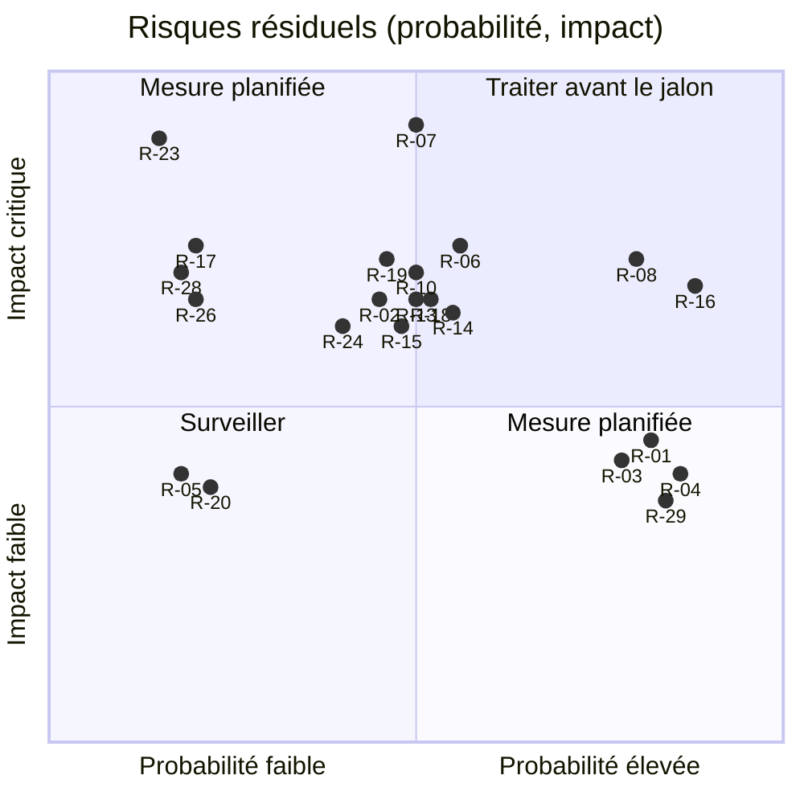

# 09 — Risques, vérifications et questions ouvertes

> Plan de réécriture en Rust, en architecture hexagonale, du serveur MCP Légifrance (`mcp-legifrance`). Ce document tient trois registres : les risques `R-xx`, les vérifications `V-xx` (tout ce que le plan et les recherches marquent **NON VÉRIFIÉ**) et les questions `Q1` à `Q17` de [00-decisions.md](00-decisions.md) §13 (Q1 à Q15 communes au plan ; Q16 et Q17 propres au livré, §3.17 et §3.18). Il recueille aussi les arbitrages secondaires que les autres documents renvoient ici (§3.16), les réponses du propriétaire du 2026-10-16 (C1 à C7, §3.16.4) et le registre des points différés de la revue de clôture M1 (`M1-D1…M1-D24`, §3.19).
>
> [00-decisions.md](00-decisions.md) est normatif et ce document ne le modifie pas. Sa révision 2 (2026-10-15) a intégré les amendements `AM-01…AM-43` de la revue (journal de 00 §14) : les amendements que ce document proposait sont tranchés et le §3.16.1 renvoie à leur décision ; les choix adoptés par défaut restent des questions ouvertes (Q1 à Q15, §3). Depuis le 2026-10-16 (C1 à C7), 00 §10 (exigence qualité) l'emporte sur tout autre document et, pour M0 et M1, le code livré et le plan 1 font foi ; leurs écarts avec le plan sont au §11.1 de 00. Les amendements décidés par cette réconciliation sont au §3.16.5.
>
> Rédigé le 2026-10-15, révision 2 du même jour (alignement sur 00 révision 2), contrôle final du 2026-10-16 (politique des versions, démarrage de M0 sans réponse aux questions, étiquette de V-76, statut des alignements du §3.16.2), puis réconcilié le 2026-10-16 avec le livré M0-M1 (plan 1) et les décisions C1 à C7. « La référence Python » désigne `matematicsolutions/fr-eli-mcp@d3b5b13` (v0.5.3). Les défauts `D-01…D-47` viennent de la [recherche 02](../recherche/02-defauts.md) ; les points de parité `P-xxx` et les écarts `E-xx`, de la [recherche 01](../recherche/01-parite.md).

## Sommaire

0. [Mode d'emploi](#0-mode-demploi)
1. [Registre des risques](#1-registre-des-risques)
2. [Registre des vérifications](#2-registre-des-vérifications)
3. [Questions ouvertes Q1 à Q17, arbitrages secondaires et points différés M1](#3-questions-ouvertes-q1-à-q17-arbitrages-secondaires-et-points-différés-m1)
4. [Hypothèses de travail](#4-hypothèses-de-travail)
5. [Critères d'acceptation de ce registre par jalon](#5-critères-dacceptation-de-ce-registre-par-jalon)
6. [Sources](#sources)

---

## 0. Mode d'emploi

### 0.1 Rôle et règles de mise à jour

- **Attribution des identifiants.** 00 §0 désigne ce document comme registre des vérifications ; il attribue donc les identifiants `R-01…R-30` et `V-01…V-216`. Les autres documents (plan et ADR de `docs/adr/`) portent déjà la forme finale **NON VÉRIFIÉ** [V-xx · étiquette] décrite à la fin du §2.19 (remplacement fait en révision 2, commit f771337, T-M0-12 livrée). La table de correspondance complète est au §2.19. Dix groupes d'étiquettes (neuf paires et un triplet) désignent chacun une même vérification et reçoivent le même identifiant (§2.1) : la première étiquette de chaque groupe est l'étiquette de référence, les autres sont des alias, signalés comme tels au §2.19. Les listes « points NON VÉRIFIÉS » des autres documents sont des index locaux : en cas d'écart (jalon, caractère bloquant, formulation), ce registre fait foi (00 §0, document propriétaire).
- **Citation dans ce document.** Hors de la colonne « Étiquette(s) » du registre, ce document cite directement les `V-xx` : toute mention d'un `V-xx` signale un point **NON VÉRIFIÉ** tant que le journal du §2.20 ne l'a pas levé. Un fait non vérifié qui n'a pas encore de `V-xx` est marqué **NON VÉRIFIÉ** et reçoit un identifiant à la suite.
- **Statuts d'une vérification.** `ouvert` (statut initial), `levé` (résultat consigné, avec sa preuve : artefact de workflow, fixture enregistrée, commit), `partiel`, `contourné` (une décision rend la vérification inutile), `caduc`. Toute levée donne une ligne dans le journal du §2.20 et une mise à jour des documents concernés : le marqueur **NON VÉRIFIÉ** y est retiré ou remplacé par le résultat.
- **Statuts d'un risque.** `ouvert`, `surveillé`, `réduit`, `clos`, `matérialisé` (le risque s'est produit et devient un incident, traité par une PR ou un ADR).
- **Quand mettre à jour.** Après chaque exécution live (registre de [06-qualite.md](06-qualite.md) §5.4), à la clôture de chaque jalon (revue des `R-xx` et `V-xx` du jalon, §5), à chaque montée de `rmcp`, à chaque réponse à une question `Qn`, à chaque révision de 00.
- **Qui.** Le mainteneur, ou l'agent qui exécute la vérification. Dans ce second cas, un humain relit la PR (06 §13.1).
- **Nouvelles incertitudes.** Elles prennent l'identifiant suivant (`V-217`, `R-31`…), et la plage citée par 00 §0 est amendée dans la même PR. Une nouvelle étiquette qui recouvre une vérification existante n'en crée pas : elle devient un alias de celle-ci (§2.1). Un identifiant n'est jamais réutilisé, même après une levée ou une clôture.
- **Points différés du livré.** Les points différés de la revue de clôture M1 portent le préfixe `M1-D` (`M1-D1…M1-D24`, registre du §3.19) : le préfixe `D-` est pris par les défauts de la référence. Un point n'est jamais renuméroté ; un point traité reçoit le statut `fait` et le commit.
- **Jalons M0 et M1.** Ils sont livrés (plan 1). Dans les fiches et tableaux de ce document, « M0 » ou « M1 » désigne le jalon *prévu par le plan* ; ce que le livré n'a pas fait est redistribué (§2.18 et 00 §11.1), et la colonne « Jalon » des vérifications cède devant la table de redistribution du §2.18.

### 0.2 Échelles des risques

| Note | Probabilité | Impact |
|---|---|---|
| 1 | faible : peu probable avant v1.0.0 | gêne : contournement simple, aucune réponse fausse |
| 2 | moyenne | fonction dégradée, contournement documenté |
| 3 | élevée, ou déjà constatée | fonction clé indisponible, ou réponse juridiquement fausse (date, existence d'un texte, citation) |
| 4 | — | jalon bloqué, ou exposition contractuelle ou juridique (CGU, données personnelles, licence) |

Le score vaut probabilité × impact. Il est évalué **après** les mesures déjà décidées par 00 : c'est un risque résiduel. À partir de 9, le risque est traité avant le jalon concerné ; de 6 à 8, une mesure est planifiée et le risque revu à chaque jalon ; jusqu'à 4, il est seulement surveillé.

### 0.3 Environnement de rédaction : état vérifié le 2026-10-15 (mis à jour le 2026-10-16)

Ces constats ont été faits pour ce document depuis le conteneur de développement (`curl` à travers le proxy du conteneur, `git ls-remote`, `rustc --version`). Ils fondent R-13 et Q6.

| Ressource | Résultat | Conséquence |
|---|---|---|
| `https://index.crates.io` (index sparse) | 200 ; le champ `pubtime` donne la date de publication de chaque version | âge des crates vérifiable (R-22) |
| `https://static.crates.io` (archives des crates) | refusé (403 du proxy) ; **historique, caduc le 2026-10-16** (hôte joignable depuis, voir la mise à jour ci-dessous) | était : aucune dépendance téléchargeable, aucune compilation possible (V-01) ; levé |
| `https://static.rust-lang.org` | refusé ; **historique, caduc le 2026-10-16** (hôte joignable depuis) | était : toolchain 1.99.0 non installable (V-16) ; installée |
| Toolchain installée | **historique** : `rustc 1.97.0 (2d8144b78 2026-07-07)`, `cargo 1.97.0` ; **depuis le 2026-10-16 : `rustc 1.99.0 (b940084d7 2026-09-28)`** | supérieure à la MSRV 1.88 (C5) ; égale à la toolchain épinglée par 00 §2 |
| `https://docs.rs`, `https://crates.io/api` | refusés | documentation des crates consultable seulement dans les sources |
| `sandbox-oauth`, `oauth`, `sandbox-api`, `api` et `piste.gouv.fr` | refusés | aucun appel live depuis le conteneur (R-13, Q3, Q6) |
| `https://www.legifrance.gouv.fr` | refusé | recette des URL impossible depuis le conteneur (V-139) |
| `https://echanges.dila.gouv.fr` | refusé | aucun dump DILA (M9, V-185) |
| `https://www.rfc-editor.org`, `https://code.claude.com` | refusés | RFC 9728 et documentation de Claude Code non lisibles (V-44, V-48) |
| `https://pypi.org`, `https://registry.npmjs.org` | 200 | référence Python et suite de conformité consultables |
| `git ls-remote` sur GitHub | fonctionne | tags vérifiables : `rmcp-v3.5.1` (`79437f2`) est le dernier tag de rmcp ; `2026-07-28` est la dernière révision de la spécification |
| API GitHub (`gh api`) sur `modelcontextprotocol/rust-sdk` | refusée pour cette session | statut des issues rmcp non vérifiable ici (V-38) |

**Mise à jour du 2026-10-16.** Ce tableau décrit le conteneur de rédaction du plan. Depuis, M0 et M1 ont été compilés, testés et fusionnés (PR #1 et #2, CI verte) : la compilation et les tests fonctionnent en local et en CI, et la toolchain locale est `rustc 1.99.0 (b940084d7 2026-09-28)`, la version que 00 §2 épingle (l'épinglage dans `rust-toolchain.toml`, aujourd'hui `channel = "stable"`, est une tâche de tête de M2, 00 §11.1). Les lignes `static.crates.io`, `static.rust-lang.org` et « Toolchain installée » sont donc caduques ; les refus des hôtes PISTE, Légifrance et DILA restent valables jusqu'à preuve contraire (R-13, Q3, Q6).

---

## 1. Registre des risques

### 1.1 Synthèse

| R | Risque | P | I | Score | Jalons | Liens principaux |
|---|---|---|---|---|---|---|
| [R-01](#r-01--instabilité-de-lapi-rmcp) | Instabilité de l'API rmcp | 3 | 2 | 6 | M0, M4, M8, chaque montée | V-38, ADR-0003 |
| [R-02](#r-02--bugs-ouverts-et-comportements-de-rmcp-351) | Bugs ouverts et comportements de rmcp 3.5.1 | 2 | 3 | 6 | M3 (spike), M4, M8 | V-29, V-30, V-36, V-38 |
| [R-03](#r-03--quotas-piste-inconnus) | Quotas PISTE inconnus | 3 | 2 | 6 | M2, M6, M7, M8 | V-62, V-63, V-64, Q4 |
| [R-04](#r-04--écarts-et-disponibilité-sandbox--production) | Écarts et disponibilité sandbox / production | 3 | 2 | 6 | M2, v0.1.0 | V-59, V-61, Q3 |
| [R-05](#r-05--origine-du-mojibake) | Origine du mojibake | 1 | 2 | 2 | M2 | V-71, V-72, V-73 |
| [R-06](#r-06--comportement--introuvable--de-lapi) | Comportement « introuvable » de l'API | 2 | 3 | 6 | M2, M6 | V-66, V-67, V-68, V-134 |
| [R-07](#r-07--cgu-piste-et-mode-http-partagé) | CGU PISTE et mode HTTP partagé | 2 | 4 | 8 | M8 | V-175, V-176, Q4 |
| [R-08](#r-08--smart-app-control-gatekeeper-et-signature) | Smart App Control, Gatekeeper et signature | 3 | 3 | **9** | Distribution (v0.1.0) | V-173, V-174, Q5 |
| [R-09](#r-09--tls-aws-lc-en-compilation-croisée) | TLS aws-lc en compilation croisée | 2 | 2 | 4 | M2 (tête), Distribution | V-02, V-25 |
| [R-10](#r-10--support-réel-de-2026-07-28-par-les-clients) | Support réel de 2026-07-28 par les clients | 2 | 3 | 6 | M4, v0.1.0, chaque version | V-46, V-49, V-51, V-52, Q7 |
| [R-11](#r-11--coût-de-contexte) | Coût de contexte | 2 | 2 | 4 | M4, M5, M6, M7 | V-47, V-48, V-58 |
| [R-12](#r-12--évolution-du-swagger-et-de-lapi-légifrance) | Évolution du Swagger et de l'API Légifrance | 2 | 2 | 4 | M2, en continu | V-74, V-122, V-135 |
| [R-13](#r-13--accès-réseau-de-lenvironnement-de-développement) | Accès réseau de l'environnement de développement | 2 | 3 | 6 | M2, M9 | Q3, Q6, V-185 |
| [R-14](#r-14--dépendance-à-un-compte-piste-personnel) | Dépendance à un compte PISTE personnel | 2 | 3 | 6 | M2, en continu | Q3, V-60 |
| [R-15](#r-15--données-personnelles-dans-les-décisions-et-les-journaux) | Données personnelles dans les décisions et les journaux | 2 | 3 | 6 | M2, M4, M8, M9 | V-178, V-179, V-180 |
| [R-16](#r-16--dumps-dila--volumétrie-et-absence-de-global-récent) | Dumps DILA : volumétrie, absence de global récent | 3 | 3 | **9** | M9 | V-185 à V-189, Q6 |
| [R-17](#r-17--sémantique-de-singledate--version-de-la-veille) | Sémantique de `singleDate` : version de la veille | 1 | 3 | 3 | M2 | V-76, V-100 |
| [R-18](#r-18--url-légifrance-et-contrat-de-citation) | URL Légifrance et contrat de citation | 2 | 3 | 6 | M2, v0.1.0 | V-139 à V-145 |
| [R-19](#r-19--fiabilité-du-vérificateur-de-citations) | Fiabilité du vérificateur de citations | 2 | 3 | 6 | M6 | V-119, V-120, V-134, V-163 |
| [R-20](#r-20--audit-strict-et-indisponibilité) | Audit strict et indisponibilité | 1 | 2 | 2 | M3 | Q9, V-164 à V-167 |
| [R-21](#r-21--délais-des-clients-et-délai-global) | Délais des clients et délai global | 2 | 2 | 4 | M2, M3, M4 | V-55 |
| [R-22](#r-22--chaîne-dapprovisionnement-et-versions-trop-récentes) | Chaîne d'approvisionnement et versions trop récentes | 2 | 2 | 4 | chaque dépendance, Distribution | V-25, V-26, V-171 |
| [R-23](#r-23--fuite-de-secrets-ou-de-données-dans-les-journaux) | Fuite de secrets ou de données dans les journaux | 1 | 4 | 4 | M2, M4 | — |
| [R-24](#r-24--sécurité-du-transport-http) | Sécurité du transport HTTP | 2 | 3 | 6 | M8 | V-39 à V-45, V-56, V-57 |
| [R-25](#r-25--mainteneur-unique-et-contributions-dagents) | Mainteneur unique et contributions d'agents | 2 | 2 | 4 | tous | — |
| [R-26](#r-26--contamination-de-licence) | Contamination de licence | 1 | 3 | 3 | M0, M6 | Q2, V-25, V-177 |
| [R-27](#r-27--évolution-de-la-spécification-mcp) | Évolution de la spécification MCP | 2 | 2 | 4 | après v0.3.0 | Q7 |
| [R-28](#r-28--format-strict-des-identifiants) | Format strict des identifiants | 1 | 3 | 3 | M2 | V-103, V-104 |
| [R-29](#r-29--réponses-volumineuses-et-mémoire) | Réponses volumineuses et mémoire | 3 | 2 | 6 | M2, M5, M7 | V-75, V-96, V-18 |
| [R-30](#r-30--nom-du-produit--marque--légifrance--et-homonymie) | Nom du produit : marque « Légifrance » et homonymie | 2 | 2 | 4 | Distribution | V-215 (Q1 décidée) |



Les positions reprennent les notes du tableau, légèrement décalées pour rester lisibles. R-13 est réduit depuis le 2026-10-16 (fiche R-13). R-06 (3 × 3 à 2 × 3) et R-29 (2 × 2 à 3 × 2) ont été réévalués le 2026-10-28 (T-M2-23, fiches R-06 et R-29). Les risques notés 2 × 2 (R-09, R-11, R-12, R-21, R-22, R-25, R-27, R-30) sont omis du graphique.

### 1.2 Fiches

#### R-01 — Instabilité de l'API rmcp

- **Description.** `rmcp` a publié quatre lignes incompatibles en 2026 : 0.17.0 (2026-02-27), 1.0.0 (2026-03-03), 2.0.0 (2026-06-29), 3.0.0 (2026-07-28), d'après le champ `pubtime` de l'index sparse relevé pour ce document (recherche 04 §1.1, recherche 09 §0). `ProtocolVersion::LATEST` est passé à 2026-07-28 dans une **mineure**, la 3.5.0 (recherche 09 §0). Une montée peut donc changer en silence la version négociée, les indications de cache par défaut (`fill_missing_cache_hints`) ou la boucle avant l'ouverture d'une ère (annexe D §9.4). Un correctif de sécurité publié seulement en 3.6 ou 4.x imposerait une montée en urgence.
- **Probabilité : 3.** Le rythme de 2026 rend très probable au moins une nouvelle mineure incompatible en pratique avant v1.0.0.
- **Impact : 2.** Le SDK est confiné à `lf-adapter-mcp` (00 §2, vérifié par `cargo xtask check-arch`, `make arch` ; le contrôle d'épinglage de rmcp arrive en M4) : une montée ne touche qu'un crate, mais elle peut casser les deux ères.
- **Réduction.** `rmcp` et `rmcp-macros` épinglés `=3.5.1`, `Cargo.lock` versionné (00 §6) ; aucun type `rmcp::model::*` hors de l'adapter ([02-architecture.md](02-architecture.md) §1.2) ; transcriptions JSON-RPC brutes des deux ères qui figent le comportement attendu (06 §6.1) ; descriptor lock (05 §9) ; procédure de montée de l'annexe D §9.4 (CHANGELOG, `LATEST`, `KNOWN_VERSIONS`, transcriptions, verrou, issues). Les outils de mise à jour automatique des dépendances excluent `rmcp` et `rmcp-macros`.
- **Signal d'alerte.** Nouvelle version de rmcp qui touche `LATEST`, `KNOWN_VERSIONS`, `discover` ou `StreamableHttpServerConfig` ; avis RUSTSEC visant 3.5.1 ; transcription rouge après `cargo update`.
- **Jalons.** M0 (choix figé), M4, M8, puis chaque montée.
- **Liens.** V-38 ; ADR-0003 ([index des ADR](../adr/README.md)) ; [annexes/D-mcp-2026-07-28.md](annexes/D-mcp-2026-07-28.md) §9.4.

#### R-02 — Bugs ouverts et comportements de rmcp 3.5.1

- **Description.** Issues ouvertes au 2026-10-15 selon la recherche 09 §4 : #1337 (`outputSchema` ou `structuredContent` à racine non objet envoyé tel quel aux pairs legacy), #1347 (`-32601` au lieu de `-32602` pour des params non désérialisables), #1348 (cache de validation de `Mcp-Param-*` jamais invalidé, P0 sécurité), #1325 (sessions HTTP legacy non annulées). La lecture du code de 3.5.1 ajoute qu'une notification reçue avant l'ouverture d'une ère **arrête le service** (`service/server.rs:681-685`, annexe D §9.2 constat 1), ce qui toucherait la sonde de Claude Code. rmcp journalise les réponses complètes au niveau `debug` (`service.rs:1593-1615`). Le comportement sur la panique d'un outil est inconnu (V-36).
- **Probabilité : 2.** Les parades sont décidées ; elles restent à prouver par le spike rmcp (avant la conception de `ToolCall` et des cas d'usage de M3, V-28) et les tests M4.
- **Impact : 3.** Serveur qui s'arrête à l'ouverture d'une session, ou réponses refusées par VS Code.
- **Réduction.** `PreLifecycleFilter` autour de `stdio()` dès le spike rmcp (avant la conception des ports de M3, V-28), avec les écarts acceptés et testés de 00 §6 (`ping` avant toute ère → `{}`, `initialize` à `_meta` moderne → poignée de main legacy, ligne non JSON ignorée ; annexe D §4.3, V-29, V-30) et proposition d'un correctif en amont, après lequel le filtre est retiré ; sorties toujours à racine objet (00 §6) ; aucune `x-mcp-header` (00 §6) ; filtre `tracing` qui plafonne `rmcp` à `warn` par défaut, garde-fou maintenu quand `LF_LOG` passe en `debug` ou `trace` sans le nommer (02 §8.2, §8.6 ; au niveau `info`, rmcp journalise déjà chaque notification reçue en entier) ; test documentaire de #1347 ; `catch_unwind` dans `call_tool` si V-36 le justifie ; `with_legacy_session_mode(false)` en HTTP (annexe D §9.1).
- **Signal d'alerte.** Transcriptions `premature_notification`, `garbage_and_batch` ou `legacy_2025_11_25` rouges ; issue rmcp réouverte ; rapport « server disconnected » d'un client.
- **Jalons.** M3 (spike, ex-M0), M4, M8.
- **Liens.** V-29, V-30, V-31, V-36, V-38 ; annexe D §9.

#### R-03 — Quotas PISTE inconnus

- **Description.** Les quotas sont « par seconde / minute / jour », sur le nombre de requêtes ou la bande passante, par application ou par méthode, modifiables par la DILA avec information par courriel (CGU API Légifrance l.212-231, recherche 05 §3.3). Leurs valeurs ne sont pas publiques. `fr_search_all` (M7) et `fr_verify_citations` (M6) multiplient les appels ; en mode HTTP partagé, le quota d'une application est commun à tous les utilisateurs.
- **Probabilité : 3.** Valeurs inconnues ; un client tiers rapporte des 401 transitoires sous limitation (V-64).
- **Impact : 2.** En stdio : `[rate_limited]` et des réponses partielles ; en M8, un utilisateur peut épuiser le quota des autres (impact 3 dans ce profil).
- **Réduction.** Limiteur `governor` global au processus, consulté par `check()` avant chaque tentative et jamais par `until_ready` (5 req/s, rafale 10 par défaut, `LF_PISTE_RPS`, `LF_PISTE_BURST`) et concurrence plafonnée à 4 (`LF_PISTE_CONCURRENCY` ; 00 §1, §8 ; 04 §5.4-§5.5) ; 2 tentatives au plus sur un 500 présumé déterministe (00 §8) ; cache mémoire et coalescence des requêtes identiques (00 §9) ; `Retry-After` attendu jusqu'à 30 s dans le délai global, refus d'attendre au-delà (échec immédiat, valeur propagée écrêtée à 1 h ; 04 §5.2) ; aucun test de charge ; bornes `max_citations` et `per_fond` (00 §7) ; en M8, équité par session à concevoir (recherche 05 §4.3 point 3).
- **Réévaluation du 2026-10-28 (T-M2-23, sandbox) : P 3 × I 2 = 6, inchangé.** Les valeurs des quotas ne se lisent pas dans les réponses (V-62 reste ouverte : seul le propriétaire du compte les lit dans la console PISTE). La campagne n'a jamais approché de limite : aucun 429 et aucun 401 dans les 104 réponses du lot ni dans les 9 tests live (V-63 et V-64 restent en observation continue ; la forme de `Retry-After` n'est pas observée). L'absence de 429 ne prouve pas un quota large : la campagne était courte (suite live de 63 s) et sous le limiteur de 5 req/s.
- **Signal d'alerte.** Lignes d'audit `error_code = rate_limited` ; `warn` 429 ou 503 dans `live.yml` ; courriel de la DILA sur un changement de quota ; série de `401 invalid_client` avec des jetons récents.
- **Jalons.** M2 (calibrage d'après la console), M6, M7, M8.
- **Liens.** V-62, V-63, V-64 ; Q4 ; D-13.

#### R-04 — Écarts et disponibilité sandbox / production

- **Description.** La surface d'API est identique (Swagger 2.4.2, recherche 05 §0), mais « les données ne sont pas identiques à celles de Production » et la sandbox n'a aucun engagement de service : elle peut être indisponible sans préavis (recherche 05 §3.2). Les identifiants sont propres à chaque environnement (`invalid_client` sinon, référence SOURCES.md:12). Les URL de production n'ont jamais été appelées, ni par la référence ni pendant la recherche.
- **Probabilité : 3.** L'écart est documenté par la DILA ; seule son ampleur est inconnue.
- **Impact : 2.** Fixtures et tests live peu représentatifs ; production non testée au moment de la livraison ; tests live rouges sans changement de code.
- **Réduction.** `LF_PISTE_ENV` (défaut `sandbox`) affiché dans `fr_coverage`, rappelé au démarrage et écrit dans chaque ligne d'audit (00 §1, §7) ; lacune FR-101 ; contrôle `EnvMismatch` des URL, sans déduction implicite de l'environnement (00 §1, 04 §2.3) ; cache cloisonné par environnement (00 §9) ; environnement noté dans les métadonnées des fixtures (`env = production` pour les fixtures de données publiques enregistrées en production, 00 §10, 04 §13.4) ; `live_oauth_production_endpoints` avant v0.1.0, lancé à la main par le mainteneur (Q3, 06 §5.2) ; en sandbox, `fr_verify_citations` rend `unresolvable` plutôt que `not_found` (00 §7) ; tests live jamais bloquants pour une PR (06 §5.1).
- **Réévaluation du 2026-10-28 (T-M2-23, sandbox) : P 3 × I 2 = 6, inchangé.** Les 100 réponses enregistrées en sandbox couvrent les 8 fonds de la v0.1 (la version du Swagger servi n'est pas observée, V-74 reste ouverte), mais la production n'a jamais été sondée (V-59, V-61 non faites, Q3 : sondes manuelles avant v0.1.0) : l'ampleur de l'écart de données reste inconnue. La sandbox a montré deux comportements propres à elle ou à la passerelle (403 JSON pour une route inconnue, deux 503 du moteur de recherche hors fenêtre) qui ont été traités par C1 à C5, pas par un changement de modèle.
- **Signal d'alerte.** Test live vert en sandbox mais divergent en production ; `invalid_client` ; plusieurs exécutions de `live.yml` rouges d'affilée.
- **Jalons.** M2, recette v0.1.0.
- **Liens.** V-59, V-60, V-61 ; Q3 ; D-18.

#### R-05 — Origine du mojibake

- **Description.** 6 fixtures sur 16 contiennent de l'UTF-8 décodé à tort en ISO-8859-1 : 252 séquences, dont 235 dans 60 valeurs et 17 dans 14 clés de facettes (recherche 03 §11.1 ; recompté pour ce document avec le motif de 00 §8 et [annexes/donnees/scripts/dto_repair_check.py](annexes/donnees/scripts/dto_repair_check.py), Python 3.13, `python3 -I`). Les autres documents qui citent 235 séquences ne comptent que les valeurs. La cause la plus probable est l'outil de capture : le même endpoint est sain dans une campagne ultérieure (04 §10.1). Si l'API en produisait, la réparation tout-ou-rien au niveau du corps (00 §8, fonction `text::encoding::repair_latin1_mojibake` du domaine) pourrait ne pas couvrir une forme CP1252 (V-73), ni des caractères échappés en `\uXXXX` (V-71).
- **Probabilité : 1.** Indices concordants en faveur de la capture.
- **Impact : 2.** Texte officiel restitué avec des caractères altérés ; la réparation sur des données saines est l'identité (04 §10.3).
- **Réduction.** Réparation active par défaut, comptée, journalisée en `warn` et désactivable par `LF_PISTE_MOJIBAKE_REPAIR=off` (00 §1, §8 ; 04 §10.5) ; jamais appliquée par défaut au texte de l'utilisateur (00 §8) ; proptest d'identité sur toute chaîne saine ; `live_no_mojibake_on_reference_ids` en M2 ; fixtures remplacées par des captures saines si l'API est hors de cause (D-35).
- **Réévaluation du 2026-10-28 (T-M2-23, sandbox) : P 1 × I 2 = 2, inchangé ; hypothèse confirmée.** Les six requêtes sur les identifiants des fixtures corrompues reviennent en UTF-8 propre (V-72, `live_no_mojibake_on_reference_ids` vert) ; aucun motif CP1252 (V-73) ni échappement `\uXXXX` (V-71) dans les 100 réponses enregistrées. L'origine est la capture de la référence, non PISTE. Le détecteur s'est déclenché 6 fois sur le lot, toujours à tort (espace insécable après `é` ou `à`, contrôles C1 hérités du texte officiel). La production n'est pas essayée ; la réparation reste active par défaut (elle est l'identité sur des données saines). Les 6 fixtures corrompues de la référence sont à remplacer par des captures saines (D-35).
- **Signal d'alerte.** Compteur `mojibake_repairs` ou `mojibake_unrepaired` supérieur à 0 en live ; signalement de caractères altérés.
- **Jalons.** M2.
- **Liens.** V-71, V-72, V-73 ; D-35.

#### R-06 — Comportement « introuvable » de l'API

- **Description.** Pour un identifiant bien formé mais inexistant, seul `/consult/juri` (JURITEXT, CETATEXT) est connu : HTTP 400 « L'expression à valider est fausse. » (sondé par pylegifrance, 04 §11.1). Le comportement des six autres consultations, la forme d'un 404 PISTE (routage ou ressource) et le caractère déterministe des 500 sont inconnus. La référence confondait un mauvais chemin et un texte absent (D-10).
- **Probabilité : 3.** Comportement inconnu sur la plupart des endpoints.
- **Impact : 3.** Un `not_found` à tort fait conclure au modèle qu'un texte n'existe pas ; un `upstream_error` à tort masque une citation inventée. C'est le cœur de la promesse anti-hallucination (M6).
- **Réduction.** Classification provisoire de 04 §11.2 : jamais `NotFound` sur `/search` ni sur l'endpoint token (une erreur OAuth donne `config_error`, 00 §5) ; un 404 n'est `NotFound` que sur une consultation officielle à corps non HTML ; un 500 n'est jamais `NotFound`, et n'est tenté que deux fois (00 §8) ; un 400 sans marqueur « introuvable » donne `upstream_error` (détail PISTE nettoyé pour une consultation, générique `HTTP 400 on /search` pour `/search`, R6 ; 00 §5). Sonde `live_unknown_ids_classification` en M2, puis mêmes sondes en M6 et M7. Les instructions rappellent que l'absence ici n'est pas l'absence dans le droit ; `fr_verify_citations` rend `unresolvable` tant que la couverture d'une famille n'est pas prouvée (annexe B §7.2).
- **Réévaluation du 2026-10-28 (T-M2-23, sandbox) : P 3 → 2, I 3, score 9 → 6.** La table « introuvable » de 04 §11 est définitive pour les endpoints de la v0.1 (V-66, V-67, V-68 levées) : aucun 404 n'existe en sandbox (identifiant inexistant : 400 « valider est fausse », 200 `null` ou enveloppe vide ; route inconnue : 403 JSON de la passerelle) ; la sandbox a pourtant pris l'hypothèse en défaut sur `/consult/acco` (400 « Le nombre de résultat retourné par le moteur de recherche n'est pas égal à 1 », corrigé par C1) et un 403 HTML de la passerelle n'est pas un défaut d'accès (C4). La probabilité baisse sans disparaître : M6, M7, `KALIARTI` sur `getArticle` et la production ne sont pas sondés, et le même 400 « valider est fausse » répond aussi à un texte existant daté hors de ses versions (V-89).
- **Signal d'alerte.** `not_found` sur un identifiant issu d'un `fr_search` ; hausse des `upstream_error` en 400 ou 404.
- **Jalons.** M2 (règle définitive), M6.
- **Liens.** V-66, V-67, V-68, V-69, V-134 ; D-10.

#### R-07 — CGU PISTE et mode HTTP partagé

- **Description.** L'accès à PISTE passe par un compte nominatif ; les clés « sont strictement réservées à votre application et ne doivent en aucun cas être rendues publiques ou divulguées à un tiers » (CGU API Légifrance l.171-183). La DILA peut suspendre sans préavis en cas de manquement (l.336-345). La recherche 05 §4.3 juge qu'un serveur appelant PISTE avec les identifiants de son opérateur « ressemble » au modèle de réutilisation encouragé ; c'est une interprétation, non vérifiée juridiquement. Les CGU générales du portail PISTE n'ont pas été lues.
- **Probabilité : 2.**
- **Impact : 4.** Suspension du compte, responsabilité de l'opérateur, retrait du mode distant.
- **Réduction.** M8 reste optionnel ; profil local seulement (jeton statique, `127.0.0.1`) tant que Q4 n'est pas tranchée ; jamais de transmission de jeton vers PISTE ni de secret vers un client (00 §6) ; demande écrite à la DILA (V-176) ; lecture des CGU générales (V-175) ; variante « chaque utilisateur fournit ses identifiants » évaluée par ADR si besoin ; limiteur global et équité par session.
- **Signal d'alerte.** Réponse défavorable de la DILA ; nouvelle version des CGU ; courriel de surconsommation.
- **Jalons.** M8.
- **Liens.** V-175, V-176, V-62 ; Q4 ; [annexes/C-api-legifrance.md](annexes/C-api-legifrance.md) §1.7.

#### R-08 — Smart App Control, Gatekeeper et signature

- **Description.** Un utilisateur de la référence a constaté le 2026-07-05 que Smart App Control (Windows 11) bloque les lanceurs non signés « sans demander et sans exception par programme » ; la référence conseille donc `python -m fr_eli_mcp` (référence `src/fr_eli_mcp/__main__.py:1-9`). Un binaire Rust non signé est exposé au même blocage, et sous macOS un binaire non notarisé peut être refusé par Gatekeeper (V-174).
- **Probabilité : 3** sans certificat (Q5), **1** avec.
- **Impact : 3.** Le binaire est inutilisable sur les postes concernés, et l'utilisateur ne dispose d'aucun contournement simple.
- **Réduction.** Q5, adoptée par défaut (00 §12, AM-34) : certificat Authenticode par Azure Artifact Signing si le propriétaire est éligible, sinon SSL.com eSigner, les deux seuls fournisseurs que cargo-dist sait utiliser (08 §12.1 ligne 4, V-193), et compte Apple Developer ; signature macOS par `codesign` (option `macos-sign` de dist, expérimentale, V-194), notarisation par un job `notarytool` dédié, car dist ne notarise pas (08 §3.3, V-195). À défaut, binaires non signés avec un avertissement explicite dans le README et la page de release, et replis documentés : image OCI sous Docker Desktop ou WSL (08 §8.6, §8.7). Un bundle MCPB unique, avec lanceur POSIX et override `win32` (V-197). Essai réel sous Smart App Control (V-173) ; un binaire compilé localement par `cargo install` serait peut-être bloqué lui aussi (V-173).
- **Signal d'alerte.** Issue « blocked by Smart App Control » ou « cannot be opened because the developer cannot be verified ». Le serveur n'ayant aucune télémétrie (ADR-0005), seuls les signalements des utilisateurs alertent.
- **Jalons.** Distribution, dès v0.1.0.
- **Liens.** V-173, V-174, V-193, V-194, V-195, V-197 ; Q5 ; [08-distribution.md](08-distribution.md) §3.

#### R-09 — TLS aws-lc en compilation croisée

- **Description.** Le fournisseur par défaut de rustls est aws-lc-rs, dont `aws-lc-sys` exige selon la cible cmake, NASM ou clang (recherche 04 §6 points 5 et 6). Les 7 cibles de cargo-dist (00 §12), dont musl et aarch64, n'ont pas été essayées. Le repli `ring` demande `rustls-no-provider` et un `install_default()` au démarrage, faute de quoi reqwest panique (02 §3.0.1).
- **Probabilité : 2.**
- **Impact : 2.** Cible manquante ou bascule vers `ring` ; panique au premier appel si l'installation du fournisseur est oubliée.
- **Réduction.** Spike TLS des deux options en tâche 0 de M2 (arrivée de `reqwest` ; M0 est livré sans spike, 00 §11.1), puis sur les 7 cibles avant la distribution, avec poignée de main (V-02) ; choix consigné dans ADR-0013 ; test « fournisseur installé avant le premier client » ; inventaire des licences (V-25). **2026-10-22 (plan 2c).** A compile avec `cc` seul sur x86_64 gnu ; musl échoue pour A et B sans compilateur C musl ; panique de reqwest sans fournisseur : `No rustls crypto provider is configured…`, levée dans `Client::build()` ; matrice à déclencher (`tls-spike.yml`) ; probabilité inchangée (2).
- **Signal d'alerte.** Échec de `dist build` sur une cible ; message « No rustls crypto provider is configured » (panique de `Client::build()` sous `rustls-no-provider`).
- **Jalons.** M2 (tête, ex-M0), Distribution.
- **Liens.** V-02, V-25 ; ADR-0013.

#### R-10 — Support réel de 2026-07-28 par les clients

- **Description.** Claude Code ≥ 2.1.292 négocie 2026-07-28 par défaut après une sonde `server/discover` ; VS Code (`main` du 2026-10-15) n'envoie qu'`initialize` 2025-11-25 ; Claude Desktop et Cursor sont inconnus (annexe D §10.1). Ce que Claude Code transmet au modèle (`structuredContent` en succès, texte en erreur) n'est vérifié que par sa documentation et son CHANGELOG, pas par un essai (V-46).
- **Probabilité : 2.** L'hétérogénéité va durer ; le mode dual-era la couvre si les tests passent.
- **Impact : 3.** Serveur invisible ou réponses illisibles dans un client majeur ; ADR-0006 à revoir si le contenu transmis n'est pas celui attendu.
- **Réduction.** Serveur dual-era `[2026-07-28, 2025-11-25, 2025-06-18]` (00 §6) ; `supportedVersions` de `server/discover` = ces trois versions, avec le repli de 00 §6 (`[2026-07-28]` seul et `-32022` par `PreLifecycleFilter`) si V-34 confirme à l'exécution le comportement lu dans le code ; instructions identiques dans `DiscoverResult` et `InitializeResult` ; transcriptions des deux ères ; protocole de test manuel avant chaque version (annexe D §10.3) ; critère de retrait du legacy inscrit dans ADR-0003 (support vérifié dans VS Code, Cursor et Claude Desktop).
- **Signal d'alerte.** Rapport « failed to connect » ; changement de CHANGELOG de Claude Code ou de VS Code sur la négociation ; MCP Inspector en mode `modern` en échec.
- **Jalons.** M4, recette v0.1.0, chaque version.
- **Liens.** V-46, V-49, V-51, V-52, V-53, V-34 ; Q7.

#### R-11 — Coût de contexte

- **Description.** Instructions limitées à 3 500 caractères (Claude Code coupe à 4 096) ; `tools/list` estimé à environ 19,4 Ko en v0.1 (11,8 Ko sans `outputSchema`) et 27,9 Ko en v0.3, l'`outputSchema` n'étant peut-être pas transmis au modèle (05 §6.6, estimations de la révision 2 reprises en 05 §0) ; Claude Code avertit au-delà de 10 000 tokens de sortie, plafonne à 25 000 et écrit dans un fichier un résultat de plus de 50 000 caractères (annexe D §10.1). Le ratio caractères/token du français juridique est supposé égal à 4 (D-33).
- **Probabilité : 2.**
- **Impact : 2.** Réponses du modèle dégradées, coût par session ; des descriptions de 3 à 6 phrases et des schémas bornés coûtent environ 4,7 Ko de plus que la référence quand l'`outputSchema` n'est pas transmis (05 §6.6).
- **Réduction.** `structuredContent` compact, champs `None` omis (ADR-0006) ; `detail = "summary"` et `max_chars = 4 000` par défaut ; plafond dur de 45 000 caractères, estimé par `lf-application` et mesuré exactement par `lf-adapter-mcp`, avec un ordre de dégradation fixé (00 §7, 05 §6.4) ; tests `descriptor_size_budget` et de taille des instructions ; leviers de réduction de 05 §6.6 ; mesures en M5.
- **Signal d'alerte.** Budget de la CI dépassé ; ratio mesuré par V-58 nettement inférieur à 4 ; avertissement de Claude Code sur la taille d'une sortie.
- **Jalons.** M4, M5, puis M6 et M7 (nouveaux outils).
- **Liens.** V-47, V-48, V-58 ; D-33.

#### R-12 — Évolution du Swagger et de l'API Légifrance

- **Description.** La copie de référence du Swagger est la 2.4.2 (2025-05-28) ; la version servie aujourd'hui est inconnue (V-74). Des chemins utilisés par des tiers en sont absents (`consult/loda/version(s)`, recherche 05 §1.12). La DILA peut faire évoluer l'API ; ses correctifs arrivent d'abord en sandbox (recherche 05 §3.2).
- **Probabilité : 2.**
- **Impact : 2.** Erreurs `Decode`, endpoint disparu, champ renommé.
- **Réduction.** DTO minimaux et tolérants (`#[serde(default)]`, champs inconnus ignorés, `serde_path_to_error`, 00 §8) ; test de dérive des chemins contre `swagger-2.4.2-paths.txt` (04 §7.1) ; `live.yml` hebdomadaire (06 §7.5) ; relecture du Swagger à chaque jalon.
- **Signal d'alerte.** Hausse des erreurs `Decode` ; `live.yml` rouge ; nouvelle `info.version` dans le catalogue PISTE.
- **Jalons.** M2, puis en continu.
- **Liens.** V-74, V-122, V-135.

#### R-13 — Accès réseau de l'environnement de développement

- **Description.** Constat du 2026-10-15 (§0.3) : depuis le conteneur, `static.crates.io`, `static.rust-lang.org`, `docs.rs`, `*.piste.gouv.fr`, `legifrance.gouv.fr` et `echanges.dila.gouv.fr` sont refusés ; seul l'index sparse de crates.io répond. La toolchain installée est 1.97.0, alors que 00 §2 épingle 1.99.0. Les recherches ont été menées dans les mêmes conditions ([README des recherches](../recherche/README.md)). **Mise à jour du 2026-10-16 : risque réduit.** M0 et M1 ont été compilés et testés en local et en CI (PR #1 et #2) avec `rustc 1.99.0` ; la compilation n'est plus bloquée. Reste l'accès live à PISTE (Q3) et aux hôtes DILA.
- **Probabilité : 2.** Les hôtes de compilation sont joignables (constaté en M0-M1) ; l'accès live à PISTE dépend de Q3.
- **Impact : 3.** Aucun appel live en M2 (M2 n'est pas acceptable sans sandbox, Q3), aucun dump en M9. La compilation n'est plus concernée.
- **Réduction.** Compilation et toolchain : réglées en M0-M1. Q6 ne reste ouverte que pour `echanges.dila.gouv.fr` (avant M9) ; l'accès live aux sondes PISTE relève de Q3 (`live.yml` ou poste du mainteneur). À défaut, la CI GitHub Actions sert d'environnement de compilation et de test : les agents travaillent par PR, la CI compile, `live.yml` exécute les sondes avec les secrets de l'environnement `piste-sandbox`. Les tests sont conçus pour tourner hors ligne (00 §10). Ne jamais contourner le proxy (désactiver TLS, changer `HTTPS_PROXY`).
- **Signal d'alerte.** `cargo fetch` en 403 ; `rustup` incapable d'installer la toolchain épinglée (régressions) ; refus persistant des hôtes PISTE (Q3).
- **Jalons.** M2, M9 (statut : réduit le 2026-10-16 ; M0 n'est plus concerné).
- **Liens.** Q6 ; V-01, V-16, V-185.

#### R-14 — Dépendance à un compte PISTE personnel

- **Description.** L'accès à PISTE passe par un compte nominatif (CGU l.171-183). Tous les tests live, l'enregistrement de fixtures et la vérification de la production dépendent des identifiants d'une personne. Une divulgation viole les CGU ; la procédure de compromission impose de réinitialiser les identifiants et de prévenir la DILA et l'AIFE (CGU l.274-285).
- **Probabilité : 2.**
- **Impact : 3.** Plus aucune vérification live ; risque de suspension en cas de fuite.
- **Réduction.** Q3, adoptée par défaut (00 §10, §13, AM-40) : sandbox par défaut ; en production, seulement des sondes en lecture seule lancées à la main par le mainteneur avant chaque étiquette (au plus 1 requête/s) et des fixtures de données publiques marquées `env = production` ; jamais d'identifiants de production en CI ; applications sandbox et production distinctes ; secrets sandbox dans l'environnement GitHub protégé `piste-sandbox`, jamais exposés aux PR venant d'un fork (06 §7.5) ; aucune valeur d'identifiant dans un fichier, un journal ou une fixture (04 §13.4) ; procédure de rotation et de compromission écrite dans `SECURITY.md` (06 §10.3) ; la CI ordinaire n'a besoin d'aucun identifiant.
- **Réévaluation du 2026-10-28 (T-M2-23) : P 2 × I 3 = 6, inchangé.** La campagne a tourné sur le compte sandbox du propriétaire sans qu'aucun identifiant n'entre dans un fichier, un journal ou une fixture (comptage par valeur : 0 dans les fixtures, les documents et les journaux). Chaque utilisateur du serveur utilise ses propres identifiants (variables d'environnement, jamais d'identifiants partagés) ; `live.yml` ne teste rien sans les secrets de l'environnement `piste-sandbox`, qui ne sont pas créés à ce jour : il reste vert sans rien vérifier.
- **Signal d'alerte.** `live.yml` en `invalid_client` ; abonnement expiré ; changement de mainteneur.
- **Jalons.** M2, puis en continu.
- **Liens.** Q3 ; V-60.

#### R-15 — Données personnelles dans les décisions et les journaux

- **Description.** Les décisions JURI sont pseudonymisées et les textes CNIL occultés par la DILA, sans que la référence le signale (D-45). Des noms résiduels sont possibles (V-178). Les champs nominatifs (présidents, rapporteurs, avocats) existent dans les réponses ; la loi interdit de réutiliser l'identité des magistrats et des membres du greffe pour évaluer ou prédire leurs pratiques (recherche 05 §5.1 ; article exact : V-179). Les requêtes de recherche peuvent révéler l'activité d'un juriste. L'empreinte SHA-256 non salée de l'audit est réversible par dictionnaire pour une entrée courte (D-17). Contenus `inap` et `dereferenced` : obligations inconnues (V-180).
- **Probabilité : 2.**
- **Impact : 3.** Exposition juridique et atteinte à la réputation ; fixtures publiques contenant un nom.
- **Réduction.** Restitution telle que publiée et lacune FR-006 (« do not try to re-identify parties », 05 §5.8) ; champs nominatifs non désérialisés (04 §14.5) ; aucune fonction d'agrégation par magistrat ; requêtes jamais journalisées en clair (04 §12.5) ; fichiers d'audit privés (06 §11.6, V-165) ; revue des fixtures enregistrées avant tout commit (06 §4.4) ; exclusion des contenus `inap` et `dereferenced` de tout index ou réponse distante tant que V-180 n'est pas levée (annexe C §10 question 8) ; aucun cache disque en v0.x (00 §9).
- **Signal d'alerte.** Nom de partie dans une fixture ; demande de fonctionnalité « statistiques par juge » ; réclamation.
- **Jalons.** M2 (fixtures), M4, M8, M9.
- **Liens.** V-178, V-179, V-180, V-165 ; D-17, D-45.

#### R-16 — Dumps DILA : volumétrie et absence de global récent

- **Description.** Le dernier global LEGI connu date du 13/07/2025 ; les incréments quotidiens courent jusqu'en octobre 2026, ce qui fait 15 mois d'archives à rejouer dans l'ordre (recherche 05 §6.2). Les globaux dépasseraient 40 Go pour l'ensemble des fonds (justicelibre, annexe C §10 question 7). L'hôte `echanges.dila.gouv.fr` est injoignable depuis le conteneur (§0.3) ; arborescence, encodage, DTD et licence par fonds ne sont pas vérifiés.
- **Probabilité : 3.**
- **Impact : 3.** M9 (v1.0.0) en retard ou réduit ; première installation longue ; index incohérent si un incrément manque.
- **Réduction.** Périmètre LEGI d'abord (annexe C §10 question 7) ; téléchargement des dumps hors binaire, par un script documenté, le binaire ne lisant qu'un répertoire local (proposition par défaut de 02 §3.9, à trancher en M9, §3.16.3) ; ingestion en flux (`flate2` → `tar` → `quick-xml`), sans extraction sur disque ; registre des archives appliquées et reconstruction complète sur un nouveau global (annexe C §7.11) ; tests sur des extraits réels ; budget disque documenté après V-185 ; Q6 pour l'accès réseau.
- **Signal d'alerte.** Q6 refusée pour l'hôte DILA ; durée d'ingestion mesurée hors de proportion ; nouveau global ou changement de DTD.
- **Jalons.** M9.
- **Liens.** V-185, V-186, V-187, V-188, V-189 ; Q6.

#### R-17 — Sémantique de `singleDate` : version de la veille

- **Description.** Tous les horodatages de date observés sont à minuit UTC (recherche 03 §11.2, V-100). L'ancienne règle (minuit Europe/Paris, soit 22 h ou 23 h UTC la veille) retenait la version de la veille si PISTE compare l'instant à des bornes stockées à minuit UTC ou le tronque en date UTC (04 §6.3). 00 §8 (révision 2, AM-02) fixe donc `DATE_VERSION.singleDate` à **midi Europe/Paris** du jour demandé (10 h ou 11 h UTC), correct dans les trois interprétations (comparaison à des bornes à minuit UTC, troncature en date UTC, troncature en date Paris), avec 10 à 11 h de marge de chaque côté, et stable sur la journée. Vecteurs fixés par 00 §8 : 2026-10-15 → 1792058400000 ; 2026-01-15 → 1768474800000 ; 2026-03-29 → 1774778400000 ; 2026-10-25 → 1792926000000. Le risque résiduel est un comportement de PISTE qui ne relève d'aucune de ces trois interprétations.
- **Probabilité : 1.** La règle de midi couvre les trois lectures plausibles ; **confirmée en sandbox le 2026-10-28** (V-76 levée : midi Paris rend la version de D, minuit Paris la précédente, §2.20) ; la production n'est pas essayée.
- **Impact : 3.** Le jour d'une entrée en vigueur, la recherche rendrait l'ancienne version : réponse juridiquement fausse sur l'état du droit.
- **Réduction.** Midi Europe/Paris (00 §8) ; sonde `live_singledate_noon_paris_semantics` en M2 (V-76, comparée à minuit UTC, à minuit Paris et à la veille, 04 §13.5) ; vecteurs de test de 00 §8 et de 04 §6.3 ; la clé de cache repose sur `VersionDate`, pas sur l'instant envoyé (00 §7, §9).
- **Réévaluation du 2026-10-28 (T-M2-23, sandbox) : P 1 × I 3 = 3, inchangé ; V-76 n'est plus bloquante.** `live_singledate_noon_paris_semantics` est vert : midi Paris retient la version qui commence le jour D, minuit Paris celle d'avant, ce qui confirme la règle de 00 §8 et explique le choix. La production n'est pas essayée.
- **Signal d'alerte.** Sonde rouge ; écart entre `fr_search` et la page Légifrance un jour de changement de version.
- **Jalons.** M2.
- **Liens.** V-76, V-100, V-77, V-17.

#### R-18 — URL Légifrance et contrat de citation

- **Description.** Chaque entité citable expose un `source_url` (ADR-0009). Les motifs d'URL (03 §5.5) n'ont pas été ouverts dans un navigateur : `/loda/article_lc/` ou `/codes/article_lc/` pour un article de loi, `/ceta/id/` ou `/juri/id/` pour un `CETATEXT`, `/conv_coll/id/` pour un `KALIARTI` (V-139 à V-144). Livré (M1) : `ResourceKind::CodeArticle` pour tout `LEGIARTI` (`crates/lf-domain/src/url.rs:15-21`, `entity/article.rs:34-37`), comme la référence ; la règle `/loda/article_lc/` (E-19) n'est adoptée qu'après V-140 et V-142 (live, M2), et l'URL d'un `LEGIARTI` de loi est la Q17 (V-141, §3.18). Le contrat de citation v2 est une tâche de tête de M2 (C2, 00 §11.1).
- **Probabilité : 2.**
- **Impact : 3.** Une citation au lien mort est invérifiable par l'utilisateur ; or la vérifiabilité est la raison d'être du contrat.
- **Réduction.** Fonctions d'URL pures dans `lf-domain`, faciles à corriger et couvertes par les tests golden ; recette navigateur avant v0.1.0 ; règle de 00 §4 : `/loda/article_lc/` si le parent est un texte non codifié, `/codes/article_lc/` si c'est un code ou si sa nature est inconnue (repli de parité), d'après `textTitles[].nature` ; V-140 et V-142 bloquantes pour v0.1.0 (00 §4).
- **Signal d'alerte.** Recette rouge ; lien signalé comme mort.
- **Jalons.** M2 (règle des URL après V-140 et V-142 ; M1 livré sans elle), recette v0.1.0.
- **Liens.** V-139 à V-145 ; ADR-0009 ; D-28, D-29.

#### R-19 — Fiabilité du vérificateur de citations

- **Description.** `fr_verify_citations` et `fr_resolve` (M6) reposent sur une grammaire et un dictionnaire de codes construits sans accès à l'API : formes de `NUM_ARTICLE`, numéros de pourvoi, ECLI rares, abréviations non attestées, couverture partielle des fonds de jurisprudence, cas du corpus construits de mémoire (annexe B §10.2).
- **Probabilité : 2.**
- **Impact : 3.** Un faux `verified` valide une hallucination ; un faux `not_found` discrédite une citation juste.
- **Réduction.** Statut `unresolvable` par défaut quand la couverture d'une famille n'est pas prouvée (V-134) ; corpus positif et négatif versionné ([annexes/donnees/citations-corpus-positifs.jsonl](annexes/donnees/citations-corpus-positifs.jsonl), [négatifs](annexes/donnees/citations-corpus-negatifs.jsonl)) ; cas « de mémoire » limités aux tests de syntaxe tant que V-163 n'est pas levée ; tests live des `resolve_hint` (annexe B §8.7) ; en sandbox, un introuvable est rendu `unresolvable` avec la note « sandbox data differ from production », jamais `not_found` (00 §7) ; ECLI d'un autre pays classé `Unsupported { ForeignEcli }`, statut `unresolvable` (00 §4).
- **Signal d'alerte.** Régression du corpus ; écart entre `find_article` et la page Légifrance ; signalement d'un faux `verified`.
- **Jalons.** M6.
- **Liens.** V-119, V-120, V-127, V-134, V-146 à V-163 ; [annexes/B-citations.md](annexes/B-citations.md).

#### R-20 — Audit strict et indisponibilité

- **Description.** En mode `strict` (défaut, Q9), un échec d'écriture du journal fait échouer l'outil (`[audit_error]`). Causes possibles : disque plein, droits, verrou, écritures concurrentes de plusieurs processus sous Windows (V-164).
- **Probabilité : 1.**
- **Impact : 2.** Outil indisponible ; c'est voulu par Q9, mais cela peut surprendre.
- **Réduction.** Message actionnable qui cite `LF_AUDIT_MODE=best-effort` et `LF_AUDIT_DIR` ; rotation (16 Mio ou changement de date UTC) et écriture de chaque ligne sous un verrou consultatif `fs4` sur `.mcp-legifrance.lock` (00 §7, 02 §3.5, V-09) ; aucune E/S disque avant le premier `record()` (00 §7) ; tests sur les trois OS ; `check-config` vérifie que le répertoire est inscriptible.
- **Signal d'alerte.** Résultats `[audit_error]` ; rapport d'utilisateur.
- **Jalons.** M3.
- **Liens.** Q9 ; V-09, V-164, V-165, V-166, V-167 ; D-02, D-16.

#### R-21 — Délais des clients et délai global

- **Description.** Le délai global d'un outil vaut 60 s (`LF_TOOL_DEADLINE_S`) et une tentative HTTP 40 s (00 §1, §8). Les délais imposés par Claude Code et VS Code à un appel d'outil sont inconnus (V-55). Une sandbox lente et des réessais peuvent dépasser le délai du client.
- **Probabilité : 2.**
- **Impact : 2.** Appels abandonnés côté client pendant que le serveur continue à consommer du quota.
- **Réduction.** `Audited` exécute le cas d'usage sous `tokio::time::timeout(LF_TOOL_DEADLINE_S)` et publie l'échéance dans `Deadline`, variable locale de tâche lue par les adapters comme durée restante ; aucune tentative ni attente au-delà, cas d'usage à appels multiples arrêtés à 80 % du délai avec un résultat partiel motivé (00 §3 ; 04 §5.2-§5.3) ; annulation propagée jusqu'au port, avec une ligne d'audit (00 §7, 02 §7.1) ; délai configurable ; mesure V-55 puis ajustement des défauts.
- **Signal d'alerte.** `notifications/cancelled` fréquentes ; lignes d'audit `status = error` sans `error_code` et avec `error = "cancelled by client"` (format de 00 §7).
- **Jalons.** M2, M3 (`Audited` et `Deadline` dans `lf-application`), M4.
- **Liens.** V-55 ; D-14.

#### R-22 — Chaîne d'approvisionnement et versions trop récentes

- **Description.** 00 §2 (révision 2, AM-26) exige que toute version figée dans `Cargo.lock` soit publiée depuis au moins 14 jours à la date du verrouillage, sauf correctif de sécurité justifié (règle reprise du cahier des charges des recherches : 02 §13.1 ligne 12 ; recherche 07 §10 point 17). Âge au 2026-10-15, d'après le `pubtime` de l'index sparse relevé pour ce document : `rmcp`/`rmcp-macros` 3.5.1, 9 jours ; `schemars` 1.2.3, 2 ; `tokio` 1.53.3, 1 ; `serde_json` 1.0.154, 3 ; `sha2` 0.11.1, 2 ; `proptest` 1.12.0, 4 ; `rustls` 0.23.46, 0 ; `aws-lc-rs` 1.18.2, 2. À l'inverse, `reqwest` 0.13.5 (36 jours), `moka` 0.12.16 (66), `governor` 0.10.4 (302), `backon` 1.6.0 (361 ; écarté depuis, ADR-0017) et `winnow` 1.0.4 (93) respectent la règle. S'y ajoutent les risques usuels : avis RUSTSEC, version retirée, typosquatting, actions GitHub non épinglées (D-44). **2026-10-16.** `proptest` 1.12.0 est livré avec M0-M1 alors qu'il n'avait que 4 jours au 2026-10-15 ; il passe la règle des 14 jours vers le 2026-10-25. Écart accepté : dépendance de test seulement, absente du binaire.
- **Probabilité : 2.**
- **Impact : 2.**
- **Réduction.** Règle de 00 §2 (AM-26, corrigée au contrôle final du 2026-10-16) : les versions citées par le plan sont des **versions de référence** relevées les 2026-10-15 et 2026-10-16, pas des planchers ; `[workspace.dependencies]` écrit l'exigence au niveau mineur (`tokio = "1.53"`, `schemars = "1.2"`, `serde_json = "1.0"`, `reqwest = "0.13"`…), sauf `rmcp` et `rmcp-macros`, épinglés `"=3.5.1"` (00 §6) ; chaque verrouillage de `Cargo.lock` retient, pour chaque crate (le verrou de M0-M1 est livré ; l'écart `proptest` ci-dessus est accepté), la plus haute version publiée depuis au moins 14 jours à la date du verrou (`pubtime` de l'index sparse, contrôlé par script), fixée par `cargo update -p <crate> --precise <version>` ; si aucune version de la série mineure n'est assez ancienne, l'exigence descend d'une version mineure et c'est elle qui est écrite ; rmcp 3.5.1, publiée le 2026-10-05, devient éligible le 2026-10-19 et n'entre qu'en M4 ; si le `schemars` verrouillé est antérieur à 1.2.3, le lint `unused_qualifications` reste désactivé jusqu'à ce que 1.2.3 soit éligible et verrouillé ; contrôle de la règle en CI (00 §10) ; `cargo deny check` (advisories, bans, sources, licences) en CI ; `Cargo.lock` versionné ; actions épinglées par SHA (V-26 ; M1-D15 : commit CI dédié, en retard, au plus tard au début de M2) ; provenance et SBOM (V-171).
- **Signal d'alerte.** Avis RUSTSEC ; version retirée de l'index ; échec de `cargo deny`.
- **2026-10-22 (plan 2c) — règle d'âge contre avis RUSTSEC.** La règle de 14 jours imposerait `rustls` 0.23.45, `rustls-webpki` 0.103.15 et `webpki-root-certs` 1.0.9, qui portent six avis : RUSTSEC-2026-0346, -0347, -0348 et -0349 (`rustls` < 0.23.46), RUSTSEC-2026-0382 (`rustls-webpki` < 0.103.16), RUSTSEC-2026-0383 (`webpki-root-certs` < 1.0.10) ; `make deny` échoue avec elles. Les versions corrigées ont été publiées 7, 1 et 2 jours avant la PR : `rustls` 0.23.46 (2026-10-14, éligible le 2026-10-28), `rustls-webpki` 0.103.16 (2026-10-20, éligible le 2026-11-03), `webpki-root-certs` 1.0.10 (2026-10-19, éligible le 2026-11-02). **Décision** : exception `security-fix` (00 §2), `ignore = []` ; les avis touchent aussi l'option B (`ring`) ; l'exception s'éteint seule le 2026-11-03. **Note (2026-10-21)** : la règle d'âge n'est pas appliquée en CI à `fuzz/Cargo.lock` ni à `spikes/tls-provider/Cargo.lock`, que Dependabot ne couvre pas non plus : décision future. Réduction : procédure en 06 §13.1.
- **Jalons.** M0 (livré), chaque jalon qui ajoute une dépendance, Distribution.
- **Liens.** V-25, V-26, V-27, V-171.

#### R-23 — Fuite de secrets ou de données dans les journaux

- **Description.** Les vecteurs sont connus : jeton Bearer, `client_secret`, URL portant des paramètres sensibles, corps complets journalisés par rmcp au niveau `debug`, requêtes des utilisateurs, fixtures enregistrées.
- **Probabilité : 1.** Les protections sont décidées par 00 §5 et §6.
- **Impact : 4.** Violation des CGU, suspension du compte, fuite d'informations.
- **Réduction.** `secrecy::SecretString` (00 §8) ; `Debug` caviardé ; aucune URL d'une réponse n'est appelée ni journalisée ; journaux sur stderr seulement ; `rmcp` jamais en `debug` en production ; xtask n'écrit jamais d'en-tête (04 §13.4) ; tests « aucun secret dans les journaux » (06 §10) ; secrets GitHub masqués et inaccessibles aux forks.
- **Constats ouverts (audits des PR 1 et 2).** `RawDate` dérive `Debug` hors tests (`RawDate::Text` peut porter du texte du corps) : le mapping du plan 2f, qui traite les dates illisibles, est l'endroit naturel d'un `warn!(?raw)` et ne doit journaliser que la variante et la longueur. `SearchQuery` et `QueryText` dérivent toujours `Debug` (constat M2b non fermé) : `search(&self, query: &SearchQuery)` du plan 2g en fait un consommateur (il n'instrumente ni ne journalise la requête : seule la longueur d'un `typePagination` inconnu est journalisée), et un `#[instrument]` ou un `?query` futur ferait sortir le texte de la requête ; correctif : un `Debug` manuel sur `QueryText` (`QueryText(len=N)`). Le mémo de `typePagination` est global au processus et ne retire une entrée expirée qu'à sa lecture ou par éviction (jusqu'à 1 024 textes de requête en mémoire au-delà d'une heure) ; en mode multi-client (M8), le cloisonner par client (04 §6.6).
- **Signal d'alerte.** Test de non-fuite rouge ; motif de jeton détecté dans un artefact de CI.
- **Jalons.** M2, M4.
- **Liens.** 00 §5 et §6 ; 06 §10.2.

#### R-24 — Sécurité du transport HTTP

- **Description.** En M8 : rmcp ne valide pas `Origin` par défaut (liste vide, `tower.rs:55`, annexe D §9.2 constat 13), d'où un risque de DNS rebinding ; exposition hors de la boucle locale ; transmission de jeton vers PISTE ; confusion d'audience ; requêtes sans `MCP-Protocol-Version` traitées comme 2025-03-26, et version connue de rmcp mais non servie acceptée (lecture du code, V-39).
- **Probabilité : 2,** si M8 est activé.
- **Impact : 3.**
- **Réduction.** Validation `Origin` à notre charge : `with_allowed_origins(liste)` + `enforce_origin_validation()`, `Origin` invalide → 403 (00 §6) ; POST autre qu'`initialize` sans `MCP-Protocol-Version` → 400 + `-32020`, et en-tête qui nomme une version connue non servie (`2025-03-26`, `2024-11-05`) → 400 + `-32022`, par une couche axum (00 §6, annexe D §5.2, C-48) ; débit des invocations d'outils limité dans la couche axum, au-delà 429 + `Retry-After`, valeurs figées en M8 sans nouvelle variable d'environnement (00 §6, C-34 ; sur stdio, écart justifié) ; corps ≤ 256 Kio ; écoute sur `127.0.0.1` par défaut ; `allowed_hosts` ; jeton statique obligatoire en local (`LF_MCP_HTTP_TOKEN`, nom figé en M8) ; profil distant conforme aux RFC 9728 et 8707, réponses `401` et `403 insufficient_scope` ; aucune transmission de jeton entrant ; suite de conformité officielle (00 §6, annexe D §5.2 et §6).
- **Signal d'alerte.** Tests C-40 à C-60 rouges ; scénario de conformité en échec.
- **Jalons.** M8.
- **Liens.** V-39 à V-45, V-56, V-57 ; Q4.

#### R-25 — Mainteneur unique et contributions d'agents

- **Description.** Un seul mainteneur ; une part du code sera produite par des agents qui n'ont pas accès aux échanges à l'origine des décisions. Risques : dérive par rapport à 00, tests affaiblis, décisions implicites.
- **Probabilité : 2.**
- **Impact : 2.**
- **Réduction.** 00 normatif et ADR ; descriptor lock, `check-arch`, CI stricte ; relecture humaine de toute PR produite par un agent (06 §13.1) ; ce registre tenu à jour ; définition de « terminé » (06 §13.4).
- **Signal d'alerte.** PR qui modifie une règle de 00 sans ADR ; test désactivé ou snapshot régénéré sans explication.
- **Jalons.** Tous.
- **Liens.** 06 §15.2 question 8.

#### R-26 — Contamination de licence

- **Description.** Les projets juridix et mcp-legifrance de Ktulu-Analog sont sous AGPL-3.0 : idées seulement, aucune ligne de code reprise (00 §12). Les fixtures de la référence sont sous Apache-2.0 et exigent une attribution. Les données relèvent de la Licence Ouverte 2.0, qui exige une mention de la source (V-177).
- **Probabilité : 1.**
- **Impact : 3.** Relicence forcée ou retrait de code.
- **Réduction.** Règle « idées seulement » et licence entrante = sortante à rappeler dans `CONTRIBUTING` (hygiène du dépôt, 00 §11.1 ; 08 §9.1, §9.4) ; `NOTICE` ; licences contrôlées par cargo-deny (V-25) ; revue ; aucune copie depuis ces dépôts dans les données du plan (annexe B §11).
- **Signal d'alerte.** Code ressemblant à un projet AGPL en revue ; licence inattendue dans le graphe.
- **Jalons.** M0, M6.
- **Liens.** Q2 ; V-25, V-177.

#### R-27 — Évolution de la spécification MCP

- **Description.** Une prochaine révision est annoncée sans date (feuille de route du 2026-08-22, annexe D §1.1). Les clients finiront par retirer le legacy ; de nouvelles extensions (skills, MRTR) peuvent devenir attendues.
- **Probabilité : 2** à douze mois.
- **Impact : 2.**
- **Réduction.** Dual-era et ADR-0003 ; veille sur les tags du dépôt de la spécification (`git ls-remote --tags`) ; transcriptions qui rendent visible tout changement de comportement.
- **Signal d'alerte.** Nouveau tag `*-RC` ; annonce de fin du legacy dans un client.
- **Jalons.** Après v0.3.0.
- **Liens.** Q7 ; recherche 08 §15.3.

#### R-28 — Format strict des identifiants

- **Description.** 00 §4 impose un préfixe de 8 lettres suivi de 12 chiffres, avec une forme stricte (`FromStr` tolérant sur blancs et casse), ce qui est vérifié sur toutes les fixtures. Un identifiant réel d'une autre forme serait refusé (V-103) ; un suffixe de version sur un autre préfixe que `LEGITEXT` serait mal analysé (V-104). Le livré tolère et retire le suffixe sur tous les préfixes (`crates/lf-domain/src/id.rs:5-8`, `:22-29`) ; `Id::parse` reste tolérant, et `parse_versioned` (tâche de tête de M2, C4) conserve la date et refuse un suffixe mal formé (`_foo`, `_`, `_31-02-2023`).
- **Probabilité : 1.**
- **Impact : 3.** `invalid_arg` sur un identifiant valide issu de `fr_search` : le texte devient inaccessible.
- **Réduction.** Collecte d'identifiants live sur les 8 fonds en M2 ; proptest ; message d'erreur qui cite le format attendu ; contrôle sur les dumps en M9.
- **Signal d'alerte.** `invalid_arg` sur un identifiant renvoyé par l'API.
- **Jalons.** M1 (livré), M2.
- **Liens.** V-103, V-104 ; D-31.

#### R-29 — Réponses volumineuses et mémoire

- **Description.** `/consult/lawDecree` sur un code (V-96), de grandes conventions KALI ou de longues TOC peuvent approcher la borne de 16 Mio (04 §4.3) ; le cache mémoire est borné en octets.
- **Probabilité : 2.**
- **Impact : 2.** `Decode` pour cause de taille, latence, mémoire résidente.
- **Réduction.** Lecture du corps en flux, bornée à 16 Mio après décompression (00 §8) ; `/consult/legi/tableMatieres` pour `get_act` sur un code dès v0.1 si V-96, bloquante en M2, montre que `lawDecree` sur un code dépasse 4 Mio ou 10 s (00 §8) ; pagination de la TOC (`toc_offset`/`toc_limit`) ; plafond dur de 45 000 caractères par réponse (00 §7) ; cache pondéré en octets ; mesures V-75 et V-18.
- **Amplification à la désérialisation (audit de sécurité de la PR 2, M1, gravité Medium, latente : rien n'est branché avant le plan 2g).** Un corps de 16 Mio de `{"results":[{},{},…]}` donne 2,1 Gio résidents, 3,2 Gio réservés et 1,8 s de décodage synchrone (×136 résident, ×204 réservé) ; le permis de concurrence est rendu avant le décodage et ne le borne pas (4 appels ≈ 8,5 Gio, 8 appels ≈ 17 Gio : la VM WSL de 24 Go est tuée). Source : un hôte en amont hostile ou défaillant (`CustomHost`, proxy interceptant TLS). Réduction décidée (R11) : budget global de 200 000 éléments par document, compteur armé par `decode` ; `results` ≤ 100 puis ≤ `page_size` au mapping ; plafond de corps par endpoint à étudier. **Critère d'acceptation de 07 T-M2-09 : à faire avant le branchement du décodage des DTO** (04 §8.5, limite 1).
- **Amplification du lexer HTML et de `LongText` (audit de sécurité du plan 2e, M-1 et M-2, gravité Medium, latentes : aucun mapper ne les appelle avant les plans 2f et 2g). Corrigées par la vague de fin du plan 2e.** M-1 : le tampon d'événements du lexer montait à 25 fois l'entrée (`<script>` suivi de `<` répétés, 400 Mio pour 16 Mio) ; le lexer lit désormais l'entrée deux fois (table des dernières fermantes, au plus 256 noms) et ne retient aucun événement : 64 Mio (×4,0) pour `clean` sur la même entrée. M-2 : la structure des paragraphes (`Vec<String>`, mots collectés, table non bornée) montait à ×22,7 (`from_html` sur `a<p>` × 16 Mio) et ×46,5 (`from_plain` sur `a\n` × 10 Mio) en mémoire résidente ; `LongText` se construit désormais en flux, abandonne le texte dès le dépassement de 16 000 000 caractères, borne la table à `MAX_PARAGRAPHS` = 100 000 (la suite rejoint le dernier paragraphe, sans perte) et expose `heap_bytes()` pour le `weigher` du cache : ×1,1 et ×2,1 en mémoire résidente, rétention ×0,58 et ×1,12 (sonde hors arbre, release, rapport de la vague de fin). Reste à la charge de l'appelant : le temps de calcul synchrone (0,5 à 0,7 s pour 16 Mio hostiles, à budgéter ou à exécuter dans `spawn_blocking`, comme le décodage des DTO).
- **Réévaluation du 2026-10-28 (T-M2-23, sandbox) : P 2 → 3, I 2, score 4 → 6.** Le risque s'est réalisé : `/consult/lawDecree` du Code du travail pèse 31,4 Mio (9,2 s au test live) et sa table des matières `/consult/legi/tableMatieres` 18,4 Mio, tous deux au-dessus de la borne de 16 Mio ; le Code civil passe (6,2 Mio et 2,7 Mio). La réduction « `tableMatieres` pour `get_act` sur un code dès v0.1 » ne tient donc pas (V-96, décision C2 option (b)) : `get_act` d'un texte trop gros rend une erreur claire qui oriente vers `get_article` ou la recherche (plan 2h, tâche C2) ; l'impact reste 2 parce que l'échec est net et borné, sans consommation de mémoire. Reste à décider en M3 le typage de cette erreur (`CorpusError::TooLarge`) et, en M5, la borne ou la pagination de la table des matières (V-75, partielle). Les autres tailles mesurées sont modestes (accord d'entreprise 0,9 Mio, convention KALI 0,8 Mio, recherche à 100 résultats 0,5 Mio).
- **Signal d'alerte.** `Decode` de taille ; mémoire résidente au-delà des cibles de 06 §12.1 ; un décodage qui dépasse 100 ms.
- **Jalons.** M2, M5, M7.
- **Liens.** V-75, V-96, V-18 ; D-41, D-47 ; audit de sécurité de la PR 2 (M1) ; audit de sécurité du plan 2e (M-1, M-2).

#### R-30 — Nom du produit : marque « Légifrance » et homonymie

- **Description.** Le produit s'appelle `mcp-legifrance` (00 §1), comme le projet AGPL `Ktulu-Analog/mcp-legifrance` (08 §12.2 question 1), dont aucune ligne ne doit être reprise (00 §12). Le statut de marque de « Légifrance » et les conditions d'usage du nom dans un produit non officiel ne sont pas vérifiés (V-215). cargo-dist nomme les archives et les installeurs d'après le paquet Cargo (08 §12.1 ligne 1) : 00 §2 (révision 2, AM-32, Q1 décidée le 2026-10-16 par C6) nomme donc le paquet du binaire `mcp-legifrance`, son répertoire restant `crates/lf-app`. Les publications au registre MCP et les URL d'assets MCPB sont immuables : un changement de nom après elles laisserait des métadonnées impossibles à corriger.
- **Probabilité : 2.**
- **Impact : 2.** Confusion des utilisateurs entre les deux projets, demande de changement de nom, noms d'artefacts incohérents.
- **Réduction.** Q1 décidée le 2026-10-16 (C6) : dépôt renommé en `mcp-legifrance` avant toute publication immuable (registre MCP, MCPB, crates.io, GHCR ; 00 §12) ; mention « projet non officiel, sans lien avec la DILA » dans le README et le manifeste MCPB ; vérification V-215 ; paquet Cargo du binaire nommé `mcp-legifrance`, répertoire `crates/lf-app` (00 §2) ; README qui distingue explicitement le projet homonyme et sa licence.
- **Signal d'alerte.** Issue de confusion entre les deux projets ; demande de la DILA ou du titulaire de la marque.
- **Jalons.** Distribution (Q1 décidée le 2026-10-16 ; dépôt déjà renommé).
- **Liens.** Q1 ; V-215 ; [08-distribution.md](08-distribution.md) §9.6, §12.

---

## 2. Registre des vérifications

Le registre recense **toutes** les étiquettes `[v:…]` des documents du plan ([00](00-decisions.md), [01](01-existant.md), [02](02-architecture.md), [03](03-domaine.md), [04](04-adapter-piste.md), [05](05-outils-mcp.md), [06](06-qualite.md), [08](08-distribution.md), annexes [A](annexes/A-parite.md), [B](annexes/B-citations.md), [C](annexes/C-api-legifrance.md) et [D](annexes/D-mcp-2026-07-28.md)) et des ADR ([docs/adr/](../adr/README.md)), soit 223 étiquettes distinctes au 2026-10-15 après la révision 2 (222 dans le plan, une seule, `[v:squelette-compile-m0]`, propre aux ADR), plus 2 qui n'existent que dans ce registre (§2.1) : 225 étiquettes en tout. Le contrôle final du 2026-10-16 y ajoute `[v:singledate-midi-paris]`, nouvelle étiquette de référence de V-76, dont `[v:singledate-minuit-paris]` devient l'alias (§2.1) : 226 étiquettes. Il compte 215 vérifications. Au 2026-10-15, toutes sont `ouvert`, sauf celles que le journal du §2.20 note `partiel` : V-169, V-170 et V-171 (lecture faite par 08), V-31, V-32, V-33, V-34, V-39 et V-40 (lecture du code de rmcp 3.5.1). Tout remplacement automatique des étiquettes par les identifiants couvre `docs/plan/` **et** `docs/adr/`.

[08-distribution.md](08-distribution.md) a été publié pendant la rédaction de ce registre. Ses 28 étiquettes propres ont reçu les identifiants V-192 à V-215 ou rejoignent une vérification existante (V-18, V-171, V-173, V-174), conformément à la règle du §0.1 : les identifiants suivants sont pris à la suite, sans renuméroter. Pour la lecture, les lignes V-192 à V-215 sont regroupées avec V-169 à V-174 au §2.13 ; le §2.17 ne garde qu'un renvoi.

### 2.1 Conventions

**Colonnes.** « À vérifier » formule la question ; « Pourquoi » dit ce qui en dépend et ce qui change si la réponse est défavorable, avec le document à mettre à jour ; « Comment » donne l'opération exacte (appel live, compilation, test, essai dans un client, lecture) ; « Prér. » liste les prérequis ; « Jalon » indique quand la vérification doit être levée ; « Bloquant » vaut **Oui (Mx)** quand le jalon Mx ne peut pas être accepté sans elle, ou sans une décision explicite qui la contourne. Sinon le plan avance sur l'hypothèse de travail du §4.

**Prérequis.**

| Code | Prérequis |
|---|---|
| `S` | identifiants PISTE **sandbox** (Q3) et accès à `sandbox-oauth.piste.gouv.fr` et `sandbox-api.piste.gouv.fr` (depuis la CI ou un poste ouvert, Q6) |
| `P` | identifiants PISTE **production**, application distincte (Q3), et accès à `oauth.piste.gouv.fr` et `api.piste.gouv.fr` ; sondes en lecture seule lancées à la main par le mainteneur, au plus 1 requête/s, jamais en CI (00 §10) |
| `C` | accès à la console PISTE (compte nominatif) |
| `N` | réseau de construction : `static.crates.io` et `static.rust-lang.org` (Q6) |
| `R` | runners de CI Linux, macOS et Windows (GitHub Actions) |
| `W` | poste Windows 11 réel (Smart App Control, ACL, console) |
| `M` | poste macOS réel |
| `K` | clients MCP installés : Claude Code, VS Code, Claude Desktop, Cursor, MCP Inspector |
| `L` | navigateur avec accès à `www.legifrance.gouv.fr` |
| `D` | accès à `echanges.dila.gouv.fr` (Q6) et espace disque à la mesure de V-185 |
| `J` | relecture juridique ou sources documentaires officielles |
| `G` | accès Web et GitHub (issues, documentation, paquets npm) |
| `A` | certificat de signature Authenticode et compte Apple Developer (Q5) |
| `T` | clé d'API Anthropic (comptage de tokens) |
| `—` | aucun : lecture de code ou test local hors ligne |

**Étiquettes fusionnées.** Ces étiquettes désignent la même vérification et reçoivent le même identifiant (doublons signalés par l'annexe C §9 ligne 18, 06 §15.1 ligne 3 et la revue de la révision 2 ; renommage de l'étiquette de V-76 au contrôle final du 2026-10-16). Une seule vérification `V-xx` est tenue par groupe : la colonne « Référence » donne l'étiquette à employer, la colonne « Alias » celles qui y sont rattachées. Au contrôle final du 2026-10-16, chaque document remplace ses alias par l'étiquette de référence, puis par la forme finale décrite à la fin du §2.19 (remplacement fait : révision 2, commit f771337, tâche T-M0-12 livrée). Documents d'emploi relevés le 2026-10-15 (pour V-76, le 2026-10-16) ; un alias qui reste employé hors de ce registre est un défaut à corriger :

| V | Référence | Alias | Remarque |
|---|---|---|---|
| V-02 | `[v:tls-fournisseur-cross]` (04, 06, 08, ADR-0013) | `[v:tls-aws-lc-cross]` (02, 06, 08) | options A (aws-lc) et B (ring) essayées ensemble au spike TLS (tête de M2, 00 §11.1 ; fait au plan 2c, partiel) |
| V-12 | `[v:schemars-sortie-defs]` (05) | `[v:schemas-sans-dollar-schema-legacy]` (06) | acceptation par les clients, legacy compris, des schémas tels que nous les émettons (`$defs`, sans `$schema`, 05 §2.5) ; même essai |
| V-18 | `[v:binaire-taille-memoire]` (06, 08, ADR-0013) | `[v:taille-binaire]` (plus employé hors de 09 depuis le 2026-10-16) | taille mesurée au spike TLS (tête de M2, 00 §11.1 ; partiel, plan 2c), mémoire en M5 |
| V-33 | `[v:rmcp-ttl-legacy]` (02, 05, D) | `[v:rmcp-list-tools-result-api]`, `[v:rmcp-discover-ttl]` (05, D) | tranchées ensemble par l'annexe D §3.4 |
| V-49 | `[v:cc-sonde-delai]` (05, 06, D) | `[v:cc-sonde-processus-frere]` (05, 06, D) | mesurées par le même essai |
| V-62 | `[v:quota-piste-prod]` (00, 01, 02, 05, 06, 08, A, B, C, ADR-0004) | `[v:quotas-piste]` (04, 06) | — |
| V-72 | `[v:mojibake-origine]` (01, 03, 04, 06, A, B, C) | `[v:origine-mojibake]` (02, 06) | — |
| V-75 | `[v:taille-max-textes]` (01, 03, 04, 05, 06, C, ADR-0006, ADR-0007) | `[v:taille-max-reponse-piste]` (02) | — |
| V-76 | `[v:singledate-midi-paris]` (01, 03, 04, 06, A, C, ADR-0007, ADR-0011) | `[v:singledate-minuit-paris]` (employée par ces documents jusqu'au contrôle final du 2026-10-16) | l'alias porte le nom de la règle antérieure à la révision 2 (minuit Europe/Paris) ; la règle est midi Europe/Paris (00 §8, AM-02). Seul groupe dont l'étiquette de référence est la plus récente |
| V-171 | `[v:sbom-provenance-outils]` (06, 08) | `[v:slsa-niveau-attestations]` (08) | le choix des outils est fait par 08 §3.5-§3.6, seul le niveau SLSA reste ouvert |

**Étiquettes nouvelles** (marquées *(nouvelle)* dans le registre : absentes des documents du plan lors de la première rédaction de ce registre, tirées des recherches ou des risques) : `[v:squelette-compile-m0]` (recherche 04 §6 point 1 ; employée depuis par ADR-0015 et ADR-0012), `[v:chrono-tz-iana]` (recherche 04 §6 point 10 ; employée depuis par 04 et ADR-0011), `[v:registre-mcp-cargo]` (recherche 01 §16 point 11 ; employée depuis par 08 et ADR-0013), `[v:cgu-mode-partage-dila]` (recherche 05 §4.3 point 1), `[v:attribution-licence-ouverte]` (recherche 02 §7 point 15 ; employée depuis par 08 et l'annexe C), `[v:pseudonymisation-residuelle]` (D-45, R-15). Au 2026-10-15, seules `[v:cgu-mode-partage-dila]` et `[v:pseudonymisation-residuelle]` n'apparaissent que dans ce registre. Les deux vérifications de signature tirées de R-08 (Smart App Control, Gatekeeper) portent les étiquettes de 08 : `[v:sac-signature-suffit]` (V-173) et `[v:mcpb-quarantaine-macos]` (V-174).

**Points des recherches non repris.** Ils sont sans objet pour le plan ou déjà tranchés : valeur maximale de `pageSize` (100, documentée par le Swagger, annexe C §3.8) ; réponse de `lawDecree` à une date mal formée (le domaine n'envoie que des `VersionDate` valides) ; crates écartés (`backoff`, `dynosaur`, `reqwest-middleware`, recherche 04 §6 points 8 et 9) ; guide de migration 2.x → 3.x de rmcp (la réécriture part de 3.5.1) ; texte exact des erreurs pydantic et ordre de `tools/list` de la référence (E-29 tranché, tri de rmcp `router/tool.rs:581-589`) ; âge des crates, **vérifié** pour ce document par l'index sparse (R-22).

### 2.2 Gabarits des sondes live

Les appels live du registre s'écrivent en notation abrégée. `{base}` et `{oauth}` désignent les URL de l'environnement (00 §8), `<J>` la date du jour au format `AAAA-MM-JJ`. `DV(J)` reproduit la valeur envoyée par l'adapter (midi Europe/Paris, 00 §8 révision 2) ; `DVp` et `DVu` servent aux comparaisons de V-76.

```text
C(<chemin>; <corps>)   ≡ POST {base}<chemin>, en-têtes Authorization: Bearer <jeton>,
                         Content-Type et Accept: application/json, corps JSON donné
S{<fond>; [<champ>;] [<type>;] "<valeur>"; [<filtres>]; [p=<page>]; [n=<taille>]; [pag=<pagination>]}
                       ≡ C(/search; {"fond":"<fond>","recherche":{
                             "champs":[{"typeChamp":"<champ>","criteres":[{"typeRecherche":"<type>",
                               "valeur":"<valeur>","operateur":"ET"}],"operateur":"ET"}],
                             "filtres":[<filtres>],"pageNumber":<page>,"pageSize":<taille>,
                             "operateur":"ET","sort":"PERTINENCE","typePagination":"<pagination>"}})
                         défauts : champ = ALL, type = UN_DES_MOTS, filtres = [], page = 1,
                         taille = 10, pagination = DEFAUT ; pour LODA_DATE et CODE_DATE,
                         DV(<J>) est ajouté s'il n'est pas écrit (04 §6.2)
DV(J)   ≡ {"facette":"DATE_VERSION","singleDate":<epoch ms de midi Europe/Paris le jour J>}
DVu(J)  ≡ idem à minuit UTC ;  DVp(J) ≡ idem à minuit Europe/Paris (règle antérieure à la révision 2)
PER(F; a; b) ≡ {"facette":"F","dates":{"start":"a","end":"b"}}
VAL(F; v…)   ≡ {"facette":"F","valeurs":["v", …]}
```

Le corps de `S{…}` est exactement celui de 04 §6.1. Les fonds sont écrits sous leur nom d'API (`LODA_DATE`, `CODE_DATE`, `JURI`, `CONSTIT`, `CETAT`, `CNIL`, `KALI`, `ACCO`, `ALL`, `JUFI`, et `JORF` pour les sondes de M7).

**Exécution.**

1. **À partir de M2** : `cargo xtask record-fixture --endpoint <chemin> --body '<corps>' --name <nom> [--env sandbox|production] [--allow-error]`, qui lance `cargo run -p lf-adapter-piste --example record_fixture --features record` (00 §2) ; la CLI, le sidecar et l'arborescence de 04 §13.4 font foi (04 est le document propriétaire, 00 §0). L'outil garde les octets bruts et un fichier `.meta.toml` (environnement, statut, `Content-Type`, `Content-Encoding`, empreintes, détection du mojibake). Les sondes récurrentes sont des tests `live_*` (04 §13.5, 06 §5.3), lancés par `LF_PISTE_ENV=sandbox cargo test -p lf-adapter-piste --test live -- --ignored --test-threads=1` ou par le workflow `live.yml` (06 §7.5).
2. **Avant M2** (aucun outil Rust encore), recette shell provisoire, exécutée à la main en sandbox le 2026-10-28 (constats ci-dessous, §2.20) ; elle reste à valider par l'outil Rust de M2. Elle ne place ni le secret ni le jeton dans la ligne de commande d'un processus :

```sh
# Exécuté à la main en sandbox le 2026-10-28. Prérequis : curl, jq ; LF_PISTE_CLIENT_ID et LF_PISTE_CLIENT_SECRET exportés.
OAUTH=https://sandbox-oauth.piste.gouv.fr/api/oauth/token
BASE=https://sandbox-api.piste.gouv.fr/dila/legifrance/lf-engine-app
TOKEN=$(printf 'grant_type=client_credentials&scope=openid&client_id=%s&client_secret=%s' \
          "$LF_PISTE_CLIENT_ID" "$LF_PISTE_CLIENT_SECRET" \
        | curl -sS -X POST "$OAUTH" -H 'Content-Type: application/x-www-form-urlencoded' --data-binary @- \
        | jq -r .access_token)          # identifiants supposés sans caractère à encoder
probe() {  # probe <chemin> <corps JSON> <nom> : octets bruts dans <nom>.body, en-têtes dans <nom>.headers
  printf 'Authorization: Bearer %s\n' "$TOKEN" \
  | curl -sS -X POST "$BASE$1" -H @- -H 'Content-Type: application/json' -H 'Accept: application/json' \
         --data-binary "$2" -D "$3.headers" -o "$3.body" -w '%{http_code}\n'
  sleep 0.2                              # au moins 200 ms entre deux appels en sandbox (recherche 05 §3.3) ; 1 s en production (00 §10)
}
probe /consult/juri '{"textId":"JURITEXT000000000000"}' juri-inconnu
# En-têtes de réponse seulement (V-70), corps jeté ; BODY = corps JSON d'une sonde. Aucun « content-encoding » dans la sortie : gzip non négocié.
printf 'Authorization: Bearer %s\n' "$TOKEN" | curl --compressed -sS -D - -o /dev/null -X POST "$BASE/search" -H @- -H 'Content-Type: application/json' --data-binary "$BODY"
```

**Constats de la première exécution en sandbox (2026-10-28, essai manuel, aucune fixture enregistrée).**

- Jeton : `POST /api/oauth/token` répond 200 avec `token_type: Bearer`, `expires_in: 3600` et `scope: openid resource.READ`.
- Application non souscrite à l'API Légifrance : le jeton s'obtient mais tout appel à l'API répond 403 (corps vide ou écho de la requête). Après souscription de l'application à l'API Légifrance (sandbox), les appels passent.
- `POST /consult/juri` avec un `textId` de forme valide mais inexistant (`JURITEXT000000000000`) répond 400 (`L'expression à valider est fausse.`), pas 404 : l'API valide la forme de l'identifiant avant de le chercher. Un 404 de ressource reste à observer avec un identifiant bien formé.
- `GET /search/ping` répond 500 (`Une exception non gérée est survenue`) : chemin ou méthode à ne pas supposer.
- `POST /search` (fond `CODE_DATE`, mot « contrat », 2 résultats par page) répond 200 avec plusieurs milliers de résultats.
- Compression (V-70, mesure manuelle du 2026-10-28, hors fixtures) : ni `POST /search` (JURI, 10 résultats) ni `POST /consult/legi/tableMatieres` (Code civil, 2 815 337 octets reçus) ne portent de `Content-Encoding`, même avec `curl --compressed` (en-tête `Accept-Encoding` envoyé) ; le serveur annonce pourtant `Vary: … accept-encoding`. La sandbox ne compresse pas ses réponses (V-70, journal ci-dessous).

**Règles.** Sandbox par défaut. Production (Q3, adoptée par défaut, 00 §10) : sondes en lecture seule seulement, lancées à la main par le mainteneur avant chaque étiquette, au plus 1 requête/s ; fixtures admises pour des données publiques, marquées `env = production` ; jamais d'identifiants de production en CI. En sandbox, au plus un appel toutes les 200 ms. Aucun 429 provoqué volontairement (04 §13.5). Aucun en-tête, jeton ni secret dans un fichier enregistré. Les fichiers enregistrés sont relus avant tout commit (V-178). Chaque exécution donne une ligne dans 06 §5.4 ; chaque levée, une ligne au §2.20.

### 2.3 Outillage, compilation et dépendances (V-01 à V-27)

| V | Étiquette(s) | À vérifier | Pourquoi | Comment | Prér. | Jalon | Bloquant |
|---|---|---|---|---|---|---|---|
| **V-01** | `[v:squelette-compile-m0]` *(nouvelle)* | Les squelettes et extraits Rust du plan (workspace, `Cargo.toml` de 02 §3.0.2, squelette rmcp de la recherche 09 §8, extraits marqués « non compilé ») compilent, passent clippy et `cargo test` avec la toolchain épinglée. | Aucune ligne de Rust n'a été compilée pendant la recherche (`static.crates.io` refusé, recherche 04 §6 point 1). Un échec remet en cause des signatures de 02, 03, 04 et 05, et les ADR qui s'y appuient (ADR-0015, ADR-0012). | Squelette M0-M1 livré pour `lf-domain` et `xtask` (`make ci`) ; pour chaque autre crate, à son jalon (00 §11.1) : `cargo check --workspace --all-targets`, `cargo clippy --workspace --all-targets -- -D warnings`, `cargo test --workspace` sur le squelette des 7 crates et de `xtask`, dont `cargo check -p lf-application` seul, qui confirme que `tokio::task_local!` (`Deadline`) ne demande que la feature `rt` (lu dans les sources de tokio 1.53.3, 02 §3.2 ; ADR-0012) ; les squelettes ne déclarent une dépendance que lorsqu'un code l'emploie, `cargo machete` restant vert (00 §2 ; exception `rmcp-macros`) ; chaque écart corrigé dans le document qui porte l'extrait. | N, R | M0 partiel (`lf-domain` et `xtask`) ; reste par crate à son jalon | **Oui (par crate, à son jalon)** |
| **V-02** | `[v:tls-fournisseur-cross]`<br>`[v:tls-aws-lc-cross]` (alias) | Option A : reqwest 0.13 feature `rustls` (aws-lc-rs). Option B : `rustls-no-provider` + rustls 0.23.46 feature `ring` + `install_default()` au démarrage. Chaque option compile-t-elle pour les 7 cibles de 00 §12, et la poignée de main TLS aboutit-elle ? | aws-lc-sys exige, selon la cible, cmake, NASM ou clang (recherche 04 §6 points 5 et 6) ; sans `install_default()`, reqwest panique (02 §3.0.1). 08 §2.4 ajoute les cas msvc `+crt-static`, l'image de build Docker et `cargo install` chez l'utilisateur. Le choix est consigné dans ADR-0013 (04 §15). | Matrice `cargo build --release --target <t>` (ou `dist build`) pour `x86_64`/`aarch64-unknown-linux-gnu` et `-musl`, `x86_64`/`aarch64-apple-darwin`, `x86_64-pc-windows-msvc`, options A et B ; puis requête `GET https://sandbox-api.piste.gouv.fr/` sans jeton (attendu : un statut HTTP, aucune erreur TLS) ; test « fournisseur installé avant le premier client » pour l'option B. **Partiel (plan 2c)** : A compile et négocie TLS 1.2 et 1.3 sur x86_64 gnu ; matrice à déclencher (journal du §2.20). | N, R | M2 (tête) | **Oui (M2)** |
| **V-03** | `[v:reqwest-proxy-env]` | reqwest 0.13, avec `default-features = false` et les features retenues, applique-t-il `HTTPS_PROXY`, `HTTP_PROXY` et `NO_PROXY` ? | Postes d'entreprise derrière un proxy ; 00 §8 (révision 2, AM-06) retient la liste de features de 04 §1.4, dont `system-proxy` ; 06 §2.3 compte sur un proxy factice pour faire échouer toute sortie non locale dans les tests. | Test local : `HTTPS_PROXY=http://127.0.0.1:9` puis requête vers `https://example.invalid` (attendu : erreur de connexion au proxy) ; puis `NO_PROXY=example.invalid` (attendu : erreur DNS) ; lecture de `src/async_impl/client.rs` (proxy système). **Levé (plan 2c)** : journal du §2.20. | N | M2 (tête) | Non |
| **V-04** | `[v:cout-init-reqwest]` | Durée de construction du `reqwest::Client` (racines TLS via `rustls-platform-verifier`) sur Linux, macOS et Windows. | Le client est construit paresseusement au premier appel (02 §3.3) : ce coût s'ajoute à la latence du premier outil de chaque session. | Micro-mesure (`Instant`) dans un exemple du crate, 10 exécutions par OS sur les runners de CI. **Partiel (plan 2c)** : ~38 ms en profil dev, mesuré sous Linux seulement ; les 10 exécutions sur les trois OS de la CI restent à faire (§2.20). | N, R | M2 | Non |
| **V-05** | `[v:api-sha2-0-11]` | API `digest 0.11` de sha2 0.11.1 (`Sha256::digest`, `finalize`, encodage hex) ; repli 0.11.0. | Empreinte `input_hash` de l'audit (P-041, vecteurs de 06 §2.8). | Compiler le calcul des deux vecteurs de 06 §2.8 (`ba3d6463…`, `662718e1…`) et les comparer. | N | M0 | Non |
| **V-06** | `[v:backon-api]` | Noms et sémantique de l'API backon 1.6.0 (`when`, `adjust`, `sleep`, `notify`, gigue). | Politique de réessai de 04 §5.2, plafonnée par le délai global et respectant `Retry-After`. | Compiler l'esquisse de 04 §5.2 ; test wiremock : 3 tentatives sur 503, attente égale à `Retry-After` (horloge manuelle). **Levé, adoption refusée (plan 2c)** : `backon` écarté, ADR-0017 (§2.20). | N | M0 | Non |
| **V-07** | `[v:governor-api]` | Constructeurs de `Quota` et `RateLimiter::direct_with_clock` avec une horloge factice (`FakeRelativeClock`). | Tests déterministes du limiteur partagé (04 §5.4, 06 §2.3). | Compiler `RateLimiter::direct_with_clock(Quota::per_second(…).allow_burst(…), FakeRelativeClock::default())` et avancer l'horloge dans un test. **Levée (plan 2c)** : `Quota::per_second(…).allow_burst(…)` avec une horloge `Duration` (§2.20). | N | M0 | Non |
| **V-08** | `[v:moka-horloge-tests]` | Peut-on tester les TTL de moka 0.12.16 sans attente réelle ? | moka n'utilise pas l'horloge tokio (02 §3.4) ; des tests à attente réelle seraient lents et instables. | Chercher une horloge de test dans moka 0.12.16 ; à défaut, tester directement la fonction `Expiry::expire_after_create` (repli de 02 §3.4). | N | M3 | Non |
| **V-09** | `[v:fs4-verrou-api]` | API de verrou exclusif de fs4 1.1.0 (noms, variantes bloquante et non bloquante) et comportement sous Windows. | Écriture du journal d'audit par plusieurs processus (06 §11.5). | Compiler `lock_exclusive`/`try_lock_exclusive` ; test à deux processus sur les trois OS de la CI. | N, R | M3 | Non |
| **V-10** | `[v:serde-json-recursion]` | Limite de récursion par défaut de serde_json 1.0.154 (valeur exacte). | Profondeur JSON d'une réponse hostile ou corrompue (04 §14.4). | Lire `src/de.rs` du tag 1.0.154 (compteur de profondeur restante) ; test avec un JSON de profondeur limite + 1 (attendu : erreur `Decode`). **Levée** (plan 2d, §2.20). | N | M2 | Non |
| **V-11** | `[v:schemars-enum-chaine]` | Attributs schemars 1.2.3 (`with`, `extend`, `required`, `range`) qui produisent les schémas d'entrée voulus pour des `Option<String>` « requis mais tolérants » et des chaînes à `enum`. | Messages de parité P-010 et P-012 (02 §3.6 point 9) ; schémas figés par le descriptor lock. | Snapshot `insta` de l'`inputSchema` de `fr_search` comparé au schéma de 05 §5 ; repli : schéma écrit à la main passé en `input_schema` explicite. | N | M4 | Non (repli) |
| **V-12** | `[v:schemars-sortie-defs]`<br>`[v:schemas-sans-dollar-schema-legacy]` (alias) | Forme des `$defs` produits pour les `outputSchema`, et acceptation par les clients, legacy compris (MCP Inspector en mode `legacy`, VS Code), des `inputSchema` et `outputSchema` tels que nous les émettons : sans clé `$schema`, donc au dialecte 2020-12 par défaut (05 §2.5). | 00 §6 interdit combinateur racine et `$ref` externe ; bug rmcp #1337 ; coût de contexte (05 §6.6, levier 2). Un client legacy qui exigerait `$schema` refuserait tous les outils. | Snapshot des `outputSchema` ; appel réel dans VS Code, Claude Code (avec V-46) et MCP Inspector en mode `legacy` ; `#[schemars(inline)]` si un client refuse les `$defs`. | N, K | M4 | Non |
| **V-13** | `[v:clippy-disallowed-chrono]` | `disallowed-methods` reconnaît-il `chrono::Utc::now` quand le chemin réel est `chrono::offset::Utc::now` ? | La règle « l'heure passe par le port `Clock` » (D-19) n'est tenue que si le lint mord. | Crate d'essai qui appelle `chrono::Utc::now()` : `cargo clippy` doit échouer ; sinon déclarer le chemin canonique dans `clippy.toml`. | N | M0 | Non |
| **V-14** | `[v:clippy-config-cles]` | Clés de `clippy.toml` disponibles avec la toolchain épinglée (par exemple l'autorisation des impressions dans les tests). | Une clé inconnue est ignorée ou signalée : la politique de 06 §8.3 ne serait pas appliquée. | `cargo clippy` avec le `clippy.toml` de 02 §2.2 et 06 §8.3 : aucun avertissement de clé inconnue. | N | M0 | Non |
| **V-15** | `[v:rmcp-macros-unsafe-forbid]` | Le code généré par `#[tool_router]` et `#[tool]` est-il compatible avec `unsafe_code = "forbid"` ? Quel bruit produit `clippy::pedantic` ? | Lints de workspace de 00 §2 ; un `#[allow(unsafe_code)]` émis par une macro est une erreur dure sous `forbid` (02 §3.0.3). | Premier `cargo clippy -- -D warnings` du spike ; en cas d'erreur dure, `deny` dans `lf-adapter-mcp` seul ; `#[allow]` ciblés pour pedantic. | N | M0 | Non (repli) |
| **V-16** | `[v:date-rust-1-99]` | Date de sortie officielle de Rust 1.99.0 (le 2026-10-01 d'après la cadence de six semaines, 00 §2) et respect de la règle d'âge minimal. | Toolchain épinglée (00 §2) ; piège de l'héritage de `default-features`, corrigé à partir de 1.99. Constat du 2026-10-15 : le conteneur n'a que `rustc 1.97.0 (2026-07-07)` et `static.rust-lang.org` y est refusé (§0.3). Mise à jour du 2026-10-16 : `rustc 1.99.0 (b940084d7 2026-09-28)` est installée et utilisée ; l'épinglage dans `rust-toolchain.toml` (aujourd'hui `channel = "stable"`) est posé en tête de M2 (C5, 00 §11.1). | `rustup toolchain install 1.99.0` puis champ `date` du manifeste `channel-rust-1.99.0.toml`, ou annonce sur blog.rust-lang.org ; à défaut, épingler la dernière stable installable et le noter dans 02 §2.2. | N | M0 | Non |
| **V-17** | `[v:chrono-tz-iana]` *(nouvelle)* | Version de la base IANA embarquée par chrono-tz 0.10.4 (publiée le 2025-07-11). | `chrono-tz` n'est employé que par `lf-app` (`SystemClock`, `today_paris()`) et `lf-adapter-piste` (midi Europe/Paris de `DATE_VERSION`), jamais par `lf-domain` (00 §2). Les règles de Paris sont stables, l'impact attendu est faible (recherche 04 §6 point 10). | Lire la version tzdata du crate ; test des vecteurs de 00 §8 et de 04 §6.3 (dont 1804-03-21, temps moyen de Paris) dans l'adapter (M2), puis du test de date civile de `SystemClock` (06 §2.7, M3). **Levée** (plan 2d, §2.20) pour l'adapter ; reste le test de `SystemClock` (M3). | N | M2 (M3) | Non |
| **V-18** | `[v:binaire-taille-memoire]`<br>`[v:taille-binaire]` (alias) | Taille réelle du binaire par cible et par fournisseur TLS, taille du bundle MCPB à cinq binaires ; mémoire résidente au repos et en charge. | Choix TLS du spike M0 (ADR-0013, 08 §10) ; cibles de performance de 06 §12.1 ; dimensionnement du cache moka (capacité en octets) ; taille des téléchargements (08 §4). | Spike TLS de M0 : taille des artefacts `dist` des options A et B pour les 7 cibles ; en M5 : mémoire résidente mesurée (`/usr/bin/time -v`, Process Explorer) après 100 appels rejoués sur `FakeCorpus`. **Partielle (plan 2c)** : x86_64 gnu mesuré (§2.20). | R | M0 (taille des binaires, spike TLS), M5 (mémoire résidente) | Non |
| **V-19** | `[v:wiremock-temps-pause]` | Interaction d'une horloge tokio gelée (`start_paused`) avec les E/S réelles de wiremock 0.6.5. | Justifie l'horloge manuelle des tests de l'adapter (04 §13.1). | Test minimal `#[tokio::test(start_paused = true)]` + wiremock + reqwest : blocage, ou avance automatique du temps ? **Contournée (plan 2c)** : `start_paused` seulement sans E/S (§2.20). | N | M2 | Non |
| **V-20** | `[v:proptest-graine-env]` | Moyen de fixer la graine de proptest 1.12 (variable d'environnement, fichier ou `ProptestConfig`). | Reproductibilité d'un échec en CI (06 §1.3). | Lancer deux fois le même test avec la même graine et comparer les cas générés. | N | M1 | Non |
| **V-21** | `[v:nextest-config-cles]` | Clés de `.config/nextest.toml` (`default-filter`, `junit`, `test-groups`), option `--run-ignored only`, absence d'exécution des doc-tests par nextest 0.9.148. | Profils `default` et `live` de 06 §7.3 et §5.1. | `cargo nextest show-config test-groups` ; `cargo nextest run --profile live --run-ignored only --no-run` ; vérifier qu'un doc-test n'est pas listé. | N | M0 | Non |
| **V-22** | `[v:insta-options-ci]` | Comportement d'insta 1.49 en CI (aucune écriture de snapshot, échec sur écart) ; option `--unreferenced=reject` de cargo-insta. | Les snapshots figent les descripteurs et les sorties (06 §1.3). | PR d'essai qui modifie une sortie : la CI échoue sans créer de `.snap.new` versionné ; snapshot orphelin rejeté. | N, R | M0 | Non |
| **V-23** | `[v:ci-unshare-reseau]` | `unshare -rn` (avec réactivation de la boucle locale) fonctionne-t-il sur les runners `ubuntu-24.04` de GitHub ? | Preuve que les tests n'ont besoin d'aucun réseau (00 §10, 06 §7). | Job d'essai : `unshare -rn sh -c 'ip link set lo up && cargo nextest run --offline'`. | R | M0 | Non (repli : `--offline` seul) |
| **V-24** | `[v:cargo-deny-schema-0-20]` | Schéma exact de `deny.toml` en cargo-deny 0.20.2 (`unmaintained`, `yanked`, forme d'`ignore`). | Configuration de 06 §9.1 ; une clé refusée casse la CI. | `cargo deny check` sur le `deny.toml` de 06 §9.1 : aucune clé rejetée. **Partielle (plan 2c)** : éprouvé en 0.19.6 (§2.20). | N | M0 | Non |
| **V-25** | `[v:licences-graphe-m0]` | Licences réelles du graphe de dépendances (`option-ext`, `aws-lc-sys`, `ring`, racines de certificats, données Unicode). | Compatibilité avec Apache-2.0 (Q2) ; liste `allow` de cargo-deny ; contenu de `NOTICE`. | `cargo deny list -l crate` après le spike ; inventaire versionné dans 09 §2.20. **Levée (plan 2c)**. | N | M2 (tête) | **Oui (M2)** |
| **V-26** | `[v:actions-versions-sha]` | Versions et SHA des actions à épingler (`actions/checkout`, `Swatinem/rust-cache`, `taiki-e/install-action`, `EmbarkStudios/cargo-deny-action`, `actions/upload-artifact`). | Épinglage par SHA (D-44) ; workflows de 06 §7. | `git ls-remote --tags` de chaque dépôt ; SHA du commit visé par le tag ; écriture `@<sha> # vX.Y.Z`. | G | M0 | Non |
| **V-27** | `[v:outils-lint-workflows]` | Versions de zizmor et d'actionlint ; règles qui exigent l'épinglage par SHA. | Contrôle des workflows (06 §9.4). | Installer les deux outils, les exécuter sur `.github/workflows/` ; lire la documentation de l'audit d'épinglage de zizmor. | G, N | M0 | Non |

### 2.4 SDK rmcp et protocole MCP (V-28 à V-45)

| V | Étiquette(s) | À vérifier | Pourquoi | Comment | Prér. | Jalon | Bloquant |
|---|---|---|---|---|---|---|---|
| **V-28** | `[v:rmcp-jsonobject-input-schema]` | Arguments reçus en `JsonObject` + `input_schema` explicite + retour `Json<T>` (dans un `Result`) compilent-ils ensemble avec rmcp 3.5.1, et l'`outputSchema` est-il bien détecté ? | Décodage audité des arguments (00 §5, E-29, D-02, 02 §3.6) : avec `Parameters<T>`, l'erreur de désérialisation est produite par le routeur (`router/tool.rs:144-156`), sans audit ni préfixe `[invalid_arg]`. En cas d'échec du spike, repli `Parameters<T>` à acter par ADR (00 §5, ADR-0008). | Spike sur `fr_search` : `tools/list` doit contenir l'`inputSchema` écrit et l'`outputSchema` dérivé ; `tools/call` avec `{"page_size":"x"}` doit rendre `[invalid_arg]` et écrire une ligne d'audit. | N | avant la conception des ports de M3 | **Oui (avant M3)** |
| **V-29** | `[v:rmcp-transport-enveloppe]` | Une enveloppe `Transport<RoleServer>` autour de `stdio()` (`PreLifecycleFilter`) compile-t-elle et est-elle acceptée par `serve_with_ct` ? | rmcp 3.5.1 arrête le service sur une notification ou une réponse reçue avant l'ouverture d'une ère (`service/server.rs:681-685`, annexe D §9.2) ; 00 §6 impose `PreLifecycleFilter` dès le spike M0, retiré quand rmcp corrige ce comportement. | Transcriptions `premature_notification`, `modern_discover` et `legacy_2025_11_25` rejouées en processus sur `duplex` (06 §6.1). | N | avant la conception des ports de M3 | **Oui (avant M3)** |
| **V-30** | `[v:rmcp-methode-inattendue]` | Aucun message inattendu (méthode inconnue, requête prématurée, notification prématurée une fois le filtre en place, ligne non JSON) ne fait quitter le processus. | Règle de 00 §6 ; une note du SDK TypeScript affirme le contraire (recherche 08 §5.1) ; la lecture du code (annexe D §4.2) le prévoit. Écarts acceptés et testés (00 §6) : `ping` avant toute ère → `{}` ; `initialize` portant un `_meta` moderne → poignée de main legacy ; ligne non JSON ignorée. | Transcriptions `garbage_and_batch`, `premature_notification`, `modern_removed_methods` suivies d'`expect_alive`, en processus puis sur le binaire (`e2e_stdio.rs`, M4 : levée). | N | M0, M4 | **Oui (M4)** |
| **V-31** | `[v:rmcp-mrtr-champs-toleres]` | Sans la feature `request-state`, rmcp 3.5.1 accepte-t-il `inputResponses` et `requestState` dans les params de `tools/call`, `resources/read` et `prompts/get` ? | Un client moderne peut envoyer ces champs (MRTR) ; un rejet rendrait le serveur inutilisable pour lui. Tranché par lecture du code (statut `partiel`, §2.20) : `input_responses` et `request_state` sont des champs non conditionnels de `ReadResourceRequestParams`, `GetPromptRequestParams` et `CallToolRequestParams` (`model.rs:1836-1848`, `:2488-2501`, `:4246-4262`) ; `#[cfg(feature = "request-state")]` ne vise que le module de scellement (`model.rs:19`, `:33`). | Confirmation par la transcription `mrtr_fields_tolerated` : `tools/call` sur `fr_coverage` avec `"inputResponses":{}` et `"requestState":"x"` dans `params` et une enveloppe `_meta` moderne ; attendu : résultat normal. | N | M0 | Non |
| **V-32** | `[v:rmcp-meta-serverinfo-resultats]` | Moyen d'ajouter `serverInfo` en `_meta` à tous les résultats modernes, dont `tools/call` (SHOULD de la révision 2026-07-28). | Conformité (annexe D §12.2 question 3) ; rmcp ne le pose que sur `discover` et la clôture de `listen` (annexe D §9.2 constat 9) ; 00 §6 : posé si rmcp le permet, sinon écart accepté et documenté. Moyen identifié par lecture du code (statut `partiel`, §2.20) : `CallToolResult.meta: Option<MetaObject>` est public (`model.rs:3996-3998`) et `#[tool_handler]` ne génère pas `call_tool` quand il est écrit à la main (`rmcp-macros/src/tool_handler.rs:44-56`). | `call_tool` écrit à la main qui appelle `self.tool_router.call(ToolCallContext::new(self, req, ctx))` puis, sur `CallToolResponse::Complete` et en ère moderne, insère `io.modelcontextprotocol/serverInfo` dans `meta` ; assertion dans la transcription `modern_tools_call`. | N | M0, M4 | Non (écart acceptable) |
| **V-33** | `[v:rmcp-ttl-legacy]`<br>`[v:rmcp-list-tools-result-api]` (alias)<br>`[v:rmcp-discover-ttl]` (alias) | `ListToolsResult::with_all_items`, `with_ttl_ms` et `with_cache_scope` existent en 3.5.1 ; la surcharge de `discover` pose `ttlMs`/`cacheScope` sur `DiscoverResult` ; rmcp ne retire pas ces champs pour un pair legacy (il ne retire que `resultType`, `model.rs:4788-4801`). | Q8 ; une fuite de `ttlMs` vers un pair 2025-11-25 viole son schéma. Tranché par lecture du code (annexe D §3.4 ; statut `partiel`, §2.20), à confirmer par test. | Transcriptions `modern_tools_list` (attendu : `ttlMs = 3600000`, `cacheScope = "public"`) et `legacy_2025_11_25` (`absent` : `/result/ttlMs`, `/result/cacheScope`, `/result/resultType`). | N | M4 | Non |
| **V-34** | `[v:rmcp-enveloppe-version-legacy]` | Réponse de rmcp à une requête à enveloppe moderne portant `protocolVersion` 2025-11-25 ou 2025-06-18 ; version que choisissent les clients dans `supportedVersions`. Lu dans le code (statut `partiel`, §2.20) : la version est acceptée parce qu'elle figure dans `supported_protocol_versions()` (`handler/server.rs:63-72`), et la réponse est servie sans `resultType` ni indices de cache, puisque la version lue dans le `_meta` est antérieure à 2026-07-28 (`handler/server.rs:57-60`, `:252-259`) ; la spécification demande pourtant qu'une requête à `_meta` moderne soit servie selon la révision 2026-07-28. | Contenu de `supportedVersions` dans `server/discover` : 00 §6 annonce les trois versions servies ; si l'exécution confirme la lecture du code, repli de 00 §6 : `[2026-07-28]` seul dans `discover` (sans toucher `supported_protocol_versions()`) et `-32022` (`data.supported = ["2026-07-28"]`) répondu par `PreLifecycleFilter` à toute requête non-`initialize` dont le `_meta` déclare une version antérieure ; sinon écart consigné dans l'annexe D. | Transcription `modern_envelope_legacy_version` (06 §6.1) : `{"jsonrpc":"2.0","id":1,"method":"tools/list","params":{"_meta":{"io.modelcontextprotocol/protocolVersion":"2025-11-25","io.modelcontextprotocol/clientCapabilities":{}}}}` sans `initialize` ; noter la réponse (résultat sans `resultType`, ou `-32022`) ; MCP Inspector en modes `auto` et `modern`. | N, K | M4 | Non (décide le repli de 00 §6) |
| **V-35** | `[v:rmcp-listen-cloture]` | Messages émis par rmcp sur stdio à l'arrêt quand un `subscriptions/listen` est ouvert (réponse de clôture, `notifications/cancelled`, rien) ; conformité à la spécification ; durée de la sortie. | Accusé minimal de `subscriptions/listen` décidé par 00 §6 (filtre vide, premier message `notifications: {}`, aucune notification ensuite ; annexe D §5.3) ; critère M4 de 00 §6 : un EOF de stdin avec un `listen` ouvert termine le processus (code 0) en moins d'une seconde, alors que rmcp peut vider jusqu'à 5 s de réponses en vol (02 §8.8) ; incohérence de la spécification (recherche 08 §17 question 3). | Transcriptions `modern_listen` (accusé, puis silence jusqu'à l'annulation) et `eof_with_open_listen` (06 §6.1) : capturer toutes les lignes émises avant la sortie, le code de sortie et la durée. | N | M4 | **Oui (M4)** |
| **V-36** | `[v:rmcp-panique-outil]` | Comportement de rmcp 3.5.1 quand la tâche d'un outil panique (réponse d'erreur, silence, arrêt du service). | Une panique ne doit ni tuer le serveur, ni laisser une requête sans réponse, ni échapper à l'audit (D-02). | Outil de test dont le `FakeCorpus` panique ; observer la réponse JSON-RPC, la survie (`expect_alive`) et la ligne d'audit ; si silence, `catch_unwind` dans `call_tool`. | N | M4 | Non |
| **V-37** | `[v:rmcp-client-ere-tests]` | Ère utilisée par défaut par le client rmcp 3.5.1 dans les tests en processus. | Les snapshots `insta` dépendent de l'ère (`resultType`, `ttlMs`). | Lire `service/client.rs` ; assertion sur `protocol_version()` dans un test ; ère forcée explicitement dans chaque test. | N | M4 | Non |
| **V-38** | `[v:rmcp-bugs-statut]` | Statut des issues rmcp #1337, #1347, #1348, #1325, #1321, #1362, #1108 (et du correctif non publié #1283). | Parades de l'annexe D §9.1 ; test documentaire de #1347 à inverser à la correction (06 §6.1). | `gh issue view <n> -R modelcontextprotocol/rust-sdk` avant M4 et à chaque montée ; mise à jour de l'annexe D §9.1. Non réalisable depuis le conteneur le 2026-10-15 (API GitHub non autorisée pour ce dépôt). | G | M4, chaque montée | **Oui (M4)** |
| **V-39** | `[v:rmcp-http-entete-absent]` | Un POST non-`initialize` sans `MCP-Protocol-Version`, ou portant une version connue de rmcp mais non servie (`2025-03-26`, `2024-11-05`), est-il rejeté ? Tranché par lecture du code (statut `partiel`, §2.20) : non dans les deux cas. `validate_protocol_version_header` compare l'en-tête à `ProtocolVersion::KNOWN_VERSIONS`, pas à `supported_protocol_versions()` (`tower.rs:290-326`) ; un en-tête absent vaut 2025-03-26 (`tower.rs:2415-2436`) ; le handler ne contrôle que la version du `_meta` (`handler/server.rs:63-72`). | Exigence C-48 (annexe D §8.2) ; Q7 ; MUST de la spécification (400 pour une version invalide ou non supportée). 00 §6 pose donc une couche axum : sans en-tête → 400 + `-32020` ; version connue non servie → 400 + `-32022` (00 §6, annexe D §5.2). | Tests `oneshot` `http_missing_version_header_rejected` (sans en-tête → 400 + `-32020`) et `http_unsupported_known_version_header_rejected` (`MCP-Protocol-Version: 2025-03-26` → 400 + `-32022`) (06 §6.2), qui confirment la couche axum. | N | M8 | Non |
| **V-40** | `[v:rmcp-http-get-405]` | Avec un gestionnaire de sessions sans event store (`LocalSessionManager::default()` ou `NeverSessionManager`), GET et DELETE donnent-ils 405 avec `Allow: POST` ? Tranché par lecture du code (statut `partiel`, §2.20) : `LocalSessionManager` dérive `Default` avec `event_store: None` (`session/local.rs:31-37`) ; avec `legacy_session_mode` faux et sans event store, `handle` ne sert que POST et répond 405 avec `Allow: POST` (`tower.rs:1834-1855`). | Streamable HTTP sans session (00 §6). | Confirmation par les tests `oneshot` GET et DELETE sur `/mcp`. | N | M8 | Non |
| **V-41** | `[v:rmcp-http-annulation]` | La fermeture de la connexion annule-t-elle le handler pour une réponse `application/json` comme pour un flux SSE ? | Appels amont inutiles et quota consommé après abandon du client (C-51). | `FakeCorpus` lent (5 s), client HTTP qui coupe après 100 ms ; vérifier l'annulation (statut d'audit, aucun appel amont restant). | N | M8 | Non |
| **V-42** | `[v:rmcp-conformance-http]` | rmcp 3.5.1 passe-t-il la suite officielle dans notre configuration ? Quels scénarios exigent des outils de test dédiés ? | Critère d'acceptation de M8 (06 §6.2). | `npx @modelcontextprotocol/conformance@<version épinglée>` contre `examples/conformance_server.rs` (06 §6.2) ; baseline des échecs attendus versionnée. | N, G | M8 | **Oui (M8)** |
| **V-43** | `[v:conformance-suite-cli]` | Version de `@modelcontextprotocol/conformance` à épingler, options de la CLI (`--url`, `--spec-version` ou `--requirements`, `--expected-failures`), prise en charge d'un en-tête d'authentification. | Job `conformance-http` (06 §6.2). | `npx @modelcontextprotocol/conformance@<v> --help` ; lecture de `src/index.ts` au tag retenu. | G | M8 | Non |
| **V-44** | `[v:rfc9728-champs]` | Noms et sémantique exacts des champs de la RFC 9728 (`resource`, `authorization_servers`, `bearer_methods_supported`, `resource_name`, `scopes_supported`…). | Document PRM du profil distant (annexe D §6.3) ; le site de l'IETF était injoignable. | Lecture de https://www.rfc-editor.org/rfc/rfc9728 ; test `http_prm_document`. | G | M8 | Non |
| **V-45** | `[v:crate-validation-jwt]` | Crate de validation de jetons (JWT, JWKS, introspection RFC 7662) : choix, API, licence compatible avec `cargo deny`. | Profil distant de M8 (annexe D §6.3). | Comparer deux ou trois candidats (index crates.io, licence, MSRV, maintenance) ; spike de validation d'un JWT de test avec audience RFC 8707. | N | M8 | Non |

### 2.5 Clients MCP (V-46 à V-58)

| V | Étiquette(s) | À vérifier | Pourquoi | Comment | Prér. | Jalon | Bloquant |
|---|---|---|---|---|---|---|---|
| **V-46** | `[v:cc-structured-content-succes]` | Claude Code, dans sa version courante, transmet-il au modèle le `structuredContent` sur un succès et le texte seul sur une erreur `isError` ? | Fondement d'ADR-0006 et d'ADR-0010 : la réponse compacte EST le `structuredContent` (00 §6). | Protocole de l'annexe D §10.3 : `fr_search`, `fr_get_text`, puis `fr_get_text` sur un `LEGITEXT` (erreur volontaire). Build de test dont le `TextContent` de repli diffère volontairement du `structuredContent` : demander au modèle de restituer ce qu'il a reçu. | K | M4 (avant v0.1.0), puis chaque version de Claude Code | **Oui (v0.1.0)** |
| **V-47** | `[v:cc-output-schema-contexte]` | Claude Code transmet-il l'`outputSchema` au modèle ? | Coût fixe de session en v0.1 : environ 11,8 Ko sans `outputSchema`, environ 19,4 Ko avec (27,9 Ko en v0.3), plus 2,9 Ko d'instructions (05 §6.6). | Build de test dont une description de champ de sortie contient un mot témoin ; demander au modèle, sans appel d'outil, de restituer ce mot ; contrôle de la consommation de contexte avec `/context`. | K | M5 | Non |
| **V-48** | `[v:cc-tool-search-seuil]` | Seuil à partir duquel Claude Code diffère le chargement des descriptions d'outils (tool search) ; effet de la clé `_meta` `anthropic/alwaysLoad`. | Coût fixe (05 §6.6) et visibilité de `fr_search` (05 §13.2 question 4). | Documentation https://code.claude.com/docs/en/mcp et CHANGELOG ; observation avec `/context` en v0.1 (8 outils) puis v0.3 (13 outils). | K, G | M5 | Non |
| **V-49** | `[v:cc-sonde-delai]`<br>`[v:cc-sonde-processus-frere]` | Délai de la sonde `server/discover` de Claude Code (« 3 s » selon un tiers) ; sonde lancée dans un processus frère éphémère ou dans le processus de session. | Démarrage minimal et sans réseau (00 §6, annexe D §4.5) ; double démarrage à chaque session. | Lancer le serveur via un script enveloppe qui horodate dans un fichier chaque démarrage, la première ligne reçue sur stdin et la fin du processus ; compter les processus par session et la durée de vie du premier. | K | M4 | Non |
| **V-50** | `[v:cc-prompt-args-espaces]` | Effet du découpage des arguments de prompt sur les blancs dans Claude Code (arguments perdus, concaténés ?) ; le reste de la ligne d'une commande de prompt est-il transmis intact ? | 00 §7 (révision 2, AM-23) : `verifier_citations` et `etat_du_droit` sont sans argument et demandent le texte au tour suivant ; `analyser_decision(decision_id)` garde un argument d'un seul jeton. Un argument optionnel (classe « ajout ») ne sera ajouté que si V-50 montre que le reste de la ligne est transmis intact (05 §8). | Prompt d'essai à un argument optionnel, invoqué avec un texte de plusieurs mots ; journaliser sur stderr (niveau debug du crate) les `arguments` reçus par `prompts/get`. | K | M7 | Non |
| **V-51** | `[v:desktop-structured-content]` | Ère utilisée et forme transmise au modèle par Claude Desktop (bundle MCPB) et par claude.ai (connecteurs distants, M8). | Support réel de 2026-07-28 (R-10) ; validité d'ADR-0006 pour ces clients. | Installer le MCPB ; journal stderr de notre serveur (méthode d'ouverture `initialize` ou `server/discover`, version négociée) ; même protocole que V-46. | K | v0.1.0 | Non |
| **V-52** | `[v:cursor-ere-et-contenu]` | Cursor n'envoie-t-il qu'`initialize` ? Quelle forme transmet-il au modèle ? | Support réel de 2026-07-28 (R-10) ; un seul rapport de forum, non lu. | Même protocole que V-51 avec la version stable de Cursor. | K | v0.1.0 | Non |
| **V-53** | `[v:vscode-openworld-confirm]` | Interface de VS Code pour `openWorldHint: true` (confirmation des résultats). | Coût d'une approbation à chaque appel (05 §13.1 ligne 4) ; parité P-002. Q11 (00 §6, adoptée par défaut : `true`) est réexaminée avant v0.1.0 au vu de ce résultat ; tout changement passe par le verrou des descripteurs et le CHANGELOG. | Appel de `fr_search` dans VS Code stable ; capture de l'interface ; build de test avec `openWorldHint: false` pour comparer. | K | v0.1.0 | Non |
| **V-54** | `[v:clients-templates-completions]` | Prise en charge des resource templates et des completions par Claude Code et VS Code. | Utilité des resources et completions de v0.3 (00 §7). | En M7, journaliser les requêtes `resources/templates/list` et `completion/complete` reçues ; essai manuel des mentions de ressources dans chaque client. | K | M7 | Non |
| **V-55** | `[v:delai-clients-mcp]` | Délais imposés par Claude Code et VS Code à un appel d'outil, comparés aux 60 s de `LF_TOOL_DEADLINE_S`. | Un client qui abandonne avant notre délai consomme du quota pour rien (R-21). | `LF_PISTE_OAUTH_URL`/`LF_PISTE_BASE_URL` vers un bouchon local `http://127.0.0.1:<port>` (boucle locale admise, 04 §2.3) qui répond après 30, 60, 90 puis 120 s ; noter l'instant de `notifications/cancelled` ou du message d'expiration du client. | K | M4 | Non |
| **V-56** | `[v:clients-entete-statique]` | Claude Code et VS Code savent-ils envoyer un en-tête `Authorization` statique à un serveur MCP HTTP ? | Profil HTTP local à jeton statique (annexe D §6.2). | Configuration HTTP de chaque client avec un en-tête ; journal des en-têtes reçus (valeur masquée). | K | M8 | Non |
| **V-57** | `[v:clients-origin-http]` | En-tête `Origin` envoyé par les clients HTTP réels (Electron, navigateur, Node) : la validation stricte en rejette-t-elle un ? | Validation `Origin` (403) du mode HTTP (00 §6, annexe D §5.2). | Journaliser `Origin` et `Host` reçus de chaque client ; ajuster `allowed_origins`. | K | M8 | Non |
| **V-58** | `[v:tokens-par-caractere]` | Ratio caractères/token réel sur du français juridique (D-33 suppose 4). | `max_chars = 4 000`, plafond de 45 000 caractères, budgets de M5 (05 §6). | `POST https://api.anthropic.com/v1/messages/count_tokens` sur 20 extraits recapturés (articles, décisions, délibérations) et 5 `structuredContent` typiques ; ratio médian consigné dans 05 §6.5. | T | M5 | Non |

### 2.6 PISTE : accès, environnements, quotas, erreurs (V-59 à V-75)

| V | Étiquette(s) | À vérifier | Pourquoi | Comment | Prér. | Jalon | Bloquant |
|---|---|---|---|---|---|---|---|
| **V-59** | `[v:oauth-production-live]` | L'endpoint token `https://oauth.piste.gouv.fr/api/oauth/token` et la base `https://api.piste.gouv.fr/dila/legifrance/lf-engine-app` répondent-ils comme documenté avec une application de production ? | `LF_PISTE_ENV=production` n'a jamais été appelé (la référence n'avait qu'une application sandbox) ; 00 §8 serait à corriger. | `live_oauth_production_endpoints`, lancé à la main par le mainteneur (00 §10, au plus 1 requête/s) : jeton (formulaire de 00 §8) puis `C(/consult/juri; {"textId":"JURITEXT000051743650"})` et les 9 scénarios de la référence, en lecture seule. | P | avant v0.1.0 | **Oui (v0.1.0)**, Q3 prévoyant par défaut la production avant v0.1.0 |
| **V-60** | `[v:oauth-reponses]` | Statuts et corps réels des erreurs de l'endpoint token ; valeurs réelles de `expires_in`, `token_type` et `scope`. | Classification `Auth`/`Config` (04 §3.5) ; renouvellement 60 s avant expiration (00 §8). | `live_token_reuse_and_expires_in` ; sondes : secret faux ; `client_id` inconnu ; identifiants sandbox présentés à l'endpoint de production (attendu `invalid_client`, référence SOURCES.md:12) ; `scope` absent ; `grant_type=password`. Noter statut, `error`, `error_description`. | S (+P) | M2 | Non |
| **V-61** | `[v:sandbox-prod-donnees]` | Ampleur des écarts de données entre sandbox et production. | Formulation de la lacune FR-101 ; représentativité des fixtures et des tests live de sandbox (R-04) ; note « sandbox data differ from production » de `fr_verify_citations` (00 §7). | Côté production, sondes manuelles en lecture seule du mainteneur, au plus 1 requête/s (00 §10). Les 8 recherches des smoke tests de la référence (tests/test_smoke.py:32-139 : « republique numerique » LODA, « vie privee » CODE, « responsabilite » JURI, « liberte » CONSTIT, « urbanisme » CETAT, « sanction » CNIL, « convention collective » KALI, « teletravail » ACCO), le même jour dans les deux environnements : comparer `totalResultNumber`, les 10 premiers identifiants et `modifDate`/`dateMaj` d'un même texte. | S, P | avant v0.1.0 | Non |
| **V-62** | `[v:quota-piste-prod]`<br>`[v:quotas-piste]` (alias) | Valeurs et granularité réelles des quotas PISTE (par seconde, minute, jour ; par application ou par méthode ; en requêtes ou en bande passante), en sandbox et en production. | Défauts du limiteur (5 req/s, rafale 10) et concurrence de 4, réglables par `LF_PISTE_RPS`, `LF_PISTE_BURST` et `LF_PISTE_CONCURRENCY` (00 §1, §8) ; fan-out de `fr_search_all` et `fr_verify_citations`, mode HTTP partagé (R-03). | Console PISTE : « Applications » → application → « Actions » → « Consulter les quotas » (CGU API Légifrance l.212-231), pour chaque application. Aucun test de charge (04 §13.5). | C | M2 (v0.1), puis M6, M8 | **Non en v0.1 ; Oui (M8)** |
| **V-63** | `[v:retry-after-piste]` | Présence et format (secondes ou date HTTP) de `Retry-After` sur les 429 et 503 de PISTE. | Message `[rate_limited] … retry in N s` et attente des réessais (04 §5.2). | Observation passive : l'adapter journalise en `warn` le statut et la présence et la forme de `Retry-After` ; revue des journaux de `live.yml` sur plusieurs semaines. Aucun 429 provoqué. | S | M2, puis en continu | Non |
| **V-64** | `[v:401-sous-throttling]` | PISTE renvoie-t-il `401 invalid_client` pendant une limitation de débit, avec un jeton valide (rapport de pylegifrance) ? | Un 401 transitoire serait classé `config_error` à tort ; un seul renouvellement est prévu (00 §8). | Observation passive (`live_401_under_load_is_not_misclassified`) : compter dans les journaux les 401 reçus avec un jeton obtenu depuis moins de 60 s. | S | M2, puis en continu | Non |
| **V-65** | `[v:forme-403-piste]` | Sens et corps d'un 403 de l'API Légifrance (application non abonnée, ou autre cause). | Classé `Auth` puis `config_error`, avec le message « check that the PISTE application is subscribed to the Legifrance API » (00 §5, AM-28 ; 02 §9.2 ligne 12), alors que la parité (S10) donnait `upstream_error`. | Seconde application sandbox **non abonnée** à l'API Légifrance : jeton puis `S{LODA_DATE; "test"; [DV(J)]}`. En complément, forme d'un 403 de passerelle : `GET https://sandbox-api.piste.gouv.fr/cassation/judilibre/v1.0/healthcheck` avec un jeton Légifrance seul (403 connu, référence DISCOVERY.md:89-93). | S, C | M2 | Non |
| **V-66** | `[v:forme-404-piste]` | Forme d'un 404 PISTE de routage et, s'il existe, d'un 404 de ressource. | Règle 4 de 04 §11.2 (404 sur une consultation officielle, corps non HTML ⇒ `NotFound`, sinon `Config`), provisoire ; D-10. Hypothèse codée (plan 2d, tâche 5) : règle 4 de 04 §11.2 ; **Levé pour la sandbox (plan 2h, PR 2)** : aucun 404 observé, une route inexistante répond 403 (journal du §2.20). | `C(/consult/inexistant; {})` ; `GET {base}/search` ; `POST https://sandbox-api.piste.gouv.fr/dila/legifrance/lf-engine-appX/search` ; enregistrer statut, `Content-Type` et corps (`--allow-error`). | S | M2 | **Oui (M2)** |
| **V-67** | `[v:corps-erreur-piste]` | Forme générale des corps d'erreur de l'API (`error`, `status`, `message`, `errorCode`). | Extraction du message amont d'un 400 de consultation, tronqué à 200 caractères (04 §11.3 ; le détail d'un 400 de `/search` est générique, R6) ; marqueur « valider est fausse ». Hypothèse codée (plan 2d, tâche 5) : forme du 400 de `/consult/juri` lue d'un client tiers, `PisteErrorDto` tolérant ; **Levé pour la sandbox (plan 2h, PR 2)** : même corps à six champs pour 400, 500 et 503 (§2.20). | Synthèse des enregistrements de V-65, V-66, V-68 et V-69 ; mise à jour de `PisteErrorDto`. | S | M2 | Non |
| **V-68** | `[v:introuvable-par-endpoint]` | Réponse de chaque consultation à un identifiant bien formé mais inexistant : 200 vide, 400 « L'expression à valider est fausse. », 404 ou 500. | Un `not_found` à tort ou manqué trompe le modèle sur l'existence d'un texte (D-10, R-06) ; classification de 04 §11.2. Hypothèse codée (plan 2d, tâche 5) : le marqueur « valider est fausse » vaut `NotFound` sur toute consultation ; **Levé pour les endpoints de la v0.1 en sandbox (plan 2h, PR 2)** ; M6 et M7 restent à sonder (§2.20). | `live_unknown_ids_classification`, avec `…000000000000` puis `…999999999999` : `C(/consult/juri; {"textId":"JURITEXT…"})`, puis `CONSTEXT…` et `CETATEXT…` ; `C(/consult/lawDecree; {"textId":"LEGITEXT…","date":"<J>"})` ; `C(/consult/getArticle; {"id":"LEGIARTI…"})` et `{"id":"KALIARTI…"}` ; `C(/consult/cnil; {"textId":"CNILTEXT…"})` ; `C(/consult/kaliText; {"id":"KALITEXT…"})` ; `C(/consult/acco; {"id":"ACCOTEXT…"})`. En M6 et M7, mêmes sondes sur les endpoints de 04 §7.1. | S | M2 (M6, M7) | **Oui (M2)** |
| **V-69** | `[v:500-requete-invalide]` | Une facette ou un champ inconnu, ou `fond=ALL` avec filtres, provoquent-ils un 500 déterministe plutôt qu'un 400 ? | 00 §8 (révision 2, AM-03) présume déterministe un 500 répété : 2 tentatives au plus, puis `Upstream { status: 500, retryable: false }`, qui n'invite pas le modèle à réessayer ; si V-69 montre des 500 transitoires fréquents, retour à 3 tentatives (04 §16 question 3, annexe C §9 écart 2). **Levé en sandbox (plan 2h, PR 2)** : facette inconnue et `fond = ALL` avec filtres donnent un 500 déterministe ; champ racine inconnu : 200, ignoré (§2.20). | Deux fois chacune : `S{JURI; "contrat"; [VAL(FACETTE_INEXISTANTE; x)]}` ; `S{JURI; "contrat"}` avec un champ racine `"champInconnu":1` ; `S{ALL; "contrat"; [VAL(NATURE; ARRET)]}`. Noter statut et corps. | S | M2 | Non |
| **V-70** | `[v:piste-gzip]` | PISTE compresse-t-il les réponses (`Content-Encoding: gzip`) quand le client le demande ? | 00 §8 (révision 2, AM-06) active la feature `gzip` de reqwest (liste de 04 §1.4, sans `charset` ni `http2`) et borne le corps à 16 Mio après décompression ; intérêt réel et bande passante des gros textes. | `live_gzip_negotiated` : `C(/consult/lawDecree; {"textId":"LEGITEXT000033205014","date":"<J>"})` avec et sans `Accept-Encoding: gzip` ; noter `Content-Encoding` et les tailles. | S | M2 | Non |
| **V-71** | `[v:json-echappements-unicode]` | PISTE sert-il les caractères non ASCII bruts ou échappés en `\uXXXX` ? | Angle mort de la réparation du mojibake au niveau du corps (04 §10.3) ; révision de 00 §8 si les caractères sont échappés. **Levé en sandbox (plan 2h, PR 2)** : caractères bruts, aucun `\uXXXX` (§2.20). | Sur les octets bruts enregistrés : compter les séquences `\u00XX` et les `é` encodés `C3 A9`. | S | M2 | Non |
| **V-72** | `[v:mojibake-origine]`<br>`[v:origine-mojibake]` (alias) | Le mojibake des 6 fixtures (252 séquences, R-05) vient-il de l'outil de capture ou de l'API ? Existe-t-il en production ? | Politique des fixtures (D-35) ; réparation active par défaut sur les réponses, jamais par défaut sur le texte utilisateur (00 §8 ; annexe B §10.1 question 4). Stratégies contrôlées sur les fixtures par [annexes/donnees/scripts/dto_repair_check.py](annexes/donnees/scripts/dto_repair_check.py) (00 §10). **Levé en sandbox (plan 2h, PR 2)** : les six requêtes reviennent propres ; l'origine est la capture (§2.20). | `live_no_mojibake_on_reference_ids` : `C(/consult/juri; {"textId":"JURITEXT000051743650"})`, `C(/consult/getArticle; {"id":"LEGIARTI000006419288"})`, `C(/consult/lawDecree; {"textId":"LEGITEXT000033205014","date":"<J>"})`, `S{LODA_DATE; "republique numerique"; [DV(J)]; n=5}`, `S{CODE_DATE; "vie privee"; [DV(J)]; n=5}`, `S{JURI; "responsabilite"; n=3}`. Attendu : aucun motif, `é` = `C3 A9` ; noter le `Content-Type` (charset). | S (+P) | M2 | Non |
| **V-73** | `[v:mojibake-cp1252]` | Existe-t-il du mojibake de forme CP1252 (`’`) dans des réponses réelles, et la règle de 00 §8 (ISO-8859-1) le répare-t-elle ? | La règle refuse toute réparation si un caractère dépasse U+00FF : un mojibake CP1252 resterait en l'état. **Levé en sandbox (plan 2h, PR 2)** : aucun motif CP1252 (§2.20). | Rechercher `â€` et les caractères > U+00FF voisins de `Ã` ou `â` dans tout le corpus enregistré ; si présent, cas de test et décision. | S | M2, M6 | Non |
| **V-74** | `[v:swagger-version-servie]` | Version du Swagger servie aujourd'hui par PISTE, comparée à la copie 2.4.2 ; existence de `consult/loda/version(s)` et `consult/juri/*`. | Liste fermée des chemins (00 §8) et test de dérive (04 §7.1) ; R-12. | Télécharger le Swagger depuis le catalogue PISTE ; comparer `info.version`, `paths` et `definitions` à `swagger-2.4.2-paths.txt`. | C | M2, puis à chaque jalon | Non |
| **V-75** | `[v:taille-max-textes]`<br>`[v:taille-max-reponse-piste]` (alias) | Tailles maximales réelles des réponses (gros textes, codes, TOC, conventions) face à la borne de corps de 16 Mio (04 §4.3) et aux budgets de M5. | Borne de lecture (D-41), budgets de réponse (D-33), capacité du cache. **Partiel en sandbox (plan 2h, PR 2)** : codes mesurés (§2.20). | Enregistrer `lawDecree` de `LEGITEXT000006070721` (Code civil) et d'une loi longue, `kaliText` d'une grande convention, `juri` d'un arrêt long ; tailles brutes et décompressées. | S | M5 | **Oui (M5)** |

### 2.7 PISTE : recherche `/search` (V-76 à V-89)

| V | Étiquette(s) | À vérifier | Pourquoi | Comment | Prér. | Jalon | Bloquant |
|---|---|---|---|---|---|---|---|
| **V-76** | `[v:singledate-midi-paris]`<br>`[v:singledate-minuit-paris]` (alias) | Avec `singleDate` = midi Europe/Paris du jour J (10 h ou 11 h UTC, règle de 00 §8 révision 2), un texte dont une version commence le jour J est-il retenu le jour J, et la version précédente le jour J-1 ? (L'alias porte le nom de la règle antérieure, minuit Europe/Paris ; étiquette de référence renommée au contrôle final du 2026-10-16, §2.1.) | Confirme la règle de 00 §8 (AM-02), correcte que PISTE compare l'instant à des bornes stockées à minuit UTC ou le tronque en date UTC ou Paris ; un échec rendrait une réponse fausse le jour d'une entrée en vigueur (04 §6.3, R-17). **Levé en sandbox (plan 2h, PR 2, 2026-10-28)** : midi Paris retient la version de D, minuit Paris la précédente ; règle de 00 §8 confirmée (§2.20). | `live_singledate_noon_paris_semantics` (04 §13.5) : (1) repérer un texte dont une version commence à une date D connue (suffixe `_JJ-MM-AAAA` de `titles[0].id`, 03 §2.4) ; (2) `S{LODA_DATE; "<titre exact>"; EXACTE; [DV(D)]}` (midi Paris), puis avec `DVu(D)`, `DVp(D)` et `DV(D-1)` ; (3) comparer le suffixe de version retenu (attendu : version commençant à D pour `DV(D)`, version précédente pour `DV(D-1)`). | S | M2 | **Oui (M2)** |
| **V-77** | `[v:formats-dates-entree]` | `singleDate` en chaîne (`"2025-04-15"`, exemple officiel) ; fuseau attendu pour l'entier en ms ; formats acceptés pour `dates {start, end}`. | Robustesse de la construction des requêtes (04 §6.2, §6.5). **Levé en sandbox (plan 2h, PR 2)** : chaîne et entier acceptés pour `singleDate`, trois formats pour `dates` (§2.20). | Même recherche avec `{"facette":"DATE_VERSION","singleDate":"<J>"}` puis en ms ; `PER(DATE_SIGNATURE; …)` en `AAAA-MM-JJ` puis en ms ; comparer les totaux. | S | M2 | Non |
| **V-78** | `[v:filtres-dates-effet]` | Effet réel des facettes de date de `date_from`/`date_to` : le total diminue-t-il ? bornes incluses ? borne lointaine ? combinaison avec `DATE_VERSION` ? | Paramètres `date_from`/`date_to` de `fr_search` (00 §7, 04 §6.5). **Levé en sandbox (plan 2h, PR 2)** : sept facettes réduisent le total, bornes incluses ; borne lointaine non essayée (§2.20). | `live_date_facets_reduce_total` : pour chaque fond de 04 §6.5, même requête sans puis avec `PER(<F>; 2020-01-01; 2020-12-31)` ; inclusion : `PER(DATE_DECISION; D; D)` avec D la date de la décision de consult_juri.json ; borne lointaine `PER(<F>; 1500-01-01; 2221-12-31)`. | S | M2 | Non |
| **V-79** | `[v:mode-all-semantique]` | Sens de `TOUS_LES_MOTS_DANS_UN_CHAMP` avec `typeChamp = ALL` (tous les mots dans un même champ, ou n'importe où ?) ; confirmation que `UN_DES_MOTS` est un OU. | Décide Q10 (00 §13, AM-41) : `any` (parité) jusqu'à V-79 ; passage à `all` si V-79 confirme la sémantique « tous les mots dans un champ quelconque » et un rappel acceptable sur les 9 scénarios de la référence ; décision consignée avant le verrou des descripteurs de M4. **Partiel en sandbox (plan 2h, PR 2)** : `any` ≥ `all` ≥ `exact` confirmé ; transmis à T-M4-10 (§2.20). | `live_match_modes_totals` : `S{LODA_DATE; "republique numerique"; [DV(J)]}` en `UN_DES_MOTS`, `TOUS_LES_MOTS_DANS_UN_CHAMP` et `EXACTE` (attendu : any ≥ all ≥ exact) ; puis deux mots dont l'un n'est que dans le titre et l'autre que dans un article de `LEGITEXT000033205014` : ce texte est-il renvoyé en `all` ? ; enfin, rappel en `all` sur les 9 scénarios de la référence (le hit attendu est-il toujours présent en première page ?). | S | M2 | Non (décide Q10 avant le verrou de M4) |
| **V-80** | `[v:syntaxe-moteur-valeur]` | Syntaxe interprétée dans `valeur` (guillemets, jokers, `*`, opérateurs). | Assainissement de 04 §6.8 ; description de `query`. **Levé en sandbox pour les formes essayées (plan 2h, PR 2)** : `*`, guillemets et joker de fin actifs ; `ET` et `OU` ne sont pas des opérateurs (§2.20). | Totaux de `S{JURI; v}` pour v ∈ {`responsabilite`, `"responsabilite civile"` entre guillemets, `responsab*`, `*`, `responsabilite AND civile`, `responsabilite -civile`} ; comparer aux modes de V-79. | S | M2 | Non |
| **V-81** | `[v:longueur-max-query]` | Longueur maximale de `valeur` acceptée par `/search`. | Borne de `QueryText` (03 §4.1, D-32), 500 à l'origine, ramenée à 450 (C3). **Levé en sandbox (plan 2h, PR 2)** : limite réelle entre 451 et 498 caractères (mesurée en caractères, ASCII et accentués, non en octets ; intervalle 451-498 non sondé, 450 borne conservatrice), la borne de 500 était trop haute ; un mot de 100 caractères donne un 403 HTML (C4) (§2.20). | `S{LODA_DATE; <mots répétés jusqu'à 500, 1 000, 2 000 puis 4 000 caractères>; [DV(J)]}` ; noter les statuts. | S | M2 | Non |
| **V-82** | `[v:typepagination-page2]` | Effet de `DEFAUT` contre `ARTICLE` en page 2 (CODE) ; cohérence de `has_more` (calculé sur `totalResultNumber`). | `PaginationMemo` décidé par 00 §7 (révision 2, AM-04 ; TTL 1 h, 1 024 entrées) avec repli `DEFAUT` en page > 1 sans mémo (`ARTICLE` pour CODE avant V-82, qui rejouait la page 1 : tâche C5 du plan 2h) ; paramètre opaque `pagination` (classe « ajout ») si le mémo ne suffit pas (05 §13.1 ligne 7). | `live_type_pagination_page2_code` : `S{CODE_DATE; "contrat de travail"; [DV(J)]; p=1}` → `typePagination` reçu ; puis `p=2` avec `pag=DEFAUT` et avec `pag=ARTICLE` ; comparer hits, `totalResultNumber`, `totalArticleResultNumber`. | S | M5 | **Oui (M5)** |
| **V-83** | `[v:pagination-profonde]` | Fenêtre maximale de résultats accessibles par `/search` (10 000 ?) et réponse au-delà. | Rejet `invalid_arg` de `page × page_size` > 10 000 dans le cas d'usage, sans réseau (00 §7, AM-04 ; 04 §6.7) ; lacune FR-008. | `live_deep_pagination_limit` : `S{JURI; "responsabilite"; n=100; p=100}` (positions 9 901 à 10 000), puis `p=101` ; statut et corps. | S | M5 | Non |
| **V-84** | `[v:fond-all-comportement]` | Comportement de `fond=ALL` (pertinence, mélange des fonds, facettes, filtres de date, tri). | Alternative au fan-out de `fr_search_all`, écartée par 00 §7 (annexe C §9 écart 5). | `S{ALL; "republique numerique"}` sans puis avec `DV(J)` et `PER(DATE_SIGNATURE; 2016-01-01; 2016-12-31)`. | S | M7 | Non |
| **V-85** | `[v:tris-par-fond]` | Tris valides par fond (CODE notamment) et valeurs de `secondSort`. | Seul `PERTINENCE` est envoyé (00 §8) ; un tri par date serait utile à `fr_search_all` et aux décisions. | Matrice `sort` (valeurs de l'enum du Swagger) × 8 fonds ; noter 200, 400 ou 500. | S | M7 | Non |
| **V-86** | `[v:facette-casse-valeurs]` | Filtre `valeur` (singulier, exemples officiels) contre `valeurs` ; sensibilité à la casse des valeurs (`ARRET` contre `arret`). | Filtres de M6 (résolution) et completions. | `S{JURI; "contrat"; [VAL(NATURE; ARRET)]}`, puis `[VAL(NATURE; arret)]`, puis `[{"facette":"NATURE","valeur":"ARRET"}]` ; comparer les totaux. | S | M6 | Non |
| **V-87** | `[v:date-hit-semantique]` | Sens du champ `date` des hits selon le fond (signature, publication, décision, version). | Champ `date?` des hits de `fr_search` (00 §7) et sa description. **Levé en sandbox (plan 2h, PR 2)** : le sens de `date` dépend du fond (§2.20). | Pour 3 hits par fond, comparer la `date` du hit aux dates de la consultation correspondante. | S | M2 | Non |
| **V-88** | `[v:kali-extraits-num]` | Fiabilité du `num` des extraits KALI en recherche (E-26). | `articles[].num` des hits KALI. **Partiel en sandbox (plan 2h, PR 2)** : un extrait comparé, `num` identique (§2.20). | `S{KALI; "convention collective"; n=10}` ; pour chaque extrait, `C(/consult/getArticle; {"id":"KALIARTI…"})` et comparaison des `num`. | S | M2 | Non |
| **V-89** | `[v:version-date-bornes]` | Réponse de l'API à des dates de version extrêmes (avant 1789, très lointaines). | Bornes de `VersionDate` (1500-01-01 à 2221-12-31, 03 §6.1). **Levé en sandbox pour les dates essayées (plan 2h, PR 2)** : un 400 « valider est fausse » sur `lawDecree` avant le texte, 200 en 2221 (§2.20). | `C(/consult/lawDecree; {"textId":"LEGITEXT000006070721","date":d})` pour d ∈ {`1500-01-01`, `1789-07-14`, `1804-03-21`, `2221-12-31`, `2999-01-01`} ; même série en `DV(d)` sur `CODE_DATE`. | S | M2 | Non |

### 2.8 PISTE : contenu des consultations (V-90 à V-117, V-216)

V-216 (vague de fin du plan 2e) est rangée avec V-90 à V-92, dont elle complète la question du champ `texte`, sans renumérotation (§0.1).

| V | Étiquette(s) | À vérifier | Pourquoi | Comment | Prér. | Jalon | Bloquant |
|---|---|---|---|---|---|---|---|
| **V-90** | `[v:texte-html-getarticle-juri]` | Présence de `texteHtml` sur `/consult/getArticle` et sur `/consult/juri` pour JURI. | Reconstruction des paragraphes (`text::from_html`, 00 §4) ; sinon articles et arrêts en un seul paragraphe. | `live_texte_html_presence` : `C(/consult/getArticle; {"id":"LEGIARTI000006419288"})` → `article.texteHtml` ; `C(/consult/juri; {"textId":"JURITEXT000051743650"})` → `text.texteHtml`. | S | M2 | Non |
| **V-91** | `[v:texte-plat-source]` | Le champ `texte` est-il aplati (sans saut de ligne) par l'API elle-même, et non par l'outil de capture ? | Structure en alinéas perdue sans `texteHtml` (D-26). | Octets bruts des enregistrements de V-90 : présence de `\n` dans `texte`. | S | M2 | Non |
| **V-92** | `[v:texthtml-vs-texte-complet]` | Pertinence du seuil de 90 % qui fait préférer `texte` à `texteHtml` (`best_of`, 03 §7). | Choix de la source du texte long. | Sur 20 textes recapturés non tronqués : longueur de `texteHtml` débalisé et replié rapportée à celle de `texte`. | S | M2 | Non |
| **V-216** | `[v:chevrons-entites-texte-brut]` | Les champs bruts `texte` et `nota` de l'API portent-ils des balises HTML ou des entités (`&amp;`, `&#8217;`), ou seulement des chevrons littéraux (formules, comparaisons) ? | `LongText::from_plain` ne lexe plus le texte brut (plan 2e, Ruling 12 ; 03 §7.4 étape 3) : une balise ou une entité réelle y resterait telle quelle, alors que l'ancien lexing perdait la fin d'une formule (« Lorsque R<P, … » donnait « Lorsque R »). Défavorable : décoder les entités ou lexer `texte` seulement s'il ressemble à du HTML (03 §7.4, 04 §9.2). | Sur le corpus recapturé de V-90 et V-91, dont un article à formule (CGI art. 197, voir V-93) : rechercher `<[A-Za-z/!]` et `&[#A-Za-z]` dans `texte` et `nota`, et comparer au `texteHtml` débalisé. | S | M2 | Non |
| **V-93** | `[v:balises-html-autres]` | Autres balises HTML (tableaux, listes) dans le HTML des codes et lois. | Conversion HTML → paragraphes maison, sans crate HTML (02 §13.1 ligne 9). | Inventaire des balises sur le corpus recapturé, dont un article à barème : `S{CODE_DATE; NUM_ARTICLE; EXACTE; "197"; [DV(J)]}` puis hit du CGI (`LEGITEXT000006069577`, codes-table.md) et `getArticle`. | S | M2 | Non |
| **V-94** | `[v:entites-html-legifrance]` | Entités HTML présentes dans `texteHtml` et `content`. | Décodage des entités par `text::from_html`. | Même corpus que V-93 : inventaire des motifs `&[A-Za-z0-9#]+;`. | S | M2 | Non |
| **V-95** | `[v:lawdecree-content-articles]` | Présence du `content` HTML des articles dans `/consult/lawDecree` (fixture élaguée). | Sinon lecture article par article, N appels (D-25). **Levé en sandbox (plan 2h, PR 2)** : `content` présent sur tous les articles (§2.20). | `C(/consult/lawDecree; {"textId":"LEGITEXT000033205014","date":"<J>"})`, réponse non tronquée. | S | M2 | Non |
| **V-96** | `[v:lawdecree-sur-code]` | Comportement, taille et durée de `/consult/lawDecree` sur le `LEGITEXT` d'un code. | `fr_get_act` sur un code (D-47), alors que `fr_search` CODE renvoie des `LEGITEXT` de codes dès v0.1 : 00 §8 (révision 2, AM-29) fait servir `get_act` sur un code par `/consult/legi/tableMatieres` (nature CODE) dès v0.1 si `lawDecree` sur un code dépasse 4 Mio ou 10 s (04 §7.3). **Levé en sandbox (plan 2h, PR 2, 2026-10-28)** : 4 Mio dépassés deux fois, borne de 16 Mio dépassée par le Code du travail ; option (b) retenue (Task 15, §2.20). | `live_lawdecree_on_code_size` (04 §13.5) : `C(/consult/lawDecree; {"textId":"LEGITEXT000006070721","date":"<J>"})` (Code civil) et `LEGITEXT000006072050` (Code du travail) : taille brute et décompressée, durée, présence du contenu ; comparaison aux seuils de 4 Mio et 10 s. | S | M2 | **Oui (M2)** |
| **V-97** | `[v:intordre-lawdecree]` | Présence d'`intOrdre` dans les réponses réelles de `/consult/lawDecree`. | Ordre de la TOC (00 §4) et écart possible avec la référence (P-033). **Levé en sandbox (plan 2h, PR 2)** : `intOrdre` sur tous les nœuds (§2.20). | Enregistrements de V-95 et V-96 : nombre de nœuds porteurs d'`intOrdre`. | S | M2 | Non |
| **V-98** | `[v:toc-ordre-sans-intordre]` | Ordre réel des articles et sections quand `intOrdre` est absent et que les deux coexistent. | Ordre de la TOC de `fr_get_act` et `fr_get_convention`. **Partiel en sandbox (plan 2h, PR 2)** : cas « absent » non observé (§2.20). | Même corpus ; comparaison avec l'ordre de la page Légifrance du texte. | S, L | M2 | Non |
| **V-99** | `[v:toc-doublons-reels]` | Fréquence réelle des articles en double dans une TOC. | Dédoublonnage déjà prévu (00 §4) ; mesure seulement. **Levé en sandbox (plan 2h, PR 2)** : doublons réels, 7 au Code civil et 213 au Code du travail (§2.20). | Même corpus : nombre d'`id` répétés par TOC. | S | M2 | Non |
| **V-100** | `[v:convention-horaire-timestamps]` | Tous les horodatages de date de l'API sont-ils à minuit UTC ? | Dates civiles (ADR-0011) ; interprétation de `singleDate` (V-76). **Levé en sandbox (plan 2h, PR 2)** : 30 327 des 30 329 entiers de date à minuit UTC, les deux autres sont des métadonnées de fichier (§2.20). | `live_dates_are_midnight_utc` : sur tout le corpus enregistré, chaque date en epoch ms vérifie `ms mod 86 400 000 = 0`. | S | M2 | Non |
| **V-101** | `[v:sentinelle-2222-debut]` | Sens de `2222-02-22` dans une date de début, et lien avec l'état `VIGUEUR_DIFF`. | Toute date ≥ 2222-01-01 → `None`, champ omis (00 §4, AM-01) ; une date de début omise est décrite « date d'entrée en vigueur non déterminée », l'`etat` `VIGUEUR_DIFF` portant l'information (00 §4 ; 03 §6.2). **Non observée en sandbox (plan 2h, PR 2)** : ni `VIGUEUR_DIFF` ni `2222-02-22` en `dateDebut` dans le corpus enregistré (§2.20). | Repérer dans le corpus des articles à `etat = VIGUEUR_DIFF` (ou les chercher via une loi récente à entrée en vigueur différée) et lire `dateDebut`/`dateFin`. | S | M2 | Non |
| **V-102** | `[v:eli-natif-null]` | `eli`, `idEli` et `idEliAlias` restent-ils `null` en production (LODA, articles) ? | Contrat de citation v2 : `eli` seulement s'il est natif (00 §4) ; lacune FR-001. | `live_eli_fields_are_null` sur `lawDecree` et `getArticle` de 10 textes (dont `LEGITEXT000033205014`), en sandbox puis en production. | S, P | M2 (production avant v0.1.0) | Non |
| **V-103** | `[v:id-format-hors-fixtures]` | Le format 8 lettres + 12 chiffres vaut-il pour tous les identifiants servis par l'API ? | Forme stricte 8 + 12 (00 §4, `FromStr` tolérant sur blancs et casse) : un identifiant valide refusé donnerait un `invalid_arg` à tort (R-28). | 8 fonds × 3 requêtes × `n=100`, plus les consultations du corpus : extraire tous les identifiants et tester `^[A-Z]{8}[0-9]{12}(_[0-9]{2}-[0-9]{2}-[0-9]{4})?$`. | S | M2 (avant v0.1.0) | **Oui (v0.1.0)** |
| **V-104** | `[v:suffixe-version-autres-prefixes]` | Le suffixe `_JJ-MM-AAAA` n'apparaît-il que sur des `LEGITEXT` ? | `VersionedId` réservé à `LEGITEXT` (00 §4). | Même corpus que V-103. | S | M2 | Non |
| **V-105** | `[v:types-champs-heterogenes]` | `num`, `idcc`, `numParution` et autres numéros arrivent-ils parfois en entier ? | Aucun impact attendu : `opt_string_or_number` couvre les deux formes (D-24). | Même corpus : type JSON de chaque champ de numéro. | S | M2 | Non |
| **V-106** | `[v:acco-data-attachment]` | Présence, contenu (base64 du .docx ou texte extrait) et taille de `data` et `attachment` sur `/consult/acco`. | Caviardage par défaut d'`acco.data` (04 §13.4) ; texte ACCO disponible seulement en pièce jointe. | `C(/consult/acco; {"id":"ACCOTEXT000053643828"})` (consult_acco.json). | S | M2 | Non |
| **V-107** | `[v:getarticle-champs-elagues]` | Présence de `articleVersions`, `lienCitations`, `lienModifications`, `lienConcordes` et `notaHtml` sur `getArticle`. | `fr_diff_article` et `fr_get_related` (M7) pourraient s'en servir sans endpoint supplémentaire. | Enregistrement de V-90. | S | M2 (usage en M7) | Non |
| **V-108** | `[v:date-maj-par-document]` | Sémantique de `modifDate`, `dateMaj`, `lastUpdate` et `refInjection` comme « date de dernière mise à jour ». | Attribution de la Licence Ouverte (D-45, annexe C §10 question 5, V-177) : Q15, adoptée par défaut (00 §12), n'ajoute un champ `last_update?` par document (classe « ajout ») que lorsqu'un champ fiable de l'API est identifié ; d'ici là, date de consultation dans `fr_coverage` et les instructions. | Comparer ces champs à la mention « Dernière mise à jour » des pages Légifrance de 5 textes et 5 décisions. | S, L | M2 | Non |
| **V-109** | `[v:sommaire-semantique-par-fond]` | Sens de `resumePrincipal` et `abstrats` (titrage ou analyse) selon JURI et CETAT. | `text::summary` (00 §4, AM-16) mappe le sommaire officiel par fond dans l'adapter (`OfficialSummary { analyses, titrages }` : JURI `abstrats` → analyses, `resumePrincipal`/`autreResume` → titrages ; CETAT l'inverse) et prend les analyses, sinon les titrages ; ce mapping repose sur deux fixtures seulement (consult_juri.json, consult_juri_cetat.json). | 5 décisions publiées au Bulletin (JURI) et au Recueil Lebon (CETAT) : comparer les champs aux rubriques de la page Légifrance. | S, L | M2 | Non |
| **V-110** | `[v:dispositif-constit-variantes]` | Marqueurs du dispositif du Conseil constitutionnel sur d'autres décisions et époques. | Extraction du dispositif (« LE CONSEIL CONSTITUTIONNEL DÉCIDE : » → « Jugé par », 00 §4) validée sur une seule décision ; à défaut, repli sur `lead` (début du texte, `summary_source = lead`, 00 §4, §7). | 10 décisions `CONSTIT` de 1959 à 2025 (DC, QPC, L, AN) : présence et forme des deux marqueurs. | S | M2 (M5) | Non |
| **V-111** | `[v:dispositif-cetat-variantes]` | Marqueurs du dispositif du Conseil d'État, des CAA et des TA (« D E C I D E », « DÉCIDE », « Délibéré »). | Extraction du dispositif CETAT (00 §4) validée sur une seule décision. | 10 décisions CETAT (CE, CAA, TA, années variées). | S | M2 (M5) | Non |
| **V-112** | `[v:cetat-num-requete]` | Le `num` CETAT est-il toujours le numéro de requête ? | Citation CETAT et résolution par `NUM_DEC` (M6). | 20 hits CETAT : comparer `num` au numéro affiché sur Légifrance et dans le titre. | S | M2 (M6) | Non |
| **V-113** | `[v:etats-juridiques-liste]` | Liste complète des valeurs d'`etat` et de `jurisState`. | Statut juridique rendu (`LegalStatus`, 03 §3.3). | Énumérations du Swagger 2.4.2 et valeurs distinctes du corpus enregistré. | S | M2 | Non |
| **V-114** | `[v:natures-constit]` | Valeurs de `nature` du Conseil constitutionnel hors QPC et DC ; sens des types rares (`OF`, `ORGA`, `AR16`, `ELEC`, `REF`, `AUTR`). | Format de citation corrigé (00 §4, sans l'objet entre crochets, Q12) et grammaire du parseur (annexe B). | Facettes de `S{CONSTIT; "*"}` ; définitions sur conseil-constitutionnel.fr. | S, J | M6 | Non |
| **V-115** | `[v:cnil-nature-decision-format]` | Forme de citation des décisions CNIL qui ne sont pas des délibérations. | Citation CNIL (00 §4). | Facettes de `S{CNIL; "*"}` ; un exemple de chaque nature ; usages de la CNIL. | S, J | M2 | Non |
| **V-116** | `[v:publication-bulletin-semantique]` | Sens de `typePublicationBulletin` (`T`/`F`) et de `publicationRecueil`. | Mention de publication dans les citations ou les filtres (M6). | 10 décisions de chaque valeur ; comparer à la mention de publication de la page Légifrance. | S, L | M6 | Non |
| **V-117** | `[v:liens-juri-fragmentes]` | Cause des titres fragmentés et des identifiants vides de `liens[]` JURI (API ou capture). | `fr_get_related` analyse `liens` (00 §7). | Octets bruts de `C(/consult/juri; {"textId":"JURITEXT000051743650"})` comparés à la fixture. | S | M7 | Non |

### 2.9 PISTE : résolution (M6) et navigation (M7) (V-118 à V-138)

| V | Étiquette(s) | À vérifier | Pourquoi | Comment | Prér. | Jalon | Bloquant |
|---|---|---|---|---|---|---|---|
| **V-118** | `[v:idandnum-comportement]` | Comportement de `/consult/getArticleWithIdAndNum` : forme de `num`, réponse sans article, articles à version différée. | Première étape de `find_article` à la date du jour : l'endpoint ne rend que la version en vigueur ; à une autre date, `/search` `EXACTE` sur `NUM_ARTICLE` + `DATE_VERSION` et filtrage des hits par `cid` (00 §8, AM-29 ; 04 §7.2). | `live_find_article_today_and_past` (04 §13.5) : `C(/consult/getArticleWithIdAndNum; {"id":"LEGITEXT000006070721","num":"9"})` ; `{"id":"LEGITEXT000006072050","num":"L1242-2"}` puis `"num":"1242-2"` ; `"num":"99999"` ; un article à version différée. | S | M6 | Non |
| **V-119** | `[v:num-article-forme-api]` | Forme attendue par `NUM_ARTICLE` et `getArticleWithIdAndNum` pour `R*`, `LO`, `1er`, suffixes latins et lettres. | Résolution « Code X, art. N » (M6) ; normalisation de `ArticleNum` (03). | `S{CODE_DATE; NUM_ARTICLE; EXACTE; v; [DV(J)]; n=100; pag=ARTICLE}` pour v ∈ {`L1242-2`, `R1242-1`, `R*1242-1`, `D1`, `LO141`, `1er`, `1`, `39 octies`, `199 undecies B`} ; `1er` aussi sur `LODA_DATE` ; noter les hits. | S | M6 | **Oui (M6)** |
| **V-120** | `[v:recherche-exacte-par-numero]` | Comportement des recherches `EXACTE` sur `NUM`, `NUM_ARTICLE`, `NUM_AFFAIRE`, `NUM_DEC`, `NUM_DELIB` et `IDCC` : casse, tirets, zéros de tête, pourvoi avec ou sans point, années à 2 chiffres. | `find_by_number` (00 §3, §8 ; 04 §6.9, §7.2) et `fr_verify_citations`. | `live_exact_number_searches` (04 §13.5) : `S{JURI; NUM_AFFAIRE; EXACTE; v}` pour `21-23.174`, `21-23174`, `21–23.174` (demi-cadratin) ; `S{CONSTIT; NUM_DEC; EXACTE; "2025-1173"}` puis `"2025-1173 QPC"` ; `S{CETAT; NUM_DEC; EXACTE; "506507"}` puis `"0506507"` ; `S{CNIL; NUM_DELIB; EXACTE; "SAN-2026-002"}` puis `"2026-002"` ; `S{KALI; IDCC; EXACTE; "2121"}` puis `"02121"` ; `S{LODA_DATE; NUM; EXACTE; "2016-1321"; [DV(J)]}`. | S | M6 | **Oui (M6)** |
| **V-121** | `[v:nom-code-filtre]` | Le filtre `NOM_CODE` (ou `TEXT_NOM_CODE`) sur `CODE_DATE` provoque-t-il un 500 ? | Optimisation de `find_article` (04 §7.2 point 4) : 00 §8 (AM-29) interdit `NOM_CODE` sans V-121 ; `find_article` filtre donc les hits par `cid`. | `S{CODE_DATE; NUM_ARTICLE; EXACTE; "9"; [DV(J), VAL(NOM_CODE; Code civil)]}`, puis avec `TEXT_NOM_CODE`. | S | M6 | Non |
| **V-122** | `[v:endpoints-m6-reponses]` | Formes réelles des réponses de `getJoWithNor`, `kaliContIdcc` et `/list/code`. | DTO de M6 (04 §8.3) et table des codes (`CodeTable`, 04 §12.3), qui sert `list_codes()`, méthode du port dès M6, chargée paresseusement au premier besoin et jamais au démarrage (00 §3, AM-29). | `C(/consult/getJoWithNor; {"nor":"ECFI1524250L"})` ; `C(/consult/kaliContIdcc; {"id":"2121"})` ; `C(/list/code; {"pageNumber":1,"pageSize":100,"sort":"TITLE_ASC"})`. | S | M6 | **Oui (M6)** |
| **V-123** | `[v:list-code-forme]` | Titres de `/list/code` : unicité des slugs, libellés porteurs de « ¹ », nombre d'entrées par page. | Completions de noms de codes (≤ 100 valeurs, 00 §7) et gabarit `legifrance://code/{code}/article/{num}`. | Pagination complète de V-122 ; calcul des slugs selon 05 §8 ; recherche de doublons. | S | M6 | Non |
| **V-124** | `[v:list-code-etats]` | `/list/code` sans filtre `states` rend-il les codes abrogés, avec quelles valeurs d'`etat` ? Les codes absents des listes tierces y figurent-ils ? | Résolution de citations anciennes : `list_codes()` rend les codes abrogés avec leur `etat` (00 §3 ; 04 §16 question 8). | V-122 sans `states`, puis avec `"states":["VIGUEUR"]` ; comparaison avec codes-table.md. | S | M6 | Non |
| **V-125** | `[v:list-code-sort]` | Valeurs acceptées par `/list/code.sort` (`TITLE_ASC`, `CODE_DATE_MAJ`). | Corps de la requête `/list/code` (04 §7.1). | V-122 avec chaque valeur ; statut et ordre obtenu. | S | M6 | Non |
| **V-126** | `[v:codes-legitext-tiers]` | Les `LEGITEXT` tiers de codes-table.md, dont le conflit du Code rural et de la pêche maritime (`LEGITEXT000006071367` contre `LEGITEXT000022197698`), correspondent-ils à `/list/code` ? | Dictionnaire du parseur (annexe B) ; aucun identifiant de code codé en dur (04 §7.2). | Jointure par titre entre codes-table.md et la liste complète de V-122. | S | M6 | Non |
| **V-127** | `[v:recherche-ecli-champ-all]` | Une recherche `EXACTE` sur `ALL` avec un ECLI complet retrouve-t-elle la décision (JURI, CETAT) ? | Repli de la recherche par la facette `ECLI` que 00 §8 adopte en M6 (V-128) : vérification d'un ECLI cité si la facette échoue (annexe B §10.1 question 1). | `S{JURI; ALL; EXACTE; "ECLI:FR:CCASS:2025:C100399"}` ; `S{CETAT; ALL; EXACTE; "ECLI:FR:CECHR:2026:506507.20260529"}` ; puis `typeChamp = ECLI` (valeur de l'enum du Swagger). | S | M6 | Non |
| **V-128** | `[v:ecli-filtre-juri-cetat]` | Le filtre `ECLI` de JURI et CETAT fonctionne-t-il avec une valeur exacte ? | Recherche filtrée par la facette `ECLI` (JURI, CETAT) adoptée par 00 §8 en M6 (AM-29 ; variante `NumberKind::Ecli`, annexe B §10.1 question 1, annexe C §10 question 2) : sans elle, un ECLI de la Cour de cassation n'est vérifiable que par une recherche plein texte. | `live_ecli_facet_and_eli_redirects` (04 §13.5) : `S{JURI; "*"; [VAL(ECLI; ECLI:FR:CCASS:2025:C100399)]}` ; idem sur CETAT avec `ECLI:FR:CECHR:2026:506507.20260529`. | S | M6 | Non |
| **V-129** | `[v:facettes-fermees-filtre]` | Les valeurs fermées (`NATURE`, `CASSATION_FORMATION`, `JURIDICTION_NATURE` et sous-valeurs, `APPEL_SIEGE_APPEL`) sont-elles acceptées comme filtres ? | Désambiguïsation des citations de jurisprudence (annexe B §7). | Pour chaque facette, une valeur lue dans les facettes d'une réponse précédente : `S{JURI ou CETAT; "contrat"; [VAL(<F>; <v>)]}` ; le total diminue-t-il ? | S | M6 | Non |
| **V-130** | `[v:constit-filtre-libelle]` | Les libellés de `NATURE_CONSTIT` sont-ils acceptés comme valeurs de filtre ? | Les valeurs de facette CONSTIT sont des libellés (recherche 07 §2.4). | `S{CONSTIT; "liberte"; [VAL(NATURE_CONSTIT; <libellé lu dans les facettes>)]}`, puis avec le code court (`QPC`). | S | M6 | Non |
| **V-131** | `[v:kali-brochure-recherche]` | Existe-t-il un champ de recherche par numéro de brochure KALI ? | Citations de conventions par brochure (annexe B). | Lecture de l'enum `typeChamp` du Swagger 2.4.2 et de la feuille KALI du document officiel des tris et filtres ; si un candidat existe, `S{KALI; <champ>; EXACTE; "<n° de brochure>"}`. | — (S si candidat) | M6 | Non |
| **V-132** | `[v:idcc-bornes]` | Borne supérieure et format de l'IDCC. | Validation des IDCC cités (03, annexe B). | Valeurs maximales observées dans les facettes IDCC de `S{KALI; "*"}` et `S{ACCO; "*"}` ; `C(/consult/kaliContIdcc; {"id":"9999"})`. | S | M6 | Non |
| **V-133** | `[v:eli-redirection-endpoints]` | Comportement de `getArticleWithIdEliOrAlias` et `eliAndAliasRedirectionTexte`, adoptés par 00 §8 en M6 (AM-29). | Résolution d'un ELI cité, sans jamais fabriquer d'ELI (00 §4, §8 ; annexe B §10.1 question 2, annexe C §10 question 3). | `live_ecli_facet_and_eli_redirects` (04 §13.5) : `C(/consult/getArticleWithIdEliOrAlias; {"idEliOrAlias":"/eli/decret/2021/7/13/PRMD2117108D/jo/article_1"})` ; `C(/consult/eliAndAliasRedirectionTexte; {"idEliOrAlias":"/eli/decret/2018/2/13/JUSC1732516D/jo/texte"})` (exemples de l'annexe C §2) ; plus `/eli/loi/2016/10/7/ECFI1524250L/jo/texte`. | S | M6 | Non |
| **V-134** | `[v:couverture-fonds-jurisprudence]` | Couverture réelle de JURI (Cour de cassation, cours d'appel), CETAT (CE, CAA, TA) et CONSTIT. | Autoriser ou non le statut `not_found` par famille dans `fr_verify_citations` (annexe B §7.2, §10.1 question 8) ; R-19. | Échantillon de 50 décisions de référence par famille, à numéros connus de sources officielles, cherchées comme en V-120 ; taux de présence ; décision par famille. | S, J | M6 | Non (défaut `unresolvable`) |
| **V-135** | `[v:endpoints-m7-reponses]` | Formes et tailles réelles des réponses de `tableMatieres`, `canonicalArticleVersion`, `getArticleByCid`, `relatedLinksArticle` et, pour la surface JORF, `/consult/jorf`. (`/suggest` est retiré par 00 §8 : aucun consommateur.) | DTO et cas d'usage de M7 (04 §7.3) ; la consultation des hits `Jorf` (`/consult/jorf` avec bascule vers la version consolidée si `hasLoda`, ou hits limités à `citation` + `source_url`) et la surface JORF de 00 §4 sont tranchées à l'ouverture de M7 sur ce résultat (00 §4, §8, AM-29). `tableMatieres` sert dès v0.1 si V-96 l'exige. | `live_versions_links_toc` (04 §13.5) : `C(/consult/legi/tableMatieres; {"textId":"LEGITEXT000006070721","date":"<J>","nature":"CODE"})` ; `C(/search/canonicalArticleVersion; {"id":"LEGIARTI000006419288"})` ; `C(/consult/getArticleByCid; {"cid":"LEGIARTI000006419288"})` ; `C(/consult/relatedLinksArticle; {"articleId":"LEGIARTI000006419288"})` ; à l'ouverture de M7, `C(/consult/jorf; {"textCid":"<JORFTEXT d'un hit S{JORF; …}>"})` (corps de 04 §7.1, annexe C §2). | S | M7 | **Oui (M7)** |
| **V-136** | `[v:related-links-forme]` | Forme et taille de `relatedLinksArticle` ; prise en charge des `KALIARTI`. | `fr_get_related` (00 §7) et sa borne de 100 liens. | Enregistrement de V-135, plus `C(/consult/relatedLinksArticle; {"articleId":"KALIARTI000049886059"})` (consult_kali.json). | S | M7 | Non |
| **V-137** | `[v:diff-versions-endpoints]` | `/consult/getArticleByCid` et `/search/canonicalArticleVersion` permettent-ils de retrouver la version en vigueur à une date donnée ? | `fr_diff_article` (00 §7). | Sur un article à au moins 3 versions, comparer `dateDebut`/`dateFin` des versions renvoyées à la version que donne `lawDecree` à 3 dates. | S | M7 | Non |
| **V-138** | `[v:jorfcont-semantique]` | Sens de `num` dans `JorfContConsultRequest` et des « texte n° » (rang au sommaire ?), si `/consult/jorfCont` est ajouté. | Citations « JO du …, texte n° … » (annexe B). | `C(/consult/jorfCont; {"num":"<n° de parution>","date":"<date du JO>","pageNumber":1,"pageSize":10})` comparé au sommaire du JO sur Légifrance. | S, L | M7 (si adopté) | Non |

### 2.10 Site Légifrance : URL (V-139 à V-145)

| V | Étiquette(s) | À vérifier | Pourquoi | Comment | Prér. | Jalon | Bloquant |
|---|---|---|---|---|---|---|---|
| **V-139** | `[v:url-patterns-navigateur]` | Chaque motif d'URL du plan (03 §5.5) ouvre-t-il la bonne page dans un navigateur ? V-139 est la recette d'ensemble : elle est levée quand V-140, V-143 et V-144 le sont et que les motifs sans ligne propre (`LEGITEXT`, `JURITEXT`, `CONSTEXT`, `CNILTEXT`, `KALITEXT`, `ACCOTEXT`) ouvrent la bonne page ; V-141 (URL de repli, non bloquante) et V-145 (URL datées, M7) n'en font pas partie. | `source_url` du contrat de citation v2 (ADR-0009) : une URL morte rend la citation invérifiable (R-18). | Recette avant v0.1.0 : générer une URL par motif et par fond depuis les fixtures (tests golden), l'ouvrir, noter redirections et titre de la page. | L | M1, recette avant v0.1.0 | **Oui (v0.1.0)** |
| **V-140** | `[v:url-loda-article-lc]` | `/loda/article_lc/{LEGIARTI}` est-il la forme canonique pour un article de texte non codifié (E-19) ? | URL des articles de loi (00 §4, AM-18 : bloquante pour v0.1.0 ; 03 §5.5). | Ouvrir `https://www.legifrance.gouv.fr/loda/article_lc/LEGIARTI000033205058` (article de consult_loda.json). | L | v0.1.0 | **Oui (v0.1.0, avec V-139)** |
| **V-141** | `[v:url-codes-article-lc-loi]` | `/codes/article_lc/{LEGIARTI d'une loi}` résout-il (assertion de la référence, tests/test_smoke.py:57) ? | Divergence volontaire E-19 et assertion transposée du scénario smoke 3 ; reprend la Q10 du livré, devenue Q17 (§3.18). | Ouvrir `https://www.legifrance.gouv.fr/codes/article_lc/LEGIARTI000033205058`. | L | v0.1.0 | Non |
| **V-142** | `[v:texttitles-nature-loi]` | Valeur de `textTitles[].nature` renvoyée par `/consult/getArticle` pour un article de loi. | Choix entre `/loda/article_lc/` et `/codes/article_lc/` (00 §4, AM-18 : bloquante pour v0.1.0) ; assertion du scénario smoke 3 (annexe A). | `C(/consult/getArticle; {"id":"LEGIARTI000033205058"})`. | S | M2 (avant v0.1.0) | **Oui (v0.1.0)** |
| **V-143** | `[v:url-ceta-vs-juri]` | Forme canonique pour un `CETATEXT` : `/ceta/id/` ou `/juri/id/` ? | URL des décisions administratives (03 §5.5) ; la référence et pylegifrance divergent. | Ouvrir `https://www.legifrance.gouv.fr/ceta/id/CETATEXT000054178503` et `https://www.legifrance.gouv.fr/juri/id/CETATEXT000054178503` (consult_juri_cetat.json). | L | v0.1.0 | **Oui (v0.1.0, avec V-139)** |
| **V-144** | `[v:url-kaliarti]` | `/conv_coll/id/KALIARTI…` ouvre-t-il l'article ? | URL des articles de convention (P-034), servie dès v0.1 par `fr_get_text` sur un `KALIARTI` et par la TOC de `fr_get_convention`. | Ouvrir `https://www.legifrance.gouv.fr/conv_coll/id/KALIARTI000049886059`. | L | v0.1.0 | **Oui (v0.1.0, avec V-139)** |
| **V-145** | `[v:url-version-datee]` | URL datées des articles et des textes. | `fr_diff_article` et citations à une date (M7). | Ouvrir `https://www.legifrance.gouv.fr/loda/article_lc/LEGIARTI000006258433/2011-08-31` (exemple de 03) et `https://www.legifrance.gouv.fr/codes/article_lc/LEGIARTI000006419288/<date>`. | L | M7 | Non |

### 2.11 Grammaire des citations et données juridiques (M6) (V-146 à V-163)

| V | Étiquette(s) | À vérifier | Pourquoi | Comment | Prér. | Jalon | Bloquant |
|---|---|---|---|---|---|---|---|
| **V-146** | `[v:ecli-structure-generale]` | Règles générales de l'ECLI : cinq composants, longueurs, alphabet. | Newtype `Ecli` validé, jamais fabriqué (00 §4) ; grammaire du parseur. | Lecture des sources officielles citées par l'annexe B (e-Justice, EUR-Lex, CURIA) ; tests de la grammaire sur les ECLI des fixtures. | J | M6 | Non |
| **V-147** | `[v:ecli-codes-cass-rares]` | Préfixes d'ordinal ECLI de la chambre mixte, des chambres réunies, de la chambre civile unique et de la chambre des requêtes ; valeur de facette `CASSATION_FORMATION` de la chambre des requêtes. | Grammaire ECLI de la Cour de cassation (annexe B). | `S{JURI; "chambre mixte"}` puis consultation d'un arrêt par formation : lecture de `ecli`. | S, J | M6 | Non |
| **V-148** | `[v:ecli-juridictions-fond]` | Format ECLI des cours d'appel, CAA, TA et des avis contentieux du Conseil d'État. | Grammaire et validation des ECLI cités (annexe B). | Consultations JURI (CA) et CETAT (CAA, TA, avis) : lecture de `ecli` quand il est rempli. | S | M6 | Non |
| **V-149** | `[v:caa-codes-liste]` | Liste exhaustive des codes à deux lettres des CAA, dont `VE` (Versailles). | Grammaire des ECLI et des citations de CAA (annexe B). | Facettes de juridiction de CETAT ; ECLI d'une décision de chaque CAA. | S | M6 | Non |
| **V-150** | `[v:cetat-formations-libelles]` | Libellés de `formation` renvoyés par CETAT pour toutes les formations et époques. | Règle de grammaire `ce_formation` (annexe B) ; changement d'appellation des sous-sections en chambres. | Facettes de formation de `S{CETAT; "*"}` et une décision par décennie. | S | M6 | Non |
| **V-151** | `[v:pourvoi-structure]` | Sens du second bloc du numéro de pourvoi (`AA-NN.NNN`) et de la lettre-clé. | Validation et normalisation des numéros de pourvoi (annexe B). | Documentation de la Cour de cassation ; observations sur 50 numéros (QPC, avis, pénal). | J, S | M6 | Non |
| **V-152** | `[v:cass-codes-formation]` | Liste exhaustive des codes de formation et de publication de la Cour de cassation (`FS-B`, `F-D`, `FS-P+B+R+I`…). | Reconnaissance de ces mentions dans les citations (annexe B). | Taxonomies de Judilibre (`src/taxons/formation.js`, `publication.js`) recoupées avec des titres JURI. | J | M6 | Non |
| **V-153** | `[v:juri-num-interne]` | Structure du `num` interne JURI (`12500399` : chambre, année, numéro d'arrêt ?). | Lien entre `num` et ECLI (`C100399`) pour la vérification (annexe B). | 50 décisions : corrélation entre `num`, chambre, année et ordinal ECLI. | S | M6 | Non |
| **V-154** | `[v:cc-numeros-joints]` | Forme, dans le champ `num` de l'API, des numéros joints (`2010-14/22`), des rectifications (`2015-491R`) et des types composés (`SEN/QPC`). | Résolution des décisions du Conseil constitutionnel (annexe B). | `S{CONSTIT; NUM_DEC; EXACTE; "2010-14/22"}` puis consultation ; idem pour `2015-491R`. | S | M6 | Non |
| **V-155** | `[v:cnil-num-delib-format]` | Format attendu par `NUM_DELIB` (avec ou sans série), sens de `MED`, numérotation des mises en demeure publiques. | Citation et résolution CNIL (00 §4, annexe B). | Recherches CNIL de V-120 ; facettes de nature ; publications de la CNIL. | S, J | M6 | Non |
| **V-156** | `[v:nor-lettres-nature]` | Sens des lettres finales du NOR autres que `L`, `R`, `C` (`D`, `A`, `S`, `M`…). | Grammaire du NOR (annexe B). | Lexique DILA (`lexique-api-lgf.md:225-237`) et texte officiel sur le NOR. | J | M6 | Non |
| **V-157** | `[v:numerotation-textes]` | Bascule de l'année des numéros de textes de 2 à 4 chiffres ; numérotation commune ou séparée par nature ; textes antérieurs à 1945 ; égalité de l'année du numéro et de la signature. | Résolution « loi n° … » (annexe B). | `S{LODA_DATE; NUM; EXACTE; <numéro>; [DV(J)]}` sur des numéros de 1958, 1990, 1999, 2000 et 2001 ; sources de légistique. | S, J | M6 | Non |
| **V-158** | `[v:bloc-constit-loda]` | Présence, titres exacts et découpage en articles de la Constitution, de la DDHC, du Préambule de 1946 et de la Charte de l'environnement dans LODA ; adressage des alinéas du Préambule. | Résolution des citations constitutionnelles (annexe B). | `S{LODA_DATE; ALL; EXACTE; "Constitution du 4 octobre 1958"; [DV(J)]}` et équivalents ; `lawDecree` de chaque texte trouvé. | S | M6 | Non |
| **V-159** | `[v:abreviations-codes]` | Abréviations de codes non attestées par une liste de référence (`C. mon. fin.`, `CRPM`, `CJA`, `CMF`, `CGI, ann. II`…). | Dictionnaire du parseur (annexe B, codes-table.md). | Liste de référence (Ref-Lex, guides d'abréviations cités par l'annexe B §11) ; relecture juridique. | J | M6 | Non |
| **V-160** | `[v:marqueurs-relation-jp]` | Marqueurs de relation de `citationJp` autres que « à rapprocher » (`contra`, `cf.`…). | Typage des liens entre décisions de `fr_get_related` (M7). | 50 décisions JURI publiées : inventaire des marqueurs de `citationJp`. | S | M7 | Non |
| **V-161** | `[v:table-repli-nfkc]` | Comportement Unicode (NFKC, minuscules, décomposition) des caractères de la table de repli et de `fold_char`. | Vue « clé » repliée 1:1 pour garder les offsets (00 §4). | Test unitaire exhaustif sur la table (unicode-normalization) : chaque caractère se replie en un seul caractère. | N | M6 | Non |
| **V-162** | `[v:seuil-quote-mismatch]` | Seuil de similarité qui distingue `match` de `quote_mismatch`. | Contrôle d'extrait cité de `fr_verify_citations`, calculé automatiquement quand un extrait entre guillemets jouxte la citation et que le texte officiel a été lu (00 §7, AM-20). | Corpus d'extraits exacts, légèrement altérés et faux (annexe B §8) ; courbe précision/rappel ; seuil figé dans l'annexe B. | S | M6 | Non |
| **V-163** | `[v:corpus-cas-de-memoire]` | Exactitude juridique des cas du corpus construits de mémoire (P065 à P068, P103, P104, P128, P145, N25). | Ces cas ne doivent pas servir en test live tant qu'ils ne sont pas vérifiés (recherche 07 §10 point 18). | Relecture par un juriste et vérification sur Légifrance ; à défaut, ces cas restent des tests de syntaxe seulement. | J, L | M6 | **Oui (M6, usage en test live)** |

### 2.12 Système, audit et plateformes (V-164 à V-168)

| V | Étiquette(s) | À vérifier | Pourquoi | Comment | Prér. | Jalon | Bloquant |
|---|---|---|---|---|---|---|---|
| **V-164** | `[v:audit-multi-processus]` | Atomicité des écritures JSONL concurrentes de plusieurs processus (Claude Code et VS Code), surtout sous Windows. | Intégrité du journal d'audit (D-16, Q9, R-20). | Test à N processus × 1 000 lignes avec le verrou consultatif par ligne de 00 §7 (`fs4`, `.mcp-legifrance.lock` ; 06 §11.5) sur les trois OS de la CI, puis sur un poste Windows avec antivirus actif : aucune ligne perdue ni entrelacée. | R, W | M3 | Non |
| **V-165** | `[v:audit-acl-windows]` | Les fichiers créés dans `%APPDATA%` sont-ils privés pour l'utilisateur (ACL) ? | Le journal contient des empreintes d'entrées et des messages d'erreur (06 §11.6). | `icacls <fichier>` après création du journal par le binaire. | W | M3 | Non |
| **V-166** | `[v:cout-sync-data]` | Coût de `sync_data` par ligne selon le système de fichiers. | Latence ajoutée par l'audit (06 §12.1). | Micro-mesure sur ext4, APFS et NTFS (runners de CI), 1 000 lignes. | R | M3 (M5) | Non |
| **V-167** | `[v:chemin-donnees-plateforme]` | Chemins de `dirs::data_dir()` par OS, et cas sans `HOME`. | Défaut de `LF_AUDIT_DIR` (00 §1). | Test qui affiche `data_dir()` sur les trois runners ; `env -u HOME` sous Linux : message actionnable attendu. | R | M3 | Non |
| **V-168** | `[v:arret-windows]` | Arrêt sous Windows : fermeture de stdin, événements console. | Arrêt propre (02 §8.8) ; aucune ligne d'audit acquittée perdue. | `e2e_stdio` sur runner Windows : EOF → code 0 en moins de 1 s ; événement Ctrl+C simulé ; vérification du journal. | R, W | M4 | Non |

### 2.13 Distribution (V-169 à V-174, V-192 à V-215)

Les lignes V-192 à V-215 viennent de [08-distribution.md](08-distribution.md), publié pendant la rédaction de ce registre (§2) ; elles sont regroupées ici sans renumérotation (§0.1).

| V | Étiquette(s) | À vérifier | Pourquoi | Comment | Prér. | Jalon | Bloquant |
|---|---|---|---|---|---|---|---|
| **V-169** | `[v:cargo-dist-emplacement-config]` | Fichier produit par `dist init` pour un workspace : `dist-workspace.toml` ou `[workspace.metadata.dist]` ? | Arborescence de 02 §2.2. | Vérifié par lecture du code par 08 §12.1 ligne 7 (`init.rs:284-333` : un nouveau workspace reçoit `dist-workspace.toml`) ; reste à le confirmer par `dist init --yes` (cargo-dist 0.33.0) sur le squelette de M0. | N | M0 | Non |
| **V-170** | `[v:cargo-dist-pr-run-mode]` | Option `pr-run-mode = "plan"` de cargo-dist 0.33. | Plan de release vérifié sur chaque PR (06 §7.1). | Documenté, et valeur par défaut, dans le livre de dist 0.33.0 (`reference/config.md:1420-1437`, 08 §12.1 ligne 15) ; reste à le confirmer par `dist generate` et une PR d'essai. | N, R | M0 | Non |
| **V-171** | `[v:sbom-provenance-outils]`<br>`[v:slsa-niveau-attestations]` | Outils d'attestation de provenance et de SBOM ; 08 §3.5-§3.6 a retenu `cargo-auditable`, `cargo-cyclonedx` et `github-attestations`, tous documentés par dist 0.33.0. Restent le niveau SLSA et le prédicat produits par `actions/attest@v4`, et l'attestation d'une image OCI stockée dans GHCR. | Chaîne de release (D-44, 08). | Release de test ; `gh attestation verify <artefact> -R <dépôt>` ; lecture du prédicat produit. | R, G | Distribution (v0.1.0) | Non |
| **V-172** | `[v:registre-mcp-cargo]` *(nouvelle)* | Le registre MCP officiel accepte-t-il en production un paquet `registryType: "cargo"` (accepté par le validateur ; registre en « preview », recherche 06 §9) et lit-il le jeton `mcp-name:` du README rendu par crates.io ? | Q13, adoptée par défaut (00 §12, AM-33) : en v0.x, `cargo install --git … --tag vX.Y.Z --locked mcp-legifrance` documenté, sans crates.io ni paquet `cargo` dans `server.json` (seuls `mcpb` et `oci`) ; la question revient au réexamen de Q13 à v1.0.0 ; question laissée ouverte par la recherche 01 §16 point 11. | Validation d'un `server.json` d'essai par `mcp-publisher`. | G | v1.0.0 (réexamen de Q13) | Non |
| **V-173** | `[v:sac-signature-suffit]` | Sous Smart App Control actif, un `.exe` signé (Azure Artifact Signing ou SSL.com) passe-t-il sans réputation préalable ? Un binaire non signé, ou compilé localement par `cargo install`, est-il bloqué ? Docker Desktop et WSL restent-ils utilisables comme repli ? | Blocage constaté par un utilisateur de la référence le 2026-07-05 (référence `src/fr_eli_mcp/__main__.py:1-9`) ; R-08. | Poste Windows 11 avec Smart App Control actif : lancer, depuis Claude Desktop puis VS Code, la version non signée, une version compilée localement, puis la version signée (`signtool verify /pa`) ; relever l'événement de blocage dans le journal Code Integrity ; essayer l'image OCI sous Docker Desktop et WSL (repli documenté de 00 §12). | W, A | Distribution (v0.1.0) | **Oui (v0.1.0) si un certificat est obtenu (Q5)** |
| **V-174** | `[v:mcpb-quarantaine-macos]` | Les binaires extraits d'un MCPB par Claude Desktop portent-ils l'attribut de quarantaine et déclenchent-ils Gatekeeper ? Un binaire non notarisé téléchargé depuis une release est-il bloqué ? | Distribution macOS (00 §12) ; R-08. | Poste macOS : installer le MCPB non notarisé puis notarisé ; `spctl --assess --type execute -vv` et `xattr -l` sur le binaire extrait. | M, A | Distribution (v0.1.0) | Non |
| **V-192** | `[v:windows-arm64-emulation]` | Le binaire `x86_64-pc-windows-msvc` fonctionne-t-il sous Windows 11 ARM64 par émulation, y compris lancé par un client MCP ? | Aucune cible Windows ARM64 n'est prévue (00 §12, 08 §1.2). | Poste ou machine virtuelle Windows 11 ARM64 : lancer le binaire depuis Claude Desktop puis VS Code ; transcription `modern_discover` rejouée. | W (ARM64), K | Distribution (v0.1.0) | Non |
| **V-193** | `[v:azure-artifact-signing-eligibilite]` | Éligibilité (pays, personne physique ou morale), validation d'identité et coût d'Azure Artifact Signing ; coût d'un certificat EV chez SSL.com (eSigner). | cargo-dist ne signe sous Windows qu'avec ces deux fournisseurs (08 §12.1 ligne 4) ; Q5, adoptée par défaut (00 §12) : Azure Artifact Signing si éligible, sinon SSL.com eSigner. | Lecture des conditions des deux services ; demande d'éligibilité et de devis par le propriétaire. | A, G | avant v0.1.0 | Non (Q5) |
| **V-194** | `[v:cargo-dist-macos-sign]` | Fonctionnement de `macos-sign` (expérimental) dans dist 0.33.0 : transmission des variables `CODESIGN_*` aux jobs de build, prise en compte de `CODESIGN_OPTIONS=runtime`. | Signature macOS intégrée à dist (08 §3.3). | Release d'essai sur un dépôt de test avec un certificat de développeur ; `codesign --verify --strict --verbose=2` et `codesign -dv --verbose=4` (option `runtime`) sur l'artefact. | A, R | Distribution (v0.1.0) | Non |
| **V-195** | `[v:macos-notarisation-binaire-nu]` | Notarisation d'un exécutable nu soumis en zip par `notarytool` ; impossibilité d'agrafer le ticket ; comportement de Gatekeeper en ligne et hors ligne au premier lancement. | dist signe mais ne notarise pas (08 §12.1 ligne 3) : la notarisation passe par un job personnalisé (08 §3.3). | `xcrun notarytool submit <binaire>.zip --wait` ; `xcrun stapler staple` (échec attendu sur un binaire nu) ; premier lancement sur un Mac hors ligne, fichier portant l'attribut de quarantaine. | A, M | Distribution (v0.1.0) | Non |
| **V-196** | `[v:rosetta-runner-ci]` | Le runner GitHub `macos-14` (arm64) exécute-t-il le binaire `x86_64-apple-darwin` sous Rosetta pour le test fumée ? Sinon, test sur `macos-15-intel`. | Test fumée de chaque artefact de release (08 §7.5). | Job d'essai : `arch -x86_64 ./mcp-legifrance --version` sur `macos-14`. | R | Distribution (v0.1.0) | Non |
| **V-197** | `[v:mcpb-multi-architecture]` | Un bundle multi-plateforme avec lanceur POSIX (`entry_point` sans extension) et override `win32` vers un `.exe` explicite est-il accepté et lancé par Claude Desktop et par les plugins de Claude Code, sans double suffixe `.exe` ? | MCPB et `server.json` n'ont pas de sélecteur d'architecture (08 §12.1 ligne 5) ; le bundle est le canal d'installation de Claude Desktop ; Q5, adoptée par défaut (00 §12) : un bundle unique par version, lanceur POSIX qui choisit le binaire selon `uname -m`, override `win32`. | Installer le bundle d'essai dans Claude Desktop sous macOS arm64 et x86_64, Windows et Linux ; identifier le binaire lancé (liste des processus, journal stderr). Repli : bundles par plateforme ou binaire universel macOS. | K, M, W | Distribution (v0.1.0) | **Oui (v0.1.0, canal MCPB)** |
| **V-198** | `[v:lipo-signatures]` | Un binaire universel produit par `lipo -create` à partir de deux binaires signés reste-t-il valide et notarisable sans nouvelle signature ? | Alternative au lanceur du MCPB pour macOS (08 §4.1). | `lipo -create` puis `codesign --verify --strict` et `xcrun notarytool submit`. | A, M | Distribution (v0.1.0) | Non |
| **V-199** | `[v:mcpb-version-manifeste]` | `manifest_version` 0.3 est-il accepté par les versions courantes de Claude Desktop et de Claude Code ? | Manifeste MCPB proposé (08 §4.3, §12.1 ligne 13). | Installation du bundle d'essai dans les deux clients ; message d'erreur éventuel. | K | v0.1.0 | Non |
| **V-200** | `[v:mcpb-user-config-vide]` | Valeur transmise dans `env` pour un `user_config` facultatif non renseigné : chaîne vide, variable absente, ou littéral `${user_config.x}` ? | Une variable `LF_*` vide vaut « absente » (04 §2.2) ; un littéral non interpolé serait pris pour une valeur et produirait un problème de configuration. | Bundle d'essai avec un champ facultatif laissé vide ; le serveur journalise sur stderr la présence et la longueur des variables reçues, jamais leur valeur. | K | v0.1.0 | Non |
| **V-201** | `[v:mcpb-signature-client]` | Effet, dans Claude Desktop, d'un bundle non signé par `mcpb sign` : avertissement, blocage, ou rien ? | Signature du bundle (08 §4.6) et certificat à prévoir (Q5). | Installer le même bundle signé puis non signé ; capturer l'interface. | K | v0.1.0 | Non |
| **V-202** | `[v:desktop-linux]` | Claude Desktop est-il disponible sous Linux, ce qui justifierait la partie Linux du MCPB ? | Contenu du bundle (08 §4.1). | Page de téléchargement officielle de Claude Desktop. | G | v0.1.0 | Non |
| **V-203** | `[v:images-oci-base]` | Existence, tag et digest de `rust:1.99.0-slim-bookworm` et de `gcr.io/distroless/static-debian12:nonroot` ; contenu de l'image distroless static (magasin CA, utilisateur 65532, `tzdata`, `HOME`). | Dockerfile proposé (08 §5.2) ; image indispensable à la galerie de VS Code (08 §12.1 ligne 10). | `docker buildx imagetools inspect <image>` pour les tags et digests ; inventaire du système de fichiers de l'image (export, puis listing). | G | Distribution (v0.1.0) | Non |
| **V-204** | `[v:oci-racines-tls]` | `rustls-platform-verifier` trouve-t-il le magasin CA de l'image distroless avec un binaire musl statique ? | Sans racines, aucune poignée de main TLS dans le conteneur : image inutilisable. | Image construite, puis `check-config --online` (une requête token, 04 §2.4) avec des identifiants sandbox ; à défaut, exemple de test qui ouvre une poignée de main vers `sandbox-api.piste.gouv.fr`. | S, R | Distribution (v0.1.0) | **Oui (v0.1.0, canal OCI)** |
| **V-205** | `[v:ghcr-visibilite]` | Visibilité par défaut d'un paquet GHCR créé par un workflow, et procédure pour le rendre public. | Publication de l'image (08 §5.3). | Publication d'essai depuis un workflow ; lecture des réglages du paquet ; documentation de GitHub Packages. | G, R | v0.1.0 | Non |
| **V-206** | `[v:mcp-publisher-checksums]` | Nom du fichier de sommes (et des signatures cosign) des releases de `mcp-publisher` v1.8.1 ; politique de compatibilité de l'audience OIDC. | La référence téléchargeait `mcp-publisher` sans somme de contrôle (D-44) ; job `publish-mcp-registry` (08 §6.5). | Liste des assets de la release v1.8.1 du dépôt `modelcontextprotocol/registry` (`gh release view v1.8.1 -R modelcontextprotocol/registry`). | G | v0.1.0 | Non |
| **V-207** | `[v:cargo-publish-workspace]` | `cargo publish --workspace` (et `--dry-run`) avec la toolchain 1.99 : ordre de publication des dépendances internes déclarées `path` + `version`. | Canal cargo : publication des sept crates `lf-*` (08 §6.4, §12.1 ligne 2), écartée en v0.x par Q13 (00 §12) et réexaminée à v1.0.0. | `cargo publish --workspace --dry-run` sur le squelette de M0. | N | v1.0.0 (réexamen de Q13) | Non |
| **V-208** | `[v:crates-io-limites-publication]` | Limites de débit de crates.io pour la création de sept nouveaux crates d'un coup. | Première publication du canal cargo (08 §6.4), si Q13 la retient à v1.0.0. | Documentation et politique de crates.io ; publication échelonnée si nécessaire. | G | v1.0.0 (réexamen de Q13) | Non |
| **V-209** | `[v:crates-io-trusted-publishing]` | Publication de confiance (OIDC GitHub) sur crates.io : disponibilité, configuration, action officielle. | Éviter un jeton crates.io de longue durée dans les secrets (08 §7.7), si Q13 retient crates.io à v1.0.0. | Documentation de crates.io ; essai sur un crate de test. | G | v1.0.0 (réexamen de Q13) | Non |
| **V-210** | `[v:cargo-dist-changelog-format]` | Format de section du CHANGELOG reconnu par dist pour le titre et le corps de la release. | CHANGELOG au format Keep a Changelog (06 §13.3, 08 §7.2). | `dist plan` sur une étiquette d'essai avec un CHANGELOG au format retenu ; lecture du livre de dist 0.33.0. | N | v0.1.0 | Non |
| **V-211** | `[v:github-releases-immuables]` | Effet de l'option de releases immuables de GitHub sur l'ajout d'assets après publication et sur `gh release create … artifacts/*`. | Enchaînement des jobs de release (08 §7.4) ; URL des assets MCPB immuables. | Dépôt d'essai avec l'option activée : publier une release, puis tenter d'y ajouter un asset. | G, R | v0.1.0 | Non |
| **V-212** | `[v:syntaxe-config-clients]` | Options de `claude mcp add` (`--transport`, `--scope`, `--env`) ; emplacement de `claude_desktop_config.json` ; format de `~/.cursor/mcp.json` et interpolation des variables ; stockage des `inputs` de type mot de passe dans VS Code. | Exemples de configuration de 08 §8, qui ne doivent jamais mettre une clé en clair. | `claude mcp add --help` ; documentation officielle de chaque client ; essai de chaque exemple de 08 §8. | K | v0.1.0 | Non |
| **V-213** | `[v:url-politique-confidentialite-dila]` | URL officielle de la politique de données personnelles de la DILA ou de PISTE, à citer dans `privacy_policies` du manifeste MCPB. | Champ du manifeste (08 §4.3) ; `PRIVACY.md` (08 §9.8). | Pages légales de legifrance.gouv.fr et de piste.gouv.fr. | L | v0.1.0 | Non |
| **V-214** | `[v:titulaire-droits-reference]` | Titulaire exact du droit d'auteur de la référence Python : son `LICENSE` ne porte pas de ligne Copyright. | Contenu de `NOTICE` (Q2, 08 §9.2). | Champ `authors` de `pyproject.toml:12-14` (une société et une personne) et historique git de la référence ; à défaut, question aux auteurs. | G | M0 | Non |
| **V-215** | `[v:marque-legifrance]` | Statut de marque de « Légifrance » et conditions d'usage du nom dans le nom d'un produit non officiel. | Nom `mcp-legifrance` (00 §1) du produit, du binaire et du paquet Cargo (00 §2), homonyme du projet AGPL `Ktulu-Analog/mcp-legifrance` (08 §12.2 question 1) ; Q1, tranchée avant toute publication immuable ; R-30. | Recherche dans la base des marques de l'INPI ; mentions légales de legifrance.gouv.fr ; question à la DILA. | J, G | M0 (avec Q1) | Non |

### 2.14 CGU, licences, données personnelles, Judilibre (V-175 à V-184)

| V | Étiquette(s) | À vérifier | Pourquoi | Comment | Prér. | Jalon | Bloquant |
|---|---|---|---|---|---|---|---|
| **V-175** | `[v:cgu-piste-generales]` | CGU générales du portail PISTE (AIFE) : partage de compte, application mutualisée, mise en cache. | Mode HTTP partagé (Q4, R-07) ; l'analyse de la recherche 05 §4.3 ne repose que sur les CGU de l'API Légifrance. | Lecture de https://piste.gouv.fr/images/com_apiportal/CGU/cgu_portal_EN.pdf (non lu pendant la recherche) ; synthèse dans l'annexe C §1.7. | G | M8 (avant tout profil partagé) | **Oui (M8)** |
| **V-176** | `[v:cgu-mode-partage-dila]` *(nouvelle)* | Un serveur HTTP qui appelle PISTE avec les identifiants de son opérateur, pour des utilisateurs tiers, est-il conforme aux CGU de l'API Légifrance (clés « strictement réservées à votre application », l.171-183) ? | Interprétation favorable de la recherche 05 §4.3 point 1, non vérifiée juridiquement ; suspension sans préavis en cas de manquement (CGU l.336-345). | Demande écrite à la DILA (`retours-legifrance-modernise@dila.gouv.fr`, CGU l.347-353) décrivant le mode partagé et la variante « identifiants fournis par l'utilisateur » ; avis juridique. | J | M8 | **Oui (M8)** |
| **V-177** | `[v:attribution-licence-ouverte]` *(nouvelle)* | L'attribution exigée par la Licence Ouverte 2.0 (nom du concédant, date de dernière mise à jour) s'applique-t-elle à chaque réponse d'un connecteur, ou une mention globale (`fr_coverage`, README, NOTICE) suffit-elle ? | D-45 ; question de la recherche 02 §7 point 15 ; annexe C §10 question 5. Q15, adoptée par défaut (00 §12, AM-39) : « Source : Légifrance / DILA — Licence Ouverte 2.0 » dans `fr_coverage` et les instructions serveur ; date de consultation (Europe/Paris) rendue par `fr_coverage` (`consulted_on`), à laquelle renvoient les instructions, texte statique et verrouillé qui ne peut pas porter la date (05 §4) ; rappel dans le README ; `last_update?` par document seulement après V-108. | Lecture du texte de la Licence Ouverte 2.0 (Etalab) et question à la DILA ; décision consignée dans l'annexe C et réponse à Q15. | J | v0.1.0 | Non |
| **V-178** | `[v:pseudonymisation-residuelle]` *(nouvelle)* | Les décisions JURI et CETAT et les délibérations CNIL servies contiennent-elles des noms de personnes physiques résiduels (parties, témoins) malgré la pseudonymisation et l'occultation ? | Restitution « telle que publiée » et lacune FR-006 (05 §5.8) ; fixtures enregistrées versionnées dans un dépôt public (R-15). | Revue manuelle de 20 textes recapturés par fond avant tout commit de fixture ; un nom trouvé est retiré de la fixture (`--redact`) et signalé à la DILA. **Levé pour les 100 fixtures de sandbox (plan 2h, PR 2)** par motifs et lecture ciblée, sans la revue manuelle de 20 textes par fond, qui reste à faire avant toute publication d'un corpus plus large (§2.20). | S | M2 | Non |
| **V-179** | `[v:profilage-magistrats-article]` | Article exact de l'interdiction de réutiliser l'identité des magistrats et des membres du greffe pour évaluer ou prédire leurs pratiques (art. 33 de la loi n° 2019-222, codifié L. 10 CJA et L. 111-13 COJ, selon la recherche 05 §5.1). | Aucune fonction d'agrégation par magistrat ; champs nominatifs non désérialisés (04 §14.5) ; R-15. | `S{CODE_DATE; NUM_ARTICLE; EXACTE; "L10"; [DV(J)]}` filtré sur le CJA, puis `"L111-13"` sur le COJ, et `getArticle` ; ou consultation sur Légifrance. | S ou L | M2 | Non |
| **V-180** | `[v:dereferenced-inap-obligation]` | Obligations attachées à `dereferenced = true` et `inap = true` (articles R. 221-15 et R. 221-16 du CRPA). | Exposition en HTTP distant (M8) et index local DILA (M9) ; annexe C §10 question 8. | Lecture des articles via l'API ou sur Légifrance ; question à la DILA ; décision pour M8 et M9. | S, J | M8, M9 | **Oui (M9, index public)** |
| **V-181** | `[v:cgu-judilibre]` | CGU open data de la Cour de cassation (V8) : obligations précises (mention, réidentification, quotas). | Adapter Judilibre éventuel après v0.3.0 (annexe C §10 question 9). | Lecture de https://piste.gouv.fr/images/cgu/CGU_open_data_V8.pdf. | G | après v0.3.0 | Non |
| **V-182** | `[v:judilibre-auth-keyid]` | `KeyId` ou `Bearer` pour Judilibre, selon les endpoints. | Mutualisation éventuelle du gestionnaire de jeton. | Avec une souscription Judilibre sandbox : `GET https://sandbox-api.piste.gouv.fr/cassation/judilibre/v1.0/healthcheck` en `Bearer`, puis avec l'en-tête `KeyId`. | S (souscription Judilibre) | après v0.3.0 | Non |
| **V-183** | `[v:judilibre-couverture]` | Couverture réelle de Judilibre (juridictions administratives ?). | Intérêt d'un adapter Judilibre par rapport à JURI (annexe C §6). | `GET https://sandbox-api.piste.gouv.fr/cassation/judilibre/v1.0/taxonomy?id=jurisdiction`. | S (souscription Judilibre) | après v0.3.0 | Non |
| **V-184** | `[v:contenu-fonds-hors-plan]` | Contenu réel du fonds JUFI. | Périmètre des fonds (hors plan) ; complétude de la lacune de couverture. | `S{JUFI; "*"; n=10}` si le fond est accepté ; lecture du Swagger. | S | après v1.0 | Non |

### 2.15 Dumps DILA (M9) (V-185 à V-189)

| V | Étiquette(s) | À vérifier | Pourquoi | Comment | Prér. | Jalon | Bloquant |
|---|---|---|---|---|---|---|---|
| **V-185** | `[v:dila-volumetrie-archives]` | Taille compressée et extraite actuelle du global LEGI et des incréments, et des autres fonds visés en M9. | Budget disque, durée d'ingestion et périmètre de M9 (annexe C §10 question 7) ; R-16. | Listing HTML de `https://echanges.dila.gouv.fr/OPENDATA/LEGI/` (tailles) ; téléchargement du global avec reprise `Range` ; mesure du temps d'ingestion en flux. | D | M9 | **Oui (M9)** |
| **V-186** | `[v:dila-rythme-globaux]` | Rythme de publication des globaux (dernier connu : `Freemium_legi_global_20250713-140000.tar.gz`, soit 15 mois sans nouveau global au 2026-10-15). | Nombre d'incréments à rejouer à la première installation (R-16). | Listing des répertoires de chaque fonds ; dates des archives `Freemium_*_global_*`. | D | M9 | **Oui (M9)** |
| **V-187** | `[v:dila-structure-archives]` | Arborescence et balises d'une archive réelle de chaque fonds visé en M9 ; fichiers de suppression. | Ingestion en flux (annexe C §7.11). | `tar -tzf` d'un incrément récent par fonds ; extraction de 10 fichiers XML ; comparaison aux DTD de `/OPENDATA/DTD_LEGIFRANCE/`. | D | M9 | **Oui (M9)** |
| **V-188** | `[v:dila-encodage-xml]` | Encodage déclaré des fichiers XML et version des DTD actuelles. | Décodage de `quick-xml` et risque de mojibake côté dumps. | Prologue `<?xml … encoding=… ?>` des fichiers de V-187. | D | M9 | Non |
| **V-189** | `[v:dila-licence-par-fonds]` | Licence exacte et document de présentation de chaque fonds DILA. | Attribution des données servies hors ligne (00 §12). | Pages data.gouv.fr de chaque fonds et documents « présentation » du serveur DILA. | G, D | M9 | Non |

### 2.16 Référence Python (historique) (V-190 à V-191)

| V | Étiquette(s) | À vérifier | Pourquoi | Comment | Prér. | Jalon | Bloquant |
|---|---|---|---|---|---|---|---|
| **V-190** | `[v:versions-mcp-reference]` | Versions de FastMCP et du SDK MCP Python réellement installées avec la référence (contrainte `fastmcp>=3.4,<4`), donc versions du protocole qu'elle servait. | Documentation de migration (annexe A §6) : clients qui se connectaient à la référence. | Résolution des dépendances de `pyproject.toml` à la date de v0.5.3 (2026-09-24) ; comparaison avec `tests/tools.lock.json`. | G (PyPI) | M4 | Non |
| **V-191** | `[v:ref-windows-dates-pre-1970]` | La référence rend-elle `None` pour toute date antérieure à 1970 sous Windows (déduit du code de CPython 3.13 et de la documentation Microsoft) ? | Divergence de parité à documenter (D-20, annexe A). | Exécuter `tests/test_parse.py` de la référence, complété d'un cas en 1804, sur un runner Windows avec Python 3.13. | R | M1 | Non |

### 2.17 Distribution : compléments de 08-distribution.md (V-192 à V-215)

Les vérifications V-192 à V-215 sont regroupées au [§2.13](#213-distribution-v-169-à-v-174-v-192-à-v-215) avec V-169 à V-174. Ce paragraphe garde la numérotation des sections suivantes (§2.18 à §2.20), citées par d'autres documents.

### 2.18 Synthèse par jalon

Une vérification apparaît sous chaque jalon que cite sa colonne « Jalon ». En gras : bloquante pour ce jalon. « Recette v0.1.0 et distribution » regroupe ce qui doit être levé avant la publication de v0.1.0 sans appartenir à un jalon technique.

| Jalon | Vérifications à lever (bloquantes en gras) | Nombre | Dont bloquantes |
|---|---|---|---|
| M0 (livré ; vérifications reportées, ci-dessous) | **V-01**, **V-02**, V-03, V-05, V-06, V-07, V-13, V-14, V-15, V-16, V-18, V-21, V-22, V-23, V-24, **V-25**, V-26, V-27, **V-28**, **V-29**, V-30, V-31, V-32, V-169, V-170, V-214, V-215 | 27 | 5 |
| M1 (livré ; reportées, ci-dessous) | V-20, V-139, V-191 | 3 | 0 |
| M2 | V-04, V-10, V-17, V-19, V-60, V-62, V-63, V-64, V-65, **V-66**, V-67, **V-68**, V-69, V-70, V-71, V-72, V-73, V-74, **V-76**, V-77, V-78, V-79, V-80, V-81, V-87, V-88, V-89, V-90, V-91, V-92, V-93, V-94, V-95, **V-96**, V-97, V-98, V-99, V-100, V-101, V-102, V-103, V-104, V-105, V-106, V-107, V-108, V-109, V-110, V-111, V-112, V-113, V-115, V-142, V-178, V-179, V-216 | 56 | 4 |
| M3 | V-08, V-09, V-17, V-164, V-165, V-166, V-167 | 7 | 0 |
| M4 | V-11, V-12, **V-30**, V-32, V-33, V-34, **V-35**, V-36, V-37, **V-38**, V-46, V-49, V-55, V-168, V-190 | 15 | 3 |
| M5 | V-18, V-47, V-48, V-58, **V-75**, **V-82**, V-83, V-110, V-111, V-166 | 10 | 2 |
| M6 | V-62, V-68, V-73, V-86, V-112, V-114, V-116, V-118, **V-119**, **V-120**, V-121, **V-122**, V-123, V-124, V-125, V-126, V-127, V-128, V-129, V-130, V-131, V-132, V-133, V-134, V-146, V-147, V-148, V-149, V-150, V-151, V-152, V-153, V-154, V-155, V-156, V-157, V-158, V-159, V-161, V-162, **V-163** | 41 | 4 |
| M7 | V-50, V-54, V-68, V-84, V-85, V-107, V-117, **V-135**, V-136, V-137, V-138, V-145, V-160 | 13 | 1 |
| M8 | V-39, V-40, V-41, **V-42**, V-43, V-44, V-45, V-56, V-57, **V-62**, **V-175**, **V-176**, V-180 | 13 | 4 |
| M9 (v1.0.0, dont réexamen de Q13) | V-172, **V-180**, **V-185**, **V-186**, **V-187**, V-188, V-189, V-207, V-208, V-209 | 10 | 4 |
| Recette v0.1.0 et distribution | **V-46**, V-51, V-52, V-53, **V-59**, V-61, V-102, **V-103**, **V-139**, **V-140**, V-141, **V-142**, **V-143**, **V-144**, V-171, **V-173**, V-174, V-177, V-192, V-193, V-194, V-195, V-196, **V-197**, V-198, V-199, V-200, V-201, V-202, V-203, **V-204**, V-205, V-206, V-210, V-211, V-212, V-213 | 37 | 11 |
| Après v0.3.0 (Judilibre) | V-181, V-182, V-183 | 3 | 0 |
| Après v1.0 | V-184 | 1 | 0 |
| En continu (chaque montée, chaque version) | V-38, V-46, V-63, V-64, V-74 | 5 | 0 |

**Redistribution du 2026-10-16 (M0 et M1 livrés sans les vérifications ci-dessus, 00 §11.1).** Cette table prime sur la colonne « Jalon » du registre.

| Vérifications | Nouveau jalon | Remarque |
|---|---|---|
| V-01 | partielle, puis par crate | `lf-domain` et `xtask` compilent (clippy `-D warnings`, tests) ; chaque crate créé relance V-01 à son jalon |
| V-03, V-06, V-07, V-25 | levées (plan 2c) ; V-02 partielle | spikes proxy, `backon` (écarté, ADR-0017), `governor` ; licences de `cargo-deny` exactes d'après `cargo deny list` (M1-D17) ; V-02 : A provisoire, matrice TLS à déclencher |
| V-18 | M2, tâche 0 (partielle, plan 2c), puis M5 | taille du binaire mesurée au spike TLS avec le premier binaire qui embarque `reqwest` (x86_64 gnu mesuré, autres cibles non) ; mémoire en M5 |
| V-28, V-29, V-15 | avant la conception des ports de M3 | spike rmcp (`JsonObject` et `input_schema`, `PreLifecycleFilter`, `forbid(unsafe_code)`) : `ToolCall` en dépend |
| V-30, V-31, V-32 | M4 | V-30 et V-32 déjà dans la ligne M4 ; V-31 reste dans la ligne M0 de la synthèse |
| V-05, V-08, V-09 | M3 | empreinte d'audit, TTL de `moka`, verrou `fs4` |
| V-13, V-14 | jalon qui introduit la dépendance | M2 pour `reqwest`, M3-M4 pour l'horloge et l'environnement |
| V-21, V-23 | M2 (plan 2a, tâche 10, pour V-21 ; V-23 : isolation réseau, non couverte par la tâche 10, reste ouverte) | `.config/nextest.toml` avec `--profile ci` et matrice Linux/macOS/Windows |
| V-22 | M4 | snapshots `insta` des descripteurs |
| V-24 | M2 | `deny.toml` élargi (M1-D16, M1-D17 : plan 2c, partielle) |
| V-26, V-27 | tête de M2 (plan 2a, tâche 6) | actions épinglées par SHA, `workflow-lint` (M1-D15) |
| V-140, V-141 | M2 (procédure §3.18, Q17) | avant la recette v0.1.0 ; V-142 est déjà en M2 |
| V-17 | levée pour l'adapter (plan 2d) ; M3 : `SystemClock` | vecteurs de 00 §8 et de 04 §6.3 faits en M2 ; horloge Paris via `chrono-tz` hors du domaine (`SystemClock`, C3) en M3 |
| V-20, V-191, V-139 | ouvertes | non consignées au journal ; V-139 pour la recette v0.1.0 |
| V-16 | levée (2026-10-21) | `rustc 1.99.0` épinglée ; date de publication relevée (plan 2a, tâche 1 ; journal §2.20) |
| V-169, V-170 | M4 | `dist init` |
| V-214, V-215 | avant publication | titulaire de la référence et marque ; Q1 et Q2 sont décidées (§3.1, §3.2) |

Sur les 56 vérifications de M2, V-04, V-10, V-17 et V-19 se font hors ligne ou sur les runners de CI (prérequis N, ou N et R), V-62 et V-74 dans la console PISTE (prérequis C) ; les autres sont des sondes PISTE, qui se regroupent en une dizaine de campagnes : `live_unknown_ids_classification`, `live_no_mojibake_on_reference_ids`, `live_singledate_noon_paris_semantics`, `live_lawdecree_on_code_size`, `live_date_facets_reduce_total`, `live_match_modes_totals`, `live_texte_html_presence`, `live_dates_are_midnight_utc`, `live_eli_fields_are_null`, la collecte d'identifiants de V-103 et le plan de lot de `record-fixture` (04 §13.4). Une journée de travail en sandbox suffit à la plupart d'entre elles, une fois Q3 réglée.

### 2.19 Index des étiquettes

Correspondance complète entre les 227 étiquettes `[v:…]` (plan, ADR et ce registre) et les 216 identifiants, triée par étiquette. Elle sert à remplacer les étiquettes dans les autres documents ; dans ce document, la colonne « Étiquette(s) » du registre garde les étiquettes d'origine pour la traçabilité. Les onze alias des dix groupes fusionnés (§2.1) sont notés « alias de … », avec l'étiquette de référence : un document qui emploie un alias le remplace par l'étiquette de référence (contrôle final du 2026-10-16), puis par la forme finale décrite à la fin de ce paragraphe. Les deux étiquettes de V-76 partagent une cellule. Une étiquette créée après cette révision est ajoutée ici dans la PR qui la crée, comme nouvelle vérification ou comme alias (§0.1).

| Étiquette | V | Étiquette | V | Étiquette | V |
|---|---|---|---|---|---|
| `[v:401-sous-throttling]` | V-64 | `[v:ecli-filtre-juri-cetat]` | V-128 | `[v:quota-piste-prod]` | V-62 |
| `[v:500-requete-invalide]` | V-69 | `[v:ecli-juridictions-fond]` | V-148 | `[v:quotas-piste]` | V-62 (alias de `[v:quota-piste-prod]`) |
| `[v:abreviations-codes]` | V-159 | `[v:ecli-structure-generale]` | V-146 | `[v:recherche-ecli-champ-all]` | V-127 |
| `[v:acco-data-attachment]` | V-106 | `[v:eli-natif-null]` | V-102 | `[v:recherche-exacte-par-numero]` | V-120 |
| `[v:actions-versions-sha]` | V-26 | `[v:eli-redirection-endpoints]` | V-133 | `[v:ref-windows-dates-pre-1970]` | V-191 |
| `[v:api-sha2-0-11]` | V-05 | `[v:endpoints-m6-reponses]` | V-122 | `[v:registre-mcp-cargo]` | V-172 |
| `[v:arret-windows]` | V-168 | `[v:endpoints-m7-reponses]` | V-135 | `[v:related-links-forme]` | V-136 |
| `[v:attribution-licence-ouverte]` | V-177 | `[v:entites-html-legifrance]` | V-94 | `[v:reqwest-proxy-env]` | V-03 |
| `[v:audit-acl-windows]` | V-165 | `[v:etats-juridiques-liste]` | V-113 | `[v:retry-after-piste]` | V-63 |
| `[v:audit-multi-processus]` | V-164 | `[v:facette-casse-valeurs]` | V-86 | `[v:rfc9728-champs]` | V-44 |
| `[v:azure-artifact-signing-eligibilite]` | V-193 | `[v:facettes-fermees-filtre]` | V-129 | `[v:rmcp-bugs-statut]` | V-38 |
| `[v:backon-api]` | V-06 | `[v:filtres-dates-effet]` | V-78 | `[v:rmcp-client-ere-tests]` | V-37 |
| `[v:balises-html-autres]` | V-93 | `[v:fond-all-comportement]` | V-84 | `[v:rmcp-conformance-http]` | V-42 |
| `[v:binaire-taille-memoire]` | V-18 | `[v:formats-dates-entree]` | V-77 | `[v:rmcp-discover-ttl]` | V-33 (alias de `[v:rmcp-ttl-legacy]`) |
| `[v:bloc-constit-loda]` | V-158 | `[v:forme-403-piste]` | V-65 | `[v:rmcp-enveloppe-version-legacy]` | V-34 |
| `[v:caa-codes-liste]` | V-149 | `[v:forme-404-piste]` | V-66 | `[v:rmcp-http-annulation]` | V-41 |
| `[v:cargo-deny-schema-0-20]` | V-24 | `[v:fs4-verrou-api]` | V-09 | `[v:rmcp-http-entete-absent]` | V-39 |
| `[v:cargo-dist-changelog-format]` | V-210 | `[v:getarticle-champs-elagues]` | V-107 | `[v:rmcp-http-get-405]` | V-40 |
| `[v:cargo-dist-emplacement-config]` | V-169 | `[v:ghcr-visibilite]` | V-205 | `[v:rmcp-jsonobject-input-schema]` | V-28 |
| `[v:cargo-dist-macos-sign]` | V-194 | `[v:github-releases-immuables]` | V-211 | `[v:rmcp-list-tools-result-api]` | V-33 (alias de `[v:rmcp-ttl-legacy]`) |
| `[v:cargo-dist-pr-run-mode]` | V-170 | `[v:governor-api]` | V-07 | `[v:rmcp-listen-cloture]` | V-35 |
| `[v:cargo-publish-workspace]` | V-207 | `[v:id-format-hors-fixtures]` | V-103 | `[v:rmcp-macros-unsafe-forbid]` | V-15 |
| `[v:cass-codes-formation]` | V-152 | `[v:idandnum-comportement]` | V-118 | `[v:rmcp-meta-serverinfo-resultats]` | V-32 |
| `[v:cc-numeros-joints]` | V-154 | `[v:idcc-bornes]` | V-132 | `[v:rmcp-methode-inattendue]` | V-30 |
| `[v:cc-output-schema-contexte]` | V-47 | `[v:images-oci-base]` | V-203 | `[v:rmcp-mrtr-champs-toleres]` | V-31 |
| `[v:cc-prompt-args-espaces]` | V-50 | `[v:insta-options-ci]` | V-22 | `[v:rmcp-panique-outil]` | V-36 |
| `[v:cc-sonde-delai]` | V-49 | `[v:intordre-lawdecree]` | V-97 | `[v:rmcp-transport-enveloppe]` | V-29 |
| `[v:cc-sonde-processus-frere]` | V-49 (alias de `[v:cc-sonde-delai]`) | `[v:introuvable-par-endpoint]` | V-68 | `[v:rmcp-ttl-legacy]` | V-33 |
| `[v:cc-structured-content-succes]` | V-46 | `[v:jorfcont-semantique]` | V-138 | `[v:rosetta-runner-ci]` | V-196 |
| `[v:cc-tool-search-seuil]` | V-48 | `[v:json-echappements-unicode]` | V-71 | `[v:sac-signature-suffit]` | V-173 |
| `[v:cetat-formations-libelles]` | V-150 | `[v:judilibre-auth-keyid]` | V-182 | `[v:sandbox-prod-donnees]` | V-61 |
| `[v:cetat-num-requete]` | V-112 | `[v:judilibre-couverture]` | V-183 | `[v:sbom-provenance-outils]` | V-171 |
| `[v:cgu-judilibre]` | V-181 | `[v:juri-num-interne]` | V-153 | `[v:schemars-enum-chaine]` | V-11 |
| `[v:cgu-mode-partage-dila]` | V-176 | `[v:kali-brochure-recherche]` | V-131 | `[v:schemars-sortie-defs]` | V-12 |
| `[v:cgu-piste-generales]` | V-175 | `[v:kali-extraits-num]` | V-88 | `[v:schemas-sans-dollar-schema-legacy]` | V-12 (alias de `[v:schemars-sortie-defs]`) |
| `[v:chemin-donnees-plateforme]` | V-167 | `[v:lawdecree-content-articles]` | V-95 | `[v:sentinelle-2222-debut]` | V-101 |
| `[v:chrono-tz-iana]` | V-17 | `[v:lawdecree-sur-code]` | V-96 | `[v:serde-json-recursion]` | V-10 |
| `[v:ci-unshare-reseau]` | V-23 | `[v:licences-graphe-m0]` | V-25 | `[v:seuil-quote-mismatch]` | V-162 |
| `[v:clients-entete-statique]` | V-56 | `[v:liens-juri-fragmentes]` | V-117 | `[v:singledate-midi-paris]`<br>`[v:singledate-minuit-paris]` | V-76<br>V-76 (alias de `[v:singledate-midi-paris]`) |
| `[v:clients-origin-http]` | V-57 | `[v:lipo-signatures]` | V-198 | `[v:slsa-niveau-attestations]` | V-171 (alias de `[v:sbom-provenance-outils]`) |
| `[v:clients-templates-completions]` | V-54 | `[v:list-code-etats]` | V-124 | `[v:sommaire-semantique-par-fond]` | V-109 |
| `[v:clippy-config-cles]` | V-14 | `[v:list-code-forme]` | V-123 | `[v:squelette-compile-m0]` | V-01 |
| `[v:clippy-disallowed-chrono]` | V-13 | `[v:list-code-sort]` | V-125 | `[v:suffixe-version-autres-prefixes]` | V-104 |
| `[v:cnil-nature-decision-format]` | V-115 | `[v:longueur-max-query]` | V-81 | `[v:swagger-version-servie]` | V-74 |
| `[v:cnil-num-delib-format]` | V-155 | `[v:macos-notarisation-binaire-nu]` | V-195 | `[v:syntaxe-config-clients]` | V-212 |
| `[v:codes-legitext-tiers]` | V-126 | `[v:marque-legifrance]` | V-215 | `[v:syntaxe-moteur-valeur]` | V-80 |
| `[v:conformance-suite-cli]` | V-43 | `[v:marqueurs-relation-jp]` | V-160 | `[v:table-repli-nfkc]` | V-161 |
| `[v:constit-filtre-libelle]` | V-130 | `[v:mcp-publisher-checksums]` | V-206 | `[v:taille-binaire]` | V-18 (alias de `[v:binaire-taille-memoire]`) |
| `[v:contenu-fonds-hors-plan]` | V-184 | `[v:mcpb-multi-architecture]` | V-197 | `[v:taille-max-reponse-piste]` | V-75 (alias de `[v:taille-max-textes]`) |
| `[v:convention-horaire-timestamps]` | V-100 | `[v:mcpb-quarantaine-macos]` | V-174 | `[v:taille-max-textes]` | V-75 |
| `[v:corps-erreur-piste]` | V-67 | `[v:mcpb-signature-client]` | V-201 | `[v:texte-html-getarticle-juri]` | V-90 |
| `[v:corpus-cas-de-memoire]` | V-163 | `[v:mcpb-user-config-vide]` | V-200 | `[v:texte-plat-source]` | V-91 |
| `[v:cout-init-reqwest]` | V-04 | `[v:mcpb-version-manifeste]` | V-199 | `[v:texthtml-vs-texte-complet]` | V-92 |
| `[v:cout-sync-data]` | V-166 | `[v:mode-all-semantique]` | V-79 | `[v:texttitles-nature-loi]` | V-142 |
| `[v:couverture-fonds-jurisprudence]` | V-134 | `[v:mojibake-cp1252]` | V-73 | `[v:titulaire-droits-reference]` | V-214 |
| `[v:crate-validation-jwt]` | V-45 | `[v:mojibake-origine]` | V-72 | `[v:tls-aws-lc-cross]` | V-02 (alias de `[v:tls-fournisseur-cross]`) |
| `[v:crates-io-limites-publication]` | V-208 | `[v:moka-horloge-tests]` | V-08 | `[v:tls-fournisseur-cross]` | V-02 |
| `[v:crates-io-trusted-publishing]` | V-209 | `[v:natures-constit]` | V-114 | `[v:toc-doublons-reels]` | V-99 |
| `[v:cursor-ere-et-contenu]` | V-52 | `[v:nextest-config-cles]` | V-21 | `[v:toc-ordre-sans-intordre]` | V-98 |
| `[v:date-hit-semantique]` | V-87 | `[v:nom-code-filtre]` | V-121 | `[v:tokens-par-caractere]` | V-58 |
| `[v:date-maj-par-document]` | V-108 | `[v:nor-lettres-nature]` | V-156 | `[v:tris-par-fond]` | V-85 |
| `[v:date-rust-1-99]` | V-16 | `[v:num-article-forme-api]` | V-119 | `[v:typepagination-page2]` | V-82 |
| `[v:delai-clients-mcp]` | V-55 | `[v:numerotation-textes]` | V-157 | `[v:types-champs-heterogenes]` | V-105 |
| `[v:dereferenced-inap-obligation]` | V-180 | `[v:oauth-production-live]` | V-59 | `[v:url-ceta-vs-juri]` | V-143 |
| `[v:desktop-linux]` | V-202 | `[v:oauth-reponses]` | V-60 | `[v:url-codes-article-lc-loi]` | V-141 |
| `[v:desktop-structured-content]` | V-51 | `[v:oci-racines-tls]` | V-204 | `[v:url-kaliarti]` | V-144 |
| `[v:diff-versions-endpoints]` | V-137 | `[v:origine-mojibake]` | V-72 (alias de `[v:mojibake-origine]`) | `[v:url-loda-article-lc]` | V-140 |
| `[v:dila-encodage-xml]` | V-188 | `[v:outils-lint-workflows]` | V-27 | `[v:url-patterns-navigateur]` | V-139 |
| `[v:dila-licence-par-fonds]` | V-189 | `[v:pagination-profonde]` | V-83 | `[v:url-politique-confidentialite-dila]` | V-213 |
| `[v:dila-rythme-globaux]` | V-186 | `[v:piste-gzip]` | V-70 | `[v:url-version-datee]` | V-145 |
| `[v:dila-structure-archives]` | V-187 | `[v:pourvoi-structure]` | V-151 | `[v:version-date-bornes]` | V-89 |
| `[v:dila-volumetrie-archives]` | V-185 | `[v:profilage-magistrats-article]` | V-179 | `[v:versions-mcp-reference]` | V-190 |
| `[v:dispositif-cetat-variantes]` | V-111 | `[v:proptest-graine-env]` | V-20 | `[v:vscode-openworld-confirm]` | V-53 |
| `[v:dispositif-constit-variantes]` | V-110 | `[v:pseudonymisation-residuelle]` | V-178 | `[v:windows-arm64-emulation]` | V-192 |
| `[v:ecli-codes-cass-rares]` | V-147 | `[v:publication-bulletin-semantique]` | V-116 | `[v:wiremock-temps-pause]` | V-19 |

Ajout hors table (vague de fin du plan 2e, pour ne pas refondre les colonnes triées) : `[v:chevrons-entites-texte-brut]` ⇒ V-216.

**Présentation finale des marqueurs.** Hors de ce document (plan et ADR), chaque marqueur est finalement rendu sous la forme **NON VÉRIFIÉ** [V-xx · etiquette], par exemple **NON VÉRIFIÉ** [V-76 · singledate-midi-paris] : l'identifiant renvoie à ce registre, l'étiquette de référence, sans le préfixe `v:`, garde la traçabilité. Un alias est rendu sous son étiquette de référence. Cette forme a remplacé `[v:etiquette]` en révision 2 (commit f771337, tâche T-M0-12 livrée) : hors de ce document, plus aucun `[v:` ne subsiste, sauf la règle citée en 00 §0. Dans ce document, la colonne « Étiquette(s) » garde les étiquettes d'origine et le texte cite directement les `V-xx` (§0.1).

### 2.20 Journal des levées

Une ligne par vérification levée, partielle, contournée ou caduque. La preuve est un lien vers un artefact de workflow, une fixture enregistrée (`tests/fixtures/recorded/…`) ou un commit. La dernière colonne liste les documents mis à jour.

| Date (UTC) | V | Statut | Résultat (une phrase) | Preuve | Environnement | Documents mis à jour |
|---|---|---|---|---|---|---|
| 2026-10-15 | V-169 | partiel | un nouveau workspace reçoit `dist-workspace.toml` ; à confirmer au premier `dist init` | lecture de `init.rs:284-333` de cargo-dist 0.33.0 (08 §12.1 ligne 7) | — | 02 §2.2 à mettre à jour |
| 2026-10-15 | V-170 | partiel | `pr-run-mode = "plan"` est documenté et c'est la valeur par défaut ; à confirmer par une PR d'essai | livre de dist 0.33.0, `reference/config.md:1420-1437` (08 §12.1 ligne 15) | — | 06 §7.1 à mettre à jour |
| 2026-10-15 | V-171 | partiel | outils retenus : `cargo-auditable`, `cargo-cyclonedx`, `github-attestations` ; reste le niveau SLSA | livre de dist 0.33.0, `reference/config.md:715-742`, `:1139-1191` (08 §12.1 ligne 16) | — | 06 §9.4 à mettre à jour |
| 2026-10-15 | V-31 | partiel | `input_responses` et `request_state` sont des champs non conditionnels des params de `resources/read`, `prompts/get` et `tools/call` ; la feature `request-state` ne vise que le scellement ; à confirmer par `mrtr_fields_tolerated` | rmcp 3.5.1 (tag `rmcp-v3.5.1`, `79437f2`), `model.rs:19`, `:33`, `:1836-1848`, `:2488-2501`, `:4246-4262` | — | annexe D §11 et 06 §6.1 à mettre à jour |
| 2026-10-15 | V-32 | partiel | moyen identifié : `call_tool` écrit à la main (non généré par `#[tool_handler]`), `CallToolResult.meta` public ; à confirmer par `modern_tools_call` | rmcp 3.5.1, `model.rs:3996-3998` ; `rmcp-macros/src/tool_handler.rs:44-56` | — | annexe D §11, 05 §3.2 et 06 §6.1 à mettre à jour |
| 2026-10-15 | V-33 | partiel | `with_ttl_ms`/`with_cache_scope` et surcharge de `discover` ; rmcp ne retire pour un pair legacy que `resultType` ; à confirmer par `modern_tools_list` et `legacy_2025_11_25` | lecture du code par l'annexe D §3.4 (`model.rs:4788-4801`) | — | 05 §12 à mettre à jour |
| 2026-10-15 | V-34 | partiel | une requête à enveloppe moderne portant une version legacy est acceptée (version dans SUPPORTED) et servie sans `resultType` ni indices de cache ; l'exécution en M4 décide du repli de 00 §6 | rmcp 3.5.1, `handler/server.rs:57-72`, `:252-259` ; annexe D §4.4 | — | annexe D §4.4, §12.1 à mettre à jour |
| 2026-10-15 | V-39 | partiel | rmcp ne rejette ni l'en-tête absent (supposé 2025-03-26) ni une version connue non servie ; la couche axum de 00 §6 est nécessaire ; à confirmer par les tests `oneshot` de M8 | rmcp 3.5.1, `transport/streamable_http_server/tower.rs:290-326`, `:2415-2436` ; `handler/server.rs:63-72` | — | annexe D §5.2, §8.2 (C-48) et §11 à mettre à jour |
| 2026-10-15 | V-40 | partiel | sans event store et hors `legacy_session_mode`, seul POST est servi ; GET et DELETE → 405 avec `Allow: POST` ; à confirmer par les tests `oneshot` de M8 | rmcp 3.5.1, `transport/streamable_http_server/session/local.rs:31-37`, `tower.rs:1834-1855` | — | annexe D §11 à mettre à jour |
| 2026-10-16 | V-01 | partiel | `lf-domain` et `xtask` (M0-M1) compilent, passent clippy en `-D warnings` et les tests ; les autres crates et le squelette rmcp ne sont pas essayés | PR #1 et #2, `make ci` | local et CI | 00 §11.1 |
| 2026-10-16 | V-16 | partiel | `rustc 1.99.0 (b940084d7 2026-09-28)` est installé et utilisé ; la date de sortie officielle n'est pas relevée (vers 2026-10-01 par inférence) ; l'épinglage reste à poser | `rustc --version` | local | 00 §2, 00 §11.1 |
| 2026-10-21 | V-16 | levé | la toolchain 1.99.0 est épinglée et sa date de publication, relevée dans `multirust-channel-manifest.toml`, est 2026-10-01 | commit `ace50de` (plan 2a, tâche 1, Step 2) | local | 07 T-M2-25, 00 §11.1 |
| 2026-10-21 | V-21 | partiel | `nextest --profile ci` passe (170 tests) et écrit `target/nextest/ci/junit.xml` en local ; à confirmer au premier run de la PR sur les trois OS | commit `4945ef7` (plan 2a, tâche 10) | local | 07 T-M2-28, 00 §11.1 |
| 2026-10-21 | V-26 | partiel | les actions sont épinglées par SHA (avant : 31 constats `unpinned-uses`) ; les SHA n'ont pas été revérifiés en ligne (zizmor hors ligne) ; à confirmer au premier run de la PR | commit `bb2aa75` (plan 2a, tâche 6) | local | 07 T-M2-26, 00 §11.1 |
| 2026-10-21 | V-27 | levé | `make workflow-lint` (zizmor 1.30.1, actionlint 1.7.12) est vert sur les workflows livrés et rouge (`unpinned-uses`) quand une action repasse en tag | commit `bb2aa75` (plan 2a, tâche 6) | local | 07 T-M2-26, 00 §11.1 |
| 2026-10-22 | V-02 | partiel | l'option A (aws-lc) compile avec `cc` seul et négocie TLS 1.2 et 1.3 vers la sandbox PISTE sans jeton (HTTP 404) sur `x86_64-unknown-linux-gnu`, comme B (ring) ; musl échoue à l'identique pour A et B sans compilateur C musl ; sans fournisseur, reqwest panique dans `Client::build()` ; la matrice des 7 cibles n'est pas mesurée | commit `4a26a63` (plan 2c, tâche 12) ; `.github/workflows/tls-spike.yml` à déclencher par le propriétaire | local | 04 §4.1, 08 §2.4, ADR-0013 §7, 07 T-M0-16 |
| 2026-10-22 | V-03 | levé | `HTTP_PROXY` est honoré (requête en forme absolue), `HTTPS_PROXY` aussi (`CONNECT hôte:443`), `NO_PROXY=127.0.0.1,localhost` contourne ; sans `NO_PROXY`, la boucle locale n'est pas contournée | commit `c13fecc` (plan 2c, tâche 7), tests `proxy_env_is_honoured`, `https_proxy_env_asks_for_a_tunnel`, `no_proxy_env_bypasses_the_proxy` | local | 04 §4.2, 02 §3.3, 07 T-M0-17 |
| 2026-10-22 | V-04 | partiel | `build_client` coûte environ 38 ms en profil dev (4,4 à 5,4 ms en release), identique aux 1er, 2e et 3e appels, avec ou sans `https_only` ; mesure ad hoc de la tâche 7, faite sous Linux en profil dev seulement : les 10 exécutions par OS sur les runners de CI (macOS, Windows, Linux, en release) restent à faire | commit `c13fecc` (plan 2c, tâche 7) | local | 04 §4.2 |
| 2026-10-22 | V-06 | levé, adoption refusée | l'API de `backon` 1.6.0 est conforme à l'esquisse (`when`, `adjust`, `notify`, `sleep` ; la gigue s'ajoute), mais la gigue n'est injectable que par graine, le `Sleeper` est `'static` et le budget du 500 passerait par un prédicat à effet de bord : boucle maison de ~25 lignes. L'`unsafe` relevé est dans `backon` (projection de pin de `Retry::poll`), pas dans `fastrand` (2.5.0, `#![forbid(unsafe_code)]`) | commit `1e67d5f` (plan 2c, tâche 9, Step 3) ; `retry.rs` | local | 00 §2, §8 ; 02 §3.0.1 ; 04 §5.2 ; ADR-0017 |
| 2026-10-22 | V-07 | levé | `Quota::per_second(rps).allow_burst(burst)`, `RateLimiter::direct_with_clock` (feature `std` seule), `check()` et `NotUntil::wait_time_from` existent ; `Duration` implémente `Reference` ; la feature `std` tire `futures-timer`, `futures-util`, `futures-sink` et `parking_lot`, jamais sollicités | commit `92bce6c` (plan 2c, tâche 8, Step 1) ; `limit.rs` | local | 04 §5.4 |
| 2026-10-22 | V-18 | partiel | binaire release x86_64 gnu : A 7 083 520 o brut et 5 689 832 o strippé (5,4 Mio), pic mémoire de compilation ≈ 540 Mio (553 040 Kio de `time -v`, dont le « Ko » est un Kio) ; B 4 918 544 o et 3 621 960 o (3,5 Mio), ≈ 532 Mio (544 880 Kio) ; autres cibles et bundle MCPB non mesurés | commit `4a26a63` (plan 2c, tâche 12) | local | 08 §2.4 |
| 2026-10-22 | V-19 | contourné | `ManualClock` et `RecordingSleeper` rendent le temps déterministe ; `start_paused` n'est employé que dans `deadline_from_task_local_is_used`, sans E/S ; l'interaction avec wiremock n'est pas mesurée | commits `18d4185` et `92ed862` (plan 2c, tâches 2 et 5) | local | 04 §13.1 |
| 2026-10-22 | V-24 | partiel | `exceptions`, `wrappers`, `ignore = []`, `yanked = "deny"` et les lints `-A` (`license-exception-not-encountered`, `license-not-encountered`, `unused-wrapper`) sont éprouvés en cargo-deny 0.19.6 ; la CI emploie 0.20.2, non éprouvé | commit `f445600` (plan 2c, tâche 13) | local | 06 §9.1 |
| 2026-10-22 | V-25 | levé | 7 licences suffisent et sont toutes requises (retirer l'une fait échouer `licenses`) ; `OpenSSL` et `MPL-2.0` sont infirmées (absentes des expressions d'`aws-lc-sys` 0.45.0 et de `ring` 0.17.14 ; `option-ext` hors graphe) ; l'option B ne change pas la liste ; inventaire ci-dessous | commits `4a26a63` et `f445600` (plan 2c, tâches 12 et 13) | local | 06 §9.1, §9.2, 08 §9.3 |
| 2026-10-22 | V-70 | partiel | côté client prouvé : `Accept-Encoding: gzip` négocié, décompression, borne de 16 Mio après décompression, gzip corrompu en `Network` ; la compression côté PISTE reste non vérifiée | commit `c13fecc` (plan 2c, tâche 7), tests `gzip_is_negotiated`, `gzip_body_is_limited_after_decompression`, `corrupt_gzip_body_is_a_network_error` | local | 04 §4.2 |
| 2026-10-23 | V-10 | levé | `serde_json` 1.0.154 part de `remaining_depth: 128` (un par tableau et par objet) : 127 imbrications passent, la 128e échoue ; un DTO récursif décode 63 niveaux de `sections` feuilles (62 avec des articles, 61 avec des liens) et refuse 64 (`Decode`, catégorie `Syntax`) ; un champ non déclaré n'est pas borné, et les lecteurs de `dto/de.rs` (`Visitor` écrits à la main) ignorent un tableau ou un objet à toute profondeur | commits `ad9b421` (plan 2d, tâche 4) et `517d724` (tâche 6), tests `nesting_beyond_the_serde_json_limit_maps_to_decode`, `nesting_just_under_the_limit_is_decoded`, `a_toc_of_63_levels_is_decoded`, `a_toc_of_64_levels_or_more_maps_to_decode` | local | 04 §8.5, 07 T-M2-06 |
| 2026-10-23 | V-17 | levé (partie adapter) | `chrono-tz` 0.10.4 embarque la base IANA 2025b (`IANA_TZDB_VERSION`) ; les cinq vecteurs de 04 §6.3 sont exacts (dont 1804-03-21 = `-5231563761000`, UTC+0:09:21) ; règles tabulées jusqu'en 2099 seulement (2100 : heure d'hiver toute l'année, midi à ±1 h) ; le test de date civile de `SystemClock` (06 §2.7) reste à faire en M3 | commit `cf6a409` (plan 2d, tâche 8), tests `paris_noon_vectors`, `iana_database_version_is_pinned`, `paris_noon_uses_standard_time_from_2100` | local | 04 §6.3, 07 T-M2-05, ADR-0011 |
| 2026-10-28 | V-60 | partiel | l'endpoint token sandbox répond 200 : `token_type` `Bearer`, `expires_in` 3600, `scope` `openid resource.READ` ; les erreurs de l'endpoint token ne sont pas essayées | essai manuel de la recette de §2.2, aucune fixture | local, sandbox | — |
| 2026-10-28 | V-65 | partiel | sans souscription à l'API Légifrance, un jeton valide donne 403 sur tous les appels ; après souscription, 200 sur `/search` ; la cause exacte d'un 403 en production n'est pas essayée | essai manuel de la recette de §2.2, aucune fixture | local, sandbox | CONTRIBUTING (identifiants PISTE) |
| 2026-10-28 | V-66 | partiel | un `textId` bien formé mais inexistant donne 400 (validation de forme), pas 404 ; le 404 de ressource reste à observer | essai manuel de la recette de §2.2, aucune fixture | local, sandbox | — |
| 2026-10-28 | V-66 | levé (sandbox) | aucun 404 n'a été observé : ni pour un identifiant inexistant (400 ou 200 selon l'endpoint), ni pour une route inexistante, que la passerelle refuse par un 403 (`application/json`, 33 octets, corps de la requête recopié) ; la règle 4 de 04 §11.2 reste du code défensif ; production non essayée | `crates/lf-adapter-piste/tests/fixtures/recorded/consult/inexistant/inconnu/route-inexistante.json` et les 18 autres enregistrements `consult/*/inconnu/` (aucun statut 404 parmi les 100 réponses du lot) | sandbox | 04 §5.1, §11.1, §11.2, §15 |
| 2026-10-28 | V-67 | levé (sandbox) | les 28 corps d'erreur 400, 500 et 503 ont la même forme JSON à six champs (`timestamp` en epoch ms, `error` entier, `status` en anglais, `message` en français, `errorCode` et `exceptionDetails` toujours `null`) et `PisteErrorDto` les lit ; le 403 d'une route inexistante recopie le corps de la requête, et un 403 de passerelle peut être une page HTML Apache (199 octets, octets non versionnés) | `crates/lf-adapter-piste/tests/fixtures/recorded/consult/*/inconnu/`, `search/erreurs500/`, `search/longueur/`, `search/pagination/` (sidecars `http_status`) | sandbox | 04 §11.3, §15 |
| 2026-10-28 | V-68 | levé (endpoints v0.1, sandbox) | pour `…000000000000` comme pour `…999999999999` : `juri` (JURITEXT, CETATEXT, CONSTEXT), `cnil`, `lawDecree` et un identifiant mal formé donnent 400 « L'expression à valider est fausse. » (`NotFound`) ; `getArticle` donne 200 `{"executionTime":0,"dereferenced":false,"article":null}` et `kaliText` 200 avec une enveloppe tout `null` ou `[]` (`NotFound` par le mapping) ; `acco` donne 400 « Le nombre de résultat retourné par le moteur de recherche n'est pas égal à 1. », qui n'est pas le marqueur : `InvalidRequest` avant la tâche C1 du plan 2h ; corps `{}` : 500 ; jamais de 404 ; M6, M7, `KALIARTI` sur `getArticle` et la production non essayés ; le même 400 « valider est fausse » répond aussi à un texte existant daté hors de ses versions (V-89) | `crates/lf-adapter-piste/tests/fixtures/recorded/consult/juri/inconnu/`, `consult/lawDecree/inconnu/`, `consult/cnil/inconnu/`, `consult/getArticle/inconnu/`, `consult/kaliText/inconnu/`, `consult/acco/inconnu/` (19 enregistrements) | sandbox | 04 §11.1, §11.2, §15 ; 06 §5.3 |
| 2026-10-28 | V-76 | levé (sandbox) | avec `singleDate` à midi Europe/Paris, la version retenue pour un jour D est celle qui commence à D, et ni midi la veille ni minuit Paris de D (22 h ou 23 h UTC la veille) ne la retiennent : l'assertion `[false, false, true]` de `live_singledate_noon_paris_semantics` tient (l'essai à blanc avait lu, pour le Code du travail et D = 2026-10-08, `_08-10-2026` à midi Paris et `_01-10-2026` la veille à midi comme à minuit Paris). PISTE compare donc l'instant à des bornes stockées à minuit UTC ou le tronque en date UTC, mais ne le tronque pas en date de Paris (minuit Paris de D aurait rendu D) ; la règle de 00 §8 est confirmée, sans amendement ni ADR. Minuit UTC de D n'est pas dans l'assertion du test (l'essai à blanc l'avait lu égal à midi Paris) ; production non essayée | test live `live_singledate_noon_paris_semantics` vert le 2026-10-28 (5,06 s ; journal du contrôleur, hors dépôt) ; corroboration : `crates/lf-adapter-piste/tests/fixtures/recorded/search/identifiants/search-CODE_DATE-100.json` (`singleDate` 1793185200000 = 2026-10-28T11:00Z rend `LEGITEXT000006072050_08-10-2026`) | sandbox | 00 §8, 04 §6.3, 06 §5.4 |
| 2026-10-28 | V-77 | levé (sandbox) | `singleDate` en chaîne `"2026-10-28"` est accepté : 200, total 68 et même texte en tête (`LEGITEXT000006070719_26-08-2026`) que l'entier à midi Paris du même jour ; `dates {start, end}` est accepté en `AAAA-MM-JJ`, en `AAAA-MM-JJTHH:MM:SS` sans fuseau et en epoch ms (1577836800000 et 1609372800000) : 200, total 3 188 et mêmes résultats pour les trois (JURI, `DATE_DECISION`, 2020). Le plan garde l'entier ms pour `singleDate` et `AAAA-MM-JJ` pour les périodes ; formats invalides et fuseau de l'entier au-delà de V-76 non essayés | `crates/lf-adapter-piste/tests/fixtures/recorded/search/dates/v77-singledate-chaine.json`, `search/dates/v77-dates-iso-heure.json`, `search/dates/v77-dates-epoch.json`, `search/dates/v78-JURI-DATE_DECISION-2020.json` et `search/mojibake/search-code-vie-privee.json` (même dossier) | sandbox | 04 §6.2, §6.5 |
| 2026-10-28 | V-78 | levé (sandbox), sauf borne lointaine | les sept facettes réduisent le total sur 2020-01-01 à 2020-12-31 : LODA_DATE `DATE_SIGNATURE` 117 170 ⇒ 4 474 (avec `DATE_VERSION` dans la même requête), JURI `DATE_DECISION` 188 032 ⇒ 3 188, CONSTIT 1 846 ⇒ 56, CETAT 51 985 ⇒ 1 943, CNIL `DATE_DELIB` 1 035 ⇒ 46, KALI `DATE_SIGNATURE` 27 567 ⇒ 760, ACCO 56 475 ⇒ 8 114 ; les deux bornes sont incluses (JURI `DATE_DECISION`, « responsabilite » : 34 le 2025-06-04 et 12 le 2025-06-05, 46 sur les deux jours) ; la borne lointaine (1500-01-01 à 2221-12-31) n'est pas essayée et reste **NON VÉRIFIÉ**. Aucune facette ne change dans 04 §6.5 | `crates/lf-adapter-piste/tests/fixtures/recorded/search/dates/v78-<fond>-sans.json` et `v78-<fond>-<facette>-2020.json` (sept fonds) ; `v78-bornes-JURI-2025-06-04.json`, `v78-bornes-JURI-2025-06-05.json`, `v78-bornes-JURI-2025-06-04-05.json` (même dossier) ; test live `live_date_facets_reduce_total` vert | sandbox | 04 §6.5, 06 §5.4 |
| 2026-10-28 | V-89 | levé (sandbox), dates essayées | `lawDecree` d'un texte existant (`LEGITEXT000033205014`, entré en vigueur le 2016-10-09) : 1500-01-01 et 1804-03-21 donnent 400 « L'expression à valider est fausse. » (151 octets), le marqueur de 04 §11 : le port rend donc `NotFound` pour une date antérieure au texte, et `get_act` d'une date trop ancienne répond `not_found` (message « aucune version à cette date » à prévoir en M3, aucun code ici) ; 2221-12-31 donne 200 (345 129 octets, version `_08-09-2023`, la même qu'au 2026-10-28). `/search` `CODE_DATE` : 1500-01-01 donne 200 avec 0 résultat (805 octets, aucune erreur), 2221-12-31 donne 200 avec 68 résultats dont une version future (`LEGITEXT000006070719_01-01-2029`). 1789-07-14 et 2999-01-01 ne sont pas essayés ; les bornes de `VersionDate` (1500-01-01 à 2221-12-31) sont acceptées par l'API | `crates/lf-adapter-piste/tests/fixtures/recorded/consult/lawDecree/dates/v89-lawDecree-1500-01-01.json`, `v89-lawDecree-1804-03-21.json`, `v89-lawDecree-2221-12-31.json` et `search/dates/v89-search-code-1500-01-01.json`, `v89-search-code-2221-12-31.json` | sandbox | 03 §6.1, 04 §7.3, §11.1, 05 §5.2 |
| 2026-10-28 | V-100 | levé (sandbox), sauf deux métadonnées | sur 30 329 entiers de date (champs `date*`, `relevantDate`, `modified`, facettes et `timestamp` d'erreur exclus ; 853 dans les 100 enregistrements, 29 476 dans les deux codes retirés) 30 327 sont des multiples de 86 400 000 (minuit UTC) ; les deux autres, `/acco/attachment/modified` (1772215500000, 2026-02-27T18:45Z) et `/acco/attachment/date` (1765559940000, 2025-12-12T17:59Z) de `consult/acco/complet/acco-ACCOTEXT000053643828`, sont les métadonnées du fichier Word joint, pas des dates juridiques. Les 28 `timestamp` des corps d'erreur sont l'instant de la réponse. Côté chaînes ISO des hits `/search`, 916 `sections[].dateVersion` sont à `T00:00:00.000+0000` et 70 (LODA, KALI) valent l'instant de la requête. Sentinelle `2999-01-01` : 15 133 occurrences ; `2222-02-22` : 1 (V-101). La date civile UTC reste la bonne | `crates/lf-adapter-piste/tests/fixtures/recorded/consult/acco/complet/acco-ACCOTEXT000053643828.json` ; `search/identifiants/search-LODA_DATE-100.json`, `search-KALI-100.json` (70 `dateVersion` d'instant) ; test live `live_dates_are_midnight_utc_and_eli_fields_are_null` vert | sandbox | 03 §6.3, 04 §6.3 |
| 2026-10-28 | V-101 | non observée | aucun nœud d'`etat` `VIGUEUR_DIFF` dans les 100 enregistrements ni dans les deux codes (la valeur n'apparaît que comme clé de facette à zéro) ; `2222-02-22` n'apparaît qu'une fois, en `dateFin` (article `LEGIARTI000006650903`, L742-2 du Code du travail, `etat` `VIGUEUR`, `dateDebut` 1982-11-14), jamais en `dateDebut` ; `2999-01-01` sert aussi de `dateDebut` (187 occurrences : liens et versions sans date, `etat` `VIGUEUR`, vide ou nul), sans lien avec `VIGUEUR_DIFF`. Le sens du champ omis reste décrit par champ (00 §4, 03 §6.2) | `crates/lf-adapter-piste/tests/fixtures/recorded/consult/getArticle/contenu/getArticle-LEGIARTI000033205058.json` (`dateDebut` 2999-01-01) ; la `dateFin` 2222-02-22 est dans la réponse retirée du Code du travail (non versionnée, 1 occurrence) | sandbox | 03 §6.2 |
| 2026-10-28 | V-96 | levé (sandbox) : seuils dépassés, décision C2 = option (b) | `/consult/lawDecree` d'un code rend 200, mais gros : Code civil (`LEGITEXT000006070721`) 6 476 648 octets (6,2 Mio) en 1 818 ms (1 211 ms au test live) ; Code du travail (`LEGITEXT000006072050`) 32 921 369 octets (31,4 Mio) en 6 322 ms (9 165 ms au test live, donc sous les 10 s). Le seuil de 4 Mio est dépassé deux fois, et le Code du travail dépasse la borne de corps de 16 Mio : `get_act` y échoue aujourd'hui en `Decode`. Sonde de `/consult/legi/tableMatieres` (nature CODE, 2 appels, contrôleur) : Code civil 200, 2 815 336 octets (2,7 Mio) en 563 ms, articles sans `content` ; Code du travail 200, 19 330 918 octets (18,4 Mio) en 2 298 ms, au-dessus de la borne de 16 Mio : l'option (a) ne tient pas pour le Code du travail. **Décision** (ledger, « Ruling : C2 = option (b) ») : `get_act` d'un texte trop gros est refusé par un message clair qui oriente vers `get_article` ou la recherche, détecté par la conséquence (corps de `/consult/lawDecree` au-dessus de la borne), sans reconnaître les codes à l'avance (`/list/code` reste en M6) ; le propriétaire peut préférer relever la borne (option c). Suite : Task 15 (C2) du plan 2h, à rédiger au ledger par le contrôleur ; aucun code ici. `live_lawdecree_on_code_size` reste rouge (seuils non assouplis) tant que la Task 15 n'a pas décidé de son sort | `.superpowers/sdd/2026-10-28-m2h-outils-et-sondes/removed/consult/lawDecree/lawdecree/code-civil-LEGITEXT000006070721.json` et `code-du-travail-LEGITEXT000006072050.json` (non versionnés, > 1 Mio, avec leurs `.meta.toml`) ; sondes `tableMatieres` hors dépôt (`/var/tmp/m2h-c2/out`, ledger) ; test live `live_lawdecree_on_code_size` rouge comme à l'essai (journal du contrôleur) | sandbox | 04 §7.3, §16 question 13, 06 §5.4 |
| 2026-10-28 | V-75 | partiel | tailles brutes mesurées (l'en-tête `Content-Encoding` n'est pas visible par `reqwest`, E1 : seule la taille décompressée est lue) : Code du travail `lawDecree` 32 921 369 octets, Code civil 6 476 648, `lawDecree` d'une loi (`LEGITEXT000033205014`) 345 129, accord d'entreprise `acco` 890 279 (champ `data` caviardé dans le fichier versionné), convention `kaliText` (`KALITEXT000049878950`) 758 840, délibération CNIL 210 085, décisions 28 839 à 38 231 (`juri`), recherche LODA à 100 résultats 522 238. La borne de 16 Mio est dépassée par le Code du travail seul ; les budgets de M5 restent à calibrer | `crates/lf-adapter-piste/tests/fixtures/recorded/consult/lawDecree/mojibake/lawDecree-LEGITEXT000033205014.json`, `consult/acco/complet/`, `consult/kaliText/complet/`, `consult/cnil/complet/`, `search/identifiants/search-LODA_DATE-100.json` (sidecars `bytes_raw`) et les deux codes retirés (V-96) | sandbox | 04 §4.3, ADR-0007 |
| 2026-10-28 | V-95 | levé (sandbox) | le `content` HTML des articles est présent et non vide sur tous les articles de la TOC de `/consult/lawDecree` : 114 sur 114 (`LEGITEXT000033205014`), 2 906 sur 2 906 (Code civil), 11 831 sur 11 831 (Code du travail) | `crates/lf-adapter-piste/tests/fixtures/recorded/consult/lawDecree/mojibake/lawDecree-LEGITEXT000033205014.json` et les deux codes retirés (V-96) | sandbox | 03 §4.2 |
| 2026-10-28 | V-97 | levé (sandbox) | `intOrdre` est présent sur tous les nœuds : sections 29 sur 29 et articles 114 sur 114 (`LEGITEXT000033205014`), 622 sur 622 et 2 906 sur 2 906 (Code civil), 4 991 sur 4 991 et 11 831 sur 11 831 (Code du travail), toujours entier. Il n'est pas unique (467 valeurs distinctes pour 3 528 nœuds au Code civil, 632 pour 16 822 au Code du travail) mais il est nécessaire : les 6 sections de tête du Code civil arrivent dans le tableau dans l'ordre Titre préliminaire, Livre IV, III, II, Ier, V, et le tri par `intOrdre` donne l'ordre juridique (Titre préliminaire, Livre Ier, II, III, IV, V) ; de même pour les 5 parties du Code du travail. Le tri de la TOC (03 §4.2, règle 2) n'est pas rouvert | `crates/lf-adapter-piste/tests/fixtures/recorded/consult/lawDecree/mojibake/lawDecree-LEGITEXT000033205014.json` et les deux codes retirés (V-96) | sandbox | 03 §4.2 |
| 2026-10-28 | V-98 | partiel | le cas « `intOrdre` absent » n'existe pas dans ces trois réponses (V-97). Quand sections et articles coexistent chez un même parent (43 parents au Code civil, 21 au Code du travail, 1 dans la loi), les articles passent avant les sous-sections par leurs `intOrdre` (sauf une égalité au Code civil), comme dans la règle de repli (articles avant sous-sections). Le tri stable par `intOrdre` laisse chaque liste dans l'ordre du tableau, sauf la liste de tête du Code civil (6 sections), celle du Code du travail (5 parties) et deux listes d'articles de la loi ; 28 parents du Code du travail et 2 du Code civil ont des frères d'`intOrdre` égal (le tri stable garde l'ordre du tableau). Comparaison avec la page Légifrance non faite | `crates/lf-adapter-piste/tests/fixtures/recorded/consult/lawDecree/mojibake/lawDecree-LEGITEXT000033205014.json` et les deux codes retirés (V-96) | sandbox | 03 §4.2 |
| 2026-10-28 | V-99 | levé (sandbox) | des articles en double existent : Code civil 7 identifiants répétés (chacun deux fois, sous des parents différents) sur 2 906 articles (2 899 distincts) ; Code du travail 213 identifiants répétés (201 deux fois, 12 quatre fois), 237 occurrences en trop sur 11 831 articles (11 594 distincts), dont 148 identifiants avec deux occurrences sous une même section ; 55 `id` de section répétés (aucun au Code civil) ; loi : aucun. Les contenus répétés sont identiques (220 sur 220). Le dédoublonnage par première occurrence en préordre (03 §4.2, règle 3) reste nécessaire | `crates/lf-adapter-piste/tests/fixtures/recorded/consult/lawDecree/mojibake/lawDecree-LEGITEXT000033205014.json` et les deux codes retirés (V-96) | sandbox | 03 §4.2 |
| 2026-10-28 | V-71 | levé (sandbox) | PISTE sert les caractères non ASCII bruts : 0 séquence `\uXXXX` dans les 104 réponses (44 003 434 octets), 401 212 `é` en `C3 A9`, 94 réponses avec des caractères non ASCII, toutes en UTF-8 valide, sans BOM ; `Content-Type: application/json` sans `charset` sur 102 réponses, `text/html; charset=iso-8859-1` sur les 2 pages 403 de la passerelle. L'angle mort du mojibake au niveau du corps n'existe pas | `crates/lf-adapter-piste/tests/fixtures/recorded/consult/getArticle/mojibake/`, `consult/juri/mojibake/`, `consult/lawDecree/mojibake/`, `search/mojibake/` (6 enregistrements) et les 98 autres, sidecars `content_type` | sandbox | 04 §10.3, §10.7 |
| 2026-10-28 | V-72 | levé (sandbox) | les six requêtes sur les identifiants des fixtures corrompues (`LEGIARTI000006419288`, `JURITEXT000051743650`, `LEGITEXT000033205014`, `CODE_DATE` « vie privee », `JURI` « responsabilite », `LODA_DATE` « republique numerique ») reviennent en UTF-8 propre (200, `mojibake_detected` faux, 0 `Ã`, 0 `â€`, 0 contrôle C1, 32 à 1 837 `é` par réponse, `live_no_mojibake_on_reference_ids` vert) : le mojibake des 6 fixtures de la référence vient de leur capture, pas de PISTE (hypothèse 5 de 09 §4 confirmée) ; production non essayée, R-05 réévalué en T-M2-23. Les 6 détections `mojibake=true` du lot sont toutes de faux positifs : 4 réponses (`complet/juri-CONSTEXT000052555275`, `complet/acco-ACCOTEXT000053643828`, `identifiants/search-JURI-100`, `identifiants/search-ACCO-100`) portent `é` ou `à` suivi d'une espace insécable (2, 3, 1 et 5 paires, octets `C3 A9 C2 A0`), sans aucun `Ã` ; 2 (`identifiants/search-CETAT-100`, `pagination/juri-9901-10000`) portent des contrôles C1 hérités du texte source, U+008C dans `ŒUVRE` (5 fois) et U+0085 dans `« … un` (1 fois), octets CP1252 de `Œ` et de `…` : défaut du texte officiel, pas de l'UTF-8 lu en latin-1, et la réparation est refusée (04 §10.2, étapes 3 et 5) | `crates/lf-adapter-piste/tests/fixtures/recorded/search/mojibake/search-code-vie-privee.json`, `search-juri-responsabilite.json`, `search-loda-republique-numerique.json`, `consult/getArticle/mojibake/`, `consult/juri/mojibake/`, `consult/lawDecree/mojibake/` ; les six réponses détectées citées ci-dessus ; `/var/tmp/m2h-run.log` | sandbox | 04 §10.1, §10.7, 09 R-05 |
| 2026-10-28 | V-73 | levé (sandbox) | aucun mojibake de forme CP1252 : 0 `â€`, 0 `Ã`, 0 `â` ou `Ã` suivi d'un caractère > U+00FF dans les 104 réponses ; les vrais caractères > U+00FF sont là et intacts (`’` 6 034, `œ` 1 561, `–` 1 411, `€` 447, `…` 175). La règle de 00 §8 (refus au-delà de U+00FF) n'a donc rien à réparer ni à refuser à tort | les 104 réponses (`crates/lf-adapter-piste/tests/fixtures/recorded/**` et les deux codes retirés) | sandbox | 04 §10.3 |
| 2026-10-28 | V-69 | levé (sandbox) | une facette inconnue (`FACETTE_INCONNUE`) et `fond = ALL` avec un filtre de date donnent chacun 500 deux fois sur deux (201 octets, même corps à six champs, « Une exception non gérée est survenue, veuillez contacter l'administrateur », identiques au `timestamp` près, 113 à 152 ms) : déterministes, donc 2 tentatives sur 500 gardées (hypothèse 7 de 09 §4) ; un champ racine inconnu (`champInconnu`) n'est pas une erreur : 200 deux fois, ignoré (mêmes résultats et même total, 188 032, que la requête sans lui) | `crates/lf-adapter-piste/tests/fixtures/recorded/search/erreurs500/facette-inconnue-1.json`, `facette-inconnue-2.json`, `fond-all-avec-filtres-1.json`, `fond-all-avec-filtres-2.json`, `champ-racine-inconnu-1.json`, `champ-racine-inconnu-2.json` | sandbox | 04 §5.1, §5.2 |
| 2026-10-28 | V-79 | partiel | l'ordre `any` ≥ `all` ≥ `exact` est confirmé : JURI « contrat de travail » 606 333 ≥ 119 868 ≥ 86 213 ; LODA_DATE « protection des donnees » (`DATE_VERSION` 2026-10-28) 125 908 ≥ 4 633 ≥ 554. `all` retient donc 19,8 % (JURI) et 3,7 % (LODA) des résultats de `any`. Non essayés : mots répartis entre titre et article d'un même texte (sens exact de `all` avec `typeChamp = ALL`) et rappel en `all` sur les 9 scénarios de la référence ; transmis à T-M4-10 (Q10) avec ces totaux | `crates/lf-adapter-piste/tests/fixtures/recorded/search/modes/JURI-UN_DES_MOTS.json`, `JURI-TOUS_LES_MOTS_DANS_UN_CHAMP.json`, `JURI-EXACTE.json`, `LODA_DATE-UN_DES_MOTS.json`, `LODA_DATE-TOUS_LES_MOTS_DANS_UN_CHAMP.json`, `LODA_DATE-EXACTE.json` ; test live `live_match_modes_totals` vert | sandbox | 04 §6.4, ADR-0014 |
| 2026-10-28 | V-80 | levé (sandbox) pour les formes essayées | dans `valeur` (JURI, `UN_DES_MOTS`) : `*` seul rend 606 350 résultats (tout le fonds JURI) ; des guillemets autour de `"contrat de travail"` donnent exactement le total de `EXACTE` (86 213, même taille de réponse) ; le joker de fin est actif (`contra*` 357 711, contre 188 032 pour `contrat`) ; `ET` et `OU` ne sont pas des opérateurs : « contrat ET travail » rend 605 339, plus que « contrat » seul, donc `ET` n'est pas un ET logique, et « contrat OU bail » rend 564 992 (compatible avec un OU ou un mot). `AND` et `-mot` non essayés. L'adapter ne retire donc rien (04 §6.8) | `crates/lf-adapter-piste/tests/fixtures/recorded/search/syntaxe/etoile.json`, `guillemets.json`, `joker.json`, `et.json`, `ou.json` | sandbox | 04 §6.8 |
| 2026-10-28 | V-81 | levé (sandbox) : la borne de 500 est trop haute, C3 déclenchée | `valeur` de 100, 200, 300, 400 et 450 caractères (répétition de « contrat ») et de 100 mots (200 caractères) donnent 200 ; 499, 500, 1 000, 2 000 et 4 000 caractères, et 250 mots (500 caractères), donnent 500 (le même corps « Une exception non gérée… ») : plus grande longueur acceptée 450, plus petite refusée 499, donc la limite réelle est entre 451 et 498 caractères (aucune sonde entre les deux), et c'est une limite en caractères (100 mots de 200 caractères passent, 63 mots de 499 caractères non) ; sonde du contrôleur du même jour (2 appels, hors fixtures) : 450 caractères accentués (675 octets) et 300 caractères accentués (450 octets) donnent 200, alors que 499 caractères ASCII donnent 500 : la limite est donc mesurée en caractères et non en octets (ASCII et accentués) ; l'intervalle 451-498 n'est pas sondé, 450 reste la borne conservatrice. La borne de 500 de `QueryText` laisserait donc passer des requêtes que PISTE refuse par un 500 coûteux (2 tentatives). Un mot unique de 100 caractères (`a` × 100) et de 500 caractères donnent un **403** `text/html; charset=iso-8859-1` de la passerelle (199 octets, page Apache « 403 Forbidden », 52 ms) : C4 déclenchée. Suite : Task 17 (C3, C4) du plan 2h | `crates/lf-adapter-piste/tests/fixtures/recorded/search/longueur/100.json`, `200.json`, `300.json`, `400.json`, `450.json`, `100-mots-200.json`, `499.json`, `500.json`, `1000.json`, `2000.json`, `4000.json`, `250-mots-500.json` ; les deux 403 HTML (non versionnés) : `.superpowers/sdd/2026-10-28-m2h-outils-et-sondes/removed/search/longueur/mot-unique-100.json` et `mot-unique-500.json` | sandbox | 03 §4.1, 04 §6.8, 05 §5.1 |
| 2026-10-28 | V-87 | levé (sandbox) | le sens du champ `date` d'un hit dépend du fond (100 hits par fond, 67 pour CODE, comparés aux consultations enregistrées) : JURI, CETAT, CONSTIT n'ont aucune date en recherche (0 champ de date renseigné sur 300 hits : la date n'est que dans le titre) ; LODA_DATE : `date` = la date d'entrée en vigueur du texte (`jurisDate` de la consultation : 2016-10-09 pour `LEGITEXT000033205014`), `datePublication` = la date de parution (`dateParution` : 2016-10-08), et `date` égale la date du suffixe de version pour 83 hits sur 100 ; CODE_DATE : `date` = la date du texte initial du code (`jurisDate` : 1973-01-03 pour le Code du travail, 1804-03-21 pour le Code civil), jamais la date de version (0 hit sur 67), `datePublication` à la sentinelle 2999-01-01 pour 63 hits sur 67 ; CNIL : `datePublication` = `datePubli` de la consultation (2026-01-14), pas la date de la délibération (2026-01-08, `dateTexte`, absente du hit) ; KALI : `datePublication` à la sentinelle 2999-01-01 pour 95 hits sur 100 ; ACCO : `dateSignature` = `dateTexte` (2025-12-19) et `dateDiffusion` = `dateDiffusion` (2026-03-10). Dans les hits les dates sont des chaînes ISO `+0000`, jamais des entiers | `crates/lf-adapter-piste/tests/fixtures/recorded/search/identifiants/search-LODA_DATE-100.json`, `search-CODE_DATE-100.json`, `search-CNIL-100.json`, `search-KALI-100.json`, `search-ACCO-100.json`, `search-JURI-100.json`, `search-CETAT-100.json`, `search-CONSTIT-100.json` et les consultations `consult/*/complet/`, `consult/lawDecree/mojibake/` ; Codes : réponses retirées (V-96) | sandbox | 03 §4.1 |
| 2026-10-28 | V-88 | partiel | un seul extrait KALI a pu être comparé à `getArticle` (`KALIARTI000049886059`) : même `num` (« 19 (des dispositions communes de la convention collective nationale de l'édition phonographique) »), alors que la procédure en prévoit 10. Sur les 193 extraits `KALIARTI` des 100 hits KALI, aucun `num` mal formé (parenthèses déséquilibrées : 0 ; l'exemple « `8.4 de la convention)` » de la référence n'y est pas), 74 (38 %) sans `num`, et tous les `num` présents sont égaux au `title` de l'extrait (119 sur 119) | `crates/lf-adapter-piste/tests/fixtures/recorded/search/identifiants/search-KALI-100.json` et `consult/getArticle/contenu/getArticle-KALIARTI000049886059.json` | sandbox | 03 §4.1 |
| 2026-10-28 | V-60 | partiel | inchangé : l'endpoint token sandbox répond 200 avec `token_type` `Bearer`, `expires_in` 3600 et `scope` `openid resource.READ` (recette manuelle de §2.2) ; la campagne n'ajoute que l'absence de 401 sur ses 104 réponses, sur 2 min 8 s, très en deçà de l'expiration de 3 600 s (renouvellement non exercé) ; les erreurs de l'endpoint token (secret faux, `client_id` inconnu, identifiants sandbox présentés à la production, `scope` absent) ne sont pas essayées, `live_token_reuse_and_expires_in` n'est pas écrit (la feature `record` n'expose pas le jeton) | essai manuel de la recette de §2.2, aucune fixture ; `/var/tmp/m2h-run.log` (journal du lot, hors dépôt) | sandbox | 04 §3.5 |
| 2026-10-28 | V-62 | ouvert (propriétaire) | les quotas ne se lisent pas dans les réponses : aucun 429 dans les 104 réponses du lot ; les valeurs réelles (par seconde, minute, jour ; par application ou méthode) ne sont que dans la console PISTE (« Applications » → application → « Actions » → « Consulter les quotas »), que seul le propriétaire du compte peut ouvrir | `/var/tmp/m2h-run.log` (statuts du lot : 73 × 200, 15 × 400, 11 × 500, 3 × 403, 2 × 503, aucun 429) | sandbox | — |
| 2026-10-28 | V-63 | ouvert (observation continue) | aucun 429 dans la campagne (104 réponses du lot, suite live de 9 tests verts) : la forme de `Retry-After` n'est pas observée ; les deux seuls 503 (page 101 et page 1001 de `/search` JURI hors fenêtre, V-83) sont des erreurs du moteur de recherche et les sidecars n'enregistrent pas les en-têtes de réponse, donc l'absence éventuelle de `Retry-After` sur un 503 n'est pas établie. Aucun 429 n'est provoqué (04 §13.5) | `/var/tmp/m2h-run.log` ; `crates/lf-adapter-piste/tests/fixtures/recorded/search/pagination/juri-10001-10100.meta.toml` et `juri-page1001-taille10.meta.toml` | sandbox | — |
| 2026-10-28 | V-64 | ouvert (observation continue) | aucun 401 dans les 104 réponses du lot ni dans la suite live (9 tests verts) : le 401 transitoire sous limitation décrit par pylegifrance n'est pas observé, mais la campagne n'a jamais approché de limite (aucun 429) ; à surveiller dans les journaux de `live.yml` | `/var/tmp/m2h-run.log` ; suite live du 2026-10-28 (9/9, 63 s ; journal du contrôleur, hors dépôt) | sandbox | — |
| 2026-10-28 | V-65 | partiel | inchangé quant à la cause (application non souscrite ⇒ 403 sur tous les appels, essai manuel). La campagne, application souscrite, n'a vu que trois 403 : une route inexistante (`application/json`, 33 octets, corps de la requête recopié) et deux pages HTML Apache de la passerelle (199 octets, `text/html; charset=iso-8859-1`, mot unique de 100 et 500 caractères, V-81, octets dans `removed/`) ; aucun 403 « non abonné » n'est enregistré, la cause d'un 403 en production reste inessayée | `crates/lf-adapter-piste/tests/fixtures/recorded/consult/inexistant/inconnu/route-inexistante.json` ; `removed/search/longueur/mot-unique-100.json` (hors dépôt) | sandbox | — |
| 2026-10-28 | V-70 | levé (sandbox), constat négatif | la sandbox ne compresse pas ses réponses : `POST /search` (JURI, 10 résultats) et `POST /consult/legi/tableMatieres` (Code civil, 2 815 337 octets reçus pour 2 815 336 de taille brute) répondent 200 sans `Content-Encoding` même avec `curl --compressed` (`Accept-Encoding` envoyé), alors que le serveur annonce `Vary: … accept-encoding`. La feature `gzip` de `reqwest` reste inoffensive (aucun effet observé) ; l'en-tête est de toute façon invisible par le vrai client (E1, `reqwest` le retire à la décompression) ; `live_gzip_negotiated` n'est pas écrit. Production non sondée | mesure manuelle du 2026-10-28, hors fixtures (en-têtes de réponse seulement, jeton lu d'une variable, jamais affiché ; ligne de recette ajoutée à §2.2) | sandbox | 09 §2.2, 04 §4.2, annexe C §1.4 |
| 2026-10-28 | V-74 | ouvert | non essayé : aucune réponse enregistrée ne porte la version du Swagger servi (les 100 enregistrements sont des appels d'API, pas le téléchargement du catalogue PISTE) ; reste à télécharger le Swagger et à le comparer à la copie 2.4.2 (`info.version`, `paths`, `definitions`), à refaire à chaque jalon | aucune (recette de V-74 non exécutée) | — | — |
| 2026-10-28 | V-82 | partiel (levée formelle en M5, T-M5-06), C5 déclenchée | `CODE_DATE` « contrat » (`DATE_VERSION` du 2026-10-28, 10 par page, 67 résultats) : la page 1 envoyée en `DEFAUT` répond `typePagination` `DEFAUT` (la fixture de référence, elle, répondait `ARTICLE`) et `totalArticleResultNumber` 0 ; la page 2 envoyée en `DEFAUT` rend 10 autres textes (aucun identifiant commun avec la page 1) ; la page 2 envoyée en `ARTICLE` **rend les mêmes 10 textes que la page 1** (résultats identiques, 33 224 octets, seul `executionTime` diffère) et répond elle aussi `typePagination` `DEFAUT`. Le repli `ARTICLE` de la règle 3 de 04 §6.6 (page 2 de CODE sans mémo) sert donc la page 1 à la place de la page 2 : tâche C5 (repli `DEFAUT`). Avec mémo, la page 2 reprend la valeur reçue (`DEFAUT`) et pagine correctement ; `has_more` reste cohérent avec `totalResultNumber` (67 résultats, 7 pages de 10). `ARTICLE` en page 1 (recherches `NUM_ARTICLE`, §6.9) et les autres fonds ne sont pas essayés | `crates/lf-adapter-piste/tests/fixtures/recorded/search/pagination/code-page1-defaut.json`, `code-page2-defaut.json`, `code-page2-article.json` ; script `.superpowers/sdd/2026-10-28-m2h-outils-et-sondes/analyse-18.py` (hors dépôt) | sandbox | 04 §6.6, 06 §5.4 |
| 2026-10-28 | V-83 | partiel | `JURI` « contrat » (188 032 résultats), 100 par page : la page 100 (positions 9 901 à 10 000) rend 200 avec 100 hits distincts ; la page 101 (positions 10 001 à 10 100) et la page 1001 de 10 (positions 10 001 à 10 010) rendent 503 (175 octets, « Une erreur est survenue dans le moteur de recherche », `errorCode` et `exceptionDetails` `null`, 171 et 167 ms). La fenêtre s'arrête donc à 10 000 résultats : `REACHABLE_RESULTS` est confirmé. Le 503 est réessayable par `classify` (3 tentatives), mais la garde du domaine (`page × page_size ≤ 10 000`) empêche d'y arriver. Non essayés : une page à cheval sur la limite (positions 9 991 à 10 010, par exemple) et la production | `crates/lf-adapter-piste/tests/fixtures/recorded/search/pagination/juri-9901-10000.json`, `juri-10001-10100.json`, `juri-page1001-taille10.json` | sandbox | 04 §6.7, 06 §5.4 |
| 2026-10-28 | V-90 | levé (sandbox) | `texteHtml` est une chaîne non vide sur les trois `getArticle` enregistrés (`LEGIARTI000006419288` 355 octets, `LEGIARTI000033205058` 371, `KALIARTI000049886059` 5 207) et sur les quatre textes de `/consult/juri` et `/consult/cnil` (JURI 11 033, CETAT 15 572, CONSTIT 14 791, CNIL 99 183) ; `live_texte_html_presence` vert. Le repli sur `texte` reste du code défensif. Production non essayée | `crates/lf-adapter-piste/tests/fixtures/recorded/consult/getArticle/mojibake/getArticle-LEGIARTI000006419288.json`, `consult/getArticle/contenu/getArticle-LEGIARTI000033205058.json`, `consult/juri/mojibake/juri-JURITEXT000051743650.json`, `consult/juri/complet/` ; script `.superpowers/sdd/2026-10-28-m2h-outils-et-sondes/analyse-19.py` (hors dépôt) | sandbox | 03 §4.3, 04 §8.3 |
| 2026-10-28 | V-91 | levé (sandbox) | le champ `texte` n'a aucun saut de ligne sur les 7 textes enregistrés (3 articles, 3 décisions, 1 délibération CNIL) : l'API l'aplatit elle-même, les octets bruts étant ceux de la réponse ; la structure en paragraphes n'est que dans `texteHtml` (`<BR></BR>` par paire pour JURI : 121 ; `<br>` pour CETAT : 85 ; `<br>` pour CONSTIT : 56 ; `<p>` pour CNIL : 266) | `crates/lf-adapter-piste/tests/fixtures/recorded/consult/juri/mojibake/juri-JURITEXT000051743650.json`, `consult/juri/complet/juri-CETATEXT000054178503.json`, `consult/juri/complet/juri-CONSTEXT000052555275.json`, `consult/cnil/complet/cnil-CNILTEXT000053352643.json`, `consult/getArticle/` ; script `.superpowers/sdd/2026-10-28-m2h-outils-et-sondes/analyse-19.py` (hors dépôt) | sandbox | 03 §7.4 |
| 2026-10-28 | V-92 | partiel | sur les 7 textes enregistrés (le plan en demande 20), `texteHtml` débalisé et replié en espaces est identique au `texte` replié, caractère pour caractère : rapport de 100 % partout, jamais sous le seuil de 90 % de `best_of` ; aucun texte tronqué ni divergent n'a été vu, donc le seuil n'est ni confirmé ni infirmé, et 13 textes manquent à la procédure | mêmes fichiers que V-91 ; script `.superpowers/sdd/2026-10-28-m2h-outils-et-sondes/analyse-19.py` (hors dépôt) | sandbox | — |
| 2026-10-28 | V-93 | partiel | inventaire des balises sur les champs HTML enregistrés (`texteHtml`, `content`, `nota`, sommaires) et sur le `content` des 14 737 articles des deux codes retirés : 18 noms seulement (`p`, `br`, `a`, `blockquote`, `strong`, `em`, `b`, `sup`, `sub`, `font`, `center`, `div`, `table`, `tbody`, `tr`, `td`, `th`, `RECH_*` dans le HTML des décisions), tous classés par le lexer de 03 §7.2 (bloc, cellule, suppression ou ligne) ; des tableaux existent (36 `table` dans l'unique convention, 90 dans les deux codes), aucune liste (`ul`, `ol`, `li`) ni titre (`h1` à `h6`). L'article à barème (CGI art. 197, `S{CODE_DATE; NUM_ARTICLE; EXACTE; "197"}`) n'est pas dans le lot | `crates/lf-adapter-piste/tests/fixtures/recorded/consult/lawDecree/mojibake/lawDecree-LEGITEXT000033205014.json`, `consult/kaliText/complet/kaliText-KALITEXT000049878950.json`, `consult/juri/`, `consult/getArticle/`, `consult/cnil/complet/` et les deux codes retirés (V-96) ; script `.superpowers/sdd/2026-10-28-m2h-outils-et-sondes/analyse-19.py` (hors dépôt) | sandbox | 03 §7.2 |
| 2026-10-28 | V-94 | levé (sandbox) | aucune entité `&…;` dans `texteHtml`, `content` (14 737 + 228 articles) ni `nota` : les caractères sont littéraux (`é`, `’`, `œ`) ; les 51 810 + 1 809 + 6 esperluettes littérales des `content` et `texteHtml` sont les séparateurs des paramètres d'URL des liens (`&categorieLien=`, `&dateTexte=`, `&idArticle=`, `&idSectionTA=`), non échappés. Des entités n'apparaissent qu'ailleurs : 18 sur 31 902 chaînes des 100 enregistrements, `&gt;` (1 dans `fullSectionsTitre`, 9 dans les `extracts[].values[]` de `/search`) et `&nbsp;` (8 dans le `text` des hits). Le décodage de `text::from_html` et de `clean` reste de la précaution | `crates/lf-adapter-piste/tests/fixtures/recorded/consult/getArticle/contenu/getArticle-LEGIARTI000033205058.json`, `consult/lawDecree/mojibake/lawDecree-LEGITEXT000033205014.json`, `search/identifiants/search-*-100.json`, `search/mojibake/` et les deux codes retirés ; script `.superpowers/sdd/2026-10-28-m2h-outils-et-sondes/analyse-19.py` (hors dépôt) | sandbox | 03 §7.2 |
| 2026-10-28 | V-102 | levé (sandbox), production ouverte | `idEli` et `idEliAlias` sont `null` sur les 3 `getArticle`, les 3 `juri` et la délibération CNIL ; `eli` est `null` sur les 3 `kaliText` et les 2 `lawDecree` enregistrés (et sur les 2 codes retirés) ; `live_dates_are_midnight_utc_and_eli_fields_are_null` vert. Le champ `eli` n'est donc jamais rendu en sandbox ; production non essayée (avant v0.1.0) | `crates/lf-adapter-piste/tests/fixtures/recorded/consult/getArticle/`, `consult/juri/`, `consult/cnil/complet/`, `consult/kaliText/complet/`, `consult/lawDecree/` ; script `.superpowers/sdd/2026-10-28-m2h-outils-et-sondes/analyse-19.py` (hors dépôt) | sandbox | 03 §4.3 |
| 2026-10-28 | V-103 | levé (sandbox), production ouverte | 767 hits sur les 8 fonds (100 par fond, sauf `CODE_DATE` : 67, tous ses résultats) : 767 sur 767 `titles[].id` sont `^[A-Z]{8}[0-9]{12}(_JJ-MM-AAAA)?$` ; sur les 81 enregistrements hors `inconnu/`, 5 305 valeurs de clés d'identifiants (`id`, `cid`, `idTexte`, `sectionParentId`, `articleId`, `textCid`…) dont 5 292 conformes ; les 13 autres ne sont pas des identifiants de document (7 numéros de rubrique du sommaire, `9A` à `8C` et `1`, 5 chaînes `titragesKey` de nomenclature `CETANOME…-…`/`JURINOME…-…`, 1 `ancienId` `JG_L_2026_05_000000506507`) ; aucun jeton de forme lettres + chiffres de toutes les chaînes n'a une autre forme. Préfixes vus : `ACCOTEXT`, `CETATEXT`, `CNILTEXT`, `CONSTEXT`, `JURITEXT`, `KALITEXT`, `KALIARTI`, `KALISCTA`, `KALICONT`, `LEGITEXT`, `LEGIARTI`, `LEGISCTA`, `JORFTEXT`, `JORFARTI`, `JORFSCTA`, `JORFDOLE`. Aucun changement de 03 §2 ni de `lf-domain::id` ; V-103 reste à refaire en production avant v0.1.0 | `crates/lf-adapter-piste/tests/fixtures/recorded/search/identifiants/search-ACCO-100.json`, `search-CETAT-100.json`, `search-CNIL-100.json`, `search-CODE_DATE-100.json`, `search-CONSTIT-100.json`, `search-JURI-100.json`, `search-KALI-100.json`, `search-LODA_DATE-100.json` et les consultations ; script `.superpowers/sdd/2026-10-28-m2h-outils-et-sondes/analyse-19.py` (hors dépôt) | sandbox | 03 §2 |
| 2026-10-28 | V-104 | levé (sandbox) | le suffixe `_JJ-MM-AAAA` n'apparaît que sur des `LEGITEXT` : 216 occurrences dans les valeurs de clés d'identifiants, toutes `LEGITEXT` (les 100 hits `LODA_DATE`, les 67 hits `CODE_DATE`, 49 autres) ; aucun suffixe sur `LEGIARTI`, `JORFTEXT`, `KALITEXT`, `CONSTEXT`, `CETATEXT`, `CNILTEXT`, `JURITEXT`, `ACCOTEXT`. Le `ancienId` `JG_L_2026_05_000000506507` contient des soulignés mais n'est pas un suffixe de version | `crates/lf-adapter-piste/tests/fixtures/recorded/search/identifiants/search-LODA_DATE-100.json`, `search-CODE_DATE-100.json` et les 79 autres enregistrements ; script `.superpowers/sdd/2026-10-28-m2h-outils-et-sondes/analyse-19.py` (hors dépôt) | sandbox | 03 §2 |
| 2026-10-28 | V-105 | levé (sandbox) | les champs de numéro arrivent en chaîne ou `null`, jamais en entier : `num` 878 chaînes et 1 866 `null`, `idcc` 95 chaînes, `numParution` 6 chaînes, `numeroBo`, `numTexte`, `renvoiNum` en chaîne ; les seuls entiers sont des compteurs et des rangs (`intOrdre`, `ordre`, `totalResultNumber`). Aucun champ n'a de type mixte (hors `null`) ; `opt_string_or_number` reste de la précaution | `crates/lf-adapter-piste/tests/fixtures/recorded/consult/`, `search/identifiants/`, `search/mojibake/` ; script `.superpowers/sdd/2026-10-28-m2h-outils-et-sondes/analyse-19.py` (hors dépôt) | sandbox | 04 §8.2 |
| 2026-10-28 | V-106 | levé (sandbox) | `/consult/acco` (`ACCOTEXT000053643828`, 890 279 octets) porte `data` (le .docx en base64 : 852 312 caractères, soit 624,3 Kio décodés, ce que dit `fileSize` « 624,3 Ko ») et `attachment`, un objet qui contient **le texte extrait du .docx** dans `content` (34 192 caractères, avec des `\n`) plus des métadonnées de fichier (`content_type`, `content_length` 34 198, `language` `fr`, `modified`, `date`). Le plan croyait le texte intégral réservé à `data` (03 §4.7) : l'API le sert en clair. `data` est caviardé dans le fichier versionné (`redactions = ["/acco/data"]`) et jamais lu ; `attachment` n'est pas déclaré dans `AccoDto`. Décision à prendre : lire `attachment.content` (hors v0.1.0, qui rend des métadonnées seules) | `crates/lf-adapter-piste/tests/fixtures/recorded/consult/acco/complet/acco-ACCOTEXT000053643828.json` (+ sidecar) ; script `.superpowers/sdd/2026-10-28-m2h-outils-et-sondes/analyse-19.py` (hors dépôt) | sandbox | 03 §4.7, 04 §3, §8.3 |
| 2026-10-28 | V-107 | levé (sandbox) | `getArticle` porte `articleVersions` (3, 2 et 1 entrées), `lienCitations` (14, 0 et 1), `lienModifications` (4, 1 et 1), `lienConcordes` (0, 0, 0), `lienAutres` (0), `versionPrecedente` et `notaHtml` (chaîne vide ou `null`) : les champs existent tous, sans élagage, sur `LEGIARTI000006419288`, `LEGIARTI000033205058` et `KALIARTI000049886059`. Les liens de citation et de modification portent `textCid`, `articleId`, `articleNum`, `natureText`, les dates ; `fr_diff_article` et `fr_get_related` (M7) peuvent donc les lire sans autre endpoint | `crates/lf-adapter-piste/tests/fixtures/recorded/consult/getArticle/mojibake/getArticle-LEGIARTI000006419288.json`, `consult/getArticle/contenu/` ; script `.superpowers/sdd/2026-10-28-m2h-outils-et-sondes/analyse-19.py` (hors dépôt) | sandbox | 04 §8.3 |
| 2026-10-28 | V-108 | partiel | champs relevés dans les consultations : `refInjection` (`IG-20261019` et `IG-20261020`, un lot d'injection daté, présent sur `getArticle`, `juri`, `cnil`, `acco`, `lawDecree` et les hits), `modifDate` (`kaliText` et `lawDecree`), `dateMaj` (`acco` : 2026-03-02), `dateDerniereModif` (`juri`, `cnil` : `null` partout), `dateVersement` (CETAT : 2026-06-20), `dateDiffusion` (hits) ; `lastUpdate` n'apparaît nulle part. La comparaison avec la mention « Dernière mise à jour » des pages Légifrance (5 textes, 5 décisions) n'est pas faite : le sens de ces champs comme date de dernière mise à jour reste non établi (Q15 inchangée) | `crates/lf-adapter-piste/tests/fixtures/recorded/consult/` et `search/identifiants/` ; script `.superpowers/sdd/2026-10-28-m2h-outils-et-sondes/analyse-19.py` (hors dépôt) | sandbox | — |
| 2026-10-28 | V-109 | partiel | la décision CETAT enregistrée est celle de la fixture de référence (`CETATEXT000054178503`) et la décision JURI aussi (`JURITEXT000051743650`) : les enregistrements ne donnent donc aucune décision nouvelle. Constat inchangé : JURI, `abstrats` porte une analyse (829 caractères), `resumePrincipal` et `autreResume` des titrages (« Cassation civil - RESPONSABILITE DU FAIT … ») ; CETAT, 6 entrées de sommaire, `resumePrincipal` (3, avec un code de classement de tête `01-03-02-02`, `44`, `68-01-002`) porte l'analyse et `abstrats` (3) le titrage ; CONSTIT : sommaire vide. Conforme à D29 (`map::decision`) ; la comparaison avec les pages Légifrance de 5 décisions par fond reste à faire | `crates/lf-adapter-piste/tests/fixtures/recorded/consult/juri/mojibake/juri-JURITEXT000051743650.json`, `consult/juri/complet/juri-CETATEXT000054178503.json`, `juri-CONSTEXT000052555275.json` ; script `.superpowers/sdd/2026-10-28-m2h-outils-et-sondes/analyse-19.py` (hors dépôt) | sandbox | — |
| 2026-10-28 | V-110 | partiel | une seule décision `CONSTIT` enregistrée en texte intégral (QPC 2025-1173) : « LE CONSEIL CONSTITUTIONNEL DÉCIDE » et « Jugé par » y sont présents une fois chacun ; les 10 décisions de 1959 à 2025 (DC, QPC, L, AN) de la procédure manquent. Les 100 hits `CONSTIT` comptent 30 `dc`, 68 `qpc`, 1 `l` et 1 `elec` | `crates/lf-adapter-piste/tests/fixtures/recorded/consult/juri/complet/juri-CONSTEXT000052555275.json`, `search/identifiants/search-CONSTIT-100.json` ; script `.superpowers/sdd/2026-10-28-m2h-outils-et-sondes/analyse-19.py` (hors dépôt) | sandbox | — |
| 2026-10-28 | V-111 | partiel | une seule décision `CETAT` en texte intégral (Conseil d'État, 506507) : « D E C I D E » (espacé) présent, « DÉCIDE » et « D É C I D E » absents, « Délibéré » et « Article 1er » présents ; CAA et TA non essayés (35 des 100 titres de hits `CETAT` ne commencent pas par « Conseil d'État ») | `crates/lf-adapter-piste/tests/fixtures/recorded/consult/juri/complet/juri-CETATEXT000054178503.json`, `search/identifiants/search-CETAT-100.json` ; script `.superpowers/sdd/2026-10-28-m2h-outils-et-sondes/analyse-19.py` (hors dépôt) | sandbox | — |
| 2026-10-28 | V-112 | partiel | le `num` d'un hit `CETAT` est toujours `null` (100 sur 100) ; le numéro est dans le titre, dernier mot ou, pour 16 titres « Publié au recueil Lebon », le mot avant la mention : 52 numériques (« 467427 »), 32 de la forme « 22LY01498 » (CAA, TA), 16 « Lebon ». Pour la consultation de la fixture, `num` « 506507 » est le dernier mot du `titre`. Rapprocher les hits de la page Légifrance (20) n'est pas fait | `crates/lf-adapter-piste/tests/fixtures/recorded/search/identifiants/search-CETAT-100.json`, `consult/juri/complet/juri-CETATEXT000054178503.json` ; script `.superpowers/sdd/2026-10-28-m2h-outils-et-sondes/analyse-19.py` (hors dépôt) | sandbox | — |
| 2026-10-28 | V-113 | partiel | valeurs distinctes de `etat` et `legalStatus` dans le corpus (hors `null` et chaîne vide) : `VIGUEUR`, `VIGUEUR_ETEN`, `VIGUEUR_NON_ETEN`, `ABROGE`, `ABROGE_DIFF`, `MODIFIE`, `REMPLACE`, `DENONCE`, `PERIME`, `INITIALE` ; `jurisState` : `VIGUEUR_ETEN` et `Vigueur` (casse différente, LODA) ; toutes dans la liste fermée de `LegalStatus` (17 codes), qui en laisse 7 non vus (`VIGUEUR_DIFF`, `MODIFIE_MORT_NE`, `ANNULE`, `DISJOINT`, `TRANSFERE`, `SANS_ETAT`, `SUBSTITUE`). Les énumérations du Swagger 2.4.2 ne sont pas comparées | `crates/lf-adapter-piste/tests/fixtures/recorded/consult/`, `search/identifiants/` et les deux codes retirés ; script `.superpowers/sdd/2026-10-28-m2h-outils-et-sondes/analyse-19.py` (hors dépôt) | sandbox | 03 §3.3 |
| 2026-10-28 | V-115 | partiel | 99 des 100 hits `CNIL` sont des délibérations (`nature` `deliberation`) et 1 une décision (« Décision DF-2017-2671 autorisant la société … à transférer des données … ») ; la facette `TYPE` en compte 943 délibérations pour 92 décisions sur 1 035 ; la consultation de la fixture est une « Délibération SAN-2026-002 » de nature `Sanction`. La forme de citation des décisions qui ne sont pas des délibérations (usages de la CNIL, un exemple par nature) n'est pas établie | `crates/lf-adapter-piste/tests/fixtures/recorded/search/identifiants/search-CNIL-100.json`, `consult/cnil/complet/cnil-CNILTEXT000053352643.json` ; script `.superpowers/sdd/2026-10-28-m2h-outils-et-sondes/analyse-19.py` (hors dépôt) | sandbox | — |
| 2026-10-28 | V-140 | ouvert | non essayé : l'ouverture de `/loda/article_lc/{LEGIARTI}` dans un navigateur ne se fait pas depuis les enregistrements ; à faire par le mainteneur avant la recette v0.1.0 (Q17), bloquant | aucune | — | — |
| 2026-10-28 | V-141 | ouvert | non essayé : l'ouverture de `https://www.legifrance.gouv.fr/codes/article_lc/LEGIARTI000033205058` dans un navigateur est une vérification manuelle (prérequis L) | aucune | — | — |
| 2026-10-28 | V-142 | levé (sandbox) | `textTitles` de `LEGIARTI000033205058` compte deux entrées, `JORFTEXT000033202746` (« LOI n° 2016-1321 du 7 octobre 2016 », `etat` vide) et `LEGITEXT000033205014` (`VIGUEUR`), de `nature` `LOI` toutes deux et de `cid` `JORFTEXT000033202746` : `ParentNature` lit `LOI` comme `Text` (non codifié), pas de `CODE`, donc le choix `loda_article` de 03 §4.3 tient ; `parent.id` est le `cid` `JORFTEXT000033202746` (le `LEGITEXT` est dans la seconde entrée). Aucun écart avec 04 §8, §9 : pas de tâche de mapping. Reste V-140 (forme canonique de l'URL, navigateur), qui garde `code_article` livré | `crates/lf-adapter-piste/tests/fixtures/recorded/consult/getArticle/contenu/getArticle-LEGIARTI000033205058.json` ; script `.superpowers/sdd/2026-10-28-m2h-outils-et-sondes/analyse-19.py` (hors dépôt) | sandbox | 03 §4.3, 00 §4 |
| 2026-10-28 | V-178 | levé (sandbox, 100 fixtures) | recherche par motifs sur les 100 JSON conservés : e-mail 0, IBAN 0, téléphone et NIR 0 hors faux positifs (29 correspondances, toutes des horodatages epoch ms ou des codes de classement CETAT) ; lecture ciblée des champs `president`, `rapporteur` et `avocats` et des titres. **Ce n'est pas la revue manuelle de 20 textes par fond prévue par la ligne V-178 de §2.14, qui reste à faire avant toute publication d'un corpus plus large.** Personnes physiques présentes en clair, toutes en contexte public : magistrats et greffiers (JURI, CETAT), membres du Conseil constitutionnel et représentant du Premier ministre, avocats et cabinets, membres et agents de la CNIL (délibérations), parlementaires (dossiers législatifs), requérants QPC en « prénom + initiale » (pratique du Conseil constitutionnel). Deux cas limites tranchés : `search/identifiants/search-CONSTIT-100.json` (titre d'une décision ELEC 2024 qui nomme un justiciable sous la forme « M. O. T. et autres », publié ainsi par le Conseil constitutionnel) et `search/pagination/juri-9901-10000.json` (décision ancienne de la Cour de cassation : parties pseudonymisées, un avocat tiers « Maître R. » nommé en clair) sont conservés tels que publiés, car les caviarder briserait le contrat octets bruts / `sha256`. Revue ACCO : `attachment.content` (34 192 caractères) est un accord d'entreprise public, anonymisé à la source (art. L. 2231-5-1 du Code du travail), où seules des données de personne morale restent. Réserve : c'est un champ de texte libre que l'adaptateur ne déclare pas, candidat à un caviardage par défaut de `/acco/attachment/content` dans `Probe::pointers` (à décider avant d'enregistrer d'autres ACCO). Si un nom est trouvé plus tard : `--redact` et signalement à la DILA (règle de V-178) | `crates/lf-adapter-piste/tests/fixtures/recorded/search/identifiants/search-CONSTIT-100.json` ; `crates/lf-adapter-piste/tests/fixtures/recorded/search/pagination/juri-9901-10000.json` ; `crates/lf-adapter-piste/tests/fixtures/recorded/consult/acco/` | sandbox | 06 §5.4 |

**Inventaire des licences du graphe (V-25, plan 2c).** Généré le 2026-10-22 par `cargo deny --locked --all-features list` (cargo-deny 0.19.6), toutes plateformes, option A : 185 paquets (les paquets seulement dev-dependencies et les entrées de `Cargo.lock` non activées, `ring`, `zlib-rs`, `quinn*`…, n'en font pas partie ; `Cargo.lock` compte 248 entrées). Deux bases différentes, à ne pas mélanger : « Présents » vient de `cargo deny list` (dev-dependencies seules exclues) ; « Imposée par » compte les rejets observés en retirant la licence de `allow`, avec `include-dev = true` (dev-dependencies comprises, comme `deny.toml`).

| Licence | Imposée par | Présents | Remarque |
|---|---|---|---|
| `MIT` | 37 paquets sans autre licence admise (33 hors dev-only ; `tokio`, `hyper`, `h2`, `tower`, `tracing`, `bytes`, `mio`, `governor`, `combine`, `schannel`, `walkdir`, `aws-lc-sys`, `memchr`, et en dev `aho-corasick`, `assert-json-diff`, `sharded-slab`, `tracing-subscriber`…) | 153 | écosystème |
| `Apache-2.0` | 5 : `nonzero_ext`, `sync_wrapper` (seules), `ryu`, `dunce` (alternatives hors liste), `aws-lc-sys` | 130 | |
| `Unicode-3.0` | 19 : `icu_*`, `yoke`, `zerovec`…, `unicode-ident` (`(MIT OR Apache-2.0) AND Unicode-3.0`) | 19 | tirés par `url`/`idna` |
| `ISC` | 4 : `aws-lc-rs`, `aws-lc-sys`, `rustls-webpki`, `untrusted` | 7 | chaîne TLS ; reste requise sous l'option B (`ring` = `Apache-2.0 AND ISC`) |
| `BSD-3-Clause` | 2 : `aws-lc-sys`, `subtle` (seule) | 2 | `subtle` la garde sous l'option B |
| `CDLA-Permissive-2.0` | 1 : `webpki-root-certs` 1.0.10 (seule) | 1 | racines de certificats ; licence globale (06 §9.2) |
| `Zlib` | 1 : `foldhash` 0.2.0 ← `hashbrown` 0.16.1 ← `governor` | 2 (`foldhash`, `miniz_oxide`) | |
| `NCSA` | exception `libfuzzer-sys` 0.4.13 (graphe de `fuzz/` seulement) | sans objet | pas dans `allow` |
| alternatives `OR` jamais requises | `0BSD` (`adler2`), `Apache-2.0 WITH LLVM-exception` (`wasi`), `BSL-1.0` (`ryu`), `CC0-1.0` (`dunce`), `MIT-0` (`aws-lc-sys`, `dunce`), `LGPL-2.1-or-later` (`r-efi` : `MIT OR Apache-2.0 OR …`), `Unlicense` (`memchr`, `same-file`, `walkdir`, `winapi-util`) | | non admises |
| absentes du graphe | `OpenSSL`, `MPL-2.0`, `BSD-2-Clause`, `Unicode-DFS-2016` | | `OpenSSL` : absente des expressions d'`aws-lc-sys` 0.45.0 et de `ring` 0.17.14 ; `MPL-2.0` : `option-ext` hors graphe |

Expressions SPDX relevées par `cargo metadata` (tâche 12) : `aws-lc-rs` 1.18.1 `ISC AND (Apache-2.0 OR ISC)` ; `aws-lc-sys` 0.45.0 `ISC AND (Apache-2.0 OR ISC) AND Apache-2.0 AND MIT AND BSD-3-Clause AND (Apache-2.0 OR ISC OR MIT) AND (Apache-2.0 OR ISC OR MIT-0)` ; `ring` 0.17.14 `Apache-2.0 AND ISC` (son fichier `LICENSE` cite du code OpenSSL/BoringSSL : à relire à la distribution, `cargo about`) ; `dunce` 1.0.5 `CC0-1.0 OR MIT-0 OR Apache-2.0` ; `r-efi` 6.0.0 `MIT OR Apache-2.0 OR LGPL-2.1-or-later` ; `rustls-webpki` et `untrusted` `ISC` ; `subtle` 2.6.1 `BSD-3-Clause`. Doublons (avertissements `duplicate`, non bloquants, `multiple-versions = "warn"`) : `core-foundation`, `hashbrown`, `syn` 3.0.9 et 2.0.119 ; l'option B ajouterait `windows-sys` 0.52 et 0.61.

*Historique, daté du 2026-10-16 (clôture du plan 1) :* aucune vérification n'était levée, faute d'identifiants PISTE (Q3) ; le réseau de construction n'est plus un obstacle (R-13). **L'état courant est celui du journal ci-dessus** : au plan 2c, V-03, V-06, V-07 et V-25 sont levées (V-16 et V-27 l'étaient au plan 2a), V-19 contournée ; V-02, V-04, V-18, V-24 et V-70 sont partielles. Au plan 2d, V-10 et V-17 (partie adapter) sont levées. **Restent NON VÉRIFIÉES et codées en hypothèse** : V-66 (forme d'un 404 PISTE : règle 4 de 04 §11.2), V-67 (forme des corps d'erreur : seule celle du 400 de `/consult/juri`, lue d'un client tiers), V-68 (réponse à un identifiant inexistant : le marqueur « valider est fausse » vaut `NotFound` sur toute consultation) ; V-76 (`singleDate` à midi) et V-82 (`typePagination` en page 2) aussi, jusqu'aux sondes live. Les levées partielles ci-dessus reposent sur une lecture de code ou de documentation à une version épinglée ; elles deviennent `levé` par le test ou l'essai cité.

---

## 3. Questions ouvertes Q1 à Q17, arbitrages secondaires et points différés M1

Les quinze questions communes (Q1 à Q15) sont celles de 00 §13 (numérotation définitive). Chacune porte une **proposition adoptée par défaut** : elle est appliquée dans 00 et dans tout le plan jusqu'à la réponse de l'utilisateur, qui la confirme ou la remplace ; son statut reste « adoptée par défaut, à confirmer » tant qu'aucune réponse n'est consignée. Q1 et Q2 sont **décidées** (2026-10-16, C6). Q16 (typographie des citations, décidée) et Q17 (URL d'un article de loi, ouverte) sont propres au livré (plan 1) ; elles suivent l'arbitrage du §3.16 (§3.17 et §3.18) pour ne pas renuméroter les renvois « §3.1 » à « §3.15 » des autres documents. Les points différés de la revue de clôture M1 forment le registre du §3.19. M0 et M1 ont été livrés (plan 1) sous les propositions adoptées par défaut. Cinq questions (Q1, Q3, Q5, Q6, Q10) ont été précisées et cinq (Q11 à Q15) ajoutées par la révision 2 de 00, à partir des amendements de la revue (« Origine »). Deux décideurs reviennent : le **propriétaire** du dépôt (`muchiny`), pour le produit, le juridique, le budget et les comptes ; le **mainteneur** technique, pour l'architecture et les tests. Il peut s'agir de la même personne. Toute réponse est consignée ici, avec sa date, puis répercutée dans 00 (§13 et journal du §14) et dans l'ADR concerné : un ADR encore « Proposé » est mis à jour ; un ADR « Accepté » sur la proposition par défaut est remplacé par un nouvel ADR si la réponse est contraire (cycle de vie de [docs/adr/README.md](../adr/README.md) §2).

La colonne « Réponse » reçoit la réponse de l'utilisateur et sa date ; « — » signifie : adoptée par défaut, à confirmer.

| Q | Sujet | Proposition adoptée par défaut (résumé) | Origine | Liens | Échéance | Réponse (date) |
|---|---|---|---|---|---|---|
| Q1 | Nom du produit, du dépôt et du paquet | **DÉCIDÉE** : dépôt renommé en `mcp-legifrance` ; produit, binaire et paquet `mcp-legifrance`, répertoire `crates/lf-app` (le paquet `lf-app` devient `mcp-legifrance` en M4) | AM-32 | V-215 ; R-30 | close (renommage fait avant toute publication) | 2026-10-16 (C6) |
| Q2 | Licence | **DÉCIDÉE** : Apache-2.0 + `NOTICE`, titulaire « Loïc Wernert » | plan initial | V-214, V-25 ; R-26 | close | 2026-10-16 (C6) |
| Q3 | Compte PISTE, sandbox puis production | compte du propriétaire ; sandbox par défaut ; production : sondes manuelles en lecture seule avant chaque étiquette, ≤ 1 requête/s, fixtures publiques `env = production`, jamais en CI | AM-40 | V-59, V-61 ; R-14 | sandbox avant M2, production avant v0.1.0 | — |
| Q4 | Mode HTTP partagé et CGU | profil local seulement tant que les CGU ne sont pas clarifiées | plan initial | V-175, V-176 ; R-07, R-24 | avant M8 | — |
| Q5 | Signature, notarisation et MCPB | Azure Artifact Signing ou SSL.com ; `codesign` + `notarytool` ; sinon non signé et repli OCI/WSL ; bundle MCPB unique | AM-34 | V-173, V-193, V-194, V-197 ; R-08 | avant v0.1.0 | — |
| Q6 | Réseau du conteneur et toolchain | hôtes de compilation joignables depuis M0-M1 (`rustc 1.99.0` locale) ; reste `echanges.dila.gouv.fr` (M9) ; les sondes PISTE relèvent de Q3 | AM-35 | V-01, V-16 ; R-13 | avant M9 | — |
| Q7 | Versions MCP legacy servies | 2025-11-25 et 2025-06-18 ; 2025-03-26 exclue | plan initial | V-34, V-39, V-190 ; R-10 | avant M4 | — |
| Q8 | `ttlMs` et `cacheScope` | 3 600 000 ms, `public`, pairs modernes seulement | plan initial | V-33 | M4 (listes), M7 (resources) | — |
| Q9 | Audit strict | `LF_AUDIT_MODE=strict`, `best-effort` sur option | plan initial | V-164 ; R-20 | avant M3 | — |
| Q10 | Mode de recherche par défaut | `any` jusqu'à V-79, puis `all` si confirmé | AM-41 | V-79 | avant le verrou de M4 | — |
| Q11 | `openWorldHint` | `true` jusqu'à V-53 | AM-14 | V-53 | avant v0.1.0 | — |
| Q12 | Formes de citation complémentaires | titre sans appel de note ; KALI sans IDCC ; hits CONSTIT/CNIL = titre ; Conseil constitutionnel sans objet | AM-19 | aucune vérification | en M2, avant T-M2-10 (génération des golden) | — |
| Q13 | Canal `cargo install` | `cargo install --git … --tag vX.Y.Z --locked mcp-legifrance` en v0.x, sans crates.io ; réexamen à v1.0.0 ; compatible avec C6 : crates.io tranché en M5 (`publish = false`, version `0.0.0` d'ici là) | AM-33 | V-172, V-207, V-208, V-209 | avant v0.1.0 | — |
| Q14 | Langues des `title` et des prompts | `title` et descriptions en anglais, prompts en français | AM-38 | aucune vérification | avant le verrou de M4 | — |
| Q15 | Attribution Licence Ouverte et date | source et licence dans `fr_coverage` et les instructions ; date de consultation dans `fr_coverage` (`consulted_on`), à laquelle renvoient les instructions statiques ; `last_update?` après V-108 | AM-39 | V-108, V-177 | avant v0.1.0 | — |
| Q16 | Typographie des citations | français correct (`décision`, `délibération`, mois accentués, `1er`) | plan 1 (ex-Q9 du brouillon livré) | aucune vérification | **DÉCIDÉE** (plan 1) | 2026-10-15 |
| Q17 | URL `/codes/article_lc/` pour un `LEGIARTI` non codifié | repli de parité `/codes/article_lc/` tant que V-140 et V-142 ne sont pas levées (**NON VÉRIFIÉ**) | plan 1 (ex-Q10 du brouillon livré) | V-140, V-141, V-142 ; R-18 | M2, avant la recette v0.1.0 | — |

### 3.1 Q1 — Nom du produit, du dépôt et du paquet

- **Statut : DÉCIDÉE le 2026-10-16 (C6) : option A, renommer en `mcp-legifrance` maintenant.** Le dépôt est privé, sans tag, sans release ni `server.json`, et GitHub redirige l'ancien nom (il répond « This repository moved » au push) : le coût est quasi nul. Le nom entre dans le User-Agent dès M2, puis dans des URL immuables. Répercussions : `Cargo.toml` (`repository`), `README.md`, URL du remote git local (fait le 2026-10-16 : `origin` pointe sur `https://github.com/muchiny/mcp-legifrance.git`), 00 §0 et §8, 02 §2, 06 §7.5, annexe D, 08 ; en M4, le paquet `lf-app` devient `mcp-legifrance`, sans changer le répertoire ni le binaire (§3.16.5). V-215 (marque) reste à lever avant toute publication.
- **Question.** Nom du produit, du binaire et du paquet Cargo du binaire ; renommer le dépôt `mcp-ligitfrance` en `mcp-legifrance` ? Proposition de 00 §13 (AM-32) : produit, binaire et paquet `mcp-legifrance`, répertoire `crates/lf-app`, dépôt renommé ; adoptée le 2026-10-16.
- **Contexte.** « ligit » est une coquille probable de « legifrance » (00 §0). Le produit, le binaire et le préfixe des crates sont fixés (`mcp-legifrance`, `lf-`, 00 §1), avec une exception : le paquet Cargo du binaire s'appelle `mcp-legifrance` (00 §2). Le nom du dépôt apparaît dans le User-Agent `mcp-legifrance/<version> (+https://github.com/muchiny/mcp-legifrance)` (00 §8), la condition `github.repository == 'muchiny/mcp-legifrance'` de `live.yml` (06 §7.5), le nom de registre `io.github.muchiny/mcp-legifrance` (00 §12), le `websiteUrl` (annexe D §12.2), les URL des assets de release et la racine de l'arborescence (02 §2). Une version publiée au registre MCP est immuable (recherche 06 §8), comme les URL des assets MCPB (08 §12.2 question 1). 08 §12.1 ligne 1 relève en outre que cargo-dist nomme archives, installeurs et paquet `cargo install` d'après le **paquet** Cargo : avec un paquet `lf-app`, on aurait `lf-app-<triple>.tar.xz` et `cargo install lf-app` ; d'où le paquet `mcp-legifrance` de 00 §2. Le nom `mcp-legifrance` est aussi celui d'un projet AGPL, et le statut de marque de « Légifrance » n'est pas vérifié (R-30, V-215).

| Option | Pour | Contre |
|---|---|---|
| A. Renommer avant toute publication : avant le premier commit de M0 si la réponse est là, sinon peu après le démarrage de M0 | un seul nom partout ; aucune métadonnée publiée à corriger | quelques chaînes du plan à remplacer ; redirection GitHub à vérifier si le renommage suit le démarrage |
| B. Garder `mcp-ligitfrance` | aucun changement | coquille durable dans le User-Agent, les URL et la documentation ; recherche du dépôt plus difficile |
| C. Renommer après une publication | — | `server.json` et métadonnées déjà publiés impossibles à corriger ; double nom dans l'historique |
| D. Autre nom de produit (homonymie, marque) | lève l'homonymie avec le projet AGPL et le doute sur la marque | renommage du produit, du binaire, du paquet et du nom de registre dans tout le plan |

- **Décision.** A (C6, 2026-10-16), avant toute publication immuable (registre MCP, MCPB, crates.io, GHCR ; 00 §12). Paquet Cargo du binaire `mcp-legifrance`, sans changer le répertoire `crates/lf-app` ni le binaire (00 §2, AM-32) ; effectif dans le code en M4. V-215 levée avant de publier. D reste ouverte si V-215 est défavorable.
- **Impact sur le plan.** Remplacement de `muchiny/mcp-ligitfrance` par `muchiny/mcp-legifrance` dans 00 §8 (User-Agent), 02 §2, 06 §7.5, l'annexe D et [08-distribution.md](08-distribution.md) : **fait le 2026-10-16** ; le paquet `mcp-legifrance` s'applique dans le plan (00 §2, 02 §2, §3.7, 08 §12, ADR-0013), et dans le code livré à partir de M4.
- **Décideur, échéance.** Propriétaire ; décidée le 2026-10-16 (l'échéance « avant M0 » était dépassée).

### 3.2 Q2 — Licence

- **Statut : DÉCIDÉE le 2026-10-16 (C6) : option A, Apache-2.0 avec `NOTICE`.** Apache-2.0 figure déjà dans `LICENSE`, `NOTICE` et `Cargo.toml`. Titulaire confirmé dans `NOTICE` : « Loïc Wernert » (question 9 de 08 §12.2, §3.16.3). V-214 (titulaire de la référence Python crédité dans `NOTICE`) reste ouverte, comme Q5 (signature des binaires).
- **Question.** Apache-2.0 avec `NOTICE` ? Proposition de 00 §12, §13 : oui ; adoptée le 2026-10-16.
- **Contexte.** La référence Python est sous Apache-2.0 (référence `pyproject.toml:10`), sans fichier `NOTICE` (06, Sources). La réécriture ne reprend pas son code, mais reprend ses 16 fixtures, ce qui impose une attribution. Son `LICENSE` ne porte pas de ligne Copyright : le titulaire à créditer reste à établir (V-214). Les projets AGPL (juridix, mcp-legifrance de Ktulu-Analog) ne fournissent que des idées (00 §12). Les données relèvent de la Licence Ouverte 2.0. Les licences réelles du graphe de dépendances restent à inventorier (V-25).

| Option | Pour | Contre |
|---|---|---|
| A. Apache-2.0 + `NOTICE` | cohérent avec la référence et ses fixtures ; clause de brevets | — |
| B. `MIT OR Apache-2.0` | usage courant dans l'écosystème Rust | fixtures toujours sous Apache-2.0 ; deux textes à maintenir sans besoin identifié |
| C. AGPL-3.0 | permettrait de réutiliser du code des projets AGPL | contraint les réutilisateurs et le mode HTTP ; contraire à 00 §12 |

- **Décision.** A.
- **Impact sur le plan.** `LICENSE`, `NOTICE` (référence Python, fixtures, mention « Légifrance / DILA » et Licence Ouverte 2.0), champ `license` du workspace, liste `allow` de `deny.toml` (06 §9), `server.json` et manifeste MCPB.
- **Décideur, échéance.** Propriétaire ; décidée le 2026-10-16.

### 3.3 Q3 — Compte PISTE, sandbox puis production

- **Question.** Un compte PISTE est-il disponible ? Sandbox d'abord, puis production ? Selon quelle politique pour les tests live et les fixtures de production ? Proposition adoptée par défaut (00 §10, §13, AM-40) : oui, avec la politique ci-dessous. Statut : adoptée par défaut, à confirmer.
- **Contexte.** Les recherches ont été faites sans accès authentifié (README des recherches). 101 des 216 vérifications exigent des identifiants (prérequis `S`, `P` ou `C`). Les applications sandbox et production sont distinctes (04 §2.1). Le compte est nominatif (CGU l.171-183, R-14). M2 ne peut pas être accepté sans au moins une exécution des smoke tests live en sandbox (04 §15).

| Option | Conséquence |
|---|---|
| A. Sandbox maintenant, production avant v0.1.0 | toutes les vérifications live levables ; `production` annoncée comme testée |
| B. Sandbox seulement | v0.1.0 publiée avec la mention « production non testée » ; V-59, V-61 et V-102 (partie production) restent ouvertes |
| C. Aucun compte | seules les vérifications hors ligne avancent ; M2 non acceptable ; v0.1.0 repoussée |

- **Sous-questions.** Qui détient le compte (R-14) ? Les secrets vont dans l'environnement GitHub protégé `piste-sandbox` (06 §7.5). Peut-on enregistrer des fixtures en production (04 §16 question 10) ? Qui lance les exécutions live en production, et à quelle fréquence (06 §15.2 question 9) ? Options de la revue (AM-40) pour la production : (a) sandbox seulement ; (b) sondes manuelles en lecture seule et fixtures de données publiques ; (c) production en CI avec secrets.
- **Proposition adoptée par défaut.** A, avec l'option (b) d'AM-40. Le compte est détenu par le propriétaire du dépôt ; sandbox par défaut pour les fixtures et les tests live ; en production, uniquement des sondes en lecture seule lancées à la main par le mainteneur avant chaque étiquette (au plus 1 requête/s), et des fixtures de données publiques marquées `env = production` ; jamais d'identifiants de production en CI (00 §10). Cette politique permet de lever V-59 et V-61 sans exposer les clés à la CI.
- **Impact sur le plan.** Acceptation de M2 ; campagnes du §2.18 ; 04 §13.4 (`record-fixture --env production`), §16 ; 06 §5, §7.5 (`live.yml` en sandbox seulement).
- **Décideur, échéance.** Propriétaire, titulaire du compte. Sandbox avant le début de M2 pour la recette shell du §2.2 ; production avant v0.1.0.

### 3.4 Q4 — Mode HTTP partagé et CGU PISTE

- **Question.** Un mode HTTP partagé est-il compatible avec les CGU PISTE, qui réservent strictement les clés « à votre application » ? Proposition adoptée par défaut (00 §6, §13) : local seulement tant que ce n'est pas clarifié. Statut : adoptée par défaut, à confirmer.
- **Contexte.** Lecture des CGU de l'API Légifrance dans la recherche 05 §4.3 : l'opérateur qui appelle PISTE avec ses propres identifiants ne divulgue pas ses clés, ce qui ressemble au modèle de réutilisation encouragé. C'est une interprétation non vérifiée (V-176) ; les CGU générales de PISTE n'ont pas été lues (V-175). Le quota est commun à tous les utilisateurs (R-03). Une suspension sans préavis est possible (R-07).

| Option | Conséquence |
|---|---|
| A. Local seulement : jeton statique, écoute sur `127.0.0.1` | aucune exposition contractuelle ; M8 réduit au profil local |
| B. Distant avec les identifiants de l'opérateur | après réponse écrite de la DILA et ADR ; équité des quotas à concevoir ; resource server OAuth (annexe D §6.3) |
| C. Distant, chaque utilisateur fournissant ses identifiants PISTE | conforme au compte nominatif ; le serveur manipule des secrets de tiers (en mémoire seulement, par session) ; plus complexe |
| D. Pas de M8 | M8 est déjà optionnel (00 §11) |

- **Proposition adoptée par défaut.** A (jeton statique lu dans `LF_MCP_HTTP_TOKEN`, nom figé en M8 ; 00 §1, §6). B seulement après V-175, V-176 et un ADR ; C étudiée dans le même ADR si B est refusée.
- **Impact sur le plan.** Périmètre de M8 ; `remotes[]` de `server.json` ([08-distribution.md](08-distribution.md)) ; profil distant de l'annexe D §6.3 ; R-07, R-24.
- **Décideur, échéance.** Propriétaire, sur la réponse de la DILA ; avant le début de M8.

### 3.5 Q5 — Signature, notarisation et MCPB

- **Question.** Quels moyens de signature (Windows, macOS) et quelle forme de bundle MCPB ? Un certificat Authenticode et un compte Apple Developer sont-ils disponibles ? Proposition adoptée par défaut (00 §12, §13, AM-34) : voir ci-dessous. Statut : adoptée par défaut, à confirmer.
- **Contexte.** Smart App Control bloque les exécutables non signés sur Windows 11, sans exception par programme (référence `__main__.py:1-9`, R-08) ; la notarisation macOS exige un compte Apple Developer. cargo-dist produit les binaires des 7 cibles (00 §12) ; il ne signe sous Windows qu'avec Azure Artifact Signing ou SSL.com eSigner (V-193) et ne fait sous macOS que la signature, en option expérimentale `macos-sign` (V-194), sans notarisation : il faut un job `notarytool` (V-195). Ni MCPB ni `server.json` n'ont de sélecteur d'architecture (V-197).

| Option | Conséquence |
|---|---|
| A. Les deux | binaires utilisables partout ; secrets de signature dans la CI de release |
| B. Windows seulement | Smart App Control réglé ; macOS soumis à Gatekeeper (V-174) |
| C. Aucun | avertissement dans le README et la page de release ; replis documentés : image OCI sous Docker Desktop, WSL (un binaire compilé par `cargo install` serait peut-être bloqué lui aussi, V-173) |
| D. Service de signature en nuage : Azure Artifact Signing ou SSL.com eSigner | seuls fournisseurs pris en charge par cargo-dist pour Windows (08 §12.1 ligne 4) ; éligibilité, identité du signataire et coût à vérifier (V-193) |
| E. Forme du MCPB : bundle unique avec lanceur POSIX, binaire universel macOS (`lipo`) ou bundles par architecture | le bundle unique se publie une fois par version, son lanceur reste à valider dans Claude Desktop et Claude Code (V-197) ; le binaire universel retire une copie (V-198) ; des bundles par architecture n'ont pas de sélecteur côté client |

- **Proposition adoptée par défaut.** A si possible : Windows par Azure Artifact Signing si le propriétaire est éligible, sinon SSL.com eSigner (option D) ; macOS par compte Apple Developer (`codesign` par dist, puis notarisation par un job `notarytool`). Sans certificat, C dès v0.1.0 : binaires non signés, avertissement et repli OCI/WSL documentés, avec un essai réel sous Smart App Control (V-173) pour en fixer les termes. Option E : un bundle unique par version, lanceur POSIX qui choisit le binaire selon `uname -m`, override `win32` ; pas de bundle par architecture tant que MCPB n'a pas de sélecteur (V-197).
- **Impact sur le plan.** Workflow de release et ses secrets (08 §7.7), 08 §3.3, §3.8, §4.1, ADR-0013 ; V-173, V-174, V-193 à V-195, V-197, V-198, V-201.
- **Décideur, échéance.** Propriétaire (budget, identité légale du signataire) ; avant v0.1.0.

### 3.6 Q6 — Réseau du conteneur de développement et toolchain

- **Statut : partiellement caduque (2026-10-16).** Les hôtes de compilation (`static.crates.io`, `static.rust-lang.org`) sont joignables depuis M0-M1 (`rustc 1.99.0` locale, CI verte) ; reste ouvert l'accès à `*.piste.gouv.fr`, à `www.legifrance.gouv.fr` et à `echanges.dila.gouv.fr`.
- **Question.** Ouvrir `static.crates.io` et `static.rust-lang.org` (M0), puis `echanges.dila.gouv.fr` (M9), et les hôtes PISTE pour les sondes ? Proposition adoptée par défaut (00 §2, §13, AM-35) : voir ci-dessous.
- **Contexte.** Constat du §0.3 : `static.crates.io`, `static.rust-lang.org` et `echanges.dila.gouv.fr` étaient refusés, alors qu'il fallait atteindre `static.rust-lang.org` pour installer la toolchain 1.99.0 épinglée par 00 §2 (le conteneur n'avait que 1.97.0 ; **caduc au 2026-10-16** : `rustc 1.99.0` est installée et utilisée, §0.3). `*.piste.gouv.fr`, `www.legifrance.gouv.fr` et `echanges.dila.gouv.fr` restent refusés.

| Option | Conséquence |
|---|---|
| A. Tout ouvrir : `static.crates.io`, `static.rust-lang.org`, `*.piste.gouv.fr`, `www.legifrance.gouv.fr`, `docs.rs`, puis `echanges.dila.gouv.fr` en M9 | développement et vérifications live depuis le conteneur |
| B. Minimum : `static.crates.io` et `static.rust-lang.org` ; le reste en CI (`live.yml`) et sur un poste du mainteneur ; `echanges.dila.gouv.fr` en M9 | compilation et tests locaux ; sondes live hors du conteneur |
| C. Rien | compilation seulement en CI, par PR (boucle lente) ; M0 très ralenti |

- **Proposition adoptée par défaut.** B : `static.crates.io` et `static.rust-lang.org`, indispensables dès M0, puis `echanges.dila.gouv.fr` en M9. *(Historique : les hôtes de compilation sont joignables depuis M0-M1, `rustc 1.99.0` local.)* Si `static.rust-lang.org` redevenait inaccessible, `RUSTUP_TOOLCHAIN=1.97.0` en local suffirait pour `cargo check` et les tests (MSRV 1.88, C5), la CI gardant l'épinglage ; les lints propres à 1.98 et 1.99 ne seraient vus qu'en CI (00 §2). Le piège de l'héritage de `default-features` est neutralisé par la règle de 00 §2, qui déclare `default-features = false` au niveau du workspace. L'option « épingler 1.97.0 » est écartée : elle abaisserait l'épinglage pour une contrainte locale.
- **Impact sur le plan.** Faisabilité de M0 (R-13, réduit) ; lieu d'exécution des campagnes du §2.18 ; 06 (CI). L'écart que ce document signalait (Q6 sans `static.rust-lang.org`) est corrigé par 00 révision 2 (AM-35) et sans objet pour la compilation depuis M0-M1 (§3.16.5).
- **Décideur, échéance.** Propriétaire, qui administre l'environnement ; réseau de construction : réglé de fait en M0-M1 ; DILA (`echanges.dila.gouv.fr`) avant M9 ; l'accès aux sondes PISTE relève de Q3.

### 3.7 Q7 — Versions MCP legacy servies

- **Question.** Servir 2025-11-25 et 2025-06-18, et exclure 2025-03-26 ? Proposition adoptée par défaut (00 §6, §13) : oui. Statut : adoptée par défaut, à confirmer.
- **Contexte.** VS Code n'envoie qu'`initialize` 2025-11-25 (annexe D §10.1). `structuredContent`, `outputSchema` et `title` sont apparus en 2025-06-18 (recherche 08 §3) ; 2025-03-26 ne les a pas. La référence Python, avec le SDK 1.26.0, acceptait aussi 2024-11-05 et 2025-03-26 (annexe A §7, sous réserve de V-190) : un client ancien qui se connectait à la référence ne se connectera plus (annexe A §6 : « protocole 2025-06-18 au minimum »).

| Option | Conséquence |
|---|---|
| A. `[2026-07-28, 2025-11-25, 2025-06-18]` | une seule forme de sortie (ADR-0006) ; tests des deux ères |
| B. Ajouter 2025-03-26 | second chemin de rendu (texte seul) ; tests doublés ; en HTTP, une requête sans `MCP-Protocol-Version` devient valide (V-39) |
| C. Moderne seulement | inutilisable dans VS Code (R-10) |

- **Proposition adoptée par défaut.** A. `server/discover` annonce ces trois versions, avec le repli de 00 §6 si V-34 le justifie.
- **Impact sur le plan.** Annexe D §4.4 ; transcriptions de 06 §6.1 ; couche axum de 00 §6 et V-39 (sans en-tête, ou avec une version connue non servie → 400) ; note de migration de l'annexe A §6.
- **Décideur, échéance.** Mainteneur, validé par le propriétaire ; avant M4.

### 3.8 Q8 — `ttlMs` et `cacheScope`

- **Question.** 1 h et `public` ? Proposition adoptée par défaut (00 §6, §13) : oui, pour les pairs modernes seulement. Statut : adoptée par défaut, à confirmer.
- **Contexte.** En 2026-07-28, six résultats « cachables » portent `ttlMs` et `cacheScope` (annexe D §3.4). Par défaut, rmcp pose `0`/`private` (`fill_missing_cache_hints`) et `#[tool_handler]` `0`/`public` (annexe D §9.2 constats 7 et 8). La liste des outils est fixe pour une version du binaire ; Légifrance est mis à jour chaque jour ; les contenus sont les mêmes pour tous les utilisateurs.

| Option | Conséquence |
|---|---|
| A. Listes 1 h `public` ; `resources/read` 1 h `public` | équilibre entre fraîcheur et nombre d'appels |
| B. 24 h partout | moins d'appels ; textes vieux d'un jour au plus |
| C. `0`/`private` | aucun cache client ; plus d'appels, donc plus de quota consommé |

- **Proposition adoptée par défaut.** A (`ttlMs = 3 600 000`, `cacheScope = public`), posé seulement pour les pairs modernes : rmcp ne retire pour un pair legacy que `resultType` (V-33).
- **Impact sur le plan.** `list_tools` et `discover` écrits à la main (05 §3.2) ; resources de M7 ; V-33.
- **Décideur, échéance.** Mainteneur ; M4 pour les listes, M7 pour les resources.

### 3.9 Q9 — Audit strict

- **Question.** En cas d'échec d'écriture du journal (disque plein, droits, verrou), l'outil échoue-t-il (`strict`) par défaut ? Proposition adoptée par défaut (00 §1, §13) : oui. Statut : adoptée par défaut, à confirmer.
- **Contexte.** La référence rattache son journal à l'article 12 du règlement européen sur l'IA et renvoie une erreur si l'écriture échoue (référence `src/fr_eli_mcp/audit.py:1-10`, `CONSTITUTION.md` art. 2). La recherche 02 §7 point 18 demande que ce choix soit confirmé explicitement. En mode strict, un disque plein rend l'outil indisponible (R-20). ADR-0008.

| Option | Conséquence |
|---|---|
| A. `strict` par défaut, `best-effort` sur option (`LF_AUDIT_MODE`) | aucune réponse sans trace ; message `[audit_error]` actionnable |
| B. `best-effort` par défaut | disponibilité maximale ; des réponses peuvent échapper au journal |
| C. `strict` avec un tampon mémoire de N lignes avant l'échec | plus tolérant ; lignes perdues si le processus s'arrête |

- **Proposition adoptée par défaut.** A (`LF_AUDIT_MODE=strict` ; échec → `[audit_error]`).
- **Impact sur le plan.** 02 §7.1, 06 §11.7, message d'erreur, R-20, ADR-0008.
- **Décideur, échéance.** Propriétaire, qui porte la conformité ; avant M3.

### 3.10 Q10 — Mode de recherche par défaut

- **Question.** `any` (`UN_DES_MOTS`, parité) ou `all` (`TOUS_LES_MOTS_DANS_UN_CHAMP`) ? Proposition adoptée par défaut (00 §7, §13, AM-41) : voir ci-dessous. Statut : adoptée par défaut, à confirmer.
- **Contexte.** `any` est un OU logique et donne beaucoup de bruit : 1 786 résultats LODA pour « republique numerique » (fixture search_loda.json, D-32). La recherche 02 recommande `all`, mais son sens exact avec `typeChamp = ALL` n'est pas vérifié (V-79). La valeur par défaut figure dans le schéma et la description de `fr_search` : la changer après v0.1.0 est un changement de surface, visible dans le descriptor lock (05 §9).

| Option | Conséquence |
|---|---|
| A. `any` | parité avec la référence ; rappel maximal, précision faible |
| B. `all` | précision meilleure si V-79 le confirme ; écart de parité à lister dans l'annexe A |
| C. `all`, puis repli sur `any` si 0 résultat | une requête de plus dans ce cas, signalée dans la sortie ; logique de repli à tester |

- **Proposition adoptée par défaut.** A jusqu'à V-79 (M2) ; passage à B si V-79 confirme la sémantique « tous les mots dans un champ quelconque » et un rappel acceptable sur les 9 scénarios de la référence (`live_match_modes_totals`) ; décision consignée avant le verrou des descripteurs de M4 (00 §11). C est écartée : deux appels, et un comportement moins prévisible pour le modèle.
- **Impact sur le plan.** `MatchMode` par défaut (02 §5.1, 03), description de `match` dans `fr_search` (05 §5.1), ADR-0014 ; un passage à B après v0.1.0 serait un changement de surface visible dans le verrou des descripteurs (05 §9) et le CHANGELOG.
- **Décideur, échéance.** Propriétaire (choix de produit), sur les mesures du mainteneur ; avant le verrou des descripteurs en M4.

### 3.11 Q11 — `openWorldHint`

- **Question.** `openWorldHint` vaut-il `true` (parité) ou `false` (corpus officiel fermé) sur les outils ? Proposition adoptée par défaut (00 §6, §13, AM-14) : `true` jusqu'à V-53. Statut : adoptée par défaut, à confirmer.
- **Contexte.** 00 §6 pose `read_only_hint = true`, `destructive_hint = false`, `idempotent_hint = true`, `open_world_hint = true` (parité P-002), appliqués de façon cohérente par 02, 05, 06, 08 et l'annexe A. Le billet officiel du 2026-03-16 recommande `false` pour un outil de domaine fermé (recherches 06 et 08) ; avec `true`, VS Code pose une approbation des résultats après exécution, dont l'interface n'est pas vérifiée (V-53). Il n'y a pas de bonne réponse technique : c'est un arbitrage entre posture de sécurité et friction pour l'utilisateur de VS Code.

| Option | Conséquence |
|---|---|
| A. `true` | valeur par défaut de la spécification et de la référence ; contenu externe traité comme non fiable (les décisions citent des écritures de parties : risque d'injection) ; approbation possible à chaque appel dans VS Code |
| B. `false` | corpus officiel et fermé ; aucune étape d'approbation dans VS Code ; écart de parité à lister dans l'annexe A |

- **Proposition adoptée par défaut.** A jusqu'à la mesure de V-53, puis réexamen avant v0.1.0. Tout changement passe par le verrou des descripteurs (05 §9) et le CHANGELOG.
- **Impact sur le plan.** Annotations des outils (05 §5.0, §13.1 ligne 4), verrou des descripteurs, 08 (manifeste MCPB) ; annexe A si B est retenue.
- **Décideur, échéance.** Propriétaire, sur l'essai du mainteneur (V-53) ; avant v0.1.0.

### 3.12 Q12 — Formes de citation complémentaires

- **Question.** Quelles formes de citation pour les cas que 00 §4 laissait ouverts ? Proposition adoptée par défaut (00 §4, §13, AM-19) : voir ci-dessous. Statut : adoptée par défaut, à confirmer.
- **Contexte.** Le format du Conseil constitutionnel est fixé par 00 §4 (« Cons. const., décision n° 2025-1173 QPC du 7 novembre 2025 »). Restaient des conventions de citation juridique, sans bonne réponse technique, que 03 §11 et ADR-0009 renvoyaient à M1, avant la génération des golden : (1) article d'une loi non codifiée : titre complet de parité « LOI n° 2016-1321 du 7 octobre 2016 pour une République numérique (1), art. 1 », titre sans l'appel de note, ou forme courte « Loi n° 2016-1321 du 7 octobre 2016, art. 1er » ; (2) citation KALI avec ou sans l'IDCC ; (3) hits CONSTIT et CNIL : titre (parité) ou règle de consultation par le parseur de M6 ; (4) objet entre crochets pour le Conseil constitutionnel. Aucune vérification n'y est attachée ; liens : 03 §11, ADR-0009, annexe A (P-035).

| Point | Options | Proposition adoptée par défaut |
|---|---|---|
| (1) article d'un texte non codifié | titre complet (parité) ; titre sans l'appel de note final ; forme courte | « {titre officiel du texte, sans appel de note final « (n) »}, art. {num} », `num` repris tel que servi par l'API (verbatim) |
| (2) convention KALI | sans IDCC (parité) ; « … (IDCC 2121) » | titre nettoyé, sans IDCC : l'IDCC est un champ |
| (3) hits CONSTIT et CNIL | titre officiel ; règle de consultation dès v0.2 | titre officiel en v0.1 (parité), réexamen en v0.2 avec le parseur de M6 ; la règle de consultation s'applique aux consultations |
| (4) Conseil constitutionnel | sans l'objet (00) ; avec « , M. Amine G. [objet] » | sans l'objet entre crochets, lisible dans `title` |

- **Proposition adoptée par défaut.** Colonne de droite du tableau : elle change le moins possible les données officielles (aucune réécriture hors citation) et retire un appel de note qui n'a pas de sens hors du Journal officiel.
- **Impact sur le plan.** Contrat de citation de 03 §5.4, §11 ; ADR-0009 ; golden de parité et clés de divergence de l'annexe A (P-035) ; décision avant la génération des golden de M2 (T-M2-10, 00 §11).
- **Décideur, échéance.** Propriétaire (convention juridique), éventuellement sur relecture d'un juriste ; en M2, avant T-M2-10 (génération des golden) ; le M1 livré a la forme de parité (§3.16.3).

### 3.13 Q13 — Canal `cargo install`

- **Question.** Publier les sept crates `lf-*` sur crates.io pour offrir `cargo install`, ou documenter `cargo install --git` ? Proposition adoptée par défaut (00 §12, §13, AM-33) : `--git` en v0.x. Statut : adoptée par défaut, à confirmer.
- **Contexte.** crates.io refuse les dépendances `path` seules : `cargo install mcp-legifrance` impose de publier les sept crates `lf-*` (08 §6.4), dont les API internes deviendraient des engagements semver publics ; la création de nouveaux crates est limitée en débit (V-208) ; l'ordre de `cargo publish --workspace` est à vérifier (V-207), comme la publication de confiance (V-209) et l'acceptation d'un paquet `cargo` par le registre MCP (V-172). Choix de politique de publication et de maintenance, sans bonne réponse technique.

| Option | Conséquence |
|---|---|
| A. Publier les sept crates `lf-*` et déclarer un paquet `cargo` dans `server.json` | `cargo install mcp-legifrance` ; API internes publiques et versionnées ; V-172, V-207 à V-209 avant v0.1.0 |
| B. `cargo install --git https://github.com/<dépôt> --tag vX.Y.Z --locked mcp-legifrance` documenté, sans crates.io ni entrée `cargo` au registre | aucun engagement public sur les crates internes ; `server.json` limité à `mcpb` et `oci` |
| C. Réserver les noms tôt sans contenu utile | protège les noms ; publication sans valeur pour l'utilisateur |

- **Proposition adoptée par défaut.** B en v0.x ; la publication des crates `lf-*` (et le jeton `mcp-name:` du README pour le registryType `cargo`) est réexaminée à v1.0.0 (V-172, V-207).
- **Impact sur le plan.** 08 §6.4, §12 ; ADR-0013 ; commentaire de 02 §3.0.2 ; README ; jalons de V-172 et V-207 à V-209 reportés à v1.0.0 (§2.18).
- **Décideur, échéance.** Propriétaire ; avant v0.1.0.

### 3.14 Q14 — Langues des `title` et des prompts

- **Question.** En quelle langue écrire les `title` des outils (affichés dans VS Code) et les prompts ? Proposition adoptée par défaut (00 §6, §13, AM-38) : `title` et descriptions en anglais, prompts en français. Statut : adoptée par défaut, à confirmer.
- **Contexte.** 00 §6 met les instructions, les descriptions, les messages d'erreur et les libellés de resources en anglais. La recherche 06 §10.1 recommande des `title` en français pour des utilisateurs juristes ; 05 a choisi l'anglais ; les prompts sont en français (05 §8), car leurs messages sont insérés au nom de l'utilisateur. Choix d'ergonomie, sans vérification attachée.

| Option | Conséquence |
|---|---|
| A. `title` en anglais, prompts en français | `title` cohérents avec les descriptions lues par le modèle ; prompts dans la langue de l'utilisateur |
| B. `title` et prompts en français | interface de VS Code en français ; `title` et descriptions de langues différentes |
| C. Tout en anglais | uniformité ; prompts insérés en anglais au nom d'un utilisateur francophone |

- **Proposition adoptée par défaut.** A.
- **Impact sur le plan.** 05 §5.0, §8, §13.2 ; verrou des descripteurs (les `title` y figurent).
- **Décideur, échéance.** Propriétaire ; avant le verrou des descripteurs de M4.

### 3.15 Q15 — Attribution Licence Ouverte et date

- **Question.** Où porter la mention de la source exigée par la Licence Ouverte 2.0, et quelle « date de mise à jour » ? Proposition adoptée par défaut (00 §12, §13, AM-39) : voir ci-dessous. Statut : adoptée par défaut, à confirmer.
- **Contexte.** D-45 proposait un champ `last_update` dans chaque réponse ; 05 écarte les métadonnées répétées ; les champs candidats (`modifDate`, `dateMaj`, `refInjection`) ne sont pas vérifiés (V-108) ; la portée de l'obligation (chaque réponse ou mention globale) est ouverte (V-177) ; questions de 01, de l'annexe C (§10 question 5) et de 08. Question de conformité à une licence, donc juridique.

| Option | Conséquence |
|---|---|
| A. Source et licence dans `fr_coverage` et les instructions ; date de consultation dans `fr_coverage` (`consulted_on`), à laquelle renvoient les instructions ; `last_update?` par document après V-108 | mention de la source sans alourdir chaque réponse ; aucune date inventée ; instructions statiques, donc verrouillables |
| B. Champ `last_update` dans chaque réponse dès v0.1 | coût de contexte ; date peut-être sans champ fiable dans l'API |
| C. README seulement | mention invisible du modèle et de l'utilisateur final |

- **Proposition adoptée par défaut.** A : « Source : Légifrance / DILA — Licence Ouverte 2.0 » dans `fr_coverage` et les instructions serveur ; date de consultation (date du jour, Europe/Paris) rendue par `fr_coverage` dans `consulted_on`. Interprétation consignée au contrôle final du 2026-10-16 (00 §12, §13) : les instructions sont un texte statique, identique dans `DiscoverResult` et `InitializeResult` et figé par le verrou des descripteurs ; elles ne peuvent donc pas porter la date du jour et renvoient à `consulted_on` de `fr_coverage` (05 §4, §5.8). Rappel dans le README ; un champ `last_update?` par document n'est ajouté (classe « ajout ») que lorsqu'un champ fiable de l'API est identifié (V-108).
- **Impact sur le plan.** 05 §4 (instructions), §5.8 (`fr_coverage`) ; annexe C §10 question 5 ; 08 (README, `NOTICE`) ; hypothèse 21 du §4.
- **Décideur, échéance.** Propriétaire ; avant v0.1.0.

### 3.16 Arbitrages secondaires

Ce paragraphe s'appelait §3.11 avant la révision 2. Les autres documents ont renvoyé ici leurs divergences entre sources et leurs questions propres. La révision 2 de 00 a tranché celles qui touchaient 00 : la colonne « Décision » donne le choix retenu et l'amendement correspondant (journal de 00 §14) ; les choix adoptés par défaut renvoient à leur question `Qn`. « P » désigne le propriétaire et « M » le mainteneur. Les décisions C1 à C7 du 2026-10-16 sont au §3.16.4 ; les amendements de 00 qu'elles entraînent, au §3.16.5.

#### 3.16.1 Amendements proposés à 00 (tranchés par 00 révision 2)

| Sources | Sujet | Proposition de ce document | Décision (00 révision 2) | AM, statut |
|---|---|---|---|---|
| ce document §0.3 ; Q6 | Q6 ne cite pas `static.rust-lang.org`, indispensable pour la toolchain épinglée | ajouter l'hôte à Q6 (00 §13) | hôte ajouté ; `RUSTUP_TOOLCHAIN=1.97.0` en local, 1.99.0 en CI (00 §2, §13) ; sans objet pour la compilation depuis M0-M1 (hôtes joignables, `rustc 1.99.0` locale, §3.16.5) | AM-35, adopté par défaut (Q6) |
| 02 §13.1 ligne 10 ; annexe D §12.1 écart 1 | ressource inconnue : `-32602` dans les deux ères (00 §6), ou `ErrorData::resource_not_found`, qui donne `-32002` en legacy | amender 00 §6 : laisser rmcp choisir le code selon l'ère | `resource_not_found` : `-32002` en legacy, `-32602` en moderne ; identifiant invalide dans une URI de gabarit → `-32602` dans les deux ères (00 §6) | AM-09, accepté |
| 02 §13.1 ligne 11 ; annexe D §12.1 écart 8 | `subscriptions/listen` absent de 00 §6 | accusé minimal, aucune notification ; l'inscrire dans 00 §6 et ADR-0003 | accusé minimal ; `-32601` en legacy ; critère M4 de l'EOF en moins d'une seconde (00 §6, V-35) | AM-10, accepté |
| annexe D §12.1 écart 6 | 00 §6 laisse croire que rmcp valide `Origin` ; il ne le fait pas par défaut | préciser que la validation est configurée par nous (`enforce_origin_validation()`) | validation `Origin` à notre charge ; 400 + `-32020` sans `MCP-Protocol-Version` ; corps ≤ 256 Kio ; prototype cloné (00 §6) | AM-13, accepté |
| 05 §13.1 ligne 12 | plafond dur de 45 000 caractères par réponse | l'inscrire dans 00 §7 | inscrit : estimation dans `lf-application`, mesure exacte dans `lf-adapter-mcp`, ordre de dégradation (00 §7) | AM-15, accepté |
| 05 §13.2 question 7 ; annexe B §10.1 question 10 | bornes `max_citations` ≤ 100, `fr_resolve` ≤ 5 candidats et ≤ 1 000 caractères | les inscrire dans 00 §7 | inscrites, avec `span` en points de code et `quote` automatique (00 §7) | AM-20, accepté |
| 04 §2.2, §16 question 2 | variables `LF_PISTE_RPS`, `LF_PISTE_BURST`, `LF_PISTE_CONCURRENCY`, `LF_PISTE_MOJIBAKE_REPAIR` | les inscrire dans 00 §1 | inscrites avec bornes et défauts, hors `server.json`/MCPB ; « ignored » pour les variables héritées non lues (00 §1) | AM-05, accepté |
| 04 §16 question 7 ; annexe C §9 lignes 10 et 11, §10 question 1 | `Fond::Jorf` (M7) sans endpoint de consultation ; `/suggest` sans méthode de port | ajouter `/consult/jorf` à 00 §8 (bascule vers LODA si `hasLoda`) et une méthode `suggest` à 00 §3 | `/suggest` retiré (aucun consommateur), pas de méthode `suggest` ; surface JORF (`/consult/jorf` ou hits limités à `citation` + `source_url`, outil qui lit un `JORFTEXT`, valeur `JORF` des enums, instructions) tranchée à l'ouverture de M7 (00 §4, §8, V-135) | AM-29, accepté |
| annexe B §10.1 question 1 ; annexe C §10 question 2 | recherche par ECLI absente de 00 §8 avant la révision 2 | ajouter la facette `ECLI` en v0.2 après V-127 et V-128 | `/search` filtré par la facette `ECLI` (JURI, CETAT) en M6 (00 §8, V-128) | AM-29, accepté |
| annexe B §10.1 question 2 ; annexe C §10 question 3 | endpoints de redirection ELI absents de 00 §8 avant la révision 2 | les ajouter en M6, en lecture seule, après V-133 ; jamais d'ELI fabriqué | ajoutés en M6, ELI cités seulement (00 §8, V-133) | AM-29, accepté |
| annexe A §8 question 1 ; 05 §13.1 ligne 9 ; 01 §8 question 1 | champs de hits `idcc` (ACCO) et `total_articles` (CODE) | ajout optionnel en v0.2, classe « ajout » de 00 §7 | `idcc?` (KALI, ACCO) et `total_articles?` (CODE) en v0.2, portés dès v0.1 par le domaine (00 §7) | AM-37, accepté |
| annexe A §8 question 6 | `nor?` absent de `fr_get_convention` | l'ajouter, classe « ajout » | `nor?` dans `fr_get_convention` dès v0.1 (00 §7) | AM-37, accepté |
| 05 §13.1 ligne 2 | completion de `fond` sans argument à servir en v0.3 | argument optionnel `fond` pour `etat_du_droit`, ou retrait de la completion de 00 §7 | completion de `fond` retirée ; seule la variable `code` du gabarit est complétée (00 §7) | AM-22, accepté |
| 02 §13.1 ligne 7 | `tokio` (`time`, `macros`) et `futures` dans `lf-application`, alors que 00 §2 ne liste que `lf-domain` | confirmer l'interprétation : la colonne « Dépend de » ne liste que les crates internes | liste fermée des crates externes de `lf-application`, dont `tokio` (`time`, `macros`, `rt` pour `task_local!` seulement) (00 §2, §3) | AM-07, accepté |
| annexe C §9 ligne 2 ; 04 §16 question 3 | 3 tentatives sur un 500 (00 §8) | si V-69 montre des 500 déterministes : 2 tentatives et `retryable: false` | 2 tentatives sur 500 puis `retryable: false` dès maintenant ; retour à 3 si V-69 montre des 500 transitoires fréquents (00 §8) | AM-03, accepté |
| annexe C §9 ligne 12 ; 04 §16 question 1 | `singleDate` à minuit Europe/Paris (00 §8) | passer à midi Europe/Paris si V-76 est défavorable | midi Europe/Paris dès maintenant, vecteurs fixés ; V-76 confirme en M2 (00 §8) | AM-02, accepté |
| 02 §13.1 ligne 12 ; R-22 | versions de moins de 14 jours au 2026-10-15 | revérifier à l'ouverture de M0 ; correctif précédent, sauf rmcp | règle d'âge minimal de 14 jours ; versions du plan = versions de référence, pas des planchers (correction du 2026-10-16) ; exigences au niveau mineur, sauf `rmcp`/`rmcp-macros` `=3.5.1` ; chaque verrouillage sur la plus haute version publiée depuis au moins 14 jours (verrou de M0-M1 livré ; `rmcp` pas avant le 2026-10-19) ; écart `proptest` 1.12.0 accepté, dépendance de test (00 §2, R-22) | AM-26, accepté ; écart `proptest` : §3.16.5 |
| 08 §12.1 ligne 1 ; Q1 ; R-30 | dist nomme archives et installeurs d'après le paquet `lf-app` (00 §2) ; `cargo install lf-app` | renommer le **paquet** `lf-app` en `mcp-legifrance` (répertoire et binaire inchangés) ; amender le tableau de 00 §2 | paquet `mcp-legifrance`, répertoire `crates/lf-app` (00 §1, §2) ; dans le code livré, `lf-app` devient `mcp-legifrance` en M4 (C6, §3.16.5) | AM-32, décidé (Q1, C6) |
| 08 §12.1 ligne 4 ; Q5 | dist ne signe sous Windows qu'avec SSL.com ou Azure Artifact Signing | compléter Q5 : « certificat chez SSL.com ou Azure Artifact Signing » | Azure Artifact Signing si éligible, sinon SSL.com ; `codesign` + `notarytool` ; bundle MCPB unique (00 §12) | AM-34, adopté par défaut (Q5) |
| 08 §12.1 ligne 9 ; 00 §2 | génération du manifeste MCPB et de la version de `server.json` | étendre `cargo xtask lock-descriptors`, sans nouvelle commande ; l'entériner dans 02 §3.8 | `lock-descriptors` génère et contrôle le manifeste MCPB et la version de `server.json` (00 §2) | AM-31, accepté |
| 08 §12.1 ligne 2, §12.2 question 3 ; 00 §12 | canal `cargo install` : publier les sept crates `lf-*` sur crates.io (V-207 à V-209) | décider si le canal vaut ce coût ; sinon `cargo install --git` documenté, sans entrée `cargo` au registre (V-172) | `cargo install --git … --tag vX.Y.Z --locked mcp-legifrance` en v0.x, sans crates.io ; réexamen à v1.0.0 (00 §12) ; C6 : rien avant M5 (`publish = false`, version `0.0.0`) | AM-33, adopté par défaut (Q13) |

#### 3.16.2 Alignements entre documents du plan

Lorsque 00 révision 2 a tranché le sujet, la proposition renvoie à sa décision. La colonne « Statut » dit où en est l'alignement dans les documents cités : « fait » quand le texte des documents cités le porte déjà (révision 2, constaté au contrôle final du 2026-10-16) ; la tâche de clôture du jalon (T-M3-09, T-M4-14… ; M0 est livré, ses lignes non faites sont redistribuées, 00 §11.1) le confirme sans autre correction ; « à faire » quand une correction reste attendue, avec le document concerné.

| Sources | Sujet | Proposition | Décideur | Échéance | Statut |
|---|---|---|---|---|---|
| annexe C §9 ligne 17 ; 06 §15.1 ligne 4 | borne de corps : 16 Mio (04 §4.3) ou 32 Mio (02 §3.3) | 16 Mio après décompression, décidé par 00 §8 (AM-06) ; corriger 02 §3.3 | M | M0 | fait (02 §3.3, §13.1 ligne 14) |
| ce document (V-03, V-70) | features de reqwest : `json`, `form`, `http2`, `rustls` (02 §3.0.1) ou `json`, `form`, `rustls`, `gzip`, `system-proxy` (04 §1.4) | liste de 04 (document propriétaire), décidée par 00 §8 (AM-06) : `json`, `form`, `gzip`, `system-proxy`, TLS rustls selon le spike TLS (tête de M2), ni `charset` ni `http2` ; idem pour `governor` (`std` seule) et `secrecy` (`serde`) ; corriger 02 §3.0.1 | M | M0 | fait (02 §3.0.1, §3.3) |
| annexe A §8 question 4 | URL `FR_ELI_*` de production sans `LF_PISTE_ENV` : problème de configuration (04 §2.3 règle 4) ou simple avertissement (02 §8.2) | une seule règle, décidée par 00 §1 (AM-27) : problème `EnvMismatch` dont le message demande `LF_PISTE_ENV=production`, sans déduction ; mode dégradé | M | M2 | fait (02 §8.2) |
| annexe D §12.1 écart 5 ; annexe D §3.2, §3.5, §4.7 | squelette de 05 §3.2 : `DiscoverResult::from_server_info` prend deux arguments (00 §6) et `server_config` doit fixer `with_protocol_version(V_2025_11_25)` pour l'`initialize` de repli (sinon `LATEST`) ; table JSON-RPC de 05 §7.5 : `-32700` jamais émis sur stdio (ligne ignorée), HTTP seulement | aligner 05 §3.2 et §7.5 sur l'annexe D (document propriétaire du protocole, 00 §0) | M | M4 | fait (05 §3.2, §7.5) |
| annexe D §12.1 écart 4 | exceptions stdio (`ping` → `{}` avant toute ère, `initialize` à `_meta` moderne → poignée de main legacy, ligne non JSON ignorée) | inscrites dans 00 §6 (AM-12) ; les mentionner dans 05 §7.5 | M | M4 | fait (05 §2.1, §7.5) |
| annexe D §12.1 écart 10 | `ToolRouter` construit à chaque requête en HTTP sans état | cloner un prototype, décidé par 00 §6 (AM-13) ; le noter dans 05 §10.1 | M | M8 | fait (05 §10.1) |
| 06 §15.1 lignes 1 et 2 | emplacement des fixtures, chemins et noms des tests | 06 fait foi (00 §0, AM-36) ; aligner 02 §2 et l'annexe D sur 06 | M | M0 | fait (02 §2 ; annexe D §8, §8.3, §12.1 ligne 14) |
| 06 §15.1 ligne 6 | `reqwest` en dépendance de développement (annexe D §8.3) malgré le ban de 02 §4.3 | `tower::ServiceExt::oneshot` et client HTTP/1.1 minimal, décidé par 00 §0 (AM-36) ; corriger l'annexe D | M | M8 | fait (annexe D §8.3, §12.1 ligne 15) |
| 06 §15.1 ligne 12 ; 04 §13.4 ; 00 §2 ; constat de revue sur 02 §3.8 | `xtask record-fixture` : dépendances, CLI, sidecar et arborescence ; 02 §3.8 décrit une CLI incompatible avec 04 §13.4 et 02 §3.3 nie la feature `record` | exemple `cargo run -p lf-adapter-piste --example record_fixture --features record`, décidé par 00 §2 (AM-31) ; la CLI, le sidecar et l'arborescence `tests/fixtures/{reference,recorded,synthetic}/` de 04 §13.4 font foi (04 propriétaire, 00 §0) ; corriger 02 §2, §3.3 (feature `record`, jamais activée dans le binaire) et §3.8 | M | M2 | fait (02 §2, §3.3, §3.8) |
| 06 §15.1 ligne 7 | contrôles bidirectionnels (U+202A à U+202E, U+2066 à U+2069), zero-width et contrôles C0/C1 bruts conservés par `text::clean` (`crates/lf-domain/src/text/clean.rs:15-52`) | retirés et comptés, sur les textes de l'API seulement, décidé par 00 §4 (AM-25) ; **non livré en M1** : reporté en M2 (M1-D7, 00 §11.1) avec la réparation d'encodage du mapping, tags U+E0000 compris, puis invariant de sortie en M4 ; 03 §7.3 l'exige | M | M2 | règle portée par 03 §0, §7.3 ; code reporté en tête de M2 (M1-D7) |
| 06 §15.1 lignes 9 à 11 | règle R9 de `check-arch` (ex-`check-deps`), lints supplémentaires, verrou de rotation | 06 est propriétaire des règles de `check-arch` (dont R9, extension prévue en M2 avec R2 et la fermeture transitive, M1-D10) et des lints (00 §0, AM-36) ; 02 §4 et §3.0.3 y renvoient ; verrou de rotation `fs4` sous le même verrou que l'écriture (00 §7, AM-30), à reporter dans 02 §3.5 | M | M0 | fait (02 §3.5, §4) |
| 04 §5.3, §13.2, §16 question 4 ; 02 §3.2, §4, §7.1, §10, §13 ; ADR-0012 §6 | `Deadline` en variable locale de tâche contre la liste de features de `lf-application` (`time`, `macros`) et contre l'horloge de l'adapter | décidé par 00 §2, §3 (AM-07) : `rt` autorisé pour `task_local!` seulement ; `Deadline` lu comme durée restante, convertie dans l'horloge monotone de l'adapter à l'entrée de la méthode du port ; garde dure dans `Audited` ; aligner 02 (R2, `features_max` de `check-arch`, §7.1, §10, §13), ADR-0012 §6 et 04 §5.3 | M | M3 | fait (02 §3.0.1, §3.2, §4.2, §7.1, §10, §13 ; ADR-0012 §6 ; 04 §5.3) |
| 08 §10 (M0) ; §3.5 de ce document | échéance de Q5 : critère de sortie de M0 dans 08, avant v0.1.0 ici et dans 00 §13 | Q5 avant v0.1.0 (00 §13) ; en M0, `dist-workspace.toml` sans section de signature tant que Q5 n'est pas tranchée ; corriger 08 §10 | M | M0 | fait (08 §10) |
| 06 §4.3 ; 01 §4.11 (D-35) ; R-05 | volume de mojibake des fixtures : 235 ou 252 séquences | 252 séquences, dont 235 dans 60 valeurs et 17 dans 14 clés de facettes (recompté par `dto_repair_check.py`, R-05) ; préciser l'unité dans 01 et 06 | M | M2 | fait (01 §4.11, 06 §4.3) |
| 06 §6.1 ; annexe D §8.4 | le spike M0 est dit « trancher » V-29, V-30 et V-31 avec trois transcriptions | quatre transcriptions au spike rmcp, reporté avant la conception des ports de M3 (`modern_discover`, `legacy_2025_11_25`, `premature_notification`, `mrtr_fields_tolerated`) : V-29 et V-31 levées, V-30 partielle (en processus), levée en M4 sur le binaire (§2.4) ; corriger 06 §6.1 et l'annexe D §8.4 | M | M0 | fait (06 §6.1 ; annexe D §8.4) |
| 08 §12.1 ligne 8 | 05 §9.4 évoquait une liste d'outils dans `server.json`, que le schéma ne permet pas | corriger la phrase de 05 | M | M4 | fait (05 §9.4 : « `server.json` ne porte pas de liste d'outils ») |
| 08 §12.1 lignes 7, 15 et 16 | V-169, V-170 et V-171 en partie tranchées par lecture du code et du livre de dist | statut `partiel` ; confirmation au premier `dist init` et à la première release d'essai | M | M0 | statut fait (§2.20) et reporté dans 02 §2.2 ; à faire : 06 §7.1 (`pr-run-mode`) et 06 §9.4 (outils de 08 §3.5-§3.6 retenus, niveau SLSA seul ouvert), puis levée de V-169 à V-171 |
| recherche 04 §1.1 ; recherche 09 §0, §7a | dates de rmcp 2.0.0 (2026-06-27 ou 2026-06-29) et 3.5.0 (2026-09-27 ou 2026-09-28) | index sparse, relevé pour ce document : 2026-06-29 et 2026-09-28 (UTC) | — | — | fait (§0.3, R-01) |

#### 3.16.3 Questions propres aux documents

Les lignes marquées « décidé » sont tranchées par 00 révision 2 (amendement cité) ; « voir Qn » renvoie à une question commune adoptée par défaut.

| Sources | Sujet | Proposition | Décideur | Échéance |
|---|---|---|---|---|
| annexe A §8 question 2 ; 05 §13.1 ligne 11 ; E-15 | message `not_found` des décisions CONSTIT et CETAT | décidé (00 §5, AM-24) : fond nommé selon le préfixe (`No JURI/CONSTIT/CETAT decision found for {id}.`) ; divergence E-15 listée dans l'annexe A | M | M4 |
| annexe A §8 question 3 ; 01 §8 question 3 ; 02 §13.1 ligne 6 | empreinte d'audit salée (HMAC à clé locale) | décidé (00 §7, AM-30) : SHA-256 non salé en v0.1 (P-041 documenté) ; sel ou HMAC réexaminé par ADR après v0.1.0 | P | après v0.1.0 |
| annexe A §8 question 5 | variables obsolètes (`FR_ELI_CACHE_DIR`, `FR_ELI_RUNTIME_URL`, `FR_ELI_ENV`, `PISTE_CLIENT_*`) | décidé (00 §1, AM-05) : jamais lues ; avertissement « ignored » au démarrage et dans `check-config` | M | M4 |
| 01 §8 question 4 ; 02 §13.1 ligne 8 | hôtes personnalisés | décidé (00 §1, AM-27) : accepté avec l'avertissement `CustomHost` (démarrage, `check-config`, lacune dans `fr_coverage`) ; `http` seulement vers 127.0.0.1, ::1 et localhost | M | M2 |
| 01 §8 question 5 ; 05 §13.2 question 5 | contenu des articles KALI en ligne | non en v0.1 ; option en v0.2 si les mesures de M5 le justifient | M | M5 |
| 01 §8 question 6 | type `CodeId` et outil de navigation de code | décider en M7, sur le résultat de V-96 (M2) | M | M7 |
| 01 §8 question 2 ; annexe C §10 question 5 | date de mise à jour exigée par la Licence Ouverte | voir Q15 (§3.15) : date de consultation rendue par `fr_coverage` (`consulted_on`), à laquelle renvoient les instructions statiques ; `last_update?` par document seulement après V-108 | P | v0.1.0 |
| 03 §11 question 1 | citation d'un article de loi : titre complet de la référence, ou forme courte | voir Q12 (§3.12) : titre officiel complet sans l'appel de note final « (n) », « art. {num} » verbatim (00 §4) ; livré en M1 sous la forme de parité « {titre complet du parent}, art. {n} » (`crates/lf-domain/src/citation.rs:44-51`, 03 §5.4), à revoir en M2 sur titres réels ; la forme courte n'est adoptée qu'après V-140 et V-142 (Q17) | P | M2 |
| 03 §11 question 2 | hits CONSTIT et CNIL : titre comme citation, ou règle de consultation par le parseur | voir Q12 (§3.12) : titre en v0.1 (parité) ; réexamen en v0.2 | P | M6 |
| 03 §11 question 3 | dispositif JURI (« PAR CES MOTIFS ») | décidé (00 §4, AM-16) : pas d'heuristique en v0.1 (repli `lead`) ; réexamen après recapture de textes JURI complets (V-90) | M | M5 |
| 03 §11 question 4 | racinisation légère dans BM25 | non en v0.1 ; à mesurer en M5 | M | M5 |
| 03 §11 question 5 | IDCC dans la citation KALI | voir Q12 (§3.12) : sans IDCC, l'IDCC est un champ (00 §4) ; livré en M1 (`crates/lf-domain/src/entity/act.rs:74-81`), à revoir en M2 sur titres réels | P | M2 |
| 03 §11 question 6 | `LEGITEXT…_JJ-MM-AAAA` sans `date` | décidé (00 §7, AM-43) : date du suffixe, sinon aujourd'hui (Paris) ; la date du suffixe est conservée par `parse_versioned` (C4, tâche de tête de M2) | — | M2 |
| 04 §16 question 4 | `Deadline` portée par une variable locale de tâche | décidé (00 §2, §3, AM-07) : voir §3.16.2 | M | M3 |
| 02 §13.1 ligne 13 ; recherche 01 E-29 | décodage des arguments d'outil : `Parameters<T>` (erreur produite par le routeur, sans audit) ou `JsonObject` | décidé (00 §5, AM-08) : `JsonObject` + `input_schema` explicite + décodage audité (`[invalid_arg]`) ; repli `Parameters<T>` par ADR si V-28 échoue au spike rmcp (avant la conception des ports de M3, 00 §11.1) | M | M3 |
| 04 §16 question 5 | rendu d'`InvalidRequest` | décidé (00 §5, AM-28) : `upstream_error` avec le détail PISTE nettoyé (≤ 200 caractères) pour une consultation, générique (`HTTP 400 on /search`) pour `/search` (R6) ; toute contrainte imputable à l'entrée est validée avant l'appel du port et rendue `invalid_arg` | M | M2 |
| 04 §16 question 6 | plafond `page × page_size ≤ 10 000` | décidé (00 §7, AM-04) : rejet `invalid_arg` dans le cas d'usage ; fenêtre supposée, V-83 | M | M5 |
| 04 §16 question 8 | `list_codes` avec les codes abrogés | décidé (00 §3, AM-29) : oui, avec leur `etat`, méthode du port dès M6, chargée paresseusement | M | M6 |
| 04 §16 question 9 | `check-config --online` | décidé (02 §8.1, 08 ; 04 §2.4) : option explicite, une seule requête token, aucun appel à l'API | M | M2 |
| 04 §16 question 13 ; 00 §8 | reconnaître un code avant `get_act` si V-96 impose `/consult/legi/tableMatieres` en v0.1 | à décider en M2 avec le résultat de V-96 ; si le moyen passe par `/list/code`, cet endpoint et `list_codes()` sont avancés en M2 par amendement de 00 §3 et §8 (04 §7.3) | M | M2 |
| 04 §16 question 10 ; 06 §15.2 question 9 | fixtures et exécutions live en production | voir Q3 (§3.3) : sandbox par défaut ; production : sondes manuelles en lecture seule avant chaque étiquette (≤ 1 requête/s) et fixtures de données publiques marquées `env = production` ; jamais en CI | P | M2 |
| 05 §13.2 questions 1 et 2 ; recherche 06 §12 question 7 | langue des `title`, des prompts et des resources | voir Q14 (§3.14) : `title` en anglais ; prompts en français ; libellés de resources en anglais (00 §6) | P | M4 |
| 05 §13.2 question 3 | `resource_link` et URI `legifrance://` dans les sorties | non en v0.3 ; réexamen après V-54 | M | M7 |
| 05 §13.2 question 4 ; recherche 06 §12 question 6 | clés `_meta` propres à Claude Code (`anthropic/alwaysLoad`) | décidé (00 §7, AM-15) : aucune clé `_meta` `anthropic/*` ; réexamen éventuel après V-48 par amendement de 00 | M | M5 |
| 05 §13.2 question 6 | plafond du résumé (1 200 caractères) et `max_chars` par défaut (4 000) | fixés par 00 §4 et §7 ; confirmer en M5 sur des fixtures recapturées | M | M5 |
| 05 §13.1 ligne 12 ; 05 §6.4 | dernier recours du plafond dur de 45 000 caractères : `invalid_arg` quand une page ne peut pas tenir sous le plafond (`page_size` à réduire) | plafond tranché par 00 §7 (AM-15) ; le dernier recours `invalid_arg` est à confirmer par les mesures de M5 | M | M5 |
| 05 §13.2 question 8 | nom d'audit des lectures de resources | décidé (00 §7, AM-30) : `tool: resource:<nom du gabarit>` | M | M7 |
| 05 §13.1 ligne 4 | `openWorldHint` | voir Q11 (§3.11) : `true` (parité P-002) ; réexamen avant v0.1.0 après V-53 | P | v0.1.0 |
| 05 §13.1 ligne 7 | paramètre opaque `pagination` | seulement si V-82 montre que le mémo ne suffit pas (00 §7, classe « ajout ») | M | M5 |
| 05 §13.1 ligne 10 | contrôle `quote_mismatch` | décidé (00 §7, AM-20) : automatique quand un extrait entre guillemets jouxte la citation et que le texte officiel a été lu | M | M6 |
| 06 §15.2 question 1 | rétention du journal d'audit | consigne dans le README en v0.1 ; réexamen en M9 | P | v0.1.0 |
| 06 §15.2 question 2 | chaîne d'empreintes du journal | non en v0.x | P | après v0.3.0 |
| 06 §15.2 question 3 | rotation | garder le schéma de 02 §3.5 | M | M3 |
| 06 §15.2 question 4 | langue du rustdoc et des commentaires | français pour le rustdoc et les commentaires, anglais pour tout texte servi au modèle (C7) | P | fait (2026-10-16) |
| 06 §15.2 question 5 | contrôles bidirectionnels | décidé (00 §4, AM-25) : voir §3.16.2 ; reporté en M2 (M1-D7) | M | M2 |
| 06 §15.2 question 6 | couverture de code | bloquante à 100 % (lignes, régions, fonctions, `--lib`) et mutation à 0 mutant `MISSED`, `TIMEOUT` bloquant ; tranchée par l'ADR-0002 et 00 §10 | M | fait (2026-10-16) |
| 06 §15.2 question 7 | fuzzing | balayage hebdomadaire (`.github/workflows/weekly.yml`, 4 shards, cibles `ids` et `text`), hors checks de PR ; tranché par l'ADR-0002 et 00 §10 | M | fait (2026-10-16) |
| 06 §15.2 question 8 | revue avec un seul mainteneur | relecture humaine de toute PR d'agent ; second relecteur souhaité pour la surface MCP et la sécurité | P | M2 |
| 06 §15.2 question 10 | cibles de performance | confirmer après la mesure de M5 (V-18) | M | M5 |
| 06 §15.2 question 11 | test qui lit `docs/` | accepté (précédent `golden_divergences_match_annex_a`) | M | M3 |
| 06 §15.2 question 12 | lien symbolique à la place du fichier journal | refusé | M | M3 |
| annexe B §10.1 question 3 | article d'un texte en une seule requête (`NumberQuery.article`) | oui si V-120 confirme la recette officielle | M | M6 |
| annexe B §10.1 question 4 | réparation du mojibake dans le texte de l'utilisateur | décidé (00 §4, §8) : jamais par défaut (`ParseOptions.repair_mojibake = false`) ; réexamen si V-72 montre du mojibake en production | M | M6 |
| annexe B §10.1 question 5 | statut en sandbox | décidé (00 §7, AM-20) : `unresolvable` avec la note « sandbox data differ from production », jamais `not_found` | M | M6 |
| annexe B §10.1 question 6 | visas et décision attaquée dans `fr_get_related` | `decisionAttaquee` oui ; visas si le parseur les couvre | M | M7 |
| annexe B §10.1 question 7 | double cache de la liste des codes | décidé (00 §3, AM-29) : `list_codes()`, méthode du port dès M6 ; l'adapter garde une seule table (`CodeTable`, TTL 7 j), qui sert `list_codes()`, `find_article` et les completions de M7 | M | M6 |
| annexe B §10.1 question 8 | critère pour autoriser `not_found` sur une famille | aucune absence sur l'échantillon de V-134 ; seuil final à fixer avec le propriétaire | P | M6 |
| annexe B §10.1 question 9 | note `VersionSince` | seulement quand la version courante est postérieure à la date du texte cité | M | M6 |
| annexe C §10 question 4 | anciens identifiants (`getJuriWithAncienId`…) | à décider en M6 selon le corpus | M | M6 |
| annexe C §10 question 6 | copie du Swagger dans le dépôt | liste des chemins et des définitions utilisées seulement | P | M2 |
| annexe C §10 question 7 | fonds DILA de v1.0 | LEGI d'abord | P | M9 |
| 02 §3.9 ; 08 §12.1 ligne 18, §1.4 | téléchargement des dumps DILA : le binaire ne peut pas contacter `echanges.dila.gouv.fr` (`reqwest` confiné à `lf-adapter-piste`, R6 et ban `wrappers` de 02 §4.3 ; aucun adapter ne dépend d'un autre, R3) | proposition par défaut : script documenté hors binaire, le binaire ne lisant qu'un répertoire local ; toute autre option (`wrappers` étendu à `lf-adapter-dila`, module de téléchargement dans `lf-app`) amende R3 ou R6 et `deny.toml` ; décision consignée ici à l'ouverture de M9 | M | M9 |
| annexe C §10 question 8 | contenus `dereferenced` et `inap` | exclus de tout index et de toute réponse distante | P | M8 |
| annexe C §10 question 9 ; annexe C §9 ligne 6 | Judilibre ; SQLite en M9 | réexamen après v0.3.0 ; tantivy seul en v1.0 | P | après v0.3.0 |
| annexe D §12.2 question 1 | `supportedVersions` de `server/discover` | décidé (00 §6, AM-11) : trois versions ; si V-34 confirme à l'exécution le comportement lu dans le code, `["2026-07-28"]` seul dans `discover` et `-32022` par `PreLifecycleFilter` aux requêtes non-`initialize` à `_meta` legacy | M | M4 |
| annexe D §12.2 question 3 | `serverInfo` dans chaque résultat moderne | décidé (00 §6, AM-11) : posé si rmcp le permet, sinon écart documenté ; moyen identifié par V-32 (`call_tool` écrit à la main) | M | M4 |
| annexe D §12.2 question 4 | option `--protocol-era` | non en v0.x | M | — |
| annexe D §4.7, §5.2 (C-34) | débit des invocations d'outils (MUST « Rate limit tool invocations ») | décidé (00 §6, contrôle final du 2026-10-16) : écart justifié sur stdio (un seul appelant, le client qui a lancé le processus ; tout appel qui consomme le quota PISTE passe par le limiteur de 00 §8) ; en HTTP, limiteur dans la couche axum, au-delà 429 + `Retry-After`, valeurs figées en M8 sans nouvelle variable d'environnement | M | M8 |
| annexe D §5.2 (C-48) ; V-39 | en-tête `MCP-Protocol-Version` qui nomme une version connue mais non servie (`2025-03-26`, `2024-11-05`) | décidé (00 §6, contrôle final du 2026-10-16) : 400 + `-32022` (`data.supported`, `data.requested`, `id` repris) par la couche axum, comme l'en-tête absent (400 + `-32020`) | M | M8 |
| annexe D §12.2 question 5 | jeton du profil HTTP local | `LF_MCP_HTTP_TOKEN`, nom proposé par 00 §1 et figé en M8 ; refus de démarrer sans jeton | M | M8 |
| annexe D §12.2 question 6 | profil distant : scopes, empreinte du `sub`, flux `listen` | `legifrance.read` ; empreinte du `sub` dans l'audit ; 100 flux au plus ; conditionné à Q4 | P | M8 |
| annexe D §12.2 question 7 | correctif en amont pour les notifications prématurées | décidé (00 §6, AM-12) : proposer une PR à rmcp ; retirer `PreLifecycleFilter` quand rmcp publie le correctif | M | M4 |
| annexe D §12.2 question 8 | propagation de `traceparent` | vers les spans locaux seulement, sans export (ADR-0005) | M | M4 |
| annexe D §12.2 question 9 | critère de retrait du legacy | l'inscrire dans ADR-0003 | P | M4 |
| 08 §12.2 question 4 | MCPB : bundle unique avec lanceur, binaire universel macOS, bundles par architecture ; signature du bundle | voir Q5 (§3.5) : bundle unique avec lanceur POSIX et override `win32` (V-197) ; signature selon V-201 et Q5 | P | v0.1.0 |
| 08 §12.2 question 5 | registres OCI | `ghcr.io` seul | P | v0.1.0 |
| 08 §12.2 question 6 | répertoire d'installation des installeurs | `~/.mcp-legifrance/bin` | M | v0.1.0 |
| 08 §12.2 question 7 | canaux supplémentaires (MSI, Homebrew, winget, plugin Claude Code, annuaires tiers) | après v0.1.0, au cas par cas | P | après v0.1.0 |
| 08 §12.2 question 8 | préversions | jamais au registre MCP ; `-rc` sur GHCR seulement | M | v0.1.0 |
| 08 §12.2 question 9 | titulaire du copyright dans `NOTICE` et `LICENSE` | titulaire « Loïc Wernert » confirmé le 2026-10-16 (C6) ; V-214 (référence créditée à ses auteurs) reste ouverte | P | fait |
| 08 §12.1 ligne 11 | distribution publique, alors que la référence prévoit un canal gouverné (« PATRON / appliance ») | divergence assumée : aucune clé n'est embarquée | P | fait (2026-10-16) |

#### 3.16.4 Décisions du propriétaire du 2026-10-16 (C1 à C7)

**Réponses du propriétaire du 2026-10-16 (C1 à C7).** Le propriétaire a accepté toutes les recommandations (réponse « ok »). Les choix C1 à C7 ne sont pas les points différés `M1-D` (§3.19) ni les défauts `D-xx` de la référence.

| C | Question | Réponse (2026-10-16) | Travail et documents |
|---|---|---|---|
| C1 | Quel document fait référence après la fusion du plan complet ? | **A.** Le 00 du plan complet est la référence. Son §10 recopie l'exigence qualité du §9 du brouillon livré (100 % de couverture des lignes, régions et fonctions, 0 mutant survivant, `TIMEOUT` bloquant) et l'emporte sur tout autre document. Pour M0 et M1, le code livré et le plan 1 font foi, et leurs écarts sont au §11.1 de 00 | documentation seulement ; 06 §1.3, §1.4, §7.1, §7.2, §7.6, §13.4, §14, §15.2 ; §3.16.3 de ce document, questions 6 et 7 de 06 §15.2 ; renvois du code (`date.rs`, `citation.rs`, `url.rs`, `text/window.rs`, `CONTRIBUTING.md`, ADR-0002) ; note « numérotation historique » en tête du plan 1 |
| C2 | Quel format de citation rendre aux clients ? | **A.** Format v2 complet : champ `citation` jamais vide (repli « Légifrance {ID} », une ligne, 1 000 caractères au plus), `source_url`, `ecli` et `eli` seulement s'ils sont fournis ; `eli_uri` supprimé ; Conseil constitutionnel sans « - objet » ; module `citation` renommé `contract` (le nom `citation` est libéré pour le parseur de M6), `Citable::citation()` renommée `contract()` | **tâche de tête de M2** (00 §11.1), environ 1 jour : `citation.rs`, newtypes `CitationText`, `SourceUrl` et `Eli`, 7 `impl Citable`, `constit_citation`, tests et passe de couverture et de mutation. Visible des clients venus de la référence (annexe A : `eli_uri_dropped`, `citation_renamed`). La variante CNIL « décision » attend V-115 |
| C3 | `lf-domain` reste-t-il limité à `thiserror`, avec ses dates maison ? | **A.** Liste blanche livrée, qui échoue fermé (`xtask/src/arch.rs`, `DOMAIN_ALLOWED`), et `CivilDate`. `chrono` (`std`) seulement hors du domaine (`lf-application`, adapters) ; la feature `clock` seulement dans `lf-app::clock` (date du jour à Paris) ; `chrono-tz` dans `lf-app::clock` et `lf-adapter-piste` (midi Europe/Paris de `singleDate`, AM-02) (ADR-0011). `winnow`, `aho-corasick` et `regex` entrent par ADR en M6, `unicode-normalization` aussi (NFC), en M5 seulement si un retrait maison des marques combinantes ne suffit pas | documents amendés : ADR-0011, 00 §2 à §4, 03 §1.1 et §6, 02, 04, annexes B et A, 01 ; un test du vecteur 1804-03-21 (-5231606400000) est une tâche de tête de M2 |
| C4 | Adopter la TOC en arbre et la date du suffixe de version en M2 ? | **A.** TOC : `TocNode`, `Toc::build`, `Toc::page` (tri par `intOrdre` si tous les frères l'ont, dédoublonnage, profondeur limitée à 64). Suffixe : `parse_versioned` vérifie que le suffixe est une vraie date et la conserve ; `Id::parse` reste tolérant ; un suffixe mal formé est refusé ; un suffixe bien formé sur un autre préfixe que `LEGITEXT` est toléré puis retiré (documenté). A-strict non retenu | **tâche de tête de M2** : renommer `TocEntry` en `TocArticle` (`act.rs:13`, `:44`, `entity/mod.rs:3`, `:17`) ; `DomainError::TocTooDeep` et `BadSuffix` ; correction du proptest `valid_shape_roundtrips` et du test `strips_version_suffix` ; champ `SearchHit.version_start` ; 00 et 03 §2.4, §4.2 |
| C5 | Quelle MSRV, et toolchain épinglée ? | MSRV **1.88** (plancher réel de `rmcp` 3.5.1 et `proptest` 1.12), réévaluée par ADR seulement si le job MSRV casse à l'arrivée de `rmcp` en M4. Toolchain épinglée sur **1.99.0** à l'ouverture de M2, avec `llvm-tools-preview` (`make cov` en a besoin) | **tâche de tête de M2**, moins d'une heure : `rust-toolchain.toml` (`channel = "1.99.0"`, composants `clippy`, `rustfmt`, `llvm-tools-preview`, profil minimal), 5 étapes `dtolnay/rust-toolchain@stable` à aligner (`ci.yml`, `weekly.yml`) ; plan : MSRV 1.91 devient 1.88 dans 00, 02, 06, 08, 01 et les ADR-0015 et 0016 |
| C6 | Renommer le dépôt, titulaire de `NOTICE`, crates.io ? | Q1 : **renommer maintenant** en `mcp-legifrance`. Q2 close : Apache-2.0, titulaire « Loïc Wernert » confirmé. crates.io : **rien avant M5** ; `publish = false` et version `0.0.0` conservés | §3.1 et §3.2 ; 00 §0, §8, §12, §13 ; V-214 et Q5 restent ouvertes ; en M4, le paquet `lf-app` devient `mcp-legifrance` |
| C7 | Trois conventions laissées au propriétaire | Langue : **français** pour le rustdoc et les commentaires, anglais pour tout texte servi au modèle. Fusion des PR : **commit de merge** (conserve les commits atomiques pour `git bisect` ; l'historique linéaire de GitHub n'est pas disponible sur un dépôt privé sans offre payante). Lints : seulement `clippy::panic`, `unreachable` et `unimplemented`, en `warn` dans `[workspace.lints.clippy]` donc bloquants via `-D warnings` ; les autres lints exigeraient environ 28 lignes de branches mortes, incompatibles avec 100 % des régions | **tâche de tête de M2** (3 lignes de `Cargo.toml`) ; 06 §8.4, §15.2 question 4, §7.6, §13.1 ; 03 §1.3 ; 00 §0 |

#### 3.16.5 Amendements de 00 décidés par la réconciliation du 2026-10-16

Ces lignes complètent le §3.16.1 : elles consignent ce que les décisions C1 à C7 et le livré M0-M1 changent aux décisions de 00 révision 2. Elles sont aussi inscrites dans 00 §14 (colonne « Statut » du journal) et, pour les écarts avec le livré, dans 00 §11.1.

| Sources | Sujet | Décision | Décideur | Échéance |
|---|---|---|---|---|
| ce document §0.3 ; Q6 | Q6 ne cite pas `static.rust-lang.org`, indispensable pour la toolchain épinglée | sans objet : hôtes joignables depuis M0-M1 (R-13), 00 §13 inchangé | P | fait |
| C6 ; 00 §0, §8, §12, §13 | dépôt `mcp-legifrance`, licence Apache-2.0, crates.io (Q1, Q2) | décidé le 2026-10-16 (C6) : voir les lignes suivantes et le §3 | P | fait (2026-10-16) |
| C7 ; 00 §0, §2 | langue du rustdoc, fusion par commit de merge, trois lints | décidé le 2026-10-16 (C7) : voir §3 | P | fait (2026-10-16) |
| 02 §13.1 ligne 12 ; R-22 | versions de moins de 14 jours au 2026-10-15 | règle de 00 §2 (AM-26) : plus haute version publiée depuis au moins 14 jours (pubtime contrôlé par script, M2), sinon exigence d'une mineure inférieure ; `rmcp` et `rmcp-macros` à `=3.5.1` ; écart `proptest` 1.12.0 accepté (dépendance de test, R-22) | M | script en M2 |
| 08 §12.1 ligne 1 ; Q1 ; R-30 | dist nomme archives et installeurs d'après le paquet `lf-app` (00 §2) ; `cargo install lf-app` | renommer le **paquet** `lf-app` en `mcp-legifrance` (répertoire et binaire inchangés) ; amender le tableau de 00 §2 | P | M4 (décidé le 2026-10-16, C6) |
| 08 §12.1 ligne 2, §12.2 question 3 ; 00 §12 | canal `cargo install` : publier les sept crates `lf-*` sur crates.io (V-207 à V-209) | décidé le 2026-10-16 (C6) : rien avant M5 ; `publish = false` et version `0.0.0` conservés ; repli `cargo install --git` documenté (08:760), sans entrée `cargo` au registre (V-172) ; seul risque à attendre : un tiers prend les noms des crates | P | M5 |
| C1 ; 00 en-tête et §10 | clause de priorité | 00 §10 (exigence qualité du §9 du brouillon livré, recopiée) l'emporte sur tout autre document ; pour M0 et M1, le code livré et le plan 1 font foi, écarts au §11.1 | P | fait (2026-10-16) |
| C3 ; 00 §2, §3, §4 | dépendances et dates du domaine | liste blanche `DOMAIN_ALLOWED = ["thiserror"]`, échec fermé (`xtask/src/arch.rs`) ; `CivilDate` (`crates/lf-domain/src/date.rs`) ; `Clock::today_paris() -> CivilDate` ; `chrono` et `chrono-tz` hors du domaine ; ADR-0011 amendé | P | fait (2026-10-16) |
| C5 ; 00 §2 | MSRV et toolchain | MSRV 1.88 (`Cargo.toml`, job MSRV) ; toolchain épinglée 1.99.0 avec `llvm-tools-preview` (tâche de tête de M2) | P | fait (2026-10-16) |
| 00 §2 ; livré M0 | commande de contrôle d'architecture | `check-arch` (`make arch`, `xtask/src/arch.rs`) à la place de `check-deps` : le livré l'emporte sans décision | M | fait (2026-10-16) |
| C2, C4 ; 00 §4 | contrat de citation, TOC, suffixe | contrat v2 (module `contract`), `TocEntry` livré renommé `TocArticle` puis `TocNode`, `parse_versioned` ; tâches de tête de M2 | P | fait (document) ; code en M2 |
| 00 §0 | validation des choix, identifiants | « à valider en M0 » devient « à valider au jalon qui l'implémente » ; identifiants `M1-D1` à `M1-D24` (points différés de la revue de clôture de M1, §3.19) et `C1` à `C7` (décisions du 2026-10-16) | M | fait (2026-10-16) |
| 00 §1 | source du défaut `LF_AUDIT_MODE` | source « CONSTITUTION art. 2 de la référence » pour le défaut strict ; `best-effort` s'en écarte | M | fait (2026-10-16) |
| 00 §6 | points repris du §5bis du brouillon livré | conformité 2026-07-28 jamais sacrifiée ; protocole confiné à `lf-adapter-mcp` ; `resultType` géré par rmcp ; codes -32020, -32021, -32022 ; `logging/setLevel` et `ping` supprimés ; en-têtes `Mcp-Param-*` exclus avec `x-mcp-header` | M | fait (2026-10-16) |
| 00 §13 | questions du brouillon livré | ancienne Q9 (typographie des citations) devenue Q16, décidée ; ancienne Q10 (`/codes/article_lc/` pour un `LEGIARTI` de loi) devenue Q17, ouverte, avec V-140 à V-142 | M | fait (2026-10-16) |
| 00 §0, §11 | feuille de route | `07-feuille-de-route.md` (révision 2) gardé ; identifiants `T-Mx-yy` gardés, ceux de M0 et M1 marqués livrée, reportée ou remplacée ; les plans exécutables de `docs/superpowers/plans/` le déclinent (« plan N, tâche M ») | M | fait (2026-10-16) |
| 00 §13 ; `docs/adr/` | numérotation des ADR | ADR-0001 et 0002 livrés conservés ; ex-0001 et ex-0002 du plan devenus ADR-0015 et ADR-0016 ; prochain numéro libre : 0017 | M | fait (2026-10-16) |

### 3.17 Q16 — Typographie des citations

- **Statut : DÉCIDÉE** (plan 1, 2026-10-15). Elle porte le numéro `Q9` dans le brouillon livré ; le numéro `Q9` du plan complet (audit et disque plein, §3.9) est conservé.
- **Question.** Les citations reprennent-elles à l'identique la typographie de la référence (mois sans accent, « 1 janvier », « decision », « deliberation »), ou un français correct ?
- **Décision.** Français correct : mois accentués, « 1er » pour le premier jour, « décision » et « délibération » accentués. Sources de la référence : `citations.py:283-318` et `:376-378`, `consult_cnil.json`. Elle rompt la parité stricte (annexe A) et relève de 00 §4 et de l'ADR-0009.
- **Livré.** `CivilDate::to_french` (`crates/lf-domain/src/date.rs`) et `crates/lf-domain/src/citation.rs` (commentaires « décision Q11, 00 §4 / ADR-0009 », à renuméroter Q16 dans le code).
- **Décideur, échéance.** Plan 1 ; close.

### 3.18 Q17 — URL `/codes/article_lc/` pour un `LEGIARTI` non codifié

- **Statut : OUVERTE**, à lever en M2 (elle porte le numéro `Q10` dans le brouillon livré ; le `Q10` du plan complet est le mode de recherche, §3.10).
- **Question.** `/codes/article_lc/<LEGIARTI>` résout-il pour un article de loi non codifiée ? La référence l'affirme sans preuve (`citations.py:262`, `tests/test_smoke.py:57`). **NON VÉRIFIÉ.**
- **Contexte.** Le livré produit `ResourceKind::CodeArticle` pour tout `LEGIARTI` (`crates/lf-domain/src/url.rs:15-21`, `entity/article.rs:34-37`). Le plan retient `/loda/article_lc/` quand le texte parent n'est pas un code (D-29, E-19, 03 §5.5) et retombe sur `code_article` quand la nature est inconnue.
- **Vérifications.** V-141 (c'est la Q17 elle-même), V-140 (`/loda/article_lc/` est-il canonique ?) et V-142 (valeur de `textTitles[].nature`).
- **Procédure M2.** (1) V-142 en sandbox : lire `textTitles[].nature` pour `LEGIARTI000033205058`. (2) V-140 et V-141 dans un navigateur. (3) Champs `parent`, `path` et `nota` en M2 dans tous les cas ; si `/loda/article_lc/` est canonique : `ResourceKind::LodaArticle`, nature du parent choisissant l'URL (environ 0,5 jour avec les tests), puis forme courte de la citation d'un article de loi ; sinon garder `CodeArticle`.
- **Impact sur le plan.** `entity/article.rs` et `entity/act.rs`, URL des golden de M4, citation d'un article de loi (03 §5.4), R-18.
- **Décideur, échéance.** Mainteneur ; M2, avant la recette v0.1.0 (V-139, V-140 et V-142 sont bloquantes pour v0.1.0).

### 3.19 Registre des points différés de la revue de clôture M1 (`M1-D1…M1-D24`)

Ces points ont été différés par la revue de clôture de M1 (plan 1). Ils ne vivaient que dans la mémoire de session ; ce registre les inscrit dans le dépôt, avec un renvoi depuis 00 §11.1. Le préfixe `M1-D` évite la collision avec les défauts `D-xx` de la référence. Les renvois `fichier:ligne` datent du commit de la revue de clôture ; le code a depuis bougé. « Fait » reçoit le commit ; une ligne n'est jamais renumérotée.

| M1-D | Point (emplacement) | Décision de report | Jalon | Statut |
|---|---|---|---|---|
| M1-D1 | `passages()` en O(n²/max) : chaque `window()` rebalaye depuis l'octet 0 (`passages.rs:20`) | différé par décision de la revue de clôture M1 : la taille de passage sera fixée côté serveur ; le curseur d'octets (`window_from` privé, partagé par `window` et `passages`) se pose avec le câblage offset/`max_chars` | M5 | ouvert |
| M1-D2 | Fuzz hebdomadaire : `-timeout`, `-max_len`, `-rss_limit_mb`, corpus persistant, assertions d'écho et d'aller-retour dans `fuzz_targets/ids.rs` et `text.rs`, `rust-cache` du job (`weekly.yml:58`) | avec la correction de `passages` : poser `-timeout=10` et `-max_len=65536` avant ferait passer le job au rouge sur un défaut connu (M1-D1) ; l'écho des 7 parseurs est déjà couvert en test unitaire ; la tâche 16 (plan 2a) a étendu les cibles `ids` et `text` et créé `version_date` sans `-timeout` ni `-max_len` : reste ouvert | M5 | ouvert |
| M1-D3 | Borne du nombre de termes distincts de `focus` (`rank.rs:48`) | la borne appartient au cas d'usage qui reçoit `focus` ; le coût de `rank` est déjà linéaire | M5 | ouvert |
| M1-D4 | Jetons numériques d'un seul chiffre jetés par la tokenisation (« article 9 », `fold.rs:28`) | change la sémantique du classement et l'invariant du proptest de `fold` ; à régler avec les tests de `focus` sur des requêtes réelles | M5 | ouvert |
| M1-D5 | Accents décomposés (NFD) non repliés (`fold.rs:5`) | PISTE renvoie du NFC ; normalisation NFC de la requête `focus` à l'entrée ; limite documentée dans `fold.rs:6-7` | M5 | ouvert |
| M1-D6 | Balises de bloc (`li`, `div`, `td`, `tr`, `h*`) effacées sans séparateur (`clean.rs:62`) | à trancher en TDD sur des fixtures PISTE réelles (`texteHtml` LEGI, contenu KALI) : aucune fixture actuelle n'en contient | M2 | ouvert |
| M1-D7 | Contrôles, bidi, tags Unicode, zero-width bruts, et entités vers U+00AD, U+200B-200D, U+2060, U+FEFF (`clean.rs:89`) | avec la réparation d'encodage du mapping ; invariant de sortie en M4 ; le filtre ne protège que les champs passant par `clean` (03 §7.3 l'exige, §3.16.2) | M2, puis M4 | ouvert |
| M1-D8 | Idempotence de `clean` (`<<b>b>` donne `<b>`) : rescanner jusqu'au point fixe (`clean.rs:187`) | pas de changement : la sortie est du texte, jamais réinterprétée comme HTML ; limite documentée et figée ; à revoir en M4 seulement si un rendu HTML apparaît | aucun | écarté |
| M1-D9 | Coupe douce, règle (b) : exiger une majuscule ou un saut de ligne après le point (`window.rs:54`) | lire `rest` au-delà de `head` ; la règle (a) couvre les cas mesurés (L., art., M.) ; à ajuster avec les budgets de `max_chars` | M5 | ouvert |
| M1-D10 | `check-arch` : interdire les crates d'I/O dans `lf-application` et parcourir la fermeture transitive via `resolve.nodes` (`xtask/src/arch.rs`) | à la création de `lf-application` : la règle n'a pas d'objet avant. Jalon aligné sur 00 §11.1 : M2, avec la création de `lf-application` (R2, fermeture transitive, R9) ; tête de M2 : membre inconnu, R3, R4, R5, R7 et étape 5 faits (plan 2a, tâche 4) ; R2 fermée, fermeture transitive, R9 et 5e avec `lf-application` (plan 2b) | M2 | résolu (plan 2b, tâches 5 et 6) |
| M1-D11 | `Hash`, `Display`, `FromStr` et `Ord` manquants sur `Id<K>`, `AnyId`, `ArticleId`, `DecisionId`, `Ecli`, `Fond`, `CivilDate` (`id.rs:74`, `id.rs:39`, `ecli.rs:14`) | `Hash` en tâche 0 de M2 (clés `moka`, 00 §11.1), `Display` et `FromStr` en M2 (mapper, arguments d'outils), `Ord` en M3, chacun avec son test d'aller-retour et la couverture revérifiée | M2 (`Hash` en tâche 0, `Display`, `FromStr`), M3 (`Ord`) | en partie : `Hash`, `Display`, `FromStr` faits (plan 2a, tâche 14, `09ff430`) ; `Ord` ouvert (M3) |
| M1-D12 | `IdKind` public non scellé (`id.rs:39`) | avant qu'un crate aval ne dépende de `lf-domain` ; le sceau se pose sans casse avec l'API d'identifiants | M2 | fait (plan 2a, tâche 3, `2c9d373`) |
| M1-D13 | `echo` et `ECHO_MAX_CHARS` publics ; champs de `DomainError` constructibles sans troncature (`error.rs:45`) | avant le premier adapter : `#[non_exhaustive]` (ou constructeurs) et `echo` en `pub(crate)` se décident ensemble | M2 | fait (plan 2a, tâche 3, `2c9d373` : `#[non_exhaustive]` sur les variantes porteuses d'`input`, `echo` en `pub(crate)`) |
| M1-D14 | `legifrance_url` typé par un trait scellé `LegifranceId` (`url.rs:70`) | `legifrance_url` est déjà `pub(crate)` (`url.rs:76`) : la garantie vaut pour l'aval ; trait scellé seulement si un crate aval en a besoin | M2 | ouvert |
| M1-D15 | Actions tierces épinglées par tag ou branche (`@master`, `@stable`, `@nightly`, `@v2`) (`ci.yml:81`, `weekly.yml`) | commit CI dédié avec Dependabot `github-actions`, dès que possible (premier push déjà fait : en retard, 00 §11.1) ; SHA résolus en ligne et validés par un run CI ; `contents: read`, aucun secret et `persist-credentials: false` couvrent l'intervalle | tout de suite (hygiène, 00 §11.1 ; au plus tard début de M2) | fait (plan 2a, tâche 6, `bb2aa75`) |
| M1-D16 | `fuzz/Cargo.lock` hors `cargo-deny` et `cargo-audit` (`ci.yml:72`) | avec l'élargissement de `deny.toml` ; l'exception NCSA de `libfuzzer-sys` se tranche en même temps | M2 | résolu (plan 2c, tâche 13 : `make deny` et le job `deny` couvrent `fuzz/`, `make audit-fuzz`, NCSA par exception) |
| M1-D17 | `deny.toml` : liste de licences minimale | les premières dépendances réseau diront quelles licences ajouter ; un échec bruyant d'ici là est voulu (V-24, V-25) | M2 | résolu (plan 2c, tâche 13 : 7 licences, liste exacte) |
| M1-D18 | Tests `SearchHit`, `SearchPage`, `CodeArticleRef` : URL pour chaque fond, `cid` Cnil/Kali/Cetat/Acco, `total` `Some(0)`, requête blanche, espace final après la coupe à 280 (`search.rs:61`) | viendront du mapper qui construit ces entités depuis des fixtures réelles ; l'espace final est une parité de `citations.py:162` | M2 | ouvert |
| M1-D19 | Replis de citation de `Decision`, `Deliberation`, `Act`, `Convention`, `CompanyAgreement` ; invariant `eli_uri == source_url` ; contenu d'`ATTACHMENT_NOTE` (`entity/agreement.rs:12`) | avec les tests de mapping par fixture ; l'invariant `eli_uri` disparaît avec le contrat v2 (C2) | M2 | en partie : invariant `eli_uri` disparu avec le contrat v2 (plan 2a, tâche 9, `e8420b6`) ; replis par entité ouverts (mapper M2) |
| M1-D20 | `Coverage` : familles vides, n lacunes en proptest, `captured_at`, statuts Ok et Failed ; doc `AS_OF_NOTE` non portée ; constructeur faillible (`coverage.rs:100`) | à revoir avec l'outil `fr_coverage` ; forme et emplacement tranchés en M3 (M1-D20, 03 §4.8), tests en M4 | M3 (forme), M4 (tests) | ouvert |
| M1-D21 | `TextBody` simplifie la référence (dates brutes, `etat` Kali, fusion d'articles) | à consigner et traiter au mapping DTO | M2 | ouvert |
| M1-D22 | `#[allow(clippy::cast_precision_loss)]` sur toute la fonction `rank` (`rank.rs:38`) | pas de changement : dérogation imposée par le plan et justifiée en commentaire | aucun | écarté |
| M1-D23 | `Makefile` : validation de `FILE` (`*.rs`) et `override` de `FILE` et `BASE` hérités de l'environnement | pas de changement : cibles locales, aucune frontière de confiance | aucun | écarté |
| M1-D24 | Mineurs cosmétiques ou déjà résolus des revues par tâche (plan 1, tâche 1 `serde_json`, `Cargo.lock` en stable flottant, CONTRIBUTING avant la tâche 16 du plan 1, `pr.diff`, variable `any`, proptest `Fond`, commentaire du `?` unique, NBSP dans `is_whitespace`) | pas de changement : résolus, couverts par un test unitaire ou sans effet observable (la NBSP est neutralisée par `clean`) | aucun | écarté |

Synthèse par jalon cible : **M2** : M1-D6, M1-D7 (première partie), M1-D10, M1-D11 (`Hash` en tâche 0, `Display`, `FromStr`), M1-D12, M1-D13, M1-D14, M1-D15 (au plus tard au début), M1-D16, M1-D17, M1-D18, M1-D19, M1-D21. **M3** : M1-D11 (`Ord`), M1-D20 (forme). **M4** : M1-D7 (invariant de sortie), M1-D20 (tests). **M5** : M1-D1, M1-D2, M1-D3, M1-D4, M1-D5, M1-D9. **Écartés** : M1-D8, M1-D22, M1-D23, M1-D24. Les tâches de tête de M2 issues de C1 à C7 et le reliquat `text::encoding` sont dans 00 §11.1.

---

## 4. Hypothèses de travail

Le plan avance sur ces hypothèses tant que les vérifications ou les questions citées ne sont pas tranchées. Chacune dit ce qui l'invaliderait et ce qu'il faudrait alors changer. Une hypothèse invalidée devient une ligne du journal du §2.20 et, au besoin, un amendement de 00 (consigné dans son journal, 00 §14) et une ligne du §3.16.

| n° | Hypothèse retenue | Fondement | Invalidée par | Si elle est fausse |
|---|---|---|---|---|
| 1 | Les propositions adoptées par défaut de Q3 à Q15 (00 §13) s'appliquent ; Q1 et Q2 sont décidées (2026-10-16), comme Q16 (plan 1). | 00 §13 | réponse contraire du décideur (§3) | reprendre les sections de 00 et des documents cités dans « Impact sur le plan », et remplacer l'ADR concerné s'il est accepté (§3) |
| 2 | La compilation et les tests fonctionnent en local et en CI (vérifié en M0-M1) ; seul l'accès live à PISTE reste soumis à Q3 (sandbox) ; Q6 ne vise plus que echanges.dila.gouv.fr (M9). | §0.3, mise à jour du 2026-10-16 ; 00 §13 (Q3, Q6) | réponse contraire sur Q3 (accès sandbox) | sondes live de M2 (T-M2-14 à T-M2-22) différées ou menées en production selon la politique de Q3 (00 §10, §13 ; R-14) |
| 3 | La surface d'API est identique en sandbox et en production ; seuls les données, les quotas, la disponibilité et les identifiants diffèrent. | Swagger 2.4.2 identique dans les deux copies (recherche 05 §0) | V-59, V-61, V-74 | règles de 04 §2 et fixtures à revoir par environnement |
| 4 | Les quotas permettent au moins 5 requêtes par seconde, rafale de 10, avec 4 requêtes en vol. | pratiques de clients tiers (recherche 05 §3.3) | V-62 | défauts de `governor` abaissés ; parallélisme de `fr_search_all` et `fr_verify_citations` réduit |
| 5 | Le mojibake des fixtures vient de l'outil de capture ; PISTE sert de l'UTF-8 brut, sans échappement `\uXXXX`. La réparation reste active quand même (`LF_PISTE_MOJIBAKE_REPAIR=on` par défaut). | recherche 03 §11.1 ; 04 §10.1 ; contrôle par `dto_repair_check.py` (00 §10) | V-71, V-72, V-73 | réparation par champ (révision de 00 §8) ; cas réels ajoutés au corpus de tests |
| 6 | Introuvable : un 400 « valider est fausse » sur une consultation donne `NotFound` ; un 404 sur une consultation officielle à corps non HTML donne `NotFound` ; tout autre 404 donne `Config`. | pylegifrance (04 §11.1) ; 04 §11.2 | V-66, V-67, V-68 | table de 04 §11 réécrite ; tests wiremock et messages d'erreur ajustés |
| 7 | Un 500 répété est déterministe (facette ou champ refusé) : 2 tentatives suffisent, puis `Upstream { status: 500, retryable: false }`. | 00 §8 (révision 2, AM-03) ; D-12 ; recherche 05 §2.2 | V-69 | retour à 3 tentatives et `retryable: true` si les 500 transitoires sont fréquents (amendement de 00 §8) |
| 8 | Les horodatages de date sont à minuit UTC ; `singleDate` à midi Europe/Paris retient la version en vigueur le jour demandé, que PISTE compare l'instant à des bornes à minuit UTC ou le tronque en date UTC ou Paris. | recherche 03 §11.2 ; 00 §8 (révision 2, AM-02) | V-76, V-100 | autre instant ou date en chaîne (V-77), par amendement de 00 §8 ; conversion des dates revue champ par champ |
| 9 | Tous les identifiants servis suivent le format 8 lettres + 12 chiffres, et seul `LEGITEXT` porte un suffixe de version (le livré tolère le suffixe sur tous les préfixes). | toutes les fixtures (00 §4) | V-103, V-104 | `FromStr` assoupli (03 §2) ; tests proptest élargis |
| 10 | `UN_DES_MOTS` est un OU logique ; `TOUS_LES_MOTS_DANS_UN_CHAMP` exige tous les mots dans un même champ, quel qu'il soit. | Swagger ; D-32 | V-79 | description de `match` corrigée (05) ; Q10 réexaminée avant le verrou de M4 |
| 11 | Le mémo de `typePagination` suffit pour paginer, et la fenêtre de `/search` est de 10 000 résultats. | 00 §7 (AM-04) ; recherche 05 §2.4 ; 04 §6.6, §6.7 | V-82, V-83 | paramètre opaque `pagination` (classe « ajout », 05 §13.1 ligne 7) ; autre plafond |
| 12 | `eli` et `idEli` sont toujours nuls, le champ `eli` n'est donc jamais rendu. | référence DISCOVERY.md:34-40 ; fixtures | V-102 | `eli` natif rendu ; lacune FR-001 révisée |
| 13 | Les motifs d'URL de 03 §5.5 ouvrent les bonnes pages (le livré garde `/codes/article_lc/` pour tout `LEGIARTI` tant que Q17 est ouverte). | recherches 01 et 02 ; fixtures | V-139 à V-145 | fonctions d'URL de `lf-domain` corrigées ; golden mis à jour |
| 14 | Claude Code transmet le `structuredContent` sur un succès et le texte sur une erreur ; VS Code fait de même (vérifié par lecture de son code). | annexe D §10.1 ; recherche 06 §3.3 | V-46 | ADR-0006 revu : contenu texte compact en plus du `structuredContent` |
| 15 | Les délais des clients dépassent les 60 s de `LF_TOOL_DEADLINE_S`. | — | V-55 | défaut de `LF_TOOL_DEADLINE_S` abaissé ; réessais réduits |
| 16 | Un token vaut environ 4 caractères de français juridique. | D-33 | V-58 | `max_chars` par défaut, plafonds et budgets recalibrés (05 §6) |
| 17 | Les parades de l'annexe D suffisent pour rmcp 3.5.1, et aucune montée n'a lieu avant v0.1.0 sauf correctif de sécurité. | annexe D §4.3, §9 | V-29, V-30, V-38 | montée de rmcp anticipée (procédure de l'annexe D §9.4) |
| 18 | TLS : l'option A (aws-lc) compile pour les 7 cibles ; sinon l'option B (ring). Spike en tête de M2. | recherche 04 §4.2 | V-02 | option B, avec `install_default()` testé |
| 19 | Pas de mode HTTP partagé : M8 se limite au profil local. | Q4 | V-175, V-176 et la réponse à Q4 | profil distant conçu par ADR (annexe D §6.3) |
| 20 | Binaires signés (Azure Artifact Signing ou SSL.com, `codesign` + `notarytool`) si les comptes sont obtenus ; sinon non signés, avec un avertissement et des replis documentés (image OCI, WSL). | 00 §12 ; Q5 | réponse à Q5 ; V-173, V-174, V-193 | signature et notarisation ajoutées au workflow de release, ou retirées s'il n'y a pas de certificat |
| 21 | Licence Ouverte : une mention globale (`fr_coverage`, instructions serveur, README, `NOTICE`) avec la date de consultation, rendue par `fr_coverage` (`consulted_on`), suffit. | 00 §12 (Q15, AM-39) ; recherche 05 §4.2 | V-108, V-177 | champ de date de mise à jour par entité (classe « ajout ») |
| 22 | M9 couvre LEGI d'abord, ingéré en flux, sans cache disque ; Judilibre n'est pas intégré avant v0.3.0. | annexe C §10 questions 7 et 9 | V-185 à V-189 ; réponse du propriétaire | périmètre et calendrier de M9 revus |
| 23 | Les cas du corpus construits de mémoire ne servent qu'aux tests de syntaxe. | recherche 07 §10 point 18 | V-163 | cas promus en tests live après vérification |
| 24 | `/consult/lawDecree` sur un code reste sous 4 Mio et 10 s ; sinon `get_act` sur un code passe par `/consult/legi/tableMatieres` dès v0.1. | 00 §8 (AM-29) ; 04 §7.3 | V-96 (bloquante en M2) | `tableMatieres` dès v0.1 pour les codes (règle déjà prévue par 00 §8), avec un moyen de reconnaître un code avant l'appel, fixé en M2 (§3.16.3, 04 §16 question 13) |
| 25 | Un seul bundle MCPB multi-plateforme, avec lanceur POSIX, convient à Claude Desktop et à Claude Code. | 08 §4.1 | V-197, V-199, V-200 | bundles par plateforme ou binaire universel macOS (V-198) |
| 26 | L'image OCI distroless contient un magasin CA utilisable par `rustls-platform-verifier`. | 08 §5.2 | V-203, V-204 | image de base différente ou racines embarquées |

---

## 5. Critères d'acceptation de ce registre par jalon

À la clôture de chaque jalon, le mainteneur vérifie les points suivants et consigne le résultat dans la PR de clôture.

**M0 — Fondations (livré, plan 1)**

- [x] Q1 et Q2 ont une réponse consignée au §3 (2026-10-16, C6). Q6 est sans objet pour la compilation et ne reste ouverte que pour `echanges.dila.gouv.fr` (avant M9) ; les sondes PISTE relèvent de Q3. V-214 et V-215 restent ouvertes, avant publication.
- [ ] Reportées (§2.18, 00 §11.1) : V-01 (partielle), V-02, V-18 (taille des binaires, mesurée au spike TLS) et V-25 en tête de M2 ; V-28 et V-29 avant la conception des ports de M3.
- [x] R-13 est réduit (2026-10-16) ; R-22 est revu : écart `proptest` 1.12.0 accepté, règle d'âge de 14 jours appliquée à chaque dépendance ajoutée à partir de M2 (00 §2).
- [x] Les alignements « M0 » du §3.16.2 sont vérifiés et leur colonne « Statut » confirmée ou mise à jour, ou redistribués (les lignes restantes portent l'échéance M2, ou « fait »). Le remplacement des étiquettes par la forme finale du §2.19 (T-M0-12) est fait (révision 2, commit f771337).

**M1 — Domaine (livré, plan 1)**

- [ ] V-17 passe en M2 (*vecteurs faits, plan 2d*) et M3 (`SystemClock`) ; V-20 et V-191 restent ouvertes ; la recette des URL (V-139) reste à préparer (liste des URL générées par motif) pour la recette v0.1.0.
- [x] Les arbitrages « M1 » du §3.16 sont tranchés ou reportés : citation d'un article de loi et IDCC KALI en forme de parité, revue en M2 ; contrôles bidirectionnels en M2 (M1-D7).
- [ ] Q12 (formes de citation complémentaires) a une réponse, ou sa proposition adoptée par défaut est confirmée, en M2, avant T-M2-10 (génération des golden) ; les contrôles bidirectionnels sont retirés et comptés (00 §4, M1-D7) en M2.

**M2 — Adapter PISTE**

- [x] Q3 (sandbox) a une réponse ; les campagnes de M2 du §2.18 ont tourné au moins une fois en sandbox, et le registre de 06 §5.4 est rempli. *Fait le 2026-10-28 (plan 2h, PR 2) : 104 sondes, 100 fixtures enregistrées, 9 tests live verts ; la production reste à sonder avant v0.1.0 (Q3).*
- [x] V-66, V-68, V-76 et V-96 sont levées (bloquantes) ; la table « introuvable » de 04 §11 est définitive, la règle `singleDate` (midi Europe/Paris) confirmée et le choix `lawDecree` ou `tableMatieres` pour les codes arrêté (00 §8). *Fait le 2026-10-28 : V-68 pour les endpoints de la v0.1 (M6 et M7 à sonder), `lawDecree` gardé et `get_act` refuse un texte trop gros (C2, option (b)).*
- [x] V-17 est traitée (vecteurs de 00 §8 et de 04 §6.3 : *vecteurs faits, plan 2d*) ; V-69 et V-79 ont tourné (réessais sur 500, base de Q10). *V-69 levée (2 tentatives sur 500 confirmées) ; V-79 partielle (ordre `any` ≥ `all` ≥ `exact` confirmé, sémantique de `all` à finir pour T-M4-10).*
- [x] R-03, R-04, R-05, R-06, R-14, R-17 et R-29 sont réévalués à la lumière des résultats. *Fait le 2026-10-28 (T-M2-23) : R-06 passe de 9 à 6 et R-29 de 4 à 6 ; les cinq autres sont inchangés (fiches de §1.2).*
- [ ] Tâches de tête de M2 (00 §11.1) faites par les plans 2a et 2c sauf la matrice TLS (V-02 partielle) : contrat de citation v2 (C2), TOC en arbre et `TocArticle` (C4), `parse_versioned` (C4), toolchain 1.99.0 épinglée (C5), lints `panic`, `unreachable` et `unimplemented` (C7), `text::encoding` (réparation du mojibake), test du vecteur 1804-03-21 (C3) ; spikes proxy, `backon` (écarté), `governor` et licences (V-03, V-06, V-07, V-25 levées).
- [x] `PisteEnvironment`, l'adapter jusqu'à `PisteCorpus`, `check-arch` R6 et R8, licences exactes et `fuzz/` sous cargo-deny (M1-D16, M1-D17) : livrés par le plan 2c.
- [x] `SearchQuery` et ses types, `lf-application` (`LegalCorpus`, `CorpusError`, `Deadline`) et les extensions de `check-arch` (R2 fermée, 5e, fermeture transitive, R9) : livrés par le plan 2b (M1-D10).
- [ ] Points différés `M1-D` du jalon M2 (§3.19) traités ou re-différés par écrit ; Q17 (V-140 à V-142) tranchée.

**M3 — Application**

- [ ] Q9 a une réponse ; V-08, V-09, V-17 (`SystemClock`) et V-164 à V-167 sont traitées ; R-20 et R-21 sont revus.
- [ ] Spike rmcp (V-28, V-29, V-15) fait avant la conception de `ToolCall` et des cas d'usage de M3 ; points différés `M1-D` du jalon M3 (§3.19).

**M4 — Adapter MCP**

- [ ] Q7, Q8, Q10 et Q14 ont une réponse avant la génération du verrou des descripteurs.
- [ ] V-30, V-35 et V-38 sont levées ; V-34 a tourné et le repli de 00 §6 est appliqué ou écarté ; V-46 a fait l'objet d'un premier essai dans Claude Code ; R-01, R-02 et R-10 sont revus.
- [ ] Points différés `M1-D` du jalon M4 (§3.19) ; la MSRV 1.88 est réévaluée (ADR) si le job MSRV casse à l'arrivée de `rmcp`.

**M5 — Économie de contexte, v0.1.0**

- [ ] V-75 et V-82 sont levées ; V-47, V-48 et V-58 sont mesurées ; R-11 et R-29 sont revus.
- [ ] Recette v0.1.0 : V-46, V-103, V-139, V-140, V-142, V-143, V-144, V-197 (canal MCPB) et V-204 (canal OCI) sont levées ; V-59 l'est (Q3 prévoyant la production) ; V-173 l'est si un certificat est obtenu (Q5) ; Q3 (production), Q5, Q11, Q13 et Q15 ont une réponse ; les vérifications de distribution du §2.13 ont un statut.
- [ ] Aucun risque de score supérieur ou égal à 9 n'est sans mesure en place.
- [ ] Points différés `M1-D` du jalon M5 (§3.19) traités ; la publication sur crates.io est tranchée (C6).

**M6 — Citations, v0.2.0**

- [ ] V-119, V-120, V-122 et V-163 sont levées ; la politique `not_found` par famille (V-134) est décidée ; Q12 (3), hits CONSTIT et CNIL, est réexaminée ; R-19 est revu.

**M7 — Navigation, v0.3.0**

- [ ] V-135 est levée ; la surface JORF est tranchée à l'ouverture de M7 (00 §4, §8).

**M8 — HTTP (optionnel)**

- [ ] Q4 a une réponse ; V-42 est levée ; pour un profil partagé, V-62, V-175 et V-176 le sont aussi ; les valeurs du limiteur d'invocations de la couche axum sont figées (00 §6, C-34) ; R-07 et R-24 sont revus.

**M9 — Hors ligne, v1.0.0**

- [ ] V-180, V-185, V-186 et V-187 sont levées ; R-16 est revu ; Q6 (DILA) a une réponse ; la décision sur le téléchargement des dumps (script hors binaire par défaut, 02 §3.9) est consignée au §3.16.3 ; Q13 est réexaminée (canal crates.io : V-172, V-207 à V-209).

---

## Sources

**Plan** (lus pour ce document)

- [00-decisions.md](00-decisions.md), normatif : §0 (cadre, identifiants transverses), §1 (noms, variables), §2 (workspace, crates, toolchain), §3 (ports), §4 (domaine), §5 (erreurs), §6 (protocole), §7 (outils, métriques), §8 (adapter PISTE), §9 (cache), §10 (qualité : exigence de couverture et de mutation du propriétaire, scripts versionnés des données de test), §11 (jalons) et §11.1 (écarts du livré et reports), §12 (distribution, licence), §13 (Q1 à Q17), §14 (journal des amendements `AM-01…AM-43` et table des décisions C1 à C7), dans sa révision 2 du 2026-10-15, après le contrôle final et la réconciliation du 2026-10-16 (journal du §14).
- [01-existant.md](01-existant.md) : §6 (incertitudes sur l'API, tableaux « si la réponse est défavorable »), §7 (étiquettes), §8 (questions).
- [02-architecture.md](02-architecture.md) : §1.2, §2.2 (fichiers racine, toolchain, `clippy.toml`, `dist-workspace.toml`), §3.0.1 (versions, features de reqwest), §3.0.3, §3.3 à §3.6, §8.2, §8.8, §9.2, §10, §13, §13.1 (divergences).
- [03-domaine.md](03-domaine.md) : §11 (questions), points non vérifiés.
- [04-adapter-piste.md](04-adapter-piste.md) : §1.4, §2.1 à §2.4, §4.2, §4.3, §5, §6.1 à §6.9 (payload de `/search`, `singleDate`, facettes, pagination, recherches exactes), §7.1 à §7.3 (endpoints), §10 (mojibake), §11 (introuvable), §13.4 (`record-fixture`), §13.5 (tests live), §14, §15, §16, points non vérifiés.
- [05-outils-mcp.md](05-outils-mcp.md) : §6.6 (coût fixe), §11, §12 (points non vérifiés), §13.1 et §13.2.
- [06-qualite.md](06-qualite.md) : §5 (tests live, registre des exécutions), §6 (conformité), §7.4, §7.5 (`live.yml`), §15.1 et §15.2, §16 (points non vérifiés), Sources.
- [08-distribution.md](08-distribution.md), publié pendant la rédaction de ce document : §1.2, §2.4, §3.2 à §3.8, §4.1, §4.3, §4.6, §5.2, §6.4, §7.4, §7.7, §8, §9.2, §9.6, §11 (points non vérifiés), §12.1 et §12.2.
- [docs/adr/](../adr/README.md) : cycle de vie (§2) et étiquettes `[v:…]` des ADR du plan, 0003 à 0017 (périmètre du §2 ; les ADR 0001 et 0002 livrés n'en portent pas ; l'ADR-0017 porte [V-63 · retry-after-piste]).
- [annexes/donnees/scripts/](annexes/donnees/scripts/) : `dto_repair_check.py` (SHA-256 `ef5c1c80c82a063a407ba9134d3afc3e5526bc659e5650810b38a3096d9d0530`, empreinte de 00 §10), exécuté avec Python 3.13 (`python3 -I`) sur les 16 fixtures de la référence pour le décompte du mojibake de R-05.
- [annexes/A-parite.md](annexes/A-parite.md) §6, §7, §8 ; [annexes/B-citations.md](annexes/B-citations.md) §10.1, §10.2, §11 ; [annexes/C-api-legifrance.md](annexes/C-api-legifrance.md) §1.4 à §1.7, §3.3, §3.8, §7.11, §8, §9, §10 ; [annexes/D-mcp-2026-07-28.md](annexes/D-mcp-2026-07-28.md) §0, §1.1, §9, §10, §11, §12 ; [annexes/donnees/codes-table.md](annexes/donnees/codes-table.md) (identifiants des codes cités dans les sondes).
- Livré (M0-M1, lu le 2026-10-16) : `Cargo.toml` (MSRV 1.88, lints), `rust-toolchain.toml`, `Makefile` (`make ci`, `cov`, `mutants`, `mutants-diff`), `.cargo/mutants.toml`, `xtask/src/arch.rs` (`check-arch`, `DOMAIN_ALLOWED`), `crates/lf-domain/src/` (`date.rs`, `id.rs`, `url.rs`, `citation.rs`, `text/clean.rs`), `docs/adr/0002-portes-qualite.md`, `docs/superpowers/plans/2026-10-15-m0-m1-fondations-domaine.md`.

**Rapports de recherche** (`docs/recherche/`, sections « questions ouvertes » et « NON VÉRIFIÉ »)

- [01-parite.md](../recherche/01-parite.md) §16 ; [02-defauts.md](../recherche/02-defauts.md) §1, §3.8 (D-32), §3.3 (D-04, D-05), §3.2 (D-17), §7 ; [03-dto.md](../recherche/03-dto.md) §15 ; [04-rmcp-rust.md](../recherche/04-rmcp-rust.md) §1.1, §6 ; [05-piste-dila.md](../recherche/05-piste-dila.md) §3.2 à §3.4, §4.1 à §4.4, §5.1, §6.1, §6.2, §8 ; [06-mcp-spec.md](../recherche/06-mcp-spec.md) §9, §12 ; [07-citations.md](../recherche/07-citations.md) §10 ; [08-mcp-2026-07-28.md](../recherche/08-mcp-2026-07-28.md) §15.3, §16, §17 ; [09-rmcp-2026.md](../recherche/09-rmcp-2026.md) §0, §4, §7a ; [README](../recherche/README.md) (conditions de la recherche).

**Référence Python** (`/home/user/matematicsolutions/fr-eli-mcp`, commit `d3b5b13`, lecture seule)

- `src/fr_eli_mcp/__main__.py:1-9` (Smart App Control, constat du 2026-07-05) ; `pyproject.toml:12-14` (champ `authors`) ; `src/fr_eli_mcp/audit.py:1-10` (article 12 du règlement sur l'IA, échec explicite) ; `CONSTITUTION.md` art. 2 ; `tests/test_smoke.py:32-139` (requêtes des 8 recherches de smoke test), `:57` ; `SOURCES.md:12` ; `DISCOVERY.md:34-40`, `:89-93` ; `pyproject.toml:10`.
- Fixtures `tests/fixtures/` : identifiants utilisés dans les sondes, relevés par script pour ce document : consult_acco.json (`ACCOTEXT000053643828`), consult_article.json (`LEGIARTI000006419288`, Code civil `LEGITEXT000006070721`), consult_cnil.json (`CNILTEXT000053352643`), consult_juri.json (`JURITEXT000051743650`), consult_juri_cetat.json (`CETATEXT000054178503`), consult_juri_constit.json (`CONSTEXT000052555275`), consult_kali.json (`KALIARTI000049886059`, `KALITEXT000049878950`, Code du travail `LEGITEXT000006072050`), consult_loda.json (`LEGITEXT000033205014`, `LEGIARTI000033205058`), search_loda.json (`totalResultNumber` = 1 786).

**Vérifications faites pour ce document (2026-10-15)**

- Accès réseau depuis le conteneur (`curl` à travers le proxy, et `curl -sS "$HTTPS_PROXY/__agentproxy/status"`) : résultats du §0.3.
- Toolchain installée : `rustc --version` (1.97.0, 2026-07-07) et `cargo --version` (1.97.0).
- Index sparse crates.io (`https://index.crates.io/…`), champ `pubtime` : rmcp 0.17.0 (2026-02-27), 1.0.0 (2026-03-03), 2.0.0 (2026-06-29), 3.0.0 (2026-07-28), 3.5.0 (2026-09-28), 3.5.1 (2026-10-05) ; rmcp-macros 3.5.1 ; schemars 1.2.3 ; tokio 1.53.3 ; serde_json 1.0.154 ; sha2 0.11.1 ; proptest 1.12.0 ; rustls 0.23.46 ; aws-lc-rs 1.18.2 ; reqwest 0.13.5 ; moka 0.12.16 ; governor 0.10.4 ; backon 1.6.0 ; winnow 1.0.4.
- `git ls-remote --tags https://github.com/modelcontextprotocol/rust-sdk` (dernier tag `rmcp-v3.5.1` = `79437f2`) et `https://github.com/modelcontextprotocol/modelcontextprotocol` (dernière révision `2026-07-28`).
- Comptage des étiquettes `[v:…]` des documents du plan (`grep -o '\[v:[^]]*\]'`), puis génération et contrôle du registre par script (`python3 -I`, script de session non versionné) : à la première rédaction, 218 étiquettes du plan, dont 28 propres à 08, toutes couvertes, 6 nouvelles et 215 vérifications ; à la révision 2, 223 étiquettes distinctes dans `docs/plan/` et `docs/adr/` (dont l'alias `[v:schemas-sans-dollar-schema-legacy]` créé par 06), 2 propres au registre, 225 au total, toutes rattachées à l'une des 215 vérifications (contrôle : chaque étiquette de la colonne « Étiquette(s) » du registre correspond à l'index du §2.19).
- Lecture du code de rmcp 3.5.1 (copie locale du dépôt `modelcontextprotocol/rust-sdk` au tag `rmcp-v3.5.1`, commit `79437f2`, lecture seule) pour les levées partielles de V-31, V-32, V-34, V-39 et V-40 (§2.20).
- Contrôle final du 2026-10-16 : nouveau comptage des étiquettes de `docs/plan/` et `docs/adr/` (`grep -o '\[v:[^]]*\]'`), comparé à l'index du §2.19 : seule `[v:singledate-midi-paris]` manquait, d'où 226 étiquettes ; relecture des documents cités par le §3.16.2 pour sa colonne « Statut » ; `pubtime` relu dans l'index sparse pour rmcp 3.5.1 (2026-10-05T18:35:06Z), schemars 1.2.3, tokio 1.53.3, serde_json 1.0.154, proptest 1.12.0, rustls 0.23.46, aws-lc-rs 1.18.2 et reqwest 0.13.5, conforme aux âges de R-22.

**Documents officiels et Web** (via les rapports de recherche)

- CGU de l'API Légifrance v1.0 du 15/12/2022 (`cgu-legifrance-api.md`, l.171-183, 187-202, 212-231, 235-246, 274-285, 336-353, 360-365), d'après la recherche 05 §4.
- CGU générales de PISTE : https://piste.gouv.fr/images/com_apiportal/CGU/cgu_portal_EN.pdf (non lues) ; CGU open data de la Cour de cassation : https://piste.gouv.fr/images/cgu/CGU_open_data_V8.pdf (non lues).
- Licence Ouverte 2.0 : https://www.etalab.gouv.fr/wp-content/uploads/2017/04/ETALAB-Licence-Ouverte-v2.0.pdf.
- RFC 9728 : https://www.rfc-editor.org/rfc/rfc9728 (injoignable depuis le conteneur).
- Documentation de Claude Code : https://code.claude.com/docs/en/mcp (injoignable depuis le conteneur ; lue par les recherches 06 et 08).
- Dumps DILA : https://echanges.dila.gouv.fr/OPENDATA/ (injoignable depuis le conteneur ; décrit par la recherche 05 §6).
