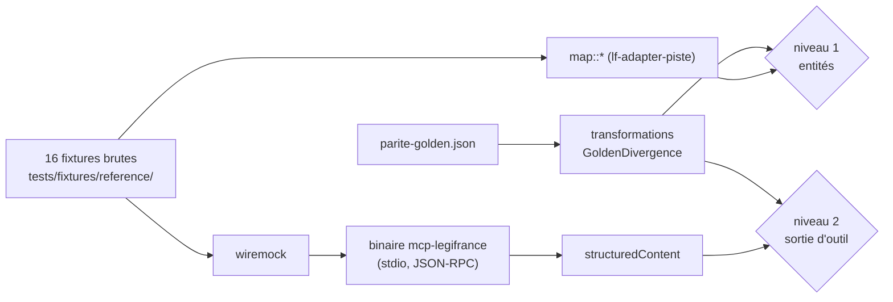

# Annexe A — Parité avec la référence Python

> **Statut** : annexe du plan, rédigée le 2026-10-15. Elle fait foi pour les tests de parité (P-001…P-060) et pour la liste des divergences volontaires. Elle est subordonnée à [00-decisions.md](../00-decisions.md) : en cas d'écart, 00 prévaut, et l'écart est signalé ici. M0 et M1 sont livrés (plan 1) : pour leurs objets, le code livré et le plan 1 font foi, et leurs écarts avec cette annexe sont listés en [00 §11.1](../00-decisions.md). Les décisions du 2026-10-16 qui reportent du code (contrat de citation v2, suffixe de version, `text::encoding`) sont des « tâches de tête de M2 (00 §11.1) » : l'annexe décrit la cible, pas l'état du domaine livré.
> **Référence** : `matematicsolutions/fr-eli-mcp`, commit `d3b5b13` (2026-09-24, v0.5.3, Apache-2.0), désignée « la référence Python ».
> **Lecteurs** : les développeurs (humains ou agents) qui écrivent les tests de parité de M1 à M5, et ceux qui rédigent la note de migration de v0.1.0. Aucune connaissance des échanges préalables n'est supposée.
> **Identifiants** : défauts `D-01…D-47` ([recherche 02](../../recherche/02-defauts.md) §1) ; points de parité `P-0xx`, écarts `E-xx` et scénarios d'erreur `S1…S17` ([recherche 01](../../recherche/01-parite.md) §15, §14, §2.6) ; jalons `M0…M9`, questions `Q1…Q17` et amendements `AM-01…AM-43` ([00-decisions.md](../00-decisions.md) §11, §13, §14 ; révision 2) ; risques `R-xx` et vérifications `V-xx` ([09-risques-et-questions.md](../09-risques-et-questions.md)). Cette annexe n'introduit qu'une famille de noms : les **clés de divergence** en `snake_case` (§4). Ce ne sont pas des identifiants transverses. Ce sont les noms des variantes utilisées par le harnais de test golden (§5.4).

## Sommaire

- [0. Résumé](#0-résumé)
- [1. Objet et définition de la parité](#1-objet-et-définition-de-la-parité)
- [2. Check-list de parité (P-001…P-060)](#2-check-list-de-parité-p-001p-060)
- [3. Écarts E-01…E-36 : décisions retenues](#3-écarts-e-01e-36--décisions-retenues)
- [4. Divergences volontaires consolidées](#4-divergences-volontaires-consolidées)
- [5. Données golden](#5-données-golden)
- [6. Migration depuis la référence Python](#6-migration-depuis-la-référence-python)
- [7. Points NON VÉRIFIÉS de ce document](#7-points-non-vérifiés-de-ce-document)
- [8. Questions ouvertes propres à la parité](#8-questions-ouvertes-propres-à-la-parité)
- [Sources](#sources)

---

## 0. Résumé

- La parité visée est **fonctionnelle**, pas octet pour octet. Un client de la référence retrouve les 8 outils, leurs paramètres et leurs défauts, les mêmes requêtes envoyées à PISTE, les mêmes faits juridiques (identifiants, dates, URL, ECLI natifs, textes) et les mêmes familles d'erreurs. Les formats changent quand 00 ou un ADR l'impose. Chaque changement est une divergence volontaire, nommée par une clé (§4) et testée.
- Les 36 points P-xxx de la recherche 01 §15 se répartissent ainsi : **12 reproduits**, **20 adaptés**, **3 divergences volontaires** (TOC arborescente, typographie des citations, couverture calculée) et **1 abandonné** (`byte_size`, remplacé par `text_length`). Chacun reçoit un test Rust nommé et un jalon (§2.1).
- Pour les 36 écarts E-xx, les décisions sont : 17 corrigés, 8 divergences assumées, 2 parités conservées, 4 adaptés, 2 ajouts, 1 non porté, 1 abandonné, 1 sans objet (§3).
- Les divergences qui changent ce que voit un client sont regroupées au §4. Les plus visibles : `citation` remplace `human_readable_citation` ; `eli_uri`, `eli_note` et `dataset_note` disparaissent ; les champs `null` sont omis, et `title` aussi quand la citation le contient ; un texte de plus de 1 200 caractères n'est plus renvoyé en entier par défaut (`detail="summary"`) ; les erreurs commencent par `[code]` ; deux codes apparaissent (`rate_limited`, `audit_error`). Les noms exacts des champs de sortie sont ceux de [05-outils-mcp.md](../05-outils-mcp.md) §5, repris au §6.4.
- Les données golden ([donnees/parite-golden.json](donnees/parite-golden.json)) figent la sortie de la référence sur ses 16 fixtures. Elles servent à deux niveaux de test, le mapping des entités et la sortie des outils. Le harnais applique d'abord les divergences volontaires, déclarées comme données, puis compare (§5).
- Le §6 donne à un utilisateur de la référence la correspondance complète : commande, variables d'environnement, outils, paramètres, champs de sortie, erreurs et audit.

---

## 1. Objet et définition de la parité

### 1.1 Objet

Cette annexe répond à trois questions :

1. Quels comportements de la référence Python la v0.1.0 doit-elle reproduire, et comment le prouver par un test ? (§2)
2. Que fait-on de chaque défaut ou incohérence relevé dans la référence ? (§3)
3. Qu'est-ce qui change pour un client qui migre, et comment s'en accommode-t-il ? (§4, §6)

Le périmètre est **v0.1.0** (M0 à M5, [00-decisions.md](../00-decisions.md) §11). Les outils et capacités de M6 et au-delà (`fr_verify_citations`, `fr_resolve`, `fr_get_related`, `fr_diff_article`, `fr_search_all`, resources, prompts, completions, HTTP, DILA) n'existent pas dans la référence. Ils ne relèvent donc pas de la parité. Ils figurent au §6.3 seulement pour informer le lecteur qui migre.

### 1.2 Définition : parité fonctionnelle

Pour tout appel valide accepté par la référence, la version Rust v0.1.0 doit :

| # | Exigence | Forme du contrôle |
|---|---|---|
| F1 | **accepter le même appel** : mêmes noms d'outils, mêmes noms de paramètres, mêmes défauts, mêmes valeurs admises (surensemble autorisé) | comparaison sémantique des descripteurs (P-003) |
| F2 | **interroger PISTE de façon équivalente** : mêmes endpoints, mêmes clés de corps, mêmes valeurs constantes, aux valeurs volatiles près | `body_json` wiremock (P-020, P-021) |
| F3 | **rendre les mêmes faits juridiques** : identifiants, dates civiles, URL Légifrance, ECLI natifs, métadonnées, texte officiel (aux blancs près), dans une forme éventuellement réorganisée | golden (P-030 à P-039, §5) |
| F4 | **classer les erreurs dans les mêmes familles** : mêmes codes pour les mêmes causes, sauf correction documentée ; même première phrase des messages `invalid_arg` et `not_found` | tables S1…S17 (§2.2) |
| F5 | **respecter les mêmes invariants de sûreté** : lecture seule, aucun ELI ni ECLI fabriqué, aucun secret divulgué, aucun texte réécrit | P-002, P-026, P-039 |
| F6 | **écrire un audit au moins aussi complet** : mêmes clés de tête, même format d'horodatage, même algorithme d'empreinte | P-040 à P-043 |

**Ne relèvent pas de la parité** (aucun test ne doit les figer) :

- les octets JSON exacts, l'ordre des champs et les espaces ;
- le texte des descriptions d'outils et des instructions serveur (réécrits, 00 §6) et les empreintes SHA-256 du verrou de descripteurs de la référence ;
- les artefacts de Python, de pydantic et de FastMCP : préfixe `Error calling tool '<nom>': `, `repr()` Python dans les messages (E-27), texte multiligne des erreurs de validation pydantic, `meta.fastmcp` dans les descripteurs. Exception : la coercition « lax » des entiers (`"10"` accepté pour un entier, recherche 01 §2.1) est **reproduite** par 05 §1.4 (règle 5), parce que des clients l'exploitent ;
- tout comportement qui découle d'un défaut D-xx, sauf décision contraire écrite au §3.

### 1.3 Typologie des décisions

| Décision | Sens | Ce que vérifie le test |
|---|---|---|
| **Reproduit** | Le comportement observable est identique au sens du §1.2. | Le comportement de la référence, transposé tel quel. |
| **Adapté** | Même intention et même information, forme différente, imposée par 00, par un ADR ou par la plateforme Rust/rmcp. | La nouvelle forme **et** l'invariant hérité. |
| **Divergence volontaire** | Le comportement change délibérément pour corriger un défaut D-xx ou un écart E-xx. La divergence est listée au §4 et son impact client est décrit. | Le nouveau comportement. Le golden est transformé par la clé de divergence (§5.4). |
| **Abandonné** | Non porté. La justification est écrite, et l'éventuel remplaçant est nommé. | L'absence (par exemple : aucune clé `byte_size`). |

### 1.4 Règles d'arbitrage

1. [00-decisions.md](../00-decisions.md) prévaut sur la recherche 01. Quand une proposition de la recherche 01 contredit 00, la décision de 00 est appliquée et le point est signalé (voir les colonnes « Décision » du §2.1 et du §3).
2. **Noms de sortie** : [05-outils-mcp.md](../05-outils-mcp.md) §5 les fixe. Il applique le principe de moindre surprise : un champ conservé garde le nom JSON de la référence (`raison_sociale`, `syndicats`, `date_debut_version`…), sauf si 00 en impose un autre (`citation`, `date` des décisions, `text_length`). Le §6.4 reprend ces noms. Toute modification de 05 entraîne la mise à jour du §6.4 et du harnais golden (§5.4) dans le même changement.
3. **Toute nouvelle divergence** est ajoutée au §4, avec sa clé, **avant** la fusion du code qui l'introduit. Le test `golden_divergences_match_annex_a` (§5.4) échoue sinon.
4. Un point P-xxx n'est « fait » que si son test est vert en CI. P-060 (live) fait exception : il s'exécute à la main avant l'étiquette v0.1.0, avec un compte sandbox (Q3).

---

## 2. Check-list de parité (P-001…P-060)

### 2.1 Table de décision

Crates : `domain` = `lf-domain`, `app` = `lf-application`, `piste` = `lf-adapter-piste`, `audit` = `lf-adapter-audit`, `mcp` = `lf-adapter-mcp`, `bin` = `lf-app` (tests e2e qui lancent le binaire en stdio). Les noms de tests déjà fixés par [02-architecture.md](../02-architecture.md), [03-domaine.md](../03-domaine.md) ou [04-adapter-piste.md](../04-adapter-piste.md) sont repris tels quels ; les autres sont fixés ici.

**Surface MCP**

| ID | Exigence de la référence (résumé) | Décision | Comportement v0.1 et justification | Test(s) Rust | Jalon |
|---|---|---|---|---|---|
| P-001 | Exactement 8 outils : `fr_search`, `fr_get_act`, `fr_get_text`, `fr_get_decision`, `fr_get_deliberation`, `fr_get_convention`, `fr_get_company_agreement`, `fr_coverage`. | Reproduit | Les 8 noms sont conservés (00 §1, §7). La liste est figée **par version** : 8 en v0.1, puis 10 en v0.2 et 13 en v0.3. Aucun client ne doit dépendre de l'ordre de `tools/list` (recherche 01 §3.9). | mcp : `tools_list_matches_v01_surface` (in-process, `tokio::io::duplex`) ; bin : `stdio_tools_list_both_eras` (`server/discover` 2026-07-28 et `initialize` 2025-11-25) | M4 |
| P-002 | Annotations `readOnlyHint=true`, `idempotentHint=true`, `destructiveHint=false`, `openWorldHint=true` sur les 8 outils. | Reproduit | Annotations en littéraux sur chaque `#[tool]` (00 §6, 02 §3.6). `openWorldHint=true` est adopté par défaut (Q11) jusqu'à V-53 (confirmation des résultats dans VS Code), avec réexamen avant v0.1.0 ; tout changement passe par le verrou des descripteurs et le CHANGELOG. | mcp : `annotations_are_read_only_on_all_tools` | M4 |
| P-003 | Paramètres : noms, types, défauts et caractère requis identiques ; descriptions reprises. | Adapté | Les paramètres de la référence gardent leur nom, leur type JSON, leur défaut et leur caractère requis : `query` requis ; `fond` vaut `"LODA"` par défaut ; `page_size` vaut `10` ; `date` est optionnelle et nullable ; les 6 identifiants sont requis. **Ajouts** de 00 §7, listés au §6.3. **Schéma plus strict** : `enum` sur `fond`, `minimum`/`maximum` sur `page_size` (D-31) ; la validation serveur reste tolérante (P-010), accepte les entiers en chaîne (`"10"`) et traite `null` comme « absent » (05 §1.4 règle 5, §3.3). Un argument inconnu est refusé (`additionalProperties: false`, déjà présent dans les schémas de la référence). **Descriptions réécrites** en anglais, 3 à 6 phrases (00 §6, texte dans 05 §5) : leur texte ne relève pas de la parité. **Équivalences admises** par la comparaison (05 §3.3) : `anyOf [T, null]` de la référence équivaut à `T` non requis, `null` étant accepté à l'exécution comme « absent » ; `default: null` équivaut à l'absence de défaut. C'est le cas de `fr_get_act.date` (référence : `{"anyOf":[{"type":"string"},{"type":"null"}],"default":null}` ; Rust : `type: "string"`, `format: date`, sans `default`, 05 §5.2). | mcp : `reference_parameters_preserved`. Le verrou de la référence, copié sans modification dans `crates/lf-adapter-mcp/tests/reference/tools.lock.reference.json`, est comparé paramètre par paramètre : présence, type, défaut, requis, aux équivalences près. mcp : `null_date_is_absent` (exécution : `fr_get_act` avec `"date": null` se comporte comme sans `date`). | M4 |
| P-004 | `outputSchema` publié ; `structuredContent` et `TextContent` JSON équivalent ; propriétés de sortie identiques au rapport 01 §5. | Adapté | `outputSchema` et `structuredContent` à racine objet. Le `TextContent` est la sérialisation JSON du même objet (00 §6, ADR-0006). Propriétés : divergences `citation_renamed`, `eli_uri_dropped`, `notes_dropped`, `nulls_omitted`, `fields_renamed`, `fields_not_rendered` et `fields_added` (§4). Sur erreur : texte seul, sans `structuredContent` (comme la référence). | mcp : `structured_content_validates_against_output_schema` (dev-dep `jsonschema`), `text_content_is_json_of_structured_content`, snapshots `insta` par outil ; bin : `tool_output_matches_golden` (§5.4) | M4, M5 |
| P-005 | Instructions transmises à l'initialisation ; contenu = annexe A.1 du rapport 01, aux seules modifications listées. | Adapté | 00 §6 impose au plus 3 500 caractères, alors que la référence en compte 4 470 : le texte est **réécrit**, pas retouché. Contenu à conserver : ordre d'appel des outils ; contraintes dures (ne pas répondre au-delà du corpus, appeler `fr_coverage` si la recherche est vide ; ne jamais fabriquer d'ELI ou d'ECLI ; ECLI natif seulement ; citer `citation` et `source_url` ; texte officiel non modifié) ; itération sur erreurs avec les 6 codes. Retraits : chemin `~/.matematic/audit/…` et noms `FR_ELI_*` (E-34), phrase « or a search returned nothing » (E-04). Ajouts : note ELI unique (ADR-0009), retour progressif (`next_offset`, `has_more`), attribution des données « Source : Légifrance / DILA — Licence Ouverte 2.0 » avec renvoi à `consulted_on` de `fr_coverage` (00 §12, adoptée par défaut, Q15). Texte : 05 §4.1 (2 879 caractères en v0.1, comptage de 05 §4.2 après la révision 2) ; écarts avec la référence : 05 §4.4. | mcp : `instructions_fit_budget` (≤ 3 500, et `cargo xtask instructions-size`), texte figé dans `tests/tools.lock.json` (05 §9.3), tests de P-006 | M4 |
| P-006 | Test de dérive : tout `fr_*` cité existe ; tout outil enregistré est cité ; tout code d'erreur est documenté. | Reproduit et étendu | Égalité **dans les deux sens** (05 §4.3) : jetons `` `fr_…` `` des instructions = outils enregistrés ; jetons `` `[code]` `` = `ErrorCode::ALL` (00 §6) ; tout autre jeton `` `snake_case` `` est un paramètre ou un champ de sortie réel. La référence n'exigeait que l'inclusion (test_instructions_drift.py:40-92). Extensions : les outils cités dans les descriptions (même version) et dans les phrases d'aide des messages `invalid_arg` (03 §2.7) existent. Le contrôle « code inconnu » de la référence (test_instructions_drift.py:60-76) est garanti par le type `ErrorCode`. | mcp : `instructions_drift` (05 §4.3), `descriptions_cite_only_registered_tools`, `hint_messages_cite_existing_tools` | M4 |
| P-007 | Verrou de descripteurs : SHA-256 canonique, refus d'une base vide, détection added/removed/changed, commande de régénération. | Adapté | Algorithme conservé : `sha256(json(sort_keys, ensure_ascii=False, separators=(",",":")))` par descripteur et pour l'ensemble (référence test_descriptor_lock.py:46-59). Descripteurs lus **comme un client** (`tools/list` en stdio). Le fichier est `tests/tools.lock.json`, régénéré par `cargo xtask lock-descriptors` (00 §2, §10). **Nouvelle base** : les empreintes de la référence (`toolset_sha256 = 6012a30d…`) ne sont pas réutilisables, car schemars n'est pas pydantic et il n'y a pas de `meta.fastmcp` (recherche 01 §11.2). | mcp : `descriptor_lock_matches`, `descriptor_lock_rejects_empty_baseline` ; CI : `cargo xtask lock-descriptors --check` | M4 |

**Validation et erreurs**

| ID | Exigence | Décision | Comportement v0.1 et justification | Test(s) Rust | Jalon |
|---|---|---|---|---|---|
| P-010 | `fond` insensible à la casse et aux espaces ; message exact avec la liste triée. | Reproduit | `Fond::parse` (livré, fond.rs) : `trim` puis comparaison insensible à la casse (`" loda "` accepté) ; `parse_param` est abandonné. Message : `[invalid_arg] fond='XYZ' must be one of ['ACCO', 'CETAT', 'CNIL', 'CODE', 'CONSTIT', 'JURI', 'KALI', 'LODA'].` (03 §3.2), rédigé par `lf-adapter-mcp` (`render.rs`, M4) à partir des champs typés de `DomainError` (00 §11.1). `JORF` s'ajoute à la liste en M7. | domain : `fond_parse_is_case_and_space_insensitive` ; mcp : `fond_error_message_matches_reference` | M1, M4 |
| P-011 | Ordre de validation de `fr_search` : fond → query → page_size ; bornes 1..100 inclusives. | Reproduit | `SearchUseCase` suit cet ordre, puis valide les nouveaux paramètres (`page`, `match`, `date_from`/`date_to`, `version_date`) (02 §6.1). | app : `search_validation_order_matches_reference` (table : fond, query et page_size tous invalides ⇒ message `fond` ; query et page_size invalides ⇒ message `query` ; etc.) | M3 |
| P-012 | Messages `invalid_arg` exacts pour chaque identifiant (S4, S5). | Adapté | S4 (`text_id is required.`) est identique. S5 : **première phrase identique**, puis une phrase d'aide qui nomme l'outil à utiliser (03 §2.7). Nouveaux cas : `BadDigits`, `BadSuffix` (un suffixe bien formé hors LEGITEXT est toléré puis retiré, C4). L'affichage de la valeur fautive façon `repr()` (apostrophes simples, contrôles échappés, troncature à 64 caractères suivie de `…`) est rédigé par `lf-adapter-mcp` (`render.rs`, M4), pas par le domaine (E-27). | domain : `id_error_messages_table` ; mcp : `invalid_id_message_starts_with_reference_sentence` | M1, M4 |
| P-013 | Messages `not_found` exacts par outil. | Adapté | **Première phrase identique** à la référence : `No LODA text found for {id}.`, `No article found for {id}.`, `No JURI decision found for {id}.` (JURITEXT), `No CNIL deliberation found for {id}.`, `No collective agreement text found for {id}.`, `No company agreement found for {id}.`. Elle est suivie d'une phrase d'aide (`Check the id, or …`, 05 §7.4). Pour CONSTEXT et CETATEXT, 00 §5 (AM-24) décide `No CONSTIT decision found for {id}.` et `No CETAT decision found for {id}.` au lieu de `No JURI…`, suivis de `Check the id, or search with fr_search.` (E-15, clé `not_found_message_per_court` ; texte : 05 §7.4). La comparaison de la première phrase à la référence ne porte donc que sur JURITEXT. Ces messages s'appliquent désormais à **tout** `NotFound` : 200 vide, 404 de ressource, 400 « valider est fausse » (02 §6.1, 04 §11.2). La référence répondait alors `Legifrance returned 404 for that resource.` (clé `not_found_semantics`). La réponse réelle de chaque endpoint à un identifiant inconnu est **NON VÉRIFIÉ** [V-68 · introuvable-par-endpoint]. | app : `not_found_messages_match_reference` (table : 6 outils × 3 origines ; la première phrase est comparée à la référence) | M3 |
| P-014 | Mapping : identifiants absents → `config_error` ; 404 → `not_found` ; autres HTTP → `upstream_error` ; réseau ou timeout → `upstream_error`. | Adapté | Identifiants absents : `config_error`, même message avec `LF_PISTE_CLIENT_ID`/`LF_PISTE_CLIENT_SECRET` (E-34), sans E/S (D-39). 404 : `not_found` seulement si l'API désigne une ressource absente, sinon `config_error` (D-10, 04 §11.2). OAuth 400/401, second 401 de l'API et 403 : `config_error` (D-10, 00 §5). 429 épuisé : `rate_limited` (nouveau). Autres statuts : `upstream_error`, sans URL ni lien MDN (D-40). JSON illisible : `upstream_error` (E-21). Table complète : 02 §9.2 (source unique de la correspondance) ; classification « introuvable » : 04 §11.2, qui fait foi ; textes des messages : 05 §7.2-§7.4 ; transposition S1…S17 au §2.2. | piste : `missing_credentials_makes_no_network_call`, `oauth_invalid_client_401_maps_to_auth_no_retry`, `oauth_400_maps_to_auth`, `oauth_404_maps_to_config_not_not_found`, `404_on_search_is_config_not_not_found`, `404_on_consult_official_host_is_not_found`, `the_503_three_times_maps_to_upstream_retryable`, `the_429_three_times_maps_to_rate_limited`, `invalid_json_maps_to_decode_with_path` ; app : `corpus_error_maps_to_app_error_table` | M2, M3 |
| P-015 | `isError=true` avec le préfixe `[code] ` ; aucune fuite de secret ni de jeton. | Reproduit | La forme est celle que **promettaient** les instructions de la référence : texte seul `[code] message` en tête (corrige E-01, ADR-0010). Aucun secret, jeton ou URL à paramètres (00 §5). | mcp : `error_results_are_text_with_code_prefix` ; piste : `error_messages_never_contain_secret_or_token` | M4 |

**Requêtes PISTE**

| ID | Exigence | Décision | Comportement v0.1 et justification | Test(s) Rust | Jalon |
|---|---|---|---|---|---|
| P-020 | Corps de `/search` identique (clés, constantes, `DATE_VERSION` pour LODA et CODE seulement, `pageNumber=1`). | Adapté | Avec les défauts (`match=any`, défaut adopté jusqu'à V-79, Q10 ; `page=1` ; sans plage de dates), le corps a les mêmes clés et les mêmes valeurs que la référence : `typeChamp ALL`, `UN_DES_MOTS`, `operateur ET` aux trois niveaux, `sort PERTINENCE`, `pageNumber`, `pageSize`, `typePagination DEFAUT`, `filtres: []` hors LODA et CODE. **Seule différence** : `singleDate` vaut midi Europe/Paris du jour `version_date` (10:00Z en été, 11:00Z en hiver ; vecteurs de 00 §8, par exemple 2026-10-15 ⇒ `1792058400000`), et non l'instant de l'appel (E-06, clé `search_singledate_noon_paris`). Ajouts : `typeRecherche` selon `match`, facettes de dates, `typePagination` en page > 1 = valeur du `PaginationMemo`, sinon repli `ARTICLE` pour CODE et `DEFAUT` ailleurs (00 §7, 04 §6). | piste : `search_request_matches_reference_json`, `search_{loda,code,juri,constit,cetat,cnil,kali,acco}_fixture_maps`, `paris_noon_vectors`, `type_recherche_follows_match` | M2 |
| P-021 | Corps des 6 consultations identiques (`textId` ou `id`) ; `fr_get_act` envoie la date fournie, sinon celle du jour. | Adapté | Clés identiques : `lawDecree {"textId","date"}`, `getArticle {"id"}`, `juri {"textId"}`, `cnil {"textId"}`, `kaliText {"id"}`, `acco {"id"}`. L'identifiant est normalisé (trim, suffixe `_JJ-MM-AAAA` retiré). `date` est validée au format `AAAA-MM-JJ`, sinon `invalid_arg` local (D-22). Le défaut est la date du suffixe de `text_id` s'il y en a un (E-17), sinon aujourd'hui **Europe/Paris** (E-05) ; une `date` explicite l'emporte (00 §7, AM-43). | piste : `consult_*_fixture_maps` (`body_json`) ; app : `get_act_default_date_is_today_paris` (`FixedClock` 2026-07-14T22:30Z ⇒ `2026-07-15`), `get_act_suffix_date_is_default_date` (06 §2.2) | M2, M3 |
| P-022 | OAuth : formulaire `client_credentials` + `scope=openid` ; jeton réutilisé jusqu'à `expires_in − 60 s` ; `expires_in` absent → 3 600 ; rafraîchissements concurrents sérialisés. | Reproduit | 00 §8 (rafraîchissement mono-vol). | piste : `oauth_success_form_body_and_token_reuse`, `oauth_token_refreshed_60s_before_expiry`, `oauth_expires_in_null_uses_default_3600`, `concurrent_calls_share_one_token_refresh` | M2 |
| P-023 | 401 → invalidation et un nouvel essai avec un jeton neuf ; second 401 → `upstream_error`. | Adapté | Le premier 401 déclenche un seul renouvellement, sur un budget séparé qui ne consomme pas de tentative transitoire. Le second 401 donne `CorpusError::Auth`, rendu `config_error` et non `upstream_error` (00 §5, §8 ; 02 §9.2 ligne 11). Les tentatives suivantes ne redemandent plus de jeton (corrige E-20). | piste : `api_401_refreshes_once_then_succeeds`, `api_401_twice_maps_to_auth`, `status_401_then_503_then_200_requests_exactly_two_tokens` | M2 |
| P-024 | Réessais sur 429, 500, 502, 503, 504 et erreurs réseau : 3 tentatives au plus, attentes ≥ 0,5 s puis ≥ 1 s. | Adapté | Mêmes statuts, même plafond de 3 tentatives sur 429, 502, 503, 504 et erreurs réseau, mêmes attentes minimales, **plus** une gigue. **Exception** : 2 tentatives au plus sur 500, puis `Upstream { status: 500, retryable: false }`, rendu sans invitation à réessayer (un 500 répété est présumé déterministe ; retour à 3 tentatives si V-69 montre des 500 transitoires fréquents ; 00 §8, AM-03). `Retry-After` est respecté, plafonné à 30 s. L'ensemble est borné par `LF_TOOL_DEADLINE_S` (D-12, D-14 ; 04 §5.2). La présence de `Retry-After` chez PISTE est **NON VÉRIFIÉ** [V-63 · retry-after-piste]. | piste : `the_500_then_200_succeeds_after_backoff`, `the_500_twice_maps_to_upstream_not_retryable`, `the_503_three_times_maps_to_upstream_retryable`, `the_429_retry_after_is_honoured`, `tool_deadline_caps_retries` | M2 |
| P-025 | Délais : connexion 10 s, requête 40 s ; en-têtes `Accept: application/json`, `Authorization: Bearer …`, `User-Agent` versionné. | Reproduit | Mêmes délais (40 s réglable par `LF_HTTP_TIMEOUT_S`). Redirections non suivies, comme dans la référence. User-Agent corrigé : `mcp-legifrance/<version> (+https://github.com/muchiny/mcp-legifrance)` (E-08, 00 §8). | piste : `user_agent_contains_crate_version`, `accept_json_header`, `request_timeout_maps_to_timeout`, `redirect_is_not_followed` | M2 |
| P-026 | Jeton jamais écrit sur disque ni dans les journaux. | Reproduit (renforcé) | `SecretString`, `Debug` expurgé, en-tête marqué sensible. Le jeton n'entre jamais dans le cache, l'audit, les fixtures ni les journaux (04 §14.1). | piste : `debug_of_config_redacts_secret`, `bearer_header_is_sensitive`, `error_messages_never_contain_secret_or_token` ; bin : `stdout_contains_only_jsonrpc` et capture de stderr avec un secret injecté (02 §11.3) | M2 |

**Normalisation (golden sur les 16 fixtures)**

| ID | Exigence | Décision | Comportement v0.1 et justification | Test(s) Rust | Jalon |
|---|---|---|---|---|---|
| P-030 | `strip_marks`, `strip_date_suffix`, `ms_to_date` (UTC, flottants rejetés, sentinelle 2999-01-01), `_fr_date`. | Adapté | `strip_marks` devient `text::clean` : retire `<mark>`, replie les blancs, remplace NBSP par une espace, trim (`short_text_cleaned`). `strip_date_suffix` devient `parse_versioned` (`VersionedId` de 03) : le suffixe `_JJ-MM-AAAA` d'un `LEGITEXT` est conservé en `version_start` (`version_suffix_kept`) et un suffixe mal formé est refusé ; un suffixe bien formé sur un autre préfixe est toléré puis retiré (avec un diagnostic `debug!` + compteur dans les données amont), y compris en entrée utilisateur (00 §4, AM-43 amendé par C4 le 2026-10-16, qui écarte `SuffixNotAllowed`) ; `Id::parse` livré reste tolérant et jette encore le suffixe (**tâche de tête de M2**, 00 §11.1). `ms_to_date` devient `CivilDate::from_unix_millis` (livré, date.rs:91) : date civile UTC conservée ; flottants et booléens rejetés (adapter) ; épochs négatifs calculés partout par `div_euclid` (E-35) ; puis `open_ended` (sentinelles ⇒ `None`, E-11 ; tâche de tête de M2). `_fr_date` devient `CivilDate::to_french` (livré, date.rs:115) : accents et « 1er » (E-12, Q16). Vecteurs repris : `"a <mark>b</mark> c"` ⇒ `"a b c"` ; `LEGITEXT000033205014_08-09-2023` ⇒ id + 2023-09-08 ; `1475884800000` ⇒ 2016-10-08 ; `-5231606400000` ⇒ 1804-03-21 ; `1762473600000` ⇒ « 7 novembre 2025 ». | domain : `clean_strips_mark_tags`, `versioned_id_splits_suffix` (à écrire, M2), `from_unix_millis_matches_fixtures` et `from_unix_millis_edges` (livrés, date.rs:239 et :248 ; le vecteur `-5231606400000` ⇒ 1804-03-21 est à ajouter en tête de M2), `open_ended_maps_sentinels_to_none` (à écrire, M2), `french_prose_covers_all_twelve_months` (livré, date.rs:280) ; piste : `bool_is_not_a_date`, `sentinel_2999_and_2222_are_none`, `negative_ms_1804` | M1 (livré), M2 (suffixe, sentinelles) |
| P-031 | `legifrance_url` : les 10 kinds ; `eli_uri == source_url` partout. | Adapté | Les 10 motifs de la référence sont conservés. Un kind s'ajoute : `loda_article` (E-19), seulement après les vérifications live V-140 et V-142 en M2 ; KALIARTI garde `/conv_coll/id/` sans kind séparé (`kali_article` est inutile, 03 §5.5). L'URL est construite depuis l'identifiant typé et n'est jamais `None`. `eli_uri` est **abandonné** (00 §4, ADR-0009) : le domaine livré le porte encore (citation.rs), la suppression est une tâche de tête de M2 (00 §11.1). | domain : `source_url_snapshot_all_kinds` (`insta`) ; mcp : `no_view_has_eli_uri` | M1 (livré, à amender en M2), M4 |
| P-032 | Hits de recherche : kind, URL sur `id` (LODA, CODE) ou `cid or id` (autres), citation ACCO, `articles` CODE avec snippet ≤ 280, défauts `articles: []`, `idcc`/`raison_sociale: null`. | Adapté | `kind` = fond demandé (parité). `id` = `titles[0].id` sans suffixe. URL construite depuis l'`id` typé : sur les 17 hits des fixtures, `cid == id` partout hors LODA, donc l'URL est la même que dans la référence (mesure de ce document sur le golden). Citation ACCO `{titre} ({raison sociale})` reproduite. `articles` CODE (`article_id`, `num`, `snippet` ≤ 280 caractères) reproduits, et étendus à KALI (E-26). Divergences : titres nettoyés (`short_text_cleaned`) et omis quand la citation les contient (`title_omitted_when_in_citation`, 05 §5.0.4) ; extrait coupé en fin de mot avec `…` inclus dans les 280 caractères, alors que la référence coupait sans ellipse (`snippet_ellipsis`, 03 §7.3 ; aucun cas sur les fixtures) ; défauts vides omis (`nulls_omitted`) ; hits à identifiant invalide écartés et comptés (`invalid_hits_dropped`) ; nouveaux champs `date` et `snippet` (`hit_date`, `snippets_all_fonds`) ; `cid`, `idcc` et `raison_sociale` non rendus (`fields_not_rendered`, §8 question 1) ; `idcc?` revient en v0.2 dans les hits KALI et ACCO, et `total_articles?` au niveau de la page pour CODE (classe « ajout », 00 §7, AM-37 ; à porter dès v0.1 par le domaine : `SearchHit.idcc`, `SearchPage.total_articles`). | piste : `search_*_fixture_maps`, `mapping_matches_golden`, `snippet_is_truncated_to_280_chars`, `invalid_hit_is_dropped_and_counted` | M2 |
| P-033 | TOC LODA en parcours préfixe (62 entrées sur consult_loda.json) ; TOC KALI = sections, puis articles de premier niveau. | Divergence volontaire | Arbre sections + articles avec `depth`, tri par `intOrdre` quand tous les frères le portent, dédoublonnage, pagination `toc_offset`/`toc_limit` (100 par défaut, 500 au plus), articles de premier niveau avant les sections (03 §4.2, clé `toc_tree`). Sur consult_loda.json : 88 entrées (26 sections + 62 articles) au lieu de 62. **Invariant hérité, vérifié sur les fixtures** : la projection « articles seuls » de la TOC aplatie redonne exactement les 62 `article_id` de la référence, dans le même ordre, et l'unique KALIARTI de consult_kali.json. consult_loda.json n'a ni `intOrdre` (0 nœud sur 88) ni article de premier niveau (mesure de ce document). Sur des réponses réelles qui porteraient `intOrdre`, l'ordre peut différer de la référence : **NON VÉRIFIÉ** [V-97 · intordre-lawdecree]. | domain : `toc_preserves_section_titles`, `toc_sorted_by_int_ordre`, `toc_dedups_articles` ; piste : `toc_article_projection_matches_reference_order`, `kali_inline_content_is_available_without_extra_call` | M2 (tête) |
| P-034 | Citation d'article `"{code}, art. {num}"` / `"Art. {num}"` / `code` ; URL `conv_coll` pour KALIARTI. | Adapté | Règle de citation reproduite : « Code civil, art. 9 » inchangé (00 §4). Repli ultime `Légifrance {ID}` quand rien n'est disponible, car le contrat n'est plus optionnel (`citation_never_empty`). URL : KALIARTI ⇒ `/conv_coll/id/` (parité ; résolution réelle **NON VÉRIFIÉ** [V-144 · url-kaliarti]). LEGIARTI dont le texte parent n'est pas un code ⇒ `/loda/article_lc/` (E-19, `law_article_url`) **seulement après V-140 (forme canonique) et V-142 (`textTitles[].nature`) en M2** (URL non datée en v0.1, 00 §4, AM-18) ; d'ici là le domaine livré garde `/codes/article_lc/`, comme la référence (00 §11.1). Repli `Légifrance {ID}` et `citation` jamais vide : contrat v2, tâche de tête de M2. | domain : `article_citation_rules_table`, `law_article_url_uses_loda_article_lc`, `unknown_parent_nature_falls_back_to_codes_url` ; piste : `kali_article_url_uses_conv_coll` (portage de test_parse.py:226) | M2 (après V-140 et V-142 pour la règle `/loda/` ; `citation_never_empty` avec le contrat v2) |
| P-035 | Citation Cons. const. exacte ; citation CNIL exacte ; JURI et CETAT = `titre`. | Divergence volontaire | « Cons. const., décision n° 2025-1173 QPC du 7 novembre 2025 », sans le suffixe « - objet » (le domaine livré l'ajoute encore, citation.rs:66-87 ; sa suppression avec `bracketed` est une tâche de tête de M2, C2, 00 §11.1) ; « CNIL, délibération n° SAN-2026-002 du 8 janvier 2026 » ; JURI et CETAT : titre nettoyé (parité) (00 §4, ADR-0009, D-27 ; clé `citation_typography`). **Formats complémentaires** adoptés par défaut (Q12, AM-19 ; avant les golden de M2) : article d'un texte non codifié = « {titre officiel du texte, sans appel de note final « (n) »}, art. {num} », `num` verbatim (clé `law_article_citation` ; la citation du texte lui-même garde « (1) », 03 §5.4) ; convention KALI = titre nettoyé, sans IDCC (parité) ; hits de recherche CONSTIT et CNIL = titre officiel (parité), la règle de consultation ne s'appliquant qu'aux consultations. | domain : `constit_citation_golden`, `cnil_citation_golden`, `juri_and_cetat_citation_is_clean_title`, `article_citation_rules_table` (ligne « article de loi, appel de note retiré », sans fixture) | M2 (tête) |
| P-036 | ACCO : métadonnées seules, aucune clé `text`, `attachment_note` exacte, thèmes et syndicats filtrés. | Reproduit | Métadonnées seules. `data` (le `.docx` en base64) n'est jamais désérialisé. Aucun champ texte. `attachment_note` reprend le texte de la référence (recherche 01 annexe A.6), sauf réécriture décidée par 05. Thèmes et syndicats : libellés non vides. | piste : `consult_acco_fixture_maps`, `acco_large_data_field_is_skipped` ; mcp : `acco_view_has_no_text_field` | M2 |
| P-037 | `byte_size` = longueur UTF-8 du texte (364 / 644 / 15188 / 15055 / 634). | Abandonné (remplacé) | Remplacé par `text_length`, le nombre de caractères Unicode du texte **canonique**, qui sert de base à `offset` et `next_offset` (00 §7, clé `byte_size_to_text_length`). Les valeurs de la référence ne sont pas transposables : elles ont été mesurées sur un texte en mojibake et non nettoyé (§5.5). | domain : `text_length_counts_chars_of_canonical_text`, proptest `window_offsets_are_char_based` | M2 (`LongText`), M5 |
| P-038 | Toutes les assertions de `test_parse.py` et toutes les valeurs golden (ou leur version réparée). | Adapté | Les 19 tests de `test_parse.py` sont portés (§2.3). Les valeurs du golden sont comparées après application des divergences déclarées (§5.4). | piste : `ported_*` (19), `mapping_matches_golden` ; bin : `tool_output_matches_golden` | M2, M4 |
| P-039 | Aucun `eli_uri` ne contient `/eli/` ; `ecli` jamais fabriqué (`null` conservé). | Reproduit | Aucune URL ne contient `/eli/`. Le champ `eli` n'apparaît que si l'API renvoie un ELI natif, ce qui n'arrive jamais aujourd'hui (**NON VÉRIFIÉ** en production [V-102 · eli-natif-null]). `ecli` natif, validé, jamais fabriqué. Un ECLI absent donne un champ omis au lieu de `null` (`nulls_omitted`). | piste : `ported_no_fabricated_eli` (étendu aux 16 fixtures), `invalid_native_ecli_is_dropped_with_diagnostic` ; domain : `ecli_is_never_fabricated` | M1, M2 |

**Audit**

| ID | Exigence | Décision | Comportement v0.1 et justification | Test(s) Rust | Jalon |
|---|---|---|---|---|---|
| P-040 | Une ligne JSONL par appel, erreurs comprises (E-02) ; clés `ts, tool, input_hash, output_count_or_size, duration_ms, status[, error]` ; `ts` ISO-8601 en millisecondes `+00:00` ; `error` ≤ 500 caractères. | Adapté (élargi) | Une ligne pour chaque issue : succès, `invalid_arg`, `not_found`, erreurs amont, délai, annulation (02 §7.1, ADR-0008). Cas limites (00 §7, AM-30) : annulation ⇒ `status: error`, `error_code` absent, `error: cancelled by client` ; lecture de resource (M7) ⇒ `tool: resource:<nom du gabarit>` ; prompts et completions non audités (aucun cas d'usage d'outil exécuté). Ordre normatif des clés : `ts, tool, input_hash, output_count_or_size, duration_ms, status, error_code?, error?, env, server_version` (02 §3.5). Le préfixe est **identique** à la référence et 3 clés s'ajoutent (`audit_keys_added`). `ts` au format `…T…:…:….mmm+00:00` (E-33). `error` ≤ 500 caractères Unicode. Durée réelle (E-03). Fichier et rotation : clé `audit_location_rotation`. | app : `audit_written_for_every_outcome`, `error_duration_is_nonzero`, `cancelled_call_is_audited` ; audit : `audit_line_key_order_is_normative`, `audit_ts_uses_plus_00_00`, `audit_error_truncated_to_500_chars` | M3 |
| P-041 | `input_hash` : algorithme du rapport 01 §8 ; ses 8 vecteurs (si la compatibilité d'empreinte est retenue). | Reproduit (algorithme), adapté (entrée) | Même canonicalisation : clés triées, séparateurs compacts, échappement `\uXXXX` en hexadécimal minuscule avec paires de substitution au-delà du BMP. Les 8 vecteurs sont repris (§6.6). **Entrée hachée** = l'objet `arguments` brut (02 §6.1), alors que la référence hachait une charge partiellement normalisée (clé `audit_hash_raw_arguments`). Décision (00 §7, AM-30) : `input_hash` = SHA-256 **non salé** des arguments bruts canonicalisés, non compatible en général avec les empreintes de la référence (égalité seulement dans les cas du §6.6) ; un sel ou un HMAC (D-17) sera réexaminé par ADR après v0.1.0. | audit : `input_hash_reference_vectors` (8) ; app : `input_hash_of_invalid_arguments_is_computed` | M3 |
| P-042 | Métriques `output_count_or_size` : hits, articles, octets, 1, nombre de lacunes, 0 en erreur. | Adapté | Métriques de 00 §7 : hits (inchangé), entrées de TOC renvoyées (au lieu du nombre d'articles), caractères renvoyés (au lieu des octets du texte entier), 1 pour ACCO (inchangé), nombre de lacunes calculées (au lieu de 2, constant), 0 en erreur (inchangé) (clé `audit_metrics_redefined`). | app : `audit_metric_per_tool` (table) | M3 |
| P-043 | Échec d'écriture de l'audit → l'appel échoue. | Reproduit (par défaut) | `LF_AUDIT_MODE=strict` par défaut (Q9) : `[audit_error] audit log unavailable; the call was not recorded and its result is withheld (see server logs).`, suivi de `Original error: [code].` s'il y en avait une, sans chemin (texte de 05 §7.2, qui fait foi), et le résultat est écarté. `best-effort` : résultat rendu, avec `warn!` et compteur (02 §7.1, clé `audit_mode_configurable`). Le moment de l'échec diffère de la référence (S17). | app : `audit_failure_returns_audit_error`, `best_effort_keeps_result` ; bin : `audit_unwritable_dir_fails_call` (deux cas : répertoire existant en lecture seule, et chemin non créable sous un parent en lecture seule ; même issue `[audit_error]` dans les deux cas) | M3 |

**Couverture et live**

| ID | Exigence | Décision | Comportement v0.1 et justification | Test(s) Rust | Jalon |
|---|---|---|---|---|---|
| P-050 | `fr_coverage` renvoie exactement la sortie de l'annexe A.9 du rapport 01 (3 familles, 2 lacunes) ; tests de `test_coverage.py` portés. | Divergence volontaire | Sortie **calculée** (00 §7, D-34), forme de 05 §5.8 : `status`, `environment`, `configuration`, `source`, `attribution` (« Source : Légifrance / DILA — Licence Ouverte 2.0 ») et `consulted_on` (date du jour, Europe/Paris) (00 §12, adoptés par défaut, Q15), `as_of_note` (texte de la référence), `eli_note`, `general_tools`, `families[{fond,label,tools}]` (une par fond servi), `gaps[{id,fond?,missing,fallback}]` jamais vide (FR-001 et FR-002 conservées, avec un nouveau libellé ; FR-003 à FR-009 ; lacunes dynamiques FR-101 à FR-104, dont `CustomHost` et le mode dégradé, 00 §1). `status` vaut `degraded` si les identifiants manquent ou si la configuration a un problème (mode dégradé, dont `EnvMismatch`). Les invariants des 7 tests de la référence sont portés, sauf celui de `captured_at`, sans objet en v0.1 (§2.3). La forme et l'emplacement de `Coverage` (constructeur faillible et invariant « au moins une lacune » livrés) se tranchent en M3 (M1-D20, 00 §11.1) ; les noms d'outils restent hors du domaine. | app : `coverage_invariants_ported` ; mcp : `every_registered_tool_is_in_a_family_or_general`, `every_served_fond_has_a_family`, `gaps_never_empty`, `coverage_degraded_without_credentials`, `coverage_makes_no_port_call` (05 §5.8) | M3, M4 |
| P-060 | Les 9 scénarios smoke passent en sandbox avec les mêmes requêtes et les mêmes assertions. | Adapté | Mêmes 9 requêtes. Les assertions sont transposées (§2.3, tableau smoke) : `citation` remplace `human_readable_citation` ; le scénario 3 attend `/loda/article_lc/` pour un article de la loi n° 2016-1321, et la nature `textTitles` d'un article de loi qui commande ce choix est **NON VÉRIFIÉ** [V-142 · texttitles-nature-loi] ; le scénario 5 attend « Cons. const., décision ». | piste : `crates/lf-adapter-piste/tests/live.rs`, `live_reference_scenario_1` à `_9` (`#[ignore]`) ; bin : `live_e2e_reference_scenarios` (`#[ignore]`) | M2 (adapter), M4 (e2e) |

**Bilan** : 12 reproduits (P-001, P-002, P-006, P-010, P-011, P-015, P-022, P-025, P-026, P-036, P-039, P-043) ; 20 adaptés (P-003, P-004, P-005, P-007, P-012, P-013, P-014, P-020, P-021, P-023, P-024, P-030, P-031, P-032, P-034, P-038, P-040, P-041, P-042, P-060) ; 3 divergences volontaires (P-033, P-035, P-050) ; 1 abandonné (P-037).

**Critères d'acceptation de la parité pour v0.1.0**

- [ ] Chaque ligne du §2.1 a ses tests, verts en CI. P-060 fait exception (live).
- [ ] P-060 a été exécuté en sandbox avant l'étiquette v0.1.0 (Q3), et son résultat est consigné dans [06-qualite.md](../06-qualite.md).
- [ ] `mapping_matches_golden`, `tool_output_matches_golden` et `golden_divergences_match_annex_a` sont verts (§5.4).
- [ ] La note de migration du §6 figure dans le README et dans le CHANGELOG de v0.1.0 ([08-distribution.md](../08-distribution.md)).
- [ ] Aucune divergence n'existe dans le code sans clé au §4.

### 2.2 Matrice des scénarios d'erreur S1…S17 transposée

Colonne « Référence » : recherche 01 §2.6. La référence préfixait tous ses textes par `Error calling tool '<nom>': `, omis ici sauf mention. Colonne « Rust » : extrait des sources uniques, qui font foi et ne sont pas recopiées ici en détail : correspondance cause → code dans 02 §9.2, classification « introuvable » dans 04 §11.2, texte des messages dans 05 §7.2 à §7.4. Toutes les issues Rust sont auditées avec une durée réelle, sauf mention contraire. En cas d'écart de rédaction, 05 fait foi et ce tableau est corrigé.

| # | Scénario | Référence : texte et audit | Rust v0.1 : texte et audit | Clé(s) §4 |
|---|---|---|---|---|
| S1 | `fond` invalide | `[invalid_arg] fond='XYZ' must be one of [...]` ; **non audité** | `[invalid_arg] fond='XYZ' must be one of ['ACCO', 'CETAT', 'CNIL', 'CODE', 'CONSTIT', 'JURI', 'KALI', 'LODA'].` ; audité `error`/`invalid_arg` | `error_prefix`, `audit_every_outcome` |
| S2 | `query` vide ou blanche | `[invalid_arg] query is required.` ; non audité | identique ; audité | idem |
| S3 | `page_size` hors de 1..100 | `[invalid_arg] page_size=0 out of range (1..100).` ; non audité | identique ; audité. `"10"` (chaîne) est accepté, comme dans la référence (05 §3.3). Une valeur non entière (`[1]`) donne `[invalid_arg] page_size: invalid type: sequence, expected an integer` (décodage audité, E-29). | idem, `invalid_input_audited` |
| S4 | identifiant vide | `[invalid_arg] text_id is required.` (et les 5 autres) ; non audité | identique ; audité | idem |
| S5 | mauvais préfixe | `[invalid_arg] text_id='JURITEXT0001' must be a Legifrance LEGITEXT... identifier.` ; non audité | première phrase identique, suivie d'une phrase d'aide (03 §2.7) ; audité | `id_validation_strict` |
| S6 | identifiants PISTE absents | `[config_error] PISTE credentials missing: set FR_ELI_CLIENT_ID and FR_ELI_CLIENT_SECRET (…)` ; audité, `duration_ms: 0` | `[config_error] PISTE credentials missing: set LF_PISTE_CLIENT_ID and LF_PISTE_CLIENT_SECRET (from your piste.gouv.fr application, section OAuth Credentials).` ; aucune E/S ; audité, durée réelle | `env_vars_renamed` |
| S7 | OAuth 200 sans `access_token` | `[config_error] PISTE OAuth returned no access_token.` | identique | — |
| S8 | OAuth 4xx (`invalid_client`) | `[upstream_error] Legifrance/PISTE HTTP 401: Client error '401 Unauthorized' for url '…'` | `[config_error] PISTE rejected the credentials (HTTP 401): check LF_PISTE_CLIENT_ID, LF_PISTE_CLIENT_SECRET and LF_PISTE_ENV.` (05 §7.2) ; OAuth 404 (mauvaise `LF_PISTE_OAUTH_URL`) ⇒ `[config_error] PISTE OAuth endpoint not found: check LF_PISTE_OAUTH_URL.` (02 §9.2 ligne 8) | `error_codes_reclassified` |
| S9 | API 404 | `[not_found] Legifrance returned 404 for that resource.` | consultation sur hôte officiel avec un corps non HTML ⇒ `[not_found] No … found for {id}. Check the id, or …` ; `/search`, hôte personnalisé ou page HTML ⇒ `[config_error] Legifrance endpoint not found: check LF_PISTE_BASE_URL.` Forme réelle d'un 404 PISTE : **NON VÉRIFIÉ** [V-66 · forme-404-piste]. | `not_found_semantics`, `error_codes_reclassified` |
| S10 | API 400 ou 403 | `[upstream_error] Legifrance/PISTE HTTP 400: Client error '400 Bad Request' for url '…'` | 400 sur une consultation avec « valider est fausse » ⇒ `[not_found] …` (04 §11.2 règle 2 ; 02 §9.2 ligne 13 bis) ; autre 400 ⇒ `[upstream_error] Legifrance rejected the request (HTTP 400): {détail PISTE nettoyé, ≤ 200 caractères}` (`warn!` « bug probable », 00 §5) ; 403 ⇒ `[config_error] PISTE denied access (HTTP 403): check that the PISTE application is subscribed to the Legifrance API.` (00 §5 ; 02 §9.2 ligne 12). Sens d'un 403 : **NON VÉRIFIÉ** [V-65 · forme-403-piste]. | idem |
| S11 | 429 ou 5xx trois fois | `[upstream_error] Legifrance/PISTE HTTP 503: Server error '503 Service Unavailable' …` | 502, 503, 504 (3 tentatives) ⇒ `[upstream_error] Legifrance/PISTE HTTP 503 (service unavailable); retry once, then report it.`, sans URL ; 500 (2 tentatives, `retryable: false`) ⇒ même gabarit sans invitation à réessayer (00 §8 ; 02 §9.2 ligne 17) ; 429 ⇒ `[rate_limited] PISTE quota reached; retry in 12 s.` | `error_codes_added`, `error_messages_redacted` |
| S12 | API 401 deux fois | `[upstream_error] Legifrance/PISTE HTTP 401: …` | `[config_error] PISTE rejected the credentials (HTTP 401): …` (`Auth`) | `error_codes_reclassified` |
| S13 | timeout ou erreur réseau trois fois | `[upstream_error] Legifrance/PISTE error: ConnectTimeout: …` | `[upstream_error] …`, sans URL. Délai global dépassé ⇒ `[upstream_error] tool deadline of 60 s exceeded; retry, or narrow the request (smaller page_size, fewer fonds).` | `rate_limit_and_deadline` |
| S14 | 200 avec un corps non JSON | `Expecting value: line 1 column 1 (char 0)`, **sans code** | `[upstream_error] unexpected response from Legifrance; report it.` (`Decode` n'est pas réessayable, 00 §8 ; 05 §7.2) | `error_codes_reclassified` |
| S15 | 200 avec une charge vide ou sans `id` | `[not_found] No LODA text found for LEGITEXT….` ; **non audité** | première phrase identique, suivie de la phrase d'aide (P-013) ; audité | `audit_every_outcome` |
| S16 | recherche sans résultat | succès `{"total":0,"hits":[],…}` ; audité `ok`, 0 | succès `total: 0`, `hits: []`, `has_more: false` ; audité `ok`, 0 ; non mis en cache (00 §9) | `search_echo_dropped` |
| S17 | répertoire d'audit non inscriptible | deux cas, car `AuditLogger()` fait `mkdir(parents=True, exist_ok=True)` (audit.py:46), qui ignore toute `OSError` quand le chemin est déjà un répertoire, et n'ouvre le fichier qu'à `log()` (audit.py:74) : (a) répertoire **non créable** ⇒ `[Errno 13] Permission denied: '…'` dès `_audit()`, donc **avant** la validation, pour tout appel ; (b) répertoire **existant non inscriptible** ⇒ aucune erreur pour les issues non auditées (S1 à S5, S15), qui rendent leur message habituel ; pour les autres, `PermissionError` à l'écriture de la ligne, après l'appel amont (succès comme erreur amont, dont le message est alors masqué) | strict : `[audit_error] audit log unavailable; the call was not recorded and its result is withheld (see server logs).`, suivi de `Original error: [code].` s'il y en avait une, après l'exécution, dont le résultat est écarté, dans les cas (a) et (b) et pour toutes les issues, `invalid_arg` compris (aucune E/S disque avant le premier `record()`, 00 §7) ; best-effort : résultat rendu et `warn!` | `audit_mode_configurable`, `error_codes_added` |
| — | arguments non décodables ou inconnus (pydantic) | texte pydantic multiligne (`1 validation error for call[fr_search]…`) ; non audité | `[invalid_arg] <champ>: <raison serde>`, ou `unknown field 'foo', expected one of …` ; audité (E-29). Dépend du spike rmcp (avant la conception des ports de M3, 00 §11.1) **NON VÉRIFIÉ** [V-28 · rmcp-jsonobject-input-schema]. | `invalid_input_audited` |
| — | outil inconnu | résultat `isError`, `Unknown tool: 'x'` | erreur JSON-RPC `-32602` (protocole, 00 §5) ; aucune ligne d'audit | `unknown_tool_jsonrpc` |

Test : app et mcp `error_matrix_s1_to_s17` (table pilotée, `FakeCorpus` pour les issues amont) ; piste : les tests nommés au §2.1 (P-014).

### 2.3 Portage des tests de la référence

**`tests/test_parse.py` (19 tests, référence test_parse.py:21-226)** ⇒ module `#[cfg(test)]` `ported_test_parse` de `crates/lf-adapter-piste` (06 §1.4, pas `tests/`). Chaque test garde son nom avec le préfixe `ported_`. Il appelle le mapping DTO ⇒ entité sur la fixture brute (servie par `include_bytes!`, donc réparée du mojibake), puis applique les assertions transposées. Transposition commune : `human_readable_citation` devient `contract.citation` ; une assertion `eli_uri == source_url` devient « l'entité n'expose aucun `eli_uri` et `contract.eli` vaut `None` ».

| Test de la référence (ligne) | Adaptation Rust |
|---|---|
| `test_search_loda_hits` (21) | `kind == loda`, `id` LEGITEXT sans `_` (la date du suffixe est dans `version_start`), aucun `<mark>`, URL `/loda/id/`, citation non vide. L'assertion vestigiale `"Rpublique" not in title` est remplacée par `title` contient « République » (mojibake réparé). |
| `test_search_code_hits_carry_article_ids` (35) | identique : `articles[0].article_id` est un LEGIARTI |
| `test_search_juri_hits` (43) | identique |
| `test_law_decree_metadata_and_toc` (51) | `nature == "LOI"`, citation, URL `/loda/id/`, TOC non vide. « Premier article » = première entrée **article** de la TOC (la première entrée est une section). |
| `test_article_text_and_citation` (63) | identique : `num == "9"`, `code_title == "Code civil"`, citation `== "Code civil, art. 9"`, URL `/codes/article_lc/`, texte non vide |
| `test_juri_native_ecli` (74) | identique |
| `test_search_constit_hits` (84) | identique, sans `eli_uri` |
| `test_search_cetat_hits` (95) | identique, sans `eli_uri` |
| `test_consult_juri_constit_native_ecli_and_citation` (106) | ECLI, juridiction et URL identiques ; citation **égale** à « Cons. const., décision n° 2025-1173 QPC du 7 novembre 2025 » (`citation_typography`) |
| `test_consult_juri_cetat_native_ecli` (119) | identique (`juridiction == "Conseil d'État"`) |
| `test_strip_date_suffix_and_marks` (130) | `parse_versioned("LEGITEXT000033205014_08-09-2023")` ⇒ id + 2023-09-08 ; `"JURITEXT000051743650"` sans suffixe ⇒ `Id::parse` ; `clean("a <mark>b</mark> c") == "a b c"` |
| `test_no_fabricated_eli` (136) | aucune URL ne contient `/eli/`, sur les **16** fixtures (la référence n'en contrôlait que 4) |
| `test_search_cnil_hits` (153) | identique, sans `eli_uri` |
| `test_search_kali_hits` (165) | identique |
| `test_search_acco_hits_carry_company` (176) | au niveau de l'entité : `company` et `idcc` présents, `company` contenu dans la citation. Au niveau de la vue, seule la citation porte la société : 05 §5.1 ne rend ni `idcc` ni `raison_sociale` dans les hits en v0.1 ; `idcc?` est rendu à partir de v0.2 (00 §7, AM-37). |
| `test_consult_cnil_citation_and_text` (189) | `nature_delib == "Sanction"`, texte, URL ; citation commençant par « CNIL, délibération n° SAN-2026-002 du » |
| `test_consult_kali_toc_resolvable_via_get_text` (201) | première entrée **article** de la TOC = KALIARTI |
| `test_consult_acco_metadata_only_no_docx_payload` (212) | identique ; l'entité n'a aucun champ texte |
| `test_kali_article_url_uses_conv_coll` (226) | variante de consult_article.json avec `id = KALIARTI000049886059` ⇒ `source_url == https://www.legifrance.gouv.fr/conv_coll/id/KALIARTI000049886059` |

**`tests/test_coverage.py` (7 tests, référence test_coverage.py:21-78)** ⇒ app `coverage_invariants_ported` (un cas par test), les tests mcp de 05 §5.8 et bin `coverage_call_writes_audit_line`. Transposition sur la forme de 05 §5.8 : `test_families_are_named` ⇒ familles non vides, chacune avec `fond`, `label` et au moins un outil ; `test_known_gaps_never_silently_empty` ⇒ `gaps` non vide (`gaps_never_empty`) ; `test_every_gap_has_id_and_a_way_out` ⇒ identifiants uniques, `missing` et `fallback` non vides ; `test_gap_families_exist` ⇒ le `fond` d'une lacune, s'il est présent, a une famille ; `test_snapshot_families_carry_a_capture_date` ⇒ **sans objet en v0.1** (05 n'a ni `live` ni `captured_at` ; à réintroduire en M9 si l'adapter DILA sert des instantanés) ; `test_tool_is_registered_and_returns_coverage` ⇒ `status` ∈ {`ok`, `degraded`, `failed`} ; `test_tool_writes_an_audit_entry` ⇒ une ligne d'audit `fr_coverage` dans un `LF_AUDIT_DIR` temporaire.

**`tests/test_instructions_drift.py` (6 tests)** ⇒ les 4 tests mcp de P-006 et `error_results_are_text_with_code_prefix`. Les tests « code inconnu » (`test_raised_error_codes_in_valid_codes`, `test_tool_error_rejects_unknown_code`) n'ont pas d'équivalent : le type `ErrorCode` les rend impossibles.

**`tests/test_descriptor_lock.py`** ⇒ P-007.

**`tests/test_smoke.py` (9 scénarios, référence test_smoke.py:30-147)** ⇒ `live_reference_scenario_{1..9}`. Les requêtes sont identiques (`republique numerique`/LODA/5, `vie privee`/CODE/5, `LEGITEXT000033205014`, `responsabilite`/JURI/3, `liberte`/CONSTIT/3, `urbanisme`/CETAT/5, `sanction`/CNIL/3, `convention collective`/KALI/3, `teletravail`/ACCO/3). Adaptations : scénario 3, l'article de la loi attend `/loda/article_lc/` au lieu de `/codes/article_lc/` (référence test_smoke.py:57 ; E-19) ; scénario 5, la citation commence par « Cons. const., décision » ; scénarios 3, 4, 6 et 7, un texte de plus de 1 200 caractères n'est plus rendu en entier par défaut (05 §6.2) : l'assertion « texte non vide » devient « `text` ou `summary` non vide », et une variante passe `detail: "full"` ; scénario 9, mêmes assertions, `raison_sociale` présente dans la vue (05 §5.7).

---

## 3. Écarts E-01…E-36 : décisions retenues

Vocabulaire : **Corrigé** = le défaut n'est pas reproduit ; **Divergence assumée** = choix de conception qui change un comportement non défectueux ; **Parité** = comportement de la référence conservé ; **Adapté**, **Ajout**, **Non porté**, **Abandonné**, **Sans objet** au sens du §1.3. La colonne « Clé » renvoie au §4.

| ID | Constat dans la référence (recherche 01 §14) | Proposition de la recherche 01 | Décision retenue | Fondement | Clé | Test, jalon |
|---|---|---|---|---|---|---|
| E-01 | Texte d'erreur sur le fil : `Error calling tool '<nom>': [code] msg`. | corriger | **Corrigé** : `[code] msg` en tête, `isError=true`. | ADR-0010, 00 §5 | `error_prefix` | P-015, M4 |
| E-02 | Pas d'audit pour `invalid_arg`, `not_found` de normalisation et erreurs de validation. | corriger | **Corrigé** : `Audited` enveloppe chaque exécution. | ADR-0008, 00 §3, D-02 | `audit_every_outcome` | P-040, M3 |
| E-03 | `duration_ms=0` sur toutes les lignes d'erreur. | corriger | **Corrigé** : durée réelle mesurée par une horloge monotone, normalisation comprise. | D-03, 02 §7.1 | `audit_every_outcome` | `error_duration_is_nonzero`, M3 |
| E-04 | Recherche vide = succès, alors que les instructions annoncent `not_found`. | parité ou `not_found`, à décider | **Parité** : succès vide (04 §11.1). Les instructions sont corrigées : `not_found` = « aucun document pour cet identifiant » ; recherche vide ⇒ appeler `fr_coverage`. | P-005, S16 | `instructions_rewritten` | `empty_search_is_success`, M3 |
| E-05 | `date` par défaut = date UTC. | Europe/Paris | **Divergence assumée** : `Clock::today_paris()`. | ADR-0011, 00 §4, D-19 | `today_paris` | `get_act_default_date_is_today_paris`, M3 |
| E-06 | Clé de cache LODA/CODE avec `singleDate` en millisecondes : jamais de hit. | corriger | **Corrigé** : `singleDate` = midi Europe/Paris du jour `version_date` (00 §8, AM-02 ; confirmé par V-76 en M2) ; clé = `SearchQuery` normalisée, au jour près (`VersionDate`), hors `singleDate`. | ADR-0007, 00 §8, §9, D-01 | `search_singledate_noon_paris`, `memory_cache` | `second_identical_loda_search_hits_cache`, M3 |
| E-07 | Manifeste distant qui peut repointer l'URL de base. | ne pas porter | **Non porté** : `LF_PISTE_ENV` et URL explicites ; aucune configuration distante. | ADR-0005, D-04, D-05 | `no_remote_manifest` | `no_network_at_startup` (bin), M4 |
| E-08 | User-Agent `0.3.0` périmé. | version du crate | **Corrigé** : `mcp-legifrance/<CARGO_PKG_VERSION> (+https://github.com/muchiny/mcp-legifrance)`. | 00 §8 | `server_identity` | `user_agent_contains_crate_version`, M2 |
| E-09 | `serverInfo.version` = version de FastMCP. | version du crate | **Corrigé** : `Implementation::new("mcp-legifrance", env!("CARGO_PKG_VERSION"))`. Le nom change aussi : `fr-eli-mcp` devient `mcp-legifrance`. | 00 §6 | `server_identity` | `server_info_is_mcp_legifrance_with_crate_version`, M4 |
| E-10 | `fr_get_act.etat` lu dans `etat` (null), alors que KALI se replie sur `jurisState`. | repli (recommandé) | **Divergence assumée** : `etat`, sinon `jurisState`, pour LODA et KALI. consult_loda.json donne `VIGUEUR` au lieu de `null`. | 03 §3.3, D-21 | `etat_juris_state_fallback` | `loda_status_falls_back_to_juris_state`, M2 |
| E-11 | Sentinelle `2999-01-01` restituée telle quelle. | parité, `null` éventuel | **Divergence assumée** : toute date ≥ 2222-01-01 donne `None`, donc un champ omis. Le sens (« sans date de fin », « non déterminée », « inconnue ») est documenté par champ (03 §6.2). | ADR-0011, 00 §4, D-20 | `sentinel_dates_none` | `open_ended_maps_sentinels_to_none`, M2 (tête) |
| E-12 | Citations sans accents, « 1 » au lieu de « 1er ». | à trancher | **Divergence assumée** : typographie française corrigée. Formats fixés par 00 §4. | ADR-0009, D-27 ; Q16 (DÉCIDÉE, plan 1, 2026-10-15) | `citation_typography` | P-035, M1 (accents, mois, « 1er » livrés) ; suffixe « - objet » : M2 |
| E-13 | Mojibake de 6 fixtures non réparé. | réparation conditionnelle | **Divergence assumée** : réparation latin-1 ⇒ UTF-8 au niveau du corps, tout ou rien, active par défaut, désactivable par `LF_PISTE_MOJIBAKE_REPAIR=off` (00 §1), comptée et journalisée (00 §8, 04 §10). Origine : **NON VÉRIFIÉ** [V-72 · mojibake-origine]. | 00 §8, D-35 | `mojibake_repaired` | `repairs_all_six_corrupt_fixtures`, M2 |
| E-14 | `idcc` de type `str` ou `int`, type conservé en sortie. | DTO tolérant, type conservé | **Adapté** : DTO tolérant (`opt_string_or_number`), mais **un seul** type de sortie, `Idcc` rendu sans zéros de tête. Type JSON proposé : chaîne, comme dans les fixtures (`"275"`). Fixé par 05. | 03 §4.6, D-24 | `idcc_single_type` | `idcc_accepts_string_and_number`, M2 |
| E-15 | Message `No JURI decision found` même pour CONSTIT et CETAT. | parité ou message neutre | **Divergence assumée (décidée par 00 §5, AM-24)** : `No JURI decision found for {id}.` pour JURITEXT (parité) ; `No CONSTIT decision found for {id}.` et `No CETAT decision found for {id}.` pour CONSTEXT et CETATEXT ; puis `Check the id, or search with fr_search.` | 00 §5, 05 §7.4 | `not_found_message_per_court` | `not_found_messages_match_reference`, M3 |
| E-16 | Seul le préfixe est vérifié ; pas de trim ; identifiant envoyé tel quel. | newtypes stricts | **Corrigé** : 8 lettres + 12 chiffres ; trim et casse du préfixe tolérés ; date du suffixe conservée sur LEGITEXT (`parse_versioned`, tâche de tête de M2), suffixe bien formé toléré puis retiré sur les autres préfixes, suffixe mal formé refusé (`BadSuffix`) ; première phrase des messages conservée (03 §2.6-2.7). | 00 §4, D-31 | `id_validation_strict` | `id_error_messages_table`, M1 (forme 8+12, trim, casse : livré), M2 (tête : suffixe), M4 (messages) |
| E-17 | `fr_get_act` accepte un identifiant suffixé et l'envoie tel quel. | idem E-16 | **Corrigé** : le suffixe est séparé (`VersionedId`) et l'API reçoit l'identifiant nu. La date du suffixe devient la `date` par défaut ; une `date` explicite l'emporte (00 §7, AM-43 ; 05 §5.2, qui répond à 03 §11 question 6). | 00 §4, §7, 05 §5.2 | `id_validation_strict`, `version_suffix_kept` | `versioned_id_splits_suffix`, `get_act_suffix_date_is_default_date`, M2 (tête), M3 |
| E-18 | Type d'URL des décisions choisi par `origine` et non par le préfixe. | parité, avec repli sur le préfixe | **Corrigé** : la juridiction, l'URL et la règle de citation viennent du préfixe validé. `origine` ne sert qu'au contrôle de cohérence. 00 §4 l'impose, contre la proposition de la recherche 01. | 00 §4, D-28 | `decision_routing_by_prefix` | `url_depends_on_id_type_not_payload_origine`, M1 |
| E-19 | `/codes/article_lc/` pour tout LEGIARTI, y compris les articles de loi. | parité en v0.1 | **Divergence assumée** (00 §4, AM-18) : `/loda/article_lc/` quand le texte parent n'est pas un code ; `/codes/article_lc/` pour un code ou une nature inconnue (03 §5.5). Forme canonique : **NON VÉRIFIÉ** [V-140 · url-loda-article-lc] (V-140, V-142) ; résolution de l'ancienne forme pour un article de loi : **NON VÉRIFIÉ** [V-141 · url-codes-article-lc-loi] (V-141, ex-Q10 livrée, devenue Q17). V-140 et V-142 sont bloquantes pour v0.1.0 : la règle ne s'applique qu'après ces vérifications en M2 ; d'ici là le domaine livré garde `/codes/article_lc/`, comme la référence (00 §11.1). | D-29 | `law_article_url` | `law_article_url_uses_loda_article_lc`, M2 (après V-140 et V-142) ; P-060 |
| E-20 | Après un 401, chaque tentative force un jeton ; `Retry-After` ignoré ; pas de gigue. | corriger | **Corrigé** : un seul renouvellement, `Retry-After`, gigue ; même nombre maximal de tentatives. | 00 §8, D-12 | `retry_policy` | `status_401_then_503_then_200_requests_exactly_two_tokens`, M2 |
| E-21 | JSON invalide : erreur sans code. | `upstream_error` | **Corrigé** : `CorpusError::Decode`, rendu `upstream_error` et audité. | 02 §9.2, D-11 | `error_codes_reclassified` | `invalid_json_maps_to_decode_with_path`, M2 |
| E-22 | Nouveau client HTTP et nouveau cache à chaque appel. | client partagé | **Corrigé** : un seul `reqwest::Client`. | 00 §8, D-06 | — | test de construction (04 §13.6), M2 |
| E-23 | Identifiants exigés avant la lecture du cache. | sans importance | **Sans objet** : cache en mémoire, vide au démarrage, configuration fixée au démarrage (04 §12.2). | ADR-0007 | — | — |
| E-24 | Gestionnaire de jeton indexé par `(oauth_url, client_id)` ; environnement relu à chaque appel. | lecture au démarrage | **Corrigé** : configuration lue une fois au démarrage (documenté) ; un gestionnaire de jeton par processus. | 02 §8.2, 04 §2.2 | `config_read_once` | `config_is_read_once_at_startup` (bin), M4 |
| E-25 | Documentation incohérente : `PISTE_CLIENT_ID` (README), `FR_ELI_ENV` jamais lus. | `LF_*` réellement lues | **Corrigé** : variables `LF_*` ; compatibilité `FR_ELI_*` avec avertissement de dépréciation (00 §1) ; `PISTE_CLIENT_*` et `FR_ELI_ENV` ne sont toujours pas lues et, si elles sont définies, produisent un avertissement « ignored » au démarrage et dans `check-config` (00 §1, AM-05 ; §6.2). | 00 §1, D-42, D-43 | `env_vars_renamed` | `fr_eli_variables_are_read_with_deprecation_warning`, M4 |
| E-26 | Extraits KALIARTI des hits KALI ignorés. | amélioration possible | **Ajout** : `articles` KALI (`num` omis, car malformé ; fiabilité **NON VÉRIFIÉ** [V-88 · kali-extraits-num]). | 03 §4.1, D-33 | `snippets_all_fonds` | `search_kali_fixture_maps`, M2 |
| E-27 | `repr()` Python dans les messages. | émuler ou accepter | **Adapté** : pas d'émulation complète ; rendu façon `repr()` (apostrophes simples, contrôles échappés, troncature à 64 caractères), rédigé par `lf-adapter-mcp` (`render.rs`, M4) à partir des champs typés de `DomainError` (input, expected, famille retrouvée par `AnyId::parse`). Identique à `repr()` pour les valeurs ASCII sans apostrophe ni contrôle, c'est-à-dire tous les exemples de la référence. | 03 §2.7 | `id_validation_strict` | `render_matches_python_repr_on_ascii`, M4 |
| E-28 | Description de `fr_coverage` contenant « Returns: … » (artefact FastMCP). | reprendre si parité des descripteurs | **Abandonné** : descriptions réécrites (00 §6). | 00 §6 | `descriptors_rewritten` | `descriptor_lock_matches`, M4 |
| E-29 | Validation d'arguments : résultat `isError` (FastMCP) ; comportement rmcp à vérifier. | `isError` + `[invalid_arg]` | **Corrigé** : toute entrée invalide donne `isError` + `[invalid_arg]`, audité (arguments reçus en `JsonObject` et décodés par l'adapter, 02 §3.6). Le spike rmcp (avant la conception des ports de M3, 00 §11.1) doit valider l'approche : **NON VÉRIFIÉ** [V-28 · rmcp-jsonobject-input-schema]. | 02 §3.6, §13.1 ligne 13 | `invalid_input_audited` | `undecodable_arguments_are_audited_invalid_arg`, M4 |
| E-30 | Cache persistant sur disque (diskcache). | déviation assumée | **Divergence assumée** : cache `moka` en mémoire, perdu au redémarrage ; `FR_ELI_CACHE_DIR` ignoré. Cache disque réévalué en M9. | ADR-0007, 00 §9 | `memory_cache` | `errors_and_empty_results_are_not_cached`, M3 |
| E-31 | Aucune limitation de débit. | ajout | **Ajout** : `governor` (5 req/s, rafale 10 par défaut) et sémaphore de 4 requêtes en vol, réglables par `LF_PISTE_RPS`, `LF_PISTE_BURST` et `LF_PISTE_CONCURRENCY` (00 §1, AM-05). Quotas réels : **NON VÉRIFIÉ** [V-62 · quota-piste-prod]. | 00 §8, D-13 | `rate_limit_and_deadline` | `rate_limiter_spaces_requests`, M2 |
| E-32 | `fr_search` : `query` brute dans l'empreinte, strippée dans la requête et la sortie. | parité (empreinte) | **Adapté** : `query` reste brute dans l'empreinte (parité), mais l'empreinte porte sur l'objet `arguments` brut : `fond` n'y est pas normalisé et les défauts n'y sont pas injectés (02 §6.1). SHA-256 non salé, non compatible en général avec la référence (00 §7, AM-30 ; P-041). | 00 §7, 02 §6.1 | `audit_hash_raw_arguments` | `input_hash_reference_vectors`, M3 |
| E-33 | `ts` au format `+00:00`. | parité | **Parité** : millisecondes et suffixe `+00:00`, pas `Z`. | 02 §3.5 | — | `audit_ts_uses_plus_00_00`, M3 |
| E-34 | Instructions citant `FR_ELI_*` et `~/.matematic/audit/fr-eli-mcp.jsonl`. | lister les lignes modifiées | **Adapté** : instructions réécrites (≤ 3 500 caractères) ; messages `config_error` avec les noms `LF_*` ; aucun chemin local. | 00 §6 | `instructions_rewritten`, `env_vars_renamed` | P-005, M4 |
| E-35 | `ms_to_date` négatif dépendant de la plateforme. | calcul calendaire pur | **Corrigé** : `CivilDate::from_unix_millis` (`div_euclid`, date.rs:91) ; même résultat sous Windows, testé en CI Windows. | 03 §6.3, D-20 | `epoch_platform_independent` | `negative_ms_1804`, M2 (tête ; `from_unix_millis` livré en M1) |
| E-36 | `CONSTEXT` absent de `_ID_PREFIXES`. | inclure | **Corrigé** : les 10 préfixes documentaires sont dans le domaine. | 03 §2.1, D-28 | — | `all_prefixes_parse`, M1 |

**Bilan** (décision principale de chaque ligne, la seule qui fasse foi) : 17 corrigés (E-01, E-02, E-03, E-06, E-08, E-09, E-16, E-17, E-18, E-20, E-21, E-22, E-24, E-25, E-29, E-35, E-36) ; 8 divergences assumées (E-05, E-10, E-11, E-12, E-13, E-15, E-19, E-30) ; 2 parités (E-04, E-33) ; 4 adaptés (E-14, E-27, E-32, E-34) ; 2 ajouts (E-26, E-31) ; 1 non porté (E-07) ; 1 abandonné (E-28) ; 1 sans objet (E-23). Un écart corrigé peut porter une clé de divergence au §4 (E-06, E-18, E-35…), car la correction change aussi ce que voit le client.

---

## 4. Divergences volontaires consolidées

Chaque divergence porte une **clé** stable. La colonne « Golden » vaut **oui** quand la divergence change une valeur comparée au §5. Les clés marquées oui sont exactement les variantes de l'enum `GoldenDivergence` du harnais (§5.4), et le test `golden_divergences_match_annex_a` vérifie cette égalité. La colonne « Impact client » s'adresse à qui consomme la sortie de la référence (un modèle, un script, un agent).

### 4.1 Contrat de sortie (ADR-0006, ADR-0009)

| Clé | Référence | Rust v0.1 | Justification | Impact client | Golden |
|---|---|---|---|---|---|
| `citation_renamed` | `human_readable_citation` | `citation` | 00 §4, ADR-0009 | lire `citation` | oui |
| `eli_uri_dropped` | `eli_uri`, toujours égal à `source_url` | supprimé ; `eli` présent seulement si l'ELI est natif (aujourd'hui jamais) | D-30, 00 §4 | utiliser `source_url` ; ne pas attendre `eli` | oui |
| `notes_dropped` | `eli_note` (`SearchResult`, `Act` — y compris `fr_get_convention`, qui renvoyait le modèle `Act` —, `ArticleText`), `dataset_note` (`SearchResult`) (models.py:63-64, :98, :122 ; golden `tool_output` : les 8 `search_*`, `consult_loda`, `consult_article`, `consult_kali`) | absentes ; note ELI dans les instructions et dans `fr_coverage` | D-30, D-33, ADR-0006 | lire `fr_coverage` une fois par session | oui |
| `nulls_omitted` | champs `null` et listes vides par défaut présents (`articles: []`, `idcc: null`…) | champs `None` omis (`skip_serializing_if`) ; listes optionnelles vides omises | 00 §6 | traiter « clé absente » comme `null` | oui |
| `search_echo_dropped` | `fond` et `query` renvoyés | non renvoyés ; ajout de `page` et `has_more` | 00 §7, ADR-0006 | garder la requête côté client | oui |
| `fields_renamed` | `date_texte` (décision, délibération), `text_id` (convention), `date_parution` (convention), `title_long` (délibération), `known_gaps` (couverture) | `date` (décision : 00 §7 ; délibération : 05 §5.5), `convention_id`, `date_publication`, `title` (titre long s'il n'est pas contenu dans la citation), `gaps` (05 §5.6, §5.8) | 00 §7, 05 §5 | voir la table §6.4 | oui |
| `fields_not_rendered` | hits : `cid`, `idcc`, `raison_sociale` ; `fr_get_act` : `cid` ; `fr_get_text` : `full_sections_titre` ; `fr_get_convention` : `cid`, `nature`, `num_parution`, `date_debut_version`, `date_fin_version` | absents (liste fermée de 00 §7 pour les hits ; 05 §1.4 règle 8 et §5.2 à §5.6) ; la raison sociale ACCO reste dans `citation` ; `path` remplace `full_sections_titre`. `nor` de `fr_get_convention` est **rendu** dès v0.1 (`nor?`, comme `fr_get_act`, 00 §7, AM-37) ; `idcc?` revient dans les hits KALI et ACCO en v0.2 (classe « ajout ») | 00 §7, 05 §5 | consulter `fr_get_company_agreement` pour l'IDCC ou la société (v0.1) | oui |
| `title_omitted_when_in_citation` | `title` toujours rendu, souvent identique à `human_readable_citation` | `title` omis quand `citation` le contient (égalité ou inclusion, après `clean`) : hits LODA, CODE, JURI, CETAT, CNIL, KALI, ACCO ; `fr_get_act`, décisions JURI et CETAT, convention, accord. Rendu pour le Conseil constitutionnel (titre absent de la citation). | 05 §1.4 règle 2, §5.0.4 | lire `citation` ; `title` n'apparaît que s'il apporte une information | oui |
| `fields_added` | — | `page`, `has_more`, `snippet`, `date` (hits) ; `date`, `jo_reference`, `aliases`, `toc_total`, `next_toc_offset` (`fr_get_act`) ; `parent_id`, `path`, `nota` (`fr_get_text`) ; `summary`, `summary_source`, `text_length`, `next_offset`, `passages`, `note` (lectures longues) ; `idcc`, `container_title`, `bulletin` (convention) ; `environment`, `configuration`, `source`, `attribution`, `consulted_on`, `eli_note`, `general_tools` (couverture) ; en v0.2 : `idcc` (hits KALI et ACCO), `total_articles` (page CODE) | 00 §7, §12, 05 §5 | champs nouveaux, ignorables | oui (liste blanche, §5.4) |

### 4.2 Citations et URL

| Clé | Référence | Rust v0.1 | Justification | Impact client | Golden |
|---|---|---|---|---|---|
| `citation_typography` | « Cons. const., decision n° … - {objet} », « CNIL, deliberation n° … », `fevrier`, `aout`, `decembre`, « 1 » | « Cons. const., décision n° 2025-1173 QPC du 7 novembre 2025 », « CNIL, délibération n° SAN-2026-002 du 8 janvier 2026 », mois accentués, « 1er » ; l'objet reste lisible dans `title` | 00 §4, ADR-0009, D-27, Q16 (accents déjà livrés ; suppression du suffixe « - objet » : tâche de tête de M2) | citations différentes : un cache de citations ou une comparaison de chaînes doit être régénéré | oui |
| `citation_never_empty` | citation éventuellement `null` | toujours présente ; repli `Légifrance {ID}` ; au plus 1 000 caractères | D-30, 03 §5.1 | aucune action | non (aucun cas sur les fixtures) |
| `law_article_citation` | article d'une loi non codifiée : titre complet, appel de note « (1) » compris, puis `, art. {num}` | « {titre officiel du texte, sans appel de note final « (n) »}, art. {num} », `num` verbatim ; la citation du texte lui-même (`fr_get_act`, hit LODA) garde « (1) » (adopté par défaut, Q12) | 00 §4, AM-19, 03 §5.4 et §5.6 n° 26 | citations d'articles de loi différentes | non (aucun article de loi consulté dans les fixtures) |
| `law_article_url` | `/codes/article_lc/{LEGIARTI}` pour tout article | `/loda/article_lc/` si le texte parent n'est pas un code ; `/codes/article_lc/` si c'est un code ou si sa nature est inconnue (repli de parité) | 00 §4, AM-18, D-29, E-19 | URL d'article de loi différentes | non (live seulement) |
| `decision_routing_by_prefix` | URL de décision choisie par `origine` | choisie par le préfixe de l'identifiant | 00 §4, D-28, E-18 | aucun sur des données cohérentes | non |

### 4.3 Dates

| Clé | Référence | Rust v0.1 | Justification | Impact client | Golden |
|---|---|---|---|---|---|
| `today_paris` | « aujourd'hui » = date UTC | date civile Europe/Paris (`Clock::today_paris`) | ADR-0011, D-19 | entre minuit et 1 h ou 2 h (heure de Paris), la version servie par défaut est celle du jour français | non |
| `sentinel_dates_none` | `2999-01-01` restitué (`date_fin`, `date_fin_version`, `date_parution` KALI) | toute date ≥ 2222-01-01 ⇒ champ omis | ADR-0011, D-20, E-11 | « absent » = sans date de fin (fin), non déterminée (début), inconnue (publication) | oui |
| `epoch_platform_independent` | épochs négatifs ⇒ `None` sous Windows ; `true` ⇒ `1970-01-01` | `1804-03-21` partout ; booléens rejetés | D-20, E-35 | aucun sous Linux | non |
| `date_param_validated` | `date` non validée, envoyée telle quelle | format strict `AAAA-MM-JJ`, date calendaire valide, sinon `invalid_arg` local | D-22 | corriger les formats `07/10/2016` | non |

### 4.4 Textes

| Clé | Référence | Rust v0.1 | Justification | Impact client | Golden |
|---|---|---|---|---|---|
| `mojibake_repaired` | `République` restitué tel quel | corps réparé (latin-1 ⇒ UTF-8, tout ou rien) avant tout traitement ; active par défaut, désactivable par `LF_PISTE_MOJIBAKE_REPAIR=off` (00 §1 ; le harnais golden suppose la valeur par défaut) | 00 §8, D-35, E-13 | textes lisibles | oui |
| `short_text_cleaned` | titres : `<mark>` retiré et trim, blancs internes conservés (`libertés  - Non conformité`) | `text::clean` : blancs repliés, NBSP ⇒ espace, trim | 03 §7.3 | différences d'espaces seulement | oui |
| `long_text_structured` | `texte` à plat, sans saut de ligne ; NBSP conservées | paragraphes reconstruits depuis `texteHtml` quand il est présent, sinon `texte` ; NBSP ⇒ espace ; `<RECH_ECLI>…</RECH_ECLI>` supprimé avec son contenu (l'ECLI est dans `ecli`, 03 §7.2), si bien que le texte CONSTIT et CETAT ne finit plus par l'ECLI que porte `texte` | D-26, 03 §7 | texte « verbatim aux blancs près » ; structure en alinéas visible. Présence de `texteHtml` sur `getArticle` et JURI : **NON VÉRIFIÉ** [V-90 · texte-html-getarticle-juri] | oui (comparaison aux blancs près) |
| `text_progressive` | texte intégral toujours renvoyé | `detail="summary"` par défaut : un texte d'au plus 1 200 caractères revient entier dans `text`, un texte plus long revient sous forme de `summary` (sommaire officiel, dispositif ou début, avec `summary_source`) ; `detail="full"` donne une fenêtre `offset`/`max_chars` (4 000 par défaut, 40 000 au plus) avec `next_offset` ; `focus` donne des `passages` BM25 (05 §5.0.2, §6.2) | 00 §7, ADR-0006, D-33 | **changement majeur** : pour lire un texte long, passer `detail: "full"` et boucler sur `offset = next_offset` | non (le harnais passe `detail: "full"`, §5.4) |
| `byte_size_to_text_length` | `byte_size` (octets UTF-8) | `text_length` (caractères Unicode du texte canonique) | 00 §7, P-037 | recalculer les seuils exprimés en octets | oui |

### 4.5 Recherche

| Clé | Référence | Rust v0.1 | Justification | Impact client | Golden |
|---|---|---|---|---|---|
| `search_params_added` | `query`, `fond`, `page_size` | en plus : `page`, `match` (`any` par défaut jusqu'à V-79, puis `all` si V-79 le confirme, décision avant le verrou de M4, Q10), `date_from`/`date_to`, `version_date` | 00 §7, D-09, D-32, ADR-0014 | pagination désormais possible | non |
| `search_singledate_noon_paris` | `singleDate` = instant de l'appel | midi Europe/Paris du jour `version_date`, en epoch ms (10:00Z en été, 11:00Z en hiver ; vecteurs de 00 §8). Correct que PISTE compare l'instant à des bornes stockées à minuit UTC ou le tronque en date UTC ou Paris ; sémantique réelle **NON VÉRIFIÉ** [V-76 · singledate-midi-paris] (V-76, bloquante en M2) | 00 §8, AM-02, D-01, E-06 | résultats stables sur la journée ; cache efficace | non |
| `query_normalized` | `query.strip()` | `QueryText` : trim, blancs repliés, contrôles retirés, 1 à 500 caractères (au-delà, `invalid_arg`) | D-32, 03 §4.1 | requêtes de plus de 500 caractères refusées | non |
| `snippets_all_fonds` | extraits CODE seulement (`articles`) | `snippet` ≤ 280 caractères pour tous les fonds ; `articles` aussi pour KALI | D-33, E-26 | champs nouveaux | non (liste blanche) |
| `snippet_ellipsis` | coupe franche à 280 points de code | coupe à la dernière espace des 40 derniers caractères, puis `…` inclus dans les 280 caractères | 03 §7.3 | extraits légèrement plus courts | non (aucun extrait des fixtures n'atteint 280) |
| `hit_date` | aucune date dans les hits | `date` (date du document, hors sentinelle) | D-21 | champ nouveau | non (liste blanche) |
| `invalid_hits_dropped` | hit sans `id` renvoyé avec `source_url: null` | hit écarté et compté (`SearchPage.dropped`, journalisé) | D-30 | `hits.len()` peut être inférieur à `page_size` sans que ce soit la fin | non |

### 4.6 Structures

| Clé | Référence | Rust v0.1 | Justification | Impact client | Golden |
|---|---|---|---|---|---|
| `toc_tree` | `articles[{article_id,num,etat}]` aplati, sans sections, sans ordre `intOrdre` ni dédoublonnage ; KALI : sections puis articles de premier niveau | `toc` aplatie en préordre : sections `{depth, title}`, articles `{depth, article_id, num?, etat?}` (l'`etat` d'un article est omis s'il égale celui du texte) ; tri `intOrdre`, dédoublonnage, articles de premier niveau en tête ; pagination `toc_offset`/`toc_limit`, `toc_total`, `next_toc_offset` (03 §4.2, 05 §5.0.4) | D-25, 00 §7 | filtrer les entrées qui ont un `article_id` pour retrouver l'ancienne liste ; paginer au-delà de 100 | oui (projection, §5.4) |
| `etat_juris_state_fallback` | `etat` LODA = `etat` brut (souvent `null`) | `etat`, sinon `jurisState`, rendu en code API majuscule (`VIGUEUR`) | D-21, E-10 | `etat` renseigné | oui |
| `numero_affaire_cetat` | `numero_affaire: []` pour CETAT | `[num]` (`["506507"]` sur la fixture) | 03 §4.4 | numéro de requête disponible | oui |
| `version_suffix_kept` | suffixe `_JJ-MM-AAAA` jeté | conservé dans le domaine (`version_start`, `LEGITEXT` seulement) ; sert de `date` par défaut de `fr_get_act` quand l'identifiant est suffixé (00 §7, 05 §5.2) ; non rendu dans les hits ; dans les données amont, un suffixe sur un autre préfixe est retiré avec un diagnostic, sans être conservé (00 §4) | 00 §4, §7, AM-43, 03 §2.4 | un identifiant suffixé lit la version qu'il désigne | non |
| `idcc_single_type` | `idcc` chaîne ou entier selon l'API | type unique (proposition : chaîne) | E-14 | type stable | non (les fixtures ont des chaînes) |

### 4.7 Identifiants, validation et erreurs

| Clé | Référence | Rust v0.1 | Justification | Impact client | Golden |
|---|---|---|---|---|---|
| `id_validation_strict` | préfixe seul, sans trim | 8 lettres + 12 chiffres ; trim et casse du préfixe tolérés ; date du suffixe conservée sur LEGITEXT (`parse_versioned`), suffixe bien formé toléré puis retiré ailleurs, suffixe mal formé refusé (`BadSuffix`) ; message de parité suivi d'une phrase d'aide | 00 §4, D-31, E-16, E-17, E-27 | identifiants malformés refusés localement | non |
| `invalid_input_audited` | erreur pydantic multiligne, non auditée | `[invalid_arg] …`, auditée | E-29, D-02 | message court et exploitable | non |
| `schema_stricter` | `fond` sans `enum`, `page_size` sans bornes | `enum`, `minimum`, `maximum` dans le schéma | D-31 | certains clients valident avant l'envoi | non |
| `error_prefix` | `Error calling tool '<nom>': [code] …` | `[code] …` | E-01, ADR-0010 | analyser le préfixe en tête | non |
| `error_codes_added` | 4 codes | 6 codes : `rate_limited`, `audit_error` en plus | 00 §5 | gérer `rate_limited` (réessayer plus tard) et `audit_error` (problème local) | non |
| `error_codes_reclassified` | OAuth 4xx, second 401 et 403 ⇒ `upstream_error` ; JSON illisible ⇒ sans code | `config_error` (identifiants ou abonnement) ; `upstream_error` (corps illisible) | D-10, D-11, 00 §5 | ne pas réessayer un `config_error` | non |
| `not_found_semantics` | tout 404, y compris de routage, ⇒ `not_found` ; message générique sur 404 | `not_found` seulement si l'API désigne une ressource absente (200 vide, 404 de ressource, 400 « valider est fausse ») ; message propre à l'outil, suivi d'une phrase d'aide | D-10, 04 §11, 05 §7.4 | un `not_found` signifie vraiment « n'existe pas » | non |
| `not_found_message_per_court` | `No JURI decision found for {id}.` pour les trois préfixes | `No CONSTIT decision found for {id}.` (CONSTEXT), `No CETAT decision found for {id}.` (CETATEXT) ; inchangé pour JURITEXT ; phrase d'aide ensuite | E-15, 00 §5 (AM-24), 05 §7.4 | message plus juste : le modèle n'est pas renvoyé vers le mauvais fond | non |
| `error_messages_redacted` | URL complète, lien MDN, chemin local dans les messages | statut et gabarit d'endpoint seulement ; aucun chemin, aucune URL à paramètres | D-40, 02 §9.3 | messages plus courts | non |
| `unknown_tool_jsonrpc` | outil inconnu ⇒ résultat `isError` | erreur JSON-RPC `-32602` | 00 §5 | erreur de protocole côté client | non |

### 4.8 Audit (ADR-0008)

| Clé | Référence | Rust v0.1 | Justification | Impact client | Golden |
|---|---|---|---|---|---|
| `audit_every_outcome` | lignes seulement pour les succès et les exceptions amont ; `duration_ms: 0` en erreur | une ligne par issue ; durée réelle ; annulation ⇒ `status: error` sans `error_code`, `error: cancelled by client` ; lecture de resource (M7) ⇒ `tool: resource:<nom du gabarit>` ; prompts et completions non audités (00 §7, AM-30) | E-02, E-03, D-02, D-03 | plus de lignes ; durées exploitables | non |
| `audit_keys_added` | `ts, tool, input_hash, output_count_or_size, duration_ms, status[, error]` | mêmes clés de tête, puis `error_code?`, `env`, `server_version` | 00 §7, D-17 | les analyseurs ligne à ligne gagnent 3 clés | non |
| `audit_location_rotation` | `~/.matematic/audit/fr-eli-mcp.jsonl`, sans rotation, sans `fsync`, sans verrou | `LF_AUDIT_DIR` (défaut `dirs::data_dir()/mcp-legifrance/audit`, **NON VÉRIFIÉ** [V-167 · chemin-donnees-plateforme]) ; fichier actif `mcp-legifrance.jsonl` (nom fixé ici, repris par 06 §11.5, cohérent avec le motif de rotation de 02 §3.5) ; pour chaque ligne : verrou consultatif `fs4` sur `.mcp-legifrance.lock`, ouverture en ajout, `write_all`, `sync_data`, fermeture ; rotation à 16 Mio ou au changement de date UTC (`mcp-legifrance-AAAA-MM-JJ[-n].jsonl`) sous le même verrou ; plusieurs processus peuvent écrire le même répertoire (atomicité **NON VÉRIFIÉ** [V-164 · audit-multi-processus]) ; aucune E/S disque avant le premier `record()` (00 §7, AM-30) | D-16, 00 §7, 02 §3.5 | nouveau chemin et nouveau nom ; l'ancien fichier n'est plus alimenté | non |
| `audit_hash_raw_arguments` | empreinte d'une charge partiellement normalisée (`fond` en majuscules, `page_size` par défaut, `date` du jour) | empreinte SHA-256 non salée de l'objet `arguments` brut, même canonicalisation ; sel ou HMAC réexaminé par ADR après v0.1.0 | 00 §7 (AM-30), 02 §6.1 | empreintes égales seulement si le client envoie exactement les champs que hachait la référence (§6.6) | non |
| `audit_metrics_redefined` | articles (Act), octets (textes), 2 (couverture) | entrées de TOC renvoyées, caractères renvoyés, nombre de lacunes calculées | 00 §7 | métriques non comparables entre versions | non |
| `audit_mode_configurable` | échec d'écriture ⇒ exception brute `PermissionError` : avant la validation si le répertoire ne peut pas être créé ; après l'appel amont s'il existe sans droit d'écriture, et aucune erreur pour les issues non auditées (S17) | `strict` (défaut) ⇒ `[audit_error]` après l'exécution, pour toute issue ; `best-effort` ⇒ résultat rendu, `warn!` | Q9, 02 §7.1 | `LF_AUDIT_MODE=best-effort` possible | non |

### 4.9 Couverture, protocole, configuration et exploitation

| Clé | Référence | Rust v0.1 | Justification | Impact client | Golden |
|---|---|---|---|---|---|
| `coverage_computed` | 3 familles `{name,tool,source,captured_at,live}` et 2 lacunes `known_gaps` codées en dur, `status="ok"` constant | `families[{fond,label,tools}]` par fond servi, `gaps` calculées et jamais vides (FR-001 à FR-009, FR-101 à FR-104), `environment`, `configuration`, `source`, `attribution`, `consulted_on`, `eli_note`, `general_tools`, `status` calculé (05 §5.8) | 00 §7, §12 (Q15), D-18, D-34 | `fr_coverage` dit enfin si l'on est en sandbox ; nouvelle forme à relire | non (pas de golden de couverture) |
| `server_identity` | `serverInfo` `fr-eli-mcp` + version de FastMCP ; UA `fr-eli-mcp/0.3.0` | `mcp-legifrance` + version du crate ; UA `mcp-legifrance/<version>` | E-08, E-09 | renommer le serveur dans les configurations qui filtrent par nom | non |
| `protocol_versions` | versions du SDK MCP Python installé : 2024-11-05, 2025-03-26, 2025-06-18 et 2025-11-25 avec le SDK 1.26.0 (version réellement installée chez l'utilisateur : **NON VÉRIFIÉ** [V-190 · versions-mcp-reference]) ; capacités `tools`, `resources`, `prompts` (vides), `logging` | 2026-07-28 (`server/discover`), 2025-11-25 et 2025-06-18 (`initialize`) ; ni 2025-03-26 ni 2024-11-05 (Q7) ; pas de capacité `logging` ; resources, prompts et completions à partir de v0.3 | 00 §6, ADR-0003 | un client limité à 2025-03-26 ne peut plus se connecter | non |
| `instructions_rewritten` | 4 470 caractères, chemin d'audit et `FR_ELI_*` cités | ≤ 3 500 caractères, en anglais, testés contre la dérive | 00 §6, E-04, E-34 | aucun | non |
| `descriptors_rewritten` | descriptions issues des docstrings ; « Returns: » dans `fr_coverage` | descriptions de 3 à 6 phrases, verrouillées | 00 §6, E-28 | aucun | non |
| `env_vars_renamed` | `FR_ELI_*` | `LF_*`, avec lecture de compatibilité de 5 `FR_ELI_*` et avertissement de dépréciation ; `FR_ELI_CACHE_DIR`, `FR_ELI_RUNTIME_URL`, `FR_ELI_ENV`, `PISTE_CLIENT_ID`/`PISTE_CLIENT_SECRET` jamais lues, avertissement « ignored » si elles sont définies | 00 §1 (AM-05), E-25 | voir §6.2 | non |
| `url_overrides_validated` | `FR_ELI_OAUTH_URL`/`FR_ELI_BASE_URL` pris tels quels ; production obtenue en remplaçant les hôtes | surcharges validées (`https`, sauf boucle locale ; ni userinfo, ni requête, ni fragment) ; hôte hors des quatre hôtes officiels accepté avec l'avertissement `CustomHost` (FR-103) ; hôte officiel d'un autre environnement que `LF_PISTE_ENV` ⇒ `EnvMismatch`, sans déduction implicite ; configuration invalide ⇒ mode dégradé : chaque outil PISTE renvoie `[config_error] …` sans E/S, `fr_coverage` et `check-config` décrivent le problème | 00 §1 (AM-27), 04 §2.3 | pour la production, définir `LF_PISTE_ENV=production` (§6.2) | non |
| `no_remote_manifest` | manifeste distant, télémétrie d'activation | aucun appel réseau hors PISTE | ADR-0005, E-07 | `FR_ELI_RUNTIME_URL` sans effet | non |
| `memory_cache` | `diskcache` persistant, clé = corps JSON | `moka` en mémoire, clé de domaine namespacée par environnement, TTL 1 h, 24 h et 7 j, ni erreurs ni réponses vides en cache | ADR-0007, E-06, E-30, D-15 | premier appel plus lent après un redémarrage | non |
| `rate_limit_and_deadline` | ni limiteur, ni délai global (pire cas > 200 s) | limiteur 5 req/s, rafale 10 ; 4 requêtes en vol (`LF_PISTE_RPS`, `LF_PISTE_BURST`, `LF_PISTE_CONCURRENCY`, 00 §1) ; délai global de 60 s (`LF_TOOL_DEADLINE_S`) | 00 §1, §8, D-13, D-14, E-31 | des appels peuvent échouer vite en `rate_limited` ou au délai global | non |
| `retry_policy` | 401 qui force un jeton à chaque tentative ; pas de gigue ; `Retry-After` ignoré | un seul renouvellement ; gigue ; `Retry-After` respecté ; 2 tentatives au plus sur 500, puis `retryable: false` (3 sur 429, 502, 503, 504 et réseau) | 00 §8 (AM-03), D-12, E-20 | un 500 répété n'est plus réessayé une troisième fois | non |
| `config_read_once` | environnement relu à chaque appel | lu une fois au démarrage | E-24, 02 §8.2 | changer une variable impose de redémarrer le serveur | non |

**Ce qui ne change pas** (garanti par les tests du §2.1) : les 8 noms d'outils et leur rôle ; les noms, défauts et caractères requis des paramètres de la référence, ainsi que l'acceptation des entiers en chaîne ; les 8 valeurs de `fond`, leur correspondance avec les fonds de l'API et le `kind` des hits ; les endpoints appelés et les clés des corps ; les motifs d'URL (sauf `law_article_url`) ; les identifiants renvoyés ; les ECLI natifs ; la recherche vide renvoyée comme un succès ; les 4 codes historiques et leur sens (sauf `error_codes_reclassified`) ; la première phrase des messages `invalid_arg` et `not_found` (sauf `not_found_message_per_court`) ; les annotations en lecture seule ; le transport stdio ; OAuth `client_credentials` avec la sandbox par défaut ; le format de tête des lignes d'audit et l'algorithme d'empreinte.

---

## 5. Données golden

### 5.1 Provenance et statut

- Fichier : [donnees/parite-golden.json](donnees/parite-golden.json), 118 107 octets, JSON UTF-8.
- Produit pendant la recherche 01 par une **réimplémentation indépendante** des normaliseurs de la référence (`golden.py`, qui n'importe pas le code de référence), puis contrôlé contre toutes les assertions de `tests/test_parse.py`, qui passent toutes (recherche 01, en-tête et annexe B).
- **Générateur et contrôles versionnés** dans [donnees/scripts/](donnees/scripts/) (00 §10), exécutés avec Python 3.13 en mode isolé (`python3 -I`), les fixtures étant lues comme des données :

  | Script | Rôle | Appel | SHA-256 |
  |---|---|---|---|
  | [golden.py](donnees/scripts/golden.py) | générateur du golden (réimplémentation indépendante) | `python3 -I golden.py <fixtures_dir> <out_json>` | `53ac6aeac325ee6be94006248b0cb9ea2f2da5a414050225b0bf7ea0b5393b11` |
  | [check_golden.py](donnees/scripts/check_golden.py) | rejoue sur la section `normalizer` les assertions de `tests/test_parse.py` | `python3 -I check_golden.py parite-golden.json` | `94f2cd1c9d45639e033cbc5ad6feb9d805075350b9de585642cbc5515971a072` |
  | [dto_repair_check.py](donnees/scripts/dto_repair_check.py) | contrôle des stratégies de réparation du mojibake sur chaque fixture (corps, champ, idempotence, piège des NBSP, §5.5) | `python3 -I dto_repair_check.py <fixture.json> …` | `ef5c1c80c82a063a407ba9134d3afc3e5526bc659e5650810b38a3096d9d0530` |

  Mesure de ce document (2026-10-15, Python 3.13.16) : `golden.py` relancé sur les 16 fixtures de `d3b5b13` reproduit `parite-golden.json` à l'octet près, et `check_golden.py` passe.
- Il décrit le comportement de la **référence** sur ses 16 fixtures (`tests/fixtures/*.json` au commit `d3b5b13`). Ce n'est **pas** la sortie attendue de la version Rust : celle-ci s'en déduit par les transformations du §5.4.
- Il est figé : on ne le régénère pas, car la référence n'évolue plus pour ce plan. S'il faut recalculer une valeur contestée (mojibake, écart E-xx), on rejoue les scripts versionnés ci-dessus, jamais une copie locale (00 §10), et le fichier n'est remplacé que si le résultat diffère, avec une PR qui le justifie.

### 5.2 Structure

```json
{
  "_meta": {
    "generated_by": "scratchpad/scripts/golden.py (re-implementation independante, n'importe pas la reference)",
    "reference": "matematicsolutions/fr-eli-mcp@d3b5b13 tests/fixtures/*.json",
    "normalizer": "sortie des fonctions citations.normalize_* (dict brut, avant modele pydantic)",
    "tool_output": "structuredContent attendu de l'outil (ordre des champs des modeles models.py, defauts appliques, byte_size, eli_note/dataset_note)"
  },
  "normalizer":  { "search_loda.json": { "total": 1786, "hits": [ … ] }, …, "consult_article.json[id=KALIARTI000049886059]": { … } },
  "tool_output": { "search_loda.json": { "fond": "LODA", "query": "<query.strip()>", "total": 1786, "hits": [ … ], "eli_note": "…", "dataset_note": "…" }, … }
}
```

| Section | Entrées | Contenu | Usage en test |
|---|---|---|---|
| `_meta` | 4 clés | provenance et définition des deux sections. Le chemin `scratchpad/scripts/golden.py` de `generated_by` est historique (session de recherche) : `golden.py` l'écrit en dur, ce qui garde la reproduction à l'octet près (§5.1). Il est gardé tel quel pour ne changer ni le golden ni les empreintes de 00 §10 ; le générateur versionné est `donnees/scripts/golden.py`. Il est corrigé à la prochaine régénération éventuelle du golden, dont la PR met à jour, dans le même changement, l'empreinte de `golden.py` (00 §10 et §5.1), le `sha256` de `parite-golden.meta.toml` (§5.3) et la valeur attendue par `golden_meta_is_expected` | contrôlé par `golden_meta_is_expected` (garde-fou contre un remplacement de fichier) |
| `normalizer` | 17 : les 16 fixtures + `consult_article.json[id=KALIARTI000049886059]` (variante de test_parse.py:226) | dictionnaire brut renvoyé par `normalize_*`, **avant** pydantic : aucune valeur par défaut (un hit non CODE n'a pas de clé `articles`, un hit non ACCO pas de clé `idcc`), ni `byte_size`, ni notes ; `eli_uri` présent. Recherches : `{total, hits}`. Consultations : les champs de l'entité. | niveau 1, entités : `lf-adapter-piste` |
| `tool_output` | 16 (pas de variante KALIARTI) | `structuredContent` de l'outil dans la référence : ordre des champs des modèles, défauts remplis (`articles: []`, `idcc: null`, `raison_sociale: null`), `byte_size`, `eli_note` (`SearchResult`, `Act` — dont `fr_get_convention` —, `ArticleText` : les 8 recherches, `consult_loda`, `consult_article`, `consult_kali`), `dataset_note` (les 8 recherches), `fond` et `query` (recherches ; `query` vaut le marqueur `<query.strip()>`). | niveau 2, sortie d'outil : `lf-app` (e2e) |

Les deux sections ne contiennent ni scénario d'erreur, ni `fr_coverage`, ni descripteur, ni ligne d'audit. Ces points sont couverts par le §2.2, par la recherche 01 annexes A.9 et A.10 et par les vecteurs du §6.6.

### 5.3 Installation dans le dépôt (M2)

- Copie **sans modification** dans `crates/lf-adapter-piste/tests/fixtures/reference/parite-golden.json`, à côté des 16 fixtures brutes (04 §13.3), avec un `parite-golden.meta.toml` : `source = "docs/plan/annexes/donnees/parite-golden.json"`, `sha256`, `reference = "matematicsolutions/fr-eli-mcp@d3b5b13"`, `license = "Apache-2.0 (référence) ; données Légifrance, Licence Ouverte 2.0"`.
- Test `golden_copy_matches_plan_data` : l'empreinte de la copie est égale à celle du fichier du plan quand celui-ci est présent (le test est ignoré, avec un message, si `docs/` est absent, par exemple dans un paquet publié).
- Les tests de `lf-app` lisent la même copie par un chemin relatif (`../lf-adapter-piste/tests/fixtures/reference/`). Les tests ne sont pas exécutés depuis un paquet crates.io, donc ce couplage est acceptable.
- Attribution dans `NOTICE` (00 §12).

### 5.4 Utilisation dans les tests Rust



**Niveau 1, entités** : test unitaire `#[cfg(test)]` du crate (`crates/lf-adapter-piste/src/…`, `mapping_matches_golden`), pas un fichier de `tests/` (porte `--lib` à 100 %, 06 §1.4 ; `serde` et `serde_json` en dev-dependencies, que `check-arch` ne compte pas). Pour chaque entrée de `normalizer`, la fixture brute passe par le pipeline réel de l'adapter (décodage, réparation, DTO, mapping) et l'entité obtenue est comparée champ par champ au golden transformé. Les comparateurs sont les suivants :

| Comparateur | Règle |
|---|---|
| `Eq` | égalité stricte (identifiants, URL, ECLI, `num`, `total`, `siret`) |
| `Clean` | `text::clean(repair(golden)) == rust`. `repair` n'est appliqué que si le `.meta.toml` de la fixture contient `mojibake` dans `known_issues` (04 §13.3). |
| `Date` | golden `AAAA-MM-JJ` ⇒ `CivilDate` ; une date ≥ 2222-01-01 exige `None` côté Rust |
| `LongText` | `fold_ws(rust.canonical()) == strip_ecli(fold_ws(repair(golden)))`, où `fold_ws` remplace toute suite de blancs Unicode (NBSP compris) par une espace et rogne les bords, et où `strip_ecli` retire le suffixe final `" " + ecli` quand le `texteHtml` de la fixture contient `<RECH_ECLI>` (consult_juri_constit.json, consult_juri_cetat.json) : ce suffixe doit alors être présent et égal à `" " + contract.ecli`, sinon le test échoue ; ailleurs (consult_juri.json a un ECLI natif mais ni `texteHtml` ni ECLI final dans son `texte` tronqué), `strip_ecli` est l'identité. Raison : `<RECH_ECLI>…</RECH_ECLI>` est supprimé avec son contenu (03 §7.2), alors que `texte`, donc le golden, finit par l'ECLI |
| `TocProjection` | la liste des `article_id` des entrées article de la TOC aplatie est égale à la liste golden `articles[].article_id` (même ordre) ; `num` en `Clean`, `etat` en `Eq` sur le code API |
| `Override` | valeur attendue explicite (table ci-dessous), avec la clé de divergence qui la justifie |
| `Dropped` | la clé golden n'a pas d'équivalent dans l'entité (`eli_uri`, `cid` d'une convention) |

Correspondance des clés golden ⇒ entité (03 §4), dans l'ordre des entrées du golden. La colonne « champ Rust » reprend les noms des entités livrées (`fond`, `raison_sociale`, `syndicats`, `date_debut_version`, `date_fin_version`, `date_texte`, `text_id`, `date_parution`) ; les noms JSON de sortie (`company`, `unions`, `date`, `convention_id`, `date_publication`…, §6.4) restent décidés par les vues M4 :

| Entité | Clé golden ⇒ champ Rust (comparateur) |
|---|---|
| `SearchPage` / `SearchHit` | `total` ⇒ `total` (Eq) ; `hits[i]` ⇒ `hits[i]` (même ordre, même nombre) ; `kind` ⇒ `kind` (Eq) ; `id` (Eq) ; `cid` (Eq, Display) ; `title` (Clean) ; `nature` (Clean) ; `etat` ⇒ code API (Eq) ; `idcc` (Eq, Display) ; `raison_sociale` (Clean) ; `articles[]` ⇒ `articles[]` (`article_id` Eq, `num` Clean, `snippet` Clean puis ≤ 280) ; `human_readable_citation` ⇒ `contract.citation` (Clean) ; `source_url` ⇒ `contract.source_url` (Eq) ; `eli_uri` (Dropped) |
| `Act` | `text_id` (Eq) ; `cid` (Eq) ; `nor` (Eq) ; `title` (Clean) ; `nature` (Clean) ; `etat` (Override) ; `date_parution` (Date) ; `num_parution` (Eq) ; `date_debut_version` (Date) ; `date_fin_version` (Date) ; `articles` ⇒ `toc` (TocProjection) ; citation et URL comme ci-dessus |
| `ArticleText` | `article_id` (Eq) ; `num` (Clean) ; `etat` (Eq) ; `code_title` (Clean) ; `full_sections_titre` (Clean) ; `date_debut`, `date_fin` (Date) ; `text` (LongText) ; citation, URL |
| `Decision` | `decision_id` (Eq) ; `ecli` ⇒ `contract.ecli` (Eq) ; `juridiction`, `formation`, `solution`, `nature`, `title` (Clean) ; `numero_affaire` (Eq ; Override pour CETAT) ; `date_texte` (Date) ; `text` (LongText) ; citation (Clean ; Override pour CONSTIT), URL |
| `Deliberation` | `deliberation_id` (Eq) ; `num`, `nature`, `nature_delib`, `title`, `title_long` (Clean) ; `etat` (Eq) ; `date_texte`, `date_publication` (Date) ; `text` (LongText, préfixe, voir ci-dessous) ; citation (Override), URL |
| `Convention` | `text_id` (Eq) ; `cid` (Dropped) ; `nor` (Eq) ; `title` (Clean) ; `etat` (Eq) ; `date_parution` (Date) ; `nature`, `num_parution`, `date_debut_version`, `date_fin_version` (golden `null` ⇒ Dropped) ; `articles` ⇒ `toc` (TocProjection) ; citation, URL |
| `CompanyAgreement` | `agreement_id`, `siret`, `code_ape` (Eq) ; `nature`, `title`, `raison_sociale`, `secteur` (Clean) ; `idcc` (Eq, Display) ; `themes`, `syndicats` (Eq) ; `date_texte`, `date_effet`, `date_depot` (Date) ; `attachment_note` (Eq) ; citation, URL |

Valeurs explicites (comparateur `Override`). Ce sont les seuls cas où la valeur attendue n'est pas une transformation mécanique du golden :

| Entrée golden | Champ | Golden (référence) | Attendu Rust | Clé |
|---|---|---|---|---|
| `consult_juri_constit.json` | citation | `Cons. const., decision n° 2025-1173 QPC du 7 novembre 2025 - Absence de publicité des débats …` | `Cons. const., décision n° 2025-1173 QPC du 7 novembre 2025` | `citation_typography` |
| `consult_cnil.json` | citation | `CNIL, deliberation n° SAN-2026-002 du 8 janvier 2026` | `CNIL, délibération n° SAN-2026-002 du 8 janvier 2026` | `citation_typography` |
| `consult_loda.json` | `etat` | `null` | `VIGUEUR` (depuis `jurisState: "Vigueur"`) | `etat_juris_state_fallback` |
| `consult_juri_cetat.json` | `numero_affaire` | `[]` | `["506507"]` | `numero_affaire_cetat` |
| `consult_cnil.json` | `text` | 606 caractères terminés par ` [...]` | égalité `fold_ws` sur le préfixe commun jusqu'au premier ` [...]` : la fixture tronque `texte` (606 caractères) et `texteHtml` débalisé (591 caractères) à deux endroits différents, qui divergent au caractère 586 (mesure de ce document) | `long_text_structured` |

Pour les deux autres fixtures qui ont un `texteHtml` (consult_juri_constit.json, consult_juri_cetat.json), `texte` et `texteHtml` débalisé ne sont égaux après `fold_ws` que si l'on garde le contenu de `<RECH_ECLI>`. Le texte canonique Rust le supprime (03 §7.2) : `fold_ws(texte)` vaut donc `fold_ws(canonique) + " " + ecli`. La comparaison `LongText` y est stricte **après** `strip_ecli` (mesure de ce document, `python3 -I` sur les fixtures) : CONSTIT, `texte` brut de 14 322 caractères, 14 314 après `fold_ws`, contre 14 284 pour le texte débalisé sans `<RECH_ECLI>`, soit 30 caractères (« ECLI:FR:CC:2025:2025.1173.QPC » précédé d'une espace) ; CETAT, 14 601 caractères avant et après `fold_ws`, contre 14 566, soit 35 caractères (« ECLI:FR:CECHR:2026:506507.20260529 » précédé d'une espace). consult_article.json et consult_juri.json n'ont pas de `texteHtml` : `strip_ecli` y est sans effet.

**Niveau 2, sortie d'outil** : `crates/lf-app/tests/parity_tool_output.rs::tool_output_matches_golden`.

- Mise en place : un `MockServer` wiremock sert les 16 fixtures brutes (`set_body_raw`) et un jeton factice. Le binaire est lancé avec `LF_PISTE_OAUTH_URL` et `LF_PISTE_BASE_URL` en boucle locale `http` (admise avec avertissement, 04 §2.3), `LF_PISTE_CLIENT_ID`/`SECRET` factices et un `LF_AUDIT_DIR` temporaire. Le test envoie `initialize` (2025-11-25), puis un `tools/call` par fixture, et lit `structuredContent`. Il rejoue la même séquence en ère moderne (`server/discover`, puis `tools/call` avec `_meta` 2026-07-28) : les deux `structuredContent` doivent être identiques (00 §6).
- Arguments : `detail: "full"`, `max_chars: 40000` pour les textes (le plus long `texte` des fixtures fait 14 601 caractères, CETAT, et le texte canonique est plus court ; la fenêtre couvre tout et `next_offset` est absent) ; `toc_limit: 500` pour `fr_get_act` et `fr_get_convention` (88 entrées au plus) ; pour les recherches, une `query` quelconque (`"golden"`) et le `fond` de la fixture.
- Transformations appliquées au golden `tool_output`, **dans cet ordre**. L'ordre reproduit celui de la production : réparation avant tout nettoyage (00 §8).

| Ordre | Clé (`GoldenDivergence`) | Transformation de la valeur golden |
|---|---|---|
| 1 | `mojibake_repaired` | `repair_latin1_mojibake` sur chaque chaîne, seulement pour les 6 fixtures marquées `mojibake` |
| 2 | `short_text_cleaned` | `text::clean` sur les champs courts (titres, natures, `num`, citations) |
| 3 | `long_text_structured` | `text` comparé en `LongText` (niveau 1, `strip_ecli` compris pour CONSTIT et CETAT), puis supprimé de la comparaison clé par clé |
| 4 | `sentinel_dates_none` | suppression des dates ≥ 2222-01-01 (3 occurrences dans `tool_output` : `consult_article` `date_fin`, `consult_loda` `date_fin_version`, `consult_kali` `date_parution`) |
| 5 | `citation_typography`, `etat_juris_state_fallback`, `numero_affaire_cetat` | valeurs explicites du tableau `Override` |
| 6 | `toc_tree` | `articles` comparé par `TocProjection` à la `toc` rendue : les entrées qui ont un `article_id` donnent, dans l'ordre, les `article_id` et `num` du golden ; un `etat` absent d'une entrée doit égaler l'`etat` du texte (05 §5.0.4). Puis `articles` est supprimé. |
| 7 | `citation_renamed`, `fields_renamed` | renommage des clés (`human_readable_citation` ⇒ `citation`, `date_texte` ⇒ `date` pour les décisions et délibérations, `text_id` ⇒ `convention_id`, `date_parution` ⇒ `date_publication` pour la convention). Délibération : `title` attendu = `title_long` s'il n'est pas contenu dans la citation, sinon `title` selon la même règle (05 §5.5) ; `title_long` est supprimé. |
| 8 | `title_omitted_when_in_citation` | suppression de `title` quand la `citation` transformée le contient (égalité ou inclusion) |
| 9 | `eli_uri_dropped`, `notes_dropped`, `byte_size_to_text_length`, `search_echo_dropped`, `fields_not_rendered` | suppression de `eli_uri`, `eli_note` (recherches, `consult_loda`, `consult_article`, `consult_kali`), `dataset_note` (recherches), `byte_size`, `fond`, `query` (et du marqueur `<query.strip()>`), et des champs que 05 ne rend pas (§4.1 ; `nor` de `consult_kali` est conservé et comparé) |
| 10 | `nulls_omitted` | suppression des clés de valeur `null` et des listes optionnelles vides (`articles` d'un hit, `numero_affaire`, `themes`, `syndicats`) ; les listes principales (`hits`, `toc`) restent, même vides (05 §1.4 règle 1) |
| 11 | `fields_added` | aucune transformation : les clés Rust absentes du golden transformé doivent figurer dans la liste blanche `ADDED_FIELDS` de l'outil (§4.1), sinon le test échoue. Aucun ajout silencieux n'est possible. |

- Règle de comparaison : chaque clé du golden transformé doit exister côté Rust avec une valeur égale ; chaque clé Rust absente du golden transformé doit être dans `ADDED_FIELDS`. La comparaison se fait sur `serde_json::Value` et ne dépend pas de l'ordre des clés, que la feature `preserve_order` soit active ou non.
- Le contenu des champs ajoutés (`snippet`, `date`, `text_length`…) est vérifié par les snapshots `insta` (04 §13.3 `mapping_snapshots`, P-004), pas par le golden.

**Harnais**, esquisse non compilée, à valider au jalon qui l'implémente :

```rust
// crates/lf-adapter-piste/src/golden.rs (`#[cfg(test)]`) — non compilé, à valider au jalon qui l'implémente
/// Une variante par clé du §4 de l'annexe A dont la colonne « Golden » vaut « oui ».
#[derive(Clone, Copy, Debug, PartialEq, Eq, Hash)]
pub enum GoldenDivergence {
    CitationRenamed, EliUriDropped, NotesDropped, NullsOmitted, SearchEchoDropped,
    FieldsRenamed, FieldsNotRendered, TitleOmittedWhenInCitation, FieldsAdded,
    CitationTypography, SentinelDatesNone, MojibakeRepaired, ShortTextCleaned,
    LongTextStructured, ByteSizeToTextLength, TocTree, EtatJurisStateFallback, NumeroAffaireCetat,
}
impl GoldenDivergence {
    pub const ALL: &'static [Self] = &[/* les 18 variantes */];
    pub fn key(self) -> &'static str { /* "citation_renamed", … (snake_case) */ }
}

pub enum Expected { Str(&'static str), Json(&'static str), Absent }
pub struct Override { pub entry: &'static str, pub pointer: &'static str, pub expected: Expected, pub because: GoldenDivergence }

pub const OVERRIDES: &[Override] = &[
    Override { entry: "consult_juri_constit.json", pointer: "/human_readable_citation",
               expected: Expected::Str("Cons. const., décision n° 2025-1173 QPC du 7 novembre 2025"),
               because: GoldenDivergence::CitationTypography },
    Override { entry: "consult_cnil.json", pointer: "/human_readable_citation",
               expected: Expected::Str("CNIL, délibération n° SAN-2026-002 du 8 janvier 2026"),
               because: GoldenDivergence::CitationTypography },
    Override { entry: "consult_loda.json", pointer: "/etat", expected: Expected::Str("VIGUEUR"),
               because: GoldenDivergence::EtatJurisStateFallback },
    Override { entry: "consult_juri_cetat.json", pointer: "/numero_affaire", expected: Expected::Json(r#"["506507"]"#),
               because: GoldenDivergence::NumeroAffaireCetat },
];
```

Tests de cohérence du harnais :

- `golden_divergences_match_annex_a` : l'ensemble `GoldenDivergence::ALL.map(key)` est égal à l'ensemble des clés du §4 de ce document dont la colonne « Golden » vaut « oui ». Les clés sont extraites de la première colonne des tableaux du §4. Ce test de dérive documentation ⇔ code corrige D-43.
- `every_golden_divergence_is_exercised` : chaque variante sert au moins une fois sur les 16 fixtures. Une divergence morte fait échouer le test.
- `overrides_point_to_existing_golden_values` : chaque `pointer` existe dans l'entrée golden visée.

### 5.5 Limites

1. **Fixtures réduites ou tronquées** (recherche 01 §13, 04 §13.3) : `consult_juri.json` a un `texte` coupé à 600 caractères ; `consult_cnil.json` à 606 caractères (et `texteHtml` à 591) ; la TOC de `consult_loda.json` est élaguée (au plus 5 articles par section, numérotation à trous) ; les recherches n'ont que 1 à 3 hits. Le golden valide les **formes**, pas les **volumes**. Les budgets de M5 se mesurent sur des fixtures recapturées (`cargo xtask record-fixture`, 04 §13.4).
2. **Mojibake** : 6 fixtures (search_loda, search_code, search_juri, consult_loda, consult_article, consult_juri) et donc leur golden contiennent du mojibake. Le motif apparaît 28, 3, 4, 6, 14 et 24 fois dans `tool_output` (mesure de ce document). Le golden reproduit fidèlement le comportement de la référence, qui ne réparait rien. Les comparaisons réparent donc d'abord le golden (transformation 1). Exemple tiré de consult_article.json : `propres Ã\u00a0 empêcher` ⇒ `propres à empêcher`. La séquence de `à` contient une NBSP : normaliser les NBSP avant la réparation la rendrait impossible, d'où l'ordre imposé (00 §8, 04 §10.4). Ce piège et les stratégies de réparation (corps entier ou champ par champ, identité sur les fixtures saines, idempotence) sont contrôlés sur chaque fixture par [donnees/scripts/dto_repair_check.py](donnees/scripts/dto_repair_check.py) (§5.1).
3. **Faux positif du motif** : `consult_juri_constit.json`, une fixture saine, contient `é` suivi d'une NBSP (`constitutionnalité\u00a0;`), qui répond au motif `[U+00C2–U+00F4][U+0080–U+00BF]` (mesure de ce document). Le motif seul n'est donc pas un oracle fiable sur le golden brut. Ce sont la garde « caractère > U+00FF » de l'algorithme (04 §10.2) et le marqueur `known_issues` qui décident.
4. **Troncature des extraits après réparation** : la référence coupait les `snippet` à 280 points de code sur le texte en mojibake, la version Rust coupe le texte réparé. Les points de coupe diffèrent pour un extrait mojibake de plus de 280 caractères. Il n'y a aucun cas dans les fixtures (l'extrait CODE fait 108 caractères).
5. **`byte_size`** : valeurs mesurées sur des octets en mojibake (364 octets pour 336 caractères dans consult_article.json). Elles n'ont aucune valeur pour la version Rust (P-037).
6. **Marqueur `query`** : `tool_output.search_*.query` vaut `<query.strip()>`, pas une vraie requête. Ce champ est supprimé de toute façon (`search_echo_dropped`).
7. **Oracle indirect** : le golden vient d'une réimplémentation (`donnees/scripts/golden.py`) contrôlée par les assertions des 19 tests de la référence (`donnees/scripts/check_golden.py`), pas d'une exécution de la référence. Les valeurs que ces tests ne vérifient pas (`etat`, `byte_size`, notes, ordre des champs) reposent sur la lecture du code par la recherche 01.
8. **Un seul environnement, date de capture inconnue** : les fixtures viennent vraisemblablement de la sandbox (`captured_at = "inconnu"`, 04 §13.3). Ni le golden ni les fixtures ne se comparent à une réponse de production (04 §2.1).
9. **Ordre des champs** : celui de pydantic. Il n'a pas de sens pour la version Rust : la comparaison ignore l'ordre.
10. **Évolution** : les fixtures recapturées en M2 n'ont pas de golden Python. Elles sont figées par des snapshots `insta` de la sortie Rust. Le golden Python reste l'oracle historique des 16 fixtures d'origine.

---

## 6. Migration depuis la référence Python

Cette section est destinée à la documentation utilisateur de v0.1.0 ([08-distribution.md](../08-distribution.md)). Les noms de paramètres et de champs sont ceux de [05-outils-mcp.md](../05-outils-mcp.md) §5, qui fait foi.

### 6.1 Installation et lancement

| Aspect | Référence | Rust v0.1 |
|---|---|---|
| Installation | `pip install fr-eli-mcp`, `uvx fr-eli-mcp`, image `python:3.11-slim` | binaires `cargo-dist` (Linux, macOS, Windows ; signature adoptée par défaut, Q5), bundle MCPB unique, image OCI distroless, `cargo install --git https://github.com/<dépôt> --tag vX.Y.Z --locked` (pas de publication crates.io en v0.x, adopté par défaut, Q13) (00 §12, ADR-0013) |
| Commande | `fr-eli-mcp` ou `python -m fr_eli_mcp` | `mcp-legifrance` (équivaut à `mcp-legifrance serve`) ; `mcp-legifrance check-config [--online]` pour diagnostiquer |
| `serverInfo.name` | `fr-eli-mcp` | `mcp-legifrance` |
| Nom de registre MCP | `io.github.matematicsolutions/fr-eli-mcp` | `io.github.muchiny/mcp-legifrance` (Q1 décidée le 2026-10-16) |
| Versions du protocole | celles du SDK MCP Python installé (avec le SDK 1.26.0 : 2024-11-05 à 2025-11-25 ; **NON VÉRIFIÉ** [V-190 · versions-mcp-reference]) | 2026-07-28, 2025-11-25, 2025-06-18 (Q7) |
| Réseau au démarrage | aucun (manifeste téléchargé au premier appel d'outil) | aucun ; OAuth au premier appel d'outil (00 §6) |

### 6.2 Variables d'environnement

| Référence | Rust v0.1 | Comportement |
|---|---|---|
| `FR_ELI_CLIENT_ID` | `LF_PISTE_CLIENT_ID` | l'ancienne variable est lue si la nouvelle est absente, avec un avertissement de dépréciation sur stderr ; si les deux sont définies, `LF_*` l'emporte (02 §8.2) |
| `FR_ELI_CLIENT_SECRET` | `LF_PISTE_CLIENT_SECRET` | idem ; secret en `SecretString` |
| `FR_ELI_OAUTH_URL` | `LF_PISTE_OAUTH_URL` | idem ; surcharge validée : `https` (sauf boucle locale 127.0.0.1, ::1, localhost), ni userinfo, ni requête, ni fragment ; hôte hors des quatre hôtes officiels accepté avec l'avertissement `CustomHost` (00 §1, 04 §2.3 ; clé `url_overrides_validated`). **Préférer `LF_PISTE_ENV`.** |
| `FR_ELI_BASE_URL` | `LF_PISTE_BASE_URL` | idem ; `/` final retiré (parité) |
| `FR_ELI_AUDIT_DIR` | `LF_AUDIT_DIR` | idem ; le **nom de fichier** change (`mcp-legifrance.jsonl` au lieu de `fr-eli-mcp.jsonl`) ; défaut `dirs::data_dir()/mcp-legifrance/audit` au lieu de `~/.matematic/audit` (**NON VÉRIFIÉ** [V-167 · chemin-donnees-plateforme]) |
| — (production obtenue en remplaçant les hôtes dans les URL, référence DISCOVERY.md:13) | `LF_PISTE_ENV=sandbox\|production` (défaut `sandbox`) | choisit les deux URL officielles. Les URL de production (`https://oauth.piste.gouv.fr/api/oauth/token`, `https://api.piste.gouv.fr/dila/legifrance/lf-engine-app`) n'ont jamais été appelées : **NON VÉRIFIÉ** [V-59 · oauth-production-live]. **Piège** : des surcharges `FR_ELI_*_URL` vers les hôtes de production avec `LF_PISTE_ENV` absent (donc `sandbox`) donnent le problème de configuration `EnvMismatch` (00 §1, AM-27) : aucune déduction implicite de l'environnement ; le serveur démarre en mode dégradé, chaque outil PISTE renvoie `[config_error] …` avec un message qui demande `LF_PISTE_ENV=production`, et `fr_coverage` et `check-config` décrivent le problème. |
| `FR_ELI_ENV` | — | n'était lue nulle part dans la référence ; elle ne l'est toujours pas (00 §1, 02 §8.2) ; avertissement « ignored » si elle est définie. Utiliser `LF_PISTE_ENV`. |
| `FR_ELI_CACHE_DIR` | — | sans objet : plus de cache disque (`memory_cache`) ; avertissement « ignored » si elle est définie |
| `FR_ELI_RUNTIME_URL` | — | sans objet : plus de manifeste distant (ADR-0005) ; avertissement « ignored » si elle est définie |
| `PISTE_CLIENT_ID`, `PISTE_CLIENT_SECRET` | — | citées par le README de la référence mais jamais lues (D-42) ; toujours non lues ; avertissement « ignored » si elles sont définies |
| — | `LF_AUDIT_MODE=strict\|best-effort` | nouveau (défaut `strict`, Q9) |
| — | `LF_LOG` | nouveau : filtre `tracing`, stderr seulement |
| — | `LF_HTTP_TIMEOUT_S` (40), `LF_TOOL_DEADLINE_S` (60) | nouveaux |
| — | `LF_PISTE_RPS` (5), `LF_PISTE_BURST` (10), `LF_PISTE_CONCURRENCY` (4), `LF_PISTE_MOJIBAKE_REPAIR` (`on`) | nouveaux réglages avancés, inscrits dans 00 §1 (AM-05) avec leurs bornes ; valeur invalide ⇒ défaut + `warn!`, affichée par `check-config` ; déclarés ni dans `server.json` ni dans le manifeste MCPB (README et `check-config` seulement) |

Une variable vide ou blanche compte comme absente (02 §8.2). La configuration est lue une fois au démarrage : toute modification impose de redémarrer le serveur (`config_read_once`). Ce tableau sert la note de migration ; la liste fermée des variables est celle de 00 §1, et leurs formats, priorités et messages sont détaillés dans 02 §8.2, qui fait foi.

### 6.3 Outils et paramètres

| Outil | Paramètres de la référence (conservés) | Paramètres ajoutés en v0.1 (00 §7, 05 §5) | Changement de comportement par défaut |
|---|---|---|---|
| `fr_search` | `query` (requis), `fond` (`"LODA"`), `page_size` (10) | `page` (1), `match` (`any`, défaut adopté jusqu'à V-79, Q10), `date_from`, `date_to`, `version_date` (LODA et CODE seulement ; aujourd'hui à Paris) | aucun sur les résultats ; `query` limitée à 500 caractères ; plage de dates refusée pour CODE (05 §5.1) |
| `fr_get_act` | `text_id` (requis), `date` | `toc_offset` (0), `toc_limit` (100, 500 au plus) | `date` par défaut : date du suffixe de `text_id` s'il y en a un, sinon aujourd'hui à Paris (00 §7, 05 §5.2) ; `"date": null` vaut « absent » (P-003) ; TOC paginée au-delà de 100 entrées, sections incluses |
| `fr_get_text` | `article_id` (requis) | `detail` (`summary`), `offset` (0), `max_chars` (4 000), `focus`, `passages` (3) | texte rendu entier s'il fait au plus 1 200 caractères ; au-delà, `summary` (début du texte) : passer `detail: "full"` pour lire la suite |
| `fr_get_decision` | `decision_id` (requis) | idem | au-delà de 1 200 caractères, `summary` = sommaire officiel, sinon dispositif, sinon début |
| `fr_get_deliberation` | `deliberation_id` (requis) | idem | au-delà de 1 200 caractères, `summary` = début du texte |
| `fr_get_convention` | `convention_id` (requis) | `toc_offset`, `toc_limit` | TOC paginée, sections incluses |
| `fr_get_company_agreement` | `agreement_id` (requis) | — | aucun |
| `fr_coverage` | — | — | contenu calculé, nouvelle forme (§6.4) |

`offset > 0` sans `detail` vaut `detail="full"` ; `offset > 0` avec `detail="summary"` explicite est refusé en `invalid_arg` (00 §7, AM-43 ; 05 §5.0.2). Outils ajoutés après v0.1, hors parité : `fr_verify_citations` et `fr_resolve` (v0.2) ; `fr_get_related`, `fr_diff_article` et `fr_search_all` (v0.3), avec les resources, prompts et completions (00 §7).

### 6.4 Champs de sortie

Règles communes : `human_readable_citation` ⇒ `citation` ; `source_url` inchangé ; `eli_uri`, `eli_note` et `dataset_note` supprimés ; valeur `null` ⇒ clé absente ; liste optionnelle vide ⇒ clé absente (les listes principales `hits` et `toc` restent) ; date ≥ 2222-01-01 ⇒ clé absente ; `title` omis quand `citation` le contient ; `etat` en code API majuscule (05 §1.4, §5.0.4). Colonne « Source » : **00** = nom normatif (00 §7) ; **05** = nom fixé par 05 §5.

**`fr_search`** (05 §5.1)

| Référence | Rust v0.1 | Source | Remarque |
|---|---|---|---|
| `fond`, `query` | — | 00 | non renvoyés |
| `total` | `total` | 00 | |
| — | `page`, `has_more` | 00 | |
| `hits` | `hits` (toujours présent) | 00 | |
| `hits[].kind`, `hits[].id` | identiques | 00 | `id` sans suffixe de version |
| `hits[].title` | `title?` | 05 | omis s'il est égal à la citation ou contenu dans celle-ci |
| `hits[].nature`, `hits[].etat` | `nature?`, `etat?` | 00 | |
| `hits[].cid`, `hits[].raison_sociale` | — | 00, 05 §1.4 règle 8 | la raison sociale ACCO reste dans `citation` |
| `hits[].idcc` | — en v0.1 ; `hits[].idcc?` en v0.2 (hits KALI et ACCO) | 00 §7 (AM-37) | classe « ajout » ; porté dès v0.1 par `SearchHit.idcc` |
| — | `total_articles?` en v0.2 (page, CODE) | 00 §7 (AM-37), 05 §5.1 | classe « ajout » ; porté dès v0.1 par `SearchPage.total_articles` |
| `hits[].articles[{article_id,num,snippet}]` | `articles?[{article_id, num?, snippet?}]` | 00 | CODE, et KALI sans `num` ; omis si vide |
| — | `hits[].date?`, `hits[].snippet?` | 00 | |
| — | `note?` | 05 | exceptionnel (plafond de 45 000 caractères, 05 §6.4) |

**`fr_get_act`** (05 §5.2 ; modèle `Act` de la référence)

| Référence | Rust v0.1 | Source | Remarque |
|---|---|---|---|
| `text_id`, `nature`, `nor`, `date_parution`, `num_parution`, `date_debut_version`, `date_fin_version` | noms conservés | 05 | `nor` en majuscules ; `date_fin_version` absent si sentinelle |
| `title` | `title?` | 05 | omis quand la citation le contient (cas de la fixture) |
| `etat` | `etat?` | 05 | `etat`, sinon `jurisState` : `VIGUEUR` au lieu de `null` sur la fixture |
| `cid` | — | 05 §1.4 règle 8 | le `JORFTEXT` n'est consommé par aucun outil de v0.1 |
| `articles[{article_id,num,etat}]` | `toc[…]` : `{depth, title}` pour une section, `{depth, article_id, num?, etat?}` pour un article ; `toc_total` ; `next_toc_offset?` | 00, 05 §5.0.4 | `etat` d'un article omis s'il égale celui du texte |
| — | `date` (version servie), `jo_reference?`, `aliases?`, `eli?`, `note?` | 05 | `note` pour un code entier (D-47) |

**`fr_get_text`** (05 §5.3 ; modèle `ArticleText`)

| Référence | Rust v0.1 | Source | Remarque |
|---|---|---|---|
| `article_id`, `num` | conservés | 05 | |
| `etat`, `code_title`, `date_debut`, `date_fin` | conservés | 00 | `date_fin` absent si sentinelle (« sans date de fin ») |
| `full_sections_titre` | `path?` | 05 | liste complète des titres (`context.titresTM`) au lieu d'un titre partiel |
| — | `parent_id?`, `nota?`, `eli?` | 05 | `parent_id` = texte parent, pour enchaîner avec `fr_get_act` ou `fr_get_convention` |
| `text` (intégral) | `text` (entier si ≤ 1 200 caractères, sinon fenêtre avec `detail="full"`), `summary` + `summary_source`, `passages[{offset,text,score}]` (avec `focus`), `next_offset?`, `note?` | 00, 05 §5.0.3 | |
| `byte_size` | `text_length` | 00 | en caractères du texte canonique |

**`fr_get_decision`** (05 §5.4 ; modèle `Decision`)

| Référence | Rust v0.1 | Source | Remarque |
|---|---|---|---|
| `decision_id`, `nature` | conservés | 05 | |
| `ecli`, `juridiction`, `formation`, `solution` | conservés | 00 | `ecli` absent s'il n'est pas natif |
| `numero_affaire` | `numero_affaire?` | 00 | omis si vide ; `[num]` pour CETAT |
| `date_texte` | `date` | 00 | |
| `title` | `title?` | 05 | rendu seulement s'il n'est pas contenu dans la citation (cas du Conseil constitutionnel) |
| `text`, `byte_size` | champs de lecture communs ; `summary_source` ∈ `official`, `dispositif`, `lead` | 00, 05 | |

**`fr_get_deliberation`** (05 §5.5 ; modèle `Deliberation`)

| Référence | Rust v0.1 | Source | Remarque |
|---|---|---|---|
| `deliberation_id`, `num`, `nature`, `nature_delib`, `etat`, `date_publication` | conservés | 05 | |
| `date_texte` | `date` | 05 | cohérent avec `fr_get_decision` |
| `title`, `title_long` | `title?` | 05 | `title_long` s'il n'est pas contenu dans la citation, sinon `title` selon la même règle |
| `text`, `byte_size` | champs de lecture communs ; `summary_source` = `lead` | 00, 05 | |

**`fr_get_convention`** (05 §5.6 ; la référence renvoyait le modèle `Act`)

| Référence | Rust v0.1 | Source | Remarque |
|---|---|---|---|
| `text_id` | `convention_id` | 05 | nom du paramètre d'entrée |
| `title` | `title?` | 05 | omis quand il est la citation (cas de la fixture) |
| `etat` | `etat?` | 05 | `etat`, sinon `jurisState` |
| `date_parution` | `date_publication?` | 05 | la sentinelle `2999-01-01` de la fixture donne une clé absente |
| `nor` | `nor?` | 00 §7 (AM-37), 05 §5.6 | rendu dès v0.1, comme pour `fr_get_act` (`ASET2450455M` sur la fixture) |
| `cid`, `nature`, `num_parution`, `date_debut_version`, `date_fin_version` | — | 05 | non rendus |
| `articles` | `toc`, `toc_total`, `next_toc_offset?` | 00, 05 | entrées KALIARTI à lire avec `fr_get_text` |
| — | `idcc?`, `container_title?`, `bulletin?` | 00 (`idcc`), 05 | |

**`fr_get_company_agreement`** (05 §5.7 ; modèle `CompanyAgreement`)

| Référence | Rust v0.1 | Source | Remarque |
|---|---|---|---|
| `agreement_id`, `nature`, `raison_sociale`, `siret`, `code_ape`, `secteur`, `themes`, `syndicats`, `date_texte`, `date_effet`, `date_depot`, `attachment_note` | noms conservés | 05 | métadonnées seules ; `themes` et `syndicats` omis si vides ; `attachment_note` mot pour mot |
| `title` | `title?` | 05 §5.7 | omis quand il est contenu dans la citation `{titre} ({raison sociale})` (cas de la fixture) ; rendu si la citation a été coupée à 1 000 caractères (03 §5.1) |
| `idcc` (`str` ou `int`) | `idcc?` | 05 | type unique, chaîne (`"275"`) (E-14) |

**`fr_coverage`** (05 §5.8 ; modèle `Coverage`)

| Référence | Rust v0.1 | Source | Remarque |
|---|---|---|---|
| `status` | `status` | 05 | calculé : `degraded` si les identifiants manquent ou si la configuration a un problème |
| `as_of_note` | `as_of_note` | 05 | texte de la référence |
| `families[{name,tool,source,captured_at,live}]` | `families[{fond,label,tools}]` | 05 | une famille par fond servi |
| `known_gaps[{id,family,missing,fallback}]` | `gaps[{id,fond?,missing,fallback}]` | 05 | FR-001 et FR-002 conservées (libellés réécrits) ; FR-003 à FR-009 ; FR-101 à FR-104 selon l'environnement et la configuration (FR-103 : `CustomHost` ; FR-104 : mode dégradé, dont `EnvMismatch`) |
| — | `environment`, `configuration{credentials_configured, audit_mode, problems?}`, `source`, `eli_note`, `general_tools` | 00, 05 | |
| — | `attribution` (« Source : Légifrance / DILA — Licence Ouverte 2.0 »), `consulted_on` (date du jour, Europe/Paris) | 00 §12 (Q15), 05 §5.8 | `last_update?` par document seulement après V-108 |

### 6.5 Erreurs

| Référence | Rust v0.1 |
|---|---|
| `Error calling tool 'fr_x': [code] message` | `[code] message` |
| 4 codes : `invalid_arg`, `not_found`, `upstream_error`, `config_error` | 6 codes : les mêmes, plus `rate_limited` et `audit_error` |
| `upstream_error` sur un refus OAuth, un second 401 ou un 403 | `config_error` |
| `upstream_error` après trois 429 | `rate_limited` |
| `not_found` « Legifrance returned 404 for that resource. » | `not_found` « No … found for {id}. », ou `config_error` pour un 404 de routage |
| texte sans code (JSON illisible, exception non prévue) | `upstream_error` |
| `[Errno 13] Permission denied: '…'` (audit) | `audit_error`, sans chemin |
| erreur pydantic multiligne | `[invalid_arg] <champ>: …` |
| `Unknown tool: 'x'` en `isError` | erreur JSON-RPC `-32602` |

Un client qui décidait de réessayer sur `upstream_error` peut continuer à le faire. Il ajoute `rate_limited`, à réessayer après le délai indiqué, et ne réessaie jamais `config_error` ni `audit_error`.

### 6.6 Audit

| Aspect | Référence | Rust v0.1 |
|---|---|---|
| Fichier | `~/.matematic/audit/fr-eli-mcp.jsonl` (`FR_ELI_AUDIT_DIR`) | `LF_AUDIT_DIR/mcp-legifrance.jsonl`, avec rotation (`audit_location_rotation`) |
| Lignes | succès et exceptions amont | toutes les issues |
| Clés | `ts, tool, input_hash, output_count_or_size, duration_ms, status[, error]` | mêmes clés de tête, puis `error_code?`, `error?`, `env`, `server_version` |
| `duration_ms` en erreur | toujours 0 | durée réelle |
| `input_hash` | SHA-256 d'une charge partiellement normalisée | SHA-256 non salé de l'objet `arguments` brut, même canonicalisation (00 §7) ; non compatible en général |
| Écriture | ouverture en ajout, sans verrou ni `fsync` | par ligne : verrou `fs4` sur `.mcp-legifrance.lock`, ajout, `sync_data` ; plusieurs processus peuvent partager `LF_AUDIT_DIR` (00 §7) |
| Métriques | articles, octets, 2… | entrées de TOC, caractères, lacunes calculées… (`audit_metrics_redefined`) |

Vecteurs d'empreinte (recherche 01 §8), repris par `input_hash_reference_vectors` :

| Objet haché | JSON canonique | SHA-256 |
|---|---|---|
| `{}` | `{}` | `44136fa355b3678a1146ad16f7e8649e94fb4fc21fe77e8310c060f61caaff8a` |
| `{"query":"republique numerique","fond":"LODA","page_size":5}` | `{"fond":"LODA","page_size":5,"query":"republique numerique"}` | `44a8ee11979f621ab2584f279aca6523f357c5cd2d4adcb89550253865beb0d3` |
| `{"query":"vie privée","fond":"CODE","page_size":10}` | `{"fond":"CODE","page_size":10,"query":"vie priv\u00e9e"}` | `60f4c0810787e4b88d338d513b2306aacbba2ecdec2c44346cae299ce87ecd14` |
| `{"query":"  vie privée ","fond":"CODE","page_size":10}` | `{"fond":"CODE","page_size":10,"query":"  vie priv\u00e9e "}` | `8e247a13f8c46327e3e3940cbbf85a1c9af59212878927af334a424dce056709` |
| `{"query":"emoji 😀","fond":"JURI","page_size":3}` | `{"fond":"JURI","page_size":3,"query":"emoji \ud83d\ude00"}` | `b097b014240c833f1347c250d05463c855488144feb98eba1c36751007f65b79` |
| `{"article_id":"LEGIARTI000006419288"}` | idem | `ae5137eaa92ffcd7e3948ae676e95ef72bb9d6535df3f141d31f67344873568a` |
| `{"text_id":"LEGITEXT000033205014","date":"2026-10-15"}` | `{"date":"2026-10-15","text_id":"LEGITEXT000033205014"}` | `d8a8e991b913e763ce637f43b0b983a647d7d106aca8e6c13c4dabb1199e2183` |
| `{"decision_id":"CONSTEXT000052555275"}` | idem | `26eab19dad0d8885c5c5d5ab0716f3eccfb7f14ca193c26e8378e111203fad48` |

La colonne « JSON canonique » montre les échappements `\uXXXX` produits par `ensure_ascii=True`. La recherche 01 §8 imprime les caractères non échappés. Les empreintes, elles, sont calculées sur la forme échappée.

**Conséquence** : un appel `fr_search` avec `{"query":"republique numerique","fond":"LODA","page_size":5}` a la même empreinte dans les deux versions. Un appel `{"query":"republique numerique"}` ne l'a pas : la référence hachait `fond` et `page_size` par défaut, la version Rust hache ce qu'elle reçoit. Il en va de même pour `fr_get_act` sans `date` : la référence hachait la date du jour UTC.

### 6.7 Check-list de migration

- [ ] Remplacer la commande `fr-eli-mcp` (ou `uvx fr-eli-mcp`) par `mcp-legifrance` dans la configuration du client MCP.
- [ ] Renommer `FR_ELI_CLIENT_ID`/`FR_ELI_CLIENT_SECRET` en `LF_PISTE_CLIENT_ID`/`LF_PISTE_CLIENT_SECRET`. Les anciens noms fonctionnent encore, avec un avertissement.
- [ ] Pour la production : `LF_PISTE_ENV=production`, et supprimer les surcharges d'URL (`FR_ELI_OAUTH_URL`, `FR_ELI_BASE_URL`). Des surcharges vers les hôtes de production sans `LF_PISTE_ENV=production` mettent le serveur en mode dégradé (`EnvMismatch`, §6.2).
- [ ] Supprimer `FR_ELI_CACHE_DIR`, `FR_ELI_RUNTIME_URL`, `FR_ELI_ENV` et `PISTE_CLIENT_*`, qui sont sans effet (avertissement « ignored » au démarrage et dans `check-config` tant qu'elles sont définies).
- [ ] Vérifier avec `mcp-legifrance check-config` (et `--online` pour tester les identifiants).
- [ ] Analyseurs de sortie : lire `citation` ; ne plus attendre `eli_uri`, `eli_note` ni `dataset_note` ; traiter une clé absente comme `null` ; ne pas exiger `title` ; appliquer les renommages du §6.4 (`date`, `convention_id`, `date_publication`, `path`, `gaps`…).
- [ ] Lecture des textes : au-delà de 1 200 caractères, la réponse par défaut est un résumé ; passer `detail: "full"` et boucler sur `offset = next_offset`, ou utiliser `focus`.
- [ ] TOC : lire `toc` au lieu de `articles`, garder les entrées qui ont un `article_id` ; paginer avec `toc_offset = next_toc_offset`.
- [ ] Erreurs : lire le préfixe `[code]` en tête ; gérer `rate_limited` et `audit_error`.
- [ ] Audit : nouveau chemin et nouveau nom de fichier ; trois clés de plus ; adapter les scripts d'analyse ; ne pas comparer les empreintes ni les métriques entre les deux versions.
- [ ] Client MCP : protocole 2025-06-18 au minimum.

---

## 7. Points NON VÉRIFIÉS de ce document

Registre de référence : [09-risques-et-questions.md](../09-risques-et-questions.md) §2, qui fait foi pour l'échéance, la méthode et le statut de chaque vérification (colonne « V-xx ») ; ce tableau ne sert que d'index local des étiquettes employées ici. Les étiquettes déjà employées par d'autres documents du plan sont reprises telles quelles ; ce document n'en crée aucune et n'emploie que des étiquettes de référence, aucun alias (09 §2.1, §2.19).

| Étiquette | V-xx | Vérification à faire | Où |
|---|---|---|---|
| [V-68 · introuvable-par-endpoint] | V-68 | Réponse réelle de chaque endpoint de consultation à un identifiant bien formé mais inexistant (200 vide, 400 « valider est fausse », 404, 500). Reprise de 04. | P-013, S9, S15 |
| [V-66 · forme-404-piste] | V-66 | Forme d'un 404 PISTE, de routage ou de ressource. Reprise de 02 et 04. | S9 |
| [V-65 · forme-403-piste] | V-65 | Sens d'un 403 de l'API Légifrance (application non abonnée ?). Reprise de 02 et 04. | S10 |
| [V-63 · retry-after-piste] | V-63 | Présence et format de `Retry-After` sur les 429 et 503 de PISTE. Reprise de 02 et 04. | P-024 |
| [V-62 · quota-piste-prod] | V-62 | Valeurs réelles des quotas PISTE (par seconde, minute, jour). Reprise de 02 et 04 ; l'ancienne étiquette `quotas-piste` est un alias de celle-ci (09 §2.1). | E-31 |
| [V-72 · mojibake-origine] | V-72 | Le mojibake des 6 fixtures vient-il de l'outil de capture ou de l'API ? Reprise de 03 et 04. | E-13 |
| [V-140 · url-loda-article-lc] | V-140 | `/loda/article_lc/{LEGIARTI}` est-elle la forme canonique pour un article de texte non codifié ? Reprise de 03. Bloquante pour v0.1.0 (00 §4). | E-19 |
| [V-141 · url-codes-article-lc-loi] | V-141 | `/codes/article_lc/{LEGIARTI d'une loi}` résout-elle ? Reprise de 03. | E-19 |
| [V-144 · url-kaliarti] | V-144 | `/conv_coll/id/KALIARTI…` ouvre-t-elle l'article ? Reprise de 03. | P-034 |
| [V-142 · texttitles-nature-loi] | V-142 | Valeur de `textTitles[].nature` renvoyée par `/consult/getArticle` pour un article de loi (par exemple un article de la loi n° 2016-1321) : elle décide entre `/loda/article_lc/` et `/codes/article_lc/` et donc l'assertion du scénario smoke 3. Bloquante pour v0.1.0 (00 §4). | P-060, E-19 |
| [V-28 · rmcp-jsonobject-input-schema] | V-28 | Les arguments reçus en `JsonObject` avec un `input_schema` explicite et la détection de l'`outputSchema` compilent avec rmcp 3.5.1 (spike rmcp, avant la conception des ports de M3). Reprise de 02. | E-29, S-validation |
| [V-167 · chemin-donnees-plateforme] | V-167 | Chemins exacts de `dirs::data_dir()` par OS et cas sans `HOME`. Reprise de 02. | §4.8, §6.2 |
| [V-164 · audit-multi-processus] | V-164 | Atomicité des écritures JSONL de plusieurs processus dans le même `LF_AUDIT_DIR` (Claude Code et VS Code), surtout sous Windows. Reprise de 06. | §4.8 |
| [V-88 · kali-extraits-num] | V-88 | Fiabilité du `num` des extraits KALI en recherche. Reprise de 03. | E-26 |
| [V-102 · eli-natif-null] | V-102 | `eli` et `idEli` restent `null` en production. Reprise de 03. | P-039 |
| [V-97 · intordre-lawdecree] | V-97 | Présence d'`intOrdre` dans les réponses réelles de `/consult/lawDecree`, qui changerait l'ordre de la TOC par rapport à la référence. Reprise de 03. | P-033 |
| [V-90 · texte-html-getarticle-juri] | V-90 | Présence de `texteHtml` sur `/consult/getArticle` et sur `/consult/juri` pour JURI. Reprise de 03 et 04. | `long_text_structured` |
| [V-76 · singledate-midi-paris] | V-76 | Avec `singleDate` à midi Europe/Paris (00 §8), un texte qui entre en vigueur le jour J est-il retenu le jour J ? Comparaison avec minuit UTC, minuit Paris et la veille. Bloquante en M2. Reprise de 04 ; étiquette de référence renommée au contrôle final du 2026-10-16, l'ancien nom `singledate-minuit-paris` (règle de minuit de la première version du plan) restant un alias (09 §2.19). | `search_singledate_noon_paris`, E-06 |
| [V-59 · oauth-production-live] | V-59 | Les URL de production OAuth et API fonctionnent avec des identifiants de production. Reprise de 04. | §6.2 |
| [V-190 · versions-mcp-reference] | V-190 | Versions de FastMCP et du SDK MCP Python réellement installées avec la référence (contrainte `fastmcp>=3.4,<4`), donc versions du protocole qu'elle servait. Avec le SDK 1.26.0 : 2024-11-05, 2025-03-26, 2025-06-18, 2025-11-25 (`mcp/shared/version.py:3`). | `protocol_versions`, §6.1 |

---

## 8. Questions ouvertes propres à la parité

Ces six questions ont toutes été **tranchées par la révision 2 de 00** (amendements de la revue, 00 §14) ; elles restent listées, avec leur décision, pour la traçabilité, et 09 les consigne. Aucune ne relève des questions ouvertes Q1…Q17 de 00 §13. Les questions que la recherche 01 laissait ouvertes et que 05 a tranchées ne sont plus listées : coercition des entiers (acceptée, 05 §1.4), résumé d'un article (texte entier jusqu'à 1 200 caractères, sinon début, 05 §6.2), noms des champs conservés (noms de la référence, 05 §5), `attachment_note` (texte de la référence mot pour mot, 05 §5.7), date par défaut d'un identifiant suffixé (date du suffixe, inscrite dans 00 §7 par AM-43 ; 05 §5.2).

1. **Champs des hits absents de 00 §7** : la référence rendait `idcc` et `raison_sociale` (hits ACCO) et `cid` (hits LODA), et son test `test_search_acco_hits_carry_company` les vérifie. 05 §13.1 (ligne 9) recommande d'ajouter `idcc` (ACCO) et `total_articles` (CODE) en champs optionnels en v0.2 si l'évaluation le justifie. **Décision** (00 §7, AM-37) : liste fermée de 00 en v0.1 ; en v0.2, classe « ajout », `idcc?` pour les hits KALI et ACCO et `total_articles?` au niveau de la page pour CODE ; `cid` et `raison_sociale` non rendus.
2. **Message `not_found` des décisions CONSTIT et CETAT** (E-15) : garder la parité stricte (`No JURI decision found…` pour les trois préfixes), ou adopter les messages par juridiction de 05 §7.4 ? **Décision** (00 §5, AM-24) : messages par juridiction (`No CONSTIT decision found for {id}.`, `No CETAT decision found for {id}.`) ; le test de parité ne compare la première phrase que pour JURITEXT.
3. **Empreinte d'audit** : un consommateur dépend-il de la stabilité de `input_hash` entre la référence et la version Rust ? **Décision** (00 §7, AM-30) : non ; SHA-256 non salé des arguments bruts canonicalisés, non-compatibilité documentée au §6.6 ; sel ou HMAC réexaminé par ADR après v0.1.0.
4. **URL `FR_ELI_*` de production avec `LF_PISTE_ENV` absent** : 04 §2.3 (règle 4) produit un problème de configuration, 02 §8.2 un simple avertissement. En lecture de compatibilité, faut-il déduire `production` des deux hôtes officiels de production, ou échouer avec un message qui demande `LF_PISTE_ENV=production` ? **Décision** (00 §1, AM-27) : problème `EnvMismatch`, sans déduction implicite, avec ce message actionnable ; le serveur démarre en mode dégradé ; une seule règle, celle de 00 §1, détaillée par 04 §2.3 et 02 §8.2.
5. **Variables obsolètes** : émettre un avertissement au démarrage et dans `check-config` quand `FR_ELI_CACHE_DIR`, `FR_ELI_RUNTIME_URL`, `FR_ELI_ENV` ou `PISTE_CLIENT_*` sont définies ? **Décision** (00 §1, AM-05) : oui, avertissement « ignored » au démarrage et dans `check-config`.
6. **`nor` des conventions** : la référence le rendait (`ASET2450455M` sur consult_kali.json) ; la première version de 05 §5.6 ne le rendait pas, alors que `fr_get_act` le garde. **Décision** (00 §7, AM-37) : `fr_get_convention` rend `nor?` dès v0.1, comme `fr_get_act` (05 §5.6) ; le golden le compare (§5.4).

---

## Sources

**Plan et décisions**
- [00-decisions.md](../00-decisions.md) (normatif) : §1 (noms, variables `LF_*`, compatibilité `FR_ELI_*`), §3 (`Audited`), §4 (contrat de citation v2, dates, identifiants), §5 (erreurs et codes), §6 (protocole, instructions, sortie), §7 (outils, paramètres, métriques d'audit, ligne d'audit), §8 (adapter PISTE), §9 (cache), §10 (qualité, scripts du golden), §11 (jalons), §12 (distribution, attribution), §13 (Q1 à Q17), §14 (journal des amendements AM-01 à AM-43, révision 2).
- [02-architecture.md](../02-architecture.md) : §3.5 (format et rotation de l'audit), §3.6 (`JsonObject`, E-29), §5.2 (`AuditRecord`), §6.1 (empreinte sur les arguments bruts, ordre de validation, messages), §7.1 (`Audited`, issues et tests), §7.2 (cache), §8.2 (variables et compatibilité), §9.2 (table des erreurs), §11.3, §13.1.
- [03-domaine.md](../03-domaine.md) : §2.1 à §2.7 (identifiants, messages), §3.2 et §3.3 (fond, `LegalStatus`), §4.1 à §4.8 (entités), §5.1 à §5.6 (contrat, règles, URL, 26 divergences), §6.2 à §6.5 (dates), §7.2 (`<RECH_ECLI>` supprimé), §10 et §11 (tests).
- [04-adapter-piste.md](../04-adapter-piste.md) : §2.1 à §2.4 (environnements, variables, validation des URL), §5.1 et §5.2 (résilience), §6.1 à §6.10 (requêtes `/search`), §9 (mapping), §10 (mojibake), §11 (introuvable), §12 (cache et audit), §13 (tests, fixtures, xtask, live).
- [05-outils-mcp.md](../05-outils-mcp.md) : §1.4 (règles de rendu : listes vides, `title` omis, coercition des entiers, identifiants non rendus), §3.3 (décodage des arguments), §4.1 à §4.4 (instructions et écarts avec la référence), §5.0 à §5.8 (paramètres et vues de sortie des 8 outils v0.1, catalogue des lacunes), §6.1 et §6.2 (lecture progressive, résumé), §7.1 à §7.5 (messages d'erreur), §9 (verrou), §13.1 (lignes 9 et 11).
- Liens prospectifs : [06-qualite.md](../06-qualite.md), [08-distribution.md](../08-distribution.md), [09-risques-et-questions.md](../09-risques-et-questions.md), [index des ADR](../../adr/README.md) (ADR-0003, 0005 à 0011, 0013, 0014).

**Rapports de recherche** (`docs/recherche/`)
- [01-parite.md](../../recherche/01-parite.md), lu en entier : §0, §1, §2.1 à §2.6 (surface MCP, erreurs, S1 à S17), §3 (outils), §4 (normalisation), §5 (modèles), §6 (client PISTE), §7 (cache), §8 (audit et vecteurs d'empreinte), §9 (manifeste), §10 (couverture), §11 (tests et golden), §12 (CI), §13 (fixtures), §14 (E-01 à E-36), §15 (P-001 à P-060), §16, annexes A et B.
- [02-defauts.md](../../recherche/02-defauts.md) : §1 (synthèse D-01 à D-47), §2.a à §2.d.

**Référence Python** (`/home/user/matematicsolutions/fr-eli-mcp`, commit `d3b5b13`, lecture seule)
- `tests/test_parse.py:21-226` (19 tests ; lignes des fonctions vérifiées par `grep -n`), `tests/test_coverage.py:21-78`, `tests/test_instructions_drift.py:28-92`, `tests/test_descriptor_lock.py:46-93`, `tests/test_smoke.py:30-147` (assertion `/codes/article_lc/` à la ligne 57, relue), `tests/tools.lock.json` (schéma de `fr_get_act.date`) ; `src/fr_eli_mcp/models.py:56-64`, `:98`, `:122` (`eli_note`, `dataset_note`) ; `src/fr_eli_mcp/audit.py:44-47`, `:74` et `server.py:106-107`, `:190` (création du répertoire d'audit et ouverture du fichier, S17).
- Fixtures `tests/fixtures/consult_loda.json` (0 `intOrdre` sur 88 nœuds, aucun article de premier niveau), `consult_kali.json`, `consult_article.json` (`textTitles[0].nature = "CODE"`), `consult_cnil.json`, `consult_juri_constit.json`, `consult_juri_cetat.json` : mesures de ce document.

**Données du plan**
- [donnees/parite-golden.json](donnees/parite-golden.json) : structure (`_meta`, 17 entrées `normalizer`, 16 entrées `tool_output`), hits (`cid == id` hors LODA), 3 dates sentinelles, comptage des motifs de mojibake, faux positif `é` + NBSP, présence de `eli_note` et `dataset_note` par entrée.
- [donnees/scripts/](donnees/scripts/) : `golden.py`, `check_golden.py`, `dto_repair_check.py` (SHA-256 au §5.1 ; Python 3.13, `python3 -I`).

**Tiers**
- SDK MCP Python v1.26.0 (clone en lecture seule de la recherche 01) : `src/mcp/shared/version.py:3` (`SUPPORTED_PROTOCOL_VERSIONS = ["2024-11-05", "2025-03-26", "2025-06-18", LATEST_PROTOCOL_VERSION]`) et `src/mcp/types.py:27` (`LATEST_PROTOCOL_VERSION = "2025-11-25"`).

**Mesures de ce document** (2026-10-15, scripts Python lancés en `python3 -I` sur les fixtures et le golden, lus comme données) : correspondance des URL des hits ; comptage des sentinelles et des motifs de mojibake dans `tool_output` ; comparaison de `texte` avec `texteHtml` débalisé et replié (CETAT et CONSTIT égaux seulement si le contenu de `<RECH_ECLI>` est gardé ; sans lui, `texte` est plus long de 35 et 30 caractères, l'ECLI précédé d'une espace ; CNIL tronqués différemment, divergence au caractère 586) ; présence d'`intOrdre` et d'articles de premier niveau dans les TOC ; régénération du golden par `golden.py` (identique à l'octet près) et `check_golden.py`.
