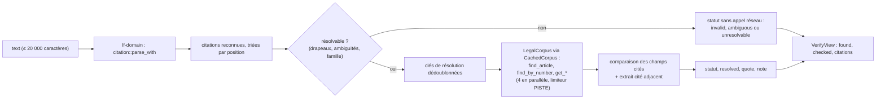

# Annexe B — Citations juridiques : parseur (M6), `fr_verify_citations`, `fr_resolve` et `fr_get_related` (M7)

> **Statut** : M0-M1 livrés (plan 1), le reste est un plan. [00-decisions.md](../00-decisions.md) est normatif et l'emporte en cas de doute ; pour M0-M1 le code livré fait foi (écarts : 00 §11.1). Les types de date, d'ECLI et de texte sont ceux du domaine livré (`CivilDate`, `ecli::Ecli`) ; `text::fold` livré reste `pub(crate)` et la vue clé du parseur utilise `fold_char` (M6, §3.2) ; les dépendances du parseur entrent dans `lf-domain` par ADR au jalon M6 (00 §2).
> **Jalons** : M6 (v0.2.0) : parseur `lf-domain::citation`, corpus, `fr_verify_citations`, `fr_resolve`, `list_codes()`, recherche par ECLI, ELI cités (00 §11). M7 (v0.3.0) : `fr_get_related`, complétion des noms de codes, gabarit `legifrance://code/{code}/article/{num}`.
> **Lecteurs** : développeurs de `lf-domain::citation`, des cas d'usage M6/M7 de `lf-application`, des méthodes `find_article`/`find_by_number`/`list_codes` de `lf-adapter-piste`, et des vues de `lf-adapter-mcp`.
> **Données** : [donnees/codes-table.md](donnees/codes-table.md) (77 codes), [donnees/citations-corpus-positifs.jsonl](donnees/citations-corpus-positifs.jsonl) (185 cas), [donnees/citations-corpus-negatifs.jsonl](donnees/citations-corpus-negatifs.jsonl) (45 cas).
> Les extraits Rust sont **non compilés, à valider au jalon qui l'implémente**. Les points non vérifiés sont marqués **NON VÉRIFIÉ** avec une étiquette `[v:…]` ; le registre `V-xx` les reprend dans [09-risques-et-questions.md](../09-risques-et-questions.md).

Documents liés : [03-domaine.md](../03-domaine.md) §8 (architecture et types du parseur, en résumé), [02-architecture.md](../02-architecture.md) §5.1 (port `LegalCorpus`) et §6.2 (cas d'usage), [04-adapter-piste.md](../04-adapter-piste.md) §6.9, §7.1 à §7.3 et §12.3 (requêtes, endpoints, table des codes), [05-outils-mcp.md](../05-outils-mcp.md) §5.9 à §5.11 (schémas des trois outils), [06-qualite.md](../06-qualite.md) (stratégie de test), les plans d'implémentation exécutables (retirés : voir [README du plan §3.5](../README.md#35-plans-dimplémentation-retirés) ; tâches, forme « plan N, tâche M »), [C-api-legifrance.md](C-api-legifrance.md) (API), [A-parite.md](A-parite.md) (divergences volontaires). ADR concernés (index : [../../adr/README.md](../../adr/README.md)) : ADR-0004 (PISTE d'abord, DILA ensuite derrière le même port), ADR-0006 (sortie compacte), ADR-0007 (cache au niveau du port), ADR-0009 (contrat de citation v2), ADR-0010 (erreurs `[code]`), ADR-0011 (dates), ADR-0012 (ports RPITIT). Rapport source principal : [recherche 07](../../recherche/07-citations.md).

---

## Sommaire

0. Résumé
1. Objet, périmètre, répartition
2. Formes réellement renvoyées par l'API et pièges
3. Normalisation avec conservation des offsets
4. Grammaire EBNF par famille et désambiguïsation
5. Dictionnaire des codes
6. Types Rust
7. Résolution et vérification
8. Corpus de tests
9. Critères d'acceptation (M6, M7)
10. Points ouverts
11. Sources

---

## 0. Résumé

- **Tout est à construire.** La référence Python n'a aucun parseur de citations : `citations.py` ne contient que des normaliseurs de réponses et des formateurs (recherche 07 §1). Ses formateurs produisent des chaînes fautives (« decision », « deliberation », « fevrier », « 1 » pour « 1er » : référence citations.py:283-318, :378 ; D-27) que le parseur doit **relire**, car un modèle recopiera les sorties de l'ancien serveur.
- **Parseur pur** dans `lf-domain` : `citation::parse(&str) -> Vec<Spanned<CitationRef>>` = `parse_with(&str, &ParseOptions::default())` (00 §4). Chaîne : normalisation réversible (table d'offsets, vue « clé » repliée 1:1) → ancres `aho-corasick` et `RegexSet` → grammaires `winnow` 1.0 par famille → arbitrage des chevauchements → post-traitement (énumérations, anaphores, qualificatifs de version) → drapeaux et confiance. Les spans sont des offsets **en octets du texte d'origine** ; la sortie MCP les convertit en points de code Unicode (`Span::to_chars`, 00 §7).
- **12 familles** reconnues (articles de codes, textes, articles de textes, bloc de constitutionnalité, Cour de cassation, juridictions judiciaires du fond, Conseil d'État, CAA et TA, Conseil constitutionnel, ECLI, CNIL, conventions collectives), plus JORF, NOR, ELI et identifiants Légifrance, et une famille « hors périmètre » qui sert de **puits** contre les faux positifs (« D. 2016, p. 1234 » est le Recueil Dalloz, pas un article D.).
- **Dictionnaire de 77 codes** (titres, abréviations, sigles ambigus) dans le domaine. La correspondance code → `LEGITEXT` n'est **jamais codée en dur** : l'adapter la lit dans `/list/code` (cache 7 jours) au premier besoin du résolveur. La table de [donnees/codes-table.md](donnees/codes-table.md) contient déjà un conflit d'identifiant (Code rural et de la pêche maritime).
- **Résolution** dans `lf-application`, par le seul port `LegalCorpus` (`find_article`, `find_by_number`, `list_codes`, `get_*`, 00 §3). Deux règles absolues : un identifiant renvoyé vient **toujours** d'une réponse de l'API ; `not_found` exige une **preuve d'absence** (recherche exacte réussie, toutes les variantes essayées, famille à couverture complète, données de production). Sinon : `unresolvable` ou `ambiguous` ; en sandbox, un introuvable est toujours `unresolvable` (00 §7).
- **Statuts** (00 §7) : `verified`, `not_found`, `ambiguous`, `unresolvable`, `invalid`. Concurrence bornée à 4 résolutions, budget de temps de 80 % du délai de l'outil (02 §6.2, 05 §5.9).
- **`fr_resolve`** rend au plus 5 candidats `{id, kind, citation, source_url, confidence}` et la forme canonique reconnue (`interpreted_as`). **`fr_get_related`** (M7) liste les liens d'un article (`relatedLinksArticle`) ou d'une décision (`citationJp` et `liens` analysés par le parseur).
- **Corpus** : 185 cas positifs (217 attentes) et 45 négatifs (32 attentes), 249 sous-chaînes `match` toutes vérifiées dans leur entrée (contrôle du 2026-10-15 pour P001-P200 et N01-N42, étendu par le test `corpus_matches_are_substrings` à P201-P215 et N43-N45, §8.1). Harnais table-driven Rust, 26 `resolve_hint` pour les tests live, aucune surcharge : l'attente de P159 (ECLI européen, `Unsupported { family: ForeignEcli }`, 00 §4) est corrigée dans le fichier de données (§8.4).

---

## 1. Objet, périmètre, répartition

### 1.1 Ce que fixe cette annexe

| Sujet | Ici | Ailleurs |
|---|---|---|
| Architecture du module `citation`, signature publique | rappel §6.1 | [03-domaine.md](../03-domaine.md) §8.1 |
| Normalisation, grammaire, désambiguïsation, bornes des spans | §3, §4 | — |
| Dictionnaire des codes, sigles | §5 | [donnees/codes-table.md](donnees/codes-table.md) |
| Types complets `CitationRef` et sous-types | §6.2 à §6.5 | 03 §8.6 (résumé) |
| `NumberQuery` (variantes) | §6.6 (définition, fait foi pour la forme et les couples (fond, kind)) | 03 §4.11 (emplacement : `lf-domain::search`), 02 §5.1 (signature du port), 04 §7.2 (besoins de l'adapter) |
| Quoi demander à l'API par famille, quoi comparer | §7.3 | 04 §6.9 et §7 (comment construire les requêtes), [C-api-legifrance.md](C-api-legifrance.md) |
| Statuts, preuve d'absence, notes | §7.1, §7.2, §7.6, §7.10 | 05 §5.9 (schéma de sortie) |
| Schémas d'entrée et de sortie des outils | rappels §7.7, §7.8, §7.11 | [05-outils-mcp.md](../05-outils-mcp.md) §5.9 à §5.11 |
| Corpus et harnais de tests | §8 | [06-qualite.md](../06-qualite.md) |

### 1.2 Répartition par crate

| Crate | Module | Contenu | Jalon |
|---|---|---|---|
| `lf-domain` | `citation::{normalize, scan, grammar::*, post, dict::{codes, courts}, types, format, quote}` | reconnaissance, spans, normalisation, drapeaux, anaphores intra-document, forme canonique, détection d'un extrait cité adjacent | M6 |
| `lf-domain` | `ecli::Ecli` (racine du crate, livré), `CivilDate::to_french` (livré) ; `text::encoding::repair_latin1_mojibake` et `contract::{Eli, Nor, Idcc}` (module `contract` = ex-`citation` du contrat v2, C2) | réutilisés tels quels (03 §1.5) ; `text::encoding` et `Eli` (contrat v2) : tâches de tête de M2 (00 §11.1) ; `Nor`, `Idcc` : M2, avec `Act` et `Convention` (`text::fold` n'est pas réutilisé : `fold_char` le remplace pour la vue clé, M6). Le parseur met l'ECLI cité en majuscules avant `Ecli::parse` ; la grammaire ECLI livrée, plus tolérante, est gardée et réalignée en M6 seulement si le parseur la réutilise pour les ECLI cités | M1 (livré), M2 |
| `lf-domain` | `search::{NumberQuery, NumberKind, NumberValue}` | entrée de `find_by_number` (forme : §6.6 ; emplacement : 03 §4.11, 02 §5.1) | M6 |
| `lf-application` | `citation::{verify, resolve, related, policy, notes}` ; `VerifyCitationsUseCase`, `ResolveUseCase`, `RelatedUseCase` | choix des appels de port, comparaison des champs, statuts, preuve d'absence, budget | M6 (M7 pour `related`) |
| `lf-application` | `ports::LegalCorpus::{find_article, find_by_number, list_codes}` | ajouts M6 au port unique (00 §3, 02 §5.1) ; `list_codes() -> Vec<CodeListing>` (03 §4.11), chargée paresseusement, jamais au démarrage | M6 |
| `lf-application` | `ports::LegalCorpus::related_links` | ajout M7 | M7 |
| `lf-adapter-piste` | requêtes et mémos | `CodeTable` (mémo `/list/code`, seule table des codes du processus, 04 §12.3), recherches `EXACTE`, `/search` filtré par la facette `ECLI` (JURI, CETAT), `getArticleWithIdAndNum`, `getJoWithNor`, `kaliContIdcc`, `getArticleWithIdEliOrAlias` et `eliAndAliasRedirectionTexte` (ELI cités) | M6 |
| `lf-adapter-piste` | requêtes | `relatedLinksArticle` (`/suggest` retiré, 00 §8) | M7 |
| `lf-adapter-cache` | `CachedCorpus` | `Op::FindArticle` (24 h), `Op::FindByNumber` (1 h), `Op::Codes` (7 j) en M6 ; `Op::Related` (24 h) en M7 ; aucune mise en cache d'erreur ni de réponse vide (00 §9) | M6, M7 |
| `lf-adapter-mcp` | vues de sortie | `VerifyView`, `ResolveView`, `RelatedView` ; `kind` en `snake_case` ; `span` en points de code Unicode (00 §7) ; rendu anglais des notes | M6, M7 |

`lf-domain` livré n'admet que `thiserror` (liste blanche de `xtask/src/arch.rs`, `DOMAIN_ALLOWED`, qui échoue fermé ; 00 §2). Le parseur élargit cette liste **par un ADR au jalon M6** (ADR-0018, amendé le 2026-10-29 : **`winnow` n'est pas employé**, les grammaires sont écrites à la main avec un curseur sur une vue en caractères, et les mentions de `winnow` qui suivent décrivent le plan d'origine, non le code livré) : `aho-corasick`, `regex`, et `unicode-normalization` pour la normalisation NFC (en M5 seulement si un retrait maison des marques combinantes ne suffit pas). Pas de `chrono` dans le domaine : les dates sont des `CivilDate`. Pas de `serde` dans le domaine (03 §1.1) ; `serde_json` seulement en `[dev-dependencies]` pour charger le corpus. Chaque dépendance n'entre dans `crates/lf-domain/Cargo.toml` qu'avec le premier code qui l'emploie, jamais d'avance (`cargo machete` vert, 00 §2, 03 §1.1) : `winnow`, `aho-corasick` et `regex` arrivent avec le parseur (M6), `unicode-normalization` au jalon qui en a besoin ; les exigences de version suivent 00 §2 (niveau mineur, versions du plan = versions de référence).

### 1.3 Flux d'un appel `fr_verify_citations`



### 1.4 Principes non négociables

1. **Jamais d'identifiant fabriqué.** Un `id`, un ECLI ou un ELI renvoyé vient d'une réponse de l'API, jamais d'une dérivation (référence server.py:65 « NEVER invent an id, an ELI, an ECLI or a citation » ; 03 §1.4 et §5.2). Les règles de dérivation ECLI (§4.10) servent **au contrôle** d'un ECLI cité, jamais à en produire un.
2. **Jamais « introuvable » sans preuve.** « Absence here is not absence in the law » (référence server.py:46). `not_found` n'est rendu que si la preuve du §7.2 est réunie, sur des données de production ; une erreur amont, un délai dépassé, une couverture partielle ou l'environnement sandbox donnent `unresolvable` (00 §7).
3. **Le domaine reconnaît, l'application vérifie.** Le parseur ne fait aucune E/S ; il signale les impossibilités syntaxiques (31 février, « 4e civ. », ECLI malformé) par des drapeaux. Seule l'application, par le port, constate l'existence d'un document (03 §8.7).
4. **Offsets du texte d'origine.** Toute normalisation est réversible par une table d'offsets : `&input[span.start..span.end]` est l'extrait d'origine (§3.4).
5. **Bornes partout.** Entrée bornée par le cas d'usage (20 000 caractères pour `fr_verify_citations`, 1 000 pour `fr_resolve`, 00 §7), fenêtre d'analyse bornée par ancre, aucune récursion non bornée, aucune panique (03 §1.3 et §8.8).
6. **Relire l'ancien, produire le nouveau.** Le parseur accepte les formes historiques de la référence (sans accents, « 1 janvier ») ; la forme canonique produite (`format`, §6.5) est celle du contrat v2 (ADR-0009 ; « Cons. const., décision n° 2025-1173 QPC du 7 novembre 2025 »).

### 1.5 Défauts et écarts de la référence traités ici

| Identifiant | Défaut ou écart | Traitement |
|---|---|---|
| D-27, E-12 | formats « French convention » fautifs (accents, mois, « 1er », premier crochet) | le parseur relit ces formes (P140, P173) ; `format` produit les formes corrigées de 03 §5.4 |
| D-30 | contrat de citation non garanti | `resolved.citation` et `resolved.source_url` viennent du `CitationContract` du document consulté (03 §5.1) |
| D-35 | fixtures en mojibake | réparation **avant** le repli des espaces (§3.1) ; cas P077 et P109 |
| D-13, D-14 | ni limitation de débit, ni délai global | 4 résolutions concurrentes, limiteur PISTE, budget de 80 % du délai (§7.7) |
| D-15 | « not found » mis en cache 24 h | aucune absence n'est mise en cache (00 §9) ; une preuve d'absence est recalculée à chaque appel |
| D-33 | réponses volumineuses | environ 300 caractères par citation vérifiée (05 §5.9) |
| P-034, P-035 | formats de citation de parité | « Code civil, art. 9 » inchangé ; CC et CNIL corrigés (divergences listées dans [A-parite.md](A-parite.md)) |
| P-039 | ni ELI ni ECLI fabriqué | principe 1 |

---

## 2. Formes réellement renvoyées par l'API et pièges

### 2.1 Formes de citation observées, par fonds

Toutes les valeurs ci-dessous sont lues dans les fixtures de la référence (`tests/fixtures/*.json`, recherche 07 §2.1) ; LODA et JURI sont montrés après réparation du mojibake.

| Fonds | Champ | Valeur réelle | Source |
|---|---|---|---|
| CODE | `article.num`, `textTitles[].titre` | `"9"`, `"Code civil"` (`LEGIARTI000006419288`, `LEGITEXT000006070721`) | consult_article.json |
| LODA | `title` | `LOI n° 2016-1321 du 7 octobre 2016 pour une République numérique (1)` (brut : `n°`, `République`) | consult_loda.json ; search_loda.json:9 |
| LODA | `id`, `cid`, `nor`, `numParution`, `dateParution` | `LEGITEXT000033205014_08-09-2023`, `JORFTEXT000033202746`, `ECFI1524250L`, `"0235"`, 2016-10-08 | consult_loda.json:4-19 |
| LODA | titre citant d'autres textes | `Décret n° 2016-1849 du 23 décembre 2016 … pris en application de l'article 107 de la loi n° 2016-1321 du 7 octobre 2016 … et … de l'article 2 de la loi n° 93-1419 du 31 décembre 1993 …` | search_loda.json:56 |
| JURI | `titre` | `Cour de cassation, civile, Chambre civile 1, 4 juin 2025, 24-13.470, Publié au bulletin` | consult_juri.json:45 |
| JURI | `numeroAffaire`, `num`, `natureNumero`, `ecli`, `formation` | `["24-13.470"]`, `"12500399"`, `"ARRET 12500399"`, `ECLI:FR:CCASS:2025:C100399`, `CHAMBRE_CIVILE_1` | consult_juri.json (vérifié le 2026-10-15) |
| JURI | `citationJp` | `… à rapprocher : 1re Civ., 25 mai 2023, pourvoi n° 21-23.174 (cassation partielle) et l'arrêt cité.` | consult_juri.json:92 |
| JURI | en-tête du `texte` | `… Arrêt n° 399 F Pourvoi n° N 24-13.470 …` | consult_juri.json:69 |
| JURI | `liens[].title` | `"1 du code civil."`, `"Article 10 de la directive 85/374/CEE du Conseil, du 25 juillet 1985, … ;  article 2270-"` (tronqués, `id` et `cidTexte` vides) | consult_juri.json:105 |
| CETAT (CE) | `titre`, `formation`, `ecli`, `num`, `ancienId` | `Conseil d'État, 2ème - 7ème chambres réunies, 29/05/2026, 506507`, `2ème - 7ème chambres réunies`, `ECLI:FR:CECHR:2026:506507.20260529`, `506507`, `JG_L_2026_05_000000506507` | consult_juri_cetat.json:11-154 |
| CETAT (CAA) | `titles[].title` | `CAA de MARSEILLE, 4ème chambre, 09/06/2026, 24MA02429` ; `CAA de NANCY, 3ème chambre, 22/05/2025, 22NC02259` | search_cetat.json:9,93 |
| CETAT | renvois aux juges du fond | `Par un jugement nos 2005064, 2006015, 2006016 du 30 juin 2022, le tribunal administratif … Par un arrêt n° 22NC02259 du 22 mai 2025 la cour administrative d'appel de Nancy …` | consult_juri_cetat.json:68 |
| CONSTIT | `titre` | `Décision 2025-1173 QPC - 07 novembre 2025 - M.\u00a0Amine G. [Absence de publicité …] - Conformité` (U+00A0, jour sur 2 chiffres) | consult_juri_constit.json:40 |
| CONSTIT | `num`, `natureNumero`, `ecli`, `nor`, `titreJo`, `lienJo` | `2025-1173`, `QPC 2025-1173`, `ECLI:FR:CC:2025:2025.1173.QPC`, `CSCX2531180S`, `JORF n°0263 du 8 novembre 2025, texte n° 152`, `…/jorf/id/JORFTEXT000052541898` | consult_juri_constit.json |
| CONSTIT (recherche) | `nor`, `nature` | `cscx2531180s` (minuscules), `qpc` | search_constit.json:30,118 |
| CNIL | `num`, `titre`, `titreLong` | `SAN-2026-002`, `Délibération SAN-2026-002 du 8 janvier 2026`, `Délibération de la formation restreinte n° SAN-2026-002 du 8 janvier 2026 …` | consult_cnil.json:11,40 |
| CNIL (recherche) | `titles[].title` | `… n° SAN–2026-003 du 22 janvier 2026 …` (**U+2013**) | search_cnil.json:53 |
| KALI | `conteneurs[0]` | `{cid: KALICONT000005635096, num: "2121", titre: "Convention collective nationale de l'édition du 14 janvier 2000\n"}` | consult_kali.json:145-149 |
| KALI | `num` d'articles | `"19 (des dispositions communes …)"`, `"8.4 de la convention)"` (valeurs amont malformées) | consult_kali.json ; search_kali.json:100,122 |
| ACCO | `numero`, `codeIdcc` | `T09426064936`, `"275"` | consult_acco.json:12,23 |

### 2.2 Pièges que la normalisation et la grammaire doivent absorber

| Piège | Exemple réel | Source | Traitement | Cas du corpus |
|---|---|---|---|---|
| Mojibake UTF-8 lu en Latin-1 | `n°`, `Publié`, `Ã` + U+00A0 (= `à`) | consult_juri.json:92 ; 6 fixtures sur 16 (D-35) | étape 1 du §3.1, **avant** le repli des espaces ; origine vérifiée en sandbox le 2026-10-28 : la capture, non PISTE [V-72 · mojibake-origine] | P077, P109 |
| Espaces exotiques | U+00A0 dans `M. Amine G.` ; U+202F | consult_juri_constit.json:40 | étape 3, repli un pour un | P042, P078, P141 |
| Tirets typographiques | `SAN–2026-003` (U+2013) ; U+2011 insécable | search_cnil.json:53 | étape 3 | P042, P076, P106, P172 |
| Apostrophes typographiques | `l’article 61-1`, `code de l’urbanisme` | consult_juri_constit.json:68 ; search_cetat.json | étape 3 | P005, P007, P080 |
| NOR en minuscules | `cscx2531180s` | search_constit.json:118 | forme minuscule acceptée **seulement** après l'ancre `NOR` (§4.13) | P194 |
| Ordinaux non typographiques | `2ème - 7ème`, `4ème chambre` | consult_juri_cetat.json:29 ; search_cetat.json:9 | `ORDN` accepte `ème`, `eme`, `è` (§4.1) | P120, P121 |
| Ordinaux en exposant | `1ʳᵉ civ.` | usage | étape 3 (`ʳᵉ` → `re`) | P106 |
| Dates hétérogènes | `29/05/2026`, `07 novembre 2025`, `DU 4 JUIN 2025`, `2026-04-30`, `11 déc. 2019`, `1 janvier` (référence) | fixtures ; référence citations.py:295 | `DATE` (§4.1), casse et accents ignorés | P068, P115, P120, P141 |
| Balises `<mark>` dans les titres de recherche | `pour une <mark>République</mark>` | search_loda.json:9 | étape 0 si `strip_html` | P077 (balise hors du span) |
| Numéros parasites dans les titres | `de programmation 2018-2022`, `ministère de la justice 2023-2027` | consult_juri_constit.json:68 | un numéro de texte n'existe qu'après une nature et `n°` (§4.3) | P056, P057, N06 |
| Pluriel du signe numéro | `nos 2005064, 2006015, 2006016` | consult_juri_cetat.json:68 | `NUM_SIGN_PL` | P124 |
| Lettre-clé devant un pourvoi | `Pourvoi n° N 24-13.470` | consult_juri.json:69 | `key_letter` (§4.5) | P100 |
| `n°` collé au numéro | `n°0263`, `n°2016‑1321`, `n°10-10.906` | consult_juri_constit.json:42 | `NUM_SIGN` suivi de `WS?` | P076, P095, P190 |
| Liens amont tronqués | `1 du code civil.` ; `… ;  article 2270-` | consult_juri.json:105 | un nombre nu n'est pas un article ; un numéro terminé par `-` est rejeté (§4.2) | N01 |
| `num` KALI malformé | `8.4 de la convention)` | search_kali.json:122 | aucune citation | N42 |
| Saut de ligne final des titres KALI | `… du 14 janvier 2000\n` | consult_kali.json:149 | exclu du span (§4.18) | P180 |
| Doubles espaces | `… libertés  - Non conformité partielle` | search_constit.json:9,53 | `WS` = un ou plusieurs espaces | P142 |
| Fragment de formation seul | `2ème - 7ème chambres réunies` | consult_juri_cetat.json:40 | pas de décision sans juridiction ni date ni numéro | N38 |

### 2.3 Chaînes produites par la référence Python, à relire

| Producteur | Forme produite | Source | Cas |
|---|---|---|---|
| Article de code | `{code_title}, art. {num}` → `Code civil, art. 9` ; sinon `Art. {num}` | référence citations.py:256-261 ; tests/test_parse.py:69 | P015 |
| Conseil constitutionnel | `Cons. const., decision n° {num} {NATURE} du {D mois AAAA}[ - {premier crochet}]` : « decision » sans accent, mois sans accent (`fevrier`, `aout`, `decembre`), jour `1` sans « er » | citations.py:283-318 ; tests/test_parse.py:114-116 | P140 (le span s'arrête avant ` - Absence …`) |
| CNIL | `CNIL, deliberation n° {num} du {D mois AAAA}` | citations.py:378 | P173 |
| JURI, CETAT, LODA, KALI | titre amont brut | citations.py:124, 225, 337, 433 | P091, P120, P050, P180 |
| ACCO | `{titre} ({raisonSociale})` | citations.py:141-142, 458 | — (pas une forme citable par le parseur) |

Les formes **corrigées** du contrat v2 (03 §5.4) doivent aussi être relues : propriété `parse(format(c)) == c` (§8.8).

### 2.4 Valeurs fermées des facettes, sources des dictionnaires de juridictions

Ces listes alimentent `dict/courts.rs` (reconnaissance) et, côté adapter, les énumérations de filtres (recherche 07 §2.4, fixtures).

| Facette (fonds) | Valeurs | Source |
|---|---|---|
| `CASSATION_FORMATION` (JURI) | 16 valeurs : `CHAMBRE_CIVILE_1`, `CHAMBRE_CIVILE_2`, `CHAMBRE_CIVILE_3`, `CHAMBRE_COMMERCIALE`, `CHAMBRE_SOCIALE`, `CHAMBRE_CRIMINELLE`, `CHAMBRE_MIXTE`, `ASSEMBLEE_PLENIERE`, `CHAMBRES_REUNIES`, `CHAMBRE_CIVILE`, `ORDONNANCE_PREMIER_PRESIDENT`, `AVIS`, `COUR_REVISION`, `COMMISSION_REVISION`, `COMMISSION_REPARATION_DETENTION`, `TRIBUNAL_CONFLIT` | search_juri.json:370-393 |
| `APPEL_SIEGE_APPEL` (JURI) | 35 sièges de cour d'appel, en majuscules sans accents (`AIX-PROVENCE`, `ST-DENIS-REUNION`, `BASSE-TERRE`…) | search_juri.json:233 |
| `JURIDICTION_NATURE` (CETAT) | `CONSEIL_ETAT`, `COURS_APPEL`, `TRIBUNAL_ADMINISTATIF` (**sic**, sans R), `COURS_APPEL_FINANCIERE`, `TRIBUNAL_CONFLIT`, `COURS_DE_DISCIPLINE`, `COURS_COMPTES`, `CHAMBRES_COMPTES` ; sous-valeurs : 9 CAA, 42 TA | search_cetat.json:259-342 |
| `NATURE_CONSTIT`, `NATURE_AUTRE`, `NATURE_ELCT`, `NATURE_NORME_AUTRE` (CONSTIT) | **libellés**, pas des codes : `Dispositions promulguées (QPC)`, `Loi ordinaire (DC)`, `Délégalisation (L)`, `Fin de non recevoir (FNR)`… | search_constit.json:139-260 |
| `natureDelib` (CNIL) | `Sanction`, `Mise en demeure`, `Avis`, `Recommandation/lignes directrices`… | search_cnil.json |
| `nature` (LODA) | `LOI`, `ORDONNANCE`, `DECRET`, `DECRET_LOI`, `ARRETE`, `DECLARATION`, `DECISION`, `CONVENTION`, `CONSTITUTION`, `DELIBERATION`, `ACCORD_FONCTION_PUBLIQUE` | search_loda.json |

---

## 3. Normalisation avec conservation des offsets

### 3.1 Pipeline (l'ordre est impératif)

```text
texte d'origine (&str, UTF-8)
  0. [si strip_html]      balises retirées, entités décodées             → segments « supprimé » / « remplacé »
  1. [si repair_mojibake] réparation Latin-1 → UTF-8, tout-ou-rien      → segments « remplacé » (n car. → 1 car.)
  2. NFC (unicode-normalization)                                         → segments « remplacé » (2 car. → 1 car.)
  3. repli caractère par caractère (table §3.2)                          → copie, remplacement, suppression, expansion
  4. vue « clé » : fold_char() appliqué à chaque caractère, 1:1
  ▼
Normalized { text, key, offsets: OffsetMap, key_index }
```

- **Étape 0** (`ParseOptions.strip_html`, vrai pour les champs amont `citationJp` et `liens[].title`, 03 §8.1) : `<mark>`, `</mark>`, `<sup>`, `</sup>` retirées en gardant leur contenu (`1<sup>re</sup>` → `1re`) ; `<br/>` → une espace ; entités `&nbsp;`, `&amp;`, `&apos;`, `&quot;`, `&#8217;`, `&#x2019;` décodées. Même scanner tolérant que `text::from_html` (03 §7.2).
- **Étape 1** (`ParseOptions.repair_mojibake`, faux par défaut pour un texte utilisateur, 03 §8.1) : la fonction pure `text::encoding::repair_latin1_mojibake` (03 §1.6), avec la même règle tout-ou-rien que l'adapter (00 §8 : aucun caractère > U+00FF, motif `[U+00C2–U+00F4][U+0080–U+00BF]` ou C1, décodage UTF-8 strict, accepté seulement s'il ne reste aucun motif ; règle contrôlée sur les fixtures par le script versionné [donnees/scripts/dto_repair_check.py](donnees/scripts/dto_repair_check.py), Python 3.13 en `python3 -I`, 00 §10). Une variante `…_mapped` rend les segments : chaque caractère produit sur `n` octets UTF-8 correspond à `n` caractères Latin-1 de l'entrée. Elle **précède** l'étape 3 : la séquence de `à` est `Ã` suivi de U+00A0 ; replier U+00A0 d'abord rendrait la réparation impossible (consult_juri.json:92). Les données renvoyées par l'API sont déjà réparées par l'adapter au niveau du corps (00 §8), d'où `repair_mojibake = false` pour `citationJp` et `liens`. Forme CP1252 `’` (pour `’`) : non observée dans les fixtures ni, le 2026-10-28, dans les réponses de sandbox [V-73 · mojibake-cp1252].
- **Étape 2** : NFC (`e` + U+0301 → `é`). **Pas de NFKC global** : il altérerait des caractères utiles (fractions, exposants numériques). La table du §3.2 est explicite et testée ; NFKC peut servir à la construire. Comportement Unicode des caractères cités : **NON VÉRIFIÉ** [V-161 · table-repli-nfkc], à vérifier par un test qui compare la table à `unicode-normalization`.

### 3.2 Table de repli (étape 3)

| Classe | Caractères d'entrée | Sortie | Effet sur l'offset | Source, cas |
|---|---|---|---|---|
| Espaces | U+00A0, U+202F, U+2009, U+2007, U+2002–U+2006, U+2008, U+205F, U+3000, `\t`, `\r`, `\n` | U+0020 (un pour un ; les suites sont conservées, la grammaire accepte `WS`) | remplacement 1 → 1 | consult_juri_constit.json:40 ; P042, P078 |
| Largeur nulle | U+200B, U+200C, U+200D, U+2060, U+FEFF, U+00AD | supprimé | suppression | recommandation (recherche 07 §3.2) |
| Apostrophes | U+2019, U+2018, U+02BC, U+0060, U+00B4, U+2032 | `'` | 1 → 1 | search_cetat.json ; P005 |
| Tirets | U+2010, U+2011, U+2012, U+2013, U+2014, U+2212, U+FE63, U+FF0D | `-` | 1 → 1 | search_cnil.json:53 ; P042, P172 |
| Signe numéro | `nº` (U+00BA), `№` (U+2116) | `n°` | 1 → 1 ou 1 → 2 (expansion) | P078 |
| Exposants ordinaux | U+02B3 `ʳ`, U+1D49 `ᵉ`, U+1D48 `ᵈ`, U+02E2 `ˢ` | `r`, `e`, `d`, `s` (`1ʳᵉ` → `1re`) | 1 → 1 | P106 |
| Signe degré d'item | `1º` (U+00BA après un chiffre) | `°` | 1 → 1 | recherche 07 §3.2 |
| Guillemets | `«` `»` `“` `”` `„` | conservés (non significatifs pour la grammaire ; utilisés par la détection d'extrait cité, §7.9) | copie | — |
| Ligatures | `œ`, `æ` | conservées | copie | — |

Le `n o` séparé et les pluriels `n°s`, `nos` ne sont pas réécrits : la grammaire les reconnaît (`NUM_SIGN`, `NUM_SIGN_PL`), et `no`/`nos` seulement devant un chiffre.

### 3.3 Vue « clé » repliée 1:1 (étape 4)

- **Définition.** `fold_char(c) -> char` (une fonction, un seul caractère en sortie) : ASCII → minuscule ; lettres latines accentuées des blocs Latin-1 Supplement et Latin Extended-A → lettre de base minuscule (table explicite : `é è ê ë É` → `e`, `ç` → `c`, `ÿ` → `y`…) ; `œ` et `æ` restent `œ` et `æ` (minuscules) ; tout autre caractère : `c.to_lowercase()` s'il donne un seul caractère, sinon `c`. Cette fonction 1:1 est **distincte de `text::fold`** livré (qui développe `œ` en `oe` pour le BM25) : `fold_char` est ajoutée en M6, et le dictionnaire comme la recherche d'un extrait cité l'utilisent pareil (00 §11.1).
- **1:1 en caractères, pas en octets.** `é` (2 octets) devient `e` (1 octet). `key_index` garde, pour chaque caractère, l'offset en octets dans `text` et dans `key` (`u32`), ce qui convertit un offset de la clé en offset normalisé par recherche dichotomique. Invariant testé : `key.chars().count() == text.chars().count()` (00 §4).
- **Ligatures.** La recherche 07 propose `œ` → `oe` dans la vue clé (§3.2) tout en exigeant une clé de même longueur (§3.3) : c'est contradictoire. La règle 1:1 de 00 §4 l'emporte : `œ` reste un caractère. Les dictionnaires sont repliés par la même fonction ; si une graphie `oe` doit être reconnue, elle est ajoutée comme alias. Aucun titre de code du tableau ne contient `œ`.
- **Usages.** (a) Motifs `aho-corasick` des dictionnaires (titres et abréviations de codes, juridictions, mots-clés), compilés sur des motifs repliés et appliqués à `key`. (b) Mots-clés des grammaires : le combinateur `kw("conseil d'etat")` compare `fold_char(c)` caractère par caractère sur le texte normalisé, ce qui équivaut à lire la clé à la même position. `winnow::ascii::Caseless` n'est qu'ASCII (recherche 07 §3.3) : il n'est pas utilisé pour les mots accentués.
- **Sensibilité à la casse conservée** pour les jetons où elle porte du sens : préfixes d'articles (`L`, `R`, `LO`), lettres de suffixe (`199 undecies B` contre `1234-5a`, N36), sigles (`CE`, `CC`, `CP`, `CGI`), chiffres romains (`I`, `II`), lettre-clé de pourvoi, codes de CAA (`MA`), NOR hors ancre. Ces jetons sont lus sur `text`, jamais sur `key`.

### 3.4 `OffsetMap`

```rust
// crates/lf-domain/src/citation/normalize.rs — non compilé, à valider au jalon qui l'implémente
pub(crate) struct Normalized {
    pub text: String,          // texte normalisé (étapes 0 à 3)
    pub key: String,           // vue clé (étape 4), même nombre de char que `text`
    offsets: OffsetMap,        // normalisé → origine
    key_index: Vec<(u32, u32)>,// par caractère : (octet dans key, octet dans text)
}
pub(crate) struct OffsetMap { segs: Vec<Seg> }          // triés par norm_start, contigus côté normalisé
#[derive(Clone, Copy)]
struct Seg { norm_start: u32, norm_len: u32, orig_start: u32, orig_len: u32, kind: SegKind }
#[derive(Clone, Copy)]
enum SegKind { Copy, Replace }
impl OffsetMap {
    /// Offset d'origine du caractère qui commence en `norm` (début de span).
    fn to_orig(&self, norm: u32) -> u32;
    /// Fin, dans l'origine, du caractère d'origine qui couvre `norm_end - 1` (fin de span).
    fn to_orig_end(&self, norm_end: u32) -> u32;
}
```

- `Copy` : correspondance linéaire octet à octet. `Replace` : tout offset intérieur renvoie `orig_start` (début) ou `orig_start + orig_len` (fin). Une suppression laisse un trou côté origine entre deux segments ; une expansion est un `Replace` avec `norm_len > orig_len`.
- Composition : chaque étape produit sa table ; les tables sont composées une fois, à la fin de `normalize`. Les grammaires produisent des `Range<usize>` normalisés (winnow `Parser::with_span` sur `LocatingSlice<&str>`, recherche 07 §9.1) convertis **une seule fois** en `Span` d'origine.
- `u32` suffit : l'entrée est bornée par l'application (20 000 caractères) et par un garde-fou du domaine (1 Mio ; au-delà, l'analyse s'arrête à la dernière frontière de caractère avant la borne).

### 3.5 Invariants testés

| Invariant | Test |
|---|---|
| `key` a autant de caractères que `text` | proptest sur toute chaîne |
| `to_orig` et `to_orig_end` rendent des frontières de caractère de l'entrée, de façon monotone | proptest ; `input.get(start..end).is_some()` (03 §8.8) |
| Texte ASCII sans caractère replié : table identité | unitaire |
| Idempotence : `normalize(normalize(x).text).text == normalize(x).text` (sans étapes 0 et 1) | proptest |
| Pour chaque cas du corpus : `&input[span] == match` | harnais §8.5 |
| Aucune panique, temps linéaire | fuzzing (`cargo fuzz`) ; mesure du temps sur un texte de 20 000 caractères en M6 |

---

## 4. Grammaire EBNF par famille et désambiguïsation

### 4.0 Conventions

- `"…"` : mot-clé comparé par `fold_char` (casse et accents ignorés). Un point final dans un littéral d'abréviation (`"art."`, `"civ."`) est optionnel, sauf mention contraire ; il est inclus dans le span quand il est présent (P017).
- `'…'` : littéral **sensible à la casse** (sigles, préfixes, lettres).
- `/…/` : expression sur le texte normalisé, sensible à la casse.
- `[x]` optionnel ; `{x}` zéro ou plus ; `x+` un ou plus ; `|` alternative ordonnée (la première qui réussit ; l'arbitrage final entre familles est au §4.16) ; `(* … *)` commentaire ; `<…>` : renvoi à un dictionnaire.
- Entre littéraux d'une même alternative, la forme **la plus longue** est essayée d'abord, quel que soit l'ordre d'écriture (`"articles"` avant `"article"`, `"décret-loi"` avant `"décret"`, `'**'` avant `'*'`) : un `alt` winnow ne revient pas en arrière après un succès. `alt` est limité à 10 branches par tuple depuis winnow 1.0 : imbriquer (recherche 07 §9.1).
- `WS` = une ou plusieurs espaces (après repli, il n'y a plus que U+0020) ; `WS?` = zéro ou plus.
- `SEP` = `WS? ("," | ";" | ":") WS?` ou `WS`.
- `CODE_SEP` = `WS? ("," | ":") WS?` ou `WS` : `SEP` sans le point-virgule (L1-02). Un code suivi de « ; » appartient à la citation qui précède : « Code civil ; art. 9 » n'est plus une forme 2, l'article est lu sans code et reste `ambiguous`.
- `LIST_SEP` = `WS? "," WS?` | `WS "et" WS` | `WS "ou" WS` | `WS? "," WS? "et" WS`.
- `B` = frontière de mot : le caractère suivant n'est ni une lettre ni un chiffre. `regex` n'ayant ni look-around ni backreference (recherche 07 §9.1), `B` est un combinateur winnow (`boundary()`).
- Les contraintes sémantiques (date valide, chambre existante, cohérence des années) sont vérifiées **après** le parsing et produisent des **drapeaux** (§4.19), jamais un échec silencieux.
- Les commentaires `Pnnn` / `Nnn` renvoient aux cas du corpus (§8).

### 4.1 Lexique commun

```ebnf
DIGIT        = /[0-9]/ ;
INT          = DIGIT+ ;
NUM_SIGN     = ( "n°" | "no" | "num." | "numéro" ) WS? ;      (* "no" seulement si suivi d'un chiffre ; "n°" couvre nº et № après repli *)
NUM_SIGN_PL  = ( "n°s" | "nos" | "numéros" ) WS? ;            (* "nos" seulement si suivi d'un chiffre *)
ORD1_F       = "1re" | "1ère" | "1ere" | "première" ;           (* 1ʳᵉ → 1re par repli *)
ORD1_M       = "1er" | "premier" ;
ORDN         = /([2-9]|[1-9][0-9])/ ( "e" | "ème" | "eme" | "è" ) B | ORD_WORD ;   (* 2e, 2ème (DILA), 10e *)
ORD_WORD     = "deuxième" | "second" | "seconde" | "troisième" | "quatrième" | "cinquième" | "sixième"
             | "septième" | "huitième" | "neuvième" | "dixième" | "onzième" | "douzième" | "dernier" | "dernière" ;
DAY          = ORD1_M | /(0?[1-9]|[12][0-9]|3[01])/ B ;          (* « 1 janvier » de la référence accepté *)
MONTH        = "janvier" | "février" | "mars" | "avril" | "mai" | "juin" | "juillet" | "août"
             | "septembre" | "octobre" | "novembre" | "décembre"
             | "janv." | "févr." | "fév." | "avr." | "juill." | "juil." | "sept." | "oct." | "nov." | "déc." ;
YEAR4        = /(1[5-9][0-9]{2}|20[0-9]{2})/ B ;
DATE_PROSE   = DAY WS MONTH WS YEAR4 ;                         (* 7 octobre 2016 ; 07 novembre 2025 ; DU 4 JUIN 2025 *)
DATE_NUM     = /(0?[1-9]|[12][0-9]|3[01])[\/.](0?[1-9]|1[0-2])[\/.]/ YEAR4 ;   (* 29/05/2026 *)
DATE_ISO     = YEAR4 "-" /(0[1-9]|1[0-2])/ "-" /(0[1-9]|[12][0-9]|3[01])/ ;     (* 2026-04-30 *)
MOIS_REPU    = "vendémiaire" | "brumaire" | "frimaire" | "nivôse" | "pluviôse" | "ventôse"
             | "germinal" | "floréal" | "prairial" | "messidor" | "thermidor" | "fructidor" ;
DATE_REPU    = DAY WS MOIS_REPU WS "an" WS ROMAN ;
DATE         = DATE_PROSE | DATE_NUM | DATE_ISO | DATE_REPU ;
DATE_LINK    = [ ( "du" | "en date du" | "le" | "des" ) WS ] DATE ;
ROMAN        = /M{0,4}(CM|CD|D?C{0,3})(XC|XL|L?X{0,3})(IX|IV|V?I{0,3})/ B ;   (* non vide, majuscules *)
LATIN_ADV    = "bis" | "ter" | "quater" | "quinquies" | "sexies" | "septies" | "octies" | "nonies"
             | /(un|duo|ter|quater|quin|sex|sept|octo|novo)?(dec|vic|tric|quadrag|quinquag|sexag|septuag|octog|nonag)i[eè]s/
             | "semel" | "quinto" ;
```

- Mois et abréviations : `janv., févr., avr., juill., sept., oct., nov., déc.` ; `mars`, `mai`, `juin`, `août` non abrégés ; `juil.` rencontré (recherche 07 §4.1, sources WEB OQLF). Mois sans accents (`fevrier`) acceptés via la vue clé (référence citations.py:283-286).
- `LATIN_ADV` : forme validée sur tout LEGI par legi.py (`legi/articles.py:13-16`, CC0), y compris les formes fautives présentes dans LEGI (`quinquedecies`, `sexties`).
- Calendrier républicain (`legi/fr_calendar.py`) : la date est reconnue, conservée brute, sans conversion en v0.2 (03 §8.6), avec le drapeau `date_republicaine`.
- Validation de `DATE` : `CivilDate::new` (livré, date.rs:60 ; 00 §4). Échec → `date = None` et drapeau `date_invalide` (N09, N37). Année hors [1789, aujourd'hui + 1] → drapeau `annee_improbable` (sauf date républicaine) ; « aujourd'hui » vient de `ParseOptions.today`, fourni par l'application (le domaine n'a pas d'horloge, 03 §1.6).

### 4.2 Articles de codes

```ebnf
code_article  = art_kw WS art_list [ SEP sub_list ] WS? code_link code_ref [ version_q ]       (* P001, P004, P010, P013, P018 *)
              | code_ref CODE_SEP art_kw WS art_item                                         (* P015, P016, P039, P044 ; garde L1-02 ci-dessous *)
              | art_kw WS art_item WS code_abbr                                              (* P017, P019, P029, P041, P048 *)
              | sub_lead art_kw WS art_item WS? code_link code_ref [ version_q ]             (* P007, P008, P040 *)
              | prefixed_num [ SEP sub_list ] WS? code_link code_ref [ version_q ]           (* P005, P020 *)
              | [ sub_lead ] art_kw WS art_list                                             (* sans code : N03, N26, P009 *)
              | prefixed_num_dash ;                                                         (* sans art_kw ni code : N02, N41 *)

et_seq        = [ WS "et" ] WS ( "s." | "ss." | "suiv." ) | [ WS "et" ] WS ( "suivants" | "suivantes" ) B ;   (* « art. 1240 et s. du code civil », « art. 1217 s. C. civ. », « et suivants » (L1-02, gap3-2) ; le point des abréviations est obligatoire (« art. 5 s'applique » n'en est pas une) ; tolérée entre la liste d'articles (ou le numéro préfixé) et le code ; si aucun code ne suit, la mention reste hors de la citation *)
art_kw        = "articles" | "article" | "arts" | "art." ;           (* "art" sans point : seulement suivi de WS puis chiffre ou préfixe ; "arts." avec point : NON reconnu, voir la limite connue ci-dessous *)
art_list      = art_item { LIST_SEP art_item }                       (* énumération : une citation par élément (§4.15) *)
              | art_item WS "à" WS art_item ;                        (* plage, P035 ; « au » introduit une date (P061) *)
art_item      = art_num [ WS version_inline ] [ SEP sub_list ] ;
art_num       = ( ORD1_M | "unique" | "liminaire" | "préliminaire" | [ prefix WS? ] base_num { suffix } ) num_end ;
num_end       = B ;     (* et en plus : pas de lettre minuscule collée (« L. 1234-5a », N36),
                           pas de « - » non suivi d'un chiffre (lien tronqué « article 2270- », consult_juri.json:105) *)
prefix        = ( 'LO' | 'L' | 'R' | 'D' | 'A' ) [ '**' | '*' ] [ '.' ] ;   (* « L. », « LO. », « R* », « D** » ; P023, P026 *)
prefixed_num  = prefix WS? base_num { suffix } num_end ;
prefixed_num_dash = prefix WS? INT "-" INT { "-" INT } { suffix } num_end ;  (* tiret obligatoire sans code_ref *)
base_num      = INT { "-" INT } ;                                    (* 1234-5 ; 600-4-1 ; 397-1-1 *)
suffix        = WS LATIN_ADV [ "-" INT ] | WS /[A-Z]{1,2}/ B | WS LATIN_ADV ;   (* 39 octies (P027) ; 199 undecies B (P028) ; 238 bis (P029) ;
                                                                        150-0 B ter ; 199 terdecies-0 A (L1-01) ;
                                                                        lettres refusées si elles forment un sigle du dictionnaire §5 :
                                                                        « article 121-3 CP » = Code pénal (N05), pas l'article « 121-3 CP » *)
(* Ordre lu : [adverbe [ "-" entier collé ]] [lettres] [adverbe], chacun au plus une fois ; jamais deux adverbes
   consécutifs ni deux groupes de lettres consécutifs. Exemples : « 150-0 B ter », « 199 terdecies-0 A »,
   « 199 terdecies-0 A ter », « 1649 quater B quinquies », « 5 B bis ». *)
version_inline= "ancien" | "(ancien)" | "nouveau" ;                  (* « article 2270-1 ancien du code civil », P010 *)
sub_list      = sub { SEP sub } ;
sub           = ( "al." | "alinéa" | "alinéas" ) WS? ( ORDN | INT )   (* P038 ; ORDN avant INT : « al. 1er », « al. premier », « al. 2e » (Alinea(n)), « al. dernier » (DernierAlinea) ; « al. 3 » en repli (L1-02) *)
              | INT "°"                                              (* item, P031 *)
              | ROMAN                                                (* paragraphe I, II *)
              | "§" WS? INT
              | /[a-z]\)/ ;
sub_lead      = [ phrase_lead ] unit_lead { WS ( "du" | "de la" | "de l'" ) WS? unit_lead }
                WS ( "de l'" | "du" | "de la" | "des" ) WS? ;
phrase_lead   = ( ORD1_F | ORD_WORD ) WS "phrase" WS "du" WS ;         (* P008 *)
unit_lead     = ( ORD1_M | ORD_WORD ) WS "alinéa" | INT "°" | ROMAN ;  (* le span commence à l'unité, sans « le » (P040) *)
code_link     = "du" WS | "de la" WS | "de l'" | "des" WS | ε ;
code_ref      = code_name | code_abbr | code_anaphora | code_generic ;
code_name     = <titre du dictionnaire §5, sans tenir compte de la casse ni des accents, le plus long d'abord> ;
code_abbr     = <abréviation ou sigle du dictionnaire §5 ; sigles en MAJUSCULES suivis de B> ;
code_anaphora = "même code" | "dudit code" | "du présent code" | "de ce code" | "ledit code" ;
code_generic  = "code" WS ( "de" | "du" | "des" | "de la" | "de l'" ) WS? WORD { WS WORD } ;
                (* ≤ 8 mots ; s'arrête à une ponctuation ou à « dans », « en », « tel », « applicable » ;
                   seulement après art_kw ou prefixed_num ; → CodeRef::Unknown, confiance Medium *)
version_q     = SEP ( "dans sa rédaction" | "dans leur rédaction" ) WS
                  ( "applicable au litige" | "applicable à la date des faits" | "en vigueur" [ WS DATE_LINK ]
                  | ( "issue de" | "résultant de" | "antérieure à celle issue de" | "antérieure à" ) WS? text_cite )
              | SEP "en vigueur au" WS DATE ;                        (* P013, P045 *)
```

**Graphie typographique des lois organiques (L1-03, gap3-4).** `L.O` ou `L. O` (majuscules, point obligatoire après le L), suivi d'un point facultatif, d'espaces facultatifs puis d'un chiffre, se lit comme le préfixe `LO` (`L.O. 127`, `L. O. 141`, `L.O.141` donnent `LO127`, `LO141`, `LO141`). `l.o. 127` (minuscules), `L O 141` (sans point) et `L.O.I. 5` restent refusés. L'ancre ArticlePrefix devient `\b(?:L\.[ ]?O\.?|(?:LO|L|R|D|A)\*{0,2}\.?)[ ]?[0-9]`.

**Limite connue (F6, 2026-10-29).** « arts. » avec un point n'est pas reconnu : `art_kw` (`crates/lf-domain/src/citation/grammar/codes.rs`) essaie « articles », « article » et « arts » suivis d'une espace, puis « art » suivi d'un point ou d'une frontière de mot ; « arts. 1240 » ne passe ni par la première voie (le caractère qui suit « arts » est un point, non une espace) ni par la seconde (« art » est suivi de « s »). Seul « arts » sans point est reconnu (test `art_kw` : `arts 5`). Constat par lecture du code, sans test dédié : **NON VÉRIFIÉ par exécution**. Conséquence : « arts. 1240 et 1241 du code civil » ne donne aucune citation d'article (silence, jamais une fausse citation). Le corriger demande d'ajouter « arts. » à la liste de `art_kw` et un cas au corpus.

**Clé canonique `num_key`** (forme envoyée à `NUM_ARTICLE` et à `getArticleWithIdAndNum`) : préfixe sans point ni espace, puis numéro, puis suffixes séparés par une espace. `L. 761-1` → `L761-1` ; `LO. 141` → `LO141` ; `R* 111-1` → `R*111-1` ; `39 octies` → `39 octies` ; `199 undecies B` → `199 undecies B`. Sources : valeur `L36-11` envoyée en `NUM_ARTICLE` par l'exemple officiel (`exemples-d-utilisation-de-l-api.md:181-189`, via recherche 07 §4.2) ; stockage « sans ponctuation » des numéros LEGI (justicelibre, `sources/citations.py:9-12`, MIT).

**Variantes `key_variants()`**, essayées dans l'ordre par la résolution : `1er` → `["1er", "1"]` ; `R*111-1` → `["R*111-1", "R111-1"]` ; `unique`, `liminaire`, `préliminaire` → forme minuscule puis capitalisée. La forme réellement attendue par l'API pour `R*`, `1er`, les suffixes latins et les lettres est **NON VÉRIFIÉ** [V-119 · num-article-forme-api] (03 §8.6, 04 §6.9).

**Préfixes** (lexique officiel DILA, `lexique-api-lgf.md:337-355`) : `L` partie législative (`LO` loi organique), `R` décret en Conseil d'État, `D` décret simple, `A` arrêté ; `R*`, `D*` décret pris en conseil des ministres ; `R**`, `D**` présents dans LEGI (legi.py `articles.py:20`).

**Ordre des subdivisions.** `sub` est rangé du plus grand niveau au plus petit, quel que soit l'ordre de lecture : « première phrase du troisième alinéa » → `[alinea 3, phrase 1]` (P008) ; « 3° du I » → `[paragraphe I, item 3]` (P040).

**Règles de désambiguïsation des articles de codes** :

1. `L.`, `D.` ou `Ord.` suivis de `WS? n°` désignent une **nature de texte** (loi, décret, ordonnance), pas un préfixe d'article (P068 à P070).
2. `D.` suivi de `YEAR4` puis `, p.`, `, somm.`, `, chron.` ou `, jur.` est le **Recueil Dalloz** (`Unsupported`, famille `doctrine`), jamais un article (N33).
3. Sans `art_kw`, un **nombre nu** n'est jamais un article (N01). Un **numéro préfixé** l'est : suivi d'un `code_ref`, il donne un article de ce code (P005, P020) ; sans `code_ref`, il n'est émis que s'il contient un tiret (`L. 1234-5`), avec l'ambiguïté `code_manquant` (N02) ou `code_implicite` si un contexte de document est fourni (N41). Le tiret limite les faux positifs (`L. 12` peut être autre chose) ; un article sans tiret (`L. 1` du code électoral) n'est reconnu qu'avec `art_kw` ou un `code_ref`.
4. Un suffixe minuscule collé (`L. 1234-5a`) ou un tiret final sans chiffre (`article 2270-`) annule la citation : ne jamais tronquer en `L1234-5` ou `2270` (N36 ; idée reprise de juridix, AGPL, sans code). Le filet vaut aussi pour les suffixes composés (L1-01) : un adverbe latin valide, ou une lettre capitale valide, qui ne peut plus être lu après un adverbe fait que la lecture du numéro renvoie `None`, jamais un numéro tronqué (`5 bis ter`, `5 B bis ter`, `1594 F quinquies A`, `885-0 V bis A`). `885-0 V bis A` est un article réel du CGI dont la lecture lettre-adverbe-lettre n'est pas prise en charge (limite documentée, reportée en 09) : il n'apparaît pas dans `found`. Même limite pour un paragraphe romain collé après un adverbe : `150-0 B ter I` (lettre, adverbe, puis « I ») est refusé en entier, jamais lu comme `150-0 B ter` ; `200 bis I` se lit avec « I » comme lettre de suffixe (clé `200 bis I`, qui ne se résoudra pas), comme `5 bis A l'égard de` se lit `5 bis A`. Ces cas sont fixés par le test `a_roman_paragraph_glued_after_an_adverb_is_a_documented_limit` ; l'article reste vérifiable en le citant sans le paragraphe.
5. `art_kw` sans `code_ref` ni texte : `CodeArticle { code: Missing }` avec `texte_manquant` (N03, N26), ou `code_implicite` avec `code_via = contexte_document` si `ParseOptions.default_text` est fourni (P009).
6. Sigles ambigus : voir §5.3. `CE` n'est **jamais** résolu en code sans contexte (N04) ; `CP` donne le Code pénal en confiance basse (N05).
7. `code_generic` n'est tenté qu'après un `art_kw` ou un numéro préfixé, et seulement si aucun `code_name` du dictionnaire ne correspond.
8. `zone 1AU` et autres codes de zonage ne sont pas des articles : pas de préfixe reconnu, pas d'`art_kw` (N40).
9. **Un code appartient à une seule citation** (L1-02). Forme 2 : `code_ref CODE_SEP art_kw WS art_item`, avec `CODE_SEP` sans le point-virgule. Garde : si l'article lu porte lui-même un code (« C. civ., art. 9 C. pr. civ. »), la forme 2 n'est pas retenue et seul « art. 9 C. pr. civ. » est lu ; un code qui ouvre à son tour une forme « code, art. » (« C. civ., art. 9, C. pr. civ., art. 10 ») ne compte pas comme le code de l'article. `et_seq` (« et s. », « suiv. », « et suivants ») est aussi pris en compte par la garde.

### 4.3 Textes et articles de textes

```ebnf
text_cite     = nature [ WS emitter ] ( WS [ NUM_SIGN ] text_num [ WS DATE_LINK ] | WS DATE_LINK )
                [ WS text_anaphora ] [ title_hint ]                  (* P050–P078 ; numéro OU date obligatoire *)
              | nature WS appellation ;                              (* « loi Macron », N35 *)
nature        = "loi" [ WS ( "organique" | "constitutionnelle" | "de finances" [ WS "rectificative" ] [ WS "pour" WS YEAR4 ]
                           | "de financement de la sécurité sociale" [ WS "pour" WS YEAR4 ] | "du pays" ) ]
              | 'L.'                                                 (* seulement suivi de n° (règle 1) *)
              | "ordonnance" | "ord." | "décret-loi" | "décret" | "décr." | 'D.'   (* 'D.' seulement suivi de n° *)
              | "arrêté" | "arr." | "règlement" | "circulaire" | "instruction" | "délibération" | "décision" ;
emitter       = "ministériel" | "interministériel" | "préfectoral" | "du Conseil d'État" | "du Roi" ;   (* legi.py titles.py:41 *)
text_num      = ( YEAR4 | /[0-9]{2}/ ) "-" INT [ "-" INT ] B          (* 2016-1321 ; 58-1067 ; 93-1419 *)
              | INT B ;                                              (* numérotations anciennes ou locales *)
bare_num     = ( YEAR4 | /[0-9]{2}/ ) "-" INT [ "-" INT ] B         (* « loi 89-462 », « loi 78-17 », « décret 93-1419 » ; sans « n° », seulement après "loi", "décret" ou "ordonnance" écrits (pas L., D., loi organique, décret-loi, arrêté…), année obligatoire, refusé si un type de décision suit (/[A-Z]{1,4}/ : « décret 93-1419 L ») (L1-08) *)
text_anaphora = "susvisé" ["e"] ["s"] | "précité" ["e"] ["s"] | "mentionné" ["e"] ["s"] WS "ci-dessus"
              | "ci-dessus mentionné" ["e"] ["s"] ;                  (* P058, P059 *)
title_hint    = WS title_start <texte jusqu'à « ; », « . », « ( », « [ », une fin de ligne ou 300 caractères> ;
title_start   = "portant" | "relatif" | "relative" | "relatifs" | "relatives" | "pour" | "sur" | "de" | "d'"
              | "tendant" | "visant" | "modifiant" | "pris" | "prise" | "transposant" | "habilitant" ;
appellation   = /[A-Z][a-zà-ÿ'-]+/ { WS /[A-Z][a-zà-ÿ'-]+/ } ;        (* 1 à 3 mots capitalisés ; confiance Low *)

text_article  = art_kw WS art_list [ SEP sub_list ] [ WS "au" WS DATE ]
                WS ( "de la" | "de l'" | "du" | "de" ) WS? text_target   (* P052, P053, P059, P061, P062, P064 *)
              | sub_lead art_kw WS art_list WS ( "de la" | "de l'" | "du" ) WS? text_target
              | art_kw WS art_item WS 'DDHC' B                       (* P084 *)
              | text_cite_num "," WS art_kw WS art_list ;            (* forme postfixée (L1-08) : « loi n° 2016-1321 du 7 octobre 2016, art. 1er, I, 2° » ; text_cite_num = text_cite portant un numéro ou une date ; virgule seule (le « ; » ne rattache pas) ; annulée si la liste est suivie d'un code, avec ou sans lien (gap, code_part) : « …, art. 9 C. civ. », « …, art. 9 CPC », « …, art. 1240 du code civil » *)
text_target   = text_cite | const_block | "Convention" B ;           (* « Convention » seule : texte inconnu (N27) *)
```

- **Natures** produites (valeurs du corpus) : `LOI`, `LOI_ORGANIQUE`, `LOI_CONSTIT`, `LOI_FINANCES`, `LOI_FSS`, `LOI_DU_PAYS`, `ORDONNANCE`, `DECRET`, `DECRET_LOI`, `ARRETE`, `REGLEMENT`, `CIRCULAIRE`, `INSTRUCTION`, `DELIBERATION`, `DECISION`, `CONSTITUTION`, `DDHC`, `PREAMBULE_1946`, `CHARTE_ENVIRONNEMENT`. Natures LEGI connues : `legi/titles.py:20-29,44` ; facette LODA : §2.4.
- **Numéro** : année sur 2 chiffres pour le XXe siècle (`58-1067`, `86-1067`, `93-1419`, `98-389`, fixtures et DILA), sur 4 chiffres ensuite. `year = 1900 + AA` pour 2 chiffres. Date de bascule, numérotation commune ou séparée entre lois, ordonnances et décrets d'une même année, numérotation antérieure à 1945 : **NON VÉRIFIÉ** [V-157 · numerotation-textes]. `TextNumber { year: Option<u16>, seq, extra, raw }` : `raw` garde la forme écrite, tirets normalisés (`2016-1321`).
- **Article après le texte** (L1-08, gap3-5) : `TextArticle` sans `at_date`, confiance et ambiguïté du texte ; un code (même sigle ambigu ou anaphore) après la liste d'articles fait lire un `CodeArticle`, jamais un article de loi (risque de fausse validation). L'ancre de l'article suit le texte : pas de `title_hint` entre les deux. Positif P215 : « loi n° 2016-1321 du 7 octobre 2016, art. 1er, I, 2° » donne `TextArticle` (num 1er, sub Paragraphe I + Item 2, texte LOI 2016-1321, date 2016-10-07) ; négatif N45 : « loi n° 2016-1321 du 7 octobre 2016, art. 9 C. civ. » donne `Text` puis `CodeArticle` Code civil art. 9 (aucun `TextArticle`). Compléments : « loi 89-462, art. 22 » donne `TextArticle` LOI 89-462 ; « décret 93-1419 L » ne donne aucune citation de texte. P215 et N45 restent à inscrire au corpus (L1-09).
- **Numéro sans « n° »** (L1-08) : seulement après « loi », « décret » ou « ordonnance » écrits, année exigée (`bare_num`) ; un mot de une à quatre majuscules qui suit (type de décision) l'écarte, donc « loi 89-462 ALUR » n'est pas lu (lecture prudente).
- **Forme cherchée dans l'index** (L2-01, ground_truth-1) : un numéro de texte d'avant 2000 est cherché dans l'index NUM sous deux formes, dans cet ordre : `AA-N` (`89-462`, forme que la sandbox indexe) puis `AAAA-N` (`1989-462`) ; la seconde n'est tentée que si la première ne rend aucun texte LEGI. À partir de 2000 : `AAAA-N` seule ; sans année : `N`. Mesuré en sandbox (relevés C3 du 2026-11-01) : `89-462`, `78-17` et `93-1419` sont trouvés, `1989-462`, `1978-17` et `1993-1419` ne le sont pas, `2016-1321` l'est. **V-120 levée** (C3, 2026-11-01) : la forme stockée dans l'index NUM d'un texte d'avant 2000 est `AA-N`.
- **Date d'un texte numéroté** (L2-02, resolve-2) : la date citée est comparée à la date de signature lue dans le titre du hit (« Loi n° 2016-1321 du 7 octobre 2016 … »), jamais à `hit.date` (entrée en vigueur ou publication selon le fonds, ex. 2016-10-09 pour la loi 2016-1321). Seule la citation du même numéro dans le titre compte (un décret cite la loi qu'il applique). Titre absent, sans numéro ou sans date lisible : le texte est retenu sans comparaison, confiance `medium`. Confiance `high` seulement si la date citée a été comparée et égale. Un écart cite la date du titre.
- **Contrôle d'hallucination** : numéro et date présents avec `year(num) ≠ year(date)` → drapeau `annee_numero_differente_annee_date` (N07). Cohérent avec toutes les fixtures (58-1067 / 7 novembre 1958 ; 2016-1321 / 7 octobre 2016 ; 2019-222 / 23 mars 2019) ; règle générale **NON VÉRIFIÉ** [V-157 · numerotation-textes] (cas limites de fin d'année) → drapeau de sévérité « suspect », pas rejet (§4.19).
- **`title_hint`** est capturé dans la valeur mais **hors du span** (P050, P051, P055, P056, P060, P073). Il ne **réserve pas** sa plage : une citation complète qu'il contient est émise normalement et le `title_hint` s'arrête juste avant elle (titre réel « Décret n° 2016-1849 … relatif à la carte mobilité inclusion pris en application de l'article 107 de la loi n° 2016-1321 … », search_loda.json:56, qui donne le décret **et** les articles de lois cités, P051 à P053). Les nombres qu'il contient ne deviennent pas des numéros faute de nature et de `n°` : `2018-2022` dans « de programmation 2018-2022 » (P056) ; de même un `AAAA-NNNN` isolé (N06).
- Normalisation des titres amont : `n°°`, `n° °`, `n°X` collé → `n° ` (legi.py `titles.py:36,88`).
- **Formes à date seule** : « loi du 20 novembre 2023 mentionnée ci-dessus » (P058), « ordonnance du 7 novembre 1958 susvisée » (P059), « règlement du 4 février 2010 » (P060), « arrêté du 12 février 2024 » (P071) → `TextCite { number: None, date }`.
- **`décision` et `délibération`** sont aussi des natures de texte, mais les grammaires du Conseil constitutionnel (§4.9) et de la CNIL (§4.11) l'emportent à span égal (§4.16).

### 4.4 Bloc de constitutionnalité

```ebnf
const_block   = constitution | ddhc | preambule46 | charte_env ;
constitution  = "Constitution" [ WS ( "du 4 octobre 1958" | "de 1958" ) ] | "Const." ;      (* date implicite 1958-10-04 (P080) ; « de la » est porté par text_article *)
ddhc          = "Déclaration des droits de l'homme et du citoyen" [ WS ( "du 26 août 1789" | "de 1789" ) ]
              | "Déclaration de 1789" | 'DDHC' ;                     (* P082, P083, P084 *)
preambule46   = "Préambule de la Constitution du 27 octobre 1946" | "Préambule de 1946" ;     (* date implicite 1946-10-27 *)
charte_env    = "Charte de l'environnement" [ WS "de 2004" ] ;       (* P086 *)
const_article = art_kw WS art_list WS ( "de la" | "de l'" | "du" ) WS const_block
              | ( ORD_WORD | INT "e" ) WS "alinéa" WS "du" WS preambule46 ;   (* P085 : pas de numéro d'article *)
anaphore_txt  = "son" WS "article" WS art_num ;                      (* « Son article 16 dispose » : dernier texte cité *)
```

`const_article` est la forme spécialisée de `text_article` pour ces quatre textes : elle produit un `TextArticle` de nature `CONSTITUTION`, `DDHC`, `PREAMBULE_1946` ou `CHARTE_ENVIRONNEMENT`. Formes réelles : « l’article 61-1 de la Constitution », « articles 6, 8, 9 et 16 de la Déclaration des droits de l’homme et du citoyen de 1789 », « l’article 6 de la Déclaration de 1789 », « Son article 16 dispose » (consult_juri_constit.json:68) ; « article 54 de la Constitution » (`exemples-d-utilisation-de-l-api.md:595`). Un alinéa du Préambule donne `TextArticle` avec `ArticleNum::special = SansNumero` et `sub = [alinea 11]` (P085).

### 4.5 Cour de cassation

```ebnf
cass_decision = cass_court [ SEP cass_chamber ] SEP [ kind WS ] DATE_LINK SEP cass_numbers
                  { SEP publication } [ WS? "(" solution ")" ] [ SEP form_pub ]        (* P095–P099, P102–P104, P106, P108 *)
              | cass_short SEP DATE SEP cass_numbers { SEP publication } [ WS? "(" solution ")" ]   (* citationJp : P090, P093, P094 *)
              | cass_short SEP DATE                                  (* sans numéro : numero_manquant (N20) *)
              | cass_chamber_long SEP DATE_LINK SEP pourvoi          (* P107 *)
              | lf_title_cass                                        (* titres Légifrance : P091, P092, P101 *)
              | cass_court WS? "(" cass_chamber_long SEP "arrêt" WS NUM_SIGN INT WS "du" WS DATE ")"   (* P105 *)
              | "Arrêt" WS NUM_SIGN INT [ WS form_letter ] WS "Pourvoi" WS NUM_SIGN [ key_letter ] pourvoi   (* en-tête, P100 *)
              | bulletin                                             (* référence de publication seule (N31) *)
              | NUM_SIGN pourvoi ;                                   (* juridiction inférée de la forme du numéro (N29) *)
cass_court    = "Cass." | "Cass" | "Cour de cassation" | "C. cass." ;
cass_chamber  = civ_n | "civ." | "com." | "soc." | "crim." | "ass. plén." | "ch. mixte" | "ch. réunies" | "req." | 'AP' ;
civ_n         = ( ORD1_F | ORDN ) WS "civ." | "civ." WS ( ORD1_F | ORDN | INT ) ;   (* « Civ. 1ère », « civ. 4e » → drapeau *)
cass_short    = ( ORD1_F | ORDN ) WS "Civ." | "Civ." WS ( ORD1_F | ORDN | INT ) | "Com." | "Soc." | "Crim."
              | "Ass. plén." | "Ch. mixte" ;     (* seulement suivi de SEP DATE : sinon pas une chambre (N18, N19) *)
cass_chamber_long = ( "première" | "deuxième" | "troisième" ) WS "chambre civile"
              | "chambre commerciale" [ [","] WS ( "économique et financière" | "financière et économique" ) ]
              | "chambre sociale" | "chambre criminelle" | "assemblée plénière" | "chambre mixte" | "chambres réunies" ;
lf_title_cass = "Cour de cassation" SEP ( "civile" | "criminelle" ) SEP chamber_lf SEP DATE_LINK SEP pourvoi [ SEP pub_lf ]
              | "Cour de cassation" SEP chamber_lf SEP DATE_LINK SEP pourvoi [ SEP pub_lf ] ;   (* ancien format « du 24 février 2005 » *)
chamber_lf    = "Chambre" WS ( "civile" WS INT | "commerciale" | "sociale" | "criminelle" ) ;
pub_lf        = "Publié au bulletin" | "Inédit" | <libellé libre ≤ 60 caractères> ;
kind          = "avis" | "ord." | "ordonnance" | "arrêt" ;           (* « AVIS du 27 juin 2019 », P099 *)
cass_numbers  = [ ( "pourvoi" | "pourvois" ) WS ] ( NUM_SIGN | NUM_SIGN_PL ) [ key_letter ] pourvoi { LIST_SEP [ key_letter ] pourvoi }
              | pourvoi { LIST_SEP pourvoi } ;
key_letter    = /[A-Z]/ WS ;                                         (* Pourvoi n° N 24-13.470 *)
pourvoi       = /[0-9]{2}-[0-9]{2}\.[0-9]{3}/ B | /[0-9]{2}-[0-9]{5}/ B ;   (* B refuse « 21-23.1745 » (N39) *)
publication   = "Publié au bulletin" | "Inédit" | bulletin | "Rapport" ;
bulletin      = "Bull." [ WS ( "civ." | "crim." | "Ass. plén." | "ch. mixte" ) ] [ SEP ] [ YEAR4 ] [ SEP ROMAN ] SEP NUM_SIGN INT ;
form_pub      = /(FP|FS|FM|FRH|FRR|F)(-[PBRIDL](\+[PBRIDL])*)?/ B ;   (* FS-B (P102) *)
form_letter   = /(FP|FS|FM|FRH|FRR|F)(-[A-Z+]+)?/ B ;                 (* « Arrêt n° 399 F » *)
solution      = "rejet" | "cassation" | "cassation partielle" | "cassation sans renvoi" | "irrecevabilité" | "non-lieu"
              | /[a-zà-ÿ' -]{3,40}/ ;
```

Correspondances (type `CassChamber`) :

| Variantes reconnues | `CassChamber` (code corpus) | Facette `CASSATION_FORMATION` | Préfixe ECLI | Source du préfixe |
|---|---|---|---|---|
| `1re Civ.`, `Civ. 1re`, `Cass. 1re civ.`, `Cass. Civ. 1ère`, `CIV. 1`, `Chambre civile 1`, `Première chambre civile` | `Civ1` (`CIV1`) | `CHAMBRE_CIVILE_1` | `C1` | fixture consult_juri.json:43 |
| `2e civ.`, `Civ. 2e`, `Chambre civile 2`, `Deuxième chambre civile` | `Civ2` (`CIV2`) | `CHAMBRE_CIVILE_2` | `C2` | TIERS Judilibre (`sample_list.json`) |
| `3e civ.`, `Chambre civile 3`, `Troisième chambre civile` | `Civ3` (`CIV3`) | `CHAMBRE_CIVILE_3` | `C3` | TIERS Judilibre |
| `Com.`, `Cass. com.`, `Chambre commerciale` | `Com` (`COM`) | `CHAMBRE_COMMERCIALE` | `CO` | TIERS Judilibre |
| `Soc.`, `Cass. soc.`, `Chambre sociale` | `Soc` (`SOC`) | `CHAMBRE_SOCIALE` | `SO` | TIERS Judilibre |
| `Crim.`, `Cass. crim.`, `Chambre criminelle` | `Crim` (`CRIM`) | `CHAMBRE_CRIMINELLE` | `CR` | TIERS Judilibre ; WEB e-Justice |
| `Ass. plén.`, `Cass. ass. plén.`, `Assemblée plénière` | `AssPlen` (`AP`) | `ASSEMBLEE_PLENIERE` | `AP` | WEB (reflex.sne.fr, résumé) |
| `Ch. mixte`, `Cass., ch. mixte`, `Chambre mixte` | `Mixte` (`MIXTE`) | `CHAMBRE_MIXTE` | **NON VÉRIFIÉ** [V-147 · ecli-codes-cass-rares] | — |
| `Ch. réunies` (historique) | `Reunies` | `CHAMBRES_REUNIES` | **NON VÉRIFIÉ** [V-147 · ecli-codes-cass-rares] | — |
| `Cass. civ.` sans numéro (historique) | `CivUnique` | `CHAMBRE_CIVILE` | **NON VÉRIFIÉ** [V-147 · ecli-codes-cass-rares] | — |
| `Cass. req.` (chambre des requêtes) | `Requetes` | **NON VÉRIFIÉ** [V-147 · ecli-codes-cass-rares] | **NON VÉRIFIÉ** [V-147 · ecli-codes-cass-rares] | — |
| `ord.`, `ordonnance du premier président` | `PremierPresident` | `ORDONNANCE_PREMIER_PRESIDENT` | `OR` | TIERS justicelibre (`ECLI:FR:CCASS:2022:OR31631`) |
| `avis` | `DecisionKind::Avis` | `AVIS` | `AV` (WEB e-Justice) | — |

- « Il n'existe que trois chambres civiles numérotées » : `civ. 4e` donne `chamber = None` et le drapeau `chambre_inexistante:civ4` (N08 ; taxon Judilibre `civ1..civ3`, `src/taxons/chamber.js:1-14`).
- **Numéro de pourvoi** `AA-NN.NNN` (vérifié sur de nombreuses occurrences) ; forme sans point `AA-NNNNN` acceptée (TIERS justicelibre `19-19311`). Sens du second bloc et de la lettre-clé : **NON VÉRIFIÉ** [V-151 · pourvoi-structure] (observations TIERS : `40` pour des QPC, `70` pour un avis, `8x` au pénal). Contrôle : année du pourvoi ≤ année de la décision, sinon drapeau `annee_pourvoi_posterieure`.
- Codes de formation et de publication (`F`, `FS`, `FP`, `FRH`, `FRR` ; `B`, `R`, `I`, `D`, `P`, `L`) : liste issue des taxons Judilibre (`src/taxons/formation.js:1-8`, `publication.js:1-7`) ; exhaustivité **NON VÉRIFIÉ** [V-152 · cass-codes-formation].
- `publicationRecueil` de JURI (`"C"` pour un arrêt « Publié au bulletin », consult_juri.json:30,45) n'a pas la sémantique du Lebon : il n'est pas utilisé pour vérifier une mention de publication (recherche 07 §4.7).

### 4.6 Juridictions judiciaires du fond (CA, TJ, autres)

```ebnf
ca_decision   = ca_court WS? ca_seat SEP [ ca_chamber SEP ] DATE_LINK SEP rg_part        (* P110–P113 *)
              | "N°" WS "RG" WS rg [ WS "-" WS "N°" WS "Portalis" WS portalis ] ;        (* en-tête, P114 : court = None *)
ca_court      = 'CA' | "C.A." | "Cour d'appel de" | "Cour d'appel d'" ;
ca_seat       = <35 sièges de la facette APPEL_SIEGE_APPEL + formes naturelles (« Aix-en-Provence », « Saint-Denis de La Réunion »)> ;
ca_chamber    = "Pôle" WS INT WS "-" WS "Chambre" WS INT                (* « Pôle 1 - Chambre 12 », P110 *)
              | "pôle" WS INT SEP "ch." WS INT                          (* P113 *)
              | ( ORD1_F | ORDN ) WS ( "Chambre" | "ch." ) [ WS <qualificatif ≤ 40 caractères> ]   (* « 6e Chambre », P111 *)
              | "CHAMBRE" WS INT WS "SECTION" WS INT ;
rg_part       = [ NUM_SIGN ] [ 'RG' WS ] rg ;
rg            = /[0-9]{2}\/[0-9]{4,5}/ B ;                               (* 24/15215 ; 14/00554 *)
portalis      = /[0-9A-Z]{4}-[A-Z]-[A-Z0-9]{3}-[A-Z0-9]{5}/ B ;           (* 35L7-V-B7H-CIDHB, forme observée (TIERS) *)
tj_decision   = ( 'TJ' | "Tribunal judiciaire de" | "Tribunal judiciaire d'" ) WS? tj_seat SEP DATE_LINK SEP rg_part ;  (* P115 *)
autre_judic   = ( "T. com." | "Tribunal de commerce de" ) WS? <siège> SEP DATE_LINK SEP [ NUM_SIGN ] /[0-9]{4}[A-Z]?[0-9]{5,6}/ B
              | ( 'CPH' | "Conseil de prud'hommes de" ) WS? <siège> SEP DATE_LINK SEP rg_part ;
```

`ca_chamber` est gardé **brut** (texte normalisé : `Pôle 1 - Chambre 12`, `6e Chambre`, `pôle 5, ch. 9`) ; `seat` est rendu en majuscules sans accents (`PARIS`, `VERSAILLES`, `LILLE`). Formes réelles : WEB (labase-lextenso, résumés), TIERS justicelibre (titres Légifrance JURI, en-têtes de CA) ; les échantillons CA/TJ de Judilibre sont synthétiques et ne fondent aucune règle (recherche 07 §4.6). Une mention sans date ni numéro (« le TA Paris a été saisi ») n'est pas une citation (N30).

### 4.7 Conseil d'État

```ebnf
ce_decision   = ce_court SEP [ ce_formation SEP ] DATE_LINK SEP [ parties SEP ] ce_numbers [ SEP lebon ]   (* P126–P130 *)
              | lf_title_ce                                                                          (* P120, P125 *)
              | ce_court WS NUM_SIGN ce_num ;                                                       (* en-tête Ariane, P131 *)
ce_court      = 'CE' | "C.E." | "Conseil d'État" | "Conseil d'Etat" | "Cons. d'État" ;   (* 'CE' suivi de SEP puis formation ou date *)
ce_formation  = "ass." | "assemblée" | "sect." | "section" | ch_reunies | ch_seule | ssr | ssjs
              | "ord." | "réf." | "juge des référés" | "avis" ;
ch_reunies    = ORDN { WS? ( "et" | "-" | "/" | "," ) WS? ORDN } WS ( "ch." | "chambres" ) WS "réunies" | 'CHR' ;
                (* « 2ème - 7ème chambres réunies » (P120) ; « 5e et 6e ch. réunies » (P129) *)
ch_seule      = ( ORD1_F | ORDN ) WS ( "ch." | "chambre" ) [ WS "jugeant seule" ] | 'CHS' ;
ssr           = INT WS? "/" WS? INT WS 'SSR' | ORDN WS "et" WS ORDN WS "sous-sections réunies" | 'SSR' ;   (* « 7 / 5 SSR », P125 *)
ssjs          = ( ORD1_F | ORDN ) WS "sous-section" [ WS "jugeant seule" ] | 'SSJS' ;
parties       = <texte sans « n° » ni chiffre de tête, ≤ 120 caractères, jusqu'à la virgule précédant ce_numbers> ;   (* P128 *)
ce_numbers    = [ ( "req." | "requête" ) WS ] ( NUM_SIGN | NUM_SIGN_PL ) ce_num { LIST_SEP ce_num } | ce_num ;
ce_num        = /[0-9]{4,6}/ B ;                                     (* 506507 ; 216642 ; 74052 ; 99522 *)
lebon         = ( "Rec." | "Leb." | "Lebon" | "Rec. Lebon" | "recueil Lebon" ) [ WS ( "T." | "tables" ) ] [ SEP ] [ "p." WS INT ]
              | "Publié au recueil Lebon" | "mentionné aux tables du recueil Lebon" | "Inédit au recueil Lebon" ;
lf_title_ce   = ( "Conseil d'État" | "Conseil d'Etat" ) SEP <formation libre, relue par ce_formation> SEP [ "du" WS ] ( DATE_NUM | DATE_PROSE )
                SEP ce_num [ SEP lebon ] ;
```

| Formation (`CeFormation`, code corpus) | Variantes | Suffixe ECLI | Source |
|---|---|---|---|
| `Assemblee` (`ASSEMBLEE`) | `ass.`, `Ass.`, `assemblée` | `CEASS` | WEB e-Justice (résumé) |
| `Section` (`SECTION`) | `sect.`, `Sect.`, `Section du Contentieux` | `CESEC` | WEB e-Justice |
| `ChambresReunies` (`CHR`) | `2ème - 7ème chambres réunies`, `5e et 6e ch. réunies`, `CHR` | `CECHR` | fixture consult_juri_cetat.json:38 |
| `ChambreSeule` (`CHS`) | `1re ch.`, `chambre jugeant seule`, `CHS` | `CECHS` | TIERS justicelibre |
| `SousSectionsReunies` (`SSR`) | `7 / 5 SSR`, `sous-sections réunies` | `CESSR` | TIERS ; WEB |
| `SousSectionSeule` (`SSJS`) | `sous-section jugeant seule`, `SSJS` | `CESJS` | TIERS |
| `Ordonnance` (`ORDONNANCE`) | `ord.`, `réf.`, `juge des référés` | `CEORD` | TIERS (`ECLI:FR:CEORD:2021:454852.20210727`) |
| `Avis` | `avis` | **NON VÉRIFIÉ** [V-148 · ecli-juridictions-fond] | — |

Les sous-sections sont devenues des chambres en 2016 (WEB, conseil-etat.fr, résumé ; date d'effet non vérifiée) : `SSR`/`SSJS` pour les décisions anciennes, `CHR`/`CHS` ensuite ; les deux sont acceptés. Codes de publication Lebon : `B` mentionné aux tables, `C` inédit (WEB) ; `A` pour « publié » non vérifié (recherche 07 §4.7). Les libellés de `formation` renvoyés par l'API pour les décisions anciennes et les formations rares sont **NON VÉRIFIÉ** [V-150 · cetat-formations-libelles].

### 4.8 Cours administratives d'appel et tribunaux administratifs

```ebnf
caa_decision  = caa_court WS caa_seat SEP [ adm_chamber SEP ] DATE_LINK SEP [ NUM_SIGN ] caa_num     (* P121, P122, P133 *)
              | ( "arrêt" | "ordonnance" ) WS NUM_SIGN caa_num WS "du" WS DATE WS? [ "," WS? ] [ "la" WS ]
                "cour administrative d'appel" WS ( "de" WS | "d'" ) caa_seat ;                      (* P123 *)
caa_court     = 'CAA' [ WS "de" ] | "C.A.A." | "Cour administrative d'appel de" | "Cour administrative d'appel d'" ;
caa_seat      = "Bordeaux" | "Douai" | "Lyon" | "Marseille" | "Nancy" | "Nantes" | "Paris" | "Toulouse" | "Versailles" ;
adm_chamber   = ( ORD1_F | ORDN ) WS ( "chambre" | "ch." ) [ WS <qualificatif ≤ 40 caractères> ] ;   (* gardé brut *)
caa_num       = /[0-9]{2}/ caa_code /[0-9]{5}/ B ;                    (* 24MA02429 ; 22NC02259 *)
caa_code      = 'PA' | 'VE' | 'MA' | 'LY' | 'BX' | 'NT' | 'NC' | 'DA' | 'TL' ;
ta_decision   = ta_court WS ta_seat SEP [ adm_chamber SEP ] DATE_LINK SEP [ NUM_SIGN | NUM_SIGN_PL ] ta_num { LIST_SEP ta_num }   (* P132 *)
              | "jugement" WS ( NUM_SIGN | NUM_SIGN_PL ) ta_num { LIST_SEP ta_num } WS "du" WS DATE [ SEP ] [ "le" WS ]
                "tribunal administratif" [ WS ( "de" WS | "d'" ) ta_seat ] ;                       (* P124 : seat = None *)
ta_court      = 'TA' | "T.A." | "Tribunal administratif de" | "Tribunal administratif d'" | "trib. adm." ;
ta_seat       = <42 sièges de la facette, §2.4> ;
ta_num        = /[0-9]{7}/ B ;                                       (* 2005064 = AA + 5 chiffres *)
```

- Sièges des 9 CAA et 42 TA : vérifiés (facette `JURIDICTION_NATURE`, search_cetat.json:259-342).
- Codes de CAA : `MA` (Marseille) et `NC` (Nancy) vérifiés sur fixtures ; `PA`, `LY`, `BX`, `NT`, `DA`, `TL` observés chez justicelibre avec leur juridiction pour `NC`, `NT`, `PA`, `TL` ; `VE` (Versailles) jamais observé : **NON VÉRIFIÉ** [V-149 · caa-codes-liste]. Un code incohérent avec le siège cité (« CAA de Lyon … 24MA02429 ») donne le drapeau `caa_code_siege_incoherent`.
- Les codes internes `CAA13`, `TA69` de l'open data de la justice administrative (TIERS) ne sont pas des codes ECLI et ne sont pas reconnus.
- ECLI des CAA et TA : souvent `null` sur Légifrance (référence DISCOVERY.md:80-82 via recherche 07 §4.8) ; format **NON VÉRIFIÉ** [V-148 · ecli-juridictions-fond]. **Jamais** dérivé.

### 4.9 Conseil constitutionnel

```ebnf
cc_decision   = [ cc_court SEP ] [ ( "déc." | "décision" ) WS? ] [ NUM_SIGN ] cc_num WS cc_type
                [ WS ( "du" WS DATE | "-" WS DATE ) ] [ cc_tail ]                       (* P140–P144, P146, P147 *)
              | cc_court SEP DATE SEP NUM_SIGN cc_num WS cc_type                         (* P145, P149 *)
              | cc_type WS cc_num                                                        (* natureNumero « QPC 2025-1173 », P148 *)
              | ( "décision" | "déc." ) WS? [ NUM_SIGN ] /[0-9]{4}-[0-9]+/ B ;           (* sans type ni juridiction (N21) *)
cc_court      = "Cons. const." | 'CC' | "C. const." | "Conseil constitutionnel" ;
cc_year       = YEAR4 | cc_yy ;
cc_yy         = /[5-9][0-9]/ ;                                        (* AA de 59 à 99, lu comme 1900+AA ; forme de NUM_DEC pour 1959-1999 : « 71-44 DC » (L1-04) *)
cc_num        = cc_year "-" INT { "/" INT } [ 'R' ] ;                 (* 2025-1173 ; 71-44 ; 2010-14/22 (jonction) ; 2015-491R (rectification) *)
cc_type       = 'DC' | 'QPC' | 'LP' | 'LOM' | 'FNR' | 'RIP' | 'AR16' | 'ORGA' | 'PDR' | 'AN' | 'SEN' | 'ELEC'
              | 'REF' | 'OF' | 'AUTR' | 'L' | 'D' | 'I' | 'SEN/QPC' ;   (* types à une lettre : seulement juste après cc_num *)
cc_tail       = WS "-" WS [ parties ] [ WS "[" sujet "]" ] [ WS "-" WS solution ] ;   (* capturé hors span (P141) *)
```

- « Décision n° 2026-1191 QPC » désigne la 1191e saisine de 2026 ; liste des 18 types `DC, QPC, PDR, AN, SEN, D, I, OF, ELEC, LOM, LP, FNR, REF, RIP, L, ORGA, AR16, AUTR` (WEB, conseil-constitutionnel.fr et Dalloz étudiant, résumés). Sens de `OF`, `ORGA`, `AR16`, `ELEC`, `REF`, `AUTR` et valeurs de `nature` correspondantes côté API : **NON VÉRIFIÉ** [V-114 · natures-constit]. Formes `2010-14/22`, `2015-491R`, `SEN/QPC` dans le champ `num` de l'API : **NON VÉRIFIÉ** [V-154 · cc-numeros-joints].
- `'CC'` est la juridiction seulement s'il est suivi de `SEP` puis `déc.`, une date ou `n°` (P146) ; après `art. N`, c'est le Code civil (§5.3).
- **Année à deux chiffres** (L1-04, decisions-11) : `cc_yy` n'est lu que s'il n'est pas la fin d'un nombre plus long (précédé de `-`, `.`, `/`, d'une lettre ou d'un chiffre : « 2016-71-44 » non lu) ; le type CC reste obligatoire, donc « décret n° 93-1419 L », « loi n° 58-1067 » et « pourvoi n° 93-12.345 » ne sont pas des décisions (les types d'une lettre exigent toujours un mot de contexte) ; la grammaire sans type (« décision n° 71-44 ») n'est pas étendue : c'est un numéro de texte ; l'ancre `CcNumber` est `\b(?:[0-9]{4}|[5-9][0-9])-[0-9]+(?:/[0-9]+)?R?[ ]?(?:types)\b` (58 passe l'ancre, la grammaire le refuse) ; la forme à quatre chiffres 1959-1999 (« 1971-44 DC ») reste lue et donne la même valeur.
- URL officielle dérivable `…/decision/{AAAA}/{AAAA}{N}{TYPE}.htm` (vérifiée sur un cas, consult_juri_constit.json:49) : **non utilisée** (seules les URL Légifrance du contrat v2 sont produites).

### 4.10 ECLI

```ebnf
ecli          = "ECLI" ":" country ":" court ":" year ":" ordinal ;   (* casse indifférente en entrée ; valeur mise en majuscules *)
country       = /[A-Za-z]{2}/ ;
court         = /[A-Za-z][A-Za-z0-9]{0,6}/ ;                          (* 1 à 7 caractères, commence par une lettre *)
year          = /[0-9]{4}/ ;
ordinal       = /[A-Za-z0-9.]{1,25}/ B ;                              (* points autorisés, rien d'autre *)
(* Interprétations françaises, calculées après le parsing (Ecli::fr()) *)
fr_ccass_ord  = /(C1|C2|C3|CO|SO|CR|AP|OR|AV|[A-Z0-9]{2})[0-9]{5}/ ;
fr_ce_court   = 'CEASS' | 'CESEC' | 'CECHR' | 'CECHS' | 'CESSR' | 'CESJS' | 'CEORD' ;
fr_ce_ord     = /[0-9]{1,6}\.[0-9]{8}/ ;                               (* requête.AAAAMMJJ *)
fr_cc_ord     = cc_year "." INT "." cc_type ;                         (* AAAA.N.TYPE ou AA.N.TYPE (cc_year : YEAR4 ou 59-99) *)
```

- Règles générales : 5 composants, juridiction de 1 à 7 caractères commençant par une lettre, ordinal d'au plus 25 caractères, seuls les points autorisés (WEB : EUR-Lex, Curia, conclusions du Conseil 2011/C 127/01, résumés) : **NON VÉRIFIÉ** [V-146 · ecli-structure-generale] (03 §5.2). ECLI tronqué (4 composants) : aucune citation (N10).
- `country = FR` → `CitationRef::Ecli(Ecli)` (newtype `ECLI:FR:…` de 03 §5.2). Autre pays → `CitationRef::Unsupported { family: ForeignEcli }` (code `ecli_etranger`, statut `unresolvable` ; 00 §4, 03 §8.6) : cas P159, dont l'attente est portée par le fichier de données (§8.4).
- Dérivations françaises vérifiées sur fixtures (recherche 07 §2.3) : `ECLI:FR:CCASS:2025:C100399` = chambre `C1` + numéro d'arrêt `00399` (« Arrêt n° 399 F », consult_juri.json:43,69) ; `ECLI:FR:CECHR:2026:506507.20260529` = formation + requête + date (consult_juri_cetat.json:38,40) ; `ECLI:FR:CC:2025:2025.1173.QPC` (consult_juri_constit.json:38). L'année ECLI est celle de la **décision** : `ECLI:FR:CC:2026:2025.1180.QPC` (TIERS justicelibre, `tests/test_parse_dila_champs.py:120-131`). Ces dérivations servent au contrôle et à la recherche de repli, jamais à produire un ECLI (§1.4).
- **Ordinal CC à deux chiffres** (L1-04) : `ECLI:FR:CC:1971:71.44.DC` est conforme (aucun drapeau) ; `05.44.DC`, `58.44.DC`, `971.44.DC` lèvent `ecli_ordinal_non_conforme(cc)` ; le contrôle `ecli_annee_anterieure_numero` compare l'année de l'ECLI à 1900+AA.
- **Drapeaux** (N11 à N14) : juridiction `CE` seule (« le code CE n'est jamais utilisé seul », WEB e-Justice) → `code_juridiction_CE_seul_jamais_utilise` ; ordinal CC non conforme à `AAAA.N.TYPE` → `ordinal_cc_non_conforme` ; ordinal CE non conforme → `ordinal_ce_non_conforme` ; préfixe de chambre CCASS inconnu → `chambre_cass_inconnue:XX` ; année > `today` → `annee_future` ; CC avec `year(ecli) < year(num)` → `ecli_annee_anterieure_numero`. Un ECLI CE dont la date d'ordinal diffère de la date réelle (N14) est syntaxiquement valide : c'est la résolution qui le déclare `invalid` (§7.3).
- Exemples tiers **faux** à ne pas reproduire : `ECLI:FR:CE:2024:123456.20240101`, `ECLI:FR:CC:2023:123.QPC` (pylegifrance `fonds/juri.py:864-865`).

### 4.11 Délibérations CNIL

```ebnf
cnil_cite     = [ 'CNIL' SEP ] cnil_kw [ WS "de la formation restreinte" ] [ WS 'CNIL' ] WS? [ NUM_SIGN ] cnil_num [ WS "du" WS DATE ] ;
cnil_kw       = "délibération" | "délib." | "décision" | "mise en demeure" ;     (* « deliberation » sans accent via la clé (P173) *)
cnil_num      = [ cnil_series "-" ] YEAR4 "-" /[0-9]{3}/ B ;           (* tirets après repli de U+2013 (P172) *)
cnil_series   = 'SAN' | 'MED' | /[A-Z]{2,4}/ ;
```

- Confiance `High` si `CNIL` ou une série est présente (P170 à P176) ; sinon `Low` avec `emetteur_inconnu` : les délibérations municipales sont aussi numérotées `AAAA-NNN` (N16). Numéro incomplet (`SAN-2026`) : aucune citation (N15).
- Formes réelles : `SAN-2026-002`, `SAN–2026-003` (fixtures), `MED-2018-024`, `2012-022`, `n°2023-062` (TIERS), anciens identifiants `MCN97020008A` (recherche 05 §1.7). Sens exact de `MED`, format attendu par `NUM_DELIB` (avec ou sans série) : **NON VÉRIFIÉ** [V-155 · cnil-num-delib-format].

### 4.12 Conventions collectives (KALI) et accords d'entreprise (ACCO)

```ebnf
convention    = conv_kind [ WS conv_title ] [ WS "du" WS DATE ] [ WS? "(" conv_ids ")" | WS conv_ids ]   (* P180, P182, P184, P211 *)
              | conv_ids                                                                   (* P183, P185 *)
              | "Avenant" WS NUM_SIGN INT [ WS "du" WS DATE ] [ WS "à la" WS convention ] ; (* P181, N17 *)
conv_kind     = "Convention collective nationale" | "convention collective" | 'CCN' | "Accord national interprofessionnel"
              | 'ANI' | "Accord" | "Annexe" WS ROMAN ;
conv_title    = <texte jusqu'à « du » DATE, « ( », une ponctuation forte, des identifiants lisibles (idcc_part ou brochure_part) ou la fin du texte, ≤ 120 caractères> ;   (* inclus dans le span *)
conv_ids      = idcc_part [ SEP brochure_part ] | brochure_part [ SEP idcc_part ] ;
idcc_part     = 'IDCC' WS? [ NUM_SIGN ] /[0-9]{1,4}/ B ;               (* 275 ; 1486 ; 2121 *)
brochure_part = "brochure" [ WS "JO" ] WS? [ NUM_SIGN ] /[0-9]{4}/ B ; (* 3018 *)
(* acco_numero = /T[0-9]{11}/ : forme observée (T09426064936), non reconnue en v0.2 *)
```

- Identifiants sans parenthèses (L1-05) : « convention collective IDCC 1486 », « CCN IDCC 1486 », « convention collective nationale des bureaux d'études techniques IDCC 1486 » (titre conservé), « convention collective IDCC 1486, brochure n° 3018 » sont lus comme `conv_kind [ conv_title ] WS conv_ids` (P211). Le titre s'arrête devant un mot-clé d'identifiant lisible ; « convention collective de l'IDCC » et « IDCC 12345 » restent des titres (ou rien). P211 (« convention collective IDCC 1486 » → `Convention { idcc: 1486 }`) est à ajouter au corpus positif par L1-09.
- IDCC `2121` = « Convention collective nationale de l'édition du 14 janvier 2000 » (`KALICONT000005635096`, consult_kali.json:145-149) ; `codeIdcc` sur 3 chiffres (`275`, consult_acco.json:23). Syntec = IDCC 1486, brochure 3018 (WEB, résumés). Borne supérieure et format de l'IDCC : **NON VÉRIFIÉ** [V-132 · idcc-bornes].
- Un avenant sans convention identifiée porte l'ambiguïté `convention_inconnue` (N17). Le numéro ACCO (`T…`) n'est pas une forme citée dans les textes : il n'est pas reconnu en v0.2.

### 4.13 JORF, NOR, ELI, identifiants Légifrance

```ebnf
jorf          = ( 'JORF' | 'JO' | "J.O." | "Journal officiel" [ WS "de la République française" ] ) [ WS? NUM_SIGN /[0-9]{1,4}/ ]
                WS "du" WS DATE [ SEP "texte" WS NUM_SIGN INT ] [ SEP ( "p." | "page" ) WS INT ] ;   (* P190–P192 *)
nor           = 'NOR' WS? [ ":" ] WS? nor_value_any | nor_value_upper ;   (* span = la valeur seule (P193) *)
nor_value_upper = /[A-Z]{4}[0-9]{7}[A-Z]/ B ;                           (* 12 caractères ; N22 (11) refusé *)
nor_value_any = /[A-Za-z]{4}[0-9]{7}[A-Za-z]/ B ;                       (* minuscules seulement après l'ancre NOR (P194) *)
eli           = [ "https://www.legifrance.gouv.fr" ] "/eli/" eli_kind "/" YEAR4 "/" /[0-9]{1,2}/ "/" /[0-9]{1,2}/ "/" eli_key
                "/" ( "jo" | /[a-z]+/ ) "/" ( "texte" | "article_" /[0-9A-Za-z_-]+/ )
              | [ "https://www.legifrance.gouv.fr" ] "/eli/jo/" YEAR4 "/" /[0-9]{1,2}/ "/" /[0-9]{1,2}/ "/" /[0-9]{4}/ ;
eli_kind      = "loi" | "decret" | "ordonnance" | "arrete" | "decision" | "constitution" | /[a-z_]+/ ;
eli_key       = nor_value_upper | /[0-9]{4}-[0-9]+/ ;
lf_id         = lf_prefix /[0-9]{12}/ [ "_" /[0-9]{2}-[0-9]{2}-[0-9]{4}/ ] B ;   (* N23 (11 chiffres) refusé *)
lf_prefix     = 'LEGITEXT' | 'LEGIARTI' | 'LEGISCTA' | 'JORFTEXT' | 'JORFARTI' | 'JORFCONT' | 'JORFDOLE'
              | 'JURITEXT' | 'CETATEXT' | 'CONSTEXT' | 'CNILTEXT' | 'KALITEXT' | 'KALIARTI' | 'KALICONT' | 'KALISCTA' | 'ACCOTEXT' ;
```

- NOR : 3 lettres de ministère + 1 lettre de direction + 2 chiffres d'année + 5 chiffres d'ordre + 1 lettre de nature, en vigueur depuis 1987 (lexique DILA `lexique-api-lgf.md:225-237`). Exemples réels : `ECFI1524250L` (loi), `AFSA1629022D` (décret), `CSCX2531180S` (décision CC), `ASET2450455M` (KALI). Lettres finales `L` loi, `R` ordonnance, `C` circulaire (WEB) ; `D`, `A`, `S`, `M` cohérentes avec les fixtures mais de sens **NON VÉRIFIÉ** [V-156 · nor-lettres-nature]. Pas de clé de contrôle connue : validation syntaxique seulement.
- JORF : `JORF n°0263 du 8 novembre 2025, texte n° 152` (consult_juri_constit.json:42) ; la loi n° 2016-1321 est parue au JO n° **0235** du 8 octobre 2016 (`numParution`, consult_loda.json:17,19).
- ELI : exemples Swagger `/eli/decret/2021/7/13/PRMD2117108D/jo/article_1`, `/eli/decret/2018/2/13/JUSC1732516D/jo/texte`, `/eli/jo/2019/1/25/0021` (recherche 05 §1.4-1.5). Le parseur reconnaît un ELI **cité** ; le contrat v2 n'en produit jamais (03 §5.3).
- Identifiants : 16 préfixes, suffixe de version `_JJ-MM-AAAA` (03 §2.4). Dans une URL (`…/juri/id/JURITEXT000036780011`), le span couvre l'identifiant seul et `url_kind` garde le segment (`juri`) (P199). Les identifiants de titrage `JURINOME…`, `CETANOME…` ne sont pas des citations.

### 4.14 Hors périmètre reconnu (puits anti-faux-positifs)

```ebnf
eu_act        = [ art_kw WS art_item WS ( "de la" | "du" ) WS ] ( "directive" | "règlement" | "décision" )
                [ WS "(" ( 'UE' | 'CE' | 'CEE' | 'Euratom' ) ")" ] [ WS NUM_SIGN ]
                /[0-9]{2,4}\/[0-9]{1,4}(\/(CE|CEE|UE))?/ [ [","] WS "du Conseil" | [","] WS "du Parlement européen et du Conseil" ] [ [","] WS DATE_LINK ] ;
eu_article    = art_kw WS art_item ( WS SIGLE | SEP ( "de la" | "du" ) WS ( SIGLE | NOM ) ) ;   (* essayée avant eu_act ; L1-07 *)
cjue          = ( 'CJUE' | 'CJCE' | "Trib. UE" ) SEP DATE SEP [ parties SEP ] [ "aff." WS ] /[CT]-[0-9]{1,4}\/[0-9]{2}/ ;   (* L1-06 *)
cedh          = ( 'CEDH' | "Cour EDH" ) SEP DATE SEP [ parties SEP ] [ "req." WS ] [ NUM_SIGN ] /[0-9]{3,5}\/[0-9]{2}/ ;
doctrine      = 'D.' WS YEAR4 SEP ( "p." | "somm." | "chron." | "jur." ) WS? INT                    (* N33 *)
              | 'JCP' [ WS ( 'G' | 'E' | 'A' | 'S' | 'N' ) ] WS YEAR4 SEP INT                    (* N34 *)
              | "RTD civ." | "RTD com." | "Gaz. Pal." | 'AJDA' | 'RFDA' | "Dr. soc." | "Rev. crit. DIP" ;
(* parties de la CJUE : même règle que celles de la CEDH (`after_parties`), jusqu'à la première virgule après laquelle une référence d'affaire se lit, dans les 100 caractères.
   Reconnus : « CJUE, 6 octobre 2015, Schrems, C-362/14 », « CJUE, 6 octobre 2015, Maximillian Schrems c. Data Protection Commissioner, aff. C-362/14 », « Trib. UE, 12 mars 2019, Foo c. Commission, T-123/18 ».
   Non reconnus : « CJUE, 4 juin 2024 » seul, parties sans numéro d'affaire (l'article voisin reste lu), parties de plus de 100 caractères, parties qui contiennent un ancrage d'article (« art. », « article », « articles » : « CJUE, 4 juin 2024, voir l'article 1240 du code civil, C-362/14 » n'est pas absorbé, l'article reste lu et vérifié). *)
ecli_etranger = ecli (* country ≠ FR → UnsupportedFamily::ForeignEcli, code ecli_etranger *) ;
```

Articles du droit de l'Union et de la Convention EDH (`eu_article`, L1-07) : `SIGLE` (casse significative, frontière de mot) : `TFUE`, `TUE`, `CDFUE`, `RGPD` (famille `Ue`), `CEDH` (famille `Cedh`) ; jamais `CE` ni `CP`. `NOM` (vue repliée) : « Convention européenne des droits de l'homme » (suivie, facultativement, de « et des libertés fondamentales »), « Convention européenne de sauvegarde des droits de l'homme [et des libertés fondamentales] » (famille `Cedh`) ; « Charte des droits fondamentaux [de l'Union européenne] », « traité sur le fonctionnement de l'Union européenne », « traité sur l'Union européenne », « règlement général sur la protection des données » (famille `Ue`). « Convention » seul, « Convention collective… » ne sont pas des instruments. Le puits couvre « article 6 § 1 de la CEDH » (subdivisions de `art_item`) mais n'absorbe que le groupe nominal (« L'article 8 de la Convention européenne des droits de l'homme » : le puits commence à « article »). Clé du puits : aucune. Extension d'`eu_act` : après la date de l'acte, `WS? "(" SIGLE ")" SEP art_kw WS art_item` est absorbé (« Le règlement (UE) 2016/679 du 27 avril 2016 (RGPD), art. 17 » : un seul puits, clé `2016/679`) ; sans sigle entre parenthèses ou sans article lisible, l'acte garde son étendue actuelle. Exemples négatifs : « art. L. 52-8 CE », « article 121-3 CP », « article 5 de la Convention collective nationale », « art. 267 tfue » (casse).

Formes réelles : `directive 85/374/CEE du Conseil du 25 juillet 1985` (consult_juri.json:92, N32), `Règlement (UE) 2016/679`, `ECLI:EU:C:2024:216` (P159), `Affaire C-740/22` (TIERS justicelibre). Résolution : hors API Légifrance (EUR-Lex, HUDOC) → statut `unresolvable`, motif « hors périmètre ».

### 4.15 Énumérations, plages, anaphores, contexte, qualificatifs de version

- **Énumérations** : « articles L. 104-1 et L. 104-2 du code de l'urbanisme » (P004), « articles 6, 8, 9 et 16 de la Déclaration… » (P082), « articles L. 122-4, L. 122-14 et L. 122-14-3 du Code du travail » (P034) → **une citation par numéro**, chacune avec son propre span (celui du numéro), un `enum_group` commun, et le `code_ref` ou `text_target` final distribué à tous. Idée partagée par justicelibre (`sources/citations.py:59-112`, MIT) et juridix (AGPL, idée seulement). Un qualificatif de version final est distribué aussi (P045).
- **Plages** : « articles 1100 à 1100-2 du code civil » → une citation avec `range_to` (P035). La résolution ne fait aucune arithmétique sur les numéros et n'énumère pas les articles intermédiaires : elle lit les deux bornes par le même chemin que l'article seul (code, ou texte numéroté résolu une fois). Première borne non vérifiée : son issue, sans second appel. Les deux bornes vérifiées : `verified`, confiance `medium`, note `RangeEndpointsOnly`, sans comparaison d'extrait. Dernière borne absente (preuve d'absence, ou existence non confirmée d'un texte sans date comparée) : `ambiguous` avec la note `RangeEndNotFound`, jamais `invalid` ni `not_found` (la plage peut être juste pour une autre date). Autre issue de la dernière borne (écart de numéro, échec amont) : rendue telle quelle. Avec un sigle ambigu lu par défaut, la note `ReadAs` prime sur la note de plage. Énumérer tous les articles de la plage : report 1.1.0+ (Q6 option C) (L2-07).
- **Anaphores de code** : « du même code », « dudit code », « du présent code » → le code de la dernière citation de code **du même texte d'entrée** (P006, P007, P030, P033) ; `code_via = anaphore:meme_code` ou `anaphore:dudit`. Sans antécédent → `CodeRef::Anaphora` et `anaphore_non_resolue`.
- **Anaphores de texte** : « susvisée », « mentionnée ci-dessus », « précitée » → appariement avec un texte de même nature et même date cité plus haut (visas) ; sinon `TextCite { number: None, date }` résolu par recherche. « Son article 16 » → dernier texte cité.
- **Contexte de document** : « l'article R. 132-5 » à l'intérieur d'un article du code de l'urbanisme (N41), « articles 141-2 et 141-4 » dans un article du CPP (P009) → `ParseOptions.default_text: Option<TextContext>` ; avec un contexte, `code_via = contexte_document` et `code` = le code du contexte s'il est connu (sinon `None` avec `code_implicite`).
- **Qualificatifs de version** : « ancien » (P010), « dans sa rédaction applicable au litige » (P013), « dans leur rédaction antérieure à celle issue de l'ordonnance n° 2016-131 du 10 février 2016 » (P045), « en vigueur au 1er janvier 2018 » → `VersionQualifier`, utilisé par la résolution (date de version) et par `fr_diff_article` (M7). Le texte cité dans un qualificatif est **aussi émis comme citation propre** (P045), même s'il est contenu dans le span de la citation d'article (seule exception à la règle de non-chevauchement, §4.16).
- **Pile de contexte** (`post.rs`) : dernier code, dernier texte par (nature, date), dernière décision ; remise à zéro à chaque appel de `parse` (pas d'état partagé entre appels).

### 4.16 Ancres, fenêtres et arbitrage des chevauchements

**Ancres** (`scan.rs`) :

| Classe | Outil | Exemples de motifs |
|---|---|---|
| Mots-clés d'articles et subdivisions | `aho-corasick` sur `key` (`MatchKind::LeftmostLongest`) | `article`, `articles`, `art.`, `alinea`, `phrase` |
| Natures de textes | idem | `loi`, `ordonnance`, `decret`, `arrete`, `reglement`, `l. n`, `d. n`, `ord.` |
| Juridictions, chambres, formations | idem | `cass`, `cour de cassation`, `civ.`, `crim.`, `ch. mixte`, `premiere chambre civile`, `cour d'appel`, `tribunal judiciaire`, `conseil d'etat`, `cour administrative d'appel`, `tribunal administratif`, `jugement`, `arret`, `cons. const.`, `conseil constitutionnel` |
| Codes | idem | titres repliés des 77 codes, abréviations (`c. civ.`, `c.civ.`, `c civ`…), anaphores (`meme code`, `dudit code`) |
| Autres familles | idem | `cnil`, `deliberation`, `delib.`, `idcc`, `convention collective`, `avenant`, `brochure`, `jorf`, `journal officiel`, `nor`, `/eli/`, `constitution`, `declaration`, `preambule`, `charte de l'environnement` |
| Puits | idem | `directive`, `reglement (ue)`, `cjue`, `cedh`, `jcp`, `rtd`, `gaz. pal.`, `ajda`, `bull.`, `rec.`, `leb.` |
| Jetons atomiques | `RegexSet` sur `text` | `(?i)ecli:` ; NOR `[A-Z]{4}\d{7}[A-Z]` ; identifiants `(LEGITEXT\|…)\d{12}` ; pourvoi `\d{2}-\d{2}\.?\d{3}` ; CAA `\d{2}(PA\|VE\|MA\|LY\|BX\|NT\|NC\|DA\|TL)\d{5}` ; RG `\d{2}/\d{4,5}` ; CC `\d{4}-\d+(/\d+)?\s?(DC\|QPC\|…)` ; sigles (`CE`, `CC`, `CGI`…) ; préfixes `(LO\|L\|R\|D\|A)\*{0,2}\.?\s?\d` |

Les sigles et les préfixes sont cherchés sur `text` (casse significative) avec contrôle de frontière par winnow. Les abréviations à points sont générées en 3 variantes d'espacement pour l'ancrage (`c. civ.`, `c.civ.`, `c civ`) ; la grammaire les relit ensuite par jetons (`c`, `civ`) séparés de `"."? WS?`, ce qui couvre toutes les variantes.

**Fenêtres.** Pour chaque ancre, de gauche à droite, les grammaires compatibles avec la classe de l'ancre sont essayées dans une fenêtre `[ancre − 80, ancre + 400]` caractères (03 §8.8), à partir du début de l'ancre et des débuts de mots situés au plus 80 caractères avant elle (au plus 12 positions : « Première chambre civile », « premier alinéa de l'article »).

**Arbitrage** (00 §4, 03 §8.5) :

1. Tous les candidats sont collectés, puis triés par longueur de span décroissante, puis par priorité : `Ecli` > `LegifranceId` > `Eli` > `Nor` > `Decision` > `CnilDeliberation` > `Convention` > `Jorf` > `TextArticle` > `Text` > `CodeArticle` > `Unsupported`.
2. Acceptation gloutonne des candidats qui ne chevauchent aucun span déjà accepté.
3. **Puits** : un candidat entièrement contenu dans un span `Unsupported` accepté est écarté, même s'il est prioritaire à longueur égale (« D. 2016, p. 1234 », N33 ; « Article 10 de la directive 85/374/CEE », consult_juri.json:105).
4. **Énumérations** : le chevauchement est évalué sur le span de groupe jusqu'à la fin de la référence de code ou de texte ; les spans émis sont ceux des numéros (§4.18).
5. **Exception** : un texte cité dans un qualificatif de version est émis en plus de la citation qui le contient (§4.15).
6. Sortie triée par `span.start`, puis par longueur décroissante (une citation contenue suit la citation contenante).

### 4.17 Règles de désambiguïsation (récapitulatif)

| Règle | Exemple | Résultat | Cas |
|---|---|---|---|
| `L.`/`D.`/`Ord.` + `n°` = nature de texte | `L. n° 2016-1321 du 7 oct. 2016` | `Text { LOI }` | P069 (contre P020) |
| `D.` + année + `, p.` = Dalloz | `note sous D. 2016, p. 1234` | `Unsupported { doctrine }` | N33 |
| Nombre nu sans `art_kw` | `1 du code civil.` | rien | N01 |
| Préfixé sans code, avec tiret | `fixé par L. 1234-5.` | `CodeArticle`, `code_manquant` | N02 |
| Suffixe minuscule collé, tiret final | `art. L. 1234-5a`, `article 2270-` | rien | N36 |
| Sigle `CE` après un article | `art. L. 52-8 CE` | `code = None`, `sigle_ambigu:CE` | N04 |
| Sigle `CP` après un article | `article 121-3 CP` | Code pénal, `Low`, `sigle_ambigu:CP` | N05 |
| `Soc.`, `Com.` sans date | `la Soc. Générale`, `Com. de communes` | rien | N18, N19 |
| Chambre civile > 3 | `Cass. civ. 4e, …` | `chamber = None`, `chambre_inexistante:civ4` | N08 |
| Pourvoi seul | `n° 21-23.174` | `Decision { CCASS }`, `Medium`, `court_via = forme_du_numero` | N29 |
| Pourvoi mal formé | `pourvoi n° 21-23.1745` | rien | N39 |
| Numéro seul après un indice d'enregistrement | `sous le n° 506507` | `Decision { court: None }`, `juridiction_manquante` | N28 |
| `Décision AAAA-N` sans type | `Décision 2025-1173` | `Decision { court: None }`, `juridiction_et_type_manquants` | N21 |
| `AAAA-NNNN` sans nature | `pour la période 2016-1321` | rien | N06 |
| Nombres dans un `title_hint` | `de programmation 2018-2022` | rien de plus (ni nature ni `n°`) | P056 |
| Délibération sans CNIL ni série | `Délibération n° 2023-062 … du conseil municipal` | `CnilDeliberation`, `Low`, `emetteur_inconnu` | N16 |
| « Convention » seule | `l'article 6 de la Convention` | `TextArticle { text: None }`, `convention_non_identifiee` | N27 |
| Référence de bulletin seule | `Bull. civ. I, n° 270` | `Decision { CCASS }`, `reference_de_publication_seule` | N31 |
| Appellation | `la loi Macron` | `Text { LOI, appellation }`, `appellation`, `Low` | N35 |
| ECLI tronqué, NOR court, identifiant court | `ECLI:FR:CCASS:2025`, `NOR ECFI152425L`, `LEGIARTI00000641928` | rien | N10, N22, N23 |
| Fragments sans ancre | `2ème - 7ème chambres réunies`, `zone 1AU`, `8.4 de la convention)`, `le TA Paris a été saisi` | rien | N38, N40, N42, N30 |

Le cas N28 est le plus exposé aux faux positifs (« facture n° 123456 ») : un `n° NNNN(NN)` seul n'est émis que si le contexte gauche (30 caractères au plus) contient un indice d'enregistrement : « sous le », « enregistré(e) », « requête », « req. », « pourvoi », « affaire ». Il porte la confiance `Low` et n'entraîne aucun appel réseau dans `fr_verify_citations` (§7.6).

### 4.18 Bornes des spans (convention du corpus)

- Le span **exclut** les déterminants et prépositions de tête (`le`, `la`, `l'`, `du`, `de la`, `des`, `selon`, `en application de`, `Par un`) et la ponctuation finale (`.`, `,`, `;`, `)` non appariée, `\n`), **sauf** le point qui termine une abréviation (`art. 1240 C. civ.`, P017).
- Il **inclut** : les subdivisions de tête (« premier alinéa de l'article … », « 3° du I de l'article … », P007, P040) ; les qualificatifs de version accolés (P010, P013) ; les mentions de publication et la solution entre parenthèses des décisions (P090, P093) ; le titre d'une convention placé avant sa date ou ses identifiants (P180, P182) ; une URL ELI complète (P196) ; pour une décision introduite par sa nature, tout l'intervalle de la nature à la juridiction (« arrêt n° 22NC02259 du 22 mai 2025 la cour administrative d'appel de Nancy », P123).
- Il **exclut**, tout en les capturant dans la valeur : le `title_hint` d'un texte (P050), la queue d'un titre CC (` - M. Amine G. [objet] - Conformité`, P141), le préfixe `NOR :` (P193), le préfixe d'URL avant un identifiant Légifrance (P199), la parenthèse fermante qui englobe la citation (P094), le reste d'un en-tête d'arrêt (« R É P U B L I Q U E », P100).
- Énumérations : span = le numéro seul (comme justicelibre, `sources/citations.py:64-68`) ; le span de groupe n'est pas exposé en v0.2.
- Exposition MCP : `span` en **points de code Unicode** du texte reçu `{start, end}`, intervalle semi-ouvert, même unité que `offset`/`max_chars` (00 §7), accompagné de `raw` (05 §5.9, 03 §8.6 `Span::to_chars`). Le domaine et le corpus travaillent en octets (§8.3 règle 2) ; la conversion est faite une fois, dans la vue.

### 4.19 Drapeaux, ambiguïtés, confiance

**Drapeaux** (`Flag`, valeurs du corpus en `code()`) :

| Drapeau | `code()` | Déclencheur | Sévérité | Cas |
|---|---|---|---|---|
| `DateInvalide` | `date_invalide` | jour ou mois impossible | Impossible | N09, N37 |
| `AnneeFuture` | `annee_future` | année > `today` | Impossible | N13 |
| `ChambreInexistante(s)` | `chambre_inexistante:civ4` | chambre civile numérotée > 3 | Impossible | N08 |
| `ChambreCassInconnue(s)` | `chambre_cass_inconnue:XX` | préfixe d'ordinal CCASS inconnu | Impossible | N13 |
| `EcliOrdinalNonConforme(f)` | `ordinal_cc_non_conforme`, `ordinal_ce_non_conforme`, `ordinal_cass_non_conforme` | ordinal hors forme de la juridiction | Impossible | N12 |
| `EcliAnneeAnterieureNumero` | `ecli_annee_anterieure_numero` | CC : `year(ecli) < year(num)` | Impossible | — |
| `AnneePourvoiPosterieure` | `annee_pourvoi_posterieure` | année du pourvoi > année de la décision | Impossible | — |
| `EcliCodeCeSeul` | `code_juridiction_CE_seul_jamais_utilise` | ECLI avec juridiction `CE` | Suspect | N11 |
| `AnneeNumeroDifferenteAnneeDate` | `annee_numero_differente_annee_date` | texte : `year(num) ≠ year(date)` | Suspect | N07 |
| `AnneeImprobable` | `annee_improbable` | année hors [1789, today + 1] | Suspect | — |
| `TypeCcInconnu(s)` | `type_cc_inconnu:X` | type CC hors liste (mode tolérant) | Suspect | — |
| `CaaCodeSiegeIncoherent` | `caa_code_siege_incoherent` | code de CAA ≠ siège cité | Suspect | — |
| `DateRepublicaine` | `date_republicaine` | date du calendrier républicain conservée brute | Info | — |
| `MojibakeRepare` | `mojibake_repare` | l'étape 1 a modifié le texte | Info | P077, P109 |

**Ambiguïtés** (`Ambiguity`, une au plus par citation) : `code_manquant` (N02), `code_implicite` (N41), `texte_manquant` (N03, N26), `sigle_ambigu:<X>` (N04, N05), `anaphore_non_resolue`, `numero_manquant` (N20), `juridiction_manquante` (N28), `juridiction_et_type_manquants` (N21), `emetteur_inconnu` (N16), `convention_inconnue` (N17), `convention_non_identifiee` (N27), `reference_de_publication_seule` (N31), `appellation` (N35), `code_a_variantes` (§5.2).

**Confiance** : `High` par défaut ; `Medium` pour une juridiction inférée de la forme du numéro (N29), un code `Unknown` (`code_generic`), un code à variantes ; `Low` pour un sigle ambigu (N05), une délibération sans émetteur (N16), un numéro seul (N28), une appellation (N35).

---

## 5. Dictionnaire des codes

### 5.1 Contenu

[donnees/codes-table.md](donnees/codes-table.md) est la source du dictionnaire : **77 entrées** (recherche 07 §5.2). Le fichier porte en tête la légende de ses sources et statuts (`JL`, `KM`, `FX`, `DILA`, `WEB`, `TIERS`, `[PLF]`, `¹`, `?`), reprise de la recherche 07 §0.1, §0.2 et §5.1, et ses mentions **NON VÉRIFIÉ** portent les étiquettes [V-159 · abreviations-codes] (formes d'usage), [V-124 · list-code-etats] (statuts « abrogé »), [V-126 · codes-legitext-tiers] et [V-123 · list-code-forme] (légende).

| Colonne | Contenu | Fiabilité |
|---|---|---|
| Titre officiel (valeur `NOM_CODE`) | 70 titres de l'énumération `NomCode` de pylegifrance (`models/code/enum.py:4-76`, MIT) ; 7 titres marqués `¹` (n° 8, 9, 10, 46, 56, 61, 62) repris de commentaires tiers | libellé exact des `¹` **NON VÉRIFIÉ** [V-123 · list-code-forme] |
| `LEGITEXT` candidat | 71 concordants entre justicelibre et mcp-legifrance de Ktulu-Analog (AGPL : données seulement), 3 justicelibre seul, 2 Ktulu-Analog seul, 1 **conflit** ; vérifiés par fixture ou document officiel : Code civil (`LEGITEXT000006070721`, consult_article.json) et Code des postes et des communications électroniques (`LEGITEXT000006070987`, DILA `exemples…md:169`) | données **tierces**, réservées aux tests d'intégration **NON VÉRIFIÉ** [V-126 · codes-legitext-tiers] |
| Abréviations attestées | 19 codes, dont 18 par une liste universitaire ou éditoriale (WEB, résumés ; listes dérivées du « code des abréviations » du SNE, 1990, mis à jour en 2004) | WEB |
| Autres formes d'usage | 40 codes (formes tierces ou courantes) | **NON VÉRIFIÉ** [V-159 · abreviations-codes] |
| Statut | « en vigueur », « ancien », « nouveau », « remplacé par » quand une source le dit | à lire dans `/list/code` (`etat`) |

Au total, 50 codes ont au moins une abréviation ; 27 ne sont reconnus que par leur titre.

### 5.2 Conflits et cas particuliers

| Cas | Données | Règle |
|---|---|---|
| **Code rural et de la pêche maritime** | `LEGITEXT000006071367` (justicelibre) contre `LEGITEXT000022197698` (Ktulu-Analog) ; « Code rural (ancien) » `LEGITEXT000006071366` | aucun identifiant n'est retenu dans le code : `/list/code` tranche (§5.4). « code rural » sans « et de la pêche maritime » → `CodeKey::CodeRuralEtDeLaPecheMaritime`, confiance `Medium`, `code_a_variantes` ; la résolution essaie ensuite « Code rural (ancien) » avant toute conclusion d'absence |
| Codes « ancien » / « nouveau » | Code minier (nouveau / ancien), Code forestier (nouveau), Code de justice militaire (nouveau), Code rural (ancien) | un titre générique (« code minier ») vise la version « nouveau » ; la résolution essaie l'autre version avant de conclure ; date d'entrée en vigueur des nouveaux codes non utilisée en v0.2 |
| Annexes du CGI | annexes I à IV, titres `¹` pour I à III | `CGI, ann. II` reconnu (forme **NON VÉRIFIÉ** [V-159 · abreviations-codes]) |
| Collision `CPCE` | postes et communications électroniques **et** procédures civiles d'exécution | sigle refusé sans titre complet (§5.3) |
| Codes absents des listes | Code des marchés publics, Code de la nationalité française, Code de l'industrie cinématographique, Code du travail applicable à Mayotte, ancien Code de procédure civile | `code_generic` → `CodeRef::Unknown(titre)`, résolu par titre replié dans `/list/code` ; présence dans LEGI **NON VÉRIFIÉ** [V-124 · list-code-etats] |
| Codes remplacés | Code des communes (→ CGCT), Code de la famille et de l'aide sociale (→ CASF) | reconnus par leur titre ; la résolution suit `/list/code` |

### 5.3 Sigles ambigus

| Sigle | Sens possibles | Règle | Cas |
|---|---|---|---|
| `CE` | Conseil d'État ; Code électoral ; (rare) Code de l'environnement | juridiction par défaut ; après `art. N`, `code = None` et `sigle_ambigu:CE` ; jamais résolu en code sans contexte | N04 |
| `CC` | Code civil ; Conseil constitutionnel ; Cour de cassation (« CIV. 1 CC », consult_juri.json:69) | Code civil seulement dans `art. N CC` (confiance `Low`) ; sinon juridiction ou rien | — |
| `CP` | Code pénal ; Code des ports maritimes ; conseil de prud'hommes | Code pénal, `Low`, `sigle_ambigu:CP` | N05 |
| `CT` | Code du travail ; Code du tourisme ; Code des transports | Code du travail, `Low` | — |
| `CU` | Code de l'urbanisme | `Low` | — |
| `CPI` | Code de la propriété intellectuelle ; Cour pénale internationale | code seulement après `art. N`, `Low` | — |
| `CCP` | Code de la commande publique ; (procédure pénale mal abrégée) | `Low` | — |
| `CPCE` | Code des postes et des communications électroniques ; Code des procédures civiles d'exécution | `code = None`, `sigle_ambigu:CPCE` ; note : `'CPCE' is ambiguous (Code des postes et des communications électroniques, Code des procédures civiles d'exécution); name the code in full.` (133 caractères) | — |
| `L.`, `D.` | préfixe d'article ; « loi », « décret » ; `D.` = Recueil Dalloz | règles 1 et 2 du §4.2 | P069, N33 |

Un sigle (tout en majuscules) se compare **en respectant la casse** et avec frontières de mot ; une abréviation à points (`C. civ.`) se compare sans casse ni accents.

### 5.4 Règle : la table vivante vient de `/list/code`, jamais du code source

- **Le domaine ne contient aucun `LEGITEXT`.** Il porte `CodeKey` (titre officiel, abréviations, alias, sigles ambigus). La correspondance `CodeKey` → `LegiTextId` est construite par l'adapter (`CodeTable`, 04 §12.3) depuis `POST /list/code` (`CodeListRequest {pageNumber, pageSize ≤ 100, sort: TITLE_ASC, states[], codeName}` → `results[{id, cid, titre, etat, dateDebut, dateFin, lastUpdate}]`, recherche 05 §1.9).
- **Chargement paresseux** au premier besoin (premier `find_article` ou `list_codes()` en M6, première complétion en M7), **jamais au démarrage du serveur** : 00 §3 et §6 imposent un démarrage sans appel réseau, OAuth et table des codes paresseux compris. Une seule table par processus (`CodeTable` de l'adapter, TTL 7 j) sert `find_article`, `list_codes()` et les complétions (00 §3).
- **Cache 7 jours** (00 §9, catégorie « listes »), rafraîchissement mono-vol ; en cas d'échec du rafraîchissement, l'ancienne table reste servie jusqu'à 7 jours de plus, sinon `Upstream` (04 §12.3).
- **Pagination** par 100 jusqu'à `totalResultNumber` (au plus 10 pages), **sans** filtre `states` : les codes abrogés restent dans la table avec leur `etat`, pour résoudre des citations anciennes (00 §3 ; 04 §7.3 et question 8 de 04 §16, tranchée). Présence réelle des codes abrogés et valeurs d'`etat` : **NON VÉRIFIÉ** [V-124 · list-code-etats]. Unicité des titres, nombre d'entrées par page : **NON VÉRIFIÉ** [V-123 · list-code-forme]. Forme réelle de la réponse : **NON VÉRIFIÉ** [V-122 · endpoints-m6-reponses].
- **Appariement** `CodeKey` ↔ entrée : égalité du titre replié par `fold_char` (la fonction de la vue clé) avec `titre`. Plusieurs entrées pour un même titre replié → préférer `etat = VIGUEUR`, puis la `dateDebut` la plus récente. `CodeRef::Unknown(titre)` suit la même règle. Aucune entrée → statut `unresolvable` avec la note « code introuvable dans la liste des codes » ; jamais `not_found` (l'article n'a pas été cherché).
- **Valeurs de facette** : seul un titre lu dans `/list/code` peut être envoyé dans une facette `NOM_CODE` ou `TEXT_NOM_CODE`, jamais un texte libre (recherche 05 §2.2) ; en v0.2, la stratégie de 04 §7.2 n'utilise pas ce filtre, réputé source de 500 par deux clients tiers (**NON VÉRIFIÉ** [V-121 · nom-code-filtre]) : jamais de `NOM_CODE` sans V-121 (00 §8).
- **M6** : `list_codes() -> Vec<CodeListing>` (00 §3, 03 §4.11) est une méthode du port ; ses entrées gardent leur `etat`. **M7** : la même liste sert aux complétions (noms de codes en vigueur, ≤ 100 valeurs, 00 §7) et au gabarit de resource `legifrance://code/{code}/article/{num}` (05 §8), qui réutilise `CodeKey` et `ArticleNum::from_str`.

### 5.5 Représentation Rust et synchronisation avec `codes-table.md`

```rust
// crates/lf-domain/src/citation/dict/codes.rs — non compilé, à valider au jalon qui l'implémente
#[derive(Clone, Copy, PartialEq, Eq, Hash, Debug)]
pub enum CodeKey { CodeCivil, CodeDeCommerce, CodeDuTravail, /* … 77 variantes … */ CodeDeLaFamilleEtDeLAideSociale }
pub enum CodeRefKey { Known(CodeKey), Other }                        // Other : CodeRef::Unknown(String)
pub struct CodeEntry {
    pub key: CodeKey,
    pub title: &'static str,                                         // colonne 2 de codes-table.md, sans « ¹ »
    pub abbreviations: &'static [(&'static str, Confidence)],        // attestées : High ; usage : Medium
    pub ambiguous_sigles: &'static [&'static str],                   // §5.3
    pub variant_of: Option<CodeKey>,                                 // ancien ↔ nouveau, Code rural
}
pub static CODES: [CodeEntry; 77] = [ /* … */ ];
impl CodeKey { pub fn title(self) -> &'static str; pub fn entry(self) -> &'static CodeEntry; }
```

- `CodeEntry` est l'entrée **statique** du dictionnaire (champs `&'static`) ; l'entrée dynamique de `list_codes()` (`/list/code` : `LEGITEXT`, titre et `etat` lus à l'exécution) est un autre type, `CodeListing { id: LegiTextId, title: String, etat: Option<LegalStatus> }` (03 §4.11, 02 §5.1), pour éviter deux types homonymes dans `lf-domain`.
- Noms de variantes : titre en CamelCase ASCII, articles compris (`CodeDeLaSantePublique`, `LivreDesProceduresFiscales`, `CodeGeneralDesImpotsAnnexeIi`) ; un test vérifie l'absence de doublon.
- **Test de synchronisation** (`dict_matches_codes_table`) : lit la copie de test de [donnees/codes-table.md](donnees/codes-table.md) (§8.1) ; ne retient que les lignes du tableau dont la première cellule est un numéro (le titre, la légende, l'en-tête et la ligne finale sont ignorés) ; vérifie 77 lignes numérotées 1 à 77, l'égalité des titres et la présence de chaque abréviation des colonnes 4 et 5, hors mentions entre parenthèses (provenances, `**NON VÉRIFIÉ** [v:…]`). Une forme dont les seules sources sont `[KM]` ou `[JRX]` (AGPL-3.0 : `C. conso.`, `COJ`, `CSI`, `CGFP`, `CJPM`, `C. rur.`) n'entre dans `CODES`, et n'est exigée par ce test, qu'après vérification sur une source non AGPL (08 §9.4 règle 3, [V-159 · abreviations-codes]) ; le test tient la liste de ces exceptions.
- **Test d'intégration** (`codes_table_matches_list_code`, `#[ignore]`, identifiants PISTE requis, Q3) : chaque `CodeKey` trouve une entrée dans `/list/code` ; le test **rapporte** (sans échouer) les `LEGITEXT` qui diffèrent de `codes-table.md`, ce qui tranche le conflit du Code rural.

---

## 6. Types Rust

### 6.1 API du module `citation`

```rust
// crates/lf-domain/src/citation/mod.rs — non compilé, à valider au jalon qui l'implémente
pub fn parse(input: &str) -> Vec<Spanned<CitationRef>>;                    // 00 §4 ; = parse_with(input, &ParseOptions::default())
pub fn parse_with(input: &str, opts: &ParseOptions) -> Vec<Spanned<CitationRef>>;
pub fn adjacent_quote(input: &str, span: Span) -> Option<Span>;              // extrait cité qui jouxte une citation (§7.9)

pub struct ParseOptions {                   // 00 §4 ; Default = valeurs ci-dessous
    pub strip_html: bool,                   // défaut false ; true pour citationJp et liens (M7)
    pub repair_mojibake: bool,              // défaut false
    pub default_text: Option<TextContext>,  // défaut None ; contexte implicite (P009, N41)
    pub max_citations: usize,               // défaut 1 000 : garde-fou du domaine (voir ci-dessous)
    pub today: Option<CivilDate>,           // défaut None ; drapeaux annee_future et annee_improbable ; fourni par l'application via Clock
}
pub struct TextContext { pub code: Option<CodeKey>, pub text: Option<TextCite> }
```

- `max_citations` est un **garde-fou** du domaine (défaut 1 000, 00 §4). La borne métier de `fr_verify_citations` (défaut 50, 1 à 100, 00 §7, 05 §5.9) est appliquée par le cas d'usage **après** l'analyse, sinon `found` (citations reconnues) ne serait pas calculable. Au-delà du garde-fou, la sortie est tronquée et le cas d'usage le signale (`truncated`).
- `today` : le domaine n'a pas d'horloge (03 §1.6) ; l'application passe `Some(clock.today_paris())` (port `Clock`, 00 §3). Sans `today`, `annee_future` et la borne haute d'`annee_improbable` ne sont pas calculées.
- Aucune fonction ne panique ; aucune n'indexe une chaîne sans vérification (lints de 03 §1.3).

### 6.2 `Span`, `Spanned`, confiance, ambiguïtés, drapeaux

```rust
// crates/lf-domain/src/citation/types.rs — non compilé, à valider au jalon qui l'implémente
/// Offsets en OCTETS dans le texte d'ORIGINE, intervalle semi-ouvert, frontières UTF-8 garanties.
#[derive(Clone, Copy, PartialEq, Eq, Debug)]
pub struct Span { pub start: usize, pub end: usize }
impl Span { pub fn to_chars(self, input: &str) -> Span; }                // 03 §8.6 ; vue MCP : offsets en points de code Unicode (00 §7)

#[derive(Clone, PartialEq, Debug)]
pub struct Spanned<T> {
    pub value: T,
    pub span: Span,
    pub confidence: Confidence,
    pub ambiguity: Option<Ambiguity>,
    pub flags: Vec<Flag>,
    pub enum_group: Option<u32>,
}
#[derive(Clone, Copy, PartialEq, Eq, PartialOrd, Ord, Debug)]
pub enum Confidence { Low, Medium, High }
#[derive(Clone, PartialEq, Eq, Debug)]
pub enum Ambiguity {
    CodeManquant, CodeImplicite, TexteManquant, SigleAmbigu(Sigle), AnaphoreNonResolue, NumeroManquant,
    JuridictionManquante, JuridictionEtTypeManquants, EmetteurInconnu, ConventionInconnue,
    ConventionNonIdentifiee, ReferenceDePublicationSeule, Appellation, CodeAVariantes,
}
#[derive(Clone, PartialEq, Eq, Debug)]
pub enum Flag {
    DateInvalide, AnneeFuture, ChambreInexistante(String), ChambreCassInconnue(String),
    EcliOrdinalNonConforme(EcliFamily), EcliAnneeAnterieureNumero, AnneePourvoiPosterieure,
    EcliCodeCeSeul, AnneeNumeroDifferenteAnneeDate, AnneeImprobable, TypeCcInconnu(String),
    CaaCodeSiegeIncoherent, DateRepublicaine, MojibakeRepare,
}
pub enum Severity { Info, Suspect, Impossible }
impl Ambiguity { pub fn code(&self) -> Cow<'static, str>; }             // "sigle_ambigu:CE" …
impl Flag { pub fn code(&self) -> Cow<'static, str>; pub fn severity(&self) -> Severity; }
```

Les valeurs de `code()` sont **exactement** celles du corpus (§4.19) : elles servent au harnais de tests et au rendu des notes.

### 6.3 `CitationRef` et sous-types

Les noms de variantes reprennent les valeurs `kind` du corpus (03 §8.6), ce qui rend le corpus chargeable tel quel.

```rust
// non compilé, à valider au jalon qui l'implémente
pub enum CitationRef {
    CodeArticle { code: CodeRef, article: ArticleRef, version: Option<VersionQualifier>, code_via: Option<CodeVia> },
    TextArticle { text: Option<TextCite>, article: ArticleRef, at_date: Option<CivilDate> },
    Text(TextCite),
    Decision(DecisionCite),
    Ecli(Ecli),                         // ecli::Ecli (racine du crate), ECLI:FR seulement (03 §5.2) ; ECLI cité mis en majuscules avant Ecli::parse
    CnilDeliberation(CnilCite),
    Convention(ConventionCite),
    Jorf(JorfCite),
    Nor(Nor),                           // contract::Nor, majuscules
    Eli(Eli),                           // contract::Eli ; Eli::parts() -> EliParts { kind, date, key, version, part }
    LegifranceId(LegifranceIdRef),
    Unsupported(UnsupportedCite),
}
impl CitationRef { pub fn kind(&self) -> CitationKind; }               // PascalCase pour les tests, snake_case pour la vue MCP

pub enum CodeRef { Known(CodeKey), Unknown(String), Anaphora(Anaphora), Missing }
pub enum CodeVia { AnaphoreMemeCode, AnaphoreDudit, ContexteDocument }  // codes : anaphore:meme_code, anaphore:dudit, contexte_document
pub enum Anaphora { MemeCode, Dudit, PresentCode, CeCode }

pub struct ArticleRef { pub num: ArticleNum, pub sub: Vec<Subdivision>, pub range_to: Option<ArticleNum> }
pub struct ArticleNum {
    pub prefix: Option<ArticlePrefix>,  // L | LO | R | RStar | RStarStar | D | DStar | DStarStar | A
    pub special: Option<SpecialNum>,    // Premier | Unique | Liminaire | Preliminaire | SansNumero (alinéa du Préambule, P085)
    pub base: Vec<u32>,                 // [1234, 5] pour 1234-5
    pub latin: Option<LatinAdverb>,     // Bis | Ter | … | Other(String)
    pub letters: Option<String>,        // "B" dans 199 undecies B
}
impl ArticleNum {
    pub fn num_key(&self) -> String;              // "L1234-5", "199 undecies B", "1er"
    pub fn key_variants(&self) -> Vec<String>;    // ["1er", "1"], ["R*111-1", "R111-1"]
}
impl FromStr for ArticleNum { /* même grammaire que art_num ; sert au gabarit legifrance://code/{code}/article/{num} (M7) */ }
pub enum Subdivision { Paragraphe(String), Alinea(u16), DernierAlinea, Item(u16), Lettre(char), Phrase(u16), DernierePhrase, Section(u16) }
pub enum VersionQualifier {
    Ancien, Nouveau, RedactionApplicableAuLitige, RedactionApplicableDateDesFaits, RedactionEnVigueur(Option<CivilDate>),
    RedactionIssueDe(Box<TextCite>), RedactionAnterieureA(Box<TextCite>), EnVigueurAu(CivilDate),
}

pub struct TextCite {
    pub nature: TextNature, pub number: Option<TextNumber>, pub date: Option<CivilDate>, pub date_raw: Option<String>,
    pub title_hint: Option<String>, pub anaphora: Option<TextAnaphora>, pub appellation: Option<String>, pub emitter: Option<String>,
}
pub struct TextNumber { pub year: Option<u16>, pub seq: u32, pub extra: Option<u32>, pub raw: String }   // "93-1419" -> 1993/1419
pub enum TextNature { Loi, LoiOrganique, LoiConstitutionnelle, LoiDeFinances, LoiDeFinancementSecu, LoiDuPays, Ordonnance,
    Decret, DecretLoi, Arrete, Reglement, Circulaire, Instruction, Deliberation, Decision,
    Constitution, Ddhc, Preambule1946, CharteEnvironnement }
pub enum TextAnaphora { Susvisee, Precitee, MentionneeCiDessus }

pub struct DecisionCite {
    pub court: Option<Court>, pub court_via: Option<CourtVia>, pub date: Option<CivilDate>, pub numbers: Vec<CaseNumber>,
    pub kind: Option<DecisionKind>, pub publication: Option<Publication>, pub solution: Option<String>,
    pub parties: Option<String>, pub subject: Option<String>, pub arret_num: Option<u32>,
    pub formation_code: Option<String>, pub publication_codes: Vec<char>,
}
pub enum Court {
    CourDeCassation { chamber: Option<CassChamber> },
    CourAppel { seat: Option<CaSeat>, chamber: Option<String> },
    TribunalJudiciaire { seat: Option<String> },
    AutreJudiciaire { label: String },                         // T. com., CPH, TSA…
    ConseilEtat { formation: Option<CeFormation>, chambers: Vec<u8> },
    Caa { seat: Option<CaaSeat>, chamber: Option<String> },
    Ta { seat: Option<TaSeat>, chamber: Option<String> },
    ConseilConstitutionnel,
}
pub enum CourtVia { FormeDuNumero, Chambre }                    // forme_du_numero (N29) ; chambre longue seule (P107)
pub enum CaseNumber { Pourvoi(Pourvoi), Rg(RgNumber), Portalis(String), CeRequete(u32), Caa(CaaNumber),
                      Ta(TaNumber), Cc(CcNumber), Unknown(String) }
pub struct Publication { pub bulletin: Option<BulletinRef>, pub lebon: Option<LebonRef> }
pub enum BulletinRef { Publie, Inedit, Reference(String) }      // « Publié au bulletin » ; « Bull. civ. I, n° 270 »
pub enum LebonRef { Publie, Tables, Inedit, Page(String) }

pub struct CnilCite { pub series: Option<String>, pub year: u16, pub seq: u16, pub date: Option<CivilDate>, pub formation_restreinte: bool }
pub struct ConventionCite { pub kind: Option<ConventionKind>, pub idcc: Option<Idcc>, pub brochure: Option<u16>,
                            pub avenant: Option<u32>, pub title_hint: Option<String>, pub date: Option<CivilDate> }
pub struct JorfCite { pub number: Option<u16>, pub date: Option<CivilDate>, pub texte: Option<u32>, pub page: Option<u32> }
pub struct LegifranceIdRef { pub prefix: IdPrefix, pub digits: u64, pub version_start: Option<CivilDate>, pub url_kind: Option<String> }
impl LegifranceIdRef { pub fn to_document_id(&self) -> Option<DocumentId>; }    // 03 §2 ; None pour JORFARTI, LEGISCTA…
pub struct UnsupportedCite { pub family: UnsupportedFamily, pub key: Option<String> }   // key : "85/374/CEE", "C-740/22"…
pub enum UnsupportedFamily { Ue, Cjue, Cedh, Doctrine, Recueil, ForeignEcli }     // codes : UE, CJUE, CEDH, doctrine, recueil, ecli_etranger
```

Précisions reportées dans le résumé de 03 §8.6 (mêmes noms, conformes à 00 §4) : `DecisionCite.court` est une `Option<Court>` (N21, N28, P114) ; `ArticleNum.special` admet `SansNumero` (P085) ; un ECLI d'un autre pays que FR est `Unsupported { family: ForeignEcli }` (code `ecli_etranger`, statut `unresolvable`) ; les dates citées sont des `CivilDate`, `None` si invalides (00 §4, 03 §8.6), et une date républicaine est gardée dans `date_raw`.

### 6.4 Numéros typés

| Type | Forme | `Display` canonique | Validation | Source |
|---|---|---|---|---|
| `Pourvoi { yy: u8, mid: u8, seq: u16, key: Option<char> }` | `21-23.174`, `21-23174`, `N 24-13.470` | `21-23.174` | 2 + 2 + 3 chiffres | consult_juri.json:17-19 |
| `RgNumber { yy: u8, seq: u32 }` | `24/15215` | `24/15215` (zéros gardés en `raw`) | 2 + 4 ou 5 chiffres | WEB, TIERS |
| `CaaNumber { yy: u8, court: CaaCode, seq: u32 }` | `24MA02429` | idem | code dans la liste du §4.8 | search_cetat.json:9 |
| `TaNumber(u32)` | `2005064` | 7 chiffres | — | consult_juri_cetat.json:68 |
| `CcNumber { year: u16, seq: u32, joined: Vec<u32>, rectif: bool, kind: CcType }` | `2025-1173 QPC`, `2010-14/22 QPC` | `2025-1173` | type de la liste du §4.9 | consult_juri_constit.json:11 <br>**L1-04** : `year` reste sur 4 chiffres ; `FromStr` lit `AAAA-N` et `AA-N` (59-99) ; `Display` écrit 2 chiffres de 1959 à 1999 (`71-44`, `94-343/344`, `59-1`), 4 chiffres sinon, les deux formes se relisent ; `CcNumber::first_form() -> String` rend la première forme sans numéros joints, sans `R` ni type (`71-44`, `2010-14`), identique au début de `NUM_DEC` (sert à la recherche par numéro, L2-16). |
| `CnilNumber { series: Option<String>, year: u16, seq: u16 }` | `SAN-2026-002`, `2023-062` | `SAN-2026-002` | 3 chiffres d'ordre | consult_cnil.json:11 |
| `Idcc(u16)` (`contract::Idcc`, 03) | `2121`, `275` | sans zéros de tête | ≤ 4 chiffres [V-132 · idcc-bornes] | consult_kali.json:149 |
| `Nor` (`contract::Nor`, 03) | `ECFI1524250L`, `cscx2531180s` | majuscules | 4 lettres + 7 chiffres + 1 lettre | consult_loda.json |

Tous implémentent `FromStr` (erreurs `thiserror`) et `Display` ; ils servent aussi à construire la valeur envoyée dans `NumberQuery` (§6.6).

### 6.5 Résolvabilité et forme canonique

```rust
// non compilé, à valider au jalon qui l'implémente
pub enum Resolvability { Resolvable, Unresolvable(UnresolvableWhy) }
pub enum UnresolvableWhy { HorsPerimetre(UnsupportedFamily), AnaphoreNonResolue, SigleSansContexte(Sigle),
                           SansCode, PublicationSeule, Impossible(Flag) }
impl CitationRef { pub fn resolvability(&self) -> Resolvability; }                // 03 §8.7 : famille et valeurs
impl Spanned<CitationRef> { pub fn effective_resolvability(&self) -> Resolvability; } // + drapeaux Impossible, ambiguïtés bloquantes
pub mod format { pub fn canonical(c: &CitationRef) -> Option<String>; }                         // « Code civil, art. 9 »
```

- `canonical` réutilise `contract::rules` (contrat v2, tâche de tête de M2) et `CivilDate::to_french` (03 §5.4) : « Code civil, art. 9 » ; « Cons. const., décision n° 2025-1173 QPC du 7 novembre 2025 » ; « CNIL, délibération n° SAN-2026-002 du 8 janvier 2026 » ; « Loi n° 2016-1321 du 7 octobre 2016 » ; « Cass. 1re civ., 4 juin 2025, n° 24-13.470 » ; « CE, 29 mai 2026, n° 506507 ». C'est la valeur `interpreted_as` de `fr_resolve` (05 §5.10). Une citation sans forme sûre (ambiguïté bloquante) renvoie `None`.
- `canonical` décrit ce que le parseur a **reconnu** ; la `citation` d'un document résolu (`resolved.citation`, candidats) vient toujours du contrat v2 du document consulté (03 §5.1), avec les formats complémentaires de 00 §4 (adoptés par défaut, Q12) : un article de texte non codifié y est cité « {titre officiel du texte, sans appel de note final « (n) »}, art. {num} », titre que le parseur ne connaît pas.
- Propriété : `parse(canonical(c))` redonne `c` aux champs non canoniques près (§8.8).

### 6.6 Types de l'application : `NumberQuery`, résolution, statuts

**Ajouts M6 au port** (signatures de 02 §5.1 inchangées). `NumberQuery`, `NumberKind` et `NumberValue` sont des types du **domaine** (`lf-domain::search`, à côté de `SearchQuery` : 03 §4.11, 02 §5.1), parce que la clé de cache `Op::FindByNumber` (02 §7.2) et l'adapter PISTE les emploient sans dépendre de `lf-application`, et que le constructeur renvoie un `DomainError`. Cette section fait foi pour leur forme et pour les couples (fond, kind) autorisés ; 03 §4.11 et 04 §7.2 y renvoient sans les redéfinir.

```rust
// crates/lf-domain/src/search.rs (M6) — non compilé, à valider au jalon qui l'implémente
#[derive(Clone, PartialEq, Eq, Hash, Debug)]
pub enum NumberKind {
    Article,       // NUM_ARTICLE  (fond Code ou Loda)
    Text,          // NUM          (fond Loda ; Jorf si la surface JORF est retenue à l'ouverture de M7, 00 §4)
    Case,          // NUM_AFFAIRE  (fond Juri)
    Decision,      // NUM_DEC      (fond Constit ou Cetat)
    Deliberation,  // NUM_DELIB    (fond Cnil)
    Idcc,          // /consult/kaliContIdcc (fond Kali) ; IDCC en recherche (Kali, Acco)
    Nor,           // /consult/getJoWithNor
    Ecli,          // /search filtré par la facette ECLI, valeur exacte (fond Juri ou Cetat ; 00 §8, V-128)
    Eli,           // ELI cité : /consult/getArticleWithIdEliOrAlias (ELI d'article) ou
                   // /consult/eliAndAliasRedirectionTexte (ELI de texte) ; 00 §8, V-133
}
#[derive(Clone, PartialEq, Eq, Hash, Debug)]
pub struct NumberQuery {
    pub fond: Fond,
    pub kind: NumberKind,
    pub value: NumberValue,                 // newtype : 1 à 128 caractères [A-Za-z0-9.*/:_ -], forme envoyée telle quelle
    pub within: Option<DateRange>,          // facette de date du fond (04 §6.5)
    pub version_date: Option<VersionDate>,  // DATE_VERSION : Some pour (Code | Loda, Article | Text), None sinon (00 §8)
}
impl NumberQuery {
    /// Couples (fond, kind) autorisés seulement, sinon DomainError::NumberKindNotApplicable (03 §9).
    /// `at` devient `version_date` pour les recherches CODE et LODA (obligatoire, l'adapter n'a pas d'horloge) ;
    /// elle est ignorée pour les autres couples, ce qui garde une clé de cache stable.
    pub fn new(fond: Fond, kind: NumberKind, value: NumberValue, at: VersionDate) -> Result<Self, DomainError>;
    pub fn with_within(self, within: Option<DateRange>) -> Self;
}
```

Couples autorisés : (`Code`|`Loda`, `Article`), (`Loda`, `Text`), (`Juri`, `Case`), (`Constit`|`Cetat`, `Decision`), (`Cnil`, `Deliberation`), (`Kali`|`Acco`, `Idcc`), (`Loda`, `Nor`), (`Juri`|`Cetat`, `Ecli`), (`Loda`, `Eli`). Valeurs : `Ecli` = l'ECLI `ECLI:FR:…` validé (un ECLI étranger n'atteint jamais le port, 00 §4) ; `Eli` = le chemin `/eli/…` **cité** par l'utilisateur, sans le préfixe d'hôte, transmis tel quel (jamais un ELI fabriqué, 00 §4 et §8). `find_by_number` rend des `Vec<SearchHit>` ; `NumberKind::Nor`, `Eli` et `Idcc` sur `Kali` passent par une consultation et rendent au plus un hit synthétisé à partir de la réponse, dont l'identifiant est validé par le domaine (04 §7.2) ; `Ecli` rend les hits de la recherche filtrée, la comparaison avec l'ECLI natif étant faite par la résolution après `get_decision` (§7.3). Les filtres de facettes fermées (`NATURE`, `CASSATION_FORMATION`, `JURIDICTION_NATURE`) ne sont **pas** envoyés en v0.2 : le tri est fait sur les champs des hits et des documents consultés, tant que leur acceptation en filtre est **NON VÉRIFIÉ** [V-129 · facettes-fermees-filtre] (et qu'une valeur inconnue risque un 500 : une facette inconnue en donne un en sandbox le 2026-10-28, vérifié [V-69 · 500-requete-invalide], mais la valeur inconnue d'une facette connue n'est pas essayée).

**Résolution et statuts** (application, M6) :

```rust
// crates/lf-application/src/citation/mod.rs — non compilé, à valider au jalon qui l'implémente
pub enum CheckStatus { Verified, NotFound, Ambiguous, Unresolvable, Invalid }      // 00 §7
pub struct ResolvedRecord { pub id: DocumentId, pub citation: CitationText, pub source_url: SourceUrl, pub ecli: Option<Ecli> }
pub enum QuoteCheck { Match, QuoteMismatch }
pub struct CitationCheck {
    pub span: Span, pub kind: CitationKind, pub status: CheckStatus,
    pub resolved: Option<ResolvedRecord>, pub quote: Option<QuoteCheck>, pub note: Option<Note>,
}
pub(crate) enum Outcome {
    Verified { record: ResolvedRecord, soft: Vec<FieldMismatch>, info: Vec<Info> },
    Mismatch { record: ResolvedRecord, field: Field, cited: String, actual: String },
    Candidates { items: Vec<Candidate>, reason: CandidateReason },
    Absent { proof: AbsenceProof },
    Unresolvable { reason: UnresolvableReason },
}
pub struct Candidate { pub record: ResolvedRecord, pub kind: CandidateKind, pub confidence: Confidence }
pub enum CandidateKind { Article, Loda, Code, Juri, Constit, Cetat, Cnil, Kali, Acco /* + Jorf si la surface JORF est retenue à l'ouverture de M7, 00 §4 */ }   // 05 §5.10
pub struct AbsenceProof { pub at: Option<VersionDate>, pub tried: Vec<SearchTrace> }   // requêtes effectuées, toutes réussies
pub enum Field { Date, Number, Chamber, Formation, Seat, Ecli, Nature, CcType, Code, ArticleNum }
pub enum UnresolvableReason {
    HorsPerimetre(UnsupportedFamily), HorsCouverture, NonPublic, AnaphoreNonResolue, SigleAmbigu, SansNumero,
    PublicationSeule, NonPrisEnCharge(&'static str), CodeInconnu, PreuveImpossible, Amont(UpstreamKind), Budget,
    Sandbox,       // preuve d'absence réunie, mais en LF_PISTE_ENV=sandbox : jamais not_found (00 §7, V-61)
}
```

`Note` est une valeur structurée (faits) ; `lf-adapter-mcp` la rend en anglais (§7.10), comme les erreurs (03 §2.7).

### 6.7 Découpage domaine / application / adapters

| Responsabilité | Domaine (`lf-domain::citation`) | Application (`lf-application::citation`) | Adapters |
|---|---|---|---|
| Reconnaître, normaliser, borner les spans | oui | — | — |
| Contrôles syntaxiques (§7.5, colonne hors ligne) | drapeaux | lecture de la sévérité | — |
| Anaphores intra-document | pile de contexte | — | — |
| Choisir les appels (`find_article`, `find_by_number`, `get_*`, `search`) | — | oui | — |
| Construire les requêtes HTTP, `CodeTable` | — | — | `lf-adapter-piste` |
| Mettre en cache, coalescer | — | — | `lf-adapter-cache` |
| Comparer les champs cités aux documents | aides pures (`fold`, relecture d'un titre par le parseur) | oui | — |
| Statuts, preuve d'absence, budget | — | oui | — |
| Rendu JSON, `span` en points de code Unicode (`Span::to_chars`), notes en anglais | — | — | `lf-adapter-mcp` |

La résolution est un **service de l'application**, pas un port : la recherche 07 §9.2 proposait un port `CitationResolver` (avec `async_trait`) ; 00 §3 impose un port sortant unique, `LegalCorpus`, et des traits RPITIT (ADR-0012). Le futur `DilaCorpus` (M9) implémentera `find_article` et `find_by_number` sur son index, et la résolution fonctionnera sans changement (ADR-0004).

---

## 7. Résolution et vérification

### 7.1 Règles anti-hallucination

1. **Identifiant lu, jamais construit.** `resolved.id` et les `id` des candidats sont des `DocumentId` lus dans une réponse de l'API (hit ou consultation) ; `citation` et `source_url` viennent du `CitationContract` de ce document (03 §5.1). Aucun ECLI dérivé n'est renvoyé : seul l'ECLI natif d'une consultation peut l'être (« Native ECLI is … »).
2. **Pas d'absence sans preuve** (§7.2). À défaut : `unresolvable` (on n'a pas pu conclure) ou `ambiguous` (plusieurs lectures possibles).
3. **Pas de conclusion sur une recherche incomplète.** Une erreur amont, un délai dépassé, une recherche tronquée ou un filtre douteux interdisent `not_found` pour la citation concernée.
4. **Vérifier après avoir trouvé.** Un hit de recherche ne suffit pas pour `verified` : la ressource est consultée (`get_article`, `get_decision`, `get_act`, `get_deliberation`) et ses champs comparés aux champs cités, sauf quand la recherche a porté sur l'identifiant lui-même.
5. **Concurrence bornée.** 4 résolutions en parallèle (`buffer_unordered(4)`, 02 §6.2 et 05 §5.9), débit régulé par le limiteur PISTE (`governor`, 00 §8), délai global `LF_TOOL_DEADLINE_S` avec un budget interne de 80 %. Quotas réels **NON VÉRIFIÉ** [V-62 · quota-piste-prod].
6. **Aucune absence en cache.** 00 §9 interdit de mettre en cache erreurs et réponses vides : une preuve d'absence est recalculée à chaque appel (corrige D-15).
7. **Données de sandbox.** En `LF_PISTE_ENV=sandbox` (environnement par défaut, 00 §1), les données peuvent différer de la production (**NON VÉRIFIÉ** [V-61 · sandbox-prod-donnees], V-61) : un introuvable, même avec la preuve du §7.2, est rendu `unresolvable` (motif `Sandbox`) avec la note `NotInSandbox` (« sandbox data differ from production », §7.10), **jamais** `not_found` (00 §7). `not_found` est réservé aux données de production.

### 7.2 Preuve d'absence et politique de couverture

`not_found` exige **toutes** les conditions suivantes :

1. la citation est bien formée : pas de drapeau de sévérité `Impossible`, pas d'ambiguïté bloquante ;
2. la famille autorise une conclusion d'absence (tableau ci-dessous) ;
3. la cible est identifiée sans doute (code connu dans la `CodeTable`, texte résolu en confiance `High` pour un article de texte) ;
4. toutes les variantes de clé ont été essayées (`key_variants()`, pourvoi avec et sans point) ;
5. chaque appel a répondu avec succès (aucune erreur amont, aucun délai dépassé), sans filtre de statut non vérifié ;
6. la date de la recherche est connue et figure dans la note (« in force on 2026-10-15 ») ;
7. l'environnement PISTE est la production : en sandbox, les conditions 1 à 6 réunies donnent `unresolvable` (motif `Sandbox`, note `NotInSandbox`, 00 §7, §7.1 règle 7).

| Famille | `not_found` autorisé | Motif |
|---|---|---|
| Article de code | **oui** | LEGI contient tous les codes ; recherche exacte par numéro à une date (N24) |
| Article d'un texte résolu | **oui** | table des matières du texte à la date (`Toc.dropped == 0`) |
| Identifiant Légifrance consulté | **oui** si `CorpusError::NotFound` est fiable | consultation exacte ; classement vérifié en sandbox le 2026-10-28 pour les endpoints de la v0.1 [V-68 · introuvable-par-endpoint] (04 §11) |
| Texte numéroté | **non** en v0.2 (LODA seul : un décret non consolidé peut manquer) ; à réexaminer en M7 avec le fonds `JORF` | — |
| Cour de cassation, Conseil d'État, Conseil constitutionnel | **après vérification** de la couverture des fonds JURI, CETAT et CONSTIT [V-134 · couverture-fonds-jurisprudence] ; d'ici là : `unresolvable` | — |
| CA, TJ, tribunaux de commerce, CPH, CAA, TA | **jamais** | couverture partielle de Légifrance (recherche 07 §7.3) |
| CNIL | **jamais** | procédure simplifiée non publique (recherche 07 §4.11) |
| Conventions (IDCC, avenants, brochures), NOR, ELI, JORF | **jamais** en v0.2 | index incomplets (« tous les textes n'ont pas de NOR », brochures sans champ de recherche) ; ELI : endpoints de redirection adoptés en M6 mais de comportement non vérifié (V-133) ; JORF : consultation tranchée à l'ouverture de M7 (00 §8, V-135) |

La table vit dans `lf-application::citation::policy` (une `const`), avec un test qui vérifie que chaque famille y figure.

### 7.3 Stratégie par famille

« Appels » désigne les méthodes du port ; leur traduction HTTP est fixée par 04 §6.9 et §7.2. « Durs » : champs dont l'écart donne `invalid` ; « souples » : écart signalé dans `note`, statut inchangé.

| Famille | Appels (endpoint, champ exact) | Vérification | Absence | Limites, NON VÉRIFIÉ |
|---|---|---|---|---|
| **Article de code** (`code` connu, `num_key`, date = `at_date`, date d'un qualificatif, sinon `date` de l'outil, sinon aujourd'hui Paris) | `find_article(&LegiTextId, &str, ArticleAt)` (D5, 2026-10-29 : l'application résout d'abord le `CodeRef` en `LegiTextId` par `list_codes()`, puis choisit `ArticleAt::Today` si la date vaut `clock.today_paris()`, `ArticleAt::On` sinon ; le texte ci-après décrit le `CodeRef` et le `LEGITEXT` lu dans la table des codes (`CodeTable`, M6) : aujourd'hui → `/consult/getArticleWithIdAndNum {id: LEGITEXT, num: num_key}` (version en vigueur seulement, 00 §8) ; sinon ou en repli → `/search` `CODE_DATE`, `NUM_ARTICLE` `EXACTE` = `num_key`, `DATE_VERSION`, `typePagination: ARTICLE`, `pageSize` 100, **sans** `NOM_CODE` (jamais sans V-121, 00 §8), hit dont `titles[0].cid` est le code, extrait dont `num` égale la clé → `get_article` (04 §7.2) ; variantes de clé dans l'ordre | durs : `num` (replié) égal à une variante ; `code_title` replié égal au titre du code (le `LEGITEXT` n'est connu que de l'adapter, qui filtre déjà sur `cid`, 04 §7.2) ; `date_debut ≤ d < date_fin` ; souples : `etat` (`ABROGE`, `TRANSFERE`…) ; info : « Current version in force since {date_debut} » | oui | recette officielle `exemples…md:165-247` (`L36-11` → `LEGIARTI000033219357` au 2018-01-01, P014) ; [V-119 · num-article-forme-api], [V-118 · idandnum-comportement], [V-121 · nom-code-filtre], [V-120 · recherche-exacte-par-numero] |
| Article de code, code `Missing` ou sigle sans contexte | `fr_verify_citations` : aucun appel ; `fr_resolve` : `find_by_number(Code, Article, num_key, version_date)` sans filtre de code → un candidat par code qui contient ce numéro (≤ 5, `Low`) | — | non | N02, N04 |
| Article de code, sigle à sens par défaut (`CP`, `CT`, `CU`, `CPI`, `CCP`, `CC` après `art. N`) | comme un code connu, avec le code par défaut | si trouvé : `verified` + note « Read 'CP' as Code pénal » ; sinon `ambiguous` | non | N05 |
| Article de code « ancien » sans date | aucun appel (date de version inconnue) | `unresolvable`, note : passer une date | non | P010 |
| **Texte numéroté** (`nature`, `num`, `date?`) | `find_by_number(Loda, Text, "2016-1321", version_date = aujourd'hui)` → hits LODA ; tri sur le titre de chaque hit **relu par le parseur** (nature, numéro, date) ; `get_act` si le titre manque | durs : nature (famille), numéro, date si citée ; souples : `title_hint` (similarité sur la vue repliée), NOR, JORF (`num_parution`, `date_parution` de `Act`) | non (v0.2) | recette officielle `exemples…md:413-489` (`loi n° 2019-290` → `LEGITEXT000038359719`, P063) ; numérotation partagée **NON VÉRIFIÉ** [V-157 · numerotation-textes] |
| **Texte à date seule** (« loi du 17 juillet 1978 ») | `search(Loda, text = mot de nature + mots du title_hint (≤ 10), mode All, date_range [d, d], version_date aujourd'hui, page_size 20)` (`DATE_SIGNATURE`, 04 §6.5) ; tri par relecture des titres | 1 hit cohérent → `verified` (`Medium`) ; plusieurs → `ambiguous` ; aucun → `unresolvable` | non | recette `exemples…md:497-587` (`DATE_SIGNATURE`) ; [V-78 · filtres-dates-effet], [V-79 · mode-all-semantique] |
| Texte par appellation (« loi Macron ») | aucun appel : `/suggest` est retiré (00 §8, aucune méthode de port) | `unresolvable` + « use fr_search » | non | `Act.aliases` (03 §4.2) confirme a posteriori un texte trouvé par `fr_search` |
| **Article d'un texte** | résoudre le texte (lignes ci-dessus) → `get_act(text_id, at_date ou aujourd'hui)` → article de la TOC dont `num` replié égale une variante → `get_article` | comme un article de code (code parent = texte) | oui si texte `High` | recette `exemples…md:497-587` (`article 57 de la loi du 17 juillet 1978` → `LEGIARTI000006528277`, P064) et `:255-405` (`6 nonies` de l'ordonnance 58-1100, P061) |
| **Bloc de constitutionnalité** | identifiants des 4 textes par `search(Loda, titre exact, mode Exact, version_date aujourd'hui)` (« Constitution du 4 octobre 1958 », « Déclaration des Droits de l'Homme et du Citoyen de 1789 », « Préambule de la Constitution du 27 octobre 1946 », « Charte de l'environnement »), mis en cache par le port ; puis comme un article de texte | articles : comme ci-dessus ; alinéa du Préambule : `unresolvable` (non adressable) sauf si la TOC le découpe | oui (articles) | recette officielle en `LODA_ETAT` (`exemples…md:591-693`, `article 54` → `LEGIARTI000006527539`, P081) remplacée par `LODA_DATE` (00 §4) ; titres et découpage **NON VÉRIFIÉ** [V-158 · bloc-constit-loda] |
| **Cour de cassation** (pourvoi) | `find_by_number(Juri, Case, "21-23.174")` puis `"21-23174"` ; hits `JURITEXT` ; si ≤ 5 hits : `get_decision` de chacun ; sélection par date | durs : `numeroAffaire[]` contient le pourvoi, date, chambre (`formation` ↔ `CassChamber`, §4.5), ECLI natif si cité ; souples : solution, publication (non vérifiée) | après vérification | recette `exemples…md:1121-1160` (`NUM_AFFAIRE` `EXACTE`, tri `DATE_DESC`) ; [V-120 · recherche-exacte-par-numero], [V-134 · couverture-fonds-jurisprudence] **Chambre (L2-05, verify_citations-2/-14)** : champ dur comparé uniquement quand la chambre citée ET la formation officielle (`Decision.formation`, valeur de la facette `CASSATION_FORMATION`) sont des chambres modernes {CIV1, CIV2, CIV3, COM, SOC, CRIM, AP, MIXTE, PREMIER_PRESIDENT} et diffèrent : statut `invalid`, note « Cited chamber CIV1 differs from the official record (SOC). » (codes du corpus, `CassChamber::code`). Chambre citée absente ou historique (REUNIES, CIV_UNIQUE, REQUETES), ou formation absente ou vide : aucune comparaison, aucune note. Formation officielle présente mais qui n'est pas une chambre moderne (relevés C4 : « CT0196 » sur un tribunal judiciaire, « I7 » sur une cour d'appel, chambres historiques) alors qu'une chambre moderne est citée : jamais `invalid`, `verified` conservé avec la note `ChamberNotCompared` (Q7). |
| Cour de cassation sans numéro (N20, P105) | `fr_verify_citations` : aucun appel ; `fr_resolve` : `search(Juri, text = libellé de chambre, mode Exact, date_range [d, d], page_size 10)`, hits dont le titre contient la chambre → candidats `Low` | `ambiguous` (« no case number ») | non | [V-78 · filtres-dates-effet] ; le `num` interne JURI (`12500399`) semble combiner chambre, année et numéro d'arrêt : **NON VÉRIFIÉ** [V-153 · juri-num-interne], non utilisé |
| **CA, TJ** | `find_by_number(Juri, Case, "24/15215")` | durs : siège (titre « Cour d'appel de Paris »), date | jamais | couverture partielle ; TJ et T. com. presque absents [V-134 · couverture-fonds-jurisprudence] |
| **Conseil d'État** | `find_by_number(Cetat, Decision, "506507")` ; hits dont le titre commence par « Conseil d'État » ou « Conseil d'Etat » → `get_decision` | durs : date, famille de formation (le libellé API est relu par `ce_formation`), ECLI natif si cité ; souples : mention Lebon | après vérification | `num` CETAT = requête **NON VÉRIFIÉ** [V-112 · cetat-num-requete] ; [V-150 · cetat-formations-libelles] |
| **CAA** | `find_by_number(Cetat, Decision, "24MA02429")` | durs : siège (titre « CAA de MARSEILLE » ↔ code `MA`), date | jamais | ECLI souvent `null` ; jamais dérivé |
| **TA** | `find_by_number(Cetat, Decision, "2005064")` | durs : date ; siège si cité | jamais | couverture très partielle |
| **Conseil constitutionnel** | `find_by_number(Constit, Decision, "2025-1173")` → `get_decision` ; numéros joints : forme brute puis premier numéro (`CcNumber::first_form()`) ; de 1959 à 1999 `NUM_DEC` s'écrit sur deux chiffres (`71-44`), la forme `1971-44` n'existe pas et n'est plus cherchée (relevé C2 : `71-44` 1 résultat ; `71-44 DC`, `1971-44`, `1971-44 DC` aucun) ; décision jointe : `2010-14/22` 1 résultat, `2010-14/22 QPC` et `2010-14` aucun (relevé C6) ; voie ECLI : l'ordinal `2010.14.QPC` ne donne que le premier numéro, si la recherche exacte ne trouve rien une recherche plein texte CONSTIT (mode exact, premier numéro) fournit les intitulés « Décision 2010-14/22 QPC - … », dont on retient les mots commençant par `2010-14/`, puis la recherche exacte reprend avec ces formes ; l'égalité avec l'ECLI natif reste le garde-fou (L2-16) | durs : `nature` = type, date, ECLI natif si cité | après vérification | [V-154 · cc-numeros-joints], [V-114 · natures-constit] ; filtre `NATURE_CONSTIT` par libellé **NON VÉRIFIÉ** [V-130 · constit-filtre-libelle], non utilisé |
| **ECLI** `CC` | numéro `AAAA-N` tiré de l'ordinal → comme le CC | égalité stricte avec l'ECLI natif | après vérification | — |
| **ECLI** `CE*` | requête tirée de l'ordinal → comme le CE ; repli : `find_by_number(Cetat, Ecli, ECLI complet)` (facette `ECLI`, 00 §8) | égalité stricte ; un ECLI qui diffère d'un jour donne `invalid` avec l'enregistrement réel (N14) | après vérification | [V-128 · ecli-filtre-juri-cetat] (repli) |
| **ECLI** `CCASS` | aucun numéro dérivable ; `find_by_number(Juri, Ecli, ECLI complet)` → `/search` filtré par la facette `ECLI` (00 §8, M6) → `get_decision` des hits ; repli si la facette échoue : `search(Juri, text = ECLI complet, mode Exact)` | égalité stricte avec l'ECLI natif, sinon `unresolvable` (« cite the pourvoi number ») | non | effet du filtre **NON VÉRIFIÉ** [V-128 · ecli-filtre-juri-cetat] (V-128) ; repli [V-127 · recherche-ecli-champ-all] (V-127) |
| ECLI d'autres juridictions françaises | aucun appel | `unresolvable` | non | [V-148 · ecli-juridictions-fond] |
| **CNIL** | `find_by_number(Cnil, Deliberation, "SAN-2026-002")` → `get_deliberation` | durs : date ; émetteur inconnu (N16) : trouvé et date égale → `verified` + note, sinon `ambiguous` | jamais | [V-155 · cnil-num-delib-format] |
| **Convention (IDCC)** | `find_by_number(Kali, Idcc, "1486")` → `/consult/kaliContIdcc` → conteneur et `texteBaseId[]` → candidats `KALITEXT` ; repli `/search` `KALI` `IDCC` | durs : `num` du conteneur = IDCC ; souples : `title_hint` | jamais | recette officielle `exemples…md:1279-1327` ; [V-122 · endpoints-m6-reponses] |
| Avenant | avec convention identifiée : `search(Kali, "Avenant n° 18", mode Exact)` → hits dont le titre contient la date citée | 1 → `verified` ; sinon `ambiguous` | jamais | N17 : sans convention → `ambiguous` sans appel |
| Brochure | aucun appel | `unresolvable` | — | aucun champ de recherche identifié [V-131 · kali-brochure-recherche] |
| **JORF** | v0.2 : aucun appel (consultation JORF, `/consult/jorf` ou hits limités à `citation` + `source_url`, tranchée à l'ouverture de M7 : 00 §8, V-135 ; `/consult/jorfCont` hors de 00 §8) ; contrôle souple quand la référence JORF accompagne un texte résolu (`Act.num_parution`, `Act.date_parution`) | `unresolvable` seul | jamais | [V-138 · jorfcont-semantique] (si l'endpoint est ajouté) |
| **NOR** | `find_by_number(Loda, Nor, "ECFI1524250L")` → `/consult/getJoWithNor` | durs : `nor` renvoyé égal (majuscules) | jamais | « tous les textes n'ont pas de NOR » (`exemples…md:1209`) ; [V-122 · endpoints-m6-reponses] |
| **ELI** (cité, jamais fabriqué) | `find_by_number(Loda, Eli, chemin /eli/… cité)` → `/consult/getArticleWithIdEliOrAlias` (ELI d'article, partie `article_N`) ou `/consult/eliAndAliasRedirectionTexte` (ELI de texte) (00 §8, M6) → identifiant renvoyé validé → `get_article` ou `get_act` ; repli : décomposer (`Eli::parts()`) → NOR → comme le NOR ; un identifiant renvoyé sans endpoint de consultation (`JORFTEXT` sans version consolidée) → `unresolvable` | durs : nature ↔ `eli_kind`, date de signature | jamais | comportement des deux endpoints **NON VÉRIFIÉ** [V-133 · eli-redirection-endpoints] (V-133) ; aucun ELI renvoyé s'il n'est pas natif (00 §4) |
| **Identifiant Légifrance** | consultation selon le préfixe : `get_article` (LEGIARTI, KALIARTI), `get_act` (LEGITEXT, suffixe → `VersionDate`), `get_decision` (JURITEXT, CONSTEXT, CETATEXT), `get_deliberation`, `get_convention`, `get_company_agreement` | existence | oui | `JORFTEXT`, `JORFARTI`, `JORFCONT`, `JORFDOLE`, `LEGISCTA`, `KALISCTA`, `KALICONT` : pas d'endpoint de consultation dans 00 §8 en v0.2 → `unresolvable` (consultation des `JORFTEXT` tranchée à l'ouverture de M7, V-135) |
| **Hors périmètre** (dont ECLI étranger, `ForeignEcli`) | aucun appel | `unresolvable`, motif de la famille | — | N32 à N34 ; P159 |

**Sélection parmi plusieurs hits.** Au-delà de 5 hits pour un numéro, la résolution ne consulte pas chaque document : `ambiguous`, avec les 5 premiers hits comme candidats pour `fr_resolve`. Les hits JURI, CONSTIT et CETAT n'ont pas de date en recherche (03 §4.1) : la comparaison de date passe par `get_decision`, mis en cache 24 h.

**Décisions, date citée et plusieurs enregistrements (L2-06, errors-6).** Si aucun enregistrement du numéro n'est daté du jour cité, la citation est `unresolvable` (jamais des candidats, jamais `not_found`), note `NoRecordAtDate` : « {N} records share number {numéro}, none dated {date}; dates found: {d1}, {d2}, … » (dates distinctes, croissantes, au plus cinq puis « and {k} more » ; 200 caractères au plus, le numéro est raccourci avant les dates). Elle ne réutilise pas `NoRecord`, qui dirait que le numéro n'existe pas. Une décision sans date ne peut rien écarter : la liste reste ambiguë. Au-delà de {CONSULT_LIMIT} hits, la date de chaque hit est lue dans son titre (les hits JURI, CETAT et CONSTIT n'ont ni `date`, ni `datePublication`, ni `dateSignature`) ; si tous les titres sont lisibles et qu'aucun ne porte la date citée, même issue sans consultation ; un titre illisible n'écarte rien. Un seul enregistrement d'un autre jour reste un écart de date (`invalid`).

### 7.4 Ce qui n'est pas résoluble

| Motif (`UnresolvableReason`) | Exemples | Note |
|---|---|---|
| `HorsPerimetre` | actes UE, CJUE, CEDH, ECLI non français, doctrine (`D.`, `JCP`, `RTD civ.`, `Gaz. Pal.`, `AJDA`) | « not on Légifrance (EUR-Lex / HUDOC) » |
| `PublicationSeule` | `Bull. civ. I, n° 270`, `Rec. p. 44` seul | les facettes `NUM_BULLETIN`/`ANNEE_BULLETIN` (recherche 05 §2.2) ne sont pas dans 00 §8 |
| `HorsCouverture` | TJ, T. com., CPH ; CA, CAA, TA non trouvés | « Légifrance holds only a selection » ; renvoi à `fr_coverage` (référence server.py:46) |
| `NonPublic` | CNIL, procédure simplifiée | — |
| `AnaphoreNonResolue`, `SigleAmbigu`, `SansNumero` | « dudit code » en début de texte, `CE` seul, « Crim., 28 mars 2018 » | invite à préciser ou à `fr_resolve` |
| `NonPrisEnCharge` | JORF, ELI dont la redirection ne donne aucun identifiant consultable, identifiants `JORF*`, `*SCTA`, `KALICONT`, brochures, alinéas du Préambule | « not checkable in this version » |
| `CodeInconnu` | titre absent de `/list/code` | — |
| `PreuveImpossible` | texte numéroté absent de LODA, décision non trouvée dans une famille « après vérification » | « could not confirm » |
| `Amont`, `Budget` | erreur PISTE, délai, budget de 80 % épuisé | « not checked » |
| `Sandbox` | preuve d'absence réunie en `LF_PISTE_ENV=sandbox` (« article 9999 du code civil » en sandbox) | « sandbox data differ from production » (00 §7) |

Arrêtés préfectoraux et municipaux, délibérations de collectivités et circulaires (fonds `CIRC`, hors périmètre actuel) suivent `PreuveImpossible`.

### 7.5 Contrôles hors ligne et en ligne

| Famille | Domaine (hors ligne, drapeaux) | Application (en ligne) |
|---|---|---|
| Article de code | suffixe latin valide ; préfixe bien formé | existence au `num_key` à la date ; état ; extrait cité (§7.9) ; date de début de la version |
| Texte | année du numéro ≠ année de la date (N07) ; nature compatible | existence, nature, date, titre |
| Cour de cassation | chambre existante (N08) ; date valide ; pourvoi bien formé (N39) ; année du pourvoi ≤ année de la décision | pourvoi, chambre, date, ECLI natif ; solution (souple) |
| Conseil d'État | formation connue ; ECLI `CE` seul (N11) | date, formation, ECLI natif ; Lebon (souple) |
| CAA, TA | code de CAA connu et cohérent avec le siège | numéro, date, siège |
| Conseil constitutionnel | type connu ; `year(ecli) ≥ year(num)` | numéro, type, date, ECLI natif |
| ECLI | 5 composants, longueurs, alphabet, préfixes français (N12, N13) | égalité exacte avec l'ECLI natif |
| CNIL, IDCC, JORF, NOR | formes | existence, date |

Un contrôle « préfixe compatible avec le code » (pas de `L` dans un code sans partie législative) n'est **pas** appliqué faute de liste fiable (recherche 07 §7.4).

### 7.6 Statuts : correspondance

| Situation | `fr_verify_citations` | `resolved` | `fr_resolve` |
|---|---|---|---|
| `Outcome::Verified` sans écart | `verified` | le document | candidat `High` (ou `Medium`, §7.8) |
| `Verified` avec écart souple | `verified` + note | le document | candidat `Medium` + note |
| `Outcome::Mismatch` (champ dur) | `invalid` + note (« cited X differs … ») | **le document réel** | candidat `Medium` + note |
| `Outcome::Candidates` (≥ 2) | `ambiguous` + note | — | candidats |
| `Outcome::Absent` (preuve), production | `not_found` + note datée | — | `candidates: []` + note |
| `Outcome::Absent` (preuve), sandbox | `unresolvable` + note `NotInSandbox`, jamais `not_found` (00 §7) | — | `candidates: []` + note `NotInSandbox` |
| `Outcome::Unresolvable` | `unresolvable` + motif | — | `candidates: []` + motif |
| drapeau `Impossible` | `invalid` sans appel, **sauf** si un numéro permet de retrouver le document réel : la résolution est faite pour le proposer dans `resolved` | éventuel | candidats éventuels + note |
| drapeau `Suspect` | la résolution tranche : document trouvé et cohérent → `verified` ; incohérent → `invalid` ; rien → `unresolvable` | selon | selon |
| ambiguïté bloquante (`code_manquant`, `texte_manquant`, `sigle_ambigu:CE`, `numero_manquant`, `juridiction_manquante`, `juridiction_et_type_manquants`, `convention_inconnue`, `convention_non_identifiee`) | `ambiguous` sans appel | — | recherche de candidats quand c'est possible (§7.8) |
| `appellation`, `reference_de_publication_seule`, `anaphore_non_resolue` | `unresolvable` sans appel | — | idem (`/suggest` retiré, 00 §8 : la note renvoie à `fr_search`) |
| erreur amont ou délai sur cette citation | `unresolvable` (« not checked ») | — | si c'est la seule citation : l'erreur de l'outil (`upstream_error`, `rate_limited`) |
| budget de 80 % épuisé | `unresolvable` (« time budget ») | — | — |

Si **toutes** les citations soumises à la résolution ont échoué sur une erreur amont, l'appel `fr_verify_citations` échoue avec le code amont (05 §5.9) : un résultat composé uniquement de « not checked » laisserait croire à une vérification faite.

### 7.7 `fr_verify_citations` : algorithme (`VerifyCitationsUseCase`)

Entrée (05 §5.9) : `text` de 1 à 20 000 caractères, `max_citations` 1 à 100 (défaut 50) (00 §7). Sortie : `found`, `checked`, `truncated?`, `citations[{span{start,end}, raw, kind, status, resolved?{id,citation,source_url}, quote?, note?}]`.

1. **Valider** l'entrée (`invalid_arg` sinon, messages de 05 §5.9).
2. **Analyser** : `parse_with(text, {strip_html: false, repair_mojibake: false, default_text: None, max_citations: 1 000, today: Some(clock.today_paris())})`. `found` = nombre de citations ; ne garder que les `max_citations` premières par ordre d'apparition (`checked`, `truncated`).
3. **Classer sans réseau** : drapeaux et ambiguïtés (§7.6), `resolvability()` (§6.5).
4. **Dédoublonner** : une clé de résolution par citation (famille + valeurs normalisées + date de version) ; les citations de même clé partagent le résultat (énumérations, répétitions).
5. **Résoudre** les clés restantes, 4 à la fois, dans l'ordre d'apparition, sous le budget de 80 % de `LF_TOOL_DEADLINE_S` (défaut 60 s, 00 §1) ; chaque appel passe par `CachedCorpus` (coalescence des requêtes identiques, 00 §9). Au-delà du budget : `unresolvable` (« time budget »).
6. **Comparer** les champs cités (§7.3), calculer `Outcome`, appliquer la preuve d'absence (§7.2) ; en sandbox, `Outcome::Absent` devient `unresolvable` (motif `Sandbox`, 00 §7).
7. **Extrait cité** : pour les articles et les décisions dont le texte officiel a été lu, `adjacent_quote` puis comparaison, automatiquement (§7.9, 00 §7).
8. **Composer** la sortie dans l'ordre des citations ; `span` converti en points de code Unicode du texte reçu par la vue (`Span::to_chars`, 00 §7, §6.7), `kind` en `snake_case` (05 §5.9) ; `note` rendue par `lf-adapter-mcp` (§7.10).

Audit (00 §7) : `output_count_or_size` = nombre de citations (`checked`, 05 §5.9) ; 0 en erreur. Taille : environ 300 caractères par citation, soit au plus 30 000 pour 100 citations (05 §5.9).

### 7.8 `fr_resolve` : algorithme et confiance (`ResolveUseCase`)

Entrée (05 §5.10) : `citation` de 1 à 1 000 caractères, `date?` (`VersionDate`, défaut aujourd'hui Paris) (00 §7). Sortie : `interpreted_as?`, `candidates[{id, kind, citation, source_url, confidence}]` (au plus 5, meilleur d'abord, 00 §7), `note?`.

1. `parse_with(citation, …)` ; aucune citation → `candidates: []`, note `NoCitationRecognised` : « No citation recognised. Only citations introduced by 'article' or 'art.' are read; an empty result does not prove the text cites nothing. » (texte partagé avec `fr_verify_citations`, L2-08). Plusieurs → la première est résolue, la note signale les autres et renvoie à `fr_verify_citations` (05 §5.10).
2. `interpreted_as` = `format::canonical` (§6.5), pour que le modèle détecte une mauvaise lecture.
3. Résolution par famille (§7.3), avec `date` comme date de version des articles. Pour les ambiguïtés bloquantes, recherche de candidats quand une requête exacte existe (article sans code, décision sans numéro, `Décision AAAA-N` : `find_by_number(Constit, Decision, …)`).
4. Rien trouvé : succès avec `candidates: []` et la note du motif ; jamais `not_found` en erreur (05 §5.10).

| Confiance | Critère |
|---|---|
| `high` | identifiant consulté directement ; ECLI natif égal à l'ECLI cité ; article trouvé par `num_key` exact dans le code ou le texte résolu à la date ; hit unique par numéro dont le document consulté concorde sur **tous** les champs durs cités |
| `medium` | hit unique par numéro, mais un champ dur n'était pas cité (pas de date) ou un écart souple ; plage d'articles dont les deux bornes sont lues (note `RangeEndpointsOnly`, §4.15) ; code `Unknown` ou à variantes ; juridiction inférée de la forme du numéro ; document réel d'une citation `invalid` |
| `low` | plusieurs hits (rangés) ; recherche sans numéro (date + chambre) ; sigle à sens par défaut ; émetteur inconnu ; appellation (M7) |

Tri : confiance décroissante, puis égalité de date avec la date citée, puis ordre de l'API. `kind` des candidats : `article`, `loda`, `code`, `juri`, `constit`, `cetat`, `cnil`, `kali`, `acco` (+ `jorf` si la surface JORF est retenue à l'ouverture de M7, 00 §4), 05 §5.10. Audit : métrique 1 (00 §7).

### 7.9 Vérification de l'extrait cité

- **Détection** (domaine, `adjacent_quote`) : un extrait entre `« … »` ou `"…"` (après repli, `“ ”` restent des guillemets) qui commence au plus 3 caractères après la fin du span (séparateurs admis : espaces, `:`, `,`), ou qui finit au plus 3 caractères avant son début (« … », dispose l'article 9) ; longueur 10 à 2 000 caractères ; guillemets appariés. Exemple (05 §5.9) : `Selon l'article 9 du code civil, « Chacun a droit au respect de sa vie privée »`.
- **Comparaison** (application) : extrait et texte officiel repliés par `fold_char` (03 §7, exposée par le domaine en M6 ; `text::fold` reste `pub(crate)`) ; règle d'extrait **stricte** (L2-03, ADR-0020, amendement AM-67 ; Q5) : l'extrait est coupé aux ellipses (`…`, `...`, `[…]`, `[...]`, `(…)`, `(...)`) ; chaque tronçon replié (casse, accents, ligatures, ponctuation, apostrophes, espaces insécables) doit être une suite contiguë de mots du texte officiel replié, les tronçons dans l'ordre ; sinon `QuoteMismatch`. Les repères d'énumération (« 1° », « a) », « I.- ») et la forme « L. 1234-9 » = « L1234-9 » sont tolérés ; chiffres, symboles (€ % ‰ $ £) et ajouts entre crochets sont des mots. Un extrait à ellipses compte au moins 3 mots ; un extrait sans mot est un écart. Le seuil de similarité (V-162) est supprimé (constante `QUOTE_SIMILARITY` retirée).
- **Portée** : articles de codes et de textes (texte de l'article consulté), décisions (texte de la décision consultée). Pas de champ d'entrée dédié : `quote` (`match` ou `quote_mismatch`) est calculé **automatiquement** quand un extrait entre guillemets jouxte la citation et que le texte officiel a été lu (00 §7), donc pour une citation `verified` comme pour une citation `invalid` dont le document réel a été consulté ; sans texte officiel lu, `quote` est absent.
- **Note (L2-04)** : sur un résultat `verified`, l'écart d'extrait passe en tête (variante `WithQuoteMismatch(inner)`, voir §7.10) et n'est plus écrasé par la note de version, de sigle lu par défaut ou de chambre non comparée.
- Effet : champ `quote`, statut inchangé ; une note « quoted text not found in the official text » accompagne `QuoteMismatch`. C'est le principal garde-fou contre le piège des renumérotations (N25 : l'article 1382 du code civil existe, mais son contenu a changé ; connaissance générale **NON VÉRIFIÉ** [V-163 · corpus-cas-de-memoire]).

### 7.10 Notes (gabarits, rendus en anglais par `lf-adapter-mcp`)

| Note | Gabarit (≤ 200 caractères) | Statut |
|---|---|---|
| `NotInForce` | `{code} has no article {num} in force on {date}. The article may exist in earlier versions; retry with a date.` (exemple de 05 §5.9) | `not_found` |
| `NoRecord` | `No {family} record matches {value}{ on date}.` | `not_found` |
| `Mismatch` | `Cited {field} {cited} differs from the official record ({actual}).` | `invalid` |
| `Mismatches` | `Cited {champ1} {cité1} differs from the official record ({officiel1}); {champ2} {cité2} differs ({officiel2})[; …].` à partir de deux champs durs en écart, dans l'ordre date, chambre, type de décision (ex. `Cited date 2021-05-05 differs from the official record (2000-12-20); chamber SOC differs (CIV1).`) ; un seul écart garde `Mismatch` (L2-05) | `invalid` |
| `ChamberNotCompared` | `The cited chamber could not be compared: the official record gives a formation that is not a modern Cour de cassation chamber.` (L2-05, Q7) | `verified` |
| `NativeEcli` | `Native ECLI is {ecli}.` | `invalid`, `verified` |
| `Impossible` | `{fact}.` (ex. `There is no 4th civil chamber at the Cour de cassation.`) | `invalid` |
| `AmbiguousSigle` | `'{sigle}' is ambiguous ({meanings}); name the code in full.` | `ambiguous` |
| `ReadAs` | `Read '{sigle}' as {code}.` | `verified` |
| `MissingTarget` | `No recognised code or text for article {num} (an unknown abbreviation counts as missing); name the code in full, for example "article {num} du code civil".` (même texte pour `fr_resolve` et `fr_verify_citations`, sans renvoi à `fr_resolve`) | `ambiguous` |
| `NoNumber` | `No case number: use fr_search (fond={fond}, date_from={d}, date_to={d}).` | `ambiguous` |
| `Candidates` | `{n} records match; call fr_resolve to list them.` | `ambiguous` |
| `OutOfScope` | `{family} is not on Légifrance (see EUR-Lex / HUDOC).` | `unresolvable` |
| `OutOfCoverage` | `Légifrance only holds a selection of {court} decisions; absence is not proof (see fr_coverage).` | `unresolvable` |
| `NotSupported` | `Not checkable in this version ({what}).` | `unresolvable` |
| `NumberlessText` | `A text cited without a number cannot be checked here; find it with fr_search (query: its title and date).` (L2-10 ; remplace `NotSupported` « text cited without a number » ; la résolution de la Constitution et des textes à date seule reste un écart acté au contrat §7.3) | `unresolvable` |
| `DecisionLinkCodes` | `The codes of decision links may be inexact: the API gives text fragments, and a code not written next to its article is left out; check the decision with fr_verify_citations.` (L4-13 ; décision seulement, quand au moins un code d'une citation tirée de `liens` ou de `citationJp` n'était pas écrit dans sa mention ; aucun champ ni kind nouveau) | — |
| `CouldNotConfirm` | `Could not confirm existence: nothing was found in {index}, which does not prove that it does not exist.` | `unresolvable` |
| `NotChecked` | `Not checked: {reason} (upstream error, time budget).` | `unresolvable` |
| `VersionSince` | `Current version in force since {date}.` | `verified` |
| `RangeEndpointsOnly` | `Only the first and last articles of the range were checked; the articles between were not.` (L2-07) | `verified` (confiance `medium`) |
| `RangeEndNotFound` | `The first article of the range exists, but its last, article {num}, was not found; check the number or the date.` (L2-07 ; `{num}` = clé canonique du dernier article) | `ambiguous` |
| `QuoteMismatch` | `Quoted text not found in the official text.` | tout statut avec `quote` |
| `WithQuoteMismatch(inner)` | `Quoted text not found in the official text. {inner}` (≤ 200 caractères), ex. `Quoted text not found in the official text. Current version in force since 2016-10-01.` (L2-04) | `verified` seulement |
| `NotInSandbox` | `No {family} record matches {value}{ on date} in the PISTE sandbox; sandbox data differ from production.` ; pour la famille `article` seulement, on ajoute ` The article may exist in earlier versions; retry with a date.` | `unresolvable` (sandbox : remplace `NotInForce` et `NoRecord`, 00 §7) |

Texte de `NoAgreement` : `No collective agreement identified; give its IDCC (e.g. 'IDCC 1486').` (la résolution par titre n'existe pas, par conception). Règle commune aux notes `NotInForce` et `NotInSandbox` d'un article : si le texte dépasse 200 caractères, le titre du code est raccourci par « … » pour que la piste « earlier versions » reste entière (L2-09).

**Paramètres typés** (assainissement des sorties, 05 §5.9 ; test `notes_are_static_templates`, 06 §2.6). Chaque note est un gabarit fixe dont chaque paramètre a un type fermé, jamais une chaîne libre issue de l'API :

- `{code}` : `CodeKey::title()` du dictionnaire statique (§5.5), jamais le titre lu dans `/list/code` ; pour un `CodeRef::Unknown`, l'identifiant `LEGITEXT` validé de l'entrée retenue ;
- `{family}`, `{court}`, `{fond}`, `{index}`, `{what}`, `{reason}`, `{field}`, `{fact}`, `{meanings}`, `{sigle}` : vocabulaires fermés du code (`UnsupportedFamily`, `Court`, `Fond`, `UnresolvableReason`, `Field`, `Flag`, sens et sigles du §5.3) ;
- `{date}`, `{d}` : dates ISO `AAAA-MM-JJ` ; `{n}` : nombre ;
- `{num}`, `{value}`, `{cited}`, `{actual}` : valeurs typées rendues par leur forme canonique (`ArticleNum::num_key()`, numéros du §6.4, date ISO, code de chambre ou de formation des §4.5 et §4.7, `CodeKey::title()`), jamais un titre de l'API ni l'extrait brut du texte soumis ; `{ecli}` : `Ecli` validé.

### 7.11 `fr_get_related` (M7, `RelatedUseCase`)

Entrée (05 §5.11) : `id` (`LEGIARTI`, `JURITEXT`, `CONSTEXT`, `CETATEXT` ; `KALIARTI` refusé, **NON VÉRIFIÉ** [V-136 · related-links-forme]). Sortie : `id`, `citation`, `source_url`, `total`, `links[{relation, kind, citation, id?, source_url?}]` (≤ 100), `truncated?`. Pas de suite : au-delà de 100 liens, ou sous le plafond dur, la liste est tronquée avec `truncated: true`, sans paramètre de continuation, ce que dit la description de l'outil (00 §7, 05 §5.11).

- **Article** : `related_links(&ArticleId) -> RelatedLinks { cites, cited_by }` (type de 03 §4.11) → `/consult/relatedLinksArticle {articleId}` → `liensCite[]` et `liensCitePar[]` de `LiensRelatifsDTO {id, cidText, cidParent, nature ∈ {LODA, JORF, CODE, KALI, JORFCONT}, name, dateVigeur}` (04 §7.3). `relation` : `cites`, `cited_by`. `kind` : table `nature` → `kind` de 05 §5.11, qui fait foi (`code_article`, `text_article`, `text`, `convention`, `jorf`, `unsupported`). `citation` : `name` nettoyé ; `id` et `source_url` seulement si `RelatedLink.target` est un identifiant typé qu'un outil servi sait lire (`LEGIARTI`, `LEGITEXT`, `KALIARTI`, `KALITEXT` ; `JORFTEXT` seulement si la surface JORF est retenue à l'ouverture de M7, 00 §4), jamais fabriqués ; un `JORFCONT` ou un `JORFARTI` n'a que `citation` (03 §4.11). Forme et taille réelles : **NON VÉRIFIÉ** [V-136 · related-links-forme].
- **Décision** : `get_decision(&DecisionId)` puis le parseur sur `cited_case_law` (`citationJp`) et sur chaque entrée d'`applied_texts` (`liens[].title`, 03 §4.4), avec `strip_html: true` et `repair_mojibake: false` (corps déjà réparé par l'adapter). `Decision` et `Ecli` de `citationJp` → `cites_case_law` ; toute autre citation (`CodeArticle`, `Text`, `TextArticle`, `Unsupported`) → `applies_text`. Les fragments sans ancre (`1 du code civil.`, N01 ; `article 2270-`) ne sont pas émis.
- **Code d'un lien de décision (L4-13, 1.0.1)** : le code d'une citation n'est gardé que s'il est écrit dans la mention de l'article (relecture de la mention seule, même forme canonique) ; sinon le lien montre l'article seul (« article 700 ») et la note `DecisionLinkCodes` est livrée. Précision plutôt que rappel : dans une énumération légitime (« articles 455 et 458 du code de procédure civile »), les membres perdent leur code. Si le titre brut de `liens[]` porte lui-même le mauvais code (V-117), la garde ne peut pas le détecter.
- **Dédoublonnage** : clé (famille, valeurs normalisées) ; quand deux liens visent le même acte et que l'un est plus précis (article de cet acte), le plus précis est gardé (« Article 10 de la directive 85/374/CEE » l'emporte sur « directive 85/374/CEE du Conseil du 25 juillet 1985 », exemple de 05 §5.11).
- **Pas de résolution automatique** des liens de décision : ils n'ont pas d'identifiant (03 §4.4) ; la description de l'outil renvoie à `fr_resolve` (05 §5.11). Cela borne le coût à un appel.
- Les marqueurs de relation de `citationJp` (« à rapprocher », « contra », « cf. ») ne sont pas typés en v0.3 : seul « à rapprocher » est observé (consult_juri.json:92, search_juri.json) ; liste **NON VÉRIFIÉ** [V-160 · marqueurs-relation-jp].
- Audit : nombre de liens (00 §7). Cache : `Related` 24 h, `Decision` 24 h (05 §5.11).

### 7.12 Cache, audit, débit

| Opération | Cache (00 §9, 02 §7.2) | Remarque |
|---|---|---|
| `find_article` | `Op::FindArticle`, 24 h (consultation) | clé : `CodeRef` normalisé, `num_key`, `VersionDate` (au jour) |
| `find_by_number` | `Op::FindByNumber`, 1 h (recherche) | clé : fond, type, valeur, `within`, `version_date` |
| `list_codes()` (`/list/code`) | mémo `CodeTable` de l'adapter, 7 j, seule table des codes du processus (00 §3) ; `Op::Codes`, 7 j (M6, 02 §7.2), alimenté par l'appel de port que l'adapter sert depuis cette table | au plus une lecture de `/list/code` par période de validité de la `CodeTable` (§10.1, question 7, tranchée) |
| `get_*` | 24 h | partagé avec les outils de lecture |
| réponses vides, erreurs | jamais | une preuve d'absence est recalculée |

Chaque outil est enveloppé par `Audited` (00 §3) : succès, `invalid_arg`, erreurs amont, avec une durée réelle. Le débit global passe par le limiteur unique de l'adapter : `fr_verify_citations` ne contourne pas les quotas (D-13).

---

## 8. Corpus de tests

### 8.1 Fichiers et effectifs

Fichiers de référence : [donnees/citations-corpus-positifs.jsonl](donnees/citations-corpus-positifs.jsonl) et [donnees/citations-corpus-negatifs.jsonl](donnees/citations-corpus-negatifs.jsonl), issus de la recherche 07 §8. Ils sont **copiés** en M6 dans `crates/lf-domain/tests/data/citations/` (données seules, lues par `include_str!` depuis un test unitaire ; crate autonome, publiable), avec [donnees/codes-table.md](donnees/codes-table.md) que lit `dict_matches_codes_table` (§5.5) ; la cible `make surface` (`cmp`), appelée par le job `surface` de la CI (06 §7.1), compare octet pour octet chaque copie et l'annexe, pour qu'il n'existe qu'un contenu.

Contrôle refait le 2026-10-15 sur les fichiers de l'annexe (script ponctuel non versionné, Python 3.13 en `python3 -I`, en lecture seule) : 214 attentes, toutes les sous-chaînes `match` retrouvées dans leur `in`, en respectant l'ordre des énumérations ; 0 erreur. Le contrôle qui fait foi est le test Rust `corpus_matches_are_substrings` (§8.5) ; les seuls scripts Python versionnés du plan sont ceux de [donnees/scripts/](donnees/scripts/) (golden de parité et réparation du mojibake, 00 §10), qui ne lisent pas ce corpus.

**Positifs** : 185 cas, 217 attentes. Identifiants `P001` à `P215`, numérotés par bloc avec des trous (`P049`, `P079`, `P087`–`P089`, `P116`–`P119`, `P134`–`P139`, `P162`–`P169`, `P177`–`P179`, `P186`–`P189`), plus `P201`–`P215` hors bloc (correctifs 1.0.1). Contenu de `P201`–`P215` : P201-P203 articles à suffixe composé (« 150-0 B ter », « 199 terdecies-0 A », phrase E2E à trois numéros) ; P204-P207 alinéa ordinal et « et s. »/« s. »/« et suivants » gardant le code, plus la phrase E2E à six citations ; P208 « art. L.O. 127 » ; P209-P210 décisions du Conseil constitutionnel de 1959 à 1999 (« 71-44 DC », « 94-343/344 DC ») et ECLI natif `ECLI:FR:CC:1971:71.44.DC` ; P211 « convention collective IDCC 1486 » ; P212-P214 puits UE/CEDH/CJUE (« Art. 267 TFUE », « article 8 de la Convention européenne des droits de l'homme », phrase E2E à six puits dont « (RGPD), art. 17 ») ; P215 article cité après son texte (« loi n° 2016-1321 du 7 octobre 2016, art. 1er, I, 2° », « loi 89-462, art. 22 »).

| Bloc | Cas | FX | OFF | TP | WEB | SYN |
|---|---|---|---|---|---|---|
| P001–P048 articles de codes | 48 | 14 | 3 | 5 | — | 26 |
| P050–P078 textes et articles de textes | 29 | 12 | 4 | — | — | 13 |
| P080–P086 bloc de constitutionnalité | 7 | 3 | 1 | — | — | 3 |
| P090–P115 juridictions judiciaires | 26 | 6 | — | 9 | 4 | 7 |
| P120–P133 juridictions administratives | 14 | 5 | — | 1 | 3 | 5 |
| P140–P149 Conseil constitutionnel | 10 | 6 | — | 1 | — | 3 |
| P150–P161 ECLI | 12 | 3 | — | 5 | 3 | 1 |
| P170–P176 CNIL | 7 | 4 | — | — | — | 3 |
| P180–P185 conventions | 6 | 3 | — | — | — | 3 |
| P190–P200 JORF, NOR, ELI, identifiants | 11 | 7 | 1 | 2 | — | 1 |
| P201–P215 correctifs 1.0.1 (L1-01 à L1-08) | 15 | — | — | — | — | 15 |
| **Total** | **185** | **63** | **9** | **23** | **10** | **80** |

Provenances (recherche 07 §0.1) : `FX` fixture réelle de la référence ; `OFF` document officiel DILA ; `TP` donnée tierce ; `WEB` résumé de recherche web ; `SYN` cas construit pour la grammaire, dont **seule la forme compte** (contenu juridique non garanti).

**Négatifs, ambigus, suspects** : 45 cas (`N01` à `N45`), 32 attentes ; FX 6, TP 3, SYN 36. Verdicts : `ambigu` 15, `aucune_citation` 13, `suspect` 7, `hors_perimetre` 4, `verification_echoue` 2, `non_resoluble_directement` 2, `fragment` 1, `verification_a_dater` 1. Les 14 cas `aucune_citation` et `fragment` attendent une liste vide. N43 « Code civil ; art. 9 » (ambigu, texte manquant), N44 « décision n° 58-1 DC » (hors périmètre : l'année sur 2 chiffres n'est lue comme décision du Conseil constitutionnel que de 59 à 99), N45 « loi n° 2016-1321 du 7 octobre 2016, art. 3 de la loi n° 2018-493 » (l'article appartient à la seconde loi).

**Attentes par famille** (positifs / négatifs) : `CodeArticle` 76/9, `Decision` 52/8, `Text` 24/4, `TextArticle` 18/2, `Ecli` 13/4, `CnilDeliberation` 7/1, `Convention` 7/1, `LegifranceId` 4/0, `Jorf` 3/0, `Nor` 2/0, `Eli` 2/0, `Unsupported` 9/3 (P159 compté en `Unsupported`, attente corrigée par AM-21, §8.4). Deux cas exigent la réparation du mojibake (`requires: repair_mojibake` : P077, P109). 26 attentes portent un `resolve_hint` (16 FX, 4 OFF, 5 TP, 1 WEB).

### 8.2 Format JSONL

Une ligne = un cas :

```json
{"id": "P006", "src": "FX consult_juri_cetat.json:text.texte (2 phrases concaténées)",
 "in": "aux termes de l'article L. 104-7 du code de l'urbanisme : … de l'article R. 104-26 du même code : …",
 "expect": [{"kind": "CodeArticle", "match": "article L. 104-7 du code de l'urbanisme", "code": "Code de l'urbanisme", "num": "L104-7"},
            {"kind": "CodeArticle", "match": "article R. 104-26 du même code", "code": "Code de l'urbanisme", "num": "R104-26",
             "code_via": "anaphore:meme_code"}]}
```

| Clé | Niveau | Sens |
|---|---|---|
| `id`, `src`, `in` | cas | identifiant ; provenance (`FX`, `OFF`, `TP`, `WEB`, `SYN` + chemin) ; entrée UTF-8 (caractères invisibles écrits ` `, `‑`, `–`, `’`) |
| `expect` | cas | liste **ordonnée** des citations attendues ; vide = aucune |
| `verdict`, `note` | cas (négatifs) | `aucune_citation`, `fragment`, `ambigu`, `suspect`, `verification_echoue`, `verification_a_dater`, `non_resoluble_directement`, `hors_perimetre` ; explication |
| `kind` | attente | variante de `CitationRef` (PascalCase) |
| `match` | attente | sous-chaîne **exacte** de `in` : le span attendu est sa position |
| `enum_group` | attente | membres d'une même énumération ; leurs `match` se cherchent dans l'ordre, chacun après la fin du précédent |
| `resolve_hint`, `ecli_expected` | attente | identifiant ou ECLI attendus **en test live** de résolution, jamais du parseur |
| `requires` | attente | `repair_mojibake` : cas attendu seulement avec l'option |
| `confidence`, `ambiguity`, `flags` | attente | comparés s'ils sont présents (§8.3) |
| autres clés | attente | champs de la valeur, comparés seulement s'ils sont présents (§8.3) |

### 8.3 Projection et comparaison

Le domaine n'ayant pas de `serde`, le harnais **projette** chaque `Spanned<CitationRef>` en `serde_json::Value` avec les clés du corpus (code de test, `[dev-dependencies]`), puis compare en **sous-ensemble** : seules les clés présentes dans l'attente sont comparées ; une valeur `null` attendue exige `None`.

| `kind` | Clé du corpus → champ Rust |
|---|---|
| `CodeArticle` | `code` → `CodeRef::Known(k)` : `k.title()` ; `Unknown(s)` : `s` ; sinon `null` · `num` → `article.num.num_key()` · `num_keys` → `key_variants()` · `prefix` → `"L"`, `"LO"`, `"R*"`, `"D"`, `"A"` · `sub` → `[{"alinea": n}, {"phrase": n}, {"item": n}, {"paragraphe": "I"}]` · `range` → `[num_key, range_to.num_key]` · `version` → `{"ancien": true}`, `{"redaction": "applicable_au_litige"}`, `{"redaction": "anterieure_a", "texte": "ORDONNANCE 2016-131"}` · `code_via` |
| `Text` | `nature` (codes du §4.3) · `num` → `number.raw` · `year`, `seq` · `date` (ISO) · `title_hint` · `anaphora` (`susvisee`, `precitee`, `mentionnee_ci_dessus`) · `appellation` |
| `TextArticle` | `num` (`null` pour `SpecialNum::SansNumero`, P085) · `text` → `{nature, num, year, seq, date, anaphora}` ou `null` · `at_date` · `sub` |
| `Decision` | `court` → `CCASS`, `CA`, `TJ`, `CE`, `CAA`, `TA`, `CC` ou `null` · `chamber` → `CIV1`… pour la Cour de cassation, libellé brut pour CA et CAA · `formation` (`ASSEMBLEE`, `SECTION`, `CHR`, `CHS`, `SSR`, `SSJS`, `ORDONNANCE`) · `chambers` · `seat` (majuscules sans accents) · `date` · `numbers[{type, value, key_letter, cc_type, joined, yy, court_code, seq}]` avec `type` ∈ `pourvoi`, `rg`, `portalis`, `ce_requete`, `caa`, `ta`, `cc`, `inconnu` · `publication` → `{"bulletin": true}`, `{"bulletin": "Bull. …"}`, `{"lebon": "tables"}`, `{"lebon": "p. 44"}` · `solution`, `parties`, `subject`, `arret_num`, `decision_kind`, `formation_code`, `publication_codes`, `court_via` |
| `Ecli` | `country`, `court`, `year`, `ordinal`, `fr` → `{cass_chamber, arret_seq}`, `{ce_formation, ce_requete, date}`, `{cc_num, cc_type}` |
| `CnilDeliberation` | `series`, `year`, `seq`, `num` (forme `Display`), `date`, `formation` (`formation restreinte`) |
| `Convention` | `conv_kind` (`CCN`, `AVENANT`…), `idcc`, `brochure`, `avenant_num`, `title_hint`, `date` |
| `Jorf` | `jo_num`, `date`, `texte_num` |
| `Nor` | `value`, `ministere`, `service`, `yy`, `seq`, `nature_letter` |
| `Eli` | `eli_type`, `date`, `nor`, `version` (`jo`), `part` |
| `LegifranceId` | `prefix`, `num` (12 chiffres), `version_date`, `url_kind` |
| `Unsupported` | `family` (`UE`, `doctrine`, `CJUE`, `CEDH`, `recueil`, `ecli_etranger`) |

Règles de comparaison :

1. **Nombre** : autant de citations produites que d'attentes, dans le même ordre (tri par `span.start`).
2. **Span** : `(span.start, span.end)` = position de `match` dans `in` (en octets), cherchée depuis 0, ou depuis la fin du membre précédent pour un `enum_group`.
3. **Groupes** : deux attentes de même `enum_group` donnent deux citations de même `enum_group` (partition comparée, pas les numéros).
4. **`confidence`**, **`ambiguity`**, **`flags`** : comparés s'ils sont présents (`flags` comme ensemble). Pour un **positif** sans clé `flags`, le harnais exige en plus qu'aucun drapeau ne soit de sévérité `Suspect` ou `Impossible` ; sans clé `confidence`, que la confiance soit au moins `Medium`. L'ambiguïté n'est pas contrainte quand la clé est absente : des positifs en portent légitimement (P009 `code_implicite`, P114 sans juridiction, P181 `convention_inconnue`).
5. **Verdicts négatifs** : `aucune_citation`, `fragment` → liste vide ; `suspect` → au moins un drapeau `Suspect` ou `Impossible` ; `ambigu` → une ambiguïté, une confiance `Low`, **ou une juridiction inférée** (`court_via` posé, §4.17 et §4.19) ; `verification_echoue`, `verification_a_dater`, `non_resoluble_directement`, `hors_perimetre` → analyse conforme, la suite étant testée au niveau de l'application (§8.6).
   *Amendement du 2026-10-29 (F6, d'après `crates/lf-domain/tests/citations_corpus.rs`, `is_ambiguous`).* N29 (pourvoi seul, `n° 21-23.174`) a le verdict `ambigu`, mais le parseur le rend en confiance `Medium` **sans** ambiguïté : la juridiction (`CCASS`) est inférée de la forme du numéro (`court_via = forme_du_numero`), et cette inférence est son ambiguïté. L'absence d'`Ambiguity` est donc acceptée quand `court_via` est posé ; la règle ne devient pas plus lâche pour les autres cas (une citation sans ambiguïté, sans confiance `Low` et sans juridiction inférée échoue). Le fichier de données du corpus n'est pas modifié.
6. **Options** : `repair_mojibake` si une attente porte `requires: repair_mojibake` ; `default_text = Some(TextContext::default())` si une attente porte `code_via: contexte_document` (P009, N41) ; `today = 2026-10-15` (date de constitution du corpus) pour tous les cas ; `strip_html: false`.

### 8.4 Adaptations aux décisions de 00 (aucune surcharge)

Le harnais compare le fichier **tel quel** : il n'a pas de table de surcharges. Un écart entre une attente du corpus et une décision de 00 se corrige dans le fichier de données ([donnees/](donnees/)), puis dans la copie de test (§8.10), pour qu'aucun écart caché ne survive dans le test table-driven (AM-21).

| Cas | Attente de la recherche 07 | Attente du fichier (corrigée) | Raison |
|---|---|---|---|
| P159 `ECLI:EU:C:2024:216` (ligne 144 de `citations-corpus-positifs.jsonl`) | `{"kind": "Ecli", "country": "EU", …, "resolvable": false}` | `{"kind": "Unsupported", "family": "ecli_etranger", "match": "ECLI:EU:C:2024:216"}` | 00 §4 : `Ecli` n'accepte que `ECLI:FR:…` ; un ECLI d'un autre pays est `Unsupported { family: ForeignEcli }` (code `ecli_etranger`), statut `unresolvable` (03 §8.6) |

Les autres écarts entre la recherche 07 et 00 n'affectent pas le corpus : les dates sont comparées en ISO (indifférent à `CivilDate` contre `LegalDate`), et une date invalide attendue `null` correspond à `None` + `date_invalide` (N09, N37). Toute nouvelle correction d'attente imposée par 00 exige une ligne dans cette table.

### 8.5 Harnais table-driven Rust

```rust
// crates/lf-domain/src/citation/corpus_tests.rs (`#[cfg(test)]`, test unitaire du crate, pas de `tests/`) — non compilé, à valider au jalon qui l'implémente
use lf_domain::citation::{parse_with, ParseOptions, TextContext};
use serde_json::Value;

const POS: &str = include_str!("../../tests/data/citations/citations-corpus-positifs.jsonl");
const NEG: &str = include_str!("../../tests/data/citations/citations-corpus-negatifs.jsonl");

#[derive(serde::Deserialize)]
struct Case {
    id: String, src: String,
    #[serde(rename = "in")] input: String,
    expect: Vec<Value>,
    #[serde(default)] verdict: Option<String>,
}

fn cases(jsonl: &str) -> Vec<Case> {
    jsonl.lines().filter(|l| !l.trim().is_empty())
        .map(|l| serde_json::from_str(l).unwrap_or_else(|e| panic!("ligne JSONL invalide : {e}")))
        .collect()
}

fn options_for(case: &Case) -> ParseOptions {
    let has = |k: &str, v: &str| case.expect.iter().any(|e| e.get(k).and_then(Value::as_str) == Some(v));
    ParseOptions {
        repair_mojibake: has("requires", "repair_mojibake"),
        default_text: has("code_via", "contexte_document").then(TextContext::default),
        today: CivilDate::new(2026, 10, 15),
        ..ParseOptions::default()
    }
}

#[test]
fn corpus_citations() {
    let mut failures = Vec::new();
    for case in cases(POS).into_iter().chain(cases(NEG)) {
        let got = parse_with(&case.input, &options_for(&case));            // attentes du fichier, sans surcharge (§8.4)
        if let Err(msg) = check::case(&case.input, &case.expect, case.verdict.as_deref(), &got) {
            failures.push(format!("{} ({}) : {msg}", case.id, case.src));
        }
    }
    assert!(failures.is_empty(), "{} cas en échec :\n{}", failures.len(), failures.join("\n"));
}
// check::case : règles 1 à 5 du §8.3 ; project::to_json : table du §8.3 ;
// test séparé `corpus_matches_are_substrings` : règle 2 sans le parseur (remplace validate.py de la recherche 07).
```

- Tous les échecs sont rapportés d'un coup (pas d'arrêt au premier), avec l'`id` et la provenance.
- Un test séparé par famille (`cargo nextest run citations_corpus::code_article`…) peut être obtenu en filtrant sur le bloc d'identifiants : utile pendant le développement de M6, famille par famille.
- `serde` et `serde_json` sont des `[dev-dependencies]`, que `check-arch` ne compte pas ; aucune n'entre dans les dépendances normales du domaine (`make arch`, `xtask/src/arch.rs`, 00 §2). Le corpus et le golden de niveau 1 sont des tests unitaires `#[cfg(test)]` du crate (`include_str!`), donc comptés par la porte `--lib` à 100 % (00 §10).

### 8.6 Tests de l'application (faux corpus)

Un `FakeCorpus: LegalCorpus` en mémoire (pas de réseau), alimenté de documents construits à partir des fixtures, vérifie la logique de statut :

| Cas | Situation simulée | Attendu |
|---|---|---|
| N24 `article 9999 du code civil`, environnement production | `find_article` → `NotFound`, recherche exacte vide, code connu | `not_found`, note « Code civil has no article 9999 in force on {date}. » (titre tiré de `CodeKey`) |
| N24 en sandbox (`LF_PISTE_ENV=sandbox`) | même situation | `unresolvable`, note `NotInSandbox` (« … sandbox data differ from production »), jamais `not_found` (00 §7) |
| N14 ECLI à un jour près | `find_by_number(Cetat, Decision, "506507")` → hit ; `get_decision` → ECLI `…20260529` | `invalid`, `resolved` = `CETATEXT000054178503`, note `NativeEcli` |
| N07 année incohérente | `find_by_number(Loda, Text, "2016-1321")` → loi du 7 octobre 2016 | `invalid` (date), `resolved` = la loi |
| N25 `article 1382 du code civil` | article trouvé, `date_debut` 2016-10-01, extrait cité différent | `verified`, `quote: quote_mismatch`, note `VersionSince` |
| N20 `Crim., 28 mars 2018` | — | `ambiguous`, aucun appel (compteur du fake à 0) |
| N02 `L. 1234-5` | — | `ambiguous`, aucun appel |
| N32 directive UE | — | `unresolvable`, aucun appel |
| P110 CA Paris non trouvée | `find_by_number(Juri, Case, "24/15215")` → vide | `unresolvable` (`OutOfCoverage`), jamais `not_found` |
| Erreur amont sur une citation sur deux | `Upstream` pour l'une | `unresolvable` pour celle-là, l'autre vérifiée |
| Erreur amont sur toutes | `Upstream` partout | l'outil échoue avec `[upstream_error]` |
| Budget épuisé | fake lent (horloge `ManualClock`, 04) | citations restantes `unresolvable` (« time budget ») |
| Dédoublonnage | P034 (3 articles du même code) + répétition | 1 appel `CodeTable`, 3 `find_article`, pas de doublon |
| Concurrence | 50 citations | jamais plus de 4 résolutions simultanées |

### 8.7 Tests live (opt-in)

- `#[ignore]`, identifiants PISTE requis (Q3), sandbox par défaut (00 §1) ; en production, seulement des sondes en lecture seule lancées à la main par le mainteneur avant une étiquette (≤ 1 requête/s), jamais d'identifiants de production en CI (00 §10, adopté par défaut, Q3). Un indice introuvable en sandbox n'est pas un échec du parseur : les données diffèrent de la production ([V-61 · sandbox-prod-donnees], V-61). Pour chacune des 26 attentes `resolve_hint`, `fr_resolve` (cas d'usage, adapter réel) doit rendre l'identifiant indiqué en premier candidat ; `P121` vérifie aussi `ecli: null` ; `P014` passe `date = 2018-01-01`.
- Fiabilité des indices : les 16 indices `FX` viennent des fixtures enregistrées par la référence ; les 10 autres (`OFF`, `TP`, `WEB`) doivent être confirmés une fois, et un indice obsolète (document republié, version changée) est corrigé dans le corpus avec une note.
- Les mêmes tests lèvent [V-119 · num-article-forme-api], [V-118 · idandnum-comportement], [V-120 · recherche-exacte-par-numero], [V-122 · endpoints-m6-reponses], [V-121 · nom-code-filtre] et [V-126 · codes-legitext-tiers] (rapports de 04 §13.5) ; la sonde `live_ecli_facet_and_eli_redirects` de 04 §13.5 lève [V-128 · ecli-filtre-juri-cetat] (V-128) et [V-133 · eli-redirection-endpoints] (V-133).

### 8.8 Autres tests

| Type | Contenu |
|---|---|
| proptest | invariants du §3.5 ; `parse(format::canonical(c))` pour des citations générées (articles, textes, décisions CC, CNIL), y compris les formes historiques de la référence (« decision », « deliberation », mois sans accents, « 1 janvier ») ; aller-retour `FromStr`/`Display` des numéros typés (§6.4) |
| Snapshots `insta` | extraction complète du `texte` de consult_juri_cetat.json (une quinzaine de citations) et de consult_juri_constit.json (visas et articles) ; `citationJp` et `liens` de consult_juri.json (base de `fr_get_related`) |
| Fuzzing (`cargo fuzz`, job non bloquant, 06) | `parse_with` (toutes options), `ArticleNum::from_str`, `Ecli`, `Nor`, `Pourvoi` : aucune panique, spans valides ; la cible `citation_parse` vérifie en plus qu'un `ArticleNum` se relit depuis sa clé (`num_key`) ; graines dans `fuzz/seeds/citation_parse` (L1-09) |
| Non-régression des pièges | mojibake (P077, P109), U+00A0 et U+202F (P042, P078), U+2011 et U+2013 (P076, P172), `2018-2022` dans un titre (P056), `D. 2016, p.` (N33), `L. n°` contre `L. 1234` (P069 contre P020) |
| Performance | texte de 20 000 caractères dense en citations : temps mesuré et gardé sous un plafond fixé en M6 |
| Dictionnaire | `dict_matches_codes_table` (§5.5) ; unicité des noms de variantes ; chaque sigle ambigu du §5.3 a un test |

### 8.9 Cas « de mémoire » et contenu juridique non garanti

La recherche 07 §10 n° 18 désigne des cas construits de mémoire : **P065 à P068**, **P103** (arrêt Perruche), **P104**, **P128** (CE Alitalia), **P145** (QPC jointes `2010-14/22`), **N25** (renumérotation de l'article 1382). Seuls P128, P145 et N25 le signalent dans `src`. Ces cas restent valables comme tests de **syntaxe** ; ils ne doivent pas recevoir de `resolve_hint` ni servir à un test live tant qu'ils ne sont pas vérifiés : **NON VÉRIFIÉ** [V-163 · corpus-cas-de-memoire]. Plus largement, le contenu juridique des 65 cas `SYN` n'est pas garanti (numéros inventés comme `23-12.345`, P102).

### 8.10 Faire évoluer le corpus

- Un nouveau cas prend un identifiant libre dans le bloc de sa famille (`P049`, `P079`, `P087`…), sinon `P201` et suivants ; un identifiant n'est jamais réutilisé ni renuméroté.
- Chaque cas porte une provenance (`src`) ; un cas `FX` cite le fichier et le champ ; un cas issu d'une fixture recapturée (`cargo xtask record-fixture`, 00 §2) cite la nouvelle fixture.
- Toute modification passe par l'annexe ([donnees/](donnees/)) puis la copie de test, vérifiée par `make surface` (`cmp`), cible appelée par le job `surface` de la CI (06 §7.1).
- Un défaut trouvé en production (faux positif, faux négatif) devient d'abord un cas du corpus, puis une correction de grammaire.

---

## 9. Critères d'acceptation

**M6 — Citations (v0.2.0)**

- [ ] `lf-domain::citation` : `parse`, `parse_with`, `adjacent_quote`, `format::canonical`, `resolvability()` ; aucune dépendance hors 00 §2 et hors l'ADR M6 (`make arch` vert).
- [ ] Normalisation : table de repli du §3.2 complète, vue clé 1:1, `OffsetMap` ; invariants du §3.5 en proptest.
- [ ] Grammaires des 12 familles et du puits (§4.2 à §4.14), énumérations, anaphores, qualificatifs de version (§4.15), arbitrage du §4.16.
- [ ] Dictionnaire de 77 codes synchronisé avec [donnees/codes-table.md](donnees/codes-table.md) ; sigles ambigus testés (§5.3).
- [ ] Corpus entièrement vert : 185 positifs et 45 négatifs, sans surcharge dans le harnais (attente de P159 corrigée dans le fichier, §8.4) ; copies de test (corpus et table des codes, §8.1) identiques à l'annexe (CI).
- [ ] Fuzzing sans panique ; snapshots des fixtures CETAT et CONSTIT figés.
- [ ] `NumberQuery`, `NumberKind` (dont `Ecli` et `Eli`) et `NumberValue` dans `lf-domain::search` (§6.6, 03 §4.11) ; `find_article`, `find_by_number` et `list_codes()` dans le port ; facette `ECLI` et endpoints ELI de 00 §8 ; `CodeTable` paresseuse, seule table des codes (aucun appel réseau au démarrage, test stdio de 00 §6 toujours vert).
- [ ] `VerifyCitationsUseCase` et `ResolveUseCase` : statuts du §7.6, preuve d'absence du §7.2 (table de politique testée), règle sandbox (`unresolvable`, jamais `not_found`, 00 §7), budget, concurrence bornée, dédoublonnage ; tests du §8.6 verts.
- [ ] Vues MCP (05 §5.9, §5.10) : `span` en points de code Unicode (00 §7), `kind` en `snake_case`, `quote` automatique, notes du §7.10 en anglais à paramètres typés (`notes_are_static_templates`, 06 §2.6) ; descriptor lock mis à jour (05 §9).
- [ ] Tests live du §8.7 exécutés au moins une fois en sandbox (Q3) ; étiquettes levées reportées dans [09-risques-et-questions.md](../09-risques-et-questions.md).

**M7 — Navigation (v0.3.0)**

- [ ] `RelatedUseCase` et `fr_get_related` (§7.11) : liens d'article par `related_links` (`RelatedLinks`, 03 §4.11), liens de décision par le parseur, dédoublonnage, ≤ 100 liens sans suite, `truncated` (05 §5.11).
- [ ] Complétion des noms de codes servie par `list_codes()` (M6) ; gabarit `legifrance://code/{code}/article/{num}` avec `ArticleNum::from_str`.
- [ ] Réexamen de la politique de couverture (§7.2) avec les vérifications de couverture menées en M6, et avec le fonds `JORF` si la surface JORF est retenue à l'ouverture de M7 (00 §4, V-135).
- [ ] Appellations (« loi Macron ») : `unresolvable` avec renvoi à `fr_search` (`/suggest` retiré, 00 §8).

---

## 10. Points ouverts

### 10.1 Questions

Elles sont reportées dans [09-risques-et-questions.md](../09-risques-et-questions.md). Aucune ne modifie une décision de 00 sans arbitrage. La numérotation est stable (09 y renvoie) ; les questions tranchées par la révision 2 de 00 le disent.

1. **Filtre ECLI** — *tranchée* (00 §8, AM-29) : `/search` filtré par la facette `ECLI` (JURI, CETAT) est adopté en M6, comme variante `NumberKind::Ecli` (§6.6) ; la recherche plein texte exacte reste un repli [V-127 · recherche-ecli-champ-all] ; effet du filtre **NON VÉRIFIÉ** [V-128 · ecli-filtre-juri-cetat] (V-128).
2. **Endpoints ELI et JORF** — *tranchée* (00 §8, AM-29) : `/consult/getArticleWithIdEliOrAlias` et `/consult/eliAndAliasRedirectionTexte` sont adoptés en M6 pour les ELI cités, jamais fabriqués (variante `NumberKind::Eli`, §6.6 ; V-133) ; la consultation JORF (`/consult/jorf`, ou hits limités à `citation` + `source_url`) est tranchée à l'ouverture de M7 (V-135) ; `/consult/jorfCont` n'est pas retenu.
3. **Article de texte en une requête** : étendre `NumberQuery` d'un champ `article: Option<NumberValue>` pour reproduire la recette officielle « texte + `NUM_ARTICLE` dans la même recherche » (`exemples…md:497-587`), au lieu de `get_act` + table des matières (une à deux requêtes de moins) ?
4. **Mojibake dans le texte utilisateur** : activer `repair_mojibake` par défaut dans `fr_verify_citations` (la règle tout-ou-rien est sûre, mais un texte contenant `’` ou `œ` la désactive) ? Proposition : non, tant que [V-72 · mojibake-origine] n'est pas levé.
5. **Sandbox** — *tranchée* (00 §7, AM-20) : en sandbox, un introuvable est rendu `unresolvable` avec la note « sandbox data differ from production », jamais `not_found` (§7.1 règle 7, §7.2 condition 7).
6. **Visas des décisions** : `fr_get_related` doit-il aussi analyser les visas du `texte` (« Vu les articles … »), source la plus riche des textes appliqués, alors que 00 §7 ne cite que `citationJp` et `liens` ? Et exposer la décision attaquée (`decisionAttaquee`, consult_juri.json:34) comme relation ?
7. **Double cache de la liste des codes** — *tranchée* (00 §3, AM-29) : `list_codes()` est une méthode du port dès M6 et l'adapter garde une seule table (`CodeTable`, TTL 7 j) qui sert `find_article`, `list_codes()` et les complétions de M7 ; `Op::Codes` du cache décorateur est alimenté par cet appel de port, sans seconde lecture de `/list/code` (§7.12).
8. **Familles « après vérification »** : quels critères (taux de couverture mesuré sur un échantillon de décisions connues) suffisent pour autoriser `not_found` sur JURI, CETAT et CONSTIT ?
9. **Notes de version** : la note `VersionSince` doit-elle accompagner chaque article vérifié (environ 40 caractères de plus) ou seulement les articles dont la version courante est postérieure à une date seuil ?
10. **Bornes** — *tranchée* (00 §7, AM-20) : `max_citations` 1 à 100 (défaut 50), `fr_resolve` au plus 5 candidats et `citation` ≤ 1 000 caractères, `span` en points de code Unicode, `quote` automatique.

### 10.2 Points NON VÉRIFIÉS

| Étiquette | Vérification à faire |
|---|---|
| [V-119 · num-article-forme-api] | (03, 04) Forme attendue par `NUM_ARTICLE` et `getArticleWithIdAndNum` pour `R*`, `LO`, `1er`, suffixes latins et lettres. |
| [V-120 · recherche-exacte-par-numero] | (04) Comportement des recherches `EXACTE` sur `NUM`, `NUM_ARTICLE`, `NUM_AFFAIRE`, `NUM_DEC`, `NUM_DELIB`, `IDCC` : casse, tirets, zéros, pourvoi avec ou sans point, numéros à 2 chiffres d'année. |
| [V-121 · nom-code-filtre] | (04) Le filtre `NOM_CODE` ou `TEXT_NOM_CODE` provoque-t-il un 500 ? |
| [V-118 · idandnum-comportement] | (04) Comportement de `getArticleWithIdAndNum` : forme de `num`, réponse sans article, versions différées. |
| [V-122 · endpoints-m6-reponses] | (04) Formes réelles des réponses de `getJoWithNor`, `kaliContIdcc` et `/list/code`. |
| [V-135 · endpoints-m7-reponses] | (04, V-135) Formes et tailles réelles de `tableMatieres`, `canonicalArticleVersion`, `getArticleByCid`, `relatedLinksArticle` et, pour la surface JORF tranchée à l'ouverture de M7, `/consult/jorf` (`/suggest` est retiré, 00 §8). |
| [V-136 · related-links-forme] | (05) Forme de `/consult/relatedLinksArticle` et prise en charge des `KALIARTI`. |
| [V-162 · seuil-quote-mismatch] | (05) Seuil de similarité entre `match` et `quote_mismatch`. |
| *État au 2026-10-29 (F2, sandbox)* | [V-122 · endpoints-m6-reponses] : `/list/code` (108 codes, 76 `VIGUEUR` et 32 `ABROGE`), `getJoWithNor` et `kaliContIdcc` jouées ; la pagination de `/list/code` est instable et `sort` n'ordonne rien (la table des codes est l'union des parcours, sans doublon). [V-135 · endpoints-m7-reponses] et [V-136 · related-links-forme] : jouées pour `canonicalArticleVersion`, `getArticleByCid` et `relatedLinksArticle` (article 9 du Code civil : 3 versions, 14 liens « cité par ») ; `tableMatieres` et `/consult/jorf` non essayés. Restent ouvertes : V-133 (endpoints ELI, jamais essayés) et V-139 à V-141 (URL à ouvrir dans un navigateur par le mainteneur). Le statut officiel de chaque V-xx est dans 09. |
| [V-72 · mojibake-origine] | (03) Le mojibake vient-il de la capture des fixtures ou de l'API ? |
| [V-73 · mojibake-cp1252] | Présence de mojibake de forme CP1252 (`’`) dans des réponses réelles et réparation par la règle de 00 §8. |
| [V-161 · table-repli-nfkc] | Comportement Unicode (NFKC, minuscules, décomposition) des caractères de la table de repli et de `fold_char`. |
| [V-146 · ecli-structure-generale] | (03) Règles générales de l'ECLI : longueurs, alphabet, cinq composants. |
| [V-147 · ecli-codes-cass-rares] | Préfixes d'ordinal ECLI de la chambre mixte, des chambres réunies, de la chambre civile unique et de la chambre des requêtes ; valeur de facette `CASSATION_FORMATION` de la chambre des requêtes. |
| [V-148 · ecli-juridictions-fond] | Format ECLI des CA, CAA, TA et des avis contentieux du Conseil d'État. |
| [V-149 · caa-codes-liste] | Liste exhaustive des codes à deux lettres des CAA, dont `VE` (Versailles). |
| [V-112 · cetat-num-requete] | (03) Le `num` CETAT est toujours le numéro de requête. |
| [V-150 · cetat-formations-libelles] | Libellés de `formation` renvoyés par CETAT pour toutes les formations et époques (relus par la grammaire `ce_formation`). |
| [V-151 · pourvoi-structure] | Sens du second bloc du numéro de pourvoi et de la lettre-clé. |
| [V-152 · cass-codes-formation] | Liste exhaustive des codes de formation et de publication de la Cour de cassation (`FS-B`, `F-D`, `FS-P+B+R+I`…). |
| [V-153 · juri-num-interne] | Structure du `num` interne JURI (`12500399` : chambre, année, numéro d'arrêt ?). |
| [V-114 · natures-constit] | (03) Valeurs de `nature` du Conseil constitutionnel hors QPC et DC, et sens des types rares (`OF`, `ORGA`, `AR16`, `ELEC`, `REF`, `AUTR`). |
| [V-154 · cc-numeros-joints] | Forme, dans le champ `num` de l'API, des numéros joints (`2010-14/22`), des rectifications (`2015-491R`) et des types composés (`SEN/QPC`). |
| [V-130 · constit-filtre-libelle] | Acceptation des libellés de `NATURE_CONSTIT` comme valeurs de filtre. |
| [V-155 · cnil-num-delib-format] | Format attendu par `NUM_DELIB` (avec ou sans série), sens de `MED`, numérotation des mises en demeure publiques. |
| [V-156 · nor-lettres-nature] | Sens des lettres finales du NOR autres que `L`, `R`, `C` (`D`, `A`, `S`, `M`…). |
| [V-157 · numerotation-textes] | Bascule de l'année des numéros de textes de 2 à 4 chiffres, numérotation commune ou séparée par nature, textes antérieurs à 1945, égalité de l'année du numéro et de la signature. |
| [V-158 · bloc-constit-loda] | Présence, titres exacts et découpage en articles de la Constitution, de la DDHC, du Préambule de 1946 et de la Charte dans LODA ; adressage des alinéas du Préambule. |
| [V-132 · idcc-bornes] | (03) Borne supérieure et format de l'IDCC. |
| [V-131 · kali-brochure-recherche] | Existence d'un champ de recherche par numéro de brochure KALI. |
| [V-126 · codes-legitext-tiers] | Les `LEGITEXT` tiers de `codes-table.md` (dont le conflit du Code rural et de la pêche maritime) correspondent à `/list/code`. |
| [V-159 · abreviations-codes] | Abréviations de codes non attestées par une liste de référence (`C. mon. fin.`, `CRPM`, `CJA`, `CMF`, `CGI, ann. II`…). |
| [V-123 · list-code-forme] | (05) Titres de `/list/code` : unicité, libellés des titres `¹`, nombre d'entrées par page. |
| [V-124 · list-code-etats] | `/list/code` sans filtre `states` rend-il les codes abrogés, avec quelles valeurs d'`etat`, et les codes absents des listes tierces y figurent-ils ? |
| [V-129 · facettes-fermees-filtre] | Acceptation des valeurs fermées (`NATURE`, `CASSATION_FORMATION`, `JURIDICTION_NATURE` + sous-valeurs, `APPEL_SIEGE_APPEL`) comme filtres. |
| [V-69 · 500-requete-invalide] | (04) Une facette ou une valeur inconnue provoque-t-elle un 500 plutôt qu'un 400 ? |
| [V-78 · filtres-dates-effet] | (04) Effet réel des filtres de date (bornes incluses, combinaison avec `DATE_VERSION`), utilisés pour les textes à date seule et les décisions sans numéro. |
| [V-79 · mode-all-semantique] | (04) Sens de `TOUS_LES_MOTS_DANS_UN_CHAMP` avec `typeChamp = ALL`, utilisé pour les textes à date seule. |
| [V-127 · recherche-ecli-champ-all] | Une recherche `EXACTE` sur `ALL` avec la chaîne ECLI complète retrouve-t-elle la décision (JURI, CETAT) ? |
| [V-128 · ecli-filtre-juri-cetat] | (V-128) Le filtre `ECLI` de JURI et CETAT, adopté par 00 §8 en M6 (`NumberKind::Ecli`), fonctionne-t-il avec une valeur exacte ? |
| [V-134 · couverture-fonds-jurisprudence] | Couverture réelle de JURI (Cour de cassation, CA), CETAT (CE, CAA, TA) et CONSTIT, pour autoriser ou non `not_found`. |
| [V-68 · introuvable-par-endpoint] | (04) Réponse de chaque consultation à un identifiant bien formé mais inexistant. |
| [V-138 · jorfcont-semantique] | (V-138) Sens de `num` dans `JorfContConsultRequest`, des « texte n° » (rang du sommaire ?) et de la nature `JORFCONT` des liens d'article (05 §5.11), si l'endpoint est ajouté. |
| [V-133 · eli-redirection-endpoints] | (V-133) Comportement de `eliAndAliasRedirectionTexte` et `getArticleWithIdEliOrAlias`, adoptés par 00 §8 en M6 (`NumberKind::Eli`) : forme de `idEliOrAlias`, identifiant renvoyé, réponse à un ELI inconnu. |
| [V-160 · marqueurs-relation-jp] | Marqueurs de relation de `citationJp` autres que « à rapprocher » (`contra`, `cf.`…). |
| [V-62 · quota-piste-prod] | (05) Quotas réels de PISTE, pour la concurrence de `fr_verify_citations`. |
| [V-61 · sandbox-prod-donnees] | (04, V-61) Écarts de données entre sandbox et production ; d'ici là, un introuvable en sandbox est `unresolvable`, jamais `not_found` (00 §7). |
| [V-163 · corpus-cas-de-memoire] | Exactitude juridique des cas « de mémoire » (P065–P068, P103, P104, P128, P145, N25) avant tout usage en test live. |

---

## 11. Sources

**Plan**
- [00-decisions.md](../00-decisions.md) (normatif) : §1 (variables `LF_*`), §2 (crates, dépendances de `lf-domain`, `xtask`), §3 (port `LegalCorpus`, ajouts M6 et M7, `Audited`), §4 (parseur, `parse_with`/`ParseOptions`, `Ecli` FR, `ForeignEcli`, dates `CivilDate`, contrat v2), §5 (erreurs), §6 (démarrage sans réseau), §7 (outils `fr_verify_citations`, `fr_resolve`, `fr_get_related` : bornes, `span` en points de code, `quote` automatique, règle sandbox ; métriques d'audit), §8 (endpoints M6 et M7, facette `ECLI`, ELI cités, `/suggest` retiré, mojibake), §9 (cache), §10 (qualité, scripts versionnés, tests live), §11 (jalons), §13 (Q3, Q12), §14 (AM-20, AM-21, AM-29).
- [02-architecture.md](../02-architecture.md) : §5.1 (signatures de `find_article`, `find_by_number`, `list_codes`), §6.2 (cas d'usage, `buffer_unordered(4)`, budget de 80 %), §7.2 (clés et TTL du cache).
- [03-domaine.md](../03-domaine.md) : §1.1, §1.3, §1.5, §1.6 (pureté, lints, modules), §2 (identifiants), §4.1 à §4.4 (`SearchQuery`, `Act`, `TocNode`, `ArticleText`, `Decision`), §4.11 (`NumberQuery`, `CodeListing`, `RelatedLinks`), §5.1 à §5.4 (contrat v2, ECLI, ELI, règles de citation), §7 (texte, `fold`), §8 (parseur : architecture, `ParseOptions`, types, découpage, limites).
- [04-adapter-piste.md](../04-adapter-piste.md) : §6.5 (facettes de date), §6.9 (recherches exactes), §7.1 à §7.3 (endpoints et stratégies M6, M7), §10 (mojibake), §11 (introuvable), §12.3 (`CodeTable`), §13.5 (tests live), §16 (questions).
- [05-outils-mcp.md](../05-outils-mcp.md) : §5.9 à §5.11 (schémas des trois outils), §8 (resources et complétions), §9 (descriptor lock), §12 et §13 (points non vérifiés, divergences).

**Rapports de recherche** (`docs/recherche/`)
- [07-citations.md](../../recherche/07-citations.md) : rapport source de cette annexe, lu en entier : §1 (synthèse), §2.1 à §2.5 (formes réelles, pièges, ECLI, facettes, chaînes de la référence), §3 (normalisation), §4.0 à §4.15 (grammaire), §5 (dictionnaire, collisions), §6 (variantes typographiques), §7 (résolution, non-résoluble, contrôles), §8 (corpus, format, harnais), §9 (outillage winnow, architecture, types, spans, algorithme, tests, liens entre décisions), §10 (questions ouvertes).
- [05-piste-dila.md](../../recherche/05-piste-dila.md) : §1.4 à §1.10 (endpoints de résolution, `/list/code`, `/suggest`), §1.14, §2.2 (champs et facettes par fonds, `NOM_CODE`).
- [02-defauts.md](../../recherche/02-defauts.md) : D-13, D-14, D-15, D-27, D-30, D-33, D-35.
- [01-parite.md](../../recherche/01-parite.md) : E-12 ; P-034, P-035, P-039.

**Référence Python** (`matematicsolutions/fr-eli-mcp@d3b5b13`, Apache-2.0)
- `src/fr_eli_mcp/server.py:46` (« Absence here is not absence in the law »), `:48` (ECLI jamais fabriqué), `:65` (« NEVER invent an id, an ELI, an ECLI or a citation »).
- `src/fr_eli_mcp/citations.py:256-261` (article), `:283-318` (Conseil constitutionnel, `_FR_MONTHS` sans accents), `:378` (CNIL) ; `tests/test_parse.py:69`, `:114-116`.
- Fixtures `tests/fixtures/` : consult_article.json, consult_loda.json, consult_juri.json (`num` `12500399`, `ecli`, `numeroAffaire`, `citationJp`, `liens`, `decisionAttaquee` relus le 2026-10-15), consult_juri_cetat.json, consult_juri_constit.json, consult_cnil.json, consult_kali.json, consult_acco.json, search_code.json, search_loda.json, search_juri.json, search_cetat.json, search_constit.json, search_cnil.json, search_kali.json.

**Documents officiels DILA** (copies archivées citées par la recherche 07 `[DILA]`)
- `exemples-d-utilisation-de-l-api.md` (V3 du 17/09/2025) : `:165-247` (article de code par numéro), `:255-405` (article `6 nonies`), `:413-489` (loi par numéro), `:497-587` (article d'une loi datée), `:591-693` (Constitution), `:1121-1171` (pourvoi), `:1209` (NOR), `:1279-1327` (IDCC).
- `lexique-api-lgf.md` : `:225-237` (NOR), `:337-355` (préfixes d'articles).

**Données et code tiers** (lus comme données ; AGPL : idées seulement)
- legi.py (CC0) : `legi/articles.py:13-31`, `legi/titles.py`, `legi/fr_calendar.py`, `legi/roman.py`.
- judilibre-search (Cour de cassation) : `src/taxons/chamber.js:1-14`, `formation.js:1-8`, `publication.js:1-7`, `src/modules/elastic/query.js:51-56`, `src/data/sample_list.json`, `sample_detail_resolved.json`.
- justicelibre (MIT) : `sources/citations.py:9-112`, `tests/test_parse_dila_champs.py:120-131`, `web/hub.html`.
- pylegifrance (MIT) : `pylegifrance/models/code/enum.py:4-76`, `fonds/juri.py:864-865`.
- juridix et mcp-legifrance de Ktulu-Analog (AGPL-3.0) : idées (« ne jamais conclure introuvable sans preuve », suffixe minuscule collé, énumération à code final) et identifiants de codes à recouper, sans aucune copie de code.

**Web** (résumés de recherche, recherche 07 §0.3)
- e-Justice, ECLI en France : https://e-justice.europa.eu/topics/legislation-and-case-law/european-case-law-identifier-ecli/fr_fr
- Structure générale de l'ECLI : https://eur-lex.europa.eu/content/help/eurlex-content/ecli.html ; https://curia.europa.eu/jcms/jcms/P_126035/en
- Types de décisions du Conseil constitutionnel : https://www.conseil-constitutionnel.fr/le-conseil-constitutionnel/presentation-generale
- Changement d'appellation des sous-sections du Conseil d'État : https://www.conseil-etat.fr/site/actualites/changement-d-appellation-des-sous-sections-en-chambres
- Abréviations juridiques : https://www.universite-paris-saclay.fr/sites/default/files/2021-09/bu_liste_abreviations_juridiques.pdf ; https://www.clementfrancois.fr/abreviations-references-juridiques/
- Abréviations des mois : https://vitrinelinguistique.oqlf.gouv.qc.ca/23619/les-abreviations-et-les-symboles/les-abreviations/listes-dabreviations/abreviation-des-noms-de-mois
