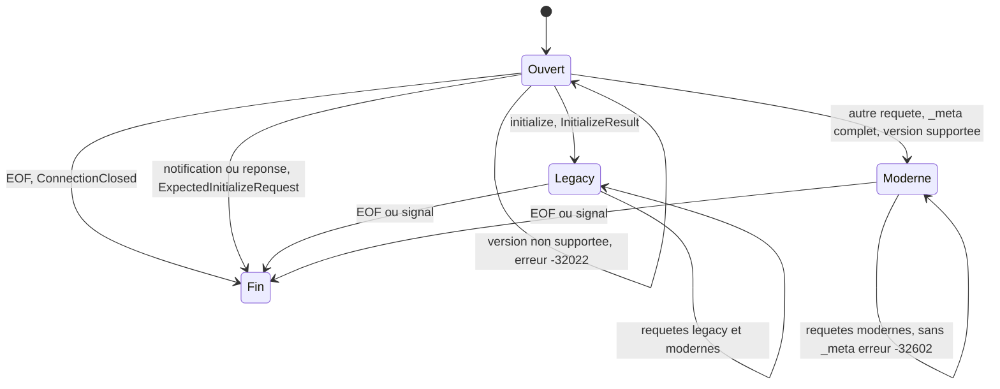
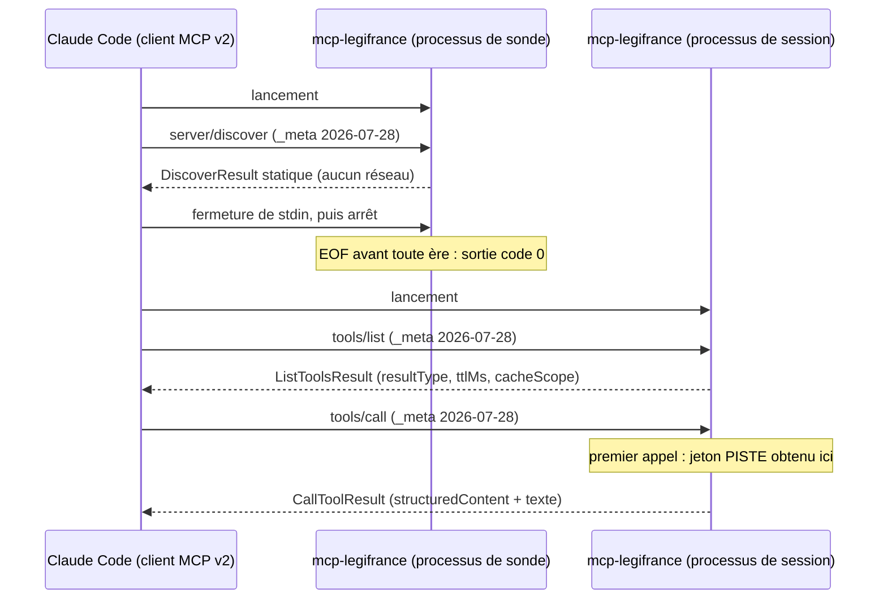

# Annexe D — MCP 2026-07-28 (« MCP v2 ») : protocole, serveur dual-era et conformité

> **Statut** : annexe de référence du plan, rédigée le 2026-10-15 (révision 2 du même jour), contrôle final le 2026-10-16 (étiquettes fusionnées, C-34, politique des versions). Elle détaille [00-decisions.md](../00-decisions.md) §6, qui reste **normatif**. Le contrat des outils (schémas, descriptions, messages, budgets) est dans [05-outils-mcp.md](../05-outils-mcp.md) ; cette annexe fixe ce que 05 et [02-architecture.md](../02-architecture.md) §3.6 lui délèguent : routage des deux ères, formes de résultat par ère, codes d'erreur, transports stdio et Streamable HTTP, `subscriptions/listen`, autorisation (M8), check-list de conformité et pièges de `rmcp` 3.5.1. En cas d'écart, 00 prévaut ; les écarts sont listés au §12.
> **Jalons** : M0 (spike rmcp), M4 (stdio dual-era, `server/discover`, tests JSON-RPC bruts), M7 (resources, prompts, completions : cache, `-32002`/`-32602` selon l'ère), M8 (Streamable HTTP, profils local et distant). Voir [07-feuille-de-route.md](../07-feuille-de-route.md).
> **Lecteurs** : développeurs de `lf-adapter-mcp` et de `lf-app`, auteurs des tests protocolaires ([06-qualite.md](../06-qualite.md)), relecteurs sécurité du mode HTTP.
> **Conventions** : « moderne » = révision 2026-07-28 (requêtes à `_meta` par requête) ; « legacy » = 2025-11-25 et 2025-06-18 (poignée de main `initialize`). Un fait lu directement dans le code ou la spécification pour cette annexe porte la mention « lu pour cette annexe » et un chemin:ligne. **NON VÉRIFIÉ** suivi d'une étiquette `[v:…]` signale un point à confirmer (registre `V-xx` dans [09-risques-et-questions.md](../09-risques-et-questions.md), liste au §11). Les extraits Rust sont **non compilés, à valider en M0**.

Documents liés : [00-decisions.md](../00-decisions.md) §1, §5, §6, §10, §11, §13 (normatif) ; [02-architecture.md](../02-architecture.md) §3.6, §8.1-§8.8 ; [05-outils-mcp.md](../05-outils-mcp.md) §1.2, §2, §3, §7.5, §10, §11 ; [06-qualite.md](../06-qualite.md) ; [08-distribution.md](../08-distribution.md) ; [09-risques-et-questions.md](../09-risques-et-questions.md) ; [A-parite.md](A-parite.md) (versions servies par la référence) ; ADR-0003 (MCP 2026-07-28 dual-era avec rmcp), ADR-0005 (aucune configuration distante ni télémétrie), ADR-0006 (sortie compacte via `structuredContent`), ADR-0010 (erreurs métier in-band) — index : [../../adr/README.md](../../adr/README.md). Rapports bruts : [recherche 08](../../recherche/08-mcp-2026-07-28.md), [recherche 06](../../recherche/06-mcp-spec.md), [recherche 09](../../recherche/09-rmcp-2026.md), [recherche 04](../../recherche/04-rmcp-rust.md).

## Sommaire

- [0. Résumé](#0-résumé)
- [1. Ce qu'est « MCP v2 »](#1-ce-quest--mcp-v2-)
- [2. Changements normatifs qui touchent notre serveur](#2-changements-normatifs-qui-touchent-notre-serveur)
- [3. Cycle de vie sans session](#3-cycle-de-vie-sans-session)
- [4. Routage dual-era sur stdio](#4-routage-dual-era-sur-stdio)
- [5. Transports](#5-transports)
- [6. Autorisation (M8)](#6-autorisation-m8)
- [7. Dépréciations et suppressions](#7-dépréciations-et-suppressions)
- [8. Check-list de conformité](#8-check-list-de-conformité)
- [9. Bugs et pièges de rmcp 3.5.1](#9-bugs-et-pièges-de-rmcp-351)
- [10. Support côté clients](#10-support-côté-clients)
- [11. Points NON VÉRIFIÉS](#11-points-non-vérifiés)
- [12. Écarts entre sources et décisions, questions ouvertes](#12-écarts-entre-sources-et-décisions-questions-ouvertes)
- [Sources](#sources)

### Alias des sources lues pour cette annexe

| Alias | Dépôt (lu en lecture seule, rien exécuté) | Révision |
|---|---|---|
| `RS` | `modelcontextprotocol/rust-sdk`, tag `rmcp-v3.5.1` | `79437f2` (2026-10-05) |
| `RSH` | `modelcontextprotocol/rust-sdk`, `main` | `5d9935d` (2026-10-15) |
| `SPEC` | `modelcontextprotocol/modelcontextprotocol`, `main`, répertoire `docs/specification/2026-07-28/` | `86f6e0c` (2026-10-14) |
| `SCHEMA` | même dépôt, `schema/2026-07-28/schema.ts` | `86f6e0c` |
| `CC` | `anthropics/claude-code`, `CHANGELOG.md` | `94506ff` (2026-10-14) |
| `VS` | `microsoft/vscode`, `src/vs/{platform,workbench/contrib}/mcp` | `3f98d21` (2026-10-15) |
| `TS` | `modelcontextprotocol/typescript-sdk`, `docs/` | `9bc40e9` (2026-10-13) |
| `CF` | `modelcontextprotocol/conformance` (paquet `0.2.0-alpha.12`) | `c37eec8` (2026-10-01) |

Ce sont les clones des recherches 06, 08 et 09 ; les chemins:lignes `RS` cités sans renvoi à un rapport ont été lus pour cette annexe.

---

## 0. Résumé

- **« MCP v2 » = la révision datée `2026-07-28`**, la plus récente au 2026-10-15 : aucun tag ni RC postérieur (revérifié par `git ls-remote --tags` le 2026-10-15). La spécification ne parle pas de « v2 » mais d'ères **modern** (2026-07-28) et **legacy** (2025-11-25 et avant) (§1).
- **Le protocole devient sans état** : plus d'`initialize` en ère moderne ; chaque requête porte `_meta["io.modelcontextprotocol/protocolVersion"]` et `_meta["io.modelcontextprotocol/clientCapabilities"]` ; `server/discover` est **obligatoire côté serveur** ; tout résultat porte `resultType` ; six résultats « cachables » portent `ttlMs` et `cacheScope` ; le serveur n'émet plus aucune requête vers le client ; nouveaux codes `-32020`, `-32021`, `-32022` ; « ressource introuvable » passe à `-32602` en moderne (rmcp garde `-32002` pour les pairs legacy, 00 §6) (§2, §3).
- **Notre serveur est dual-era** (00 §6, ADR-0003) : `rmcp` `=3.5.1` sert l'ère moderne et répond aussi à `initialize` pour 2025-11-25 et 2025-06-18. Versions déclarées explicitement : `[2026-07-28, 2025-11-25, 2025-06-18]` ; 2025-03-26 n'est pas servie (Q7) (§4.4).
- **Lecture du code de rmcp 3.5.1** (§4.2, §9.2) : une requête prématurée ou inconnue reçoit une réponse et ne fait jamais quitter le service. En revanche, **une notification reçue avant l'ouverture d'une ère arrête le service** (`ExpectedInitializeRequest`). Parade à notre charge : une enveloppe de transport qui écarte ces messages (§4.3). Un EOF avant toute ère (processus de sonde) est une fin normale, code 0.
- **À notre charge en M4** : versions explicites, `discover` et `list_tools` écrits à la main avec `ttlMs = 3 600 000` et `cacheScope = public` seulement pour les pairs modernes (Q8), accusé minimal de `subscriptions/listen`, filtre pré-cycle, racines objet (bug #1337), aucune `x-mcp-header` (bug #1348), journaux sur stderr ; en M7, `list_prompts` écrit à la main (pas de `#[prompt_handler]`, §3.4). **En M8** : validation d'`Origin` (désactivée par défaut dans rmcp), mode sans session, rejet par une couche axum des requêtes sans `MCP-Protocol-Version` ou qui nomment une version connue non servie, limiteur des invocations d'outils dans la même couche (C-34), authentification (jeton statique local, puis resource server OAuth) (§5, §6).
- **Clients** : Claude Code ≥ 2.1.292 négocie 2026-07-28 par défaut en stdio, après une sonde `server/discover` que le SDK TypeScript lance dans un processus frère éphémère ; VS Code (`main` du 2026-10-15) n'envoie que `initialize` 2025-11-25 ; Claude Desktop et Cursor sont **NON VÉRIFIÉS** (§10).
- **Conformité** : 34 exigences stdio (C-01 à C-34) testées par des transcriptions JSON-RPC brutes et des tests nommés par 06 §6.1, 21 exigences HTTP (C-40 à C-60) couvertes en plus par la suite officielle `@modelcontextprotocol/conformance` (§8).

---

## 1. Ce qu'est « MCP v2 »

### 1.1 La révision 2026-07-28 est la dernière au 2026-10-15

| Vérification | Résultat | Preuve |
|---|---|---|
| Tags du dépôt de la spécification | `2024-10-07`, `2024-11-05`, `2024-11-05-final`, `2025-03-26`, `2025-06-18`, `2025-11-25-RC`, `2025-11-25`, `2026-07-28-RC`, `2026-07-28` ; rien après | `git ls-remote --tags https://github.com/modelcontextprotocol/modelcontextprotocol`, exécuté le 2026-10-15 pour cette annexe (et par la recherche 08 §2) |
| Statut « Current » | « The **current** protocol version is **2026-07-28**. » | `docs/docs/2026-07-28/learn/versioning.mdx:27` (recherche 08 §2) |
| Marquage « latest » du site | `"version": "Version 2026-07-28 (latest)"` | `docs/docs.json:33`, `:411` (recherche 08 §2) |
| Constante du schéma | `LATEST_PROTOCOL_VERSION = "2026-07-28"` (identique dans `schema/draft`) | `SCHEMA:30` (recherche 08 §2, recherche 09 §1) |
| Révision `draft` | identique à 2026-07-28 aux liens près ; changelog vide (« Changes since the most recent release will accumulate here. ») | `docs/specification/draft/changelog.mdx` (recherche 08 §2) |
| Errata après la GA | huit fichiers, aucun changement normatif (liens, une coquille, reformulation de la clôture de `subscriptions/listen`) | `git diff 2026-07-28 HEAD` (recherche 08 §2) |
| Prochaine révision | feuille de route du 2026-08-22 : « next specification release », sans date | `blog/content/posts/2026-08-22-mcp-roadmap.md:19` (recherche 08 §2) |
| SDK Rust | tag le plus récent `rmcp-v3.5.1` ; Tier 1 depuis le 2026-08-21 | `git ls-remote --tags https://github.com/modelcontextprotocol/rust-sdk` (2026-10-15) ; recherche 09 §0-§2 |

### 1.2 Ères, terminologie et origine du mot « v2 »

- **Ère moderne** : 2026-07-28 et les révisions suivantes. Pas de poignée de main : « Every request carries its protocol version, and the server accepts or rejects each request independently » (`SPEC/basic/versioning.mdx:12-13`, recherche 08 §4.1).
- **Ère legacy** : 2025-11-25 et antérieures, avec `initialize` / `notifications/initialized` et, en HTTP, des sessions `Mcp-Session-Id` (`SPEC/basic/versioning.mdx:29-39`, recherche 08 §1).
- **« v2 » n'est pas un terme de la spécification** (aucune occurrence dans `docs/specification/2026-07-28` ni dans le billet de GA ; recherche 09 §1). Il vient des SDK (TypeScript v2, Python `mcp` v2, C# 2.0, rmcp 3.x), du « v2 MCP client » de Claude Code (opt-out `MCP_SDK_GENERATION=v1`, `CC CHANGELOG.md:2178`, version 2.1.274) et de l'URL d'un billet Cloudflare non lu (recherche 08 §1, §12.2).
- **Dans ce plan**, l'exigence utilisateur « MCP v2 » (00 §6) se lit ainsi : servir la révision 2026-07-28 en ère moderne, **sans abandonner** l'ère legacy dont dépendent encore des clients majeurs (§10).

### 1.3 Stabilité de la cible

- Politique de cycle de vie : Active, puis Deprecated, puis Removed, avec au moins 12 mois de dépréciation (`docs/docs/2026-07-28/learn/versioning.mdx:29-43`, SEP-2596 ; recherche 08 §11). Rien de ce que nous utilisons n'est déprécié (§7).
- « nothing breaks on July 28 » : la date marque la publication du texte, pas une rupture côté clients (`blog/content/posts/2026-06-29-sdk-betas-for-2026-07-28.md:42-47`, recherche 08 §15.3).
- Conséquence pour le plan : toute nouvelle révision fera l'objet d'une mise à jour d'ADR-0003 et d'une montée de rmcp **manuelle** (§9.4).

---

## 2. Changements normatifs qui touchent notre serveur

Source principale : `SPEC/changelog.mdx` (recherche 08 §3). « Prise en charge » : **rmcp** = comportement du SDK 3.5.1, à couvrir par un test de non-régression ; **nous** = code de `lf-adapter-mcp` ou de `lf-app` ; **config** = paramétrage de rmcp.

| # | Changement (SEP) | Niveau pour le serveur | Impact pour `mcp-legifrance` | Prise en charge | Jalon |
|---|---|---|---|---|---|
| 1 | Suppression d'`initialize`/`initialized` en ère moderne ; `_meta` par requête (SEP-2575) | MUST rejeter une requête sans clé requise (`-32602`, HTTP 400) ; MUST `-32022` si la version n'est pas supportée | validation de l'enveloppe avant tout code métier | **rmcp** : pré-cycle `RS service/server.rs:597-668`, requêtes suivantes `RS handler/server.rs:63-99` ; **nous** : liste de versions explicite (§4.4) | M4 |
| 2 | Plus de sessions ni de `Mcp-Session-Id` (SEP-2567) ; listes invariantes par connexion | MUST NOT faire varier les listes par connexion ; état = handles explicites | listes statiques par binaire, aucun handle (05 §1.4) | **rmcp** (stdio, HTTP moderne) ; **config** `with_legacy_session_mode(false)` en HTTP | M4, M8 |
| 3 | `server/discover` | MUST l'implémenter (l'appel est facultatif pour le client) | réponse statique, servie sans réseau | **nous** : surcharge de `discover` (défaut rmcp : `ttlMs: 0`, `private`) | M4 |
| 4 | `resultType` dans chaque résultat | MUST | toujours `"complete"` | **rmcp** (constructeurs `Some(COMPLETE)`, retrait pour les pairs legacy, `RS model.rs:4788-4801`) | M4 |
| 5 | `ttlMs` + `cacheScope` sur `server/discover`, `tools/list`, `prompts/list`, `resources/list`, `resources/templates/list`, `resources/read` (SEP-2549) | MUST, `ttlMs ≥ 0` | Q8 : 3 600 000 ms, `public` | **rmcp** remplit `0`/`private` si absent ; **nous** posons les valeurs, seulement pour les pairs modernes (§3.4) | M4, M7 |
| 6 | Plus aucune requête serveur → client ; élicitation, sampling et roots via MRTR (SEP-2322) | MUST NOT écrire de requête JSON-RPC sur stdout | nous n'en émettons aucune, dans aucune ère | **nous** : aucun appel aux méthodes `Peer` qui émettent une requête ; feature `request-state` non activée | M4 |
| 7 | Retrait de `ping`, `logging/setLevel`, `notifications/roots/list_changed` ; Logging déprécié | MUST NOT émettre `notifications/message` sans `logLevel` ; méthodes retirées → `-32601` | capacité `logging` jamais déclarée ; journaux sur stderr (00 §6) | **rmcp** (`ping` → `-32601` en moderne, `set_level` → `-32601`) ; **nous** (pas de `enable_logging()`) | M4 |
| 8 | `subscriptions/listen` remplace `resources/subscribe` et le GET HTTP | MUST envoyer l'accusé en premier ; MUST NOT notifier un type non demandé | accusé minimal, aucune notification (§5.3) | **nous** : `accepted_subscription_filter` ; **rmcp** : accusé et `subscriptionId` | M4 |
| 9 | Tasks sortent du cœur (extension `io.modelcontextprotocol/tasks`, SEP-2663) ; `Tool.execution` disparaît | — | rien à faire | **rmcp** (pas d'`execution` sans tâches) ; **nous** (aucune extension déclarée) | M4 |
| 10 | « Resource not found » : `-32002` devient `-32602` | MUST `-32602` en moderne ; MUST NOT `contents: []` | resources en M7 | **nous** : `ErrorData::resource_not_found` + `data.uri` ; **rmcp** émet `-32002` aux pairs legacy (spécification 2025-11-25) et le réécrit en `-32602` pour les pairs 2026-07-28 (`RS handler/server.rs:264-270`) ; identifiant invalide ou URI hors grammaire → `-32602` dans les deux ères (00 §6) | M7 |
| 11 | `tools/list` dans un ordre déterministe | SHOULD | stabilité des caches et du verrou | **rmcp** (`ToolRouter::list_all` trie par nom, recherche 09 §3.5) | M4 |
| 12 | Schémas JSON 2020-12 libres, `structuredContent` de toute valeur JSON, `$ref` réseau interdit (SEP-2106) | MUST NOT déréférencer un `$ref` réseau | une seule définition valable pour les deux ères : racine objet (05 §2.5) | **nous** (bug #1337, §9.1) | M4 |
| 13 | En-têtes `Mcp-Method`, `Mcp-Name`, `x-mcp-header` → `Mcp-Param-*` (SEP-2243) ; `-32020` | MUST valider la cohérence en-têtes/corps (HTTP) | HTTP seulement | **rmcp** (validation automatique pour 2026-07-28) ; **nous** : aucune `x-mcp-header` (#1348) | M8 |
| 14 | Plus de GET HTTP ni de reprise SSE (`Last-Event-ID`) | GET/DELETE → 405 (SHOULD) | HTTP sans event store | **rmcp** + **config** | M8 |
| 15 | Politique des codes d'erreur : `-32020..-32099` réservés | MUST NOT émettre un code réservé non défini ; SHOULD NOT `-32000..-32019` | aucun code JSON-RPC maison : erreurs métier in-band `[code]` (ADR-0010) | **nous** | M4 |
| 16 | Champ `extensions` dans les capacités (SEP-1724, SEP-2133) | — | aucune extension en v0.x | **nous** (ne rien déclarer) | — |
| 17 | Clés OpenTelemetry `traceparent`, `tracestate`, `baggage` dans `_meta` (SEP-414) | formats W3C si présentes | ignorées en v0.x (pas d'export OpenTelemetry, ADR-0005) | **rmcp** (clés inconnues tolérées) | — |
| 18 | Autorisation : `offline_access` à exclure, `insufficient_scope` avec tous les scopes, DCR déprécié au profit de CIMD | SHOULD NOT / SHOULD | profil distant seulement | **nous** (§6.3) | M8 |

Rappels des révisions précédentes, utiles pour l'ère legacy (recherche 08 §3.4) :

- **2025-06-18** : retrait du batching JSON-RPC ; apparition de `structuredContent`, d'`outputSchema` et de `title` ; en-tête `MCP-Protocol-Version` obligatoire en HTTP après l'initialisation.
- **2025-11-25** : les erreurs de validation d'entrée sont des erreurs d'exécution de l'outil (`isError`), et non des erreurs de protocole (SEP-1303) ; JSON Schema 2020-12 par défaut ; `Implementation.description` et `websiteUrl`, icônes.

---

## 3. Cycle de vie sans session

### 3.1 `_meta` par requête

Clés reconnues dans `params._meta` d'une requête moderne (`SPEC/basic/index.mdx:373-378`, `SCHEMA:63-111`, recherche 08 §4.1) :

| Clé | Type | Requise | Ce que fait le serveur |
|---|---|---|---|
| `io.modelcontextprotocol/protocolVersion` | chaîne | **oui** | valide la version contre `supported_protocol_versions()` ; sinon `-32022` |
| `io.modelcontextprotocol/clientCapabilities` | objet `ClientCapabilities` (`{}` = aucune capacité optionnelle) | **oui** | lue pour la requête seulement ; nous n'exigeons aucune capacité client, donc jamais de `-32021` |
| `io.modelcontextprotocol/clientInfo` | `Implementation` | non (le client SHOULD) | affichage et journaux seulement, jamais pour une décision ; le serveur **ne doit pas** l'exiger (`CF src/scenarios/server/stateless.ts:37-39`) |
| `io.modelcontextprotocol/logLevel` | `LoggingLevel` | non, déprécié | ignorée : capacité `logging` non déclarée |
| `progressToken` | chaîne ou entier | non | active `notifications/progress` pour cette requête (M7, `fr_search_all`, optionnel ; 05 §2.4) |
| `traceparent`, `tracestate`, `baggage` | chaînes W3C | non | ignorées en v0.x |
| autre clé | — | — | ignorée |

Règles serveur :

- Une requête sans clé requise, ou avec une clé mal typée, est « malformed; the server **MUST** reject it with JSON-RPC error code `-32602` » (HTTP 400) (`SPEC/basic/index.mdx:380-382`). rmcp le fait : `RequestMetaObject::DRAFT_REQUIRED_KEYS` = `protocolVersion` et `clientCapabilities` (`RS model/meta.rs:400-403`), message « request _meta is missing or has malformed required fields: … » (`RS service/server.rs:528-536`).
- Le serveur MUST NOT déduire le contexte (version, capacités, identité) des requêtes précédentes ; un processus stdio n'est pas une session (`SPEC/basic/index.mdx:191-209`, recherche 08 §4.2).
- Exemple de requête moderne minimale valide :

```json
{"jsonrpc":"2.0","id":3,"method":"tools/call",
 "params":{"name":"fr_coverage","arguments":{},
  "_meta":{"io.modelcontextprotocol/protocolVersion":"2026-07-28",
           "io.modelcontextprotocol/clientCapabilities":{}}}}
```

Les exemples de `tools/call` des billets GA et RC, dont le `_meta` ne contient que `clientInfo`, ne sont **pas** conformes et doivent être rejetés en `-32602` (recherche 08 §13 point 4).

### 3.2 `server/discover` : forme exacte

Requête (`SPEC/server/discover.mdx:13-31`) : `params` ne contient que `_meta`, avec les clés requises du §3.1.

Champs du résultat (`SCHEMA:678-697`, `SPEC/server/discover.mdx:94-101`) : `resultType` (requis), `supportedVersions` (requis), `capabilities` (requis), `instructions` (facultatif), `ttlMs` et `cacheScope` (**requis**, car `DiscoverResult extends CacheableResult`), `_meta["io.modelcontextprotocol/serverInfo"]` (SHOULD). Depuis la PR #3002, `serverInfo` est dans `_meta` et non dans le corps : les exemples antérieurs qui montrent `result.serverInfo` sont périmés (recherche 08 §4.3).

Réponse attendue de `mcp-legifrance` en v0.1.0 (les sauts de ligne sont ajoutés pour la lecture ; sur le fil, une seule ligne) :

```json
{"jsonrpc":"2.0","id":"discover-1","result":{
  "resultType":"complete",
  "supportedVersions":["2026-07-28","2025-11-25","2025-06-18"],
  "capabilities":{"tools":{}},
  "instructions":"<texte de 05 §4, au plus 3 500 caractères>",
  "ttlMs":3600000,
  "cacheScope":"public",
  "_meta":{"io.modelcontextprotocol/serverInfo":{
     "name":"mcp-legifrance","title":"Légifrance (PISTE)","version":"0.1.0",
     "websiteUrl":"https://github.com/muchiny/mcp-legifrance"}}}}
```

- `capabilities` suit 05 §2.2 : `{"tools":{}}` en v0.1 et v0.2 ; `{"tools":{},"resources":{},"prompts":{},"completions":{}}` à partir de v0.3. Jamais `logging`, `listChanged`, `subscribe`, `extensions` ni `experimental`.
- `name` et `version` viennent de `ServerIdentity` (02 §3.6) ; `websiteUrl` dépend de Q1 : il garde le nom actuel du dépôt, y compris quand M0 démarre sans réponse de l'utilisateur, jusqu'au renommage éventuel, fait ensuite (redirection GitHub vérifiée) et répercuté en bloc dans les URL du plan (00 §0, §13).
- `supportedVersions` = les trois versions servies, `SUPPORTED` (00 §6, AM-11). Repli décidé par 00 §6 si la transcription `modern_envelope_legacy_version` confirme en M4 le comportement lu dans le code (V-34, §4.4) : `["2026-07-28"]` seul dans `discover`, sans toucher `supported_protocol_versions()`.
- La réponse est **identique dans tous les états** du processus (avant toute ère, après `initialize`, en ère moderne) : rmcp sert `server/discover` avant toute ère comme une sonde « bootstrap » (`RS service/server.rs:625-646`) et le route normalement ensuite (`RS handler/server.rs:108-111`).
- Avant toute ère, rmcp passe au handler un pair « muet » qui ne peut pas joindre le client (`RS service/server.rs:625-634`) : `discover` ne doit **jamais** utiliser `ctx.peer`.

Mise en œuvre (la signature réelle de `from_server_info` prend deux arguments, `RS model.rs:1374-1392`, lu pour cette annexe) :

```rust
// crates/lf-adapter-mcp/src/server.rs — non compilé, à valider en M0
const CACHE_TTL_MS: u64 = 3_600_000;                               // Q8
static SUPPORTED: [ProtocolVersion; 3] = [                          // 00 §6, jamais KNOWN_VERSIONS
    ProtocolVersion::V_2026_07_28, ProtocolVersion::V_2025_11_25, ProtocolVersion::V_2025_06_18,
];

// dans impl ServerHandler for LegifranceServer<C, A, K>
async fn discover(&self, _ctx: RequestContext<RoleServer>) -> Result<DiscoverResult, McpError> {
    // Données statiques ; aucun réseau ; ne jamais utiliser _ctx.peer (pair muet avant toute ère).
    Ok(DiscoverResult::from_server_info(SUPPORTED.to_vec(), self.get_info()) // (versions, config)
        .with_ttl_ms(CACHE_TTL_MS)                                          // défaut rmcp : 0
        .with_cache_scope(CacheScope::Public))                              // défaut rmcp : Private
}

fn server_config(id: &ServerIdentity) -> ServerConfig {
    ServerConfig::new(ServerCapabilities::builder().enable_tools().build()) // M7 : + resources, prompts, completions
        .with_protocol_version(ProtocolVersion::V_2025_11_25) // repli explicite d'initialize (§4.4), indépendant de LATEST
        .with_server_info(Implementation::new(id.name, id.version)
            .with_title("Légifrance (PISTE)")
            .with_website_url("https://github.com/muchiny/mcp-legifrance"))
        .with_instructions(text::INSTRUCTIONS)
}
```

`with_protocol_version` existe sur `InitializeResult`/`ServerConfig` (`RS model.rs:1156`). Sans lui, `ServerConfig::new` prend `ProtocolVersion::default()`, c'est-à-dire `LATEST` (`RS model.rs:1133-1135`, `:156-160`), constante qui a changé dans une mineure (3.5.0, recherche 09 §3.2).

### 3.3 `resultType`

- Valeurs : `"complete"`, `"input_required"` (MRTR), `"task"` (extension Tasks). **Nous ne renvoyons que `"complete"`** : ni MRTR, ni extension (00 §6).
- Le client traite un `resultType` absent comme `"complete"` (commentaire de `RS model.rs:3973-3982`, qui cite le schéma).
- rmcp pose `Some(ResultType::COMPLETE)` dans ses constructeurs et retire le champ pour les pairs legacy (`strip_result_type_for_legacy_peer`, `RS model.rs:4788-4801`, appelée par `RS handler/server.rs:252-259`). `DiscoverResult` porte toujours `resultType`, ce qui est correct : il n'est servi qu'en moderne.
- Un `input_required` vers un pair < 2026-07-28 est converti en erreur par rmcp (`RS handler/server.rs:246-251`) ; sans objet pour nous.

### 3.4 `ttlMs` et `cacheScope`

| Méthode | `ttlMs` (moderne) | `cacheScope` | Legacy | Jalon | Justification |
|---|---|---|---|---|---|
| `server/discover` | 3 600 000 | `public` | sans objet | M4 | contenu statique par binaire ; `DiscoverResult extends CacheableResult` (`SCHEMA:678`, recherche 08 §13 point 1) |
| `tools/list` | 3 600 000 | `public` | champs absents | M4 | Q8 ; identique pour tous les utilisateurs |
| `prompts/list`, `resources/list`, `resources/templates/list` | 3 600 000 | `public` | champs absents | M7 | Q8 |
| `resources/read` | 3 600 000 | `public` | champs absents | M7 | Q8 ; données publiques identiques pour tous ; Légifrance est mis à jour chaque jour (recherche 08 §17 question 4) |
| `tools/call`, `prompts/get`, `completion/complete` | — | — | — | — | non cachables (`SCHEMA:1634-1640`) |

Règles de la spécification (`SPEC/server/utilities/caching.mdx`, recherche 08 §7.1) : `ttlMs` entier ≥ 0 (MUST) ; `0` = périmé immédiatement ; `public` = aucune donnée propre à un utilisateur ; même `cacheScope` sur toutes les pages d'une liste (MUST) ; ne jamais s'en remettre à `cacheScope` pour le contrôle d'accès (MUST) ; un résultat `input_required` n'est pas cachable.

Mécanique rmcp 3.5.1 (lue pour cette annexe) :

- Pour un pair ≥ 2026-07-28, `fill_missing_cache_hints` complète tout indice absent par `ttlMs: 0` et `cacheScope: "private"`, la valeur la plus prudente (`RS model.rs:4830-4854`).
- `#[tool_handler]` génère un `list_tools` avec `ttl_ms: 0` et `cache_scope: Public` pour les pairs modernes, **sauf si `list_tools` est écrit à la main** (`RS rmcp-macros/src/tool_handler.rs:58-82`). Nous l'écrivons à la main (05 §3.2).
- Pour un pair legacy, rmcp ne retire **que** `resultType` (`RS model.rs:4788-4801`) : un `ttlMs` posé par le handler partirait tel quel. D'où la règle : **poser les indices seulement si `ctx.protocol_version() >= 2026-07-28`**. Cela tranche, par lecture du code, le point [V-33 · rmcp-ttl-legacy] de 02 et 05 (V-33) ; les transcriptions `modern_tools_list` et `legacy_2025_11_25` (06 §6.1) le confirment.
- `#[prompt_handler]` (M7), à l'inverse de `#[tool_handler]`, **remplace** un `list_prompts` ou un `get_prompt` écrit à la main, pose `ttl_ms: 0` et `cache_scope: Public` pour les pairs modernes (que `fill_missing_cache_hints` ne corrige pas, puisqu'il ne touche qu'aux indices absents) et prend par défaut le routeur `Self::prompt_router()`, reconstruit à chaque appel (`RS rmcp-macros/src/prompt_handler.rs:28-30`, `:56-75`, `:78-104`, lu pour cette annexe). Nous ne l'utilisons pas : `get_prompt` (`PromptContext::new(self, request.name, request.arguments, ctx)`) et `list_prompts` (`self.prompt_router.list_all()`, indices de Q8 en moderne) sont écrits à la main sur le champ `prompt_router` (02 §3.6 ; constat 18 du §9.2).
- `ListToolsResult` est produit par la macro `paginated_result!` (`RS model.rs:4231-4235`) qui fournit `with_all_items`, `with_ttl_ms` et `with_cache_scope` (`RS model.rs:1782-1806`) ; de même, `DiscoverResult::with_ttl_ms`/`with_cache_scope` existent (`RS model.rs:1399-1409`). Ces deux lectures tranchent les volets « API » de [V-33 · rmcp-ttl-legacy] (V-33, qui regroupe les étiquettes fusionnées de 09 §2.1).

En M8 profil distant, les listes ne dépendent pas des scopes : `public` reste exact. Si un jour une liste en dépendait, elle passerait en `private` (`caching.mdx:105-108`, recherche 08 §10 point 9).

### 3.5 Codes d'erreur

| Code | Nom | Quand | Ère | HTTP | Émis par | Notre usage |
|---|---|---|---|---|---|---|
| `-32700` | Parse error | JSON illisible | les deux | non vérifié | — | **stdio : jamais émis** ; rmcp ignore une ligne non JSON pour éviter les tempêtes d'erreurs (`RS transport/async_rw.rs:166-172`, issue #938). Écart JSON-RPC accepté (§4.7) |
| `-32600` | Invalid Request | JSON valide mais pas un message JSON-RPC (dont un tableau, batch supprimé depuis 2025-06-18) | les deux | 400 | rmcp, sans `id` (`RS transport/async_rw.rs:174-189`) | accepté |
| `-32601` | Method not found | méthode inconnue ; en moderne : `ping`, `logging/setLevel`, `resources/subscribe`, `resources/unsubscribe` (`CF stateless.ts:815-849`) ; `set_level`, `read_resource`, `get_prompt` non implémentés (défauts rmcp) ; bug #1347 | les deux | 404 | rmcp | jamais émis directement par nous |
| `-32602` | Invalid params | `_meta` incomplet ; outil inconnu (« tool not found ») ; ressource inconnue ou introuvable, pair 2026-07-28 (M7, avec `data.uri`) ; identifiant invalide dans une URI de gabarit ou URI hors grammaire (M7, les deux ères) ; prompt inconnu ou argument requis manquant (M7) ; curseur invalide | les deux | 400 | rmcp et nous (M7) | ressource introuvable : `ErrorData::resource_not_found(…, Some(json!({"uri": uri})))`, dont rmcp fait `-32602` pour un pair moderne (`RS handler/server.rs:264-270`) ; URI ou identifiant invalide : `ErrorData::invalid_params(…, Some(json!({"uri": uri})))` (00 §6) |
| `-32603` | Internal error | panique interceptée, erreur interne imprévue | les deux | 500 (non vérifié) | rmcp et nous | message générique, sans secret (05 §7.1) |
| `-32020` | HeaderMismatch | en-tête standard absent, mal formé ou incohérent avec le corps | moderne, HTTP | 400 | rmcp | M8 |
| `-32021` | MissingRequiredClientCapability (`data.requiredCapabilities` = objet `ClientCapabilities`) | capacité client requise absente | moderne | 400 | rmcp (seulement pour l'extension Tasks) | **jamais** : nous n'exigeons aucune capacité client |
| `-32022` | UnsupportedProtocolVersion (`data.supported`, `data.requested`) | version de `_meta` (ou de l'en-tête) non supportée | moderne | 400 | rmcp (`RS model.rs:678-690`) | — |
| `-32002` | Resource not found (legacy) | ressource inconnue ou introuvable, pair legacy (M7, avec `data.uri`) | legacy seulement (spécification 2025-11-25) ; interdit en moderne | — | rmcp (`ErrorData::resource_not_found`, `RS model.rs:627`, `:671-673`) | M7, aux pairs legacy seulement ; **jamais** en moderne (00 §6, AM-09) |
| `-32042` | (ancien) URL elicitation required | — | — | — | — | jamais |

Exemple de `-32022` produit par notre serveur pour une version inconnue :

```json
{"jsonrpc":"2.0","id":7,"error":{"code":-32022,"message":"Unsupported protocol version",
 "data":{"requested":"2027-01-01","supported":["2026-07-28","2025-11-25","2025-06-18"]}}}
```

Règles transverses : aucune erreur métier n'est une erreur JSON-RPC (in-band `isError` + `[code]`, ADR-0010, 05 §7) ; toute réponse d'erreur reprend l'`id` de la requête (`CF stateless.ts:299-301`), sauf les erreurs sur un message dont l'`id` est illisible ; aucun code maison dans `-32768..-32000` (`SPEC/basic/index.mdx:109-155`).

### 3.6 Identité du serveur et instructions

- **`serverInfo`** : en moderne, `_meta["io.modelcontextprotocol/serverInfo"]` SHOULD figurer dans **chaque** résultat (`SPEC/basic/index.mdx:396-402`). rmcp ne la pose que sur `DiscoverResult` et sur la clôture de `subscriptions/listen` (`RS model.rs:1374-1392` ; `RS handler/server.rs:178-181`). La suite de conformité ne la vérifie que sur `server/discover` (`CF stateless.ts:480-523`). Décision (00 §6) : posée si rmcp le permet, sinon écart accepté et documenté (C-30). Moyen identifié par lecture du code : la poser sur les résultats que nous construisons (listes écrites à la main ; M7 : `resources/read`, `prompts/get`) et sur `tools/call` par un `call_tool` écrit à la main, que `#[tool_handler]` ne génère alors pas (`RS rmcp-macros/src/tool_handler.rs:44-56`) : il appelle `self.tool_router.call(ToolCallContext::new(self, req, ctx))` puis, sur `CallToolResponse::Complete` (`RS model/mrtr.rs:105-113`) et en ère moderne, insère `io.modelcontextprotocol/serverInfo` dans `CallToolResult.meta`, champ public (`RS model.rs:3996-3998`). La confirmation à l'exécution (transcriptions `modern_tools_call` et `results_carry_server_info`) est **NON VÉRIFIÉE** [V-32 · rmcp-meta-serverinfo-resultats] (V-32, statut `partiel` dans 09).
- `serverInfo` est auto-déclaré : ni le client ni nous ne fondons de décision dessus (`SPEC/basic/index.mdx:404-410`).
- Champs d'`Implementation` selon l'ère : `title` existe depuis 2025-06-18, `websiteUrl` et `description` depuis 2025-11-25. Un pair 2025-06-18 reçoit `websiteUrl` comme champ inconnu, sans effet. Aucune icône n'est publiée (05 §2.4).
- **`instructions`** : en moderne, uniquement dans `DiscoverResult` (`SCHEMA:689-696`) ; en legacy, dans `InitializeResult`. Le texte est **identique** dans les deux ères, en anglais, au plus 3 500 caractères, et porte l'attribution des données (« Source : Légifrance / DILA — Licence Ouverte 2.0 », 00 §6, §12, adoptée par défaut, Q15) ; texte statique, il renvoie à `fr_coverage` (`consulted_on`) pour la date de consultation (00 §12, AM-39) (texte et comptage : 05 §4). Claude Code coupe au-delà de 4 096 caractères (recherche 08 §4.5).

---

## 4. Routage dual-era sur stdio

### 4.1 Ce que dit la spécification

- « A server that wishes to support both legacy clients … and modern clients … **MAY** implement both behaviors. » (`SPEC/basic/versioning.mdx:126-130`, lu pour cette annexe).
- Un serveur dual-era choisit son comportement selon l'ouverture : une requête qui porte le `_meta` moderne est servie sans état ; une requête `initialize` choisit la sémantique legacy, « scoped to the stdio process ». « A dual-era server **MAY** serve both eras concurrently on the same endpoint or process. » (`SPEC/basic/versioning.mdx:174-183`).
- Côté client, sur stdio : sonder par `server/discover` avant toute autre requête ; un `DiscoverResult` ou une erreur moderne reconnue (par exemple `-32022`) indique un serveur moderne ; toute autre erreur ou un silence entraîne le repli sur `initialize`, et ce repli « **MUST NOT** be keyed to one specific error code » (`SPEC/basic/transports/stdio.mdx:121-147`).
- L'ère est une propriété du serveur : le client SHOULD la mettre en cache pour la durée de vie du processus stdio (`SPEC/basic/versioning.mdx:146-150`).
- Matrice : un client legacy face à un serveur dual-era fonctionne ; face à un serveur modern-only, il échoue (« Legacy clients have no fall-forward mechanism ») (`SPEC/basic/versioning.mdx:157-172`).

### 4.2 Ce que fait rmcp 3.5.1 (lu dans le code)

`serve_server_with_ct_inner` lit les messages dans une boucle « pré-cycle » jusqu'à l'ouverture d'une ère (`RS service/server.rs:578-685`), puis délègue à la boucle de service. Ensuite, chaque requête passe par `handle_request` (`RS handler/server.rs:51-271`).



| Message reçu | État « Ouvert » (aucune ère) | État « Legacy » (après `initialize`) | État « Moderne » (après une requête moderne) |
|---|---|---|---|
| Ligne non JSON | ignorée (`async_rw.rs:166-172`) | idem | idem |
| JSON qui n'est pas un message JSON-RPC (tableau…) | `-32600` sans `id` (`async_rw.rs:174-189`) | idem | idem |
| `server/discover`, `_meta` complet | `DiscoverResult`, reste « Ouvert » (`service/server.rs:625-646`) | `DiscoverResult` | `DiscoverResult` |
| `server/discover`, `_meta` incomplet | `-32602` (`service/server.rs:604-623`) | `-32602` (`handler/server.rs:78-99`) | `-32602` |
| `ping` | `{}`, **même avec un `_meta` moderne** (`service/server.rs:581-596`) | `{}` | `-32601` (`handler/server.rs:111-117`) |
| `initialize` à params legacy complets (`protocolVersion`, `capabilities`, `clientInfo`, `model.rs:1070-1080`), avec ou sans `_meta` moderne | poignée de main legacy (`service/server.rs:600`, `:686-713`) → « Legacy » | servi à nouveau (`handler/server.rs:104-107`) | servi (aucune vérification de `_meta`, `handler/server.rs:63`) |
| `initialize` sans params legacy complets (par exemple `_meta` seul, scénario de la suite officielle) | désérialisé en requête inconnue (comme #1347) : ligne « Méthode inconnue » | `-32601` | `-32601` (`-32602` sans `_meta` complet) |
| Autre requête avec `_meta` complet, version supportée | dispatch → « Moderne » (`service/server.rs:667-678`) ; si le `_meta` déclare 2025-11-25 ou 2025-06-18, servie sans `resultType` ni indices (§4.4) | servie en moderne (`resultType`, indices), sauf version legacy dans le `_meta` (§4.4) | servie (idem) |
| Autre requête avec `_meta` complet, version non supportée | `-32022`, reste « Ouvert » (`service/server.rs:648-666`) | `-32022` (`handler/server.rs:63-72`) | `-32022` |
| Autre requête sans `_meta` moderne complet | `-32602`, reste « Ouvert » | servie en legacy | `-32602` (`request_metadata_required`) |
| Méthode inconnue | selon le `_meta` : `-32602` ou `-32601` | `-32601` (`on_custom_request`) | `-32601` |
| `notifications/cancelled` | **arrêt du service** (`ExpectedInitializeRequest`, `service/server.rs:681-685`) | annule la requête visée ; rmcp jette sa réponse, pas ses notifications ultérieures (`service.rs:1497-1507`, `:1537-1556`) | idem |
| `notifications/initialized` | **arrêt du service** | sans effet (`on_initialized`) | sans effet |
| Autre notification, réponse ou erreur du client | **arrêt du service** | ignorée | ignorée |
| EOF sur stdin | `Err(ConnectionClosed)` (`service/server.rs:433-444`) | fin de service (`QuitReason`) | idem |

Conséquences :

1. **Requêtes** : aucune requête, prématurée ou inconnue, ne fait quitter rmcp ; elle reçoit une réponse. La note du SDK TypeScript selon laquelle les serveurs rmcp « exit on any pre-`initialize` request » (`TS docs/protocol-versions.md:108`) ne vaut donc, en 3.5.1, que pour les **notifications et réponses** reçues avant toute ère.
2. **Notifications prématurées** : elles font échouer `serve_with_ct` ; sans parade, `lf-app` sortirait. C'est contraire à 00 §6 (« ne jamais quitter sur un message inattendu ») → filtre du §4.3. Les transcriptions confirment [V-30 · rmcp-methode-inattendue] (V-30 : en processus au spike M0, sur le binaire en M4, §8.4).
3. **Coexistence** : après `initialize`, rmcp accepte encore une requête moderne et la sert en moderne (`uses_legacy_lifecycle`, `RS service.rs:204-209`) ; après une ouverture moderne, une requête sans `_meta` est refusée. C'est la recommandation de la recherche 08 §15.1 point 6.
4. **Après `initialize`**, rmcp n'attend pas `notifications/initialized` (`RS service/server.rs:729-742`) : une requête qui la précède est servie.
5. **Annulation** : rmcp ne supprime que la réponse ou l'erreur de la requête annulée (`RS service.rs:1497-1507`) ; les notifications sortantes partent sans contrôle d'annulation (`RS service.rs:1537-1556`). Un handler qui émet `notifications/progress` (`fr_search_all`, M7) teste donc `ct.is_cancelled()` avant chaque notification (05 §3.5 ; C-23).

### 4.3 Ce que nous ajoutons

1. **Versions explicites** : `supported_protocol_versions()` renvoie `SUPPORTED` (§3.2), et `ServerConfig` porte `protocol_version = 2025-11-25`, repli explicite d'`initialize`.
2. **Filtre pré-cycle** `PreLifecycleFilter` : une enveloppe de `Transport<RoleServer>` qui laisse passer toutes les requêtes et **écarte** (journal `debug`) les notifications, réponses et erreurs du client tant qu'aucune ère n'est ouverte. Elle reproduit la règle d'ouverture de rmcp (`RS service/server.rs:597-668`) pour savoir quand cesser de filtrer. Le trait `Transport` est public (`RS transport.rs:127-170`). `rmcp::transport::stdio()` renvoie le tuple `(Stdin, Stdout)` (`RS transport/io.rs:4-6`), qui n'implémente que `IntoTransport` (`RS transport/async_rw.rs:24-34`) : l'enveloppe entoure donc `AsyncRwTransport::new_server(tokio::io::stdin(), tokio::io::stdout())` (`RS transport/async_rw.rs:88-97`, module présent avec la feature `transport-io`), et le harnais de test `AsyncRwTransport::new_server(r, w)` après `tokio::io::split` d'un `duplex` (06 §2.6). Features tokio `io-std` (production) et `io-util` (`split`, tests) de `lf-adapter-mcp` : 02 §3.6 (propriétaire des dépendances, 00 §0) ; comme toute dépendance, elles ne sont déclarées qu'avec le code qui les emploie, ici l'extrait ci-dessous et son harnais au spike M0 (00 §2). Que `serve_with_ct` accepte l'enveloppe est **NON VÉRIFIÉ** [V-29 · rmcp-transport-enveloppe] (V-29, spike M0). Repli : contribuer en amont (ignorer les notifications avant l'ouverture, comme le SDK TypeScript) et épingler la version corrigée.
   Rôle conditionnel (00 §6, V-34, §4.4) : si la transcription `modern_envelope_legacy_version` confirme en M4 qu'une requête à enveloppe moderne portant une version legacy est servie sans `resultType`, le filtre répond lui-même, dans tous les états, `-32022` (`data.supported = ["2026-07-28"]`, `data.requested`, `id` de la requête, écrit par `inner.send`) à toute requête autre qu'`initialize` dont le `_meta` déclare une version antérieure à 2026-07-28, sans la transmettre à rmcp.
3. **Fin normale avant toute ère** : `ServerInitializeError::ConnectionClosed` (EOF, typiquement le processus de sonde) et `Cancelled` (signal) donnent le code de sortie 0, avec un journal `debug`. Tout autre échec d'initialisation est journalisé en `error!` et donne le code 1 (le client SHOULD relancer un serveur qui s'arrête, `SPEC/basic/transports/stdio.mdx:109-115`).
4. **Ne jamais faire échouer `initialize`** : un `Err` du handler arrête le service (`report_initialize_failure`, `RS service/server.rs:700-713`). Nous ne surchargeons pas `initialize` ; la négociation de rmcp ne peut pas échouer tant que `SUPPORTED` contient une version à poignée de main.
5. **Ne jamais utiliser `ctx.peer`** dans `discover` (pair muet avant toute ère) ni pour émettre une requête dans aucune ère (C-03).

```rust
// crates/lf-adapter-mcp/src/stdio.rs — non compilé, à valider en M0
use rmcp::{RoleServer, model::{ClientJsonRpcMessage, ClientRequest, ProtocolVersion},
           service::{RxJsonRpcMessage, TxJsonRpcMessage},
           transport::{Transport, async_rw::AsyncRwTransport}};

/// Écarte notifications, réponses et erreurs du client tant qu'aucune ère n'est ouverte :
/// rmcp 3.5.1 arrête le service sur un tel message (service/server.rs:681-685).
pub(crate) struct PreLifecycleFilter<T> { inner: T, opened: bool }

impl<T> PreLifecycleFilter<T> {
    pub(crate) fn new(inner: T) -> Self { Self { inner, opened: false } }
}

impl<T: Transport<RoleServer>> Transport<RoleServer> for PreLifecycleFilter<T> {
    type Error = T::Error;
    fn send(&mut self, item: TxJsonRpcMessage<RoleServer>)
        -> impl Future<Output = Result<(), Self::Error>> + Send + 'static { self.inner.send(item) }

    async fn receive(&mut self) -> Option<RxJsonRpcMessage<RoleServer>> {
        loop {
            let msg = self.inner.receive().await?;                 // None = EOF, propagé
            if self.opened { return Some(msg); }
            match &msg {
                ClientJsonRpcMessage::Request(req) => {
                    self.opened = opens_lifecycle(&req.request);    // même règle que rmcp
                    return Some(msg);
                }
                _ => tracing::debug!("pre-lifecycle client message dropped"),
            }
        }
    }
    fn close(&mut self) -> impl Future<Output = Result<(), Self::Error>> + Send { self.inner.close() }
}

/// `initialize`, ou requête autre que `server/discover` et `ping` dont le `_meta` est complet
/// et dont la version est dans SUPPORTED (service/server.rs:597-668).
fn opens_lifecycle(req: &ClientRequest) -> bool {
    match req {
        ClientRequest::InitializeRequest(_) => true,
        ClientRequest::DiscoverRequest(_) | ClientRequest::PingRequest(_) => false,
        other => {
            let meta = other.get_meta();
            meta.missing_required_keys(&ProtocolVersion::V_2026_07_28).is_empty()
                && meta.protocol_version().is_some_and(|v| crate::server::SUPPORTED.contains(&v))
        }
    }
}

pub async fn serve_stdio<C: LegalCorpus, A: AuditLog, K: Clock>(
    service: Arc<LegalService<C, A, K>>, identity: ServerIdentity, shutdown: CancellationToken,
) -> Result<ServeOutcome, ServeError> {
    let server = LegifranceServer::new(service, &identity);
    // stdio() renvoie un tuple qui n'implémente que IntoTransport (transport/io.rs:4-6) :
    // on enveloppe le Transport qu'il construirait (transport/async_rw.rs:24-34, :88-97).
    let transport = PreLifecycleFilter::new(
        AsyncRwTransport::new_server(tokio::io::stdin(), tokio::io::stdout()));
    match server.serve_with_ct(transport, shutdown).await {
        Ok(running) => Ok(match running.waiting().await? {
            rmcp::service::QuitReason::Cancelled => ServeOutcome::Shutdown,
            _ => ServeOutcome::StdinClosed,                       // QuitReason est non exhaustif
        }),
        Err(ServerInitializeError::ConnectionClosed(_)) => Ok(ServeOutcome::StdinClosed), // sonde : EOF
        Err(ServerInitializeError::Cancelled) => Ok(ServeOutcome::Shutdown),
        Err(e) => Err(ServeError::from(e)),                       // error! puis code 1 dans lf-app
    }
}
```

Algorithme consolidé, tel que le voit un développeur qui écrit les tests (rmcp + nos ajouts) :

```text
pour chaque ligne lue sur stdin :
  non JSON                          -> ignorer (pas de réponse)
  JSON non JSON-RPC (tableau, …)    -> -32600 sans id
  notification/réponse, aucune ère  -> ignorer (PreLifecycleFilter)            [nous]
  notifications/cancelled           -> annuler la tâche visée ; plus aucun message pour cet id
                                       (réponse jetée par rmcp ; progress arrêtée par nous)       [nous]
  autre notification                -> ignorer
  requête :
    server/discover                 -> _meta complet ? DiscoverResult statique : -32602   (tout état)
    ping                            -> aucune ère ou ère legacy : {} ; ère moderne ouverte : -32601
    initialize, params legacy       -> InitializeResult ; version = demandée si ∈ {2025-11-25, 2025-06-18}, sinon 2025-11-25 ; ère legacy
    initialize sans params legacy   -> traité comme une méthode inconnue (ci-dessous)
    _meta.protocolVersion présent   -> clientCapabilities absent ? -32602
                                       version ∉ SUPPORTED ? -32022 {supported, requested}
                                       version < 2026-07-28 (2025-11-25, 2025-06-18) ? servie sans resultType ni indices
                                               (lecture du code, §4.4) ; si la transcription modern_envelope_legacy_version
                                               le confirme (V-34), repli de 00 §6 : -32022 par le filtre      [nous]
                                       méthode retirée (logging/setLevel, resources/(un)subscribe) ou inconnue ? -32601
                                       sinon : dispatch ; résultat avec resultType "complete",
                                               ttlMs/cacheScope si cachable, serverInfo en _meta (C-30)
    sans _meta moderne              -> ère legacy ouverte ? dispatch legacy (sans resultType ni indices) : -32602
EOF                                 -> sortie rapide, code 0 (y compris avant toute ère, et en moins d'1 s
                                       avec un subscriptions/listen ouvert : 00 §6, V-35)
```

Aucune option `--protocol-era` n'est prévue en v0.x : rmcp ne l'offre pas directement, et `MCP_PROTOCOL_NEGOTIATION=legacy` côté Claude Code suffit au diagnostic (question ouverte §12.2).

### 4.4 Versions annoncées et négociation

| Cas | Réponse de `mcp-legifrance` | Mécanisme |
|---|---|---|
| `server/discover` | `supportedVersions: ["2026-07-28","2025-11-25","2025-06-18"]` | §3.2 |
| Requête moderne, `protocolVersion: "2026-07-28"` | servie en moderne | rmcp |
| Requête à enveloppe moderne, `protocolVersion: "2025-11-25"` ou `"2025-06-18"` | lu dans le code : **acceptée** (version de `SUPPORTED`) et servie dans le cycle « par requête » avec les formes legacy (sans `resultType` ni indices de cache) ; avant toute ère, elle ouvre ce cycle. Écart à la spécification, qui sert une requête à `_meta` moderne « according to this revision » (`SPEC/basic/versioning.mdx:176-177`), où `resultType` est un MUST (`SPEC/basic/index.mdx:73`). Décision (00 §6, AM-11) : si la transcription `modern_envelope_legacy_version` le confirme en M4, repli : `supportedVersions = ["2026-07-28"]` dans `discover` seul, et `-32022` (`data.supported = ["2026-07-28"]`) répondu par `PreLifecycleFilter` à toute requête non-`initialize` dont le `_meta` déclare une version antérieure (§4.3) ; sinon, comportement observé figé et écart consigné au §12.1 | `RS handler/server.rs:57-72`, `:252-259` (version acceptée, `resultType` retiré) ; `RS service.rs:1234-1240` (`protocol_version()` lit d'abord le `_meta`) ; `RS service/server.rs:648-678` ; confirmation à l'exécution et choix des clients **NON VÉRIFIÉS** [V-34 · rmcp-enveloppe-version-legacy] (V-34) |
| Requête moderne, autre version (`2025-03-26`, `2027-01-01`…) | `-32022`, `data.supported` = les trois versions | rmcp |
| `initialize` 2025-11-25 | `protocolVersion: "2025-11-25"` | `negotiate_protocol_version`, `RS service/server.rs:486-523` |
| `initialize` 2025-06-18 | `protocolVersion: "2025-06-18"` | idem |
| `initialize` 2025-03-26 ou 2024-11-05 | `protocolVersion: "2025-11-25"` ; selon la révision du client, il SHOULD se déconnecter s'il ne la supporte pas → **non servi** (Q7) | repli explicite §4.3 point 1 |
| `initialize` portant `"2026-07-28"` (incohérent) | `protocolVersion: "2025-11-25"` | 2026-07-28 n'a pas de poignée de main (`ProtocolVersion::has_initialize`, `RS model.rs:230-232`) |
| HTTP, requête non-`initialize` sans `MCP-Protocol-Version`, ou dont l'en-tête nomme une version connue non servie (`2025-03-26`, `2024-11-05`) | rejetée par notre couche axum : 400 + `-32020` sans en-tête, 400 + `-32022` pour une version non servie (2025-03-26 non servie, Q7) ; rmcp n'en rejette aucune | §5.2, C-48 |

Pourquoi 2025-03-26 est exclue (Q7, 00 §6) : elle n'a ni `structuredContent`, ni `outputSchema`, ni `title` (apparus en 2025-06-18, recherche 08 §3.4), alors que notre réponse **est** le `structuredContent` (ADR-0006) ; elle autorisait le batching, que nous refusons. La référence Python la servait (SDK 1.26.0, [A-parite.md](A-parite.md) `protocol_versions`) : un client limité à 2025-03-26 ne peut plus se connecter.

### 4.5 Démarrage sans réseau et sonde des clients

Règles (00 §6, 02 §8.2) : aucun appel réseau au démarrage ; jeton OAuth PISTE obtenu au premier appel d'outil ; `server/discover` et `initialize` servis depuis un `ServerConfig` précalculé ; une configuration PISTE absente ou invalide ne bloque pas le démarrage (« mode dégradé ») : les outils répondent `[config_error]`, `fr_coverage` l'explique.

Déroulé attendu avec Claude Code ≥ 2.1.292, si sa sonde suit le SDK TypeScript (`StdioClientTransport` : sonde dans un **processus frère** éphémère, stderr jeté, processus récolté une fois l'ère connue ; le processus de session ne reçoit jamais `server/discover`, `TS docs/protocol-versions.md:108`) :



- Que Claude Code utilise ce processus frère, ou sonde dans le même processus, est **NON VÉRIFIÉ** [V-49 · cc-sonde-delai] (V-49 : même essai que le délai de sonde, ci-dessous). Le serveur doit fonctionner dans les deux cas : discover puis `initialize` (repli) dans un même processus, ou discover puis EOF.
- Le délai de sonde de Claude Code est **NON VÉRIFIÉ** [V-49 · cc-sonde-delai] (« 3 s » selon un tiers) ; le SDK TypeScript prend par défaut le délai de requête de la connexion (`TS docs/protocol-versions.md:94`). La note de Claude Code 2.1.238 (« Fixed stdio MCP servers receiving a `server/discover` request before `initialize`, forcing lazy servers to start their backend on every session open », `CC CHANGELOG.md:3400`) montre que la sonde peut coûter un démarrage complet à chaque ouverture de session.
- Conséquences : chaque ouverture de session peut lancer **deux** processus. Le démarrage reste donc minimal : pas de fichier d'audit ouvert avant le premier appel (02 §8.2), pas de client `reqwest` construit avant le premier appel (02 §3.3), pas de cache disque, pas de verrou durable (le verrou d'audit est pris et relâché à chaque écriture, 02 §3.5).
- Critères d'acceptation (M4) : (1) `server/discover` et `initialize` répondent avec les URL PISTE pointées vers un port fermé et un `HTTPS_PROXY` qui échoue ; (2) un EOF juste après discover donne le code 0 en moins d'une seconde ; (3) un EOF de stdin avec un `subscriptions/listen` ouvert termine le processus (code 0) en moins d'une seconde (00 §6 ; transcription `eof_with_open_listen`, V-35) ; (4) cible proposée, mesurée et non bloquante : moins de 100 ms entre le lancement et la réponse à discover (p95, Linux, binaire release).

### 4.6 Formes de sortie par ère

| Aspect | Moderne (2026-07-28) | Legacy 2025-11-25 | Legacy 2025-06-18 | Prise en charge |
|---|---|---|---|---|
| Ouverture | aucune ; `server/discover` facultatif | `initialize` + `notifications/initialized` | idem | rmcp |
| `resultType` | `"complete"` partout | absent | absent | rmcp |
| `ttlMs`, `cacheScope` | sur les six résultats cachables | absents | absents | nous (§3.4) |
| Capacités, instructions | dans `DiscoverResult` | dans `InitializeResult` | idem | nous (même `ServerConfig`) |
| `serverInfo` | `_meta` de discover (et des autres résultats, C-30) | `InitializeResult.serverInfo` | idem (`title` admis, `websiteUrl` ignoré par le client) | rmcp + nous |
| `ping` | `-32601` une fois l'ère ouverte | `{}` | `{}` | rmcp |
| Ressource inconnue ou introuvable (M7) | `-32602` + `data.uri` | `-32002` + `data.uri` (spécification 2025-11-25) | idem | nous (`ErrorData::resource_not_found`) + rmcp (code choisi selon l'ère, 00 §6) |
| URI hors grammaire ou identifiant invalide dans un gabarit (M7) | `-32602` + `data.uri` | `-32602` + `data.uri` | idem | nous (`invalid_params`, 00 §6) |
| `structuredContent`, `outputSchema` | toujours objet à la racine (la spécification admet toute valeur) | objet obligatoire | objet obligatoire | nous (#1337) |
| `Tool.title`, annotations | oui | oui | oui | nous (05 §5) |
| Icônes | non publiées | non | non (n'existent pas) | nous |
| Requêtes serveur → client | jamais | jamais | jamais | nous |
| `subscriptions/listen` | accusé minimal (§5.3) | `-32601` | `-32601` | rmcp + nous |
| `resources/subscribe`, `logging/setLevel` | `-32601` | `-32601` (capacités non déclarées) | `-32601` | rmcp |
| Batch JSON-RPC | `-32600` | `-32600` | `-32600` | rmcp |
| Annulation | `notifications/cancelled` | idem | idem | rmcp + nous |
| Erreurs métier | `isError` + `[code]` texte seul | idem | idem | nous (ADR-0010) |

Une seule définition d'outil sert toutes les ères ; le verrou des descripteurs vérifie leur égalité (05 §9).

### 4.7 Écarts acceptés sur stdio

| Écart | Attendu | Comportement de rmcp 3.5.1 | Pourquoi l'accepter |
|---|---|---|---|
| `ping` avant toute ère, avec `_meta` moderne | `-32601` (`CF stateless.ts:815-849`, scénario HTTP) | `{}` (`RS service/server.rs:581-596`) | sans conséquence ; un client moderne n'envoie pas `ping` ; la suite officielle ne teste que HTTP |
| `initialize` portant un `_meta` moderne et des params legacy complets | `-32601` | poignée de main legacy | surcharger `initialize` pour échouer arrêterait le service (§4.3 point 4) ; aucun client réel n'envoie cette forme. Sans params legacy (`_meta` seul, forme du scénario de la suite officielle), rmcp répond `-32601`, conforme (§4.2) |
| Ligne non JSON | `-32700` (JSON-RPC 2.0) | ignorée | évite les tempêtes d'erreurs (issue #938) ; aligné sur les autres SDK officiels |
| Ligne sans fin | — | aucun plafond de longueur en 3.5.1 ; plafond de 16 Mio ajouté sur `main`, non publié (`RSH transport/async_rw.rs`) | le client stdio est de confiance (`SPEC` : « The stdio transport is not a sandbox », recherche 06 §5.1) |
| `serverInfo` hors discover | SHOULD dans chaque résultat | absent | comblé par nos listes et notre `call_tool` écrits à la main (§3.6) si [V-32 · rmcp-meta-serverinfo-resultats] le confirme ; sinon écart noté |
| Débit des invocations d'outils servies sans appel amont (cache, `fr_coverage`, `invalid_arg`) | MUST « Rate limit tool invocations » (`SPEC/server/tools.mdx:789-794`) | non limité par rmcp ; le limiteur PISTE (`governor` + sémaphore, 00 §8) borne toute invocation qui consomme le quota | écart retenu par 00 §6 (C-34) : sur stdio, l'unique appelant est le client qui a lancé le processus, et ces invocations ne coûtent que du calcul local borné (plafond de 45 000 caractères, délai global) ; en HTTP (M8), plusieurs clients partagent un processus : limiteur dans la couche axum (§5.2) |

---

## 5. Transports

### 5.1 stdio (M4, transport par défaut)

| Règle | Niveau | Source | Mise en œuvre |
|---|---|---|---|
| Un message JSON-RPC par ligne, sans saut de ligne interne, en UTF-8 | MUST | `SPEC/basic/transports/stdio.mdx:10-13` ; `SPEC/basic/transports/index.mdx:29-30` | codec rmcp |
| Rien d'autre que des messages MCP sur stdout | MUST NOT | `stdio.mdx:18-19` | aucun `println!` ; `tracing` sur **stderr** seulement (00 §2, 02 §8.6) ; `LF_LOG` plafonne `rmcp` à `warn`, car rmcp journalise les réponses complètes en `debug` (recherche 04 §2.13) |
| stderr libre pour les journaux ; le client ne doit pas y voir une erreur | MAY / SHOULD NOT (client) | `stdio.mdx:14-17` | journaux en anglais, sans secret (02 §11.3) |
| Le serveur n'écrit que des réponses, des notifications liées à une requête en cours et des notifications de `subscriptions/listen` ; **aucune requête** | MUST NOT | `stdio.mdx:39-58` | C-03 |
| Métadonnées entièrement dans le corps, aucune couche d'en-têtes | — | `stdio.mdx:65-72` | §3.1 |
| Annulation par `notifications/cancelled` ; arrêter le travail ; **plus aucun message** pour la requête | MUST NOT (messages), SHOULD (arrêt) | `stdio.mdx:76-83` | jeton `CancellationToken` de rmcp, propagé jusqu'à l'appel PISTE (05 §3.5) ; rmcp jette la réponse d'une requête annulée (02 §7.1), mais pas les notifications émises ensuite (`RS service.rs:1537-1556`) : `ct.is_cancelled()` testé avant chaque `notifications/progress` (`fr_search_all`, M7) |
| Sortie rapide sur EOF de stdin | SHOULD | `stdio.mdx:102-104` | 02 §8.8 ; Claude Code envoie SIGINT, SIGTERM 100 ms plus tard, puis SIGKILL 400 ms après (recherche 08 §5.1) ; Windows **NON VÉRIFIÉ** [V-168 · arret-windows] |
| Requêtes en vol perdues au redémarrage, rejouables | — | `stdio.mdx:109-115` | aucun état à reconstruire |
| Pas d'autorisation MCP en stdio : identifiants depuis l'environnement | SHOULD NOT (auth MCP) | `SPEC/basic/index.mdx:221-226` (recherche 06 §5.1) | `LF_PISTE_CLIENT_ID`/`LF_PISTE_CLIENT_SECRET` (00 §1) |
| Transports personnalisés sur flux d'octets (UDS, TCP) : réutiliser ce framing | SHOULD | `stdio.mdx:23-31` | non prévu |

### 5.2 Streamable HTTP sans session (M8, optionnel, conditionné à Q4)

Configuration proposée (feature `http` de `lf-adapter-mcp`, sous-commande `serve-http` de `lf-app`, 02 §8.1 ; options figées en M8) :

```rust
// crates/lf-adapter-mcp/src/http.rs — non compilé, à valider en M8
let config = StreamableHttpServerConfig::default()   // pas de littéral : champ privé (recherche 04 §2.15)
    .with_legacy_session_mode(false)                  // défaut rmcp : true ; legacy servi sans session aussi
    .with_json_response(true)                         // JSON simple ; SSE si une notification précède la réponse
    .with_allowed_hosts(opts.allowed_hosts)           // défaut rmcp : localhost, 127.0.0.1, ::1
    .with_allowed_origins(opts.allowed_origins)       // défaut rmcp : liste vide = AUCUNE validation d'Origin
    .enforce_origin_validation()                      // valide même avec une liste vide (tout Origin présent → 403)
    .with_max_request_body_bytes(256 * 1024)          // défaut rmcp : 4 Mio ; fr_verify_citations ≤ 20 000 caractères
    .with_cancellation_token(shutdown.child_token());
// En mode sans état, la fabrique est appelée à CHAQUE requête (recherche 04 §2.15) :
// cloner un prototype (Clone manuel, 02 §3.6) plutôt que reconstruire le ToolRouter.
let proto = LegifranceServer::new(service, &identity);
let session_manager = Arc::new(LocalSessionManager::default()); // sans event store : GET/DELETE → 405 (V-40)
let mcp = StreamableHttpService::new(move || Ok(proto.clone()), session_manager, config);
// Couche axum devant /mcp (00 §6) : en-tête de version (absent → -32020, version non servie → -32022),
// puis débit des invocations (C-34), puis authentification (§6).
// Routeur axum : /mcp protégé par la couche d'authentification (§6) ;
// /.well-known/oauth-protected-resource/mcp servi SANS authentification (profil distant).
```

Le gestionnaire de sessions doit n'avoir **aucun event store**, sinon rmcp accepte GET pour la relecture (`RS transport/streamable_http_server/tower.rs:1824-1856`). Lu dans le code : `LocalSessionManager` dérive `Default` avec `event_store: None` (`RS transport/streamable_http_server/session/local.rs:31-37`), et, sans event store ni `legacy_session_mode`, `handle` ne sert que POST et répond 405 avec `Allow: POST` à GET et DELETE (`RS tower.rs:1834-1855`). La confirmation par les tests `oneshot` de M8 (C-40) reste **NON VÉRIFIÉE** [V-40 · rmcp-http-get-405] (V-40, statut `partiel` dans 09).

| Sujet | Règle | Niveau | Source | Prise en charge |
|---|---|---|---|---|
| Endpoint | un seul chemin, POST (`/mcp`) | MUST | `SPEC/basic/transports/streamable-http.mdx:47-49` | config |
| GET, DELETE | 405, `Allow: POST` | SHOULD | `:680-687` ; `RS tower.rs:449-455`, `:1843-1856` | rmcp + config |
| `Mcp-Session-Id`, `Last-Event-ID` | ignorés, jamais émis | SHOULD | `:680-687` | rmcp (2026-07-28 toujours sans état ; legacy sans session avec `legacy_session_mode(false)`) |
| `Origin` | présent et invalide → 403 (corps JSON-RPC sans `id` permis) | MUST | `:56-62` | **config** : rmcp ne valide rien si la liste est vide (`RS tower.rs:111-131`) |
| `Host` | liste d'hôtes autorisés (rebinding DNS) | — | `RS tower.rs:101-110` | rmcp (loopback par défaut) ; profil distant : hôtes publics configurés |
| Liaison | 127.0.0.1 par défaut | SHOULD | `:63-64` | nous (défaut de `--listen`) |
| Authentification | toutes les connexions | SHOULD | `:65` | nous (§6) |
| Corps | une requête ou une notification par POST | MUST | `:69-81` | rmcp |
| Notification acceptée | 202 sans corps | MUST | `:82-87` | rmcp |
| Réponse à une requête | `application/json` ou `text/event-stream` | MUST | `:88-91` | rmcp + config (`json_response`) |
| SSE | `X-Accel-Buffering: no` ; commentaires `:` de maintien | SHOULD | `:136-155` | rmcp (`RS transport/common/server_side_http.rs:176` ; maintien 15 s par défaut) |
| Annulation | fermeture du flux SSE = annulation ; plus aucun message | MUST | `:233-240` | rmcp : sans event store, `CancelOnDisconnect` annule la requête quand le flux est abandonné (`RS tower.rs:2440-2470`) ; couverture des réponses JSON **NON VÉRIFIÉE** [V-41 · rmcp-http-annulation] |
| `MCP-Protocol-Version` | présent, égal au `_meta` ; sinon 400 + `-32020` | MUST | `:250-261` | rmcp pour une requête à `_meta` moderne ; **nous** (couche axum) pour l'en-tête absent d'une requête legacy (ligne « En-tête de version absent ») |
| Version non supportée, « whether the version is unknown to the server, or is a known version the server has chosen not to support » | 400 + `-32022` listant les versions servies | MUST | `:263-269` | rmcp pour la version du `_meta` (comparée à `supported_protocol_versions()`) ; **nous** (couche axum) pour l'en-tête d'une requête legacy : rmcp le compare seulement à `ProtocolVersion::KNOWN_VERSIONS` et sert donc `2025-03-26` ou `2024-11-05` (`RS tower.rs:293-326`, `:386-445` ; `RS handler/server.rs:63-72`) |
| Méthode inconnue | 404 + `-32601` | MUST | `:271-275` | rmcp |
| En-tête de version absent | traité comme 2025-03-26 seulement si l'on sert ces clients ; **sinon rejet** selon la validation serveur (400 + `-32020`) | MAY / MUST | `:277-281`, `:580-631` | lu dans le code : rmcp suppose 2025-03-26 et ne rejette pas (`RS tower.rs:386-445`, `:2417-2436` ; V-39, statut `partiel` dans 09) ; décision (00 §6) : couche axum, ci-dessous ; confirmation par les tests `oneshot` de M8 **NON VÉRIFIÉE** [V-39 · rmcp-http-entete-absent] |
| Débit des invocations | « Rate limit tool invocations » | MUST | `SPEC/server/tools.mdx:789-794` | **nous** : limiteur de la couche axum, au-delà 429 + `Retry-After` (00 §6, C-34) ; proposition de granularité : seau à jetons par processus en profil local, par empreinte du `sub` en profil distant ; valeurs figées en M8, sans nouvelle variable d'environnement (00 §1, §6) ; test `http_tool_invocations_are_rate_limited` (06 §6.2) |
| `Mcp-Method`, `Mcp-Name` | requis (`Mcp-Name` = `params.name` ou `params.uri` pour `tools/call`, `resources/read`, `prompts/get`) ; valeurs `=?base64?…?=` décodées avant comparaison ; noms insensibles à la casse | MUST | `:284-297`, `:467-508`, `:570-576` | rmcp, automatique pour 2026-07-28 (recherche 09 §3.4) |
| `x-mcp-header` → `Mcp-Param-*` | optionnel | — | `:356-409` | **non utilisé** (bug #1348, 00 §6) |
| Validation serveur | en-tête requis absent, incohérent ou invalide → 400 + `-32020` | MUST | `:580-631` | rmcp |
| Clients legacy | `initialize` servi par requête, sans session ; GET/DELETE → 405 | MAY (2025-11-25 : « MAY assign a session ID ») | recherche 08 §15.2 | config |
| Détection d'ère par le client | un 400 à corps d'erreur moderne = serveur moderne ; un vrai `initialize` legacy ne doit jamais recevoir un 400 « moderne » | — | `:650-668` | rmcp |
| HTTP+SSE (2024-11-05) | déprécié ; ne pas l'adopter | SHOULD NOT | `:695-708` | non implémenté |
| Plusieurs instances | aucun état partagé requis | — | recherche 08 §14.2 | jeton PISTE et cache par instance |

**Couche axum de version** (00 §6 : AM-13 pour l'en-tête absent, contrôle final du 2026-10-16 pour la version connue non servie ; détail fixé ici), appliquée à tout POST autre qu'`initialize` avant rmcp :

- en-tête `MCP-Protocol-Version` absent → 400 + `-32020` (en-tête requis absent, `streamable-http.mdx:277-281`, `:580-631`) ;
- requête sans `_meta` moderne dont l'en-tête nomme une version hors `SUPPORTED` (`2025-03-26`, `2024-11-05`, ou toute autre) → 400 + `-32022`, `data.supported` = les trois versions, `data.requested` = la valeur reçue, `id` de la requête quand il est lisible (`:263-269`) ;
- requête à `_meta` moderne : laissée à rmcp (égalité en-tête/`_meta` → `-32020`, version du `_meta` → `-32022`).

Tests : `http_missing_version_header_rejected` et `http_unsupported_known_version_header_rejected` (`MCP-Protocol-Version: 2025-03-26`), en processus par `tower::ServiceExt::oneshot` (06 §6.2) ; C-48.

Statuts HTTP récapitulés (recherche 08 §5.2, `SPEC/basic/index.mdx:380-392`) : `_meta` invalide → 400/`-32602` ; version non supportée (du `_meta` ou, pour une requête legacy, de l'en-tête) → 400/`-32022` ; capacité client manquante → 400/`-32021` ; en-tête absent ou incohérent → 400/`-32020` ; méthode inconnue (y compris `initialize`/`ping` modernes) → 404/`-32601` ; `Origin` invalide → 403 ; notification → 202 ; corps trop gros → 413 (`RS tower.rs:155-160`) ; débit des invocations dépassé → 429 + `Retry-After` (00 §6, C-34) ; jeton absent ou invalide → 401 ; scope insuffisant → 403 (§6).

### 5.3 `subscriptions/listen` : supporté au minimum, jamais utilisé pour pousser

**Décision** (00 §6, AM-10 ; proposée par cette annexe, à qui 02 §3.6 la renvoyait) : `subscriptions/listen` reçoit un accusé minimal en ère moderne ; le serveur n'envoie ensuite aucune notification ; en legacy, `-32601`. Critère M4 : un EOF de stdin avec un `listen` ouvert termine le processus (code 0) en moins d'une seconde (V-35).

Raisons :

- Les « message patterns », dont subscribe/notify, sont obligatoires pour toute implémentation (`SPEC/basic/index.mdx:17-19`, recherche 08 §7.6) ; la suite officielle vérifie que l'accusé arrive en premier (`CF stateless.ts:51-53`) ; l'Inspector affiche « Not acknowledged » sinon (recherche 08 §7.6).
- rmcp répond `-32601` tant que `accepted_subscription_filter` renvoie `None` (défaut, `RS handler/server.rs:147-154`, `:460-470`).
- Nos listes sont statiques (pas de `listChanged`) et nos resources ne changent pas pendant la vie du processus (pas de `subscribe`) : les clients se fient au TTL d'une heure.

```rust
// dans impl ServerHandler — non compilé, à valider en M0
fn accepted_subscription_filter(&self, _requested: &SubscriptionFilter) -> Option<SubscriptionFilter> {
    // rmcp intersecte avec la demande et avec les capacités annoncées (aucune) :
    // l'accusé porte `notifications: {}`. Le `listen` par défaut attend l'annulation (handler/server.rs:472-480).
    Some(SubscriptionFilter::new())
}
```

Comportement attendu :

- Premier message pour la requête : `notifications/subscriptions/acknowledged` avec `notifications: {}` et `_meta["io.modelcontextprotocol/subscriptionId"]` = `id` de la requête (rmcp, `RS service/server.rs:338-368`).
- Le flux reste ouvert jusqu'à `notifications/cancelled` (stdio), la fermeture du flux (HTTP), l'EOF ou l'arrêt. Aucune notification n'est jamais envoyée sur ce flux.
- À l'arrêt, rmcp envoie un `SubscriptionsListenResult` de clôture si `listen` se termine normalement (`RS handler/server.rs:170-183`) ; la spécification hésite entre réponse de clôture (SHOULD) et `notifications/cancelled` (MUST, stdio) (recherche 08 §13 point 2). À l'EOF, rmcp peut vider jusqu'à 5 s de réponses en vol (02 §8.8) : un `listen` ouvert ne doit pas retarder la sortie au-delà d'une seconde (critère de 00 §6 et de 02 §8.8, transcription `eof_with_open_listen`, 06 §6.1). Le comportement réel à l'arrêt sur stdio (messages émis, durée) est **NON VÉRIFIÉ** [V-35 · rmcp-listen-cloture] (V-35).
- En legacy : `-32601` (rmcp ; `resources/subscribe` aussi).
- En HTTP, un flux `listen` occupe une connexion SSE avec maintien toutes les 15 s ; proposition pour le profil distant : borner le nombre de flux `listen` simultanés (défaut proposé : 100, au-delà `-32603`), à figer en M8.

---

## 6. Autorisation (M8)

### 6.1 Cadre

- L'autorisation est **optionnelle** ; en HTTP elle SHOULD suivre la spécification ; en stdio elle SHOULD NOT s'appliquer (`SPEC/basic/authorization/index.mdx:18-24`, recherche 08 §10).
- Deux relations de confiance, **jamais mélangées** : le client MCP s'authentifie auprès de notre serveur (entrant) ; notre serveur s'authentifie auprès de PISTE par `client_credentials` avec ses propres identifiants (sortant, 00 §8, [04-adapter-piste.md](../04-adapter-piste.md)).
- Deux profils (00 §6) : **local** (jeton statique) puis **distant** (resource server OAuth 2.1). Le profil distant est conditionné aux CGU PISTE : les clés sont « strictement réservées à votre application » (Q4) ; tant que Q4 n'est pas levée, seul le profil local est livré.


### 6.2 Profil local à jeton statique

- Écoute sur `127.0.0.1` (ou `[::1]`) seulement ; une adresse non loopback est refusée dans ce profil.
- Jeton lu dans l'environnement (jamais en option de ligne de commande, 02 §8.1) ; nom proposé `LF_MCP_HTTP_TOKEN`, à figer en M8 ; au moins 32 octets aléatoires ; jeton absent → `serve-http` refuse de démarrer avec un message explicite, et `check-config` le signale.
- Chaque requête porte `Authorization: Bearer <jeton>` (la spécification exige l'autorisation dans chaque requête HTTP, `SPEC/basic/authorization/index.mdx:269`) ; comparaison en temps constant ; échec → 401 avec `WWW-Authenticate: Bearer realm="mcp-legifrance"`, sans corps détaillé.
- Pas de PRM dans ce profil : il sort du modèle OAuth de la spécification, ce qui est permis puisque l'autorisation y est optionnelle ; l'écart au SHOULD « suivre la spécification en HTTP » est documenté dans `SECURITY.md` (08).
- Pourquoi un jeton même en local : « Binding to 127.0.0.1 is not an authentication boundary » (`DOCS/tutorials/security/local-server-security.mdx:320-327`, recherche 06 §5.2).
- La validation d'`Origin` (C-42) reste active.
- La capacité de Claude Code et de VS Code à envoyer un en-tête `Authorization` statique à un serveur HTTP est **NON VÉRIFIÉE** [V-56 · clients-entete-statique].

### 6.3 Profil distant : resource server OAuth 2.1

1. **Protected Resource Metadata (RFC 9728)** : MUST (`SPEC/basic/authorization/index.mdx:73-74`). Le document MUST contenir `authorization_servers` avec au moins un serveur (`authorization-server-discovery.mdx:13-15`). Il est servi **sans authentification** à `/.well-known/oauth-protected-resource/mcp` (variante au chemin de l'endpoint) et annoncé dans le 401 (`authorization-server-discovery.mdx:36-47`). Exemple (noms de champs autres que `authorization_servers` et `scopes_supported` tirés de la RFC 9728, **NON VÉRIFIÉS** [V-44 · rfc9728-champs] ; scope proposé) :

```json
{"resource":"https://mcp.example.org/mcp",
 "authorization_servers":["https://auth.example.org"],
 "scopes_supported":["legifrance.read"],
 "bearer_methods_supported":["header"],
 "resource_name":"mcp-legifrance"}
```

2. **Défi 401** : `WWW-Authenticate: Bearer resource_metadata="https://mcp.example.org/.well-known/oauth-protected-resource/mcp", scope="legifrance.read"` (`scope` SHOULD, `index.mdx:99-114`).
3. **Validation à chaque requête** (sans état, `seps/2575-stateless-mcp.md:692-696`, recherche 08 §10 point 9) : jeton dans l'en-tête `Authorization` uniquement, jamais dans la query string ; signature (JWKS de l'AS, mise en cache) ou introspection ; `iss` ∈ `authorization_servers` ; `aud` = URI canonique du serveur MCP (RFC 8707, `index.mdx:222-240`) ; `exp` et `nbf` avec une faible tolérance ; scope requis présent. Jeton invalide ou expiré → 401 ; jeton destiné à une autre ressource → refusé (« MUST only accept tokens that are valid for use with their own resources », `index.mdx:281-297`). Crate de validation (JWT/JWKS, introspection) à choisir en M8 : **NON VÉRIFIÉ** [V-45 · crate-validation-jwt].
4. **Scope insuffisant** : 403 + `WWW-Authenticate: Bearer error="insufficient_scope", scope="legifrance.read", resource_metadata="…"`, avec **tous** les scopes nécessaires dans un seul défi (nouveau en 2026-07-28) ; tenir compte des hiérarchies de scopes (MUST) (`index.mdx:332-359`, `:404-405`, recherche 08 §10 point 7).
5. **Pas d'`offline_access`** dans `scopes_supported` ni dans le défi (SHOULD NOT, `index.mdx:311-313`).
6. **Aucun passthrough** : le jeton entrant n'est jamais transmis à PISTE (« The MCP server **MUST NOT** pass through the token it received from the MCP client », `security-considerations.mdx:116-126`), jamais journalisé, jamais écrit dans l'audit. C'est déjà notre modèle : le jeton PISTE est obtenu par le serveur et reste interne à `lf-adapter-piste`.
7. **Statuts** : 401 non autorisé, 403 scope ou permission insuffisant, 400 requête d'autorisation mal formée (`index.mdx:317-323`).
8. **Cache** : les listes ne dépendent pas des scopes → `cacheScope: public` reste exact (§3.4).
9. **Audit** : la ligne d'audit de 00 §7 n'a pas de champ « principal » ; ajouter une empreinte du `sub` en M8 est une question ouverte (§12.2).
10. Les autres durcissements de 2026-07-28 (`iss` RFC 9207, `application_type`, liaison des identifiants à l'émetteur, CIMD plutôt que DCR) concernent le client et l'AS (recherche 08 §10 point 10). L'extension `io.modelcontextprotocol/oauth-client-credentials` (machine à machine) est hors périmètre.

### 6.4 Répartition des responsabilités

| Fonction | rmcp 3.5.1 | Nous |
|---|---|---|
| Validation `Host`, `Origin` | oui, si configurée (`RS tower.rs:1199-1240`) | configurer (`enforce_origin_validation`, listes) |
| En-têtes standard, version, sans session | oui pour les requêtes à `_meta` moderne ; non pour l'en-tête absent ou la version connue non servie d'une requête legacy (§5.2) | configurer ; couche axum de version (§5.2) |
| Débit des invocations | non | couche axum (C-34, §5.2) |
| PRM, défi `WWW-Authenticate` | non (le module `auth` de rmcp est côté client ; les exemples serveur écrivent un middleware axum, `RS examples/servers/src/complex_auth_streamhttp.rs:499-540`) | couche axum + route PRM |
| Validation du jeton entrant | non | couche axum (crate à choisir) |
| Jeton PISTE | — | `lf-adapter-piste` (00 §8) |

---

## 7. Dépréciations et suppressions

| Élément | Statut 2026-07-28 | Retrait au plus tôt | Notre comportement | Impact pour nous | Source |
|---|---|---|---|---|---|
| `ping` | **supprimé** (deux sens) | — | moderne : `-32601` ; legacy : `{}` ; jamais émis par nous | aucun | `SPEC/changelog.mdx:20` ; `seps/2575-stateless-mcp.md:569-573` (recherche 08 §11) |
| `logging/setLevel` | **supprimé** | — | `-32601` (défaut rmcp) | aucun | `changelog.mdx:20` |
| Logging (`logging`, `notifications/message`, `logLevel`) | déprécié (SEP-2577) | révision ≥ 2027-07-28 | capacité jamais déclarée ; `tracing` sur stderr | la référence déclarait `logging` ([A-parite.md](A-parite.md)) : un client qui l'utilisait ne reçoit plus rien, sans erreur | `SPEC/deprecated.mdx:30` ; `logging.mdx:7-18` |
| Roots (`roots/list`, `notifications/roots/list_changed`) | déprécié ; notification supprimée | ≥ 2027-07-28 | jamais demandé ; notification de VS Code ignorée (`on_roots_list_changed` vide) | aucun (pas de fichiers locaux) | `deprecated.mdx:28` ; `VS mcpServerRequestHandler.ts:113-130` |
| Sampling (+ `includeContext`) | déprécié | ≥ 2027-07-28 | jamais demandé | aucun : résumés déterministes (05 §6.2) | `deprecated.mdx:29`, `:32` |
| Élicitation | active, via MRTR ; `notifications/elicitation/complete` et `elicitationId` supprimés | — | jamais demandée ; les ambiguïtés reviennent au modèle comme candidats (`fr_resolve`) | aucun | recherche 08 §8 |
| `resources/subscribe`, `resources/unsubscribe` | **supprimés** → `subscriptions/listen` | — | `-32601` ; `listen` minimal (§5.3) | aucun | `changelog.mdx:18` |
| Tasks dans le cœur (`Tool.execution.taskSupport`, `tasks/list`, `tasks/result`) | **supprimés** → extension | — | rien déclaré ; VS Code annonce `tasks` dans ses capacités legacy, sans effet | aucun | `changelog.mdx:22` |
| GET HTTP, `Mcp-Session-Id` | **supprimés** | — | 405 ; en-têtes ignorés | M8 | `streamable-http.mdx:14-25`, `:680-687` |
| Reprise SSE (`Last-Event-ID`) | **supprimée** | — | aucun event store | M8 | `changelog.mdx:28` |
| HTTP+SSE (2024-11-05) | déprécié | 3 mois après SEP-2596 Final | non implémenté | un client limité à ce transport ne peut pas se connecter en HTTP | `deprecated.mdx:33` |
| Dynamic Client Registration | déprécié | ≥ 2027-07-28 | côté client et AS | aucun | `deprecated.mdx:31` |
| Batching JSON-RPC | supprimé depuis 2025-06-18 | — | `-32600` | aucun | recherche 08 §3.4 |
| Codes `-32002`, `-32042` | réservés, interdits en moderne | — | `-32002` émis aux seuls pairs legacy pour une ressource introuvable (rmcp, 00 §6) ; `-32042` jamais émis | M7 (§3.5) | `SPEC/basic/index.mdx:137-144` |
| `initialize`/`initialized` | supprimés en moderne | — | conservés pour le legacy | dual-era | §4 |

Aucune fonctionnalité que nous utilisons n'est dépréciée : les dépréciations ne nous imposent rien d'autre que de **ne pas** les adopter (recherche 08 §15.3).

---

## 8. Check-list de conformité

Colonnes : **Niveau** (MUST, SHOULD, décision du plan) ; **Prise en charge** (rmcp, nous, config, CI) ; **Transcription ou test** : nom d'un fichier `tests/jsonrpc/<nom>.jsonl` ou d'un test, jalon de la section sauf mention. Cette annexe fait foi pour l'énoncé des exigences C-xx (niveau, source) ; 06 §6.1 et §6.2 font foi pour les noms et les chemins des transcriptions et des tests (00 §0, AM-36), et l'exécution est décrite au §8.3. Les numéros C-xx sont propres à cette annexe ; la numérotation HTTP commence à C-40.

### 8.1 stdio (M4 sauf mention)

| ID | Exigence | Niveau | Source | Prise en charge | Transcription ou test |
|---|---|---|---|---|---|
| C-01 | Un message JSON-RPC UTF-8 par ligne ; rien d'autre sur stdout | MUST | `stdio.mdx:10-19` | rmcp (codec) + nous (aucun `println!`) | `stdout_contains_only_jsonrpc` (binaire) : chaque ligne de stdout est un message JSON-RPC valide |
| C-02 | Journaux sur stderr ; `rmcp=warn` par défaut ; aucun secret | MUST / 00 §6 | 02 §8.6, §11.3 | nous | `default_log_filter_caps_rmcp`, `error_messages_never_contain_secret_or_userinfo` |
| C-03 | Aucune requête serveur → client (ni `ping`, ni `roots/list`, ni sampling, ni élicitation), dans aucune ère | MUST NOT | `stdio.mdx:55` | nous ; lint clippy `disallowed-methods` sur les méthodes émettrices de `Peer` (liste exacte à établir au spike M0) | contrôle commun à toutes les transcriptions : aucun message serveur portant à la fois `method` et `id` |
| C-04 | Tableau JSON (batch) → `-32600` sans `id` ; processus vivant | MUST | recherche 08 §14.1 ; `async_rw.rs:174-189` | rmcp | `garbage_and_batch` (puis `expect_alive`) |
| C-05 | Ligne non JSON ignorée, sans réponse ; processus vivant | écart accepté (§4.7) | `async_rw.rs:166-172` | rmcp | `garbage_and_batch` (puis `expect_alive`) |
| C-06 | Démarrage sans E/S réseau ; discover et `initialize` servis sans identifiants valides | 00 §6 | recherche 08 §5.1 | nous | `e2e_discover_without_network` (PISTE vers un port fermé, proxy en échec) |
| C-07 | Aucune sortie sur requête inconnue ou prématurée | 00 §6 | `service/server.rs:597-668` | rmcp | `unknown_method_lifecycle` [V-30 · rmcp-methode-inattendue] |
| C-08 | Aucune sortie sur notification ou réponse reçue avant l'ouverture d'une ère | 00 §6 | `service/server.rs:681-685` | nous (`PreLifecycleFilter`) | `premature_notification` [V-29 · rmcp-transport-enveloppe] |
| C-09 | EOF → sortie rapide, code 0, y compris avant toute ère et avec un `subscriptions/listen` ouvert (moins d'1 s, 00 §6) | SHOULD / 00 §6 | `stdio.mdx:102-104` | rmcp + nous (`ConnectionClosed`) | `eof_after_discover`, `eof_with_open_listen` ; `e2e_eof_after_discover_exits_zero`, `e2e_eof_in_session_exits_zero` (moins d'1 s) |
| C-10 | `_meta` moderne : `protocolVersion` et `clientCapabilities` requis, sinon `-32602` ; `clientInfo` facultatif | MUST | `index.mdx:373-382` ; `CF stateless.ts:37-39` | rmcp | `modern_meta_incomplete` (sans `clientCapabilities` → `-32602` ; sans `clientInfo` → servie) |
| C-11 | Version non supportée → `-32022`, `data.supported` = les trois versions, `data.requested` | MUST | `versioning.mdx:48-66` | rmcp | `modern_unsupported_version` |
| C-12 | `supported_protocol_versions()` = `[2026-07-28, 2025-11-25, 2025-06-18]` ; repli d'`initialize` = 2025-11-25 explicite | 00 §6 | §3.2 | nous | `supported_versions_are_explicit` |
| C-13 | `server/discover` statique, servi dans tout état : capacités du jalon, instructions, `ttlMs` 3 600 000, `cacheScope` `public`, `_meta.serverInfo` (`mcp-legifrance`, version du crate) | MUST / SHOULD | `discover.mdx` ; `SCHEMA:678-697` | nous + rmcp (`serverInfo`) | `modern_discover` (snapshot `insta`), `discover_after_initialize` |
| C-14 | `resultType: "complete"` sur chaque résultat moderne ; absent en legacy ; cas limite d'une enveloppe moderne à version legacy (§4.4) | MUST | `index.mdx:73` | rmcp ; nous pour le repli de 00 §6 | `modern_tools_list`, `modern_tools_call`, `legacy_2025_11_25`, `legacy_2025_06_18` ; `modern_envelope_legacy_version` [V-34 · rmcp-enveloppe-version-legacy] |
| C-15 | `ttlMs`/`cacheScope` sur `tools/list` (M7 : `prompts/list`, `resources/list`, `resources/templates/list`, `resources/read`) en moderne ; absents en legacy | MUST | `caching.mdx:13-21` | nous (listes écrites à la main, sans `#[prompt_handler]`, §3.4) | `modern_tools_list`, `legacy_2025_11_25`, `legacy_2025_06_18` ; M7 : `modern_resources_and_prompts_lists` |
| C-16 | Aucun état déduit d'une requête précédente ; requêtes entrelacées servies en parallèle | MUST NOT / SHOULD | `index.mdx:191-199` | rmcp (une tâche par requête) + nous (aucun handle) | `interleaved_two_conversations` |
| C-17 | Une fois l'ère moderne ouverte : `ping`, `logging/setLevel`, `resources/subscribe`, `resources/unsubscribe` → `-32601` | MUST | `CF stateless.ts:815-849` | rmcp | `modern_removed_methods` (exceptions : §4.7) |
| C-18 | Capacités sans `logging`, `listChanged`, `subscribe`, `extensions`, `experimental` ; identiques dans `DiscoverResult` et `InitializeResult` | 00 §6 | recherche 08 §4.4 | nous | `capabilities_same_in_both_eras` + verrou (05 §9) |
| C-19 | `tools/list` : ordre déterministe, une seule page, sans `nextCursor` | SHOULD | `tools.mdx:71-81` | rmcp (`list_all` trié) | verrou des descripteurs |
| C-20 | Outil inconnu → `-32602` ; erreur métier → `isError` + `[code]` texte seul | MUST / ADR-0010 | `tools.mdx:738-785` | rmcp + nous | `modern_tools_call` ; `unknown_tool_is_jsonrpc_32602_without_audit`, `error_results_are_text_with_code_prefix` |
| C-21 | `outputSchema` et `structuredContent` à racine objet, identiques pour tous les pairs | MUST (legacy) | `schema 2025-11-25:1113`, `:1279-1284` ; #1337 | nous | `legacy_2025_06_18`, `legacy_tools_call_structured_content_is_object` |
| C-22 | Aucun champ `execution`, aucune `x-mcp-header`, aucune icône | 00 §6 | `changelog.mdx:22` ; #1348 | nous | verrou (recherche de clés interdites) |
| C-23 | `notifications/cancelled` : tâche et appel amont arrêtés ; plus aucun message pour cet `id`, `notifications/progress` comprises (rmcp ne jette que la réponse, §4.2 point 5) ; annulation inconnue ignorée | MUST NOT / SHOULD | `stdio.mdx:76-83` ; `cancellation.mdx:66-120` | rmcp + nous (propagation, 05 §3.5 ; `ct.is_cancelled()` avant chaque progress) | `cancel_then_silence` (aucun message pour l'`id` pendant 500 ms) ; M7 : `cancel_search_all_with_progress_then_silence` (`progressToken` puis `notifications/cancelled`) |
| C-24 | `subscriptions/listen` (moderne) : premier message = accusé `notifications: {}` avec `_meta.subscriptionId` = `id` ; flux tenu jusqu'à l'annulation ; aucune notification ; legacy : `-32601` | MUST / 00 §6 | `subscriptions.mdx:14-16`, `:52-62` | nous (filtre) + rmcp (accusé) | `modern_listen`, `eof_with_open_listen` ; `legacy_2025_11_25` (`-32601`) [V-35 · rmcp-listen-cloture] |
| C-25 | Pas de MRTR : jamais `input_required` ; `inputResponses`/`requestState` tolérés dans les params | MUST NOT / robustesse | `mrtr.mdx:224-247` (recherche 08 §8) | rmcp | `mrtr_fields_tolerated` [V-31 · rmcp-mrtr-champs-toleres] |
| C-26 | Aucun code JSON-RPC maison ; jamais `-32042` ; `-32002` seulement aux pairs legacy pour une ressource introuvable (M7, C-31), jamais en moderne ; erreurs avec l'`id` de la requête | MUST NOT | `index.mdx:109-155` | nous + rmcp | contrôle commun à toutes les transcriptions |
| C-27 | `initialize` : 2025-11-25 et 2025-06-18 renvoyées telles quelles, toute autre → 2025-11-25 ; `serverInfo`, capacités, instructions identiques à discover | spécification legacy | lifecycle 2025-11-25:167-172 ; `service/server.rs:486-523` | rmcp + nous | `initialize_negotiation` (une ligne par cas du §4.4) |
| C-28 | Legacy : `ping` → `{}` ; résultats sans `resultType` ni indices ; une requête moderne reste acceptée après `initialize` | spécification legacy ; `versioning.mdx:182-183` | §4.2 | rmcp | `legacy_2025_11_25`, `legacy_then_modern` |
| C-29 | Instructions ≤ 3 500 caractères, identiques dans les deux ères | 00 §6 | 05 §4 | nous | `instructions_fit_budget`, `instructions_drift` (05 §4.3) |
| C-30 | `serverInfo` dans le `_meta` des autres résultats modernes | SHOULD | `index.mdx:396-402` | nous (moyen du §3.6) | `results_carry_server_info` [V-32 · rmcp-meta-serverinfo-resultats] ; sinon écart noté |
| C-31 | (M7) Ressource inconnue ou introuvable → `ErrorData::resource_not_found` + `data.uri` : `-32602` en moderne, `-32002` en legacy ; jamais `contents: []` ; toute URI validée (MUST) : URI hors grammaire (schéma, traversée `..`, encodage invalide) ou identifiant invalide dans un gabarit → `-32602` dans les deux ères | MUST | `resources.mdx:402-410`, `:430` | nous + rmcp (code par ère) | `resource_not_found_by_era`, `malformed_resource_uri` |
| C-32 | (M7) Completions : seule la variable `code`, au plus 100 valeurs, débit limité (10 par seconde et par processus, 00 §7) ; prompts : `-32602` sur nom ou argument invalide, `verifier_citations` et `etat_du_droit` sans argument, `analyser_decision` à argument d'un seul jeton (00 §7, AM-23) ; `notifications/progress` seulement avec `progressToken`, croissante, arrêtée à la fin et à l'annulation (C-23) | MUST / 00 §7 | `completion.mdx:142-147`, `:207-213` ; `prompts.mdx:319-325` ; `progress.mdx` | nous | `completion_only_for_code_variable`, `completions_are_rate_limited`, `prompts_without_free_text_arguments`, `cancel_search_all_with_progress_then_silence` |
| C-33 | `structuredContent` conforme à l'`outputSchema` annoncé, y compris pour les vues à listes vides et à champs omis | MUST | `SPEC/server/tools.mdx:514` ; recherche 08 §14.1 | nous | `structured_content_validates_against_output_schema` (fixtures et vues à listes vides) |
| C-34 | Sécurité des outils : (1) validation de toutes les entrées (décodage audité du `JsonObject`, puis règles du cas d'usage, 00 §5) ; (2) débit des invocations limité ; (3) sorties assainies (`text::clean`, contrôles bidirectionnels retirés, 00 §4 ; `note` à gabarits statiques ; aucun secret) | MUST | `SPEC/server/tools.mdx:789-794` ; recherche 06 §10.6 S-03 | nous | (1) `invalid_input_audited` ; (2) stdio : écart justifié (§4.7, retenu par 00 §6), `tool_invocations_are_rate_limited` sans objet en M4 (06 §2.6) ; M8 : limiteur de la couche axum (§5.2), `http_tool_invocations_are_rate_limited` (06 §6.2) ; (3) `notes_are_static_templates`, `clean_removes_bidi_controls`, `error_messages_never_contain_secret_or_userinfo` |

### 8.2 Streamable HTTP (M8)

| ID | Exigence | Niveau | Source | Prise en charge | Test (noms : 06 §6.2) |
|---|---|---|---|---|---|
| C-40 | Un seul endpoint POST `/mcp` ; GET et DELETE → 405 `Allow: POST` | MUST / SHOULD | `streamable-http.mdx:47-49`, `:680-687` | config (sans session, `LocalSessionManager::default()` sans event store, lecture du code §5.2) | `http_get_delete_405` [V-40 · rmcp-http-get-405] |
| C-41 | Aucun `Mcp-Session-Id` émis ; `Mcp-Session-Id` et `Last-Event-ID` reçus ignorés | SHOULD | `:680-687` | rmcp + config | `http_no_session_header` |
| C-42 | `Origin` présent et non autorisé → 403 | MUST | `:56-62` | **config** (rmcp ne valide pas par défaut) | `http_origin_forbidden` + scénario `dns-rebinding` de la suite [V-57 · clients-origin-http] |
| C-43 | `Host` hors liste → rejet ; écoute sur 127.0.0.1 par défaut | SHOULD | `:63-64` ; `RS tower.rs:195-210` | config + nous | `http_bad_host_rejected`, `http_default_bind_loopback` |
| C-44 | `MCP-Protocol-Version` présent et égal au `_meta`, sinon 400 + `-32020` | MUST | `:250-261`, `:580-631` | rmcp | suite officielle (`http-standard-headers`) |
| C-45 | Version non supportée → 400 + `-32022` | MUST | `:263-269` | rmcp | suite officielle (`server-stateless`) |
| C-46 | `Mcp-Method` et `Mcp-Name` présents et cohérents, décodage `=?base64?…?=`, sinon 400 + `-32020` | MUST | `:284-297`, `:467-508` | rmcp | suite officielle |
| C-47 | Méthode inconnue (y compris `initialize`/`ping` modernes) → 404 + `-32601` ; `_meta` invalide → 400 + `-32602` ; `id` repris | MUST | `:271-275` ; `CF stateless.ts:299-301`, `:815-849` | rmcp | suite officielle [V-42 · rmcp-conformance-http] |
| C-48 | POST non-`initialize` sans `MCP-Protocol-Version` → 400 + `-32020` ; POST non-`initialize` sans `_meta` moderne dont l'en-tête nomme une version hors `SUPPORTED` (`2025-03-26`, `2024-11-05`…) → 400 + `-32022` (`data.supported`, `data.requested`, `id` repris) (2025-03-26 non servie, Q7) | MUST | `:263-269`, `:277-281` ; 2025-11-25 `basic/transports.mdx:279-280` | nous (couche axum, §5.2) : rmcp ne rejette aucun des deux cas (lecture du code, V-39) | `http_missing_version_header_rejected`, `http_unsupported_known_version_header_rejected` [V-39 · rmcp-http-entete-absent] |
| C-49 | Notification acceptée → 202 sans corps | MUST | `:82-87` | rmcp | `http_notification_202` |
| C-50 | Réponse `application/json` pour une requête simple ; SSE (avec `X-Accel-Buffering: no` et maintien) quand une notification précède la réponse | MUST / SHOULD | `:88-91`, `:136-155` | config + rmcp | `http_simple_call_is_json`, `http_listen_is_sse` |
| C-51 | Fermeture du flux ou de la connexion → annulation de la requête et de l'appel PISTE ; plus aucun message | MUST | `:233-240` | rmcp + nous | `http_disconnect_cancels_upstream` [V-41 · rmcp-http-annulation] |
| C-52 | Clients legacy servis sans session (`initialize` par requête) | MAY | recherche 08 §15.2 | config | `http_legacy_initialize_then_call` |
| C-53 | Aucune `x-mcp-header` | 00 §6 (#1348) | — | nous | verrou |
| C-54 | Corps borné (413 au-delà) | robustesse | `RS tower.rs:155-160` | config | `http_body_too_large_413` |
| C-55 | Descripteurs, instructions et capacités servis en HTTP identiques à ceux de stdio | 05 §10.1 | — | nous | `http_descriptors_equal_stdio` |
| C-56 | Profil local : `Authorization: Bearer <jeton statique>` sur chaque requête, comparaison en temps constant, 401 sinon ; jeton jamais journalisé | SHOULD (auth) | `:65` ; `authorization/index.mdx:269` | nous | `http_local_token_required` [V-56 · clients-entete-statique] |
| C-57 | Profil distant : PRM servie sans authentification, `authorization_servers` non vide ; 401 avec `resource_metadata` et `scope` | MUST / SHOULD | `authorization/index.mdx:73-74`, `:99-114` ; `authorization-server-discovery.mdx:13-15`, `:36-47` | nous | `http_prm_document`, `http_401_challenge` [V-44 · rfc9728-champs] |
| C-58 | Profil distant : signature, `iss`, `aud` (RFC 8707), `exp` validés ; 401 si invalide ; 403 `insufficient_scope` avec tous les scopes ; pas d'`offline_access` | MUST / SHOULD | `index.mdx:281-297`, `:311-313`, `:332-359` | nous | `http_token_wrong_audience_401`, `http_insufficient_scope_403` [V-45 · crate-validation-jwt] |
| C-59 | Le jeton entrant n'atteint jamais PISTE, ni les journaux, ni l'audit | MUST NOT | `security-considerations.mdx:116-126` | nous | `http_inbound_token_never_reaches_piste` (wiremock vérifie que PISTE reçoit le seul jeton PISTE) |
| C-60 | Suite officielle `@modelcontextprotocol/conformance` (version épinglée) en `--requirements 2026-07-28` et `--spec-version 2025-11-25`, avec un fichier d'échecs attendus versionné | 00 §10 | `CF src/index.ts:527-560` | CI | job `conformance-http` [V-42 · rmcp-conformance-http] |

### 8.3 Banc de test protocolaire

Chemins, noms et format des transcriptions : 06 §6.1 (document propriétaire des tests, 00 §0, AM-36) ; ce paragraphe ne décrit que ce que le protocole exige du banc.

- **Transcriptions JSON-RPC brutes, en processus** (`crates/lf-adapter-mcp/tests/protocol_raw.rs`) : le serveur tourne sur `tokio::io::duplex` (motif officiel, recherche 04 §2.18), enveloppé par `PreLifecycleFilter` comme en production : `let (r, w) = tokio::io::split(server_io); PreLifecycleFilter::new(AsyncRwTransport::new_server(r, w))` (§4.3 ; 06 §2.6). Le test écrit des lignes brutes et lit les lignes de réponse avec un délai. Assertions : forme exacte (snapshot `insta` avec `sort_maps`), présence ou absence de champs, **silence** (aucune ligne pendant 500 ms, pour l'annulation et les messages ignorés), **processus vivant** (un `server/discover` doit répondre après chaque message inattendu). Le service applicatif est un double sans réseau (`lf-application` feature `test-support`, 02 §3.6).
- **Bout en bout sur le binaire** (`crates/lf-app/tests/e2e_stdio.rs`, qui rejoue chaque fichier de `tests/jsonrpc/`) : lance `mcp-legifrance serve` avec un environnement contrôlé (PISTE pointé vers `127.0.0.1:1`, `HTTPS_PROXY` invalide, `LF_AUDIT_DIR` temporaire), vérifie stdout ligne par ligne (C-01), les codes et délais de sortie (C-09, dont `eof_with_open_listen`, binaire seulement) et l'absence de secret dans stderr (C-02).
- **Fichiers de transcription** versionnés (`tests/jsonrpc/<nom>.jsonl`, un cas par fichier, rejoué par les deux exécuteurs) : liste minimale de M4 et ajouts de M7 dans 06 §6.1, qui fait foi ; la correspondance C-xx → transcription est la colonne « Transcription ou test » du §8.1. Elle comprend notamment `eof_with_open_listen` (critère d'arrêt de 00 §6, V-35), `modern_envelope_legacy_version` (§4.4, V-34) et `mrtr_fields_tolerated` (V-31) ; les cas (a) à (f) de 05 §11 en font partie.
- **HTTP** (M8) : transcriptions rejouées en processus par `tower::ServiceExt::oneshot` sur le routeur axum, sans socket, et test de bout en bout du binaire `serve-http` avec un client HTTP/1.1 minimal sur `std::net::TcpStream` ; aucun `reqwest` en dépendance de développement (ban `cargo-deny`, 00 §0, AM-36 ; 06 §6.2). S'y ajoute la suite officielle `npx @modelcontextprotocol/conformance@<version épinglée> server --url http://127.0.0.1:<port>/mcp --requirements 2026-07-28 --expected-failures tests/conformance-baseline.yml`. Plusieurs scénarios exigent des outils de test dédiés (`test_missing_capability`, etc., `CF stateless.ts:706`) : ils sont servis par un binaire de test séparé, jamais distribué (`crates/lf-adapter-mcp/examples/conformance_server.rs`, 06 §6.2 ; recherche 08 §14.1), ou portés au fichier d'échecs attendus avec leur raison ; la liste exacte est **NON VÉRIFIÉE** [V-42 · rmcp-conformance-http]. La suite ne teste pas stdio (option `--url` obligatoire, `CF src/index.ts:531`).
- **Tests manuels par client** : §10.3.

### 8.4 Critères d'acceptation protocolaires par jalon

- **M0 (spike)** : le squelette de 05 §3.2, avec les surcharges du §3.2 (`discover`), du §5.3 (`accepted_subscription_filter`) et `PreLifecycleFilter` du §4.3 (autour d'`AsyncRwTransport::new_server`), compile avec `rmcp =3.5.1` ; les quatre transcriptions `modern_discover`, `legacy_2025_11_25`, `premature_notification` et `mrtr_fields_tolerated` passent en processus. Elles lèvent V-29 [V-29 · rmcp-transport-enveloppe] et V-31 [V-31 · rmcp-mrtr-champs-toleres] ; V-30 [V-30 · rmcp-methode-inattendue] n'est levée que partiellement (en processus), puis en M4 sur le binaire (`garbage_and_batch`, `premature_notification` et `modern_removed_methods` suivies d'`expect_alive`) (06 §6.1 ; 09).
- **M4** : C-01 à C-30, C-33 et C-34 verts (C-30 ou son écart acté ; C-34 : débit des invocations stdio couvert par l'écart justifié du §4.7) ; transcriptions de la liste minimale de 06 §6.1 versionnées ; EOF avec un `listen` ouvert → code 0 en moins d'une seconde (V-35) ; V-34 tranchée : repli de 00 §6 appliqué, ou écart consigné au §12.1.
- **M7** : C-15 étendu aux nouvelles listes (dont `prompts/list` écrit à la main, §3.4) et à `resources/read`, C-23 étendu à `fr_search_all` (progress), C-31, C-32.
- **M8** : C-40 à C-60 verts, couche axum de version et limiteur d'invocations (C-34, `http_tool_invocations_are_rate_limited`) compris ; fichier d'échecs attendus revu (chaque entrée justifiée).

---

## 9. Bugs et pièges de rmcp 3.5.1

### 9.1 Issues ouvertes pertinentes

Statut relevé le 2026-10-15 par la recherche 09 §4 (résumé WebFetch) ; l'API GitHub n'était pas accessible pour cette annexe. À revérifier avant M4 et à chaque montée de version : **NON VÉRIFIÉ** [V-38 · rmcp-bugs-statut].

| Issue | Priorité | Sujet | Impact pour nous | Parade | Test |
|---|---|---|---|---|---|
| #1337 (PR #1340 ouverte) | P1 | `outputSchema` ou `structuredContent` non objet (par exemple `Json<Vec<T>>`) envoyé tel quel aux pairs 2025-06-18 et 2025-11-25, qui exigent un objet | fort si un outil renvoyait une liste | toujours une `struct` à la racine (05 §2.5) | C-21 |
| #1347 | P1 | méthode connue dont les `params` ne se désérialisent pas → `-32601` au lieu de `-32602` (`ClientRequest` `#[serde(untagged)]`) | faible : message trompeur pour un client mal formé (exemples : `{"method":"tools/call","params":{"name":5}}` ; `arguments` qui n'est pas un objet, 00 §5) | aucune ; test documentaire qui attend `-32601` tant que l'issue est ouverte, à inverser à la correction | C-26 |
| #1348 | P0 (sécurité) | le cache de schéma qui valide `Mcp-Param-*` n'est jamais invalidé | HTTP, et seulement avec `x-mcp-header` | aucune `x-mcp-header` (00 §6) | C-22, C-53 |
| #1325 | P1 | les workers de session n'annulent pas les appels en cours à la déconnexion | HTTP legacy **avec** sessions seulement | `with_legacy_session_mode(false)` | C-51 |
| #1321 | P1 | réponses du client aux requêtes du serveur ignorées sous le nouveau protocole | aucun : nous n'émettons aucune requête | — | C-03 |
| #1362 | P1 | le **client** rmcp ne répond pas au `ping` pendant l'initialisation | aucun côté serveur ; nos tests en processus n'utilisent pas `ping` | — | — |
| #1108 | P2 (inactive) | ne plus suivre de sessions ni ouvrir le GET autonome à partir de 2026-07-28 | HTTP, sans effet fonctionnel | — | C-40 |

### 9.2 Constats de lecture du code de 3.5.1

| # | Constat | Source | Conséquence ou parade |
|---|---|---|---|
| 1 | Une notification, réponse ou erreur du client reçue avant l'ouverture d'une ère arrête le service (`ExpectedInitializeRequest`) | `RS service/server.rs:681-685` | `PreLifecycleFilter` (§4.3) ; proposer un correctif en amont |
| 2 | EOF avant toute ère → `Err(ConnectionClosed)` | `RS service/server.rs:433-444` | traiter comme fin normale (sonde), code 0 |
| 3 | `ping` avant toute ère → `{}`, même avec un `_meta` moderne | `RS service/server.rs:581-596` | écart accepté (§4.7) |
| 4 | `initialize` à params legacy complets déclenche toujours la poignée de main legacy, `_meta` moderne ou non ; sans ces params, il est désérialisé en requête inconnue (`-32601`, ou `-32602` sans `_meta` complet) | `RS service/server.rs:600` ; `RS handler/server.rs:63`, `:104-107` ; `RS model.rs:1070-1080` | écart accepté sur stdio pour la première forme (§4.7) ; la seconde est conforme |
| 5 | Un `Err` du handler `initialize` arrête le service | `RS service/server.rs:700-713` | ne jamais surcharger `initialize` pour échouer |
| 6 | `DiscoverResult::from_server_info(versions, config)` prend **deux** arguments ; défaut `ttlMs: 0`, `private` | `RS model.rs:1374-1392` | surcharge du §3.2 ; squelette de 05 §3.2 aligné (appel à deux arguments) |
| 7 | `fill_missing_cache_hints` met `0`/`private` pour les pairs modernes ; `strip_result_type_for_legacy_peer` ne retire que `resultType` | `RS model.rs:4830-4854`, `:4788-4801` | poser les indices seulement en moderne (§3.4) |
| 8 | `#[tool_handler]` ne génère `list_tools` que s'il n'est pas écrit à la main ; sa version met `ttl_ms: 0`, `Public` | `RS rmcp-macros/src/tool_handler.rs:58-82` | `list_tools` écrit à la main (05 §3.2) |
| 9 | `serverInfo` en `_meta` seulement sur discover et la clôture de `listen` | `RS model.rs:1374-1392` ; `RS handler/server.rs:178-181` | C-30 |
| 10 | `ServerConfig::new` prend `ProtocolVersion::default()` = `LATEST` | `RS model.rs:1133-1135`, `:156-160` | `with_protocol_version(V_2025_11_25)` explicite |
| 11 | stdio : ligne non JSON ignorée ; JSON non conforme → `-32600` sans `id` ; aucun plafond de longueur de ligne (plafond de 16 Mio sur `main`, non publié) | `RS transport/async_rw.rs:125-197` ; `RSH transport/async_rw.rs` | C-04, C-05 ; écart accepté |
| 12 | `subscriptions/listen` → `-32601` tant que `accepted_subscription_filter` renvoie `None` | `RS handler/server.rs:147-154`, `:460-470` | §5.3 |
| 13 | HTTP : `allowed_origins` vide = aucune validation d'`Origin` ; `legacy_session_mode` vrai par défaut ; `json_response` faux ; `allowed_hosts` loopback ; corps maximal de 4 Mio | `RS tower.rs:55`, `:78-210` | configuration du §5.2 |
| 14 | HTTP : en-tête `MCP-Protocol-Version` absent → 2025-03-26 supposée | `RS tower.rs:2417-2436` | C-48 |
| 15 | HTTP sans event store : abandon du flux → annulation de la requête (`CancelOnDisconnect`) | `RS tower.rs:2440-2470` | C-51 |
| 16 | HTTP sans état : fabrique de handler appelée à chaque requête | recherche 04 §2.15 | cloner un prototype (§5.2) |
| 17 | La note du SDK TypeScript (« servers built on … rmcp … exit on any pre-`initialize` request ») ne vaut, en 3.5.1, que pour le constat 1 | `TS docs/protocol-versions.md:108` | §12.1 |
| 18 | `#[prompt_handler]` **remplace** `list_prompts` et `get_prompt` écrits à la main, pose `ttl_ms: 0`/`Public` aux pairs modernes et reconstruit `Self::prompt_router()` à chaque appel (contrairement à `#[tool_handler]`, constat 8) | `RS rmcp-macros/src/prompt_handler.rs:28-30`, `:56-75`, `:78-104` | pas de `#[prompt_handler]` : `get_prompt` et `list_prompts` écrits à la main (§3.4 ; 02 §3.6) ; C-15 (M7) |
| 19 | Après `notifications/cancelled`, rmcp ne jette que la réponse ou l'erreur de la requête annulée ; les notifications sortantes (`notifications/progress`) partent sans contrôle | `RS service.rs:1497-1507`, `:1537-1556` | `ct.is_cancelled()` avant chaque notification de progression (`fr_search_all`, M7) ; C-23 |
| 20 | `transport::stdio()` renvoie le tuple `(Stdin, Stdout)`, qui n'implémente que `IntoTransport`, pas `Transport` | `RS transport/io.rs:4-6` ; `RS transport/async_rw.rs:24-34`, `:88-97` | `PreLifecycleFilter::new(AsyncRwTransport::new_server(…))` (§4.3) |
| 21 | Une requête à enveloppe moderne portant une version legacy est acceptée (version de `SUPPORTED`) et servie sans `resultType` ni indices, car `protocol_version()` lit d'abord le `_meta` | `RS handler/server.rs:57-72`, `:252-259` ; `RS service.rs:1234-1240` | §4.4 ; repli de 00 §6 si V-34 le confirme |
| 22 | HTTP : l'en-tête `MCP-Protocol-Version` d'une requête legacy est comparé à `KNOWN_VERSIONS`, pas à `supported_protocol_versions()` ; `2025-03-26` et `2024-11-05` sont servies | `RS tower.rs:293-326`, `:386-445` | couche axum de version (§5.2) ; C-48 |
| 23 | `call_tool` écrit à la main n'est pas régénéré par `#[tool_handler]` ; `CallToolResult.meta` est public | `RS rmcp-macros/src/tool_handler.rs:44-56` ; `RS model.rs:3996-3998` | moyen de C-30 (§3.6) |
| 24 | HTTP : `LocalSessionManager::default()` n'a pas d'event store ; sans `legacy_session_mode`, seul POST est servi (405 `Allow: POST` sinon) | `RS transport/streamable_http_server/session/local.rs:31-37` ; `RS tower.rs:1834-1855` | C-40 |
| 25 | `inputResponses` et `requestState` sont des champs non conditionnels des params de `tools/call`, `resources/read` et `prompts/get` ; la feature `request-state` ne vise que le scellement | `RS model.rs:19`, `:1845-1848`, `:2498-2501`, `:4258-4262` | C-25 (V-31) |

### 9.3 Pièges d'API déjà recensés

Voir 05 §3.6 et la recherche 09 §5 : `ServerConfig` plutôt que `ServerInfo` (déprécié) ; `ReadResourceResponse`, `GetPromptResponse` et `CallToolResponse` plutôt que les résultats nus ; types `#[non_exhaustive]` (constructeurs et bras `_`) ; `Implementation::from_build_env()` renvoie l'identité de rmcp ; `transport-io` absent des features par défaut ; racine des paramètres objet, sinon `panic!` ; `outputSchema` détecté seulement sur `Json<T>` écrit littéralement ; pas de littéral `StreamableHttpServerConfig { .. }` ; aucun `println!` ; la dépendance doit s'appeler `rmcp`.

### 9.4 Politique de montée de version

- `rmcp` et `rmcp-macros` épinglés `=3.5.1` (00 §6), seules exceptions à l'exigence au niveau mineur de `[workspace.dependencies]` (00 §2), `Cargo.lock` versionné. Âge minimal (00 §2, AM-26) : 3.5.1, publiée le 2026-10-05, devient éligible le 2026-10-19 ; M0 ne fait pas le verrou initial avant cette date (le spike peut commencer avant) ; une montée ne retient qu'une version publiée depuis au moins 14 jours (pubtime de l'index sparse), sauf correctif de sécurité justifié dans la PR. L'API a connu au moins quatre versions incompatibles en 2026 (0.17, 1.0, 2.0, 3.0) et `LATEST` a changé dans une mineure, la 3.5.0 (00 §6 ; recherche 09 §2, §3.2).
- `main` contient des changements non publiés qui nous concernent (plafond de ligne stdio, `stdio_pipes()` non bloquant sous Linux, rejet des messages ambigus #1283) : ne pas les utiliser avant publication (recherche 09 §2).
- Procédure d'une montée : lire le CHANGELOG (`LATEST`, `KNOWN_VERSIONS`, défauts de `fill_missing_cache_hints`, de `discover`, de `StreamableHttpServerConfig`, boucle pré-cycle) ; rejouer toutes les transcriptions (§8.3) ; régénérer et comparer le verrou des descripteurs (05 §9) ; relancer la suite officielle (M8) ; revérifier le statut des issues du §9.1 et les constats du §9.2 (en particulier 18 à 22) ; retirer `PreLifecycleFilter` si le constat 1 est corrigé en amont.

---

## 10. Support côté clients

### 10.1 Tableau

| Client (révision observée) | Ère utilisée | Ouverture | Ce que voit le modèle (succès) | (erreur `isError`) | Particularités | Statut |
|---|---|---|---|---|---|---|
| **Claude Code** ≥ 2.1.292 (2.1.300 au 2026-10-14) | **moderne** par défaut en stdio pour toutes les installations ; opt-out `MCP_PROTOCOL_NEGOTIATION=legacy` ; HTTP direct moderne par défaut depuis 2.1.274 (y compris Bedrock, Vertex, Foundry) ; connecteurs claude.ai 2.1.295 ; connecteurs de sessions cloud 2.1.299 | sonde `server/discover`, puis requêtes modernes ; processus frère selon le SDK TypeScript | `structuredContent` remplace les blocs `content` | texte et `resource_link` seulement ; `structuredContent` ignoré | instructions et descriptions chargées d'emblée coupées à 4 096 caractères ; sortie > 10 000 tokens avertie, limite 25 000 ; résultat > 50 000 caractères écrit dans un fichier ; nom complet `mcp__<serveur>__<outil>` ≤ 128 caractères ; arguments de prompt coupés sur les blancs | ère : **vérifiée** (`CC CHANGELOG.md:652`, `:2178`, `:486`, `:256`) ; contenu transmis : **NON VÉRIFIÉ** [V-46 · cc-structured-content-succes] ; sonde (processus frère et délai) : [V-49 · cc-sonde-delai] ; `outputSchema` transmis ou non : [V-47 · cc-output-schema-contexte] |
| **VS Code** (Copilot, `main` du 2026-10-15) | **legacy** : `initialize` 2025-11-25 | `initialize` avec `roots.listChanged`, `sampling` et `elicitation` (si gestionnaires), `tasks`, extension `io.modelcontextprotocol/ui` | `JSON.stringify(structuredContent)` à la place des blocs texte ; `resource_link` transmis | même chemin de code : nos erreurs n'ont pas de `structuredContent`, le texte passe | `outputSchema` non transmis au modèle ; `readOnlyHint: true` supprime la confirmation avant exécution ; `openWorldHint: true` déclenche une confirmation des résultats | ère et contenu : **vérifiés** par lecture du code (`VS modelContextProtocol.ts:43`, `mcpServerRequestHandler.ts:113-130`, `mcpLanguageModelToolContribution.ts:144-160`, `:234-242`, `:328-337`, `:389-392`) ; interface de confirmation : **NON VÉRIFIÉE** [V-53 · vscode-openworld-confirm] |
| **Claude Desktop** | **NON VÉRIFIÉE** [V-51 · desktop-structured-content] | — | **NON VÉRIFIÉ** [V-51 · desktop-structured-content] | **NON VÉRIFIÉ** | installation en un clic par MCPB ([08-distribution.md](../08-distribution.md)) | déploiement de 2026-07-28 annoncé « across Claude products » sans détail (recherche 08 §12.2) |
| **claude.ai** (connecteurs distants, M8 seulement) | moderne annoncée | — | **NON VÉRIFIÉ** [V-51 · desktop-structured-content] | — | ne concerne que le profil distant (Q4) | idem |
| **Cursor** | probablement legacy seule (rapport de forum « legacy initialize rejected », Cursor 3.21.16, non lu) | — | **NON VÉRIFIÉ** [V-52 · cursor-ere-et-contenu] | — | — | **NON VÉRIFIÉ** [V-52 · cursor-ere-et-contenu] |
| **MCP Inspector** | sélecteur `legacy` (défaut), `auto` (sonde puis repli), `modern` | selon le mode | affiche les deux formes | — | outil de test manuel des deux ères | vérifié (`SPEC docs/docs/2026-07-28/tools/inspector/protocol-eras.mdx:8-16`, recherche 08 §12.2) |
| Clients bâtis sur le SDK TypeScript v2 | mode `auto` | sonde (processus frère pour `StdioClientTransport`), délai par défaut = délai de requête | dépend du client | — | silence de la sonde en stdio = serveur legacy ; repli sur `initialize` | `TS docs/protocol-versions.md:85-115` |

La prise en charge des resource templates et des completions par ces clients est **NON VÉRIFIÉE** [V-54 · clients-templates-completions] (05 §10.2). Les délais imposés à un appel d'outil, à comparer aux 60 s de `LF_TOOL_DEADLINE_S`, sont **NON VÉRIFIÉS** [V-55 · delai-clients-mcp].

### 10.2 Conséquences pour le serveur

1. **Dual-era indispensable** : un serveur modern-only serait inutilisable dans VS Code, très probablement dans Cursor et peut-être dans Claude Desktop (recherche 08 §12.2). Critère proposé pour retirer le legacy un jour : support de 2026-07-28 vérifié dans VS Code, Cursor et Claude Desktop (recherche 08 §15.3), décision par ADR.
2. **La réponse est le `structuredContent`** sur un succès, le texte seul sur une erreur (ADR-0006, ADR-0010, 05 §1.2) : c'est vrai dans les deux clients vérifiés, qui empruntent des ères différentes.
3. **Démarrage double** à chaque ouverture de session Claude Code : démarrage minimal (§4.5).
4. **Instructions identiques** dans `DiscoverResult` (lu par Claude Code via la sonde) et `InitializeResult` (lu par VS Code).
5. **Arguments de prompt** (M7) : Claude Code les découpe sur les blancs (recherche 06 §4.4) ; `verifier_citations` et `etat_du_droit` n'ont donc aucun argument et demandent le texte au tour suivant, `analyser_decision(decision_id)` garde un argument d'un seul jeton (00 §7, AM-23 ; V-50 avant tout argument optionnel).
6. **`openWorldHint: true`** est adopté par défaut (parité P-002, 00 §6, Q11) malgré la confirmation des résultats qu'il déclenche dans VS Code ; réexamen avant v0.1.0 au vu de [V-53 · vscode-openworld-confirm] (V-53), tout changement passant par le verrou des descripteurs et le CHANGELOG.

### 10.3 Protocole de test manuel (avant chaque version)

- [ ] **Claude Code**, configuration par défaut : `claude mcp add` du binaire ; vérifier dans les journaux de Claude Code que la négociation est 2026-07-28 ; appeler `fr_search`, `fr_get_text`, une erreur volontaire (`fr_get_text` avec un `LEGITEXT`) ; noter ce que voit le modèle (succès : `structuredContent` ; erreur : texte) pour [V-46 · cc-structured-content-succes] ; mesurer, si possible, le délai de sonde et compter les processus lancés ([V-49 · cc-sonde-delai]).
- [ ] **Claude Code** avec `MCP_PROTOCOL_NEGOTIATION=legacy` : mêmes appels ; instructions identiques.
- [ ] **VS Code** (version stable du moment) : connexion par `initialize` 2025-11-25 ; absence de confirmation avant exécution (`readOnlyHint`) ; forme de la confirmation des résultats (`openWorldHint: true`, [V-53 · vscode-openworld-confirm]).
- [ ] **MCP Inspector** en `legacy`, `auto` et `modern` : discover, listes, appels, `subscriptions/listen` (« Acknowledged »).
- [ ] **Claude Desktop** via le bundle MCPB : ère utilisée et contenu transmis ([V-51 · desktop-structured-content]).
- [ ] **Cursor** : ère utilisée et contenu transmis ([V-52 · cursor-ere-et-contenu]).
- [ ] **M8** : Claude Code et VS Code en HTTP local avec en-tête `Authorization` statique ([V-56 · clients-entete-statique]) ; en-tête `Origin` éventuellement envoyé par les clients ([V-57 · clients-origin-http]).

---

## 11. Points NON VÉRIFIÉS

Statut au registre de 09 : V-31, V-32, V-33, V-34, V-39 et V-40 sont `partiel` (tranchées par la lecture du code de rmcp 3.5.1, à confirmer par les tests nommés), les autres vérifications de cette liste sont `ouvert`.

| Étiquette | Vérification à faire | Jalon |
|---|---|---|
| [V-30 · rmcp-methode-inattendue] | (V-30 ; reprise de 02 et 05) Aucun message inattendu (méthode inconnue, requête prématurée, notification prématurée une fois le filtre en place, ligne non JSON) ne fait quitter le processus ; la lecture du code (§4.2) le prévoit, les transcriptions le confirment : en processus au spike M0 (levée partielle), sur le binaire en M4. | M0, M4 |
| [V-29 · rmcp-transport-enveloppe] | (V-29) `PreLifecycleFilter`, enveloppe `Transport<RoleServer>` d'un `AsyncRwTransport::new_server(…)` (le tuple de `stdio()` n'implémente que `IntoTransport`, constat 20), est accepté par `serve_with_ct`. | M0 |
| [V-34 · rmcp-enveloppe-version-legacy] | (V-34, `partiel`) Lu dans le code : une requête à enveloppe moderne portant `protocolVersion` 2025-11-25 ou 2025-06-18 est acceptée et servie sans `resultType` ni indices (constat 21). Reste : confirmation par `modern_envelope_legacy_version`, qui décide du repli de 00 §6, et version que choisissent les clients dans `supportedVersions`. | M4 |
| [V-32 · rmcp-meta-serverinfo-resultats] | (V-32, `partiel`) Moyen identifié par lecture : listes et `call_tool` écrits à la main, `CallToolResult.meta` public (§3.6, constat 23). Reste : confirmation par `modern_tools_call` et `results_carry_server_info`. | M0, M4 |
| [V-35 · rmcp-listen-cloture] | (V-35) Messages émis par rmcp sur stdio à l'arrêt quand un `subscriptions/listen` est ouvert (réponse de clôture, `notifications/cancelled`, rien), conformité à la spécification et durée de la sortie (critère de 00 §6 : code 0 en moins d'une seconde, `eof_with_open_listen`). | M4 |
| [V-31 · rmcp-mrtr-champs-toleres] | (V-31, `partiel`) Lu dans le code : `inputResponses` et `requestState` sont des champs non conditionnels des params de `tools/call`, `resources/read` et `prompts/get` (constat 25). Reste : confirmation par `mrtr_fields_tolerated`. | M0 |
| [V-39 · rmcp-http-entete-absent] | (V-39, `partiel`) Lu dans le code : rmcp ne rejette ni un POST non-`initialize` sans `MCP-Protocol-Version` (2025-03-26 supposée) ni un en-tête qui nomme une version connue non servie (constats 14 et 22) ; la couche axum de 00 §6 et du §5.2 est donc nécessaire. Reste : confirmation par `http_missing_version_header_rejected` et `http_unsupported_known_version_header_rejected`. | M8 |
| [V-40 · rmcp-http-get-405] | (V-40, `partiel`) Lu dans le code : `LocalSessionManager::default()` n'a pas d'event store et, sans `legacy_session_mode`, GET et DELETE → 405 `Allow: POST` (constat 24). Reste : confirmation par les tests `oneshot` de M8. | M8 |
| [V-41 · rmcp-http-annulation] | La fermeture de la connexion annule le handler pour une réponse `application/json` comme pour un flux SSE, dans notre configuration. | M8 |
| [V-42 · rmcp-conformance-http] | rmcp 3.5.1, dans notre configuration, passe la suite officielle (le projet annonce 30/30 sur 2026-07-28, chiffres maison) ; liste des scénarios qui exigent des outils de test dédiés. | M8 |
| [V-38 · rmcp-bugs-statut] | Statut des issues #1337, #1347, #1348, #1325, #1321, #1362, #1108 avant M4 et à chaque montée. | M4, chaque montée |
| [V-49 · cc-sonde-delai] | (V-49 ; reprise de 05) Délai de la sonde `server/discover` de Claude Code, et processus qui la reçoit : processus frère (SDK TypeScript, `StdioClientTransport`) ou processus de session ? Les deux sont mesurés par le même essai. | M4 |
| [V-46 · cc-structured-content-succes] | (reprise de 05) Claude Code transmet `structuredContent` sur un succès et le texte seul sur une erreur, dans sa version courante. | M4, chaque version |
| [V-47 · cc-output-schema-contexte] | (reprise de 05) Claude Code transmet ou non l'`outputSchema` au modèle. | M5 |
| [V-51 · desktop-structured-content] | (reprise de 05) Ère et forme transmise au modèle par Claude Desktop et claude.ai. | v0.1.0 |
| [V-52 · cursor-ere-et-contenu] | (reprise de 05) Cursor : `initialize` seul ? forme transmise au modèle ? | v0.1.0 |
| [V-53 · vscode-openworld-confirm] | (reprise de 05) Interface de VS Code pour `openWorldHint: true`. | v0.1.0 |
| [V-54 · clients-templates-completions] | (reprise de 05) Prise en charge des resource templates et des completions par les clients. | M7 |
| [V-55 · delai-clients-mcp] | (reprise de 04) Délais imposés par les clients à un appel d'outil. | M4 |
| [V-168 · arret-windows] | (reprise de 02) Arrêt sous Windows : fermeture de stdin, événements console. | M4 |
| [V-56 · clients-entete-statique] | Claude Code et VS Code savent envoyer un en-tête `Authorization` statique à un serveur MCP HTTP. | M8 |
| [V-57 · clients-origin-http] | En-tête `Origin` envoyé par les clients HTTP réels (Electron, navigateur, Node) : la validation stricte en rejette-t-elle un ? | M8 |
| [V-44 · rfc9728-champs] | Noms et sémantique exacts des champs de la RFC 9728 (`resource`, `bearer_methods_supported`, `resource_name`…) ; le site de l'IETF était injoignable. | M8 |
| [V-45 · crate-validation-jwt] | Crate de validation de jetons (JWT, JWKS, introspection RFC 7662) : choix, API, licence compatible avec `cargo deny`. | M8 |

L'étiquette [V-33 · rmcp-ttl-legacy] de 02, 05 et de cette annexe (V-33, `partiel`, qui regroupe les étiquettes fusionnées de 09 §2.1) est tranchée par la lecture du code (§3.4) ; il reste à la confirmer par les transcriptions `modern_tools_list`, `modern_discover` et `legacy_2025_11_25` de M4, sans vérification live.

---

## 12. Écarts entre sources et décisions, questions ouvertes

### 12.1 Écarts (décision 00 appliquée ; recommandation pour 09)

| # | Sources | Écart | Appliqué ici | Recommandation |
|---|---|---|---|---|
| 1 | 00 §6, révision 1 (« ressource inconnue → `-32602` » dans les deux ères) ; spécification 2025-11-25 (`-32002`) ; recherche 08 §15.1 et recherche 06 §10.3 (`-32002` en legacy) ; rmcp (`ErrorData::resource_not_found` → `-32002` en legacy, réécrit en `-32602` en moderne, `RS handler/server.rs:264-270`) | code de « ressource introuvable » pour les pairs legacy | `ErrorData::resource_not_found` + `data.uri` : `-32002` aux pairs legacy, `-32602` aux pairs 2026-07-28 ; identifiant ou URI invalide → `-32602` dans les deux ères (§3.5, §4.6, C-31) | tranché : 00 §6 amendé (AM-09) |
| 2 | 00 §6 et 05 §2.1 (`supportedVersions` dérivé de `supported_protocol_versions()`, donc trois versions) ; recherche 08 §17 question 1 (`["2026-07-28"]` seul, plus prudent ; pratique du SDK TypeScript) ; lecture du code (constat 21) | contenu de `supportedVersions` dans `server/discover` ; requêtes à enveloppe moderne portant une version legacy | trois versions ; comportement lu dans le code décrit au §4.4 | tranché : 00 §6 (AM-11) ; transcription `modern_envelope_legacy_version` en M4 : si elle confirme la lecture, repli (`["2026-07-28"]` dans `discover` seul et `-32022` par `PreLifecycleFilter`) ; sinon écart consigné ici |
| 3 | 00 §6 (`=3.5.1`) ; recherche 09 §7 (`~3.5.1`) | contrainte de version de rmcp | `=3.5.1` | conserver 00 |
| 4 | note du SDK TypeScript (« rmcp … exit on any pre-`initialize` request », `TS docs/protocol-versions.md:108`) ; recherche 08 §4.6 (rmcp distinguerait `initialize` à `_meta` moderne → `-32601`) ; lecture du code 3.5.1 (§4.2) | comportement de rmcp avant l'ouverture d'une ère | lecture du code : requêtes toujours servies ; `initialize` à params legacy complets toujours en legacy (sans eux : `-32601`) ; `ping` → `{}` ; notifications prématurées → arrêt | `PreLifecycleFilter` ; exceptions inscrites dans 00 §6 (AM-12) ; 05 §2.1 et §7.5 alignés sur le §4.7 (09 §3.16.2) |
| 5 | version initiale de 05 §3.2 (`DiscoverResult::from_server_info(self.get_info())`, `PreLifecycleFilter { inner: rmcp::transport::stdio(), … }`, `server_config` sans `with_protocol_version`) ; `RS model.rs:1374-1392` ; constat 20 | arité de `from_server_info` ; construction du transport enveloppé ; repli d'`initialize` | `from_server_info(SUPPORTED.to_vec(), self.get_info())`, `with_protocol_version(V_2025_11_25)` (§3.2) ; `PreLifecycleFilter::new(AsyncRwTransport::new_server(…))` (§4.3) | 05 §3.2 aligné : `from_server_info`, `with_protocol_version` et construction de `PreLifecycleFilter` dans `serve_stdio` (06 §15.1 n° 17 ; 09 §3.16.2) |
| 6 | 00 §6 (« validation `Origin` (403) … en-têtes … validés par rmcp ») ; `RS tower.rs:111-131` | rmcp ne valide pas `Origin` par défaut (liste vide) | `enforce_origin_validation()` et listes explicites (§5.2) | tranché : 00 §6 amendé (AM-13) |
| 7 | spécification (`streamable-http.mdx:263-269`, `:277-281` : rejet d'un en-tête absent et d'une version connue non servie) ; rmcp (en-tête absent → 2025-03-26, en-tête comparé à `KNOWN_VERSIONS`, constats 14 et 22) ; Q7 | requêtes HTTP legacy sans `MCP-Protocol-Version` ou à version non servie | rejet par la couche axum : `-32020` sans en-tête, `-32022` pour une version non servie (§5.2, C-48) | tranché par 00 §6 : en-tête absent (AM-13), version connue non servie (contrôle final du 2026-10-16, sur la proposition de cette annexe) ; tests `oneshot` de M8 (V-39) |
| 8 | 00 §6 (muet en révision 1) ; recherche 08 §7.6 (accusé minimal obligatoire) ; 02 §3.6 (proposition renvoyée à cette annexe) ; rmcp (`-32601` par défaut) | `subscriptions/listen` | accusé minimal, aucune notification ; EOF avec `listen` ouvert → code 0 en moins d'une seconde (§5.3) | tranché : 00 §6 amendé (AM-10) ; ADR-0003 aligné |
| 9 | recherche 09 §8 (`lf-adapter-mcp` dépend de `lf-app`) ; 00 §2 | dépendance interdite | `lf-adapter-mcp` ne dépend que de `lf-application` et `lf-domain` (déjà appliqué par 05 §3.2) | — |
| 10 | 05 §3.2 et 02 §3.6 (`ToolRouter` construit dans `new()`) ; HTTP sans état (fabrique appelée à chaque requête) | coût de construction par requête en M8 | cloner un prototype (§5.2) | tranché : 00 §6 (AM-13) ; 05 §10.1 aligné |
| 11 | recherche 08 §15.1 point 7 (option `--protocol-era`) ; 00 §1 (sous-commandes) | option de diagnostic | non retenue en v0.x | question ouverte 4 |
| 12 | version initiale de 05 §3.2 (`#[prompt_handler]` envisagé pour M7) ; constat 18 | `prompts/list` moderne à `ttlMs: 0` et routeur reconstruit | pas de `#[prompt_handler]` ; `get_prompt` et `list_prompts` écrits à la main (§3.4) | 02 §3.6 et 05 §3.2, §3.6 alignés |
| 13 | spécification (`SPEC/server/tools.mdx:789-794`, « Rate limit tool invocations ») ; 00 §8 (limiteur des seuls appels PISTE) ; 05 §3.5 (point renvoyé à cette annexe) | débit des invocations servies sans appel amont | stdio : écart justifié (§4.7) ; M8 : limiteur de la couche axum (§5.2) ; C-34 | tranché : 00 §6 (contrôle final du 2026-10-16, sur la proposition de cette annexe) ; 06 §2.6 (`tool_invocations_are_rate_limited` sans objet en M4) et §6.2 (`http_tool_invocations_are_rate_limited`) |
| 14 | 06 §6.1 (`tests/jsonrpc/<nom>.jsonl`, `protocol_raw.rs`, `e2e_stdio.rs`, noms sans préfixe) ; version initiale de cette annexe (`tests/protocol/*.jsonl`, `stdio_e2e.rs`, fonctions `raw_*`) | nomenclature et chemins des tests protocolaires | noms et chemins de 06 (§8.1, §8.3) | tranché : 00 §0 (AM-36) |
| 15 | version initiale de cette annexe (transcriptions HTTP rejouées avec `reqwest` en dépendance de développement) ; 02 §4.3 (ban `reqwest`) | client HTTP des tests de M8 | `tower::ServiceExt::oneshot` et client HTTP/1.1 minimal (§8.3) | tranché : 00 §0 (AM-36) |
| 16 | version initiale de cette annexe (« notifications prématurées : spike M0 trancherait trois vérifications ») ; 09 (V-29, V-30, V-31) | portée du spike M0 | quatre transcriptions ; V-29 et V-31 levées, V-30 partielle en M0 (§8.4) | aligné sur 06 §6.1 et 09 |

### 12.2 Questions ouvertes

1. **`supportedVersions`** (close) : tranché par 00 §6 (AM-11) : trois versions ; repli à `["2026-07-28"]` dans `discover` seul si `modern_envelope_legacy_version` confirme en M4 la lecture du code (écart 2, §4.4).
2. **Code de « ressource introuvable » en legacy** (close) : tranché par 00 §6 (AM-09) : `ErrorData::resource_not_found`, rmcp choisit `-32002`/`-32602` selon l'ère (écart 1).
3. **`serverInfo` dans chaque résultat moderne** (SHOULD ; close) : tranché par 00 §6 : posé si rmcp le permet, sinon écart documenté ; moyen identifié par lecture (§3.6, V-32), mise en œuvre en M4.
4. **Option `--protocol-era {dual|modern|legacy}`** pour le diagnostic et la future fin du legacy ? Proposition (09) : non en v0.x.
5. **Profil HTTP local** : nom de la variable du jeton (`LF_MCP_HTTP_TOKEN`, nom proposé par 00 §1 et §6, figé en M8) ; refus de démarrer sans jeton (proposé) ou génération d'un jeton affiché une seule fois ?
6. **Profil distant** : nom des scopes (`legifrance.read` proposé) ; empreinte du `sub` dans l'audit ; borne du nombre de flux `subscriptions/listen` simultanés (100 proposé). Le tout reste conditionné à Q4.
7. **Correctif en amont** du constat 1 (notifications prématurées) (close) : 00 §6 retire le filtre quand rmcp le corrige ; proposition (09) : soumettre le correctif à rmcp en M4.
8. **Propagation de `traceparent`** (`_meta`) vers les spans `tracing` locaux, sans export (ADR-0005) : utile au diagnostic, ou superflue ?
9. **Retrait futur du legacy** : critère « support vérifié dans VS Code, Cursor et Claude Desktop » à inscrire dans ADR-0003 ?

Questions communes concernées (propositions adoptées par défaut, appliquées dans cette annexe jusqu'à la réponse de l'utilisateur, 00 §13) : Q1 (`websiteUrl` et nom du dépôt ; sans réponse à l'ouverture de M0, démarrage sous le nom actuel, renommage éventuel ensuite, §3.2), Q4 (HTTP partagé et CGU PISTE), Q7 (2025-03-26 exclue), Q8 (`ttlMs` 1 h, `public`), Q11 (`openWorldHint: true`, §10.2), Q14 (instructions et `title` en anglais, prompts en français), Q15 (attribution dans les instructions, §3.6).

---

## Sources

**Plan**
- [00-decisions.md](../00-decisions.md) (normatif, révision 2) : §0 (documents propriétaires), §1, §2, §4, §5, §6, §7, §8, §10, §11, §12, §13 (Q1, Q4, Q7, Q8, Q11, Q14, Q15), §14 (AM-09, AM-10, AM-11, AM-12, AM-13, AM-23, AM-26, AM-36, AM-39, AM-42 ; décisions du contrôle final du 2026-10-16 : politique des versions, démarrage de M0 sous le nom actuel, débit des invocations C-34, version connue non servie dans l'en-tête HTTP).
- [02-architecture.md](../02-architecture.md) : §3.3 (construction paresseuse du client PISTE), §3.5 (verrou d'audit), §3.6 (`lf-adapter-mcp`, `subscriptions/listen`, prompts sans `#[prompt_handler]`), §8.1-§8.8 (CLI, configuration, mode dégradé, `tracing`, arrêt), §11.3, §13.1 #10.
- [05-outils-mcp.md](../05-outils-mcp.md) : §1.2, §1.3, §2.1-§2.5, §3.1-§3.6, §4, §7.5, §8, §9, §10, §11, §12.
- [06-qualite.md](../06-qualite.md) : §2.6 (harnais, `tool_invocations_are_rate_limited`), §2.7, §6.1 (noms et chemins des transcriptions, correspondance C-xx), §6.2 (tests HTTP, dont `http_tool_invocations_are_rate_limited`), §15.1.
- [09-risques-et-questions.md](../09-risques-et-questions.md) : §2.1 (étiquettes fusionnées : V-33, V-49) ; registre V-29 à V-42, V-46 à V-57 ; §3.16.2 (alignements) ; journal des statuts (V-31, V-32, V-33, V-34, V-39, V-40 `partiel`).
- [A-parite.md](A-parite.md) : `protocol_versions` (versions servies par la référence Python, capacité `logging`).

**Rapports de recherche** (`docs/recherche/`)
- [08-mcp-2026-07-28.md](../../recherche/08-mcp-2026-07-28.md) : §1-§17 (en entier).
- [06-mcp-spec.md](../../recherche/06-mcp-spec.md) : §1, §3.3 (ce que voient les clients), §3.5, §4.6-§4.9, §5.1-§5.3, §6, §10.
- [09-rmcp-2026.md](../../recherche/09-rmcp-2026.md) : §0-§5, §7, §8.
- [04-rmcp-rust.md](../../recherche/04-rmcp-rust.md) : §2.12-§2.15, §2.18, §2.19.

**Spécification MCP** (`modelcontextprotocol/modelcontextprotocol`, `86f6e0c`, tags jusqu'à `2026-07-28` = `5f5440bb`) — lus pour cette annexe ou via les recherches 06 et 08
- `docs/specification/2026-07-28/changelog.mdx`, `deprecated.mdx`, `basic/index.mdx`, `basic/versioning.mdx` (lignes 120-190 lues), `basic/transports/stdio.mdx` (lu en entier), `basic/transports/streamable-http.mdx` (lignes 40-100, 228-300, 580-710 lues), `basic/patterns/{subscriptions,cancellation,progress,mrtr}.mdx`, `basic/authorization/{index,authorization-server-discovery,security-considerations}.mdx` (lignes lues : `index.mdx:60-100`, `:255-330` ; `authorization-server-discovery.mdx:1-50`), `server/discover.mdx` (lu en entier), `server/{tools,resources,prompts}.mdx`, `server/utilities/{caching,completion,logging,pagination}.mdx`.
- `schema/2026-07-28/schema.ts`, `schema/2025-11-25/schema.ts`, `docs/specification/2025-06-18/changelog.mdx`, `docs/specification/2025-11-25/{changelog,basic/lifecycle,basic/transports}.mdx`.
- Relus pour la révision 2 de cette annexe (même révision `86f6e0c`) : `2026-07-28/server/tools.mdx:505-518`, `:784-796` ; `2026-07-28/server/resources.mdx:395-432` ; `2026-07-28/basic/transports/streamable-http.mdx:245-281` ; `2026-07-28/basic/versioning.mdx:170-183` ; `2025-11-25/basic/transports.mdx:272-284`.
- Dépôt de tags : `git ls-remote --tags https://github.com/modelcontextprotocol/modelcontextprotocol` (2026-10-15).

**SDK Rust `rmcp`** (`modelcontextprotocol/rust-sdk`, tag `rmcp-v3.5.1` = `79437f2`, lu pour cette annexe)
- `crates/rmcp/src/service/server.rs:338-368`, `:433-444`, `:486-536`, `:578-741` ; `crates/rmcp/src/handler/server.rs:51-271`, `:275-305`, `:388-480` ; `crates/rmcp/src/service.rs:204-209`, `:1231-1260` ; `crates/rmcp/src/model.rs:156-208`, `:678-700`, `:1117-1178`, `:1306-1410`, `:1729-1830`, `:2075-2200`, `:3972-3999`, `:4231-4235`, `:4788-4854` ; `crates/rmcp/src/model/meta.rs:395-403`, `:518` ; `crates/rmcp/src/transport.rs:127-170` ; `crates/rmcp/src/transport/async_rw.rs:120-200`, `:310-350` ; `crates/rmcp/src/transport/streamable_http_server/tower.rs:55`, `:78-290`, `:440-455`, `:915-925`, `:1199-1240`, `:1824-1856`, `:2405-2470` ; `crates/rmcp/src/transport/common/server_side_http.rs:176` ; `crates/rmcp-macros/src/tool_handler.rs:1-110` ; `README.md:1489-1580` ; `examples/servers/src/{simple_auth_streamhttp,complex_auth_streamhttp}.rs`.
- Relus pour la révision 2 de cette annexe (même tag) : `crates/rmcp/src/transport/io.rs:4-6` ; `crates/rmcp/src/transport/async_rw.rs:15-40`, `:80-100` ; `crates/rmcp/src/service.rs:1490-1560`, `:1231-1240` ; `crates/rmcp/src/service/server.rs:575-690` ; `crates/rmcp/src/handler/server.rs:51-100`, `:240-272` ; `crates/rmcp/src/model.rs:15-35`, `:627`, `:671-690`, `:1062-1080`, `:1845-1848`, `:2498-2501`, `:3985-3998`, `:4258-4262` ; `crates/rmcp/src/model/mrtr.rs:105-113` ; `crates/rmcp/src/transport/streamable_http_server/tower.rs:288-330`, `:380-420`, `:1830-1858`, `:2412-2436` ; `crates/rmcp/src/transport/streamable_http_server/session/local.rs:28-40` ; `crates/rmcp-macros/src/prompt_handler.rs:20-110` ; `crates/rmcp/Cargo.toml` (features `transport-io`, `transport-async-rw`).
- `main` (`5d9935d`) : `git diff --stat rmcp-v3.5.1 HEAD` (changements non publiés : `transport/async_rw.rs`, `transport/io.rs`, `model.rs`).
- Tags : `git ls-remote --tags https://github.com/modelcontextprotocol/rust-sdk` (2026-10-15). Issues #1337, #1347, #1348, #1325, #1321, #1362, #1108, #938, #1283 : https://github.com/modelcontextprotocol/rust-sdk/issues (statuts via la recherche 09 §4).

**Clients et outillage**
- Claude Code : `anthropics/claude-code` `CHANGELOG.md` (`94506ff`), lignes 256, 486, 652, 1629, 2178, 3400, 5644, 8260 ; documentation https://code.claude.com/docs/en/mcp (via recherches 06 et 08) ; ticket https://github.com/anthropics/claude-code/issues/86032 (via recherche 06).
- VS Code : `microsoft/vscode` (`3f98d21`) : `src/vs/platform/mcp/common/modelContextProtocol.ts:43` ; `src/vs/workbench/contrib/mcp/common/mcpServerRequestHandler.ts:108-132` (lus pour cette annexe) ; `mcpLanguageModelToolContribution.ts` (via recherche 06).
- SDK TypeScript : `modelcontextprotocol/typescript-sdk` (`9bc40e9`), `docs/protocol-versions.md:85-115` (lu pour cette annexe), `docs/migration/support-2026-07-28.md`, `docs/serving/legacy-clients.md` (via recherche 08).
- Suite de conformité : `modelcontextprotocol/conformance` (`c37eec8`, paquet `0.2.0-alpha.12`) : `src/index.ts:527-560`, `src/scenarios/server/stateless.ts` (lignes 32, 37-53, 299-301, 480-523, 706, 815-849).
- Billets : https://blog.modelcontextprotocol.io/posts/2026-07-28/ ; https://claude.com/blog/bringing-mcp-2026-07-28-to-claude (via recherche 08) ; forum Cursor https://forum.cursor.com/t/mcp-client-cannot-connect-to-modern-only-2026-07-28-streamable-http-servers-legacy-initialize-rejected/172536 (non lu).
- RFC 8707, RFC 9728, RFC 6750, OAuth 2.1 (`draft-ietf-oauth-v2-1-13`) : cités par la spécification ; sites de l'IETF injoignables depuis l'environnement de recherche.
